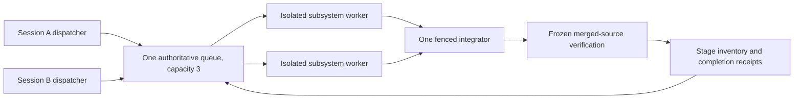

# Restartable parallel decomp sessions

Status: open
Blocked by: 06, 07, 08, 09, 10
Owner: integration coordinator
Plan deliverable: complete; implementation and gameplay milestones remain open

Preparation: tickets 01–05 resolved; ready for separately requested gameplay swarm launch
Preparation coordinator: `01a13500-1ef8-73d3-9a0d-3446b6050eba`

Read [preparation status](preparation/status.md) for the current frozen source,
actual final receipts and production boundary. Follow
[the launch handoff](preparation/launch-handoff.md) only after 04 resolves and the
user separately requests the gameplay swarm. The full gameplay spec remains open.

The destination is a readable Rust Super Metroid source port, with emulated
SNES hardware. Follow [the agreed pivot](../../docs/DECOMP_PIVOT.md) and
[the revised strategy](../decomp-strategy/revised-strategy.md): ordinary-reset
Ceres escape first, then vanilla progression, any%, save/load and credits;
complete Rust gameplay ownership before Map Rando. Retain the existing
actual-C, original-ROM and live admission contracts. A diagnostic pass or
declaration count never establishes full-game completion.

Run subsystem implementation, research and verification through subagents in
isolated worktrees. A fresh session reads durable files, joins the same queue
and delegates the next ready work. One integrator serializes shared registration,
merged-source verification and publication. Those mutations cannot all run in
parallel: they depend on one identifiable source snapshot. Parallel workers can
continue independent scopes against their pinned baselines while integration
uses frozen main source.

After validated authority cutover, the data flow is:



## Historical checkpoint and current limits

Authored source and retained receipts are checkpointed at
`d8a90451695408bbf72017ea04e7f4e915b06dd9` on
`affected-family-assignment`. See [the checkpoint](checkpoint-20261013.md)
for exact source archives, raw evidence hashes, private dependencies and cleanup.
The following table records that checkpoint's source and claim observations;
reinspect current authority and owners through preparation status before action.

| Work | Recorded state | Next action |
| --- | --- | --- |
| Compact controller | Submitted `223f8a1b0c7382817b1290d13c7a41f4e722d5e1`; clean retained worktree `/tmp/sm-ceres-continuation-compact-controller-1`; `integrate-compact-controller` ready | Preserve submission ownership; integrate through the existing owner after host reconciliation. |
| Shared game host | `73547105d870f8b05f8c6bcf55b768c223889fdb`, merged by `e8c9c3e10ac71bf0377dc00d7de5764a4263b445`; ten actual-C pairs retained; `integrate-shared-game-host` running | Observe its actual owner and finish or recover that same integration. A merge is insufficient to resolve it. |
| Ceres controller milestone | 2,240-frame diagnostic matches 1,736 updates; longer diagnosis diverges at update 7,741 / original frame 8,508 with one extra C poll | Resume existing ticket 78 after integration; diagnose setup/NMI poll order. Ceres escape remains unproved. |
| Whole Ridley | Existing ticket 141 claimed; source-only candidates and diagnostic evidence retained | Preserve its claim and held broad gates. Schedule its existing work when route dependencies and user steering permit. |
| Assignment tooling | Native Rust implementation exists; affected-family-assignment tickets 03–07 remain claimed | Reconcile final integration, verification and cleanup before resolving those tickets. |

Today the authoritative Ceres ledger is
`.scratch/ceres-continuation/ledger.toml`, coordinator `ceres-20261013`,
assignment capacity **3**. All sessions use
`SM_PIPELINE_ROOT=/home/jim/sm-decomp/out/pipeline` and
`SM_PIPELINE_WORKERS=4`. Agent slots and these four process workers are different
budgets; two sessions do not each acquire four additional process workers.

| Existing Rust capability | Practical limit / planned extension |
| --- | --- |
| `assignment.rs`: atomic reservations, revision/attempt history, no expiry, exact retry recovery and cross-effort ownership inspection | Shared mutation lock checks paths/aliases, tickets and linked submissions across efforts; prepared policy enforces shared capacity, and admitted mutations bind current real role generations. Actual external liveness remains a tool observation. |
| `authority.rs` / `session.rs` / `coordination.rs`: explicit roles, native source/submission/gate/evidence validation and cleanup | Maintained infrastructure scope admission, real-session generation fencing and exact bridge-request replay exist. One registered integrator serializes frozen shared source; original legacy gates remain authoritative. |
| `translation.rs`: pinned exercise/dependency provenance and bounded coherent scope promotion | Current scope schema permits 1–32 routines and restricted gameplay paths. Larger whole subsystems and infrastructure need explicit maintained support, not invented acceptance through this schema. |
| `batch.rs`: affected-family selection, reusable verdict authentication and shared workers | Unknown dependency inputs remain affected. Independent batch paths do not grant independent writable ownership. |
| `metrics.rs` / `session.rs`: process lifecycle and typed durable Start/Checkpoint/Inspect/Resume/Adopt | Handoffs retain exact source, real child/parent identities, commands and evidence; callers still inspect actual thread/process start identity after a crash. Resume returns reviewed commands and executes none. |
| Progress command: locked atomic stage publication with evidence pointers | Stages remain independent. Existing observations and seals are preserved; cleanup/authentication precede integration and live publication. |

## Authority cutover

The future canonical effort is **decomp-parallel**, with ledger
`.scratch/decomp-parallel/ledger.toml` and capacity **3**. It is **unactivated**.
No session creates claims there until tickets **01–04** pass, the user separately
requests launch and an actual cutover records admitted roles/generations, current
source and the exact legacy bridge. Preparation validates a private prepared
policy view with maintained `validate-activation`; production prepare,
registration/checked transfer, validation and activation occur at launch.
Ticket 04's [final evidence](issues/04-concurrency-and-crash-recovery-drill.md)
records passing actual independent-session drill, private readiness and cleanup.
Production activation remains the later launch step; this document changes no
claims. Mutable gameplay requires the catalog's approved scopes, reconciled
legacy ownership and the user's separate launch instruction.

Use durable role registrations: one explicit persistent integrator token and
one allocated persistent dispatcher token per admitted session. Record their
actual session/thread ids and returned subagent identities. Replacement sessions
inherit a stopped role only through checked owner reconciliation and a fenced
ownership transition. Tokens identify authority; possession of a string does
not prove that the old session stopped. Never initialize integration ownership
from whichever implementer submits first. Names such as `/root` are display
aliases, not globally unique session identities.

Preserve legacy ledgers, exact claim tuples, attempts, original coordinator
tokens and sealed result paths. Pending legacy work remains authoritative until
completed under its old token or deliberately adopted through a validated
bridge. The canonical queue must block overlapping paths, tickets and integration
while a bridged old owner is live, ambiguous, submitted or awaiting cleanup.
Do not copy active jobs into fresh claims, relabel historical evidence, or resolve
claimed tickets to bypass migration. Disable unrelated writable effort creation
after cutover; explicit maintenance exceptions must enter the same ownership
index. A migrated claim retains a pointer to its original identity and evidence.

## Worker and integration protocol

The [session runbook](../../docs/agents/decomp-sessions.md) owns executable
startup, claim, handoff, recovery and completion steps. Its durable contract is:

1. The admitted dispatcher selects the first dependency-ready ticket, checks
   real owners and children, reserves one assignment per free subagent slot,
   and records the returned worker identity. Each worker receives a pinned
   baseline, exact writable files, its own worktree and run directory, dependency
   receipts and gates. Ambiguous launches retain their reservation.
2. Workers make scoped WIP commits and update handoffs before long checks,
   at compile/experiment boundaries and within **30 minutes** of active edits.
   Longer checks retain the precheck commit, running command and observed process
   identity. Per-attempt logs stay on disk; results carry full commits, exact
   verdict paths/hashes, failures, retained dependencies and the next command.
   Initial experiments keep the 60-second cap; existing integration gates keep
   their declared bounds, including the current 3,600-second scope maximum.
3. A clean scoped submission retains writable ownership through integration.
   The sole integrator owns shared catalog/CLI/observer/ABI registration and
   the main Git/index. It merges one submission, freezes gameplay/tool/template/
   manifest inputs, records HEAD and digests, then runs all affected Offline
   families and required live gates. Changed baselines require a reviewed new
   revision; unrelated pipeline/tool edits can still invalidate verification.
4. After writers finish, the integrator completes both cleanup passes,
   preserves sealed source/store/reader/private-input dependencies, removes
   integrated worktrees and disposable builds, and reauthenticates. Durable
   completion records measured cleanup, checkpoints claims/tickets/handoffs
   and publishes each achieved stage independently.

Typed `decomp-worker-handoff-v1` TOML is authoritative at
`.scratch/decomp-parallel/sessions/SESSION/JOB-ATTEMPT.toml`; maintained session
commands publish rendered Markdown at the corresponding `.md` path. Start stores
the actual child UUID; Checkpoint validates exact owned files and recovers a
retained commit intent; Inspect/Resume return durable pointers/reviewed commands;
checked Adopt retains original handoff and transfer evidence. The runbook owns
these commands and schemas. A WIP commit preserves source; gameplay acceptance
requires its separate evidence and integration gates.

## Gameplay ownership lanes

These are whole-subsystem ownership envelopes, not ready assignments or new
claims. Each lane first reuses existing Rust modules, resolved tickets and
retained evidence. The queue promotes only an exercised, dependency-reviewed
scope with exact writable files. A large envelope can contain several successive
complete scheduled boundaries; concurrent workers never split a routine's
mutable shared state. File suggestions become authority only in its scope.

Ticket [05](issues/05-subsystem-scope-catalog.md) inventories all lanes and
creates dependency-ordered implementation scopes. Its research can start after
[01](issues/01-reconcile-legacy-ownership.md) beside tooling work; each scope's
mutable assignment requires [04](issues/04-concurrency-and-crash-recovery-drill.md),
the approved catalog and its own dependency/legacy ownership checks. The lane
names below are ownership envelopes, not numbered ready assignments.

| Lane / consuming milestone | Dependency and writable ownership | Acceptance gate / readiness |
| --- | --- | --- |
| Scheduler, reset and controller → Ceres (06) | Existing ticket 78 and controller submission; reconciled shared host. Own reviewed scheduler/controller files and tests; integrator owns common observer/CLI registration. | Resume extra-poll diagnosis; causal input order and original-reference semantics match; ordinary reset reaches observed game-state sequence `32 → 33 → 34` and Ceres escape. Record Rust hits, C/CPU fallback, adaptation and first mismatch. Continue ticket 78 with the approved scope. |
| Shared host and hardware lifecycle → Ceres/progression (06, 07) | Reconcile current game host first. Own `game_host.rs`, dedicated adapter tests and reviewed hardware lifecycle files; integrator owns shared callback/catalog changes. | Unchanged Samus projectile and room-scroll consumers, material actual-C PLM/HDMA/VRAM ordering, refusal/error controls; explicit reset, DMA/NMI/IRQ/PPU/APU domains. Independent host boundaries can develop beside controller work once contracts are ready. |
| Samus, collisions and player projectiles → progression (07) | Scheduler/host contracts; existing Samus, collision, projectile, power-bomb and trails work. Own exact player modules/tests/manifests; camera belongs to the room lane. | Complete scheduled movement/contact/projectile boundaries; actual-C state, return, wrap/alias/order controls, exercised mixed route gates and original-ROM comparisons. Live route admission follows Ceres and the required host contract. |
| Rooms, PLMs, doors, camera and assets → progression (07) | Canonical RAM/ROM access and shared host; existing room/PLM/camera tickets. Own exact room/PLM/scroll modules/tests/manifests; integrator owns shared ROM/state accessors. | Actual-C complete boundary state/effects, transitions, material rendering and asset extent checks; independently exercised room/door route. Preserve the already accepted camera domain. |
| Enemies, bosses and enemy projectiles → progression/full ownership (07, 09) | Stable allocation/contact/host interfaces, room inputs and original boss exercise. Own exact enemy family/boss modules/tests/manifests. | Whole lifecycle/script/render boundaries, material actual-C and live ownership with declared item-drop/spawn/fallback domains. Preserve ticket 141 and its pending gates; Ceres-only evidence establishes no later boss domain. |
| Audio, UI and menus → progression/credits (07, 08) | Host reset/audio/hardware interfaces and player/room state. Own reviewed audio/system/UI modules/tests/manifests; integrator owns canonical RAM changes. | Actual-C ordered ports/queues, menus and inventory plus exercised route checks. Existing resolved system/audio tickets retain their bounded acceptance; catalog research identifies the remaining domains. |
| Persistence and credits → save/load+credits (08) | Progression plus stable player/room state and host interfaces. Own dedicated save/credits modules/tests/manifests. | SRAM save/load and fresh-process continuation; adapted any% credits with declared inputs, required independent subjects, state/effects, negative controls and original-ROM comparisons. Record remaining C ownership for follow-up in 09. |

All lanes contribute to the same ordered milestones:

| Milestone | Ticket prerequisites | Completion evidence |
| --- | --- | --- |
| [06 Ordinary-reset Ceres escape](issues/06-ordinary-reset-ceres-escape.md) | 04, 05; existing ticket 78 and host/controller integration retained | Observed reset-to-escape sequence and required comparison/ownership gates; diagnostic prefix alone is insufficient. |
| [07 Playable vanilla progression](issues/07-playable-vanilla-progression.md) | 06; generated lane implementation scopes required for its route | Normal play checkpoints after Ceres with exercised player, room, enemy and host domains, material state/effects and original-ROM comparisons. |
| [08 Save/load and credits](issues/08-save-load-and-credits.md) | 07; required persistence/credits scopes | Fresh-process save/load continuation and adapted any% credits, with exact input provenance, independent controls and declared remaining ownership. |
| [09 Full Rust gameplay ownership](issues/09-full-rust-gameplay-ownership.md) | 08 plus unresolved catalog scopes | Supported vanilla play, boot through credits and save/load with zero gameplay C/CPU fallback; exercise supported paths and expose unknown domains. |
| [10 Map Rando later](issues/10-map-rando-compatibility.md) | 09 and separately researched seed/custom-behavior contract | Reproducible selected seeds, supported custom behavior, trick-sensitive compatibility and completion; pivot exceptions affecting seed beatability receive its explicit user review. |

Dependency-ready lane scopes can implement in parallel even while a composed
milestone is blocked. Three active assignments and available subagent slots
bound launches. Open tickets with unresolved blockers are not ready; resolved
historical leaf tickets establish only their recorded domains. Ticket 05
generates exact scopes and dependencies, and the milestone owner adds the
required implementation scopes as blockers before claiming route completion.

## Startup and recovery

Current executable **read-only** inspection (no future effort creation):

```sh
cd /home/jim/sm-decomp
export SM_PIPELINE_ROOT=/home/jim/sm-decomp/out/pipeline
export SM_PIPELINE_WORKERS=4
cargo run -p pipeline --locked --offline --bin sm-pipeline -- assign status --checkout /home/jim/sm-decomp --effort ceres-continuation --coordinator ceres-20261013 --capacity 3
cargo run -p pipeline --locked --offline --bin sm-pipeline -- assign plan --checkout /home/jim/sm-decomp --effort ceres-continuation --coordinator ceres-20261013 --capacity 3 --changed-since d8a90451695408bbf72017ea04e7f4e915b06dd9 --no-translations
```

The runbook supplies exact claim/start/result/recovery commands and fresh/resume
prompts. `--no-translations` suppresses new translation research; it does not
exclude already queued implementation or integration work from `next`. Today
only an observed admitted legacy owner mutates that queue. Another session can
inspect and join delegated work, but distinct new coordinator tokens do not
create safe independent integration ownership.

| Recovered state | Required branch |
| --- | --- |
| Parent crashed, worker/process alive | Preserve its claim, scope and shared worker budget; monitor or reconnect without a duplicate launch. |
| Owner dead, source uncommitted | Preserve owned source/logs/evidence, record actual liveness, make a scoped recovery commit, then seal the original owner-stop observation. No expiry-based release. |
| Reserved, launch ambiguous | Inspect real threads/processes; keep reserved if launch cannot be established. Only a definitely unstarted launch may be released as such. |
| Submitted implementer idle | Keep submitted ownership and exact commit; schedule its existing integration. Do not reopen implementation because the worker stopped. |
| Source merged, integration interrupted | Reconcile integrator, frozen HEAD/input digests, completed gates and cleanup. Finish exact valid result or reacquire/recheck through a new fenced attempt; never merge twice blindly. |
| Finished update response lost | Retry identical typed update only for the same current claim/revision. Preserve sealed coordinator receipts and original evidence. |
| Inputs changed or new revision pending | Freeze source, keep old attempt/evidence, and review a new scope/baseline. Stale results cannot complete the newer revision. |
| Disk pressure, failed/interrupted verification | Wait/stop actual writers, preserve failure evidence, perform scoped cleanup and authentication before continuing. Never delete shared immutable objects as intermediates. |
| Fresh machine | Git recovers source and small receipts; separately restore ROM/movies, sealed runs, stores, readers and source paths, then authenticate. A Git clone alone is insufficient. |

## Completion and activation evidence

The plan deliverable is this spec, [the ordered map](map.md), tickets and the
linked runbook. Planning completes without launching gameplay or creating the
canonical ledger. The implementation spec remains open until tickets 01–10
are resolved with their own commit/evidence and cleanup pointers.

The production multi-session launch gate is ticket **04**: two independent real
sessions, disjoint subagents, overlapping-claim rejection, checked interrupted
owner recovery, surviving-worker preservation, fenced serial integration and
post-cleanup evidence authentication. A unit-test-only restart or written
runbook does not satisfy it. Publish its exact session/claim/commit/verdict
receipts and validated legacy ownership cutover before activating the canonical
effort. Gameplay launches additionally require ticket 05's approved scopes.
