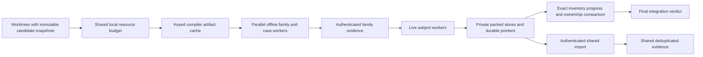

# Parallelizing offline and live decomp verification

The first implementation should separate live writer stores and isolate family
compiler inputs. Add stage timing and a shared worktree resource budget first.
The present pipeline can parallelize offline families, but all live producers using
one store wait for the same lock, and unrelated Rust source edits invalidate family
evidence. Increasing worker counts alone cannot remove those constraints.

Target: several worktrees on this eight-CPU machine. This is an investigation at
commit `16f1883`, not a production implementation or a new gameplay admission.
The original checkout's uncommitted gameplay changes were left untouched.

## Measurements

The checked-in [study harness](benchmark.py) executes the actual production
`packed_replay` and offline family verifier. Frozen live producer/reader binaries
come from the earlier authenticated storage study. Fresh runs compare all packed
members and their observation/provenance roots to each frozen subject. Progress
and routine ownership counters also match; authentication checks the retained
binary and restored bytes. No replay observations were substituted for execution.

### Live capture

All nine four-subject 1,000-frame runs passed exact inventories, roots, progress,
ownership and historical binary/observation authentication: 36 fresh producers.

| Configuration | Sample 1 | Sample 2 | Instrumented sample 3 | Packed bytes per four subjects |
| --- | ---: | ---: | ---: | ---: |
| One worker, shared store | 36.61 s | 59.69 s | 35.18 s | 3.20 MB |
| Four workers, shared store | 68.25 s | 17.90 s | 37.30 s | 3.20 MB |
| Four workers, private stores | 17.35 s | 8.05 s | 19.16 s | 12.72 MB |

Elapsed values include capture, sealing and exact-root comparisons, excluding
the later full authentication (5.09–17.38 s across samples). Builds are excluded
because this experiment intentionally uses frozen binaries to isolate capture.
Private stores retain ~4x the shared packed bytes for this short workload, still
much smaller than its ~319 MB logical observations. Longer captures and many
concurrent candidates need their own disk/CPU measurements.

The instrumented shared-store run measured subject lock waits of 0.00, 17.53,
10.62 and 31.18 s. Private-store waits were effectively zero. The existing
`producer_seconds` starts before acquiring that lock, so queued wait is mislabeled
as production time. This is direct evidence for separating scheduling, lock wait,
producer/collector activity and sealing timers.

**Timing limitation:** unrelated work was active on the host. Load averages rose
above the eight available CPUs, at one point about 19, and later fell substantially.
Sample order was fixed, caches uncontrolled, and offline work overlapped the third
live sample. The differing timings are feasibility evidence, not a controlled
production speedup estimate. In particular, the second shared-store result does
not imply parallel capture: it still acquired the same exclusive lock serially.

Historical longer evidence helps size the problem: a retained 45,000-frame run
spent 448.02 s in its four subject pipelines, including 242.20 s reported producer
time and 205.82 s sealing. Only 11.72 MB was added to its already populated shared
store. Compact storage does not make reconstruction/authentication free.

Raw samples: `out/port/pipeline-performance/live/live-results.json` and
`out/port/pipeline-performance/live-lock-timing/live-results.json` in this worktree.
Small non-ROM measurement summaries are copied beside this report.

Reproduce the live differential loop from this worktree:

```sh
python3 .scratch/decomp-pipeline-performance/benchmark.py live \
  --baseline /home/jim/sm-decomp/out/port/storage-pipeline/packed-timing/verdict.json \
  --rom /home/jim/sm-decomp/rom/sm.sfc \
  --inputs /home/jim/sm-decomp/movies/super-metroid-any-3653.inputs \
  --output out/port/pipeline-performance/new-live
```

Use a new output directory for each invocation. The command asserts frozen
input digests, exact inventories/roots and progress/ownership; it goes red if any
observations change. It runs 1,000-frame subjects in seconds each, while the full
matrix and authentication take longer. Source review preceded hypothesis testing
only to locate this real feedback seam. No specific regression or target runtime
was supplied, so this study measures relative costs rather than inventing a
pass/fail latency threshold. The source predictions were: shared lock prevents
producer overlap; isolated stores permit overlap; narrow actual compiler inputs
reduce compilation; unrelated module edits reject current broad evidence.

### Offline verification and compiler inputs

Representative families: system (475 cases) and audio (1,147 cases). Each invokes
the real bounded Rust-before-C fixture loop, full 128 KiB WRAM and return checks,
then retained evidence authentication. One/two-worker measurements are in
[offline-results.json](offline-results.json). These are small pure families;
large callback/ROM families remain a required implementation benchmark.

The pairs completed in 63.58/96.67 s with one family worker and 42.10/55.39 s with
two. The varied host load prevents a clean speedup estimate.
System/audio builds took 5.44/5.14 s serial, and 7.26/7.36 s under contention.
Audio fixture subprocesses consumed 24.92 s serial and 19.96 s in the concurrent
pair; retained evidence authentication took about 6 s in each. Source archive
authentication took only 0.13–0.17 s in these samples. Prioritize large fixture
process/I/O costs and recompilation before archive-validation shortcuts.

A focused system compiler experiment removed gameplay declarations from a
study-only memory module and left the production wrapper dispatch unchanged.
Compilation took 5.14 s for the broad wrapper versus 0.89 s for the narrow wrapper.
All 475 system cases passed full WRAM and return comparison against the actual-C
baseline. Compiler dep-info listed 26 input paths for the broad build versus three
for the narrow build: wrapper, canonical memory and system implementation.
See [closure-results.json](closure-results.json). This proves feasibility for
system; projectile/callback transitive dependencies require their actual closures.

Removing dependency hashes alone is unsafe: the current wrapper actually compiles
all gameplay modules through `lib.rs`. Extract memory/shared primitives, generate
the real module closure, then seal it. Old evidence keeps its conservative contract.
An unrelated comment added to audio.rs caused freshly verified system evidence
to reject; restoring the exact source bytes restored authentication. See
[invalidation-results.json](invalidation-results.json).

## Recommended architecture



The resource budget caps total compilers, producers/collectors and fixture pairs
across worktrees. Run/batch locks protect specific records; they are separate from
resource scheduling. Each private subject store has its own crash-recovery lock.
Publication should occupy the shared store briefly after independent capture,
rather than owning it during gameplay. Final verdict publication waits for every
required subject and gate; a failed worker preserves diagnostics and staging.

**Start with retained private stores.** Existing subject pointers already name a
relative store, so the measured approach requires no pack-format change. Its cost
is duplicate compressed objects. Shared import can follow without blocking the
first concurrency improvement. Packs cannot be copied into a common directory:
their compact references use store-global ordinals and indexes require consecutive
ranges. Import must remap physical representation while preserving canonical roots,
or introduce a versioned portable format.

**Use one build-cache module.** Its interface accepts exact compiler inputs and
command, returns authenticated immutable artifacts, and hides keyed locks, atomic
publication and corruption handling. Reuse evidence reader/decompressor/RNG first,
then stable C objects. Candidate run records still seal exact inputs and binary
hashes; warm builds always execute fresh gameplay processes.

**Return verified inventories in one traversal.** Today capture reconstructs all
logical observations in `put_run`, reopened `verify_run`, and `tree_inventory`;
authentication performs the latter two. Combine reopened verification and member
hash/count collection. Preserve precommit verification and independent staged-file
equality. This reduces duplicate CPU/I/O per worker without trusting metadata in
place of restored bytes.

**Expand offline orchestration to the current frontier.** The worktree catalog
contains 20 names against 137 family manifests, with no batch dispatcher adapter.
Declare manifest preparation/validation/live eligibility explicitly and support
changed-family selection. Parallelize isolated fixture pairs with Rust admission
before C. Persistent C workers need a separately proven complete-global-state
reset contract; WRAM reset alone cannot establish it.

## Implementation order

The [source review](source-review.md) contains primary code/ticket citations and
additional possibilities. Local tickets preserve the acceptance gates:

| Ticket | Work | Dependencies |
| --- | --- | --- |
| [02](issues/02-measure-and-schedule.md) | Stage timing and shared worker budget | Investigation |
| [03](issues/03-parallel-live-capture.md) | Concurrent fresh live subjects/private stores | 02 |
| [04](issues/04-keyed-build-cache.md) | Atomic authenticated compiler cache | 02 |
| [05](issues/05-isolate-family-inputs.md) | Canonical memory and actual source closures | 02 |
| [06](issues/06-single-pass-inventory.md) | One reopened verification/inventory traversal | 02 |
| [07](issues/07-shared-publication.md) | Shared import/dedup after independent capture | 03, 06 |
| [08](issues/08-expand-offline-orchestration.md) | Current manifest frontier and fixture concurrency | 02, 05 |

After 02, tickets 03–06 are independent implementation streams with distinct
code ownership. Coordinate changes touching shared Python harness imports. A
single integration owner freezes the combined source, verifies compatible family
evidence and performs cumulative exercised live admission. Short feedback runs
remain diagnostic when the installed family has zero calls.

Typed C events could eventually remove decimal formatting/parsing. First measure
their share after build reuse, dependency isolation and duplicate reconstruction
are addressed. Historical C baselines and checkpoint-injected replay are excluded
from this plan because they change the current four-fresh-process acceptance scope.

## Completion and evidence retention

Run cleanup and final evidence authentication are recorded in
[ticket 01](issues/01-investigation.md). Keep this worktree for implementation;
it is the investigation worktree, not an integrated disposable implementer checkout.
Packed stores, retained readers/live binaries and exact source snapshots are
dependencies of the benchmark evidence and must remain with the run pointers.
