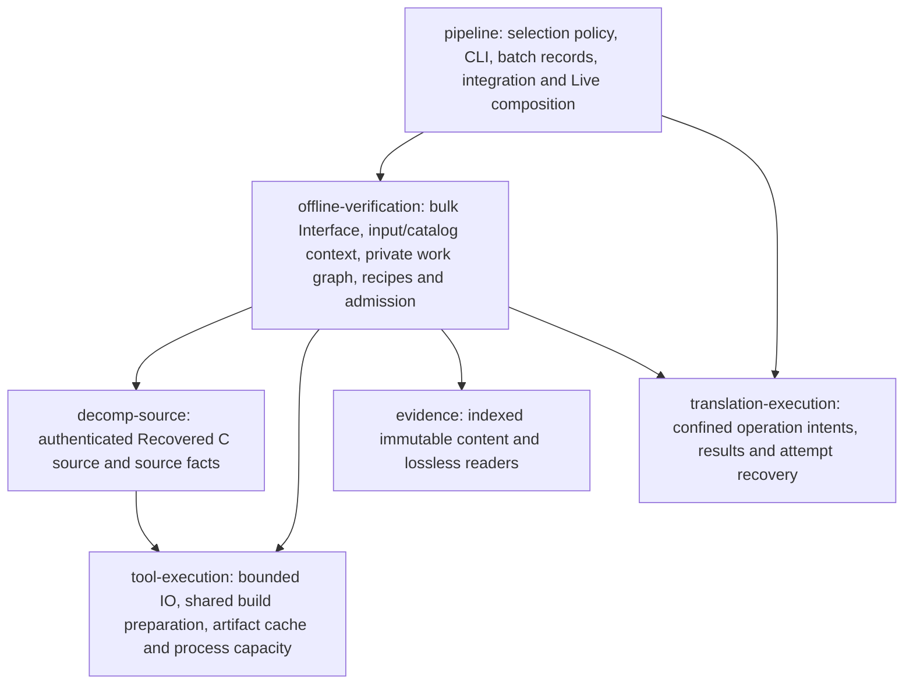
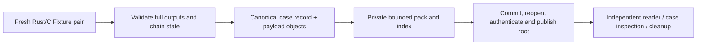

# Recommended verification architecture

Status: proposed; Interface sketches are illustrative Rust, not installed code.

This is the selected proposal. The three alternative sketches are retained for
comparison; [validation.md](validation.md) and [map.md](map.md) govern the selected
implementation order and measurement gates.

## Compare the alternatives

**A — bulk verifier.** One invocation owns shared authenticated inputs and the
complete requested family set. It provides the greatest immediate Depth for the
smallest caller change. Catalog, build and evidence reuse concentrate behind one
Seam. Cross-run recovery stays with existing records. Its limitation is that
shared work and resumption become harder to explain if its internal dependencies
remain implicit. See [Design A](designs/01-bulk-verifier.md).

**B — durable action graph.** Explicit dependencies connect preparation, builds,
Fixture pairs/groups and evidence publication. This gives scheduling and reuse
Locality across families, with inspectable reasons for every dependency. A public
editable graph would expose too much machinery, and a second durable authority
would conflict with the Translation journal. See [Design B](designs/02-action-graph.md).

**C — persistent local session.** A daemon can retain parsed inputs and exact-image
helpers between requests. That helps repeated warm work, but adds memory bounds,
socket admission, lifecycle, stale-input handling and upgrade/recovery work.
Existing helpers already amortize startup within a family. A daemon must beat an
optimized bulk invocation on complete required runs before adoption. See
[Design C](designs/03-local-session.md).

| Design | Depth and caller effort | Full required catalog | Main cost |
| --- | --- | --- | --- |
| Bulk invocation | Small complete-verification Interface | Shares preparation and evidence work | Invocation context and bounded memory |
| Explicit graph | High Leverage, but excessive public detail if exposed | Build coalescing, readiness and recovery | Correct keys, resource groups and durable projections |
| Local session | Simple submit/wait caller | Mostly repeated warm preparation/image reuse | Long-lived authority, invalidation and resident resources |

**Select A's external Interface, B's private work graph, and existing durable
records.** Defer C. This is a substantial internal rearchitecture with ordinary
single-family callers remaining simple. It requires no additional top-level crate
beyond the extraction already underway.

## Module ownership



Arrows are library dependencies. No lower Module imports `pipeline`. The
ordinary/confined execution Adapters remain private. Parsing/comparison is
in-process work; filesystem, compilers and process control are real local
dependencies tested through the verification Interface. A network Adapter or
generic plugin framework adds no demonstrated value here.

Application selection policy and catalog declarations remain distinct. The
verifier supplies complete dependency facts; `pipeline` decides which profile,
changed set or frozen mandatory set the caller is requesting.

## Small Interface, shared execution

Preserve the extraction's ordinary `verify`/`authenticate` calls and opaque
prepared Native handle. Add a bulk facet rather than forcing every single-family
caller to manage a new session or graph:

```rust
impl OfflineFamilies {
    pub fn verify_batch(
        &self,
        request: BatchVerification,
        tools: &ToolEnvironment,
    ) -> Result<BatchRun>;

    pub fn authenticate_batch(
        &self,
        evidence: &BatchEvidence,
        required: &VerificationRequirements,
    ) -> Result<AuthenticatedBatch>;
}

let run = offline.verify_batch(required_batch, &tools)?;
batch_record.publish(run.report())?;
// Later, independent of execution and after required cleanup:
let accepted = offline.authenticate_batch(&run.evidence(), &requirements)?;
```

Requests contain registered declarations, application-selected requirements,
output and bounded execution settings. They cannot supply arbitrary commands,
omit declared cases, override recipe inputs or weaken installed requirements.
Ordinary `verify` delegates to the same Implementation for a single family.
Native bulk composition consumes the existing checked prepared handles; it
does not invent another public execution Adapter or scope-approval channel.

An optional plan command presents a read-only graph summary. That report grants
no authority. Execution reestablishes the bound input identity under its current
requirements. `AuthenticatedBatch` has private constructors and binds the entire
required set; a deserialized success report is not acceptance. Retained rejection,
invalid input and outstanding producer ownership remain distinct outcomes.

## 1. Freeze inputs and catalog once

The invocation owns a bounded snapshot of exact input bytes or checked immutable
content references: source/catalog membership, declarations, Recovered C source,
ROM/captures, recipe/comparison identity, build environment and required coverage.
Workers consume that snapshot rather than independently reopening a mutable tree
and accidentally verifying different source revisions.

Committed source can be read from exact Git objects. Candidate files and external
assets require the current ownership fences, coherent read/hash/copy and namespace
validation. The existing pre-publication and post-wait freshness checks remain.
If an input changes, refuse the affected operation; do not update a launched plan
to a mixture of old and new inputs or silently allocate another Native attempt.

Use shared immutable byte buffers and bounded lazy payload reads. A read-only
file permission, mmap or remembered digest does not itself prevent modification.
Eviction discards cached bytes, not their required identities; a reload verifies
content again and remains charged to the applicable budget.

Catalog metadata should expose family/recipe identity, routines, dependencies and
payload references without repeatedly constructing all case payloads. First reuse
the existing decoded manifest once per invocation. Independently readable metadata
is a later storage refinement: a sidecar validated by hashing the complete `.smf`
can save decoding but cannot honestly claim it avoids reading that whole file.
Metadata/payload identities must be bound together and checked at execution.

## 2. Make dependency and computation identities precise

Use Rust syntax for dependency recognition and compiler dependency output for
actual build inputs, with explicitly declared runtime data. Comments retain their
exact source hashes but do not create imports. Includes, cfg/features, macros,
generated code, environment, ROM/captures and namespace changes require checked
coverage. Incomplete knowledge retains conservative selection.

Keep these identities separate:

| Identity | Contains | Permits |
| --- | --- | --- |
| Input/content | Exact bytes, logical paths, lengths, membership and referenced closure | Identifying and validating captured data |
| Build action | Input closure, recipe/ABI, generated code, compiler/runtime, target, flags and relevant environment | Looking up an eligible compiled artifact |
| Verification computation | Builds, Fixture declarations/order/inputs, host state, comparison rules and fresh/reuse requirements | Finding potentially reusable results |
| Attempt/admission binding | Required domain, source/candidate/integration identity, provenance, claim/attempt and installed tool contract | Accepting a result for this request |

A build hit cannot manufacture a fresh producer. Two equal state objects retain
two distinct subject records. Cross-family common inputs can share content while
each family retains its full declared execution and evidence obligations.
Same-attempt reconciliation, cross-attempt accepted-result reuse and artifact
reuse are separately validated operations.

Do not include unrelated application source in a computational key merely because
it lives in the same workspace. Equally, do not narrow today's broad source
requirements until a complete dependency proof and source-mutation controls allow
it. Ordinary retained producer provenance already differs from the installed
controller's pinned executable contract; preserve both meanings.

## 3. Compile eligible identical work once

Extend the existing `tool-execution::Preparation` lifetime across compatible
family builds in a batch. Reuse compiler discovery, authenticated input buffers
and existing cache keys/locks; avoid introducing a competing artifact cache.
Coalesce requests for one eligible build key, and let independent misses use the
existing shared capacity. Awaiting a cache entry must not hold an execution slot.

Reduce generated-code dependence on run directories where a recipe proves those
paths are not semantic inputs. Bind runtime input locations as data or use a
stable logical layout. Test different physical directories, transitive includes,
`__FILE__`/debug-path effects, toolchain selection and source changes before treating
two generated builds as identical. Do not normalize arbitrary command strings.

Prototype common reference/candidate images only where exact recipe, initialization
and linked-input identity match. A whole-bank image may save compilation but make
incremental rebuilds broader. Prefer the measured grouping; a generic all-game
executable is not a prerequisite. Every missing distinct artifact still needs a
real build on a cold run.

Current Native contracts require explicit compiler producer slots. Preserve them
in the first implementation. Shared build references across Native families need
a current-format contract, precise reservations and attributable producer
dependencies, followed by new frozen policy integration. Shared objects cannot
be mislabeled as fresh per-family compilation.

## 4. Produce indexed Offline evidence directly

The main storage change is to replace the directory-first evidence lifecycle with
a bounded record stream and immutable payload objects:



Each case record retains routine/case identity, declared input and predecessor,
before/Rust-after/C-after state, returns, host state, captures, ordered effects,
stdout/stderr and required producer references. Required members and producer
counts are checked explicitly. Deduplication may share equal payload bytes only
after both actual subjects have supplied their own attributable outputs.

Use the existing `evidence` Module. Prototype its Merkle images against larger
raw/chunked payload objects; 256-byte pages and compression can cost more CPU than
they save for some Offline workloads. Compare packing, restore, independent
authentication and import, not just final disk size. Keep authoritative Fixture
execution inputs uncompressed unless a separate measured decision changes that.

Start with bounded per-worker/per-run writers. `Store` currently has one writer
lock and a non-thread-shared read cache. A global writer on every case would
serialize execution. Independently produced packs require authenticated import
with ordinal remapping; copying them into a shared store is not sufficient.

Where producers still need files, retain only bounded active-case staging and
failed diagnostics, then import completed outputs and release staging after its
new references authenticate. To remove the write/read cycle itself, introduce
an exact framed output transport or owned arena behind the existing private
execution Seam. Treat that as a separate measured step: merely packing a finished
directory improves retention but does not remove its execution-time I/O.

Native output references, ownership, stdout/output limits and collector access
need explicit contract integration. Reuse its existing operation index/chunks;
do not substitute an aggregate pass record. The collector is trusted orchestration
and cannot accept an unbounded producer stream or write outside reserved scope.

Within one independent admission, authenticate each distinct content object once
and reuse its owned bytes for inventory, state comparison and chain validation.
Logical root equality cannot substitute for checking missing/corrupt objects.
Later admission and post-cleanup authentication independently reopen and validate
their required closure. This plan creates no persistent trusted-hash database.

Cleanup follows the explicit completed-run inventory and published roots, avoiding
rediscovery where the new format permits it. Shared store objects and readers stay
retained. Initial implementation adds no general garbage collector or repacker;
shared retention must be proven before deletion becomes eligible.

## 5. Schedule a private graph under one capacity budget

Use closed, recipe-owned actions for input preparation, builds, Fixture
pairs/groups, comparison, packing and publication. Callers cannot edit this graph.
Dependencies and outcomes are inspectable; canonical report ordering remains
independent of completion order.

Extend the existing ready/dependent machinery and lease pool. A ready Fixture
pair obtains capacity only while executing; a continuation waits for complete
predecessor equality. Account for compilers, active children, helper memory,
hashing/packing CPU and I/O so a new graph does not create unbounded background
work alongside four nominal producer slots.

Native begins with existing wave/reservation groups represented as indivisible
nodes. Original acceptance also has sequential family failure semantics. Preserve
these unless a new scheduling contract explicitly permits cross-family admission.
When that contract is introduced, reserve group resources atomically, stop new
admission on terminal failure/cancellation, join or stop all already-admitted
writers, preserve diagnostics, and never launch blocked descendants.

Persist the plan and progress as projections of existing batch records and Native
operation intents/results. The Translation journal remains authority for attempt,
deadline and ownership. Recovery reauthenticates completed records and reconciles
ambiguous writers before resuming; it does not create a second ledger or replay
saved commands merely because a scheduler entry says pending.

## 6. Build and select optimized tools

Measure optimized controller and sandbox builds from the same source with matched
profiles and separately retained debug information where needed. Identify exactly
which paths the actual command selects. Defer executable hashing only for commands
whose contract does not consume that identity. Producer and admission identity
checks remain required.

Rebuild and verify both tools, then create a fresh sealed installation using the
existing production workflow. Existing frozen installations are not edited in
place. New runtime/storage contracts activate only with their matching producers,
readers, source declarations and requirements. This is the final adoption step,
after the result is concrete and tested.

## Deferred extensions

A persistent local session can later reuse exact-image helpers and decoded
immutable inputs across invocations. Measure it against the optimized bulk path,
including cold start, resident memory, independent admission and shutdown.
Forks would remain inside separately exec-started single-threaded pristine
parents; a multithreaded daemon cannot fork arbitrary gameplay state safely.

Remote workers, a new orchestration database, cached reference outputs, reduced
Fixture matrices and shorter required Live horizons are outside this plan.
Revisit any of them only as a distinct design with its own evidence contract.
