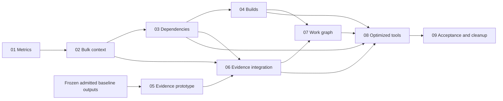

# Performance refactor ticket map

Planning status: complete proposal
Implementation status: 05 resolved; 01, 02 and 03 claimed; no production claims reserved

The active Offline family extraction must finish and its owners must hand over
the relevant source before these implementation tickets are dispatched. Freeze
that integrated revision as the baseline. Existing original-acceptance work and
production policies retain their own authority and prerequisites.

| Ticket | Type | Depends on | Deliverable |
| --- | --- | --- | --- |
| [01](issues/01-baseline-and-metrics.md) | task | None | Current phase/reuse metrics, benchmark requirements and budgets |
| [02](issues/02-bulk-input-context.md) | task | Frozen 01 interface; final acceptance waits for 01 | Small bulk Interface and one immutable authenticated input/catalog context |
| [03](issues/03-dependency-and-result-identities.md) | task | Frozen 02 catalog interface for isolated scanner; final acceptance waits for 02 | Syntax-aware dependency facts and precise identity contracts |
| [04](issues/04-shared-build-preparation.md) | task | 03 | Shared compiler preparation and eligible build coalescing |
| [05](issues/05-offline-evidence-prototype.md) | prototype | None | Measured indexed-evidence experiment using frozen admitted baseline outputs |
| [06](issues/06-indexed-evidence-and-admission.md) | task | 02, 03, 05 | Bounded payload reuse within ordinary/Native admission; current formats retained |
| [07](issues/07-batch-work-graph.md) | task | 04, 06 | Private work graph and explicit Native scheduling contracts |
| [08](issues/08-optimized-tools-and-installation.md) | task | 03, 04, 06, 07 | Validated optimized tool pair and concrete sealed installation candidate |
| [09](issues/09-integration-measurement-and-cleanup.md) | task | 08 | Complete required acceptance, measured improvement and rollout cleanup |

The isolated storage prototype can begin independently using completed frozen
baseline outputs, with no production edits. After 02, dependency/build work can
proceed while that experiment completes. Production evidence integration waits
for 02's input context and 03's identity contracts. Shared recipe registration, main Git/index,
combined-source verification and publication have one integration owner. Resolve
exact writable paths against the final extraction before creating claims; a
logical Module in a ticket does not authorize editing another worker's files.

The storage prototype is a decision gate. If direct packing costs more than it
saves, revise 06 explicitly to the measured narrower storage change before claiming
it; do not ship an expensive design merely to satisfy the original graph. Native
compiler sharing or barrier removal similarly requires a passed contract gate.

The recovered extraction's complete PLM execution exposed a 60-second Native
finalization failure. A narrow operation-admission recovery slice may precede 02/03:
it removes repeated reads inside one independent admission, preserves all current
formats/identities/producers/budgets, and changes no storage representation.
Its isolated source and gates are tracked in
[native-finalization-recovery.md](native-finalization-recovery.md). The failed
baseline remains retained; acceptance still needs the complete corrected matrix.

Ticket 02 starts provisionally from ticket 01's frozen source interface
`e086190` after the core timing regression passed. Final metrics controls and
dependency recovery still gate its acceptance; isolated implementation need not
idle while those independent controls run.

Ticket 03's pure owned source-facts slice likewise starts from ticket 02's
coherent `94104cc` catalog checkpoint while 02 finishes captured compiler inputs.
Its execution/planning consumers join the next frozen 02 checkpoint, and final
acceptance still waits for complete 02. See the exact ownership in ticket 03.

## Decisions so far

- User approved implementation. Ticket 01 starts in an isolated worktree;
  extraction recovery and baseline ownership are in [checkpoint.md](checkpoint.md).
- Recovered PLM completed every comparison but failed Native finalization. Use
  one owned authenticated-operation result for projections currently causing
  repeated full reads; preserve independent later admissions and unchanged limits.
- Choose the bulk Interface with a private graph; keep existing journal and
  capacity authority. [Architecture](architecture.md).
- Prioritize complete required-run performance and separately measure incremental
  selection and unchanged reuse. [Validation](validation.md).
- Storage-only packing reduced space but increased elapsed time in all 18
  alternating samples. Keep current formats and remove duplicate payload reads
  within independent admission. Direct producer transport remains unmeasured.
  [Revised ticket 06](issues/06-indexed-evidence-and-admission.md).
- A daemon, distributed execution and reference-output caching remain separate
  deferred designs, with no promised speedup. [Alternatives](architecture.md#compare-the-alternatives).
