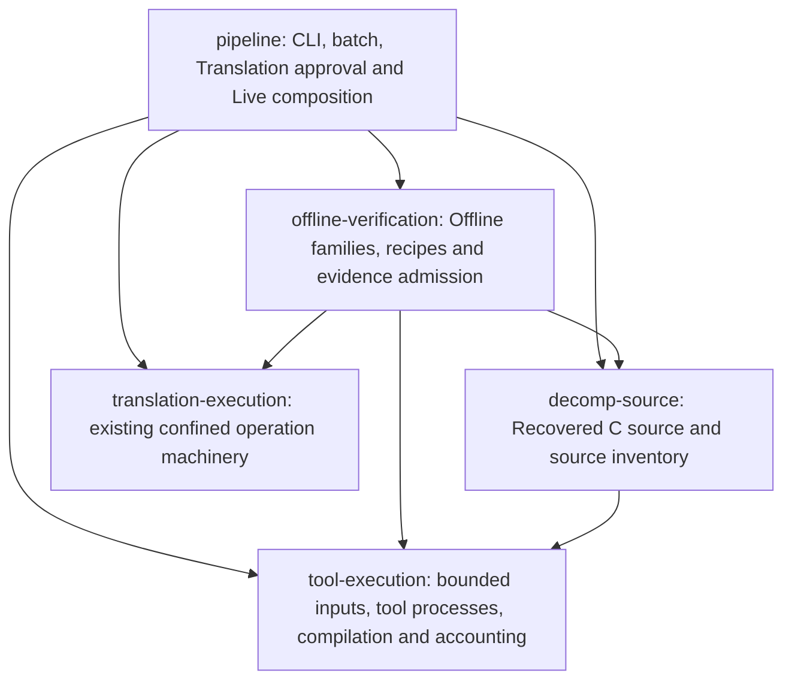

# Recommended Offline family ownership

Status: approved by the user on 2026-10-15

Source inspected: `7702289` on `main`. This is a design, not an implemented
interface. The user delegated packaging and chose structural reorganization
before proving independence from unrelated CLI changes.

## Recommendation

Create three focused library crates: `offline-verification`, `tool-execution`
and `decomp-source`. Keep `pipeline` as the application that composes them.
Use a single ordinary verification call, with a prepared handle for the existing
confined lifecycle. Ordinary and confined execution share the same private
recipe owner and evidence expectations.

The three crates have distinct existing consumers. Their separation gives
compiler-enforced dependency direction, depth at the verification interface,
locality for recipe changes and leverage for callers and tests. This expands
the workspace from 14 to 17 crates; minimizing that count is not the objective.



Arrows are Rust library dependencies. Generic execution retains its existing
`pipeline-model` telemetry types. No lower crate depends on `pipeline`.
The existing gameplay `runtime` crate retains its separate purpose.

## Three designs considered

### A — small verification protocol and separate source/execution owners

The interface is `prepare`, `verify`, `authenticate`, with opaque prepared
state. Verification, tool execution and Recovered C source each get a dedicated
crate. Fixture values and their current binary codec are an explicit additional
authoring interface.

This has the strongest dependency direction and locality. Its ordinary caller
does unnecessary preparation ceremony and would have to supply an irrelevant
Translation scope adapter unless that detail is hidden.

### B — reusable plans and bound execution sessions

The interface exposes source/catalog contexts, a family plan, execution sessions,
inspection, execution and admission. Ordinary and confined execution use two
sealed adapters. A dedicated verifier and shared execution crate contain the
implementation; source analysis stays inside the verifier.

Reusable preparation fits Native callers, and independently authenticated
declarations fit Live replay. However, the public session/adapter machinery is
more than the ordinary caller needs. Keeping shared source analysis under
verification also makes unrelated source consumers depend on that larger crate.

### C — private Offline family module and simple application session

The common interface is `verify(request)` and `authenticate(evidence)`, with a
confined prepared handle. Private child modules and restricted visibility hide
recipes and receipt internals inside `pipeline`.

This gives good depth and the simplest common caller. Rust visibility can hide
implementation details, but sibling modules in one crate can still depend on the
public Offline family interface in the wrong direction. Enforcing the full
direction would depend on convention or a wider reparenting of application code.

### Chosen combination

Use A's three explicit owners, C's ordinary caller shape, and B's opaque prepared
state and authenticated declaration result. Keep the ordinary/confined adapter
seam private. Do not expose a generic execution-adapter trait or a new public
session state machine. Preserve existing pending-operation behavior.

## Ownership

| Owner | Responsibility | Existing source to relocate or split |
| --- | --- | --- |
| `offline-verification::fixtures` | Fixture values, validation, SMFIXT01 codec and payloads | `family_model.rs` excluding shared source identity; `fixture_format.rs`; `fixture_writes.rs` |
| `offline-verification::catalog` | Registered/discovered family declarations and recipe identity | Catalog definitions/discovery in `batch.rs`; matching Native registration logic |
| `offline-verification::recipes` | One expected build/invocation/input/output description per supported recipe, including ABI controls | Family build/case logic; `callback.rs`; `plm_spawn.rs`; `ridley_subsystem_adapter.rs`; `translation_native_recipe.rs`; recipe portions of `builds.rs`; corresponding templates and required PLM generation |
| `offline-verification::execution` | Fixture pairs/chains, ordinary scheduler and pristine workers | `fixture_execution.rs`; `fixture_worker.rs`; family execution coordination |
| `offline-verification::native` | Frozen family preparation, explicit candidate ownership, confined producer sequencing, reservations and reconciliation | Verification portions of `translation_native.rs`; `translation_native_operations.rs`; confined family logic in `builds.rs` |
| `offline-verification::admission` | Complete ordinary/Native receipts, comparison, artifact inventory and current source checks | Admission/publication in `family.rs` and Native verification |
| `offline-verification::inputs` | Gameplay dependency discovery, wrapper generation and family source requirements | Family-specific parts of `inputs.rs`, including captured-Ridley inputs |
| `tool-execution` | Shared tool-process capacity, authenticated compilation, bounded input consumption, atomic artifact writes and process accounting | Root leases/executable handling; generic `builds.rs`; `build_cache.rs`; generic `bounded_inputs.rs`; `metrics.rs`; `resource_sampler.rs`; compiler dependency-rule parsing |
| `decomp-source` | Authenticate Recovered C source, expose typed definitions/dependencies and source inventories | Pin/archive checks and C source/inventory operations in `family.rs`; source analysis in `source_inventory.rs`; serialized `Source` |
| `pipeline` | Command decoding/output, family selection and batch aggregation, Translation approval/attempts, installed policy, Live composition and cleanup orchestration | Existing callers, reduced to composition and their own policy |

Source inventory CLI orchestration remains in `pipeline`; lexical cleaning,
token/name discovery and source authentication belong together in `decomp-source`.
Other existing source consumers include Live replay, decompressor acceptance,
RNG, prefix/baseline work and Translation scope validation. They consume source
facts without importing Offline family verification.

Catalog profile/Live metadata remains declaration data. Profile selection stays
in batch and Live generation stays in its existing owner. `fixture_cli.rs` and
standalone Fixture authoring commands consume the explicit Fixture interface;
only generation required by a verification recipe moves behind that recipe.

### Shared helpers receive specific owners

- Move `family::object` to the bounded input interface in `tool-execution`,
  retaining `limited`/`text` accounting. `pipeline_model::read` currently uses
  unbounded `fs::read_to_string` and is not a replacement.
- Keep general TOML `field`/`array` conveniences private to document consumers
  in `pipeline`; keep verifier document parsing local. Do not export them from
  the Offline family interface.
- Make identifier validation part of the relevant source/Fixture value
  validation. Keep trivial request-path resolution with its consumers.
- Own atomic temporary-file naming with artifact publication in
  `tool-execution`. A family module must not supply the application's nonce
  counter, digests or file-writing implementation.
- Split `bounded_inputs::Usage.pinned` and `cached_source/cache_source` out of
  generic byte/path/deadline accounting. They currently contain
  `family_model::Source`, which would otherwise create a reverse dependency.
  Put the typed source cache in `decomp-source`'s operation-local source context,
  sharing the existing read scope and worker lifetime. Preserve within-operation
  reuse and freshness checks; do not create a global trust cache or drop reuse.
- Keep compiler preparation/cache and ordinary Fixture scheduling as their
  existing deep implementation modules. Fixed worker/RNG helper recipes stay
  with their consumers and use the shared compiler machinery.

## Verification interface

The following is the recommended shape. Exact Rust lifetimes and names can be
settled during implementation without changing these responsibilities.

```rust
// Source/catalog context; creating it does not require an execution runtime.
pub struct OfflineFamilies { /* private */ }
pub struct PreparedNative { /* private */ }
pub struct AuthenticatedFamily { /* private */ }

impl OfflineFamilies {
    pub fn verify(
        &self,
        request: VerifyRequest,
        tools: &ToolEnvironment,
    ) -> Result<FamilyRun>;

    pub fn authenticate(
        &self,
        evidence: &FamilyEvidence,
    ) -> Result<AuthenticatedFamily>;

    pub fn prepare_native(
        &self,
        request: NativePreparation,
        scope_admission: &dyn ScopeAdmission,
    ) -> Result<PreparedNative>;
}

impl PreparedNative {
    pub fn verify(
        &self,
        target: NativeTarget,
        execution: &ConfinedEnvironment,
    ) -> Result<NativeRun>;

    pub fn authenticate(
        &self,
        evidence: &NativeEvidence,
    ) -> Result<AuthenticatedFamily>;
}
```

- `VerifyRequest` selects a registered family or the existing manifest/adapter
  choices, output location, case concurrency and auto/fresh/fork mode. It cannot
  supply compiler commands, recipe callbacks or arbitrary source inventories.
- `verify` owns preparation, recipe resolution, compilation, complete evaluation,
  sealing and successful-result authentication. Batch requests its current
  authenticate-before-reuse behavior without rebuilding adapter dispatch.
- `NativePreparation` contains the existing frozen declaration, coverage,
  explicit approved candidate paths and preparation limits. The prepared handle
  exposes immutable contract/identity summaries and the conservative resource
  requirement needed by Original acceptance. It hides reservation arithmetic.
- `NativeTarget` binds the candidate checkout, output, operation identity and
  inherited deadline. `ConfinedEnvironment` supplies installed tools and approved
  enforcement limits. The verifier owns the complete prescribed operation set.
- Reports and deserialized receipts are data. `AuthenticatedFamily` is created
  only after full admission and exposes the bound declaration and retained
  evidence references. Live replay consumes it without independently reopening
  an unauthenticated `manifest.smf`.
- Admission can run without compiler preparation, new leases or a live confined
  runtime. Completed Native retries retain the existing no-relaunch semantics.

Ordinary caller:

```rust
let run = offline.verify(request, &tools)?;
emit(run.report())?;
```

Live caller:

```rust
let admitted = offline.authenticate(&predecessor)?;
live::check_route_contract(admitted.declaration())?;
```

The deliberate public data facets are current Fixture values/codec operations
and read-only catalog declarations. Recipe implementations, per-case execution,
`StrictFixture`, raw argv construction, operation chunks and expected-output
reconstruction remain private.

### Translation scope approval adapter

`translation::validate_scope` reads local tickets and returns assignment policy
data. That stays in `pipeline`. Its small trusted `ScopeAdmission` adapter
returns checked scope identity, routine membership, writable paths and sealed
inputs. The verifier compares those facts with the family requirements.
The context without scope authority rejects that provenance kind; ordinary
callers do not need to configure this adapter.

This is separate from the private ordinary/confined execution adapter seam.
Reviewed-family/catalog provenance remains with verification. Invoke scope
approval only at the existing preparation/provenance transitions; do not add a
fresh ticket/authority requirement to ordinary retained admission or completed
Native replay. The installed controller continues to authorize its exact frozen
contract and enforce its pinned executable identity.

## Behavior and limits

Preserve full actual-C comparison, Rust-before-C admission, complete state and
ordered callback checks, Fixture chain propagation and canonical case ordering.
Readiness continues to execute the complete Native family prescription; preparing
a handle is not readiness.

Preserve existing command/output protocols and current serialized evidence
contracts. Fixture mismatch or producer rejection remains a retained rejected
result. Changed inputs, malformed contracts and unavailable enforcement remain
errors. Outstanding ownership remains distinguishable as `ExecutionPending`;
it cannot trigger a replacement run or premature cleanup. A Native rejected
result is not permission to evaluate the same attempt again.

Ordinary scheduling and confined wave scheduling keep their current algorithms.
Retain shared capacity, inherited byte/path/deadline accounting, compiler-cache
input rechecks, indexed Native attribution and explicit writable ownership.
Local files and compiler processes are real local dependencies; existing test
workspaces and compilers exercise them. Two existing execution adapters justify
their private seam; there is no new backend/plugin framework.

## Conservative source contract for this pass

Consolidate required source declarations under their implementation owners.
The trusted application supplies its producer identity and compiled host-source
stamps; verification adds its own, source-analysis and execution requirements.
User/candidate requests cannot omit required sets.

Retain the broad host-source superset, including the applicable `main.rs`, batch
and cleanup inputs. Update moved paths and source snapshots consistently for
ordinary and Native verification. Edits under **all three new crates** must keep
families conservatively affected, alongside the current pipeline rule. Unknown
dependencies remain affected.

Ordinary admission authenticates the retained producer identity; it does not
compare it to the currently running whole CLI binary. The installed Translation
controller's separate executable fence remains unchanged.

Current indexed evidence is the supported format. Do not add historical readers,
receipt migration or compatibility tests. Existing sealed artifacts are retained
without rewriting; source moves can require new verification under the current
dependency contract. Precise affected-family selection and proof of evidence
reuse across unrelated CLI edits are explicitly deferred.

## Implementation and acceptance

Follow the [migration and verification plan](implementation.md). The user
approved the displayed architecture on 2026-10-15 and instructed implementation
to proceed. Packaging and routine implementation choices remain delegated.
