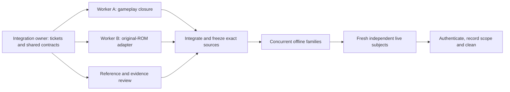

# Faster decomp verification and a practical parallel setup

Reviewed 2026-10-11 against decomp checkpoint `bb184a2`. This is a proposal and
read-only evidence review. The optimization worktree and branch were untouched.

## Assessment

The next gains should come from avoiding needless rebuilds and process/file
work, then overlapping independent producers safely. Increasing worker counts
alone will not fix the shared evidence writer lock. Retain separate gates for
actual compiled C equivalence, bounded live Rust ownership and original-ROM
accuracy: the first two are strong for the observed projectile route; original
hardware timing and general gameplay fidelity remain unfinished.

Reference provenance is substantially in place. We have pinned upstream C,
assembly references, ROM identity, original movie archives and the recording
core. The critical gap is validation coverage and timing fidelity, rather than
simply needing another implementation to copy. See the detailed
[reference and accuracy audit](reference-and-accuracy.md).

## What is measured, and what is inferred

| Observation | Evidence | Implication |
| --- | --- | --- |
| Four independent subjects reached 129,712 inputs, matching state/effects with zero CPU fallback; 1,345 artifacts per subject authenticate after cleanup | [live authentication](../decomp-port/observed-projectile-with-gfx-live-authentication.json), [live inspection](../decomp-port/observed-projectile-with-gfx-live-inspection.json) | Strong repeatability and bounded C/Rust integration evidence for this route; it does not establish original-ROM timing |
| Six frozen families passed 13,624 actual-C cases; supplemental Ceres checks passed another 1,674 | [offline authentication](../decomp-port/observed-projectile-with-gfx-offline-authentication.json), [Ceres authentication](../decomp-port/observed-projectile-with-gfx-ceres-boundary-authentication.json) | A large cost is incurred before live replay; optimize that loop as well |
| Packed 1,000-frame captures represented 319.33 MB logical bytes in 3.20 MB shared packs; repetition added zero packed bytes | [measured results](../trace-storage-study/pipeline-results.json) | Packed storage is already effective; do not rebuild this capability |
| In that short test, packed C production took 2.64–2.71 s versus plain 1.97–2.08 s, plus 4.41–4.48 s of sealing | [measurement limits](../trace-storage-study/pipeline-results.md) | Storage savings do not prove faster wall time; sealing needs its own profile |
| The latest full-route acceptance explicitly used `gzip`, while future live/batch defaults are packed | [retained verdict](../../out/port/observed-projectile-with-gfx-live-full/20261011T142927.603436Z/verdict.json), [current workflow](../../docs/DECOMP_BATCH.md) | Full-route packed throughput/peak resource use still needs representative measurement |
| Scoped latest-run dedup reclaimed 969,383,498 snapshot bytes | [cleanup](../decomp-port/observed-projectile-with-gfx-live-cleanup.json) | Repeated snapshots are a concrete storage cost; dedup preserves independent execution |
| Offline evidence seals all current port Rust modules, beyond the selected module | [family builder](../../tools/port_family.py), [host-aware builder](../../tools/port_plm_instructions.py) | Unrelated edits can invalidate many families; narrower dependencies could avoid rebuilds, after proving completeness |

A read-only inspection of the latest gzip verdict found 730,857,741 logical
sealed inventory bytes per subject, or 2,923,430,964 across four subjects. These
are logical file lengths, including repeated hardlinked content, not allocated
disk usage. The live host build lists 48 C translation units. These counts
identify possible costs; they do not measure how much runtime each consumes.
The read-only counts and capacity snapshot are retained in
[environment-and-inventory.json](environment-and-inventory.json).

## Prioritized improvements

| Priority | Proposed change | Why it helps | Required evidence before adoption |
| --- | --- | --- | --- |
| 1 | Record phase times and resource use in existing runners | Current batch/family records lack useful elapsed phase timing; packed timing starts before store admission, so `producer_seconds` can include lock wait | Separately measure queue wait, build, fixture generation, execution, snapshot I/O, encoding, closure checks, cleanup; record wall/CPU time, peak RSS and logical/physical bytes |
| 1 | Use authenticated batch reuse and one source freeze per integration wave | `port_batch.py` already reuses valid evidence and rebuilds stale families; repeating `--fresh` and long replays after small edits adds work | Report reused/stale reasons, source/manifest/asset identity and final combined gates; keep fresh independent final replay subjects |
| 1 | Cache compiled tools and unchanged C object files | Each live run builds the evidence reader in a new target directory and discards its build tree; the C host recompiles many unchanged units | Key builds by complete source/header/transform/compiler/flags/target/dependency hashes, publish atomically and retain the exact binary/source seal per run; cache failure/staleness controls |
| 2 | Narrow family dependency invalidation | Today all port `.rs` files are hashed for each family | Demonstrate complete transitive dependencies including generated wrappers, host ABI, shared memory, ROM/assets and harness; changed shared dependencies must invalidate every affected family |
| 2 | Batch offline cases through isolated workers | 13,624 cases currently launch Rust and C separately per case: 27,248 subject processes, plus builds; each creates several small files | Preserve per-case full WRAM, returns, host words and failure artifacts; reset every relevant C/global/host field; order-permutation and fresh-process comparisons must catch leakage; chained cases retain dependency order |
| 2 | Overlap independent live producers using isolated capture stores | Live subjects are currently sequential and one store lock spans production and sealing | Prototype two subjects first. Preserve independent resets/inputs and all comparison gates. A supported import must retain full pack ordering, indexes, provenance and closure; copying arbitrary packs into one store is insufficient |
| 2 | Replace C text formatting and Rust parsing with a typed event path | The packed producer still sends formatted text through a FIFO | Version record schema and exact decoded-byte identity; prove all event order/value/count and frame/reset/tail cases against the current writer, including corruption/truncation failures |
| 3 | Pack offline fixture evidence and improve reader reuse | Full WRAM fixtures, repeated ROM views, per-file hashing and repeated CLI/index opens add work | Preserve exact logical members and hashes; support targeted extraction and diagnostics; keep old verdicts/readers valid; benchmark peak storage and full authentication |
| 3 | Add checkpoint-assisted diagnostic windows | Replaying boot to reach late combat slows local iteration | Checkpoint must include CPU/emulator/PPU/APU/cart/WRAM/SRAM/coroutine/controller/host/RNG state as applicable; resumed execution must match uninterrupted execution. Label diagnostics separately and retain reset-to-end final gates |

Do not skip full comparisons, substitute empty traversals for exercised
ownership, or treat successful decompression/storage sealing as acceptance.
A cache is a way to retrieve authentic dependencies; its hit does not grant new
source correctness. Keep positive controls and independent changed-state,
missing/reordered-input, support-refusal and no-C-retry controls.

Implementation sources: [port_batch.py](../../tools/port_batch.py)
(`verify_batch`, `execute`, `main`), [port_live.py](../../tools/port_live.py)
(`generate_effect_writer`, subject loop and host build),
[port_evidence.py](../../tools/port_evidence.py)
(`build`, `store_session`, `packed_replay`, `authenticate_subject`),
[port_family.py](../../tools/port_family.py) (`build`, `verify`), and
[evidence CLI](../../crates/evidence/src/main.rs) (capture and inventory).
The [reader measurements](../trace-storage-study/rust-crate-results.md) cover
index-open/seek costs and explicitly distinguish microbenchmarks from live
throughput. Proposed changes above are not existing features.

### Measurement plan

First instrument the existing path, without changing simulation behavior. Use a
frozen source revision, ROM/movie/observer identities and explicit storage mode.
Measure a short control, a first-combat horizon around 45,000 inputs, and the
full 129,712-input route for the selected optimization. Separate cold builds,
warm builds, empty/warm stores and concurrent-load conditions. Repeat the short
representative cases enough to report a median and range; schedule expensive
full routes only after a candidate proves useful and remains exact.

Compare jobs 1/2/3 for offline families and producers 1/2 for the proposed live
scheduler. Record phase timings, peak RSS, swap/I/O activity, frames per second,
bytes written, closure/authentication time and reclamation. A shorter horizon
cannot establish the full route's nine-ID/16-4-4 ownership requirement. Current
runner timeouts also need examination under contention; a timeout should retain
failure evidence rather than publish partial success.

These experiments belong to future implementation tickets. None was launched
for this review, and no numerical speedup is promised.

## Parallel implementation and verification setup

Use one integration owner, two implementation workers and one reference/review
worker as the default team. Assign modules by dependency and actual exercised
closure. The integration owner controls ticket claims, shared interfaces, source
freeze, final combined verification, evidence admission and cleanup. The reviewer
can independently inspect compiled-oracle fixtures and observed counters while
implementers work. Ticket 138's Ridley aiming/spawning interpreter and ticket 78's
controller/timing adapter are different acceptance tracks, but shared harness,
host ABI and manifest changes still need coordinated integration.

Each implementer gets a branch and worktree, exclusive file ownership, explicit
input/output contract and acceptance domain. Publish proposed shared interfaces
before parallel edits. Do not have several agents edit `port_live.py`, the family
runner or memory/host ABI concurrently. Merge one completed change at a time,
then run combined current-source checks. The optimization branch remains a
separate effort; this review does not merge, clean, inspect or run it.

The live-subject box remains sequential today; parallel producers require the
isolated-store work above. Independent review can continue during verification.

The current host reports four physical cores/eight logical CPUs, about 11 GiB
RAM and 8 GiB swap. A short read-only sample saw active I/O, existing swap use
and competing CPU work; it is not a controlled capacity benchmark. Start with
one or two heavy offline jobs while other work is running, and the existing
three-job default when the machine is otherwise quiet. Logical CPUs are not
independent physical cores. Avoid simultaneous unrestricted Cargo builds and
several memory-heavy encoders; use one resource budget across worktrees rather
than each worker taking the machine's full CPU count.

The existing `--jobs` option (1–8, default 3) parallelizes offline verification
families only. It does not parallelize four live subjects. The batch runner
holds a checkout-level runner lock, and packed capture holds a store-wide lock
through replay and sealing. Separate worktrees still contend if they share a
store. Preserve these locks until a supported isolated-store/import design is
verified; do not remove locks to manufacture concurrency.

For sustained parallel work, a dedicated Linux runner with roughly 12–16
physical cores, 32–64 GB RAM and local NVMe is a reasonable starting procurement
profile, not a measured requirement. Use 32 GB for a small pool and consider
64 GB for multiple collectors/full-state captures. Two separate runners can
isolate accuracy work from throughput experiments. Transfer a sealed source
bundle and pinned toolchain/inputs, retain exact readers and manifests with the
store, and return authenticated evidence. Prefer isolated stores per active
worker, with one designated supported consolidation step. Keep writing runs and
cleanup scopes distinct. Headless execution avoids GUI work but does not remove
required hardware observation.

## Reference and simulation confidence

| Claim | Current confidence and limit |
| --- | --- |
| C-to-Rust equivalence for declared fixtures | Strong full-WRAM/return/host comparison across the declared cases, supplemented by independent semantic controls; does not cover every possible state |
| Repeatable live integration on the observed route | Strong for the frozen four-process 129,712-input projectile acceptance and exercised counts; substantial gameplay still belongs to native C |
| Original-ROM causal update agreement | 1,097 completed updates through original frame 1,600, with controller order/count and semantic fields; full WRAM, hardware-frame timing and actual APU handshake parity remain unproved |
| Emulator timing equivalence to recording core | Authenticated historical recording-profile agreement extends through 18,000 frames, bound to its frozen source rather than today's decomp tree. Legacy longer diagnostics identify a timing mismatch at 18,195, but their provenance is insufficient for readiness acceptance; see the accuracy audit |
| Complete vanilla-game accuracy across routes | Unproved: consuming all any% inputs does not prove reaching its intended ending; low%, 100%, death/reset/menu/alternate room and boss states need their own acceptance coverage |

Four processes of one implementation test repeatability, but shared upstream
mistakes can reproduce identically. The pinned C oracle itself normalizes some
snapshot regions and alters original wait/reset behavior. Cross-check important
logic against native assembly and actual-ROM execution, especially where a C
behavior or scratch-state exclusion seems surprising. Use supplementary ports
and room/strategy data for independent inspection and scenario selection, while
preserving their exact provenance and vanilla assumptions.

The earlier C host crash at the soft-reset sentinel was fixed, with repeated
45,000-input regression evidence, but that fix did not prove why the imported
movie reached game-over. See [ticket 76](../decomp-port/issues/76-reference-soft-reset-crash.md).
Add explicit original-oracle milestone and intended-ending comparisons to route
acceptance; input count, matching repeated processes and zero CPU fallback alone
cannot establish a completed original TAS.

The current setup is sufficient to continue bounded translations with explicit
admission controls. It is insufficient to declare full original gameplay/hardware
accuracy. Make ticket 78's causal/timing frontier a continuing independent work
stream; faster C/Rust verification should not hide it.

## Proposed order of work

1. Add phase/resource measurements and a controlled benchmark record.
2. Improve build/evidence reuse and complete cache invalidation controls.
3. Reduce offline process/file work; prove worker state isolation.
4. Prototype two independent live producers with safe capture-store ownership.
5. Optimize event transport and sealing based on the resulting profile.
6. In parallel, extend the original-ROM controller/timing/APU acceptance and
   scenario coverage; keep final original-ROM and C/Rust gates separate.

No new verification run, disposable build, extraction, worktree or evidence
object was created by this documentation review. Existing authenticated runs
and cleanup records were read; future implementation still needs its own
verification and scoped cleanup.
