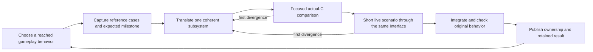

# Fresh-start pipeline for a readable Rust Super Metroid port

Status: proposed sketch
Date: 2026-10-15
Scope: a new project design; no existing source, acceptance policy, installed
controller, claim or retained evidence is replaced by this proposal.

The goal remains vanilla Super Metroid playable from reset through credits with
all gameplay owned by readable Rust and SNES hardware emulated. Map Rando follows
vanilla ownership. Project tools, orchestration and tests are Rust; there is no
Python source or runtime requirement. Pinned recovered C may temporarily execute
gameplay and serves as a translation reference.

The main design choice is to build and continuously extend one runnable game.
Every Translation scope delivers a complete gameplay behavior through the same
Interface used by live play and verification. Progress means demonstrated
gameplay reach and explicit Rust ownership, with reference agreement recorded
separately.

## Lessons grounded in this repository

These are historical observations from local reviews, not fresh acceptance or
performance measurements:

| Observation | Restart decision |
| --- | --- |
| The strategy review reports a 129,712-input mixed replay still ending in Ceres. | Require named gameplay milestones and causal input handling; reaching input EOF is never completion. |
| Complete translated modules needed separate fixture and live adapters. | Introduce one scheduled subsystem Interface and exercise it both offline and live. |
| The October 15 assessment selected 160 of 177 families after a documentation-only tracked change; 158 first refusals came from comment parsing. | Start with explicit dependency declarations and compiler dependency records, not a custom lexical source scanner. |
| CLI and orchestration identities spread into gameplay acceptance. | Separate gameplay, host/input, comparator and storage identities; invalidate only genuinely dependent claims, conservatively when uncertain. |
| Publication, repeated evidence reads and broad verification increased feedback cost. | Measure the entire edit-to-result path; separate focused checks from milestone publication. |

Sources: [revised strategy](../decomp-strategy/revised-strategy.md),
[architecture audit](../decomp-strategy/architecture-audit.md),
[batch assessment](../decomp-batch-performance-20261015/findings.md).

The restart retains semantic knowledge, reference pins, useful counterexamples
and license notices. Existing translated code may inform implementation or be
explicitly reused, but old acceptance does not automatically apply to the new
runtime. The old repository remains an inspectable reference.

## First resolve the runtime and input uncertainty

Before broad translation, select one runnable recovered-C baseline and one
existing hardware implementation. Verify the exact chosen combination. Keep
baseline patches explicit and preserve an unmodified original-ROM reference.
Do not build a new emulator or expand instruction recompilation as part of this
restart.

The first executable supports interactive and headless operation through the
same game Module. Establish ordinary reset, controller input, display and audio
output, then escape Ceres. Record the resulting room and lifecycle transitions.
Audio output at this stage is smoke evidence, not waveform equivalence.

Use original-ROM runs to establish the expected early gameplay transitions.
Observe when inputs are actually sampled and when game updates complete.
Video frames, controller polls and completed updates are different events. A
replay driver consumes an explicit causal event sequence; it must not silently
skip inputs, inject corrected state, or search ahead until the candidate matches.

Interactive play can diagnose the baseline while movie adaptation is incomplete.
It does not grant replay or original-ROM acceptance. If the baseline cannot
escape Ceres, solve or reduce that problem before accumulating translations.
If an early original comparison remains blocked, permit only the bounded pilot
needed to test the Interface; keep broad translation behind the feasibility gate.
Time-box baseline investigation and reconsider the chosen runtime when the next
bounded experiment cannot explain the failure.

## A small initial structure

Begin with one Cargo workspace and approximately three crates: the game library,
the executable, and verification tools. Module responsibilities matter more than
crate count; split crates later when dependency isolation demonstrably helps.

| Module | Interface and ownership |
| --- | --- |
| Game | Reset, causal input delivery, bounded execution to an observable event, observations and versioned snapshots. Owns scheduling and explicit C/Rust selection, initially through a recovered-C Adapter. |
| Gameplay subsystems | Complete scheduled operations such as updating Samus projectiles. Own internal dispatch, helpers and state changes. |
| State and game data | Canonical byte-addressed working memory, other persistent globals, validated ROM reads, explicit fixed-width arithmetic and aliases. |
| Hardware and host | Synchronous hardware operations and explicitly declared temporary foreign gameplay calls. Preserve ordering, reads after writes, interrupts and continuations. |
| References | Execute pinned actual C and original ROM in separate processes. Own reference-specific capture and semantic projection. |
| Verification | Execute Fixture pairs and scenarios, compare observations, locate first divergence, produce self-contained result records. |

The executable only selects interactive play or replay and invokes the Game
Interface. The same game library is linked into verification. Tests do not use
a separate imitation of the live implementation.

Preserve canonical RAM initially. Include state outside RAM, hardware state,
coroutine/continuation state and input position in snapshots where relevant.
Keep snapshot layouts versioned; only reuse a checkpoint when its state meaning
is compatible with the candidate. Otherwise regenerate from reset.

Use synchronous Host requests where behavior needs immediate answers. A deferred
end-of-frame list cannot replace reads with hardware side effects. Temporary
foreign gameplay calls remain distinct from hardware emulation. A growing enum
of individual helper calls is a signal to move a larger coherent Translation
scope behind the subsystem Interface.

Before externally visible effects, a supported refusal can select C. After Rust
starts effects, an error terminates the invocation; it cannot retry in C. Report
Rust entries, foreign gameplay calls, CPU fallback and unsupported paths separately.

## The development loop

1. Choose a behavior needed for the next gameplay milestone, or needed to remove
   measured fallback on an already reached route. Record the Translation scope,
   dependencies, writable files, admitted domain and expected observations in
   one local Markdown ticket.
2. Prepare a small corpus: an actual reached state, important branch/boundary
   cases and an input segment that materially exercises the behavior. A Fixture
   chain preserves state through allocation, update, collision and cleanup.
   Add cases because they distinguish behavior, rather than multiplying cases
   to grow a count.
3. Translate behind the scheduled subsystem Interface. Keep helpers private.
   Any temporary dependency owned by C remains declared and counted.
4. Run guarded Rust before unchecked C for synthetic fixture states. Reuse the
   real live implementation. Compare declared returns, all canonical state for
   pure routines, and ordered effects plus external state where applicable.
   Check unchanged surrounding state as well as expected changes.
5. Run the shortest fresh C/mixed scenario that reaches the changed behavior.
   Require material execution and a named postcondition, not an entry count or
   completed frame loop. Stop on the first unexplained mismatch.
6. Integrate one scope at a time. Check the merged tree, affected Offline
   families, the milestone scenario and the corresponding original-ROM domain.
   Expand original comparisons with gameplay reach. Preserve narrow documented
   exclusions and raw differences; never normalize away an unexplained mismatch.
7. Publish the exact source and separate translated, offline-verified,
   live-exercised and original-compared extents. Retain failures and perform
   scoped cleanup before closing the ticket.

The first pilot should be a complete visible operation with real host interaction,
such as a projectile lifecycle, sized after inspection. Then use a second consumer,
such as room scrolling, to test whether the Interface actually generalizes.
One shared integration owner handles Interface changes. Broad parallel
translation starts only after these consumers use the same working loop.

## Three verification costs, with unchanged meaning

| Loop | When | Work and claim |
| --- | --- | --- |
| Focused | Each edit | Changed module, small actual-C corpus, short scenario and first-divergence diagnostics. Establishes only that tested domain. |
| Integration | Each completed Translation scope | Current affected cases, host-contract controls, actual mixed gameplay, current original comparison and merged-source record. |
| Milestone | New gameplay reach, host/input changes, or release candidate | Fresh reset replay through named checkpoints, relevant lifecycle scenarios, original comparison and cumulative ownership accounting. |

There is one comparator Implementation and one observation schema. The loops
vary workload and retention, not equality rules. Two independent processes are
the normal C/Rust comparison. Add repeat runs when checking determinism or when
state isolation changes; four subjects need a specific experimental purpose.

Check the checker early: a deliberate wrong return, unrelated RAM mutation,
reordered host effect, omitted input poll, hidden fallback and corrupt retained
artifact must each fail the applicable gate. An unchanged original/C baseline
must pass the stated domain. Randomized cases are useful only inside a validated
input domain; seed and minimize failures.

## Keep feedback and evidence inexpensive

- Proposed warm targets on a named development machine: focused routine feedback
  within 5 seconds; the first subsystem edit-to-result loop within 30 seconds,
  including incremental build, preparation, execution and reporting. These are
  design budgets to measure, not promised timings. Cold builds are reported
  separately. If a target fails, measure the dominant phase before expanding
  scope or building more orchestration.
- Use Cargo and the C compiler's dependency facilities. Initially use a small
  explicit scope/dependency table with conservative fallback. Do not build a
  whole-repository call-graph engine or general task scheduler first.
- Build the C reference and live-compatible Rust candidate once per relevant
  identity. Reuse immutable reference observations only when ROM, reference,
  initial state, inputs, host rules and observation schema still match.
- Load fixtures efficiently and batch execution only where complete state reset
  is proven. Otherwise retain process isolation. Fast execution cannot rely on
  persistent state leaking between cases.
- Record elapsed planning, building, execution, comparison and retention costs
  on every run. Use detailed tracing only to answer a performance question.
- Start with one result manifest, compressed binary state/effect files and a
  compact human-readable mismatch report. Keep bounded recent context during
  probes; rerun reproducibly for extended traces. Passing probes need only their
  declared observations. Milestone records retain enough inputs and source/tool
  identity to reproduce and inspect their actual claim.
- Bind records to retained source, ROM/C identities, lockfile, toolchain/compiler
  identities, flags, fixtures, relevant host/comparator code and observation
  rules. A Git commit alone is insufficient. Keep command-line presentation out
  of behavioral identity unless it changes execution or comparison.
- Authenticate on independent reuse and after cleanup. Share validated immutable
  reads inside a single operation. Avoid repeatedly walking all prior evidence
  while producing one result.
- Keep milestone inputs/results and minimized failures; expire reproducible
  successful probe outputs under a documented policy. Introduce shared storage
  deduplication only after measurements justify its maintenance cost.

## Automation

Start with a Rust command that runs the fixed development loop for one declared
Translation scope. A model may return source changes for assigned gameplay
files. Acceptance rules, expected outputs and reference patches are outside that
rewrite scope; changes to them require separate review. Model-suggested tests
can supplement the corpus but cannot redefine success during the same attempt.

One bounded attempt records inputs, source changes, command results and the first
divergence. Retries are explicit and bounded; repeated identical failures trigger
diagnosis. Git plus local Markdown records integration state. A failed test never
advances an attempt merely because a previous run passed.

Do not initially create a durable multi-session agent platform, installation
migration framework, policy language, universal recipe system or distributed
queue. Add recovery/concurrency only for demonstrated workloads. Fixed commands,
source ownership, resource bounds and separate verification remain useful from
the start. Full source replacement automation follows a successful manual pilot.

## Milestones and stop conditions

| Milestone | Observable exit condition |
| --- | --- |
| 0. Baseline feasibility | One pinned baseline boots and escapes Ceres; causal input delivery and early original-ROM comparison are demonstrated. Any bypass remains diagnostic only. |
| 1. First Rust behavior | A complete visible subsystem runs through the live Interface; actual-C cases and the corresponding gameplay observations pass. |
| 2. Repeatable loop | A second subsystem uses the same Interface without another family of glue; feedback cost and mismatch diagnostics meet the measured pilot budget. |
| 3. Playable progression | Mixed play reaches named regions, handles doors/messages/pause/death, and demonstrates reset plus save/load. Each milestone has explicit remaining fallback. |
| 4. Vanilla route | A fresh run reaches credits with correct named checkpoints and original comparison over the claimed route. Remaining gameplay fallback is still allowed and reported. |
| 5. Vanilla ownership | C gameplay and CPU fallback are disabled; fresh completion, lifecycle checks, missing subsystem scenarios and manual exploration pass. Audit remaining gameplay dispatch and fallback sites beyond the any% route. |
| 6. Map Rando | Add seed/data support and custom gameplay against the stable Rust-owned game, with supported-technique and seed-completion checks. |

Any% provides the first end-to-end route, not exhaustive gameplay coverage. Grow
additional scenarios from unowned behavior, branch gaps and regressions.

Track four separate facts: furthest named gameplay checkpoint; Rust-owned
subsystems and remaining fallback; original-ROM comparison extent; edit-to-result
cost and retained bytes. No single function-count percentage combines these.

## Work completed for this sketch

Read-only review of existing design, strategy and performance records; one new
proposal document. No implementation, verification run, process, build output,
worktree, source reset or production mutation was created. There are no generated
run intermediates to clean and no fresh gameplay/performance acceptance claim.
