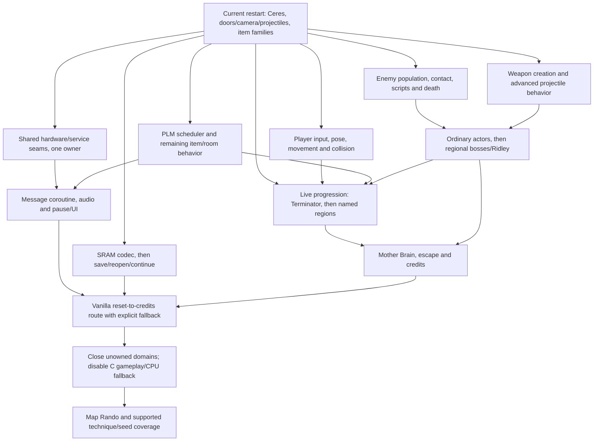

# Future parallel decompilation plan

Date:2026-10-16. Owner:independent reviewer01a14300.
Status: advisory roadmap; integrator selects/finalizes exact source claims.
Goal: playable vanilla reset-to-credits, then complete Rust gameplay ownership.

## Choose the next work

1. Keep the integrator's immediate Terminator energy-tank route in its existing
   lane. [Exact packet](next-live-tank-route.md) supplies EED7/0008, new848968,
   health199/message1 and a proposed seven-door return; traversal remains unproved.
   Use the current frozen22 route policy for navigation: material later corrects
   the A107 return exit to EAST, superseding the earlier advisory leftward input.
2. Prepare two disjoint source scopes from the table, each with a complete
   scheduled boundary or explicitly bounded kernel and declared native services.
   A useful pilot pairing is player movement/contact and the SRAM codec: distinct
   source ownership and different state/service contracts. Enemy lifecycle is
   an alternative larger ownership track after its interface is specified.
3. Freeze each interface before dispatching its source work. A ready codec scope
   can proceed while the player contract is unresolved; two ready scopes can
   run concurrently. One native worker owns their adapter edits; two Rust workers
   own separate module directories.
   Integrate/test one frozen submission at a time while the other keeps translating.
4. Replenish the next two prepared scopes as current work finishes. Use bounded
   source questions for unresolved contracts; reuse existing research otherwise.
   Route discovery and original-ROM evidence are separately scheduled work.

This expands the previous one-successor arrangement into two prepared scopes
under the user's request for more parallelism. It changes no production claim,
source owner or acceptance rule by itself. Dates and full-game percentages are
not forecast from the recent small item scopes.

## Dependency chart

Arrows indicate integration dependencies; source research can start earlier.
Each box is a coherent lane, not permission to claim all its files at once.

## Source lanes and proposed ownership

"Candidate" means source anchors/reuse exist; "needs contract" means exact
state/effect/admission closure must be selected. Neither means accepted code.
All proposed directories are new restart modules; root owns registration.

| Lane | First coherent deliverable | Reuse and dependency | Proposed exclusive files | Readiness |
| --- | --- | --- | --- | --- |
| Player movement/contact | First vertical motion/contact kernel9093EC/909440; separately horizontal/input/pose, then movement dispatcher and complete alfa/beta composition | Main samus_control/samus/collision;90A337 is a handler table, not a kernel entry. Player note supplies refined roots. Terrain949763 and remaining frame behavior stay explicit dependencies. | restart/player-motion/ and later restart/player-input/; one owner per directory | Source candidate; freeze vertical state/contact/service domain first |
| Player weapons | HUD weapon selection/creation, then charged/hyper/missile and bomb/power-bomb lifecycles | Main projectile_flight/projectile_special/power_bomb and existing restart ordinary projectile execution. Damage/contact intersects enemy-core through services. | restart/player-weapons/; existing restart projectile module changes separately assigned | Source candidate; creation/scheduler/asset boundaries need contract |
| World and item engine | Remaining collectors in coherent item families, then PlmHandler_Async8485B4 initialization/dispatch/timed draw/message continuation | Existing restart item crate plus main plm.rs/plm_instructions/plm_render. Full PLM root sm_84.c:217; draw861E:270. Shared draw helpers have one owner. | Existing restart/item-instructions/ has its current owner; later restart/plm-engine/ | Items have reusable contracts; full scheduler needs state/ROM/message closure |
| Enemy lifecycle | Active-list/population/contact/instruction/death/pickup boundary | EnemyMainA08FD4, SpawnEnemyA09275, deathA0A3AF; main leaves. Respawn is a known gap; see enemy note. | restart/enemy-core/ | Needs common scheduler/service contract; high reuse potential |
| Ordinary actors and bosses | Ordinary actor families; whole Ridley adaptation after common interface | Waver/Ripper/Rio/crawler/jump and substantial Ridley decomposition. Boss source work can precede route arrival; live complete lifecycle waits enemy services. | restart/ordinary-enemies/ and restart/ridley/; distinct owners | Actor/Ridley source candidates; Mother Brain needs separate closure research |
| Messages and presentation | Complete DisplayMessageBox_Async858080, including real yields/input/restore; then pause interaction/map/file/options | sm_85.c:373 owns coroutine; main pause_equipment_render is partial reuse. Message needs NMI/PPU/DMA/controller/audio and non-WRAM state; do not replace with canned returns. | restart/message-box/, later restart/pause-ui/ | Message source boundary identified; actual external-state contract needed |
| Persistence | SaveToSram818000/LoadFromSram818085 plus PackMapToSave/UnpackMapFromSave; then real file save/reopen/continue | Four-routine pinned codec, sm_81.c:40/78 and historical source research. Canonical WRAM/SRAM, checksum/map packing and one disk-write request stay explicit. | restart/persistence/ | Source candidate; seal SRAM/table/slot/effect domain before code |
| Audio/hardware/endgame | Music/SFX acknowledgment roots, remaining required host calls; later ending/credits scheduler | HandleMusicQueue808F0C and HandleSoundEffects sm_82.c:738; main audio queue leaves. Credits bank8B needs independent closure/route. | restart/audio-frame/; later restart/ending/; native-host shared files retain one owner | Audio/endgame need contract research; hardware work must remove identified dependencies |

Read [player tracks](future-player-tracks-summary.md) only when preparing player/weapon
scopes; read [enemy tracks](future-enemy-tracks.md) for enemy/boss scopes.
World/message/persistence anchors are recovered C578f90b under the retained
scroll/native/2c9c9a3c…/source/src tree. Main193cad9 and historical
decomp-parallel tickets15/18/19/26/35/42 are source leads, not new restart stages.

## Work in waves

| Wave | Work that can overlap | Exit condition |
| --- | --- | --- |
| Now | Current live route; two bounded interface/scope preparations; completed-artifact review and cleanup | Real new tank collector reach or retained concrete traversal gap; two genuinely disjoint scoped assignments ready |
| Core ownership | Two source lanes from player, persistence, PLM/message or enemy-core; native worker prepares their shared seams | Each completed scope owns its declared Rust boundary, passes compact actual-C checks and integrates; live extent is published separately |
| Regional gameplay | Weapon families and ordinary enemies alongside room/item/ability progression; Ridley source adaptation after enemy interface freezes | Named regions/boss encounters, required abilities and death/reset/save/pause paths work with fallback counted |
| End-to-end vanilla | Remaining regional bosses, Mother Brain closure, ending/escape/credits; persistence/UI finish in parallel | Fresh reset reaches credits and save/reopen/continue works; original-ROM comparison covers the claimed route, remaining fallback explicit |
| Complete gameplay ownership | Close unowned dispatch, branches and lifecycles outside the completion route; required graphics/audio/game-state bodies | C gameplay/CPU fallback disabled; completion and missing-domain scenarios pass, with external hardware dependencies distinguished |
| Map Rando | Seed/data behavior and supported techniques after vanilla ownership is stable | Named supported seed/technique scenarios and completion; separate evidence rather than extrapolation from any% |

Boss order and ability route are chosen from actual progression requirements.
The chart does not impose one arbitrary boss order or make every source lane
wait for route arrival. Original-ROM work grows with gameplay reach and concrete
ambiguity; it is not a fresh whole-game gate on every source submission.

## Four active slots and shared execution

| Situation | Slot1 | Slot2 | Slot3 | Slot4 |
| --- | --- | --- | --- | --- |
| Two source scopes ready | Integrator: wiring/freeze/direct runs/publication | Native adapter/contracts for both | Rust scopeA | Rust scopeB |
| One source scope and route discovery | Integrator: same duties | Native adapter | Rust scopeA | Route policy/data preparation or successor research |
| Interfaces already stable | Integrator: same duties | Rust scopeA | Rust scopeB | Artifact review or one successor preparation |

These are proposed allocations of available slots, not a new worker pool.
Existing independent coordination/review sessions retain their ownership;
research/review within a four-slot team is time-sliced when source slots are full.
Agent concurrency and process concurrency are separate: retain one root Cargo
job and the shared producer ceiling4. Root launches actual short checks directly.
Private source work can continue while a frozen checkout runs; shared wiring waits.

Source implementations may share canonical RAM at runtime; their edits remain
disjoint. Original game scheduler ordering, shared scratch and effect copyback
are tested at integration. Parallel coding does not imply parallel mutation of
the game state or independent acceptance of overlapping state effects.

## Admit work and keep the integration lane moving

Before dispatch, root records full source baseline, exact routines/domain/assets,
typed service contract, permitted files, fixture distinctions and retained live
anchor or explicit live gap. Publish translating through the shared inventory.
Each scope gets one worktree and one owner. Root alone owns native-host/lib.rs,
runtime registration, Cargo workspace/index and shared fixtures/report wiring;
native worker owns explicitly delegated adapter files in its isolated tree.

Keep at most two active source scopes and two prepared successors in this
pilot. Current22 route-policy/runtime work counts as one active scope, so only
one additional independent source scope fits until22 is submitted. Native
adapter work for these same scopes is shared support, not another source lane.
A finished worker publishes source/handoff and can take a disjoint next
module; root integrates finished work in dependency order. Grow this limit only
when ready work outlasts source capacity rather than waiting on integration.
If native wiring blocks both scopes, pick an independent state/codec lane or
finish the common interface; splitting more helper calls will not create capacity.

Reuse references only when behavioral input/reference/host/observation identities
remain compatible. Group adapter changes when both frozen contracts are ready;
do not wait for speculative scopeB to accept finished scopeA. Compare one retained
result against all applicable requirements instead of running duplicate checks.
Batch only jointly ready stage observations with the exact validated auxiliary
command. Preserve actual-C, live reach and original-ROM extent separately.

Measure existing claim/freeze/result/close timestamps, source-ready waiting time,
integration queue age and recurring publication cost. Count new uniquely owned
bodies/behavior and remaining foreign calls; repeated loop completions and fixture
counts are evidence, not proportional progress. If two submissions queue behind
integration, reduce source WIP and assign the next free slot to its actual blocker.

For failure recovery, the healthy parent checks exact stopped owner/writers,
preserves source/evidence/next action, cleans only disposable outputs and assigns
one replacement. The sole routine watch remains the fallback; completed scopes
are sealed independently of future research. Use local tickets and current
authority; this roadmap does not revive original production reservations.

## Evidence and cleanup

This roadmap uses two bounded source questions plus existing tickets/source
anchors; no builds, games, captures, source/index changes or claims were made.
No verification intermediates or producer remain; cleanup0bytes. Player research
was stopped at its time bound and its exact early findings consolidated with
unresolved full-frame closure explicitly retained. Supporting
research remains Markdown. Exact implementation plans and dates are selected
as each scope becomes ready, rather than asserting a fully researched game.
