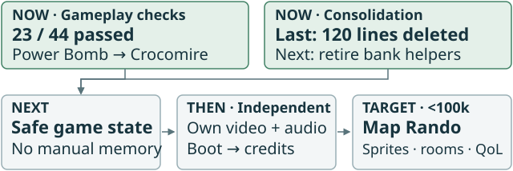

# Engine migration

| Measure | Count |
| --- | ---: |
| Production Rust lines* | 116068 |
| Legacy bank Rust lines | 52390 |
| Verification Rust lines | 39047 |
| Total Rust | 155115 |
| Lines containing `unsafe` | 4707 |
| Warnings (no-default library) | 370 |
| Required checkpoint checks passing | 25/44 |

*Physical lines by path; inline verification hooks remain in production. Verification: `verification/`, `verify/`, or filenames starting `verify`.

Change: **Cannon control and palettes shared**; engine **+217 / -236 = -19**, legacy **-204**, unsafe **-15**, verification **+4**. `sm_90`: **1,306 lines left**.

Replacement is **91%**, including ordered graphics-output compatibility. Natural grapple coverage remains pending.

[Current plan](docs/PLAN.md#work-order) | [Checkpoint recipes](movies/segments.toml) | [Codebase map](https://jimlundin.github.io/sm-decomp/#work-summary)
