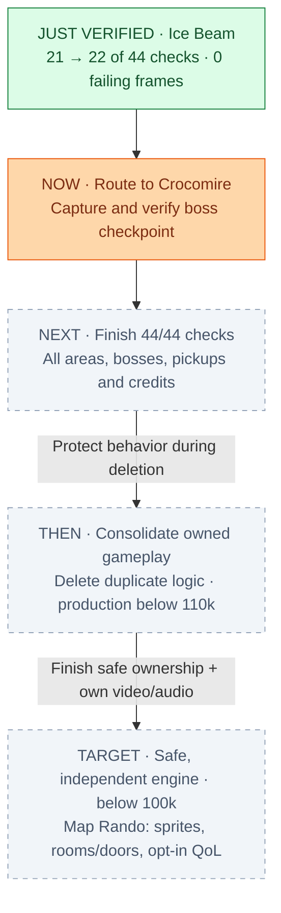

# Engine migration

| Measure | Count |
| --- | ---: |
| Production Rust lines* | 117913 |
| Verification Rust lines | 37429 |
| Total Rust | 155342 |
| Lines containing `unsafe` | 5042 |
| Warnings (no-default library) | 482 |
| Required checkpoint checks passing | 22/44 |

*Physical lines by path; inline verification hooks remain in production. Verification: `verification/`, `verify/`, or filenames starting `verify`.

[Current plan](docs/PLAN.md#work-order) · [Checkpoint recipes](movies/segments.toml) · [Codebase map](https://jimlundin.github.io/sm-decomp/)
