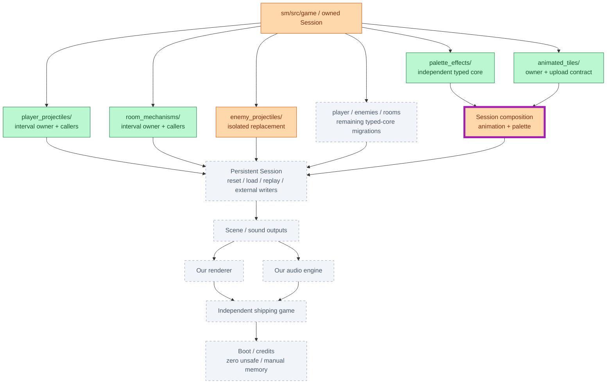
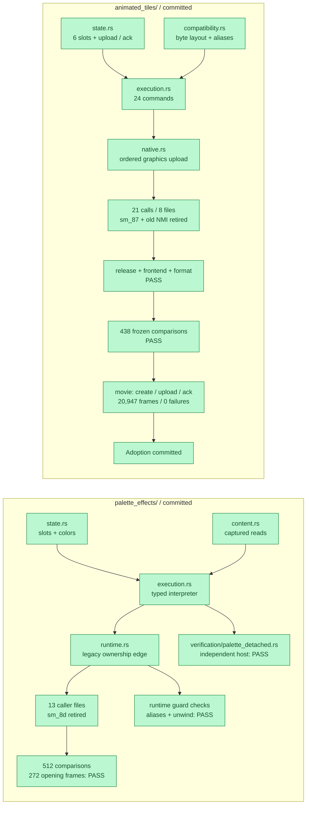
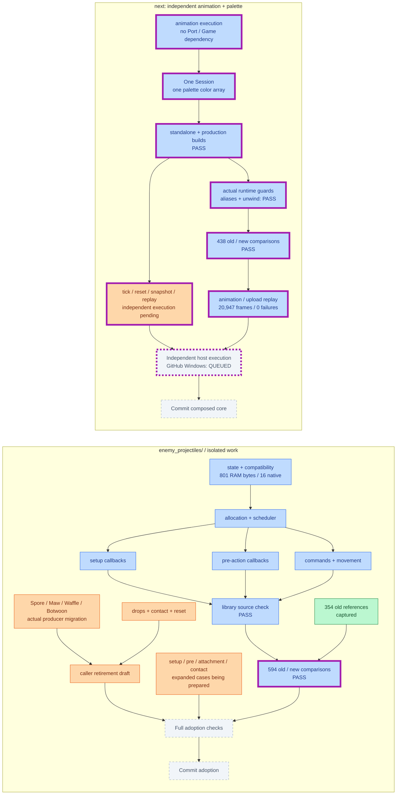

# Engine migration

2026-10-23 16:47 UTC

🟩 Committed | 🟦 Checked, uncommitted | 🟧 In progress | ⬜ Remaining | **Purple border: changed since previous report**

[Plan](docs/PLAN.md) / [Checks and accounting](docs/HANDOFF.md) / [Target architecture](docs/target-architecture/README.md)
