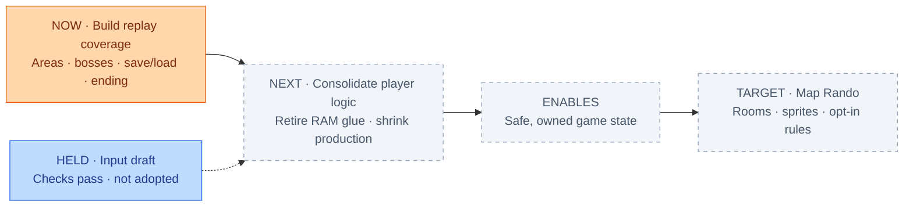

# Engine migration

| Measure | Count |
| --- | ---: |
| Production files* | 117911 |
| Verification files | 35653 |
| Total Rust | 153564 |
| Lines containing `unsafe` | 5042 |
| Warnings (no-default library) | 482 |
| Checkpoint segments passing | not measured |

*Physical lines by path; inline verification hooks remain in production. Verification: `verification/`, `verify/`, or filenames starting `verify`.

[Current plan](docs/PLAN.md#work-order) · [Codebase map](https://jimlundin.github.io/sm-decomp/) · [Last verified milestone](https://github.com/JimLundin/sm-decomp/commit/300eaf15)
