# Engine migration

[Navigate the current codebase →](https://jimlundin.github.io/sm-decomp/)

Green: adopted scope / passed check | Blue: draft | Orange: active | Grey: remaining | Red: failed
**Purple outline: changed since previous report.** Folder branches show containment; check arrows show prerequisites.

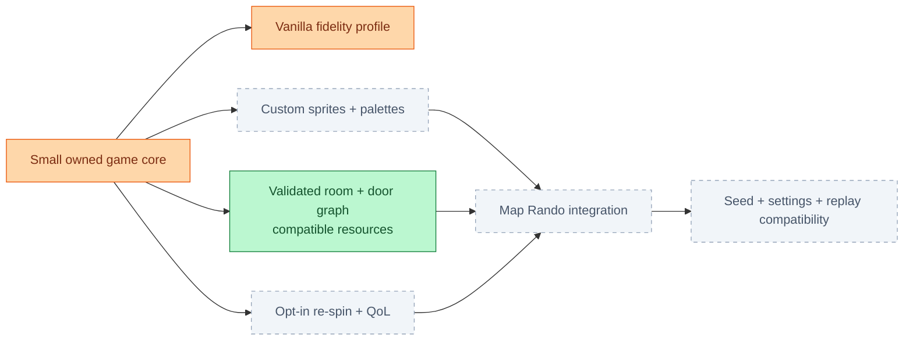

### Common actors / verification branch

```mermaid
flowchart LR
    AC["Complete callers + retirement<br/>design review PASS"]:::done --> AD["49-file declaration carrier<br/>source review PASS"]:::done
    AU["4,668 new bytes / union 57,041<br/>shared player scope audit PASS"]:::done --> AD
    AI["Per-instance appearance + lifecycle<br/>independent review PASS"]:::done --> AD
    AR["Typed read lookup + guarded edits<br/>design review PASS"]:::done --> AD
    AP["Production +4,998 / verification +5,379<br/>accounting + retirement audit PASS"]:::done --> AD
    AD --> AS["state.rs + codec.rs"]:::draft
    AD --> AV["access.rs / typed reads + edits"]:::draft
    AD --> AE["content.rs + effects.rs"]:::draft
    AD --> AM["identity / media / scene / snapshots"]:::draft
    AS --> AT["Independent declaration review<br/>PASS"]:::done
    AV --> AT
    AE --> AT
    AM --> AT
    AT --> ATC["Metadata + external constructor<br/>compile PASS"]:::done
    ATC --> AB["Parallel actor implementation"]:::active
    AV --> APR["Exceptional buffers<br/>helper review"]:::active --> AB
    AB --> AX["Combined predecessor<br/>format + build + source checks PASS"]:::done
    AX --> AXPOP["35 population / animation references<br/>capture PASS"]:::done
    AX --> AXMOVE["40 movement / contact references<br/>capture PASS"]:::done
    AXPOP --> AXAUDIT["75 captures / independent audit PASS"]:::done
    AXMOVE --> AXAUDIT
    AX --> AXTABLE["4 table-boundary references<br/>capture + independent audit PASS"]:::done
    AB --> ACOMPILE["Combined actor library<br/>format + cargo check PASS"]:::done
    AB --> ARETIRE["7 old actor modules + facades<br/>retired in private candidate"]:::draft
    ACOMPILE --> ADLL["79-case DLL<br/>build + source checks PASS"]:::done
    ADLL --> APCOMP["35 population / animation<br/>byte-identical"]:::done
    ADLL --> AMCOMP["40 movement / contact<br/>byte-identical"]:::done
    ADLL --> ATCOMP["4 table boundaries<br/>byte-identical"]:::done
    APCOMP --> ACAUDIT["79 comparisons + Runtime outputs<br/>independent audit PASS"]:::done
    AMCOMP --> ACAUDIT
    ATCOMP --> ACAUDIT
    ACAUDIT --> AVERIFY
    ADLL --> ARUN["5 ownership / prepared-media cases<br/>actual execution PASS"]:::done
    ADLL --> ASHARED["6 shared Runtime guards<br/>PASS"]:::done
    ADLL --> AINIT["Real spawn + nested initializer<br/>publication / unwind baseline PASS"]:::done
    ADLL --> AANGLE["18 angle aliases / foreign + drop<br/>single-owner baseline PASS"]:::done
    ADLL --> ACONTACT["Touch alias + two-skin collision<br/>baseline PASS"]:::done
    AINIT --> AHOOK["Observer hooks / 79 comparisons<br/>byte-identical"]:::done
    AANGLE --> AHOOK
    ACONTACT --> AHOOK
    AB --> AROUTEBUILD["Composed route / normal library + DLL<br/>format + compile PASS"]:::done
    AROUTEBUILD --> AROUTE["Two-room routes / cases 12 + 13<br/>execution + byte audit PASS"]:::done
    AVERIFY --> MUTWIRE["Hosted runner / 56 old + 17 new faults<br/>CI running / ed447a34"]:::active
    ADLL --> AORACLE["21,015 frames / 10 probes<br/>0 failures + 120-frame tail / PASS"]:::done
    ADLL --> KWRITE["Kraid live-definition write + consumer<br/>PASS"]:::done
    KWRITE --> KRESTORE["Actual CPU snapshot restore<br/>definition retained / PASS"]:::done
    KRESTORE --> KRESET["Actual reset + seeded consumer<br/>definition retained / PASS"]:::done
    AB --> ACONTRACT["18 detached contract tests<br/>compile PASS / execution pending"]:::draft
    AXTABLE --> AVERIFY
    AXAUDIT --> AVERIFY["Actual routes + oracle + mutations"]:::pending
    AV --> BORROW["Actual state/access compiler carrier<br/>positive control PASS"]:::done
    BORROW --> BREAD["Actor read across edit<br/>compiler rejects / PASS"]:::done
    BORROW --> BSREAD["Spawn read across edit<br/>compiler rejects / PASS"]:::done
    BORROW --> BESC["Mutable edit escape<br/>compiler rejects / PASS"]:::done
    BORROW --> BCOPY["Actor move out of view<br/>compiler rejects / PASS"]:::done
    BORROW --> BSCOPY["Spawn move out of view<br/>compiler rejects / PASS"]:::done
    AVERIFY --> AA["Caller retirement + adoption"]:::pending
    AVERIFY --> MUTRECIPES["9 fault recipes authored<br/>execution pending"]:::draft
    MUTRECIPES --> MUTBASE["Mutation baselines"]:::pending
    MUTBASE --> MUTBUILD["Compile faulty variants"]:::pending
    MUTBUILD --> MF1["Multipart stop"]:::pending
    MUTBUILD --> MF2["Birth publication"]:::pending
    MUTBUILD --> MF3["Live selector"]:::pending
    MUTBUILD --> MF4["Respawn preservation"]:::pending
    MUTBUILD --> MF5["One angle owner"]:::pending
    MUTBUILD --> MF6["Unwind identity"]:::pending
    MUTBUILD --> MF7["Alias publication"]:::pending
    MUTBUILD --> MF8["Skin / collision independence"]:::pending
    MUTBUILD --> MF9["Discarded-future handles"]:::pending
    class AP,AROUTE,MUTWIRE,AORACLE changed
    classDef done fill:#bbf7d0,stroke:#15803d,color:#14532d
    classDef draft fill:#bfdbfe,stroke:#2563eb,color:#1e3a8a
    classDef active fill:#fed7aa,stroke:#ea580c,color:#7c2d12
    classDef pending fill:#f1f5f9,stroke:#94a3b8,color:#475569,stroke-dasharray:5 5
    classDef changed stroke:#a21caf,stroke-width:5px
    classDef failed fill:#fecaca,stroke:#dc2626,color:#7f1d1d
```

### Room entry + configurable connections / adopted

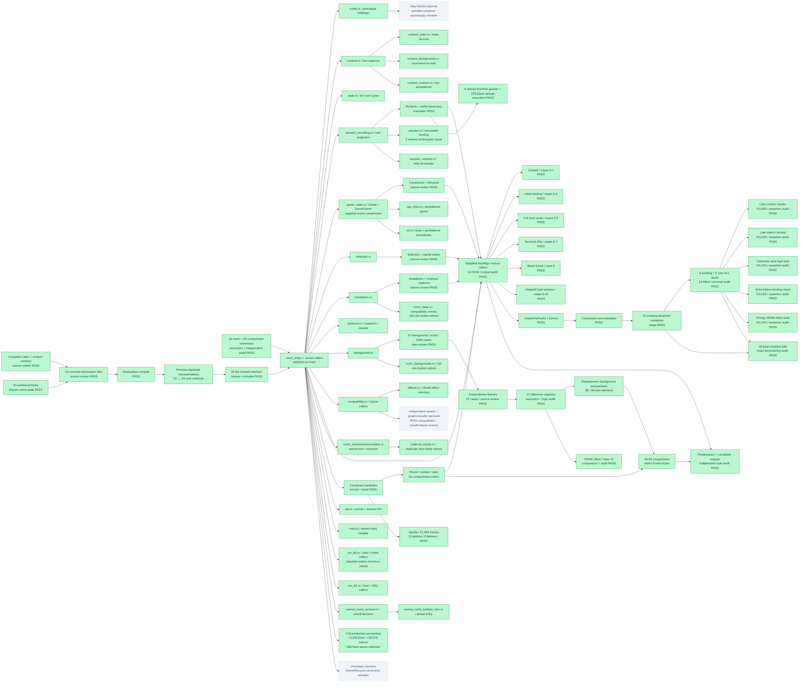

[Room validation CI / terminal audit PASS](https://github.com/JimLundin/sm-decomp/actions/runs/40044596920) | [Scope, accounting and remaining boundaries](docs/PLAN.md)

### Progression flags / adopted

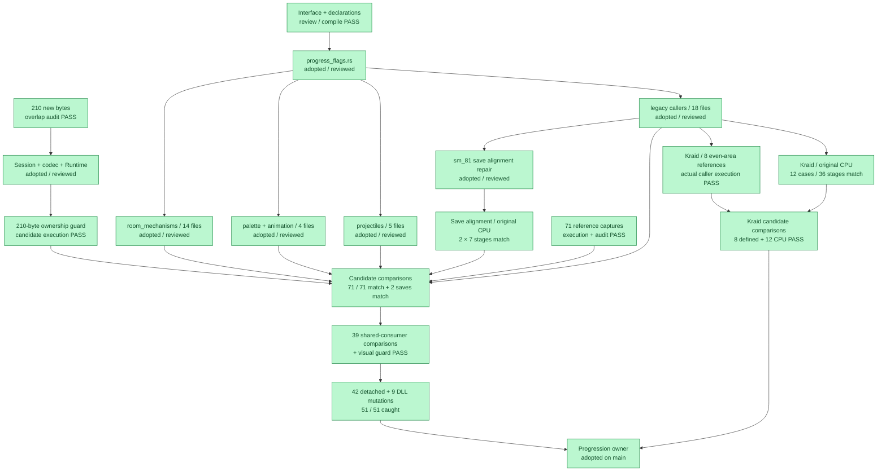

[Flags adopted: f88970aa](https://github.com/JimLundin/sm-decomp/commit/f88970aa) · [Build + 51 mutations: PASS](https://github.com/JimLundin/sm-decomp/actions/runs/40036842766)

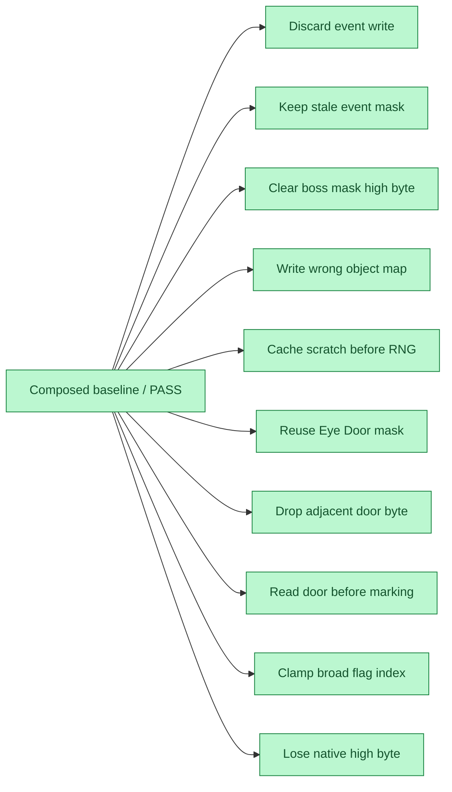

<details>
<summary>Adopted sprite effects — shared owner and verification</summary>

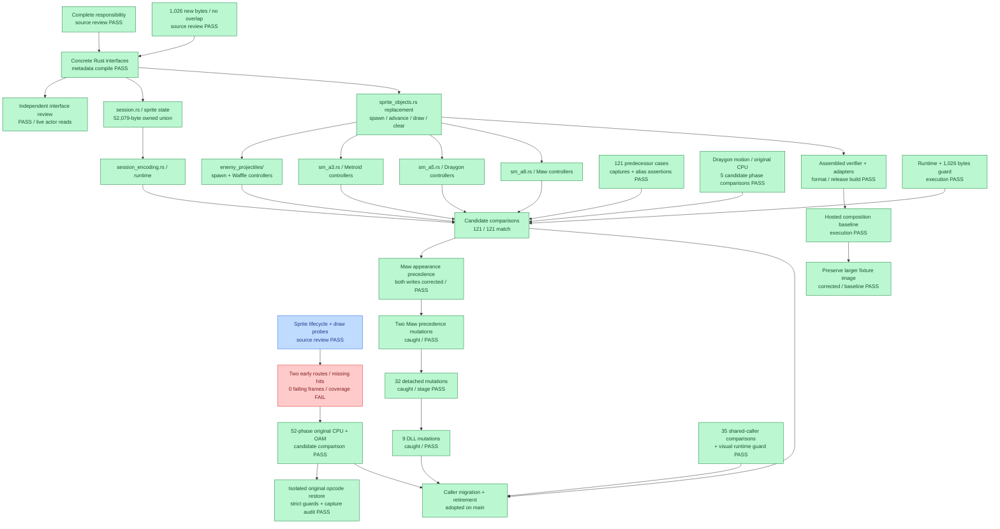

[Sprite build + 41 mutations: PASS](https://github.com/JimLundin/sm-decomp/actions/runs/40031500027)

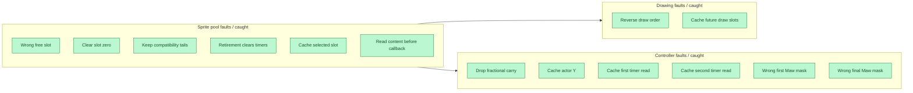

</details>

[Shared Session adopted: 74948127](https://github.com/JimLundin/sm-decomp/commit/74948127) / [Build + eight mutations: PASS](https://github.com/JimLundin/sm-decomp/actions/runs/40005712881)

[Four room mutations / CI PASS](https://github.com/JimLundin/sm-decomp/actions/runs/40005395335) · [Shared Session candidate CI](https://github.com/JimLundin/sm-decomp/actions/runs/40005712881)

### Enemy projectiles / shared owner adopted

[Full build + 16 mutations / PASS](https://github.com/JimLundin/sm-decomp/actions/runs/40013612299)

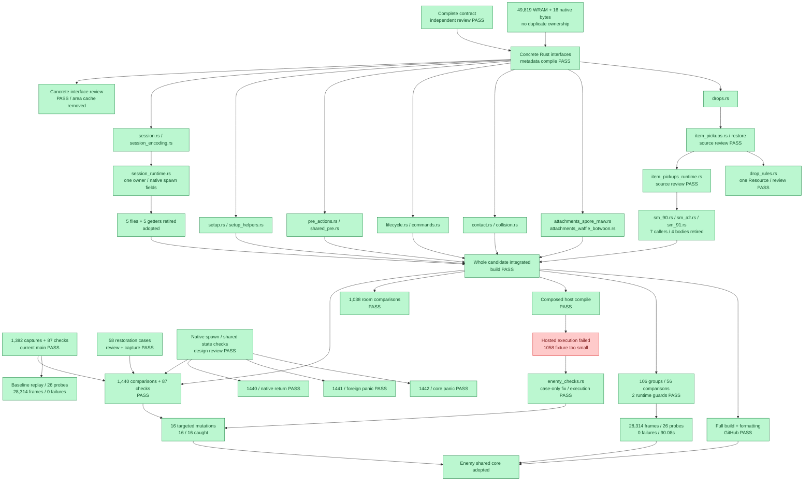

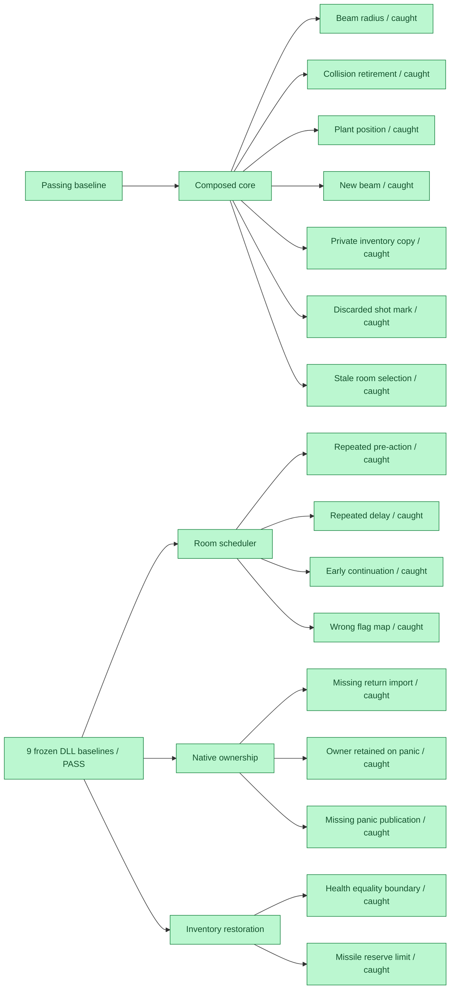

### Shared visual effects / shared owner adopted

[Full build + 27 mutations / PASS](https://github.com/JimLundin/sm-decomp/actions/runs/40021042750)

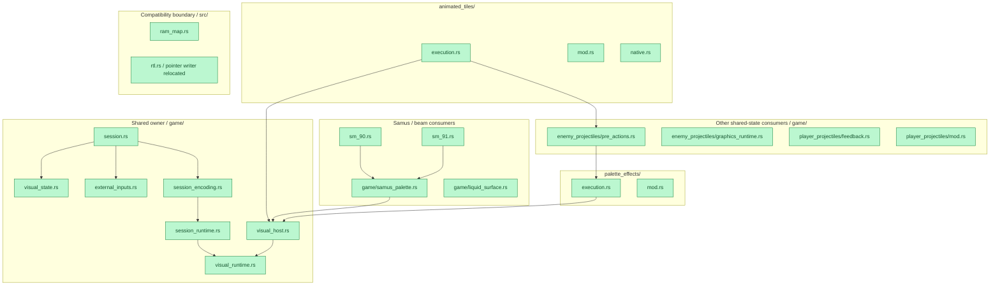

```mermaid
flowchart TB
    REVIEW["Production + caller reviews<br/>PASS"]:::done --> BUILD["Complete candidate build<br/>PASS"]:::done
    UNION["51,053 disjoint WRAM bytes<br/>zero duplicate ownership / PASS"]:::done --> BUILD
    BUILD --> PAL["Palette comparisons<br/>512 PASS"]:::done
    BUILD --> ANI["Animation comparisons<br/>438 PASS"]:::done
    BUILD --> SAM["Defined Samus comparisons<br/>224 PASS"]:::done
    BUILD --> CPU["Original-CPU oracle comparisons<br/>33 PASS"]:::done
    BUILD --> GUARD["Runtime guards<br/>3 PASS"]:::done
    BUILD --> ENEMY["Enemy regression<br/>1,443 cases + 87 checks PASS"]:::done
    BUILD --> ROOM["Room comparisons<br/>1,038 PASS"]:::done
    BUILD --> PLAYER["Player regression<br/>106 groups + 56 comparisons PASS"]:::done
    BUILD --> REPLAY["Replay / 38 required probes<br/>28,314 frames / 0 failures"]:::done
    BUILD --> HOST["Hosted full build<br/>PASS"]:::done
    HOST --> DLL["Hosted DLL mutations<br/>9 / 9 caught"]:::done
    BUILD --> DETACHED["Shared detached harness<br/>execution PASS"]:::done
    DETACHED --> OLD["7 existing detached mutants<br/>7 / 7 caught"]:::done
    DETACHED --> NEW["11 new visual mutants<br/>11 / 11 caught"]:::done
    BUILD --> FMT["Root + hosted formatting<br/>PASS"]:::done
    RETIRE["7 old production files retired<br/>adopted / 666 gross lines"]:::done --> ADOPT
    PAL --> ADOPT
    ANI --> ADOPT
    SAM --> ADOPT
    CPU --> ADOPT
    GUARD --> ADOPT
    ENEMY --> ADOPT
    ROOM --> ADOPT
    PLAYER --> ADOPT
    REPLAY --> ADOPT
    DLL --> ADOPT
    OLD --> ADOPT
    NEW --> ADOPT
    FMT --> ADOPT["Shared visual owner adopted"]:::done
    classDef done fill:#bbf7d0,stroke:#15803d,color:#14532d
    classDef active fill:#fed7aa,stroke:#ea580c,color:#7c2d12
    classDef pending fill:#f1f5f9,stroke:#94a3b8,color:#475569,stroke-dasharray:5 5
    classDef failed fill:#fecaca,stroke:#dc2626,color:#7f1d1d
    classDef changed stroke:#a21caf,stroke-width:5px
```

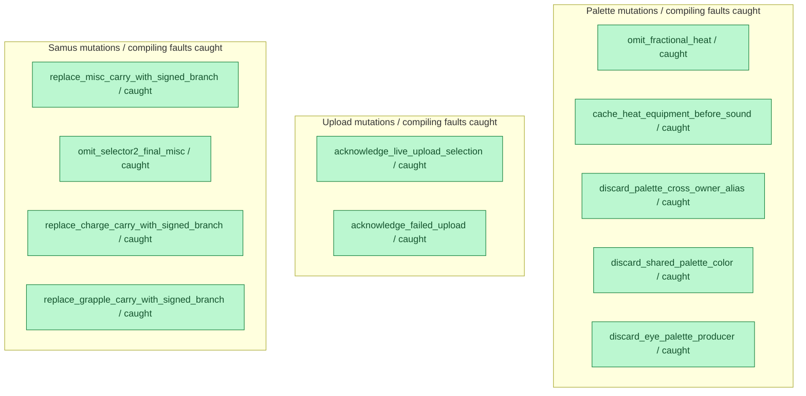
[Hosted validation](https://github.com/JimLundin/sm-decomp/actions/runs/40021042750)


<details>
<summary>Room mechanisms / shared typed core adopted</summary>

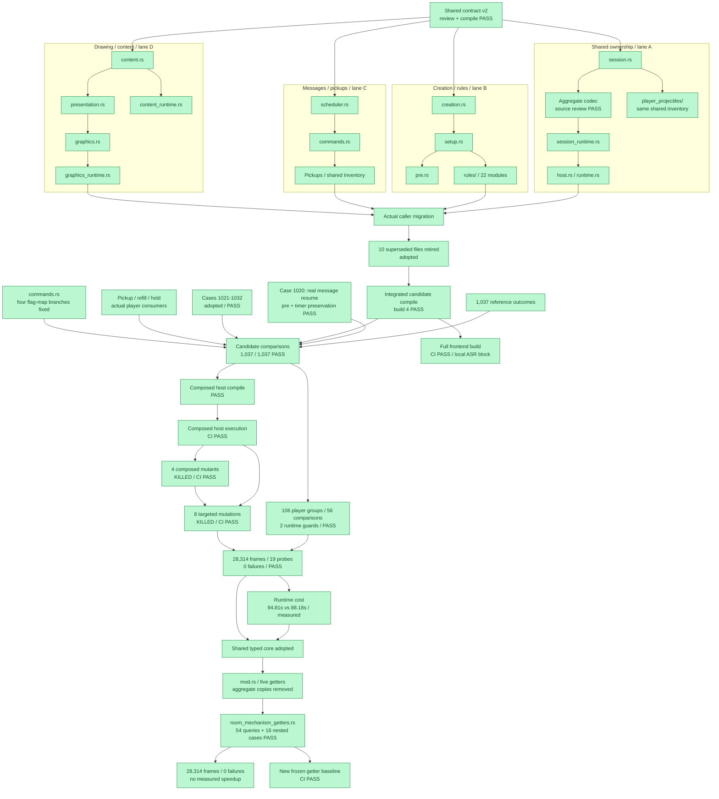

</details>

### New mechanism verification

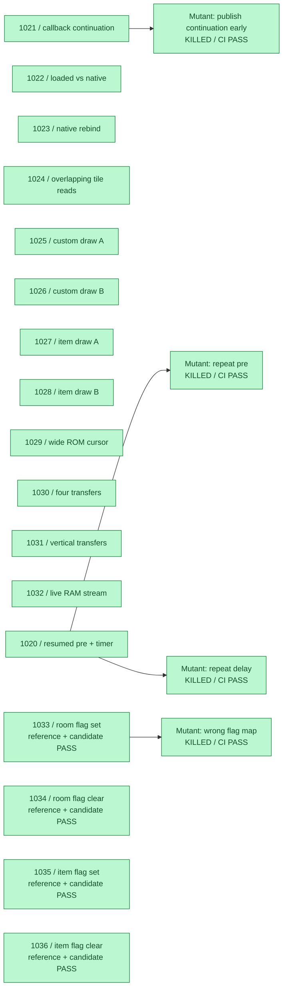

### Player projectiles / adopted typed core

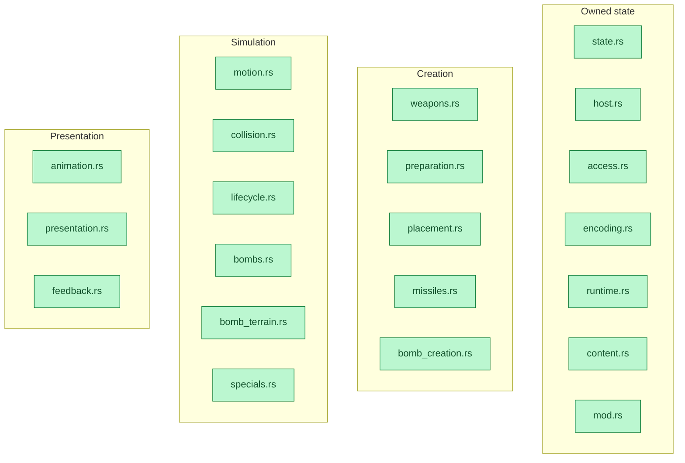

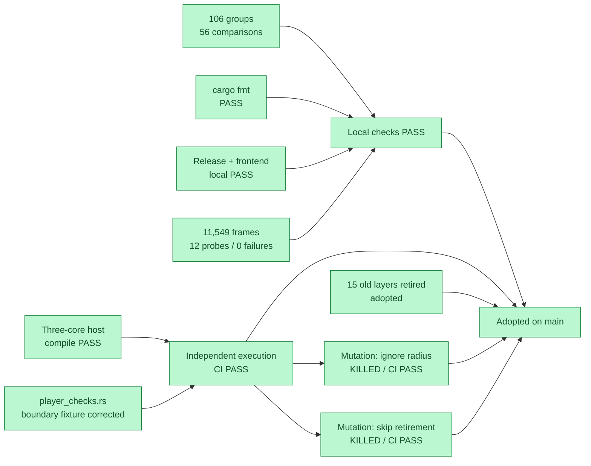

### Destination

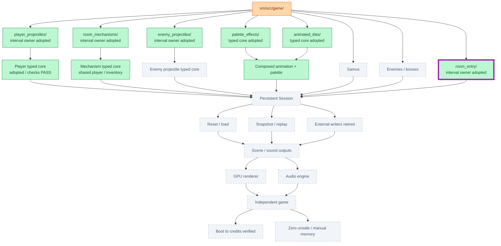

<details>
<summary>Adopted modules / expand folder maps</summary>

Green below means adopted responsibility; runtime and legacy edges still exist.

#### palette_effects/

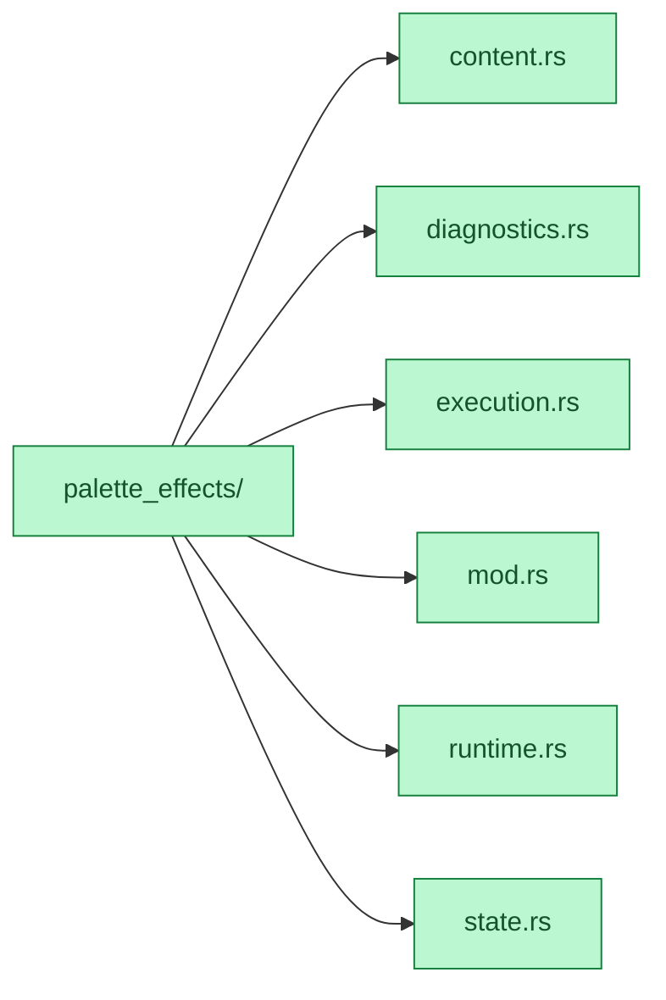

#### animated_tiles/

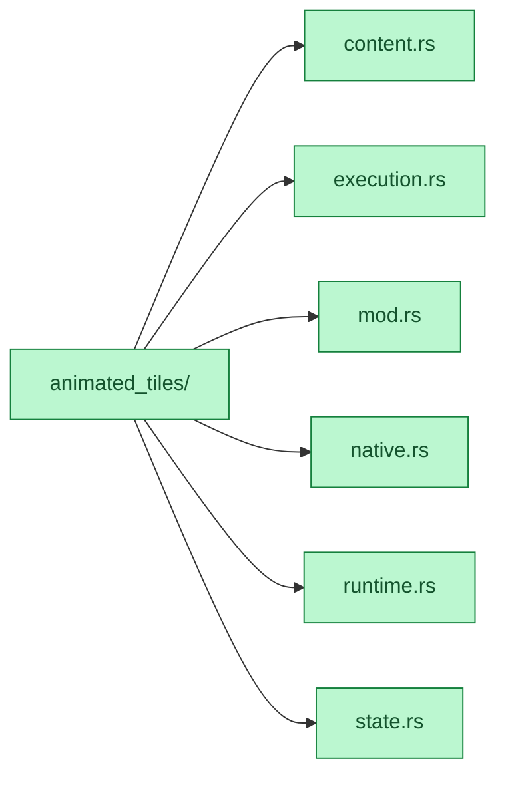

#### enemy_projectiles/

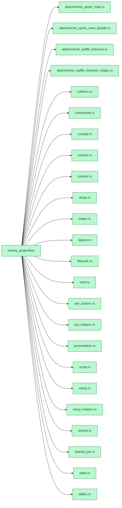

#### room_mechanisms/

```mermaid
flowchart LR
    ROOT["room_mechanisms/"]:::done
    ROOT --> f0["commands.rs"]:::done
    ROOT --> f1["creation.rs"]:::done
    ROOT --> f2["effects.rs"]:::done
    ROOT --> f3["fields.rs"]:::done
    ROOT --> f4["fields_runtime.rs"]:::done
    ROOT --> f5["graphics.rs"]:::done
    ROOT --> f6["mod.rs"]:::done
    ROOT --> f7["native_content.rs"]:::done
    ROOT --> f8["port.rs"]:::done
    ROOT --> f9["pre.rs"]:::done
    ROOT --> f10["presentation.rs"]:::done
    ROOT --> f11["rules/animal_rescue.rs"]:::done
    ROOT --> f12["rules/booster_escape.rs"]:::done
    ROOT --> f13["rules/cannon_setup.rs"]:::done
    ROOT --> f14["rules/contact_physics.rs"]:::done
    ROOT --> f15["rules/crumbling_wall.rs"]:::done
    ROOT --> f16["rules/doors.rs"]:::done
    ROOT --> f17["rules/eye_door.rs"]:::done
    ROOT --> f18["rules/gates.rs"]:::done
    ROOT --> f19["rules/hands.rs"]:::done
    ROOT --> f20["rules/item_setup.rs"]:::done
    ROOT --> f21["rules/metroid_quota.rs"]:::done
    ROOT --> f22["rules/mother_brain_glass.rs"]:::done
    ROOT --> f23["rules/noob_tube.rs"]:::done
    ROOT --> f24["rules/plants.rs"]:::done
    ROOT --> f25["rules/scroll_setup.rs"]:::done
    ROOT --> f26["rules/shaktool.rs"]:::done
    ROOT --> f27["rules/sound_delay.rs"]:::done
    ROOT --> f28["rules/stations.rs"]:::done
    ROOT --> f29["rules/terrain_setup.rs"]:::done
    ROOT --> f30["rules/torizo_statue.rs"]:::done
    ROOT --> f31["rules/tourian_wall.rs"]:::done
    ROOT --> f32["rules/treadmill.rs"]:::done
    ROOT --> f33["scheduler.rs"]:::done
    ROOT --> f34["setup.rs"]:::done
    ROOT --> f35["state.rs"]:::done
    classDef done fill:#bbf7d0,stroke:#15803d,color:#14532d
    classDef checked fill:#bfdbfe,stroke:#2563eb,color:#1e3a8a
    classDef active fill:#fed7aa,stroke:#ea580c,color:#7c2d12
    classDef pending fill:#f1f5f9,stroke:#94a3b8,color:#475569,stroke-dasharray:5 5
    classDef failed fill:#fecaca,stroke:#dc2626,color:#7f1d1d
    classDef changed stroke:#a21caf,stroke-width:5px
```

</details>

[Plan](docs/PLAN.md) / [Checks and accounting](docs/HANDOFF.md) / [Target architecture](docs/target-architecture/README.md)
