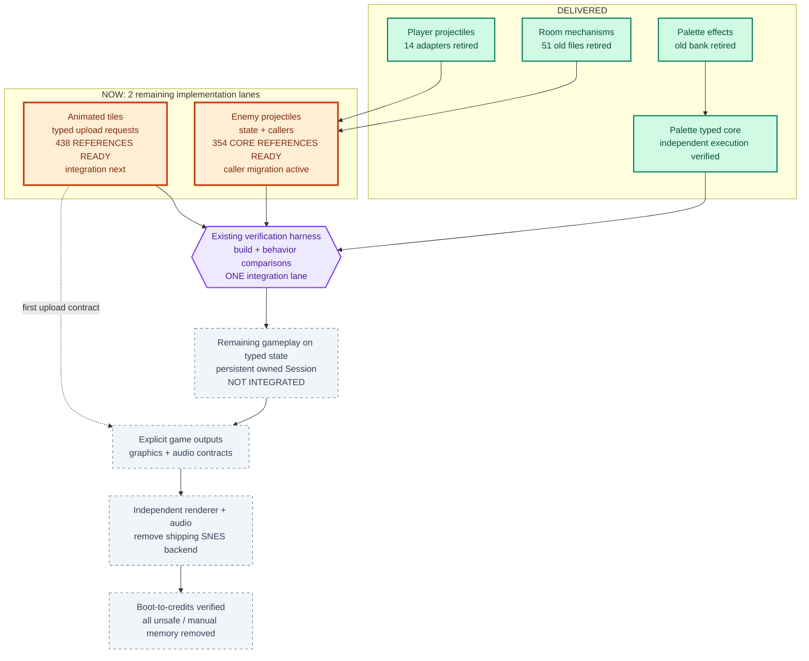

# Engine modernization

Updated: **2026-10-23 16:30 UTC**

**Target: an owned Rust Session, without manual memory access or unsafe gameplay.**
Green means that specific step is delivered, not that the entire subsystem is finished.

**Green: delivered step. Orange: active work. Grey: remaining work. Purple: verification gate.**
Arrows show migration dependencies, not current runtime calls.

| Active lane | Workers | Next visible change |
| :--- | :---: | :--- |
| Palette / Session seed | Complete | **Delivered:** typed core executes independently; production uses it through a compatibility edge. |
| Animated tiles | Implementer + reviewer | Scripts produce typed upload requests; actual graphics upload consumes and acknowledges them. |
| Enemy projectiles | Lead + reviewer + 4 focused workers | One owner replaces scattered projectile state, drops, contact handling and attached-body writes. |

**Two remaining implementation lanes feed one local compiler/integration lane.**
Palette is adopted. Animated tiles await integration; enemy projectiles still need
complete caller migration and broader verification. Node colors track verified
milestones, not a percentage inferred from code volume.

Counts and latest verified deliveries

| Measure | Current result |
| :--- | ---: |
| Total Rust lines | 110,801 |
| Latest typed-core production change | +227 lines |
| Separate verification change | +328 lines |
| Separate CI / Cargo change | +13 lines |
| Latest palette comparison | 512 cases match |
| Latest palette opening replay | 272 frames, zero failures |
| Latest mechanism game route | 28,314 frames, zero failures |

Verification is excluded from the engine-reduction measure. Some historical verification remains mixed into production files; the latest
change is priced separately above. The typed core improves architecture, but
does not reduce production size.
The new reference carriers and registrations add 834 verification-support lines,
with no production algorithm change. All 792 captures pass; the enemy suite is
core coverage, not full callback/attachment coverage.
Moving tests earns **no reduction credit**. Their relocation adds 13 support lines;
production algorithms are unchanged. Release/frontend/verifier builds, 106
projectile groups, three room-copy cases and mechanism ownership/qualified checks
pass after relocation.

- [Palette adoption](https://github.com/JimLundin/sm-decomp/commit/67d6c676): production +126 lines; verification +370. Ownership/safety progress, not size reduction.
- [Separate verification files](https://github.com/JimLundin/sm-decomp/commit/d4cd71c3).
- [Public CI formatting and frontend build pass](https://github.com/JimLundin/sm-decomp/actions/runs/39979717734).
- [Typed palette core adopted](https://github.com/JimLundin/sm-decomp/commit/601f8da3): no Game, RAM offsets or generic Port in the core.
- [Independent execution, frontend build and formatting passed](https://github.com/JimLundin/sm-decomp/actions/runs/39986571000) on GitHub Windows.
  Local Defender's standalone executable block remains respected.
- Actual runtime guard checks and 15 animated-tile callers also match; the
  production owner remains interval-scoped, not a persistent whole-game Session.

Technical evidence and limits

- Palette effects: all 512 full-memory/return/failure observations match the
  frozen old implementation. Six expected caught panics and three low-window
  diagnostics retain their exact write prefixes. The opening replay executes
  inputs 0..271, with all seven required probes and 120 frames after the last
  first hit. It contains no gameplay rooms or credits. Additional heat, alias,
  wrapping and callback branches are covered by constructed cases, not that replay.
- Palette pricing: production +126 lines / +1,388 tokens / +2,897 LF bytes;
  verification support +370 / +3,683 / +14,276; combined +496 / +5,071 / +17,173.
  Verification includes the separate 311-line carrier, private comparison
  access, seven probes, exports and source registrations. The existing shared
  transport is reused; no new native dependency or installer is added.
- Room mechanisms: 1,015 full-memory/return/native-trace outputs match, two native
  diagnostics match, and one bounded nonreturn is observed. Ownership checks and
  the qualified-command checks pass. The game route covers 12 rooms and nine
  enemy definitions, including message completion and 120 following frames.
- These checks do not establish exhaustive branches or boot-to-credits fidelity.
  Two retained native pose intervals had undefined accesses in the old Rust;
  their helper checks and static review are not defined native equivalence.
  The bounded nonreturn observes a timeout, not its preceding write dynamically.
- Historical room-mechanism total, **including verification**: -228 lines,
  -4,214 tokens, -6,464 LF bytes. The integration removed 1,154 lines after 926
  lines of reference preparation had been added. Reclassification must not
  confuse this combined figure with a production-only figure.
- Shared state transfer: production -49 lines, registration +1, verification
  +40; combined -8 lines / -5 tokens / -133 LF bytes.
- Earlier projectile adoption: +1,389 mixed lines, reported then as 596
  runtime/probe lines and 793 verification lines. Runtime and probes still need
  separation before presenting a production-only value.
- Formatting added 229 layout lines across 75 files; it changed no behavior.
  The local release/frontend/verifier build and GitHub formatting/build pass.
  The separate manual ROM workflow has not been migrated by the public CI fix.
- Current state owners still relinquish control for legacy calls. Whole-memory
  restore/load, external writers and shared suspension prevent persistent
  ownership. Rendering/audio still use the emulated backend; unsafe operations
  remain. Reference captures stay local; no ROM-derived fixtures are committed.

[Work plan](docs/PLAN.md) · [Technical handoff](docs/HANDOFF.md) ·
[Accepted engine design](docs/target-architecture/README.md)
