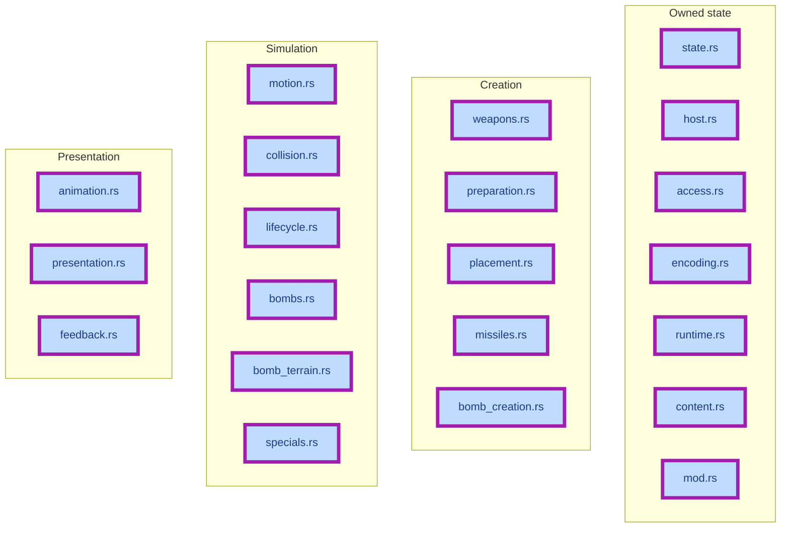
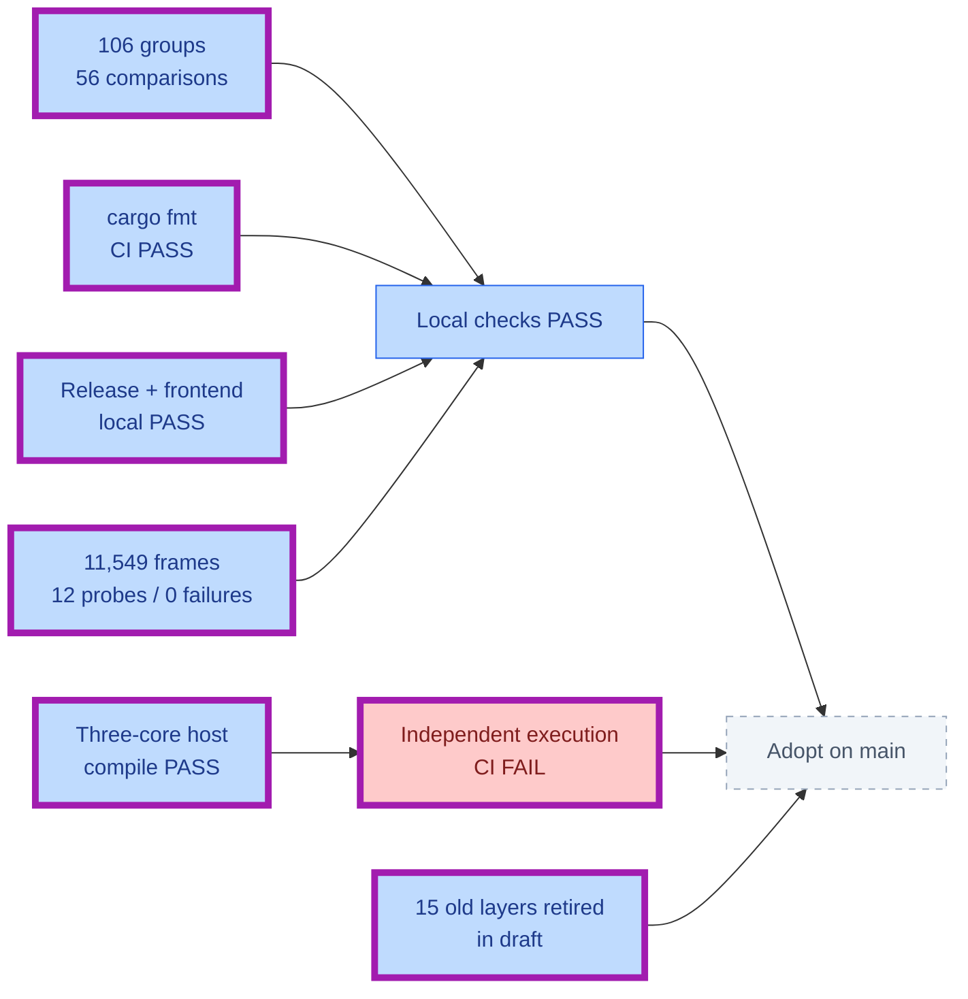
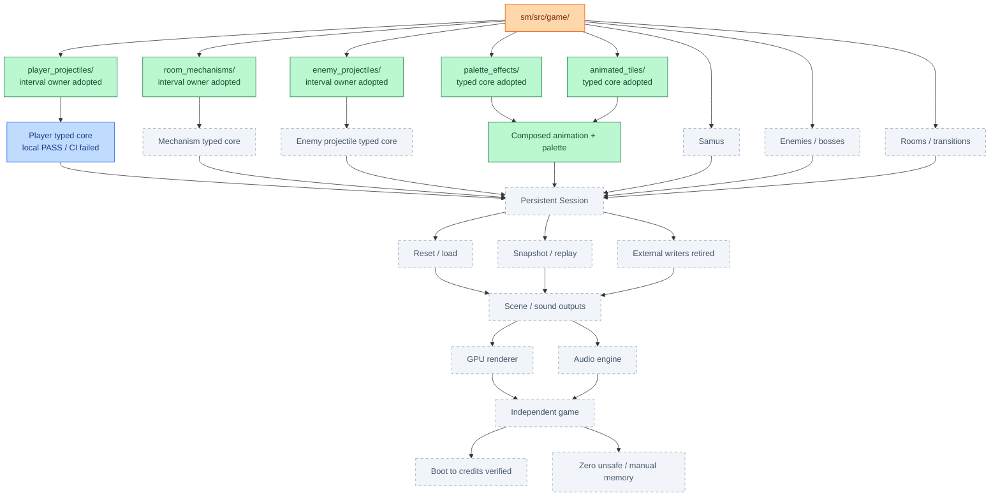
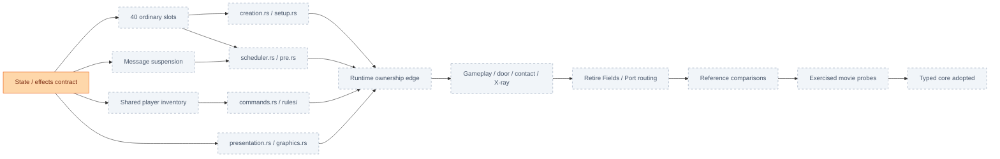
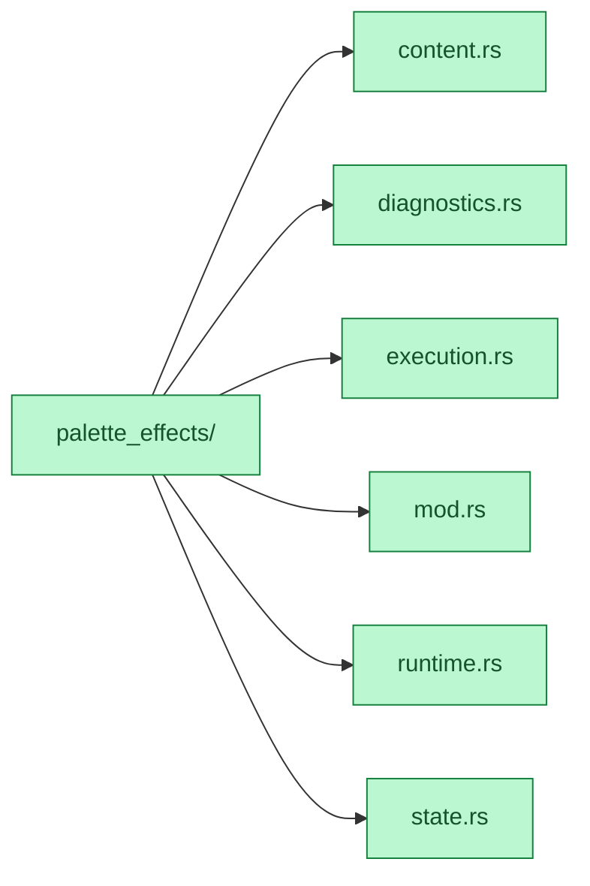
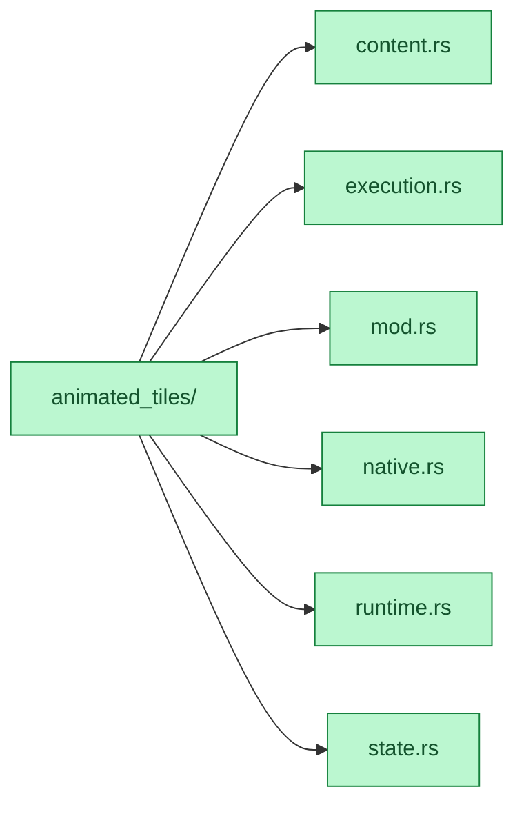
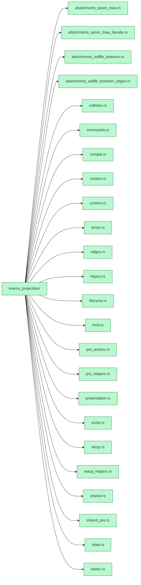

# Engine migration

Green: adopted scope | Blue: locally checked draft | Orange: active | Grey: remaining | Red: failed
**Purple outline: changed since previous report.** Folder branches show containment; check arrows show prerequisites.

[Player draft: 026ab1a2](https://github.com/JimLundin/sm-decomp/commit/026ab1a25efcc7bd329cb631f1219dbca172fa32) / [CI](https://github.com/JimLundin/sm-decomp/actions/runs/39996910420)

### Player projectiles / typed-core migration

### Destination

### Room mechanisms / next typed-core conversion

Adopted modules / expand folder maps

Green below means adopted responsibility; runtime and legacy edges still exist.

#### palette_effects/

#### animated_tiles/

#### enemy_projectiles/

#### room_mechanisms/

```mermaid
flowchart LR
    ROOT["room_mechanisms/"]:::done
    ROOT --> f0["commands.rs"]:::done
    ROOT --> f1["creation.rs"]:::done
    ROOT --> f2["effects.rs"]:::done
    ROOT --> f3["fields.rs"]:::done
    ROOT --> f4["fields_runtime.rs"]:::done
    ROOT --> f5["graphics.rs"]:::done
    ROOT --> f6["mod.rs"]:::done
    ROOT --> f7["native_content.rs"]:::done
    ROOT --> f8["port.rs"]:::done
    ROOT --> f9["pre.rs"]:::done
    ROOT --> f10["presentation.rs"]:::done
    ROOT --> f11["rules/animal_rescue.rs"]:::done
    ROOT --> f12["rules/booster_escape.rs"]:::done
    ROOT --> f13["rules/cannon_setup.rs"]:::done
    ROOT --> f14["rules/contact_physics.rs"]:::done
    ROOT --> f15["rules/crumbling_wall.rs"]:::done
    ROOT --> f16["rules/doors.rs"]:::done
    ROOT --> f17["rules/eye_door.rs"]:::done
    ROOT --> f18["rules/gates.rs"]:::done
    ROOT --> f19["rules/hands.rs"]:::done
    ROOT --> f20["rules/item_setup.rs"]:::done
    ROOT --> f21["rules/metroid_quota.rs"]:::done
    ROOT --> f22["rules/mother_brain_glass.rs"]:::done
    ROOT --> f23["rules/noob_tube.rs"]:::done
    ROOT --> f24["rules/plants.rs"]:::done
    ROOT --> f25["rules/scroll_setup.rs"]:::done
    ROOT --> f26["rules/shaktool.rs"]:::done
    ROOT --> f27["rules/sound_delay.rs"]:::done
    ROOT --> f28["rules/stations.rs"]:::done
    ROOT --> f29["rules/terrain_setup.rs"]:::done
    ROOT --> f30["rules/torizo_statue.rs"]:::done
    ROOT --> f31["rules/tourian_wall.rs"]:::done
    ROOT --> f32["rules/treadmill.rs"]:::done
    ROOT --> f33["scheduler.rs"]:::done
    ROOT --> f34["setup.rs"]:::done
    ROOT --> f35["state.rs"]:::done
    classDef done fill:#bbf7d0,stroke:#15803d,color:#14532d
    classDef checked fill:#bfdbfe,stroke:#2563eb,color:#1e3a8a
    classDef active fill:#fed7aa,stroke:#ea580c,color:#7c2d12
    classDef pending fill:#f1f5f9,stroke:#94a3b8,color:#475569,stroke-dasharray:5 5
    classDef failed fill:#fecaca,stroke:#dc2626,color:#7f1d1d
    classDef changed stroke:#a21caf,stroke-width:5px
```

[Plan](docs/PLAN.md) / [Checks and accounting](docs/HANDOFF.md) / [Target architecture](docs/target-architecture/README.md)
