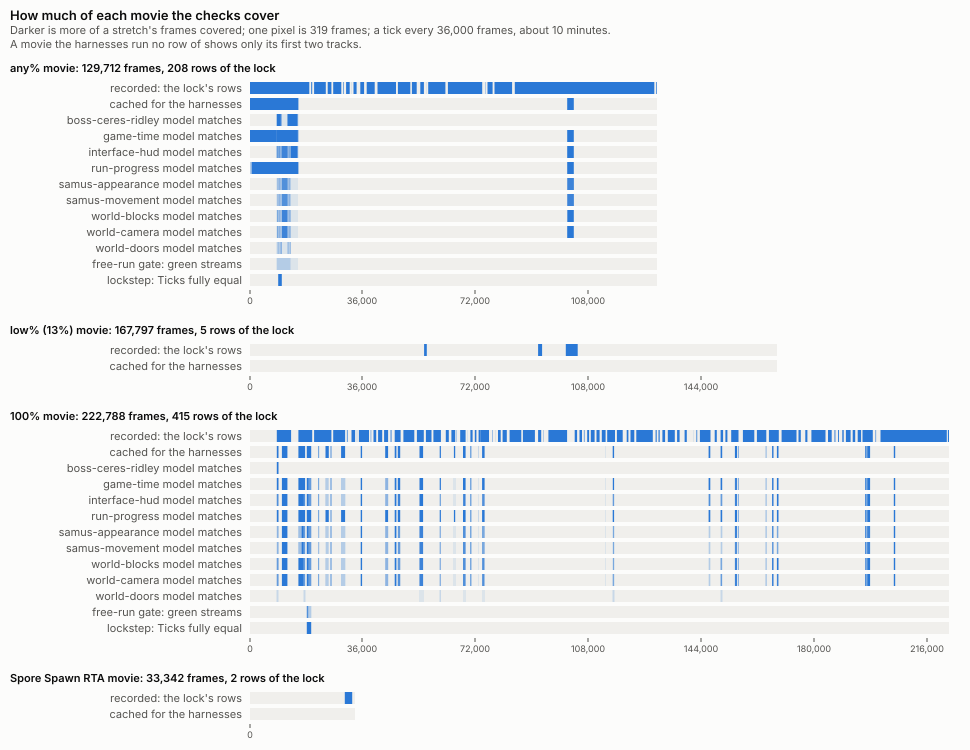

# sm-decomp

**The goal** is to model Super Metroid's behaviour, all of it, as named behaviours, so each one can
be reproduced exactly, adjusted (the space jump timing), added (respin) or removed (lag). In the
end only this engine runs; the emulator is the oracle that proves the vanilla behaviours exact.

The engine is Rust with no SNES emulation; the vanilla behaviours are proven byte-exact against
the original, unmodified ROM. Map Rando, with its custom worlds and opt-in mechanics, is the first
use case. To build it and run the checks, see [BUILDING](docs/BUILDING.md).

<!-- status:begin -->
<!-- Generated with docs/REPORT.md by `cargo run -p tools --bin tools -- report --write` (verify::report) from the tree; `tools/check_report.sh` fails when it is stale. Never edit it by hand. -->

## Where it stands

| Milestone | Frames | The engine plays alone | Still needed |
| --- | ---: | ---: | --- |
| **Power-on through Ceres**, the any% movie from power-on | 15,196 | 0 (0.0 %) | 33 of 33: S1, S2, S5, CAM, H2, P1, W2, B8, R1, E1, E2 (in progress); S4, H1, P2, W1, C1, R3, R4, F2, F4, U1, E3, E4, A1, AF0, AF1, AF2, AF3, AF4a, AF5, R2, T1, V2 (not started) |

The headline milestone ([MODEL §1](docs/architecture/MODEL.md#1-the-goal-and-what-is-exact), decision 14): the engine replays the stretch from power-on with nothing fed back, every compared cut and byte matching. Until it does, the frames it plays alone are those inside the movie's rows whose every compared stream (all but `wram`) the free-run gate holds green, each row run from its own seed. Still needed are the plan's domains and platform work the stretch touches ([domains.md §4](docs/architecture/domains.md#4-order)) that are not done.

The ladder toward it ([domains.md §4](docs/architecture/domains.md#4-order)): shorter stretches of the same movie, each played alone from its first seed, in the order the work reaches them. A rung is reached when the engine plays every frame of it alone, counted over the streams the rung claims: `video` only once it needs the line program, `apu` only once it needs the sound requests. Until then, over the lock's rows that start inside it: the rows the free-run gate starts, their green (row, stream) pairs over those streams, and the domain free run's two figures: the domain that holds the smallest share of the frames it compares, and the domain that compares the smallest share of the rows' frames after their seeds ([the report's ladder](docs/REPORT.md#the-ladder) gives every domain, why it doesn't compare the rest, and the frames no model domain compares).

| Rung | Stretch | Frames | Plays alone | Rows start | Green pairs | Free run, least held of what it compares | Free run, least compared | Still needed |
| --- | --- | ---: | ---: | ---: | ---: | ---: | ---: | --- |
| M0 | Ceres's third room, across its door, frames 9,232-9,576 | 345 | 0 (0.0 %) | 1 of 1 | 2 of 6 | 100.0 % (every domain) | 30.5 % (world-doors) | 18 of 18: S1, S5, CAM, H2, P1, B8, R1, E1, E2 (in progress); C1, R2, A1, AF0, AF1, AF2, AF3, AF4a, V3 (not started) |
| M1 | Ceres's rooms 1 to 5, down to Ridley's door, frames 8,538-10,161 | 1,624 | 0 (0.0 %) | 5 of 5 | 10 of 35 | 100.0 % (every domain) | 36.4 % (world-doors) | 22 of 22: S1, S5, CAM, H2, P1, B8, R1, E1, E2 (in progress); C1, R2, R3, E3, E4, A1, AF0, AF1, AF2, AF3, AF4a, AF5, V3 (not started) |
| M2 | Ceres with Ridley and the escape, frames 8,538-13,071 | 4,534 | 0 (0.0 %) | 10 of 10 | 20 of 70 | 99.6 % (samus-movement) | 24.7 % (world-doors) | 27 of 27: S1, S2, S5, CAM, H2, P1, W2, B8, R1, E1, E2 (in progress); S4, H1, W1, C1, R2, R3, E3, E4, A1, AF0, AF1, AF2, AF3, AF4a, AF5, V3 (not started) |

Of the 37 clean-room domains in the [whole-game plan](docs/architecture/domains.md), **9 are in progress** and **0 done**; 28 have not started. **51 rounds** have landed on 8 models; the plan estimates 157 rounds for the whole game.

How much of each whole movie the lock's rows, the harnesses, the models, the free-run gate and lockstep cover, frame by frame; the figures are in [the report's timeline](docs/REPORT.md#timeline).

### The models

Each model is built in the clean room from its spec alone, then checked frame by frame against the original game: its harness frames are the recorded frames on which it matched the original on every compared field, of the frames it ran over. Score and budget are weighted tokens; fit is score over budget.

| Model | Plan | Status | Rounds | Vectors | Harness frames | Score | Budget | Fit |
| --- | --- | --- | ---: | ---: | ---: | ---: | ---: | ---: |
| samus-movement | S1, S2 (in progress); S4, S3 (not started) | in progress | 20 | 345 | 20,856 of 40,835 | 9,400 | 8,987 | 1.05 |
| world-camera | CAM (in progress) | in progress | 6 | 83 | 23,501 of 40,835 | 1,839 | 1,762 | 1.04 |
| run-progress | P1 (in progress) | in progress | 8 | 76 | 40,442 of 40,835 | 819 | 1,061 | 0.77 |
| interface-hud | H2 (in progress) | in progress | 6 | 95 | 26,821 of 37,669 | 2,700 | 2,337 | 1.16 |
| world-blocks | W2 (in progress) | in progress | 4 | 100 | 23,517 of 35,949 | 2,395 | 2,074 | 1.15 |
| samus-appearance | S5 (in progress) | in progress | 5 | 98 | 20,977 of 37,669 | 2,191 | 1,412 | 1.55 |
| boss-ceres-ridley | B8 (in progress) | in progress | 1 | 56 | 5,437 of 40,835 | 1,299 | 1,150 | 1.13 |
| world-doors | R1 (in progress) | in progress | 1 | 70 | 1,863 of 39,824 | 3,374 | 2,912 | 1.16 |

### The whole-game plan

The plan's waves ([domains.md §4](docs/architecture/domains.md#4-order)), each domain with its plan id; rounds are the plan's estimates, platform work is in lanes.

| Wave | Clean-room domains | Platform work | Started | Rounds planned |
| --- | --- | --- | ---: | ---: |
| 0 | **S1 Samus's motion: follow-ups** (in progress); **CAM The camera** (in progress) | V1 Tooling: domain free run, RNG per consumer, cache tier (3); V3 The free-run gate and lockstep start Ceres's chain rows (1) | 2 of 2 | 2 |
| 1 | **S2 Liquids and pushes** (in progress); **S5 How Samus looks** (in progress); **H2 The HUD and the mini-map** (in progress); **W2 Blocks that react** (in progress); **P1 Progress** (in progress) | E1 Sprite drawing (2); E2 Tile writes (3); E5 The engine's State holds the models' States (3); A1 Instruction lists as assets (3); AF0 Asset formats: the shared shapes, the import crate, the content cache (2); AF1 Asset formats: the world, rooms, levels and doors (3); AF2 Asset formats: tilesets and palettes (2) | 5 of 5 | 15 |
| 2 | **R1 Doors and elevators** (in progress); W1 Beams, missiles and bombs; C1 Fighting enemies; H1 Energy, reserves and death; S4 Hurt and knockback, bomb jumps | R2 Room loading (2); AF3 Asset formats: enemies, projectiles and sprite objects (3); AF4a Asset formats: HUD art and area maps (1); V2 Whole-movie run: one free run from power-on, sparse then dense checkpoints (2) | 1 of 5 | 21 |
| 3 | **B8 Ceres Ridley and the escape** (in progress); F2 Title, intro, file select, options; F4 Cinematics and credits; R3 Liquids and room weather; R4 Room ambience; P2 Saving, loading and stations; U1 Audio, the CPU side | AF5 Asset formats: scenes and Mode 7 (4); E3 The line program (3); E4 Mode 7 and mid-line writes (2); T1 Slowdown and loading time (6) | 1 of 7 | 30 |
| 4 | W3 Items to pick up; H3 Message boxes; C2-C11 Enemy families; B1 Spore Spawn; B2 Bomb Torizo, Golden Torizo; B3 Botwoon; B4 Crocomire; B5 Kraid; B6 Phantoon; B7 Draygon; B9 Ridley; B10 Mother Brain and the escape | AF4b Asset formats: the font, messages and the pause screens (2) | 0 of 12 | 66 |
| 5 | U2 The music and sound sequencer; S3 The shinespark and echoes; S6 The grapple beam; S7 The x-ray scope; F1 The pause screen; F3 Game over | A3 Asset formats: songs, instruments, PCM samples and sound effects (3); E6 The audio mixer in runtime, not compared (1) | 0 of 6 | 23 |

### The engine

The engine's code still to be rebuilt (`crates/game` without the bridges), beside the rebuilt models. Logic-equivalent lines are score ÷ 6, the old engine's density.

| Code | Files | Logic-equivalent lines | Score | Lines |
| --- | ---: | ---: | ---: | ---: |
| not yet rebuilt | 49 | 4,981 | 29,887 | 6,920 |
| bridges from the engine to the models | 11 | 2,881 | 17,288 | 3,013 |
| rebuilt models, shared types included | 87 | 4,128 | 24,766 | 10,290 |

### Verification

The original game on an emulator (the oracle) recorded the lock's rows; the engine is held to them. See [STATUS](docs/STATUS.md) for how each is run.

| Check | State |
| --- | --- |
| the lock | 651 rows of play, 459,806 frames |
| the free-run gate: the engine runs a row alone | 29 green (row, stream) pairs over 13 rows |
| the lockstep ratchet: the engine re-seeded each Tick | 1,848 of 1,903 Ticks fully equal over 2 rows |
| the harnesses: each model on recorded frames | 63 rows cached, 40,898 frames |

Every figure, file by file and area by area, is in [the rebuild report](docs/REPORT.md); how each model is built, module by module, is in [its structure section](docs/REPORT.md#structure).
<!-- status:end -->

## Documentation

| Read | For |
| --- | --- |
| [AGENTS.md](AGENTS.md), [RULES](docs/RULES.md) | the rules every contributor and agent follows, and on one page |
| [MODEL](docs/architecture/MODEL.md), [ARCHITECTURE](docs/architecture/ARCHITECTURE.md), [PRINCIPLES](docs/architecture/PRINCIPLES.md) | the design |
| [the domain plan](docs/architecture/domains.md), [PROCESS](docs/cleanroom/PROCESS.md) | the whole game as clean-room domains; how a round runs |
| [ORACLE](docs/ORACLE.md) | the oracle, the lock and the data bundles |
| [LEGACY](docs/LEGACY.md), [STATUS](docs/STATUS.md) | known differences; how progress is measured |
| [docs/behaviours/](docs/behaviours/) | what Super Metroid does, domain by domain |
| [crates/README.md](crates/README.md) | the crates and their dependencies |

## Credits and licence

[LakeSnes](https://github.com/angelo-wf/LakeSnes) (MIT) is linked into the oracle: the build
fetches its pinned sources and their licence; the repository carries only the project's fixes to it
(`crates/oracle/native/fixes/`).
[lsnes](https://tasvideos.org/EmulatorResources/Lsnes) and
[MesenCE](https://github.com/nesdev-org/MesenCE) run as separate processes; none of their code is
linked or copied. The crates in `vendor/` are registry crates, each with its own licence files.
Patrick Johnston's [bank logs](https://patrickjohnston.org/bank/) inform names
and behaviour. Original contributions are MIT ([LICENSE](LICENSE)). Super Metroid is a trademark
of Nintendo; no ROM or game data is included.
