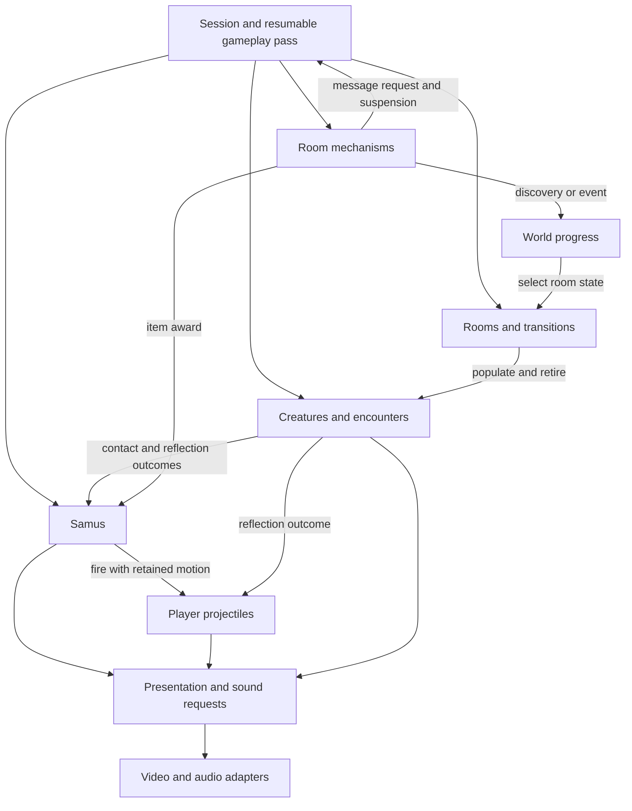
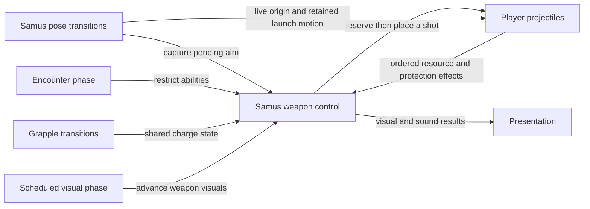
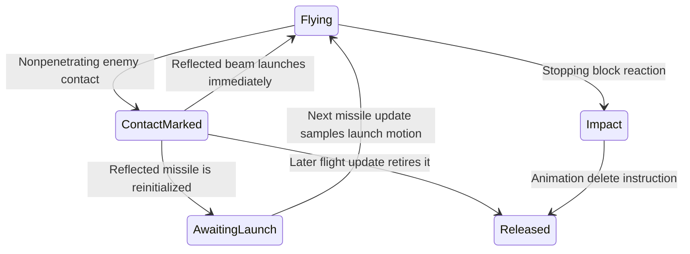

# Super Metroid engine design

The target is a game expressed through owned state, named transitions and ordered
interactions. A reader should find running, firing, collecting an item, opening a
door or advancing a boss encounter without knowing a memory bank or RAM address.
The compatibility implementation must preserve the current game's behavior,
including quirks. This document coordinates that direction; it does not claim
that the proposed owners already exist as complete Rust modules.

The [architecture atlas](architecture.html) is the interactive overview. The
[RAM ownership research](RAM_OWNERSHIP.md) establishes concrete producer/consumer
contracts. The [state migration audit](ENGINE_STATE_MIGRATION.md) identifies how
the current runtime replaces state. [PLAN.md](PLAN.md) remains the work order and
validation policy.

## One game, several cooperating state machines

These arrows describe responsibility and observation, not one universal update
order. The coordinator preserves the actual order below. An encounter may contain
several internal state machines; an enum for every instruction is not required.

| Owner | State and rules it owns | Inputs and outcomes at its interface |
| --- | --- | --- |
| Session | Play/pause/door/death/cinematic mode, the gameplay continuation, save/load requests | Controller input and nested completion/yield results; advances the next permitted phase |
| Samus | Locomotion, pose and gameplay animation, health/resources/abilities, weapon control, pending aim, launch history and contact protection | Input, resolved contacts, carry/push, item awards and encounter restrictions; movement, shot requests and presentation changes |
| Player projectiles | Reservation, placement, flight, collision response, trails, linked extensions and retirement | Shot/reflect requests and ordered contact results; reservation results, ammunition/cooldown/protection effects, impact, damage and presentation outcomes |
| Creatures and encounters | Population, active slots, creature-specific behavior, combat reactions, multipart coordination | Room population, contacts and stimuli; movement, attacks, drops, progress and room changes |
| Room mechanisms | Doors, stations, destructible blocks, pickups and platform behavior; each scheduler's continuation | Trigger/contact/script result; block changes, carry/push, item awards and message requests |
| Rooms | Selected room instance, geometry, environment, camera and entry/exit sequence | Door and progress input; population changes, mechanism setup and discovered-map observations |
| World progress | Event/boss/item-location facts and explored map | Explicit fact changes; room-selection and persistence queries |
| Presentation and audio | Visual-only animation, HUD/dialogue display, sound sequencing and backend output | Requests and the state needed to present them; dialogue completion at its original phase |
| Definitions | Immutable authored rooms, species, poses, attacks and scripts | Named definition lookup; compatibility decoding stays below the gameplay interface |

Equipment and ammunition have one live owner: Samus. World progress owns world
facts; it does not hold a second independently mutable inventory. Save orchestration
selects persistent values from their owners. A save-game restore and a verifier
checkpoint are different operations: the former intentionally restores a selected
game state, while the latter must reproduce the current execution point.

Hostile projectiles retain their own lifecycle. PLM room scripts and enemy scripts
retain their own continuation and selector rules. Sharing an implementation is
earned by matching a complete behavior contract, not by having similar records.

## Keep the observed execution order

The ordinary [gameplay pass](../sm/src/game/gameplay.rs) currently orders:

1. Active-enemy selection, palette effects and Samus preparation. Preparation
   includes player firing/projectile work, then clears directional launch history.
2. Player-shot interactions and enemy processing. Contact and reflected beams can
   already change the inputs used later in this pass.
3. A possible enemy-message suspension. Resume continues after the earlier phases;
   it must not rerun preparation or apply an already committed award again.
4. Samus movement/pose completion, then hostile projectiles.
5. Room objects, with their own nested message continuation and possible suspension.
6. Animated tiles, further interaction passes, camera, drawing, HUD and room code,
   then health/time, shaking and timers.

Door transitions, frozen modes and cinematics use other schedules. A single
`update_everything(dt)` would conceal these contracts. A frame-end event queue
would delay mutations past their consumers. Apply each named outcome before the
next observer that currently sees it; retain continuations across suspension.

Rendering is not wholly passive yet. Samus animation can change gameplay handlers
and trigger transitions; those decisions belong with Samus. The renderer should
eventually consume their visual results. Moving the current animation code wholesale
to a renderer would change its ownership incorrectly.

## What the existing models establish

The following are real implementations, not the full proposed owner interfaces:

- [LaunchMotion](../sm/src/game/launch_motion.rs) records directional movement,
  returns launch velocity without consuming history, and clears at the end of
  projectile processing. Its four records and separately supplied absolute-Y
  fraction preserve cross-direction inheritance. The
  [adapter](../sm/src/game/launch_motion_ram.rs) still loads/stores RAM and preserves
  vertical-write-before-horizontal-read behavior for unusual slot aliases.
- [Inventory and MessageHandoff](../sm/src/game/item_pickups.rs) codify item awards
  and instruction/display resumption. Awards commit before visual/music/display
  calls. The [inventory adapter](../sm/src/game/item_pickups_ram.rs) still decodes
  state for each operation. This does not own every health/ammunition writer.
- [Population creation](../sm/src/game/enemy_population.rs) owns operation-local
  search and multipart iteration. Its [adapter](../sm/src/game/enemy_population_ram.rs)
  commits fields before initializers and distinguishes captured slot identity from
  the live selector. It does not own persistent enemy execution state.
- [ApuQueue](../sm/src/apu_queue.rs) is an example of an actual persistent owner:
  `Game` stores the queue value, its consumers use that value, and
  [snapshots](../sm/src/audio_snapshot.rs) explicitly capture/restore it.

Pure decisions are useful progress. Persistent ownership requires the additional
step of retiring competing state access. A `Game` field plus independently mutable
RAM would create two authorities. Naming a file or adding getters does not close
that gap. The adopted launch, pickup and population changes currently add 113,
154 and 310 complete maintained lines respectively; they establish no deletion
forecast for the final engine.

## The state and compatibility contract

The final gameplay interface receives typed state and meaningful inputs, mutates
only its owner's state, and returns named outcomes. It does not receive `Game`,
a byte array, memory addresses or hardware pointers. Fixed-width arithmetic remains
part of the game rule where the current behavior depends on wrapping or truncation.

There must be one authority at each execution point:

- An unmigrated responsibility continues to use RAM as its authority.
- A closed gameplay responsibility uses its typed state as authority; compatibility
  bytes are a derived representation for identified legacy consumers and the oracle.
- Entering a legacy/CPU operation that can change that state is an explicit
  authority transfer: publish required bytes, execute the foreign operation, import
  the selected result before any typed consumer continues. No typed borrow survives
  the call. If those writes are not yet understood, the responsibility is not closed.

The current differential oracle runs CPU and Rust alternatives using the same live
RAM allocation, restoring snapshots between them and adopting the CPU result after
comparison. Other owners have their own selection rules: successful native-player
state and physical-audio/queue state can come from Rust, while pending commands
can come from the CPU run. Preserve those per-owner choices. An owned state value
must follow its applicable restores too. A decode only at
frame start misses the restore immediately before Rust execution. A writeback only
at frame end misses intermediate readers and suspensions. Continuation-byte
normalization also means that green RAM comparisons alone do not independently
prove all continuation behavior. See the [transfer audit](ENGINE_STATE_MIGRATION.md)
for the source paths and limitations.

Initialization, hard reset, game save/load, replay patches, checkpoint restore,
inline CPU calls and physical RAM writes are producers as well. Import cannot be
added only to the ordinary gameplay caller. Nor does a search for named fields
exclude aliases from generic native indexed writes. Even a temporary whole-RAM mutable view can invalidate retained pointers; simply
ending it before the next callback is insufficient. Retained native pointers
into player/hardware records impose the same constraint on those records. Use
scoped field access while migrating those pointer lifetimes. The byte representation must
preserve unrelated/unused bytes and mode-dependent interpretations until they
have a separately validated replacement.

## Next complete gameplay replacement: player projectiles

The coordinated candidate is the **full player-projectile lifecycle**, using the
existing launch model as a state-transfer experiment. Its complete price and final
implementation are not yet established. A standalone persistent LaunchMotion field
is insufficient while other projectile operations can still write into its bytes.

The scope includes these connected responsibilities:

- Samus weapon control through firing input, allocation/reservation,
  ammunition/cooldown/protection effects and initialization
  in [beam_firing](../sm/src/game/beam_firing.rs) and [sm_90](../sm/src/game/sm_90.rs).
- Launch history producers/reset, immediate beam reflection and later missile
  activation. Keep the independently sampled absolute-Y fraction explicit.
- Flight, axis order, live/captured selectors, extension creation/collision/cleanup
  in [projectile_flight](../sm/src/game/projectile_flight.rs).
- Contact traversal/results in [sm_94](../sm/src/game/sm_94.rs), and enemy-specific
  reflection/damage call sites. Keep legacy contact execution as an identified
  authority transfer until its writes become explicit outcomes.
- Projectile animation, trails, bombs/special attacks, retirement and room/reset
  initialization in [projectile_animation](../sm/src/game/projectile_animation.rs)
  and its callers. Distinct projectile policies remain visible.
- Persistence/import/export through every affected runtime path, including
  off-table aliases that the current accepted index domain permits.

Slot identity initially preserves reuse semantics. A captured slot is not a copy
of its contents; a live selector is not a stable handle. Adding generation checks,
rejecting callback redirection or replacing the population search with a normal
contiguous allocator requires separate evidence because each can change behavior.

The first experiment must attempt to break state ownership: run/restore/rerun,
suspend/resume, reset/load, apply a replay patch, and exercise the known aliased
launch stores. It must show which representation wins at each step and compare
unrelated bytes too. Then expand to the complete projectile responsibility, pricing
all retained compatibility, callers and registrations. Small commits can advance
this design, but a collection of temporary value models does not complete it.

## Samus weapon control and projectile ownership

The [weapon-control audit](RAM_OWNERSHIP.md#11-samus-weapon-control-crosses-projectiles-grapple-and-encounters)
distinguishes the player's ability state from allocated shots. Samus owns the
single live inventory, charge/control state, pending aim and contact protection.
Projectiles own reservation and each shot's lifecycle. Firing joins these owners
through ordered decisions and effects; it is not one atomic success/failure call.
Reservation or placement failure can retain selected earlier changes.

The names below are proposed operations, not new production functions:

| Contract | Required state and transition |
| --- | --- |
| Capture / consume aim | Retain the captured direction separately from live origin pose/position. Placement consumes it once; reservation rejection retains it until the phase clear. Pending aim can release a beam while shoot stays held. |
| Change weapon mode | Beam and grapple share charge state. Grapple start, release, ordinary beam charge and hyper flare have distinct transitions; separate independent charge clocks would change behavior. |
| Apply encounter restriction | Shitroid drain communicates through cooldown, bomb reservation count and motion state. Preserve its exact X-ray observation point before replacing that encoding with a named restriction. |
| Grant / advance contact protection | Successful firing placement grants Samus global projectile protection. Its countdown belongs to completed gameplay, not individual shot updates or releases. |
| Advance weapon appearance | Current draw code advances flare state and can end hyper's active marker; palette handling separately advances glow. Schedule these gameplay transitions at their current phases and return visual results. |
| Restore weapon sound | Ordinary, deferred and republished resume requests differ; message/unpause completion also has a direct restoration path. |
| Cancel / reset | Clear-charge, clear-charge-and-flare, projectile reset and Samus initialization retain different state. Keep the named causes and affected values explicit. |

The [typed aim follow-up](RAM_OWNERSHIP.md#typed-aim-and-placement-follow-up)
implements capture, one-use consumption, phase expiry, default/fallback selection
and live-origin placement. **383 actual old/new comparisons** pass, including
44 matching failures and 24 real extension-caller compositions. The latter show
that extension creation ignores placement rejection and still initializes its
slot; ordinary firing does not. Failure and rejection therefore have named,
caller-specific meanings. A separate sequence retains the typed pending state
without intermediate RAM decoding. The model and checked experiment adapter
forbid unsafe code; production integration and global writer closure remain open.
The preceding 68-fixture discovery experiment is preserved separately.

The [scheduled flare prototype](RAM_OWNERSHIP.md#scheduled-beam-and-grapple-flare-transitions)
also makes beam/hyper/grapple visual progression and the later grapple charge
increment explicit. **324 old/new comparisons** pass, with 66 matching failures.
It preserves entry-selected mode, post-draw charge rereads and tile-before-increment
ordering. Named sequence lookup keeps ROM addresses in the adapter. This must
join the same charge owner as firing; sprite geometry/output and other effects
remain controlled. Palette/glow, sound restoration, cancellation and encounter
restrictions above still have source-audited rather than new execution coverage.

The full projectile draft may temporarily aggregate these inputs for comparison.
Its final interface must give each value one authority and apply cross-owner
effects before the next observer, including before a failure. This refinement
does not require a second live Samus copy alongside the draft's state.

## Projectile interactions define the interface

The [contact and retirement audit](RAM_OWNERSHIP.md#4-projectile-execution-has-several-different-selector-lifetimes)
refines the proposed owner beyond a bag of projectile fields. The following is a
partial ordinary beam/missile lifecycle, not a complete replacement enum:

Contact preparation and reaction are separate observation points. The enemy
reaction sees the retirement mark and can replace it with a reflected direction.
An impact animation still occupies a projectile slot. A release and a system reset
retain different old fields and have different count, HUD and palette effects.
Do not implement all of these operations as `shot = None` or a default record.
Compatibility residue can stay in the adapter where it has no gameplay meaning;
facts used by later gameplay remain part of the owner's explicit rules.

Reflection also changes target eligibility independently of ownership. Reflec
enables the existing projectile to interact with Samus; reflecting pirates retain
the previous eligibility flag. Neither moves the shot to the hostile-projectile
pool. Enemy contact remains separately eligible. The model needs explicit contact
policy, rather than treating every reflection as a change to an exclusive faction.
The source's asserted Samus-damage path remains a validation limitation.

The proposed interface has these responsibilities:

| Operation | Owner interaction and completion point |
| --- | --- |
| Prepare enemy contact | Record the selected projectile and provisional retirement mark before the encounter reaction |
| React to contact | Encounter decides its response; apply redirection, target eligibility and launch/reinitialization at the original call point |
| Advance through room geometry | Preserve movement and each synchronous block/mechanism reaction before testing subsequent cells or axes |
| Begin impact | Projectile retains allocation and owns gameplay animation; apply sound, shake and cooldown effects in their existing order |
| Retire / reset | Distinct projectile transitions, with explicit selected effects on Samus/HUD/presentation |

These names describe the target protocol, not new public functions already in
production. The implementation may use internal continuations while a foreign
reaction is outstanding. It must retain captured identity and resume with the
returned live state. A final outcome list cannot defer effects that the next
reaction or collision sample currently observes. The source audit adds no new
movie or collision-handler execution coverage; tests of the launch calculation
alone do not validate these caller interactions.

## First authority-transfer result

The [follow-up experiment](RAM_OWNERSHIP.md#persistent-authority-transfer-before-the-full-projectile-replacement)
on source `15589b48` passes 60 comparisons and 14 discriminating checks. Its
prototype removes the usable `LaunchMotion` value during runtime ownership,
then explicitly reconstructs it on return. Repeated typed movement/firing needs
no intermediate RAM decode. Real bus/replay/reset/frontend snapshot operations
exercise that protocol; exact private oracle bodies use local snapshot types,
frame scheduling is controlled, and checkpoint coverage is only the RAM archive
stage. This supports the selected transfer mechanics, not production integration,
complete checkpoint recovery, absence of untracked writers or the full owner.

The full replacement must put these transfers at every required production entry.
A manually correct pair of publish/import calls is not enforcement against an
untracked RAM writer. Its interface should make the inactive owner unavailable
through foreign execution, preserve nesting and failures, and encode those rules
in the actual callers. The whole-projectile implementation and full cost remain
open; no savings or gameplay-route coverage follow from this prototype.

The [reviewed full draft stage](RAM_OWNERSHIP.md#whole-projectile-draft)
passes 1,634 comparisons, with controlled foreign calls. Its owner crosses
those calls by value, rereads returned inputs, and publishes partial state before
diverging on an invalid table lookup. It covers beam input/firing, flight,
acceleration, extensions, release, projectile animation/drawing decisions and
linked production cooldown. Beam firing and extension creation now call owned
placement and initialization directly, removing those legacy effects and their
publish/import round trips. Broad-index placement uses the checked adapter and
the same aim model. Launch speed, real contact reactions, remaining weapons/trails/
reset and production runtime integration remain outstanding in this stage.
Other out-of-pool execution retains reference bodies. No whole-replacement cost
is established.

State ownership alone will not finish the game-facing interface. This draft still
uses raw bank addresses for definition lookup, numeric animation instruction
pointers and `Motion::Legacy` for some behaviors. These are explicit compatibility
debt. Named attack/animation definitions and remaining motion transitions must
replace them, with address decoding and observed failure behavior in the adapter.
Retaining a captured definition allocation while observing its live contents is
also an existing contract; eagerly decoding every definition would require its
own equivalence argument. Both definition and state migration costs belong in
the complete replacement price.

## Shared behavior and coordination

Reuse complete mechanics already present: beam flight policies, projectile
animation, platform/shutter travel, liquid motion, geometry and ordered room
definition application. Extend them where the inputs, ordering, failures and
exceptions match. A universal actor system, event bus or script VM is not required
by the evidence. Authored variation belongs in definitions when one algorithm
already interprets it; ordering-sensitive behavior stays explicit.

The gameplay work owns the projectile lifecycle investigation and its consumers.
The runtime work owns the byte-image authority transfers, snapshots, hardware and
native safety constraints. This design work keeps their interfaces consistent,
checks that proposed ownership is real, and updates the atlas from adopted source.
No Git locks are reserved; compiler work and shared edits retain PLAN's existing
coordination rules.

Validation remains PLAN's strategy: test changed behavior and actual downstream
observers, record controlled-callback limitations, and select oracle segments with
required hits. Existing component results do not establish new gameplay routes or
boot-to-credits completion. Removing adapters is only a gross saving until the
complete replacement and retained runtime costs have been measured.
