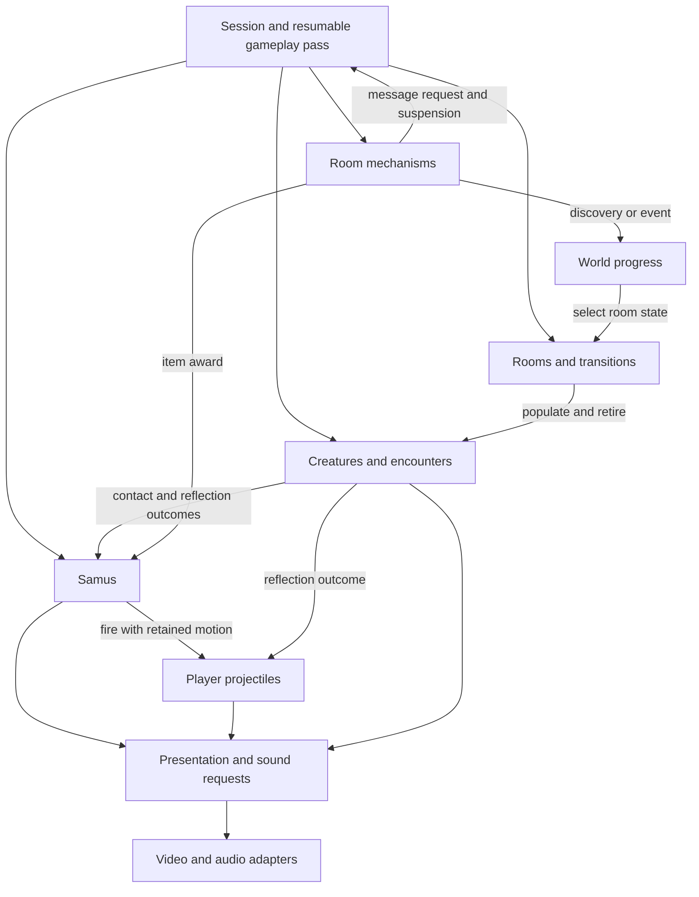
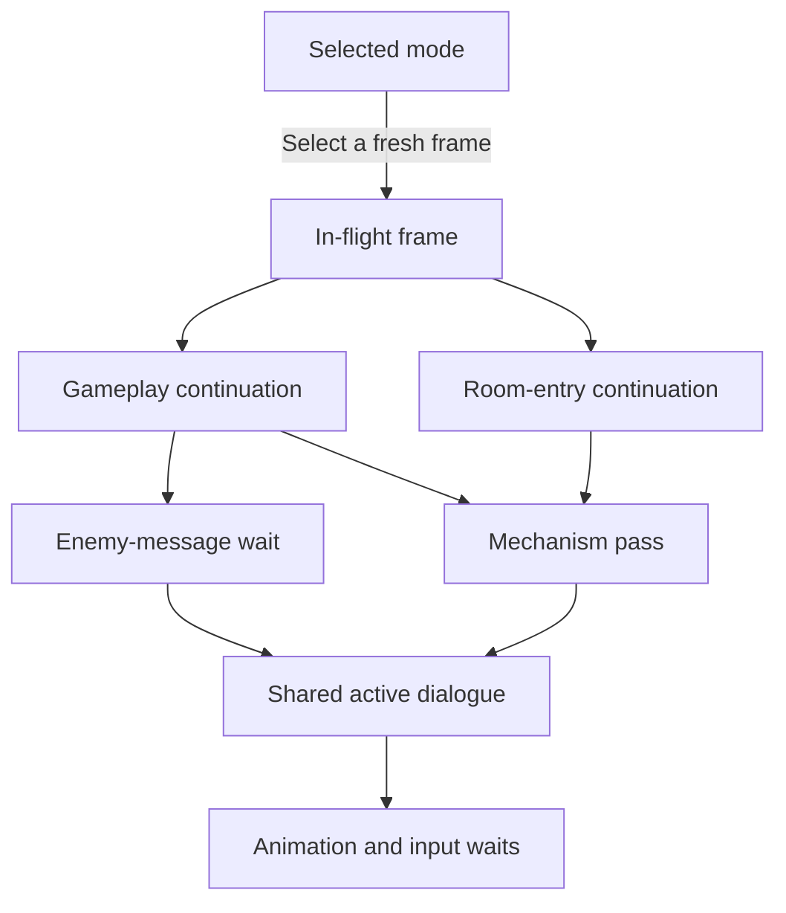
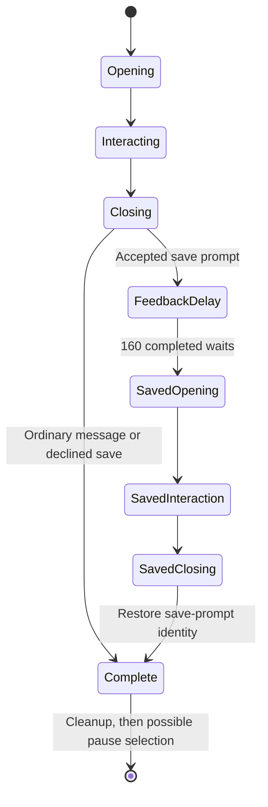
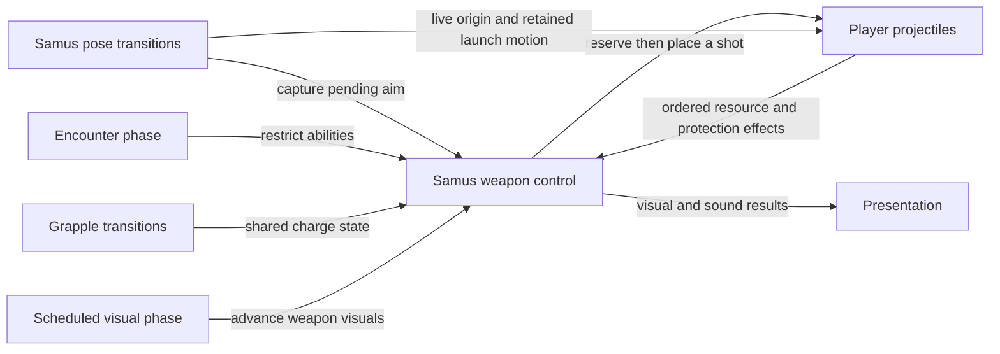
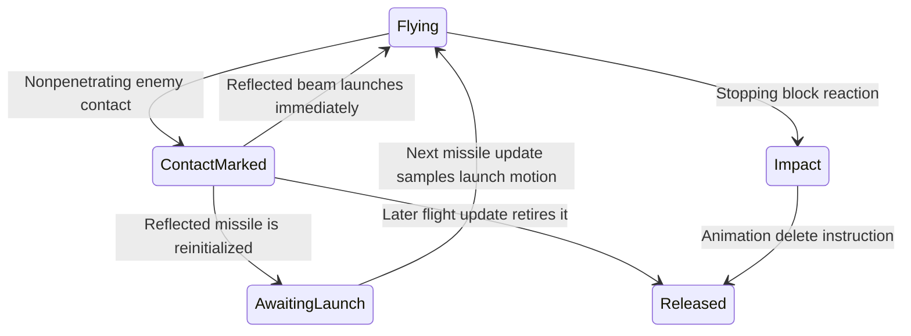
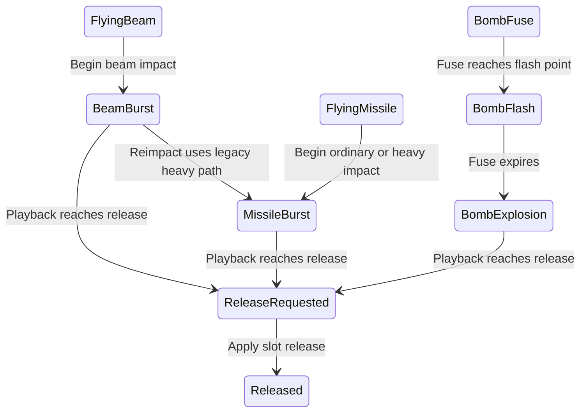
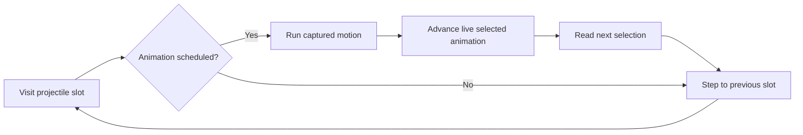
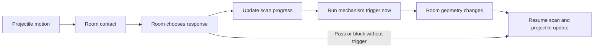
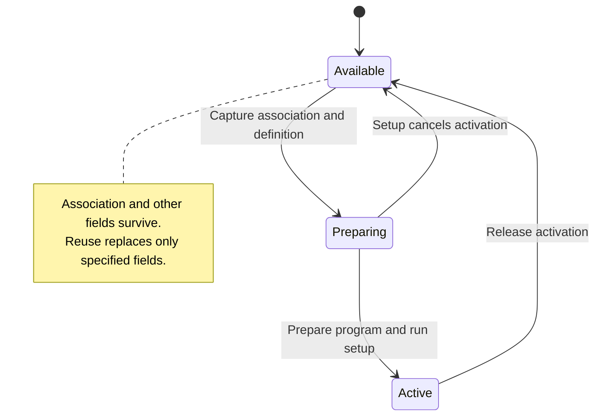

# Super Metroid engine design

The accepted destination is now [architecture revision 3](target-architecture/README.md).
This earlier design records migration experiments and current-runtime contracts.
Use the [migration handoff](target-architecture/MIGRATION.md) to apply those findings
without treating the current compatibility interfaces as the finished Session.

The target is a game expressed through owned state, named transitions and ordered
interactions. A reader should find running, firing, collecting an item, opening a
door or advancing a boss encounter without knowing a memory bank or RAM address.
The compatibility implementation must preserve the current game's behavior,
including quirks. This document coordinates that direction; it does not claim
that the proposed owners already exist as complete Rust modules.

The
[RAM ownership research](RAM_OWNERSHIP.md) establishes concrete producer/consumer
contracts. The [state migration audit](ENGINE_STATE_MIGRATION.md) identifies how
the current runtime replaces state. [PLAN.md](PLAN.md) remains the work order and
validation policy.

## One game, several cooperating state machines

These arrows describe responsibility and observation, not one universal update
order. The coordinator preserves the actual order below. An encounter may contain
several internal state machines; an enum for every instruction is not required.

| Owner | State and rules it owns | Inputs and outcomes at its interface |
| --- | --- | --- |
| Session | Play/pause/door/death/cinematic mode, the gameplay continuation, save/load requests | Controller input and nested completion/yield results; advances the next permitted phase |
| Samus | Locomotion, pose and gameplay animation, health/resources/abilities, weapon control, pending aim, launch history and contact protection | Input, resolved contacts, carry/push, item awards and encounter restrictions; movement, shot requests and presentation changes |
| Player projectiles | Reservation, placement, flight, collision response, trails, linked extensions and retirement | Shot/reflect requests and ordered contact results; reservation results, ammunition/cooldown/protection effects, impact, damage and presentation outcomes |
| Creatures and encounters | Population, active slots, creature-specific behavior, combat reactions, multipart coordination | Room population, contacts and stimuli; movement, attacks, drops, progress and room changes |
| Room mechanisms | Doors, stations, destructible blocks, pickups and platform behavior; each scheduler's continuation | Trigger/contact/script result; block changes, carry/push, item awards and message requests |
| Rooms | Selected room instance, geometry, environment, camera and entry/exit sequence | Door and progress input; population changes, mechanism setup and discovered-map observations |
| World progress | Event/boss/item-location facts and explored map | Explicit fact changes; room-selection and persistence queries |
| Presentation and audio | Visual-only animation, HUD/dialogue display, sound sequencing and backend output | Requests and the state needed to present them; dialogue completion at its original phase |
| Definitions | Immutable authored rooms, species, poses, attacks and scripts | Named definition lookup; compatibility decoding stays below the gameplay interface |

Equipment and ammunition have one live owner: Samus. World progress owns world
facts; it does not hold a second independently mutable inventory. Save orchestration
selects persistent values from their owners. A save-game restore and a verifier
checkpoint are different operations: the former intentionally restores a selected
game state, while the latter must reproduce the current execution point.

Hostile projectiles retain their own lifecycle. PLM room scripts and enemy scripts
retain their own continuation and selector rules. Sharing an implementation is
earned by matching a complete behavior contract, not by having similar records.

## Keep the observed execution order

The ordinary [gameplay pass](../sm/src/game/gameplay.rs) currently orders:

1. Active-enemy selection, palette effects and Samus preparation. Preparation
   includes player firing/projectile work, then clears directional launch history.
2. Player-shot interactions and enemy processing. Contact and reflected beams can
   already change the inputs used later in this pass.
3. A possible enemy-message suspension. Resume continues after the earlier phases;
   it must not rerun preparation or apply an already committed award again.
4. Samus movement/pose completion, then hostile projectiles.
5. Room objects, with their own nested message continuation and possible suspension.
6. Animated tiles, further interaction passes, camera, drawing, HUD and room code,
   then health/time, shaking and timers.

Door transitions, frozen modes and cinematics use other schedules. A single
`update_everything(dt)` would conceal these contracts. A frame-end event queue
would delay mutations past their consumers. Apply each named outcome before the
next observer that currently sees it; retain continuations across suspension.

Rendering is not wholly passive yet. Samus animation can change gameplay handlers
and trigger transitions; those decisions belong with Samus. The renderer should
eventually consume their visual results. Moving the current animation code wholesale
to a renderer would change its ownership incorrectly.

## Session and dialogue continuations

The [nested-session experiment](RAM_OWNERSHIP.md#mechanisms-inside-session-and-dialogue-continuations)
compares the owned mechanism pass inside the actual frame, gameplay, door-entry
and message-display control flow. The proposed owners must preserve these
separate state lifetimes:

| State | Owner and transition rule |
| --- | --- |
| Selected game mode | Session selects the next fresh frame's schedule. Changing this value alone does not redirect a suspended frame. |
| In-flight frame | Session retains the dispatch context until completion or an explicit imported continuation override. A new frame resets nested continuations before input. |
| Gameplay or room-entry phase | Its caller retains which work has completed. Resuming a mechanism message repeats neither Samus preparation nor room loading. |
| Mechanism pass | Retains selection and script continuation independently of activation. Resuming display can continue a deactivated slot. |
| Message request and active dialogue | One message service owns the overwriteable request and the separate active dialogue cycle. A resumed display does not replace its active message merely because its caller now supplies another request. |
| Dialogue animation/input wait | The dialogue owner retains its child continuation. The experiment controls these leaf operations; their complete migration is still required. |

The queue holds one overwriteable request. The experiment changes the queued
request from 12 to 77 while dialogue 12 is suspended. Display continues dialogue
12, then its caller clears the live request, including 77.
Preserve this consumption rule through the message service. Both enemy and
mechanism callers should share the dialogue implementation while retaining their
own continuation. The active dialogue fields can themselves change through legacy
callbacks; they remain part of the explicit transfer boundary.

Imported continuation state can also redirect the in-flight frame independently
of the selected mode. Compatibility import must preserve that distinction and
the existing invalid-state behavior. During normal completion, finish gameplay's
tail and decrement timers once before selecting the next frame. Room entry has
its own completion effects and does not run the gameplay timer tail.

The shared [dialogue controller](../sm/src/game/dialogue.rs) now implements this
control flow in production through owned values and named phases/effects. Its
[compatibility adapter](../sm/src/game/dialogue_ram.rs) encodes message identity,
parent/child continuations, radius, selection and delay; the existing display
bridge consumes the owner before every external operation and imports its result.
The controller and codec forbid unsafe code. Animation and input transitions run
inside the same owner. Waiting, input acquisition, audio and display output remain
external operations; parent-to-child calls require no compatibility transfer.

Every phase can suspend and resume without repeating prior effects. The saved
cursor and the current invocation's local phase are distinct: callback changes
to the cursor remain visible but do not redirect that invocation. Cleanup reads
the live message after restoring display and movement sound; map acquisition
selects pausing at that point. Save feedback reuses the same opening, interaction
and closing transitions with a different cycle.

Input has confirmation, minimum-reading-delay and dismissal phases. Confirm wins
over cancel, then navigation toggles selection. Dismissal does not advance audio
and preserves the existing held-versus-new-key policy. Opening presents its final
radius before completing; closing retains its underflow value.

Reading delay and save feedback share **one timer**. The active phase supplies its
meaning; separate counters would lose the existing alias. The first owned-child
comparison caught exactly that error, before adoption. The child wait token also
needs its invoking phase: animation and confirmation share their first saved token,
while an input-only token terminates animation as an invalid continuation.

The [latest dialogue experiment](RAM_OWNERSHIP.md#animation-and-input-inside-the-dialogue-owner)
passes 911 child/display/nested comparisons and 80 affected caller comparisons.
Four native lifecycles retain one owner over 676 waits without RAM/ROM decoding.
The full projectile candidate also composes this exact model with actual awards
and caller/script consumers: its separately rerun 313 comparisons pass. These
suites overlap in caller coverage; they do not form an additive unique-case total.

Production still serializes dialogue between calls. Closing the remaining output,
queue producers/consumers and runtime imports is required before a persistent
engine owner can replace that storage. Neither these checks nor the candidate
outer passes establish a complete session engine or frontend checkpoint support.

## What the existing models establish

The following are real implementations, not the full proposed owner interfaces:

- [LaunchMotion](../sm/src/game/launch_motion.rs) records directional movement,
  returns launch velocity without consuming history, and clears at the end of
  projectile processing. Its four records and separately supplied absolute-Y
  fraction preserve cross-direction inheritance. The
  [adapter](../sm/src/game/launch_motion_ram.rs) still loads/stores RAM and preserves
  vertical-write-before-horizontal-read behavior for unusual slot aliases.
- [Inventory and MessageHandoff](../sm/src/game/item_pickups.rs) codify item awards
  and instruction/display resumption. Awards commit before visual/music/display
  calls. The [inventory adapter](../sm/src/game/item_pickups_ram.rs) still decodes
  state for each operation. This does not own every health/ammunition writer.
- [Population creation](../sm/src/game/enemy_population.rs) owns operation-local
  search and multipart iteration. Its [adapter](../sm/src/game/enemy_population_ram.rs)
  commits fields before initializers and distinguishes captured slot identity from
  the live selector. It does not own persistent enemy execution state.
- [ApuQueue](../sm/src/apu_queue.rs) is an example of an actual persistent owner:
  `Game` stores the queue value, its consumers use that value, and
  [snapshots](../sm/src/audio_snapshot.rs) explicitly capture/restore it.

Pure decisions are useful progress. Persistent ownership requires the additional
step of retiring competing state access. A `Game` field plus independently mutable
RAM would create two authorities. Naming a file or adding getters does not close
that gap. The adopted launch, pickup and population changes currently add 113,
154 and 310 complete maintained lines respectively; they establish no deletion
forecast for the final engine.

## The state and compatibility contract

The final gameplay interface receives typed state and meaningful inputs, mutates
only its owner's state, and returns named outcomes. It does not receive `Game`,
a byte array, memory addresses or hardware pointers. Fixed-width arithmetic remains
part of the game rule where the current behavior depends on wrapping or truncation.

There must be one authority at each execution point:

- An unmigrated responsibility continues to use RAM as its authority.
- A closed gameplay responsibility uses its typed state as authority; compatibility
  bytes are a derived representation for identified legacy consumers and the oracle.
- Entering a legacy/CPU operation that can change that state is an explicit
  authority transfer: publish required bytes, execute the foreign operation, import
  the selected result before any typed consumer continues. No typed borrow survives
  the call. If those writes are not yet understood, the responsibility is not closed.

The current differential oracle runs CPU and Rust alternatives using the same live
RAM allocation, restoring snapshots between them and adopting the CPU result after
comparison. Other owners have their own selection rules: successful native-player
state and physical-audio/queue state can come from Rust, while pending commands
can come from the CPU run. Preserve those per-owner choices. An owned state value
must follow its applicable restores too. A decode only at
frame start misses the restore immediately before Rust execution. A writeback only
at frame end misses intermediate readers and suspensions. Continuation-byte
normalization also means that green RAM comparisons alone do not independently
prove all continuation behavior. See the [transfer audit](ENGINE_STATE_MIGRATION.md)
for the source paths and limitations.

Initialization, hard reset, game save/load, replay patches, checkpoint restore,
inline CPU calls and physical RAM writes are producers as well. Import cannot be
added only to the ordinary gameplay caller. Nor does a search for named fields
exclude aliases from generic native indexed writes. Even a temporary whole-RAM mutable view can invalidate retained pointers; simply
ending it before the next callback is insufficient. Retained native pointers
into player/hardware records impose the same constraint on those records. Use
scoped field access while migrating those pointer lifetimes. The byte representation must
preserve unrelated/unused bytes and mode-dependent interpretations until they
have a separately validated replacement.

## Next complete gameplay replacement: player projectiles

The coordinated candidate is the **full player-projectile lifecycle**, using the
existing launch model as a state-transfer experiment. Its complete price and final
implementation are not yet established. A standalone persistent LaunchMotion field
is insufficient while other projectile operations can still write into its bytes.

The scope includes these connected responsibilities:

- Samus weapon control through firing input, allocation/reservation,
  ammunition/cooldown/protection effects and initialization
  in [beam_firing](../sm/src/game/beam_firing.rs) and [sm_90](../sm/src/game/sm_90.rs).
- Launch history producers/reset, immediate beam reflection and later missile
  activation. Keep the independently sampled absolute-Y fraction explicit.
- Flight, axis order, live/captured selectors, extension creation/collision/cleanup
  in [projectile_flight](../sm/src/game/projectile_flight.rs).
- Contact traversal/results in [sm_94](../sm/src/game/sm_94.rs), and enemy-specific
  reflection/damage call sites. Keep legacy contact execution as an identified
  authority transfer until its writes become explicit outcomes.
- Projectile animation, trails, bombs/special attacks, retirement and room/reset
  initialization in [projectile_animation](../sm/src/game/projectile_animation.rs)
  and its callers. Distinct projectile policies remain visible.
- Persistence/import/export through every affected runtime path, including
  off-table aliases that the current accepted index domain permits.

Slot identity initially preserves reuse semantics. A captured slot is not a copy
of its contents; a live selector is not a stable handle. Adding generation checks,
rejecting callback redirection or replacing the population search with a normal
contiguous allocator requires separate evidence because each can change behavior.

The first experiment must attempt to break state ownership: run/restore/rerun,
suspend/resume, reset/load, apply a replay patch, and exercise the known aliased
launch stores. It must show which representation wins at each step and compare
unrelated bytes too. Then expand to the complete projectile responsibility, pricing
all retained compatibility, callers and registrations. Small commits can advance
this design, but a collection of temporary value models does not complete it.

## Samus weapon control and projectile ownership

The [weapon-control audit](RAM_OWNERSHIP.md#11-samus-weapon-control-crosses-projectiles-grapple-and-encounters)
distinguishes the player's ability state from allocated shots. Samus owns the
single live inventory, charge/control state, pending aim and contact protection.
Projectiles own reservation and each shot's lifecycle. Firing joins these owners
through ordered decisions and effects; it is not one atomic success/failure call.
Reservation or placement failure can retain selected earlier changes.

The names below are proposed operations, not new production functions:

| Contract | Required state and transition |
| --- | --- |
| Capture / consume aim | Retain the captured direction separately from live origin pose/position. Placement consumes it once; reservation rejection retains it until the phase clear. Pending aim can release a beam while shoot stays held. |
| Change weapon mode | Beam and grapple share charge state. Grapple start, release, ordinary beam charge and hyper flare have distinct transitions; separate independent charge clocks would change behavior. |
| Apply encounter restriction | Shitroid drain communicates through cooldown, bomb reservation count and motion state. Preserve its exact X-ray observation point before replacing that encoding with a named restriction. |
| Grant / advance contact protection | Successful firing placement grants Samus global projectile protection. Its countdown belongs to completed gameplay, not individual shot updates or releases. |
| Advance weapon appearance | Current draw code advances flare state and can end hyper's active marker; palette handling separately advances glow. Schedule these gameplay transitions at their current phases and return visual results. |
| Restore weapon sound | Ordinary, deferred and republished resume requests differ; message/unpause completion also has a direct restoration path. |
| Cancel / reset | Clear-charge, clear-charge-and-flare, projectile reset and Samus initialization retain different state. Keep the named causes and affected values explicit. |

The [typed aim follow-up](RAM_OWNERSHIP.md#typed-aim-and-placement-follow-up)
implements capture, one-use consumption, phase expiry, default/fallback selection
and live-origin placement. **383 actual old/new comparisons** pass, including
44 matching failures and 24 real extension-caller compositions. The latter show
that extension creation ignores placement rejection and still initializes its
slot; ordinary firing does not. Failure and rejection therefore have named,
caller-specific meanings. A separate sequence retains the typed pending state
without intermediate RAM decoding. The model and checked experiment adapter
forbid unsafe code; production integration and global writer closure remain open.
The preceding 68-fixture discovery experiment is preserved separately.

The [scheduled flare prototype](RAM_OWNERSHIP.md#scheduled-beam-and-grapple-flare-transitions)
also makes beam/hyper/grapple visual progression and the later grapple charge
increment explicit. **324 old/new comparisons** pass, with 66 matching failures.
It preserves entry-selected mode, post-draw charge rereads and tile-before-increment
ordering. Named sequence lookup keeps ROM addresses in the adapter. The reviewed
full draft now integrates these transitions with firing through one `Flare` bundle;
the complete `Firing` value crosses effects. Sprite geometry/output and other
effects remain controlled.

The [weapon-feedback prototype](RAM_OWNERSHIP.md#weapon-glow-and-sound-continuity)
adds **390 old/new comparisons**, including 96 matching failures, for palette/glow,
sound-request deferral/republication and direct movement-sound restoration. A
linked sequence executes the actual hurt-flash producer. Charge remains a live
input from the shared flare owner; the charge-palette cursor also serves other
Samus palette modes and cannot become private beam state. The sound transition
owns only the prefix of the current routine: debug input and time-up detection
still execute in the coordinator after a deferred sound request. Palette output,
special-palette handlers, sound queues and other effects remain controlled.

The [cancellation prototype](RAM_OWNERSHIP.md#weapon-selection-and-cancellation)
adds **654 old/new comparisons**, including 85 matching failures, through the
actual weapon selector and PLM/grapple cancellation bodies. Unavailable equipment
retains charge and animation. Most accepted switches clear them before restoring
the suit palette; inactive grapple selection restores the palette first and then
clears them. Clearing only charge can leave animation state that inactive grapple
also retains when charge is already zero. Shared cancellation code must preserve
these caller-specific schedules. Palette and grapple-start effects are controlled;
complete cancellation-writer closure remains open.

The [drain/X-ray experiment](RAM_OWNERSHIP.md#drain-restriction-and-x-ray-observation)
passes **678 old/new comparisons**, with 11 matching failures and nine discriminating
checks. `DrainRefresh`, `DrainRelease` and `WeaponPreparation` name the transitions;
X-ray queries their current result. Refresh supplies firing delay, bomb reservations
and movement drag; release clears only the latter two. The restriction matches at
the subsequent preparation phase, not for every later call until release. Rejected
X-ray still allows ordinary projectile processing. These outcomes must update the
existing Samus/weapon state; a separate mutable restriction copy would recreate
implicit synchronization. The experiment retains real drain/damage and X-ray
bodies around the substituted rules, with HUD dispatch and other effects controlled.
It establishes the selected contract, not a complete encounter or persistent owner.

The [protection experiment](RAM_OWNERSHIP.md#samus-projectile-protection-and-suspension)
passes **345 comparisons** through actual grant, contact, timer and gameplay
coordinator bodies. Protection belongs to Samus: successful beam/missile placement
replaces its duration, even when the new value is shorter. Contact observes it
without consuming it, including for bomb jumps. Enemy-message and PLM suspension
retain it; the completed gameplay tail advances it once. Reset and ordinary slot
release do not directly clear it, although callbacks and accepted broad indexed
release aliases can change it. Those compatibility paths prevent an unconditional
claim that the projectile pool cannot write Samus protection.

The full projectile draft may temporarily aggregate these inputs for comparison.
Its final interface must give each value one authority and apply cross-owner
effects before the next observer, including before a failure. This refinement
does not require a second live Samus copy alongside the draft's state.

## Projectile interactions define the interface

The [contact and retirement audit](RAM_OWNERSHIP.md#4-projectile-execution-has-several-different-selector-lifetimes)
refines the proposed owner beyond a bag of projectile fields. The following is a
partial ordinary beam/missile lifecycle, not a complete replacement enum:

Contact preparation and reaction are separate observation points. The enemy
reaction sees the retirement mark and can replace it with a reflected direction.
An impact animation still occupies a projectile slot. A release and a system reset
retain different old fields and have different count, HUD and palette effects.
Do not implement all of these operations as `shot = None` or a default record.
Compatibility residue can stay in the adapter where it has no gameplay meaning;
facts used by later gameplay remain part of the owner's explicit rules.

Reflection also changes target eligibility independently of ownership. Reflec
enables the existing projectile to interact with Samus; reflecting pirates retain
the previous eligibility flag. Neither moves the shot to the hostile-projectile
pool. Enemy contact remains separately eligible. The model needs explicit contact
policy, rather than treating every reflection as a change to an exclusive faction.
The source's asserted Samus-damage path remains a validation limitation.

The proposed interface has these responsibilities:

| Operation | Owner interaction and completion point |
| --- | --- |
| Prepare enemy contact | Record the selected projectile and provisional retirement mark before the encounter reaction |
| React to contact | Encounter decides its response; apply redirection, target eligibility and launch/reinitialization at the original call point |
| Advance through room geometry | Preserve movement and each synchronous block/mechanism reaction before testing subsequent cells or axes |
| Begin impact | Projectile retains allocation and owns gameplay animation; apply sound, shake and cooldown effects in their existing order |
| Retire / reset | Distinct projectile transitions, with explicit selected effects on Samus/HUD/presentation |

These names describe the target protocol, not new public functions already in
production. The implementation may use internal continuations while a foreign
reaction is outstanding. It must retain captured identity and resume with the
returned live state. A final outcome list cannot defer effects that the next
reaction or collision sample currently observes. The source audit adds no new
movie or collision-handler execution coverage; tests of the launch calculation
alone do not validate these caller interactions.

## First authority-transfer result

The [follow-up experiment](RAM_OWNERSHIP.md#persistent-authority-transfer-before-the-full-projectile-replacement)
on source `15589b48` passes 60 comparisons and 14 discriminating checks. Its
prototype removes the usable `LaunchMotion` value during runtime ownership,
then explicitly reconstructs it on return. Repeated typed movement/firing needs
no intermediate RAM decode. Real bus/replay/reset/frontend snapshot operations
exercise that protocol; exact private oracle bodies use local snapshot types,
frame scheduling is controlled, and checkpoint coverage is only the RAM archive
stage. This supports the selected transfer mechanics, not production integration,
complete checkpoint recovery, absence of untracked writers or the full owner.

The full replacement must put these transfers at every required production entry.
A manually correct pair of publish/import calls is not enforcement against an
untracked RAM writer. Its interface should make the inactive owner unavailable
through foreign execution, preserve nesting and failures, and encode those rules
in the actual callers. The whole-projectile implementation and full cost remain
open; no savings or gameplay-route coverage follow from this prototype.

The [reviewed full draft stage](RAM_OWNERSHIP.md#whole-projectile-draft)
passes 3,427 comparisons, with controlled foreign calls. Its owner crosses
those calls by value, rereads returned inputs, and publishes partial state before
diverging on an invalid table lookup. It covers beam input/firing, flight,
acceleration, extensions, release, projectile animation/drawing decisions and
linked production cooldown. Beam firing and extension creation now call owned
placement, initialization and launch directly, removing those legacy effects and
their publish/import round trips. Broad-index placement and launch use checked
adapters and the same pure models; launch preserves Y-write-before-history-reread
alias behavior. The subsequent flare integration retains one charge/frame/timer
bundle and covers firing-to-flare, grapple draw-to-increment and nested firing
during a draw effect. Feedback and cancellation now also use that same `Firing`
value, with no separate live control/charge copy. One composition spans PLM charge
clear, inactive grapple, rejected/accepted selection, firing, flare, palette and
grapple selection; legacy effects still perform explicit transfers. Compiled
inputs and reported results are independently checked. Real contact reactions,
remaining weapons/trails/reset, encounter restrictions and production runtime
binding remain outstanding in this reviewed stage. Other out-of-pool execution
retains reference bodies. No whole-replacement cost is established.

The subsequent reviewed reset stage passes **89 targeted comparisons**, including
recursive reset and firing/palette compositions. It resets canonical shots while
retaining their fractions and auxiliary values; its checked environment adapter
handles the remaining HUD, echo and palette changes in order. The previous 3,427
suite was not rerun. Reset remains a distinct transition from release and charge
cancellation, and its environment adapter still participates in legacy authority
transfers. Other weapons, definition interfaces and production ownership remain open.

The reviewed encounter stage adds **686 targeted comparisons** through drain,
weapon preparation, actual HUD selection and beam input. It applies drain changes
to the existing cooldown and bomb reservations and samples Samus movement drag at
the X-ray query. There is no second restriction record. Its composed sequence
retains `Firing` between operations; drag and reset environment effects still
publish/import through the legacy adapter. The prior suites were not rerun.

The reviewed missile stage adds **334 targeted comparisons**, using the same
reservation, placement, launch and animation implementation as beams. Sharing
reservation does not make the whole firing policy interchangeable: beams reuse
the last beam slot when every damage word is occupied; missiles undo the reserved
count and stop. Empty ammunition also undoes only the count, retaining the new
cooldown. Later selection, projectile kind and ammunition observations remain
live after effects. Eight linked paths require successful execution into flight,
animation and extension handling, or reset followed by beam firing. Trail/collision
outputs remain controlled; no production ownership or complete saving is established.

State ownership alone will not finish the game-facing interface. This draft still
uses raw bank addresses for definition lookup, numeric animation instruction
pointers and `Motion::Legacy` for some behaviors. These are explicit compatibility
debt. Named attack/animation definitions and remaining motion transitions must
replace them, with address decoding and observed failure behavior in the adapter.
Retaining a captured definition allocation while observing its live contents is
also an existing contract; eagerly decoding every definition would require its
own equivalence argument. Both definition and state migration costs belong in
the complete replacement price.

## Animation definitions separated from playback

The [named-animation experiment](RAM_OWNERSHIP.md#named-projectile-animation-definitions)
implements one playback algorithm with two definition providers. The algorithm
advances a duration, follows a jump, selects a sprite and contact radii, or returns
`Release`. It has no `Game`, RAM/ROM address, encoded opcode or hardware dependency.

| Boundary | Responsibility |
| --- | --- |
| Playback state | Current definition cursor, remaining duration, sprite identity and contact radii |
| Authored definitions | Named frames and jumps, explicit durations, sprites and release nodes |
| Compatibility definitions | Decode the existing instruction format, preserve captured definition lifetime and ordered diagnostics |
| Projectile owner | Apply playback results and perform actual slot release; transport the complete owner through foreign effects |

The same algorithm passes **363 old/new comparisons** using synthetic encoded
definitions and a separate persistent sequence using ordinary Rust definitions.
The latter requires no RAM/ROM decoding. This demonstrates a replaceable encoding
boundary, beyond naming numeric pointers. The model and both providers forbid
unsafe code. Compatibility still preserves partial writes, live state after a
diagnostic, wrapped operands and the captured projectile slot.

The standalone playback experiment transfers only its animation state. The
[reviewed integration](RAM_OWNERSHIP.md#integrated-animation-and-trail-definition-owner)
now places that bundle inside each shot and moves the complete `Firing` through
definition effects. Scoped access replaces a detached animation copy, so callbacks
can change other shots, charge, feedback and protection without losing those changes.
Its **1,992 selected comparisons** include recursive reset and the changed
animation, reset and missile consumers. Broad-index paths still use reference bodies.

Three synthetic native-definition sequences also pass. One uses the same
`Firing<Label, Sprite>` data structure for playback and trail sampling without RAM
or ROM decoding, retaining the surrounding weapon state. That stage proves those
two generic operations; initialization is extended below. Native firing, release,
drawing, game content, remaining attack interfaces,
production ownership and complete malformed-data coverage remain open.

The changed model/provider cohort grows from **989 to 1,194 formatted lines
(+205)**. Native example/assertion sources add 78 separately counted lines;
retained broad paths and the runtime bridge are not included in that cohort price.
This is an interface/ownership cost, not a full replacement price or a saving.
No movie coverage is claimed.

The [trail-sampling follow-up](RAM_OWNERSHIP.md#named-trail-sampling)
passes **351 targeted comparisons**. A trail can preview the upcoming timed frame
on the last tick, before playback changes the visible sprite. The shared model
therefore asks definitions for an `Upcoming` or `Active` trail marker. Its native
sequence demonstrates that distinction without RAM/ROM decoding; the compatibility
provider preserves the original cursor-relative lookup and repeated diagnostics.
Trail allocation and position are extended below; side playback/drawing remain open.

The reviewed [weapon-initialization experiment](RAM_OWNERSHIP.md#named-weapon-initialization)
now implements initialization policies on the same generic `Firing`: ordinary setup writes
damage after its diagnostic and initializes radii; fixed-entry and echo setup
write damage earlier and preserve radii. A captured launch definition stays live
across callbacks, while later frame lookup can use replacement definitions.
All **786 selected comparisons** pass. Five native sequences initialize from named
weapons, sample trails and play animation without RAM decoding. Firing selection,
movement, actual release and rendering still use compatibility interfaces. The
reviewed model/provider cohort grows another **71 lines**; no complete saving is
established.

The [visual-transition experiment](RAM_OWNERSHIP.md#named-projectile-visual-transitions)
now gives this same storage a native projectile-kind type. Initialization, impact,
bomb flash/explosion and playback work with named kinds and entries. The shared
transition model contains no RAM, ROM addresses or type-bit masks; its encoded
provider translates the existing representation. Four authored native sequences
exercise those operations, while **344 selected old/new comparisons** check their
compatibility paths and actual bomb consumers.

These are selected lifecycle transitions, not an exhaustive projectile state
chart. Beam impact installs its entry before feedback; ballistic impact emits
feedback before rereading the kind and choosing its entry. Each effect transports
the complete owner. Bomb explosion preserves kind/damage/radii/cooldown, unlike
projectile impact. The legacy beam-burst reimpact rule is named explicitly.
Allocation persists through these transitions. The original experiment stops at
playback's release request; the reviewed
[transition/release integration](RAM_OWNERSHIP.md#integrated-transitions-and-explicit-projectile-presence)
now applies canonical release in four native-kind sequences and passes 349 selected
compatibility comparisons.

Presence has several meanings here. Beam/missile slot search checks damage, bomb
search checks kind, and scheduling checks the animation cursor. Reservation counts
are independent. A further native sequence represents absent kind/cursor/sprite
with optional values in the same owner. Existing initialization, playback and
release work unchanged; release disables the selected animation gate while
retaining trail data. These results guide named queries for the native scheduler;
they do not establish one universal occupied flag or complete native firing.

The [complete update-pass experiment](RAM_OWNERSHIP.md#projectile-update-scheduling-over-the-complete-owner)
now makes motion-before-animation sequencing explicit. **453 selected comparisons**
and five native scheduling sequences pass. The pass captures admission and motion,
then advances the live selected animation unconditionally, even when motion has
just released the shot. Release can therefore be followed by the timer wrapping
from zero while its cursor remains absent. Animation callbacks may select where
iteration continues without changing which animation receives its final writes.

This describes one pass's ordering; the loop ends after the first slot, and an
out-of-pool selection transfers to an explicit compatibility continuation. Eight
linked steps retain the owner through initialization, update, actual drawing,
release, reset and surviving trails. Native scenarios use authored motion actions,
so they establish the scheduling contract rather than native flight. The model
and provider add 96 formatted lines; runtime promotion and the complete price
remain open.

The [composed beam lifecycle](RAM_OWNERSHIP.md#scheduled-beam-lifecycle-with-shared-room-flight)
now runs creation, the scheduler, shared flight/room scans, animation, drawing,
impact/release and reuse together. **675 selected comparisons** and seven new
native lifecycles pass. No second gameplay algorithm was needed. Room reactions
can make a shot move twice in one pass by changing selection; captured axis targets,
live cleanup targets and the next iteration must remain distinct. Actual
block/slope/PLM reactions, remaining native definitions and runtime authority are
still open in that build. The native direction field also still combines aim and retirement.

The [shot-to-room follow-up](RAM_OWNERSHIP.md#synchronous-shot-to-room-reaction-protocol)
now makes the reaction protocol explicit and executes the real mechanism allocator
with five selected setup routes. **187 comparisons** include 24 linked update/draw
steps; six symbolic examples reuse the same RAM-independent protocol. The room
selects a response, while the projectile retains its scan progress. Blocking,
stopping the scan and successfully creating a mechanism remain separate outcomes.
Setup runs immediately and can alter the geometry seen later in the same scan.

The special stop-scan trigger takes effect even if allocation fails. Allocation
captures the associated block before setup; setup may change the live selectors
without changing that association. Therefore `Trigger` cannot be deferred until
the end of the frame. The encoded provider still uses RAM for room/mechanism state
and retains the actual setup/slopes. The symbolic provider authors those actions;
persistent room ownership and complete mechanism conversion remain open.

The [owned mechanism follow-up](RAM_OWNERSHIP.md#owned-mechanism-allocation-and-selected-setup)
now moves allocation and five setup policies into an owned pool alongside the
projectile owner. **270 comparisons** cover the earlier reactions plus every free
slot, nested creation, partial failure, release and reuse. A native lifecycle uses
named definitions, programs, signals and tiles through the same methods.

These are conceptual lifetime phases, not a new stored tag that discards partial
state. An inactive slot may still receive an association signal. A nested spawn
can reuse a released slot before the original setup resumes; retain its captured
action and slot instead of treating reuse as cancellation. Respawn setup places a
restoration marker and preserves solidity until later script behavior removes it.
The encoded provider still transfers authority at legacy observation points and
uses a byte-owned room grid. Complete script execution, message suspension, wider
setup families and runtime promotion remain open.

The [setup/terrain integration](RAM_OWNERSHIP.md#integrated-mechanism-setup-and-terrain)
now passes 188 independent comparisons on the existing allocator, including
selected setup followed by terrain/projectile consumers. The full candidate also
reports 213 comparisons using the richer schema with named block, signal and
saved-content identities; its 115 frozen and 110 candidate compiled inputs were
independently inspected. Carry that full implementation forward. Keep the
independent composition as a cross-check, with one allocator and setup model in
the eventual engine.

The full candidate now shares creation from collisions, room entries and hardcoded
requests, reporting 334 selected comparisons in `7314fe2f`. The subsequent
[consumer/suspension audit](RAM_OWNERSHIP.md#mechanism-consumers-and-suspended-execution)
runs 29 invocations of the actual interpreter with controlled callbacks. The
[owned-pass follow-up](RAM_OWNERSHIP.md#owned-mechanism-pass) now implements the
following phases on the same pool, passing 45 old/new scheduler comparisons.
It is an experimental replacement; production scheduling still uses RAM.

```mermaid
stateDiagram-v2
    [*] --> Select
    Select --> PreAction: Admit active mechanism
    Select --> Complete: No remaining slots
    PreAction --> Countdown: Reacquire live selection
    Countdown --> Select: Still waiting
    Countdown --> Script: Timer expires
    Script --> Select: Command stops
    Script --> Script: Command continues
    Script --> Display: Continuing command requests message
    Display --> Suspended: Display yields
    Suspended --> Display: Session resumes with live queue and selection
    Display --> Script: Complete; reacquire selected program
    Script --> Drawing: Commit duration, draw entry and next program
    Drawing --> Select: Process, locate and draw with live selection
    Complete --> [*]
```

The pass owns traversal and continuation, separately from slot activation.
Deleting an admitted mechanism does not cancel the current continuation; later
phases may target another slot. The session retains the outer gameplay or door
transition while message display yields. These are logical phases, not a demand
to serialize every transient phase or discard partial state on failure.

The model takes owned execution state and returns completion or suspension.
Its definition provider supplies commands or timed drawing steps. A native
pickup sequence runs creation, award, yield/resume, drawing, countdown, release
and reuse with named content and no RAM/ROM decoding. The encoded provider
retains explicit transfers around unconverted callbacks and broad aliases.
The pass also compiles and passes its 45 cases alongside the latest 114 contact
cases, using the existing pool and contact implementation unchanged. This is
one candidate to extend; the older isolated composition supplies a cross-check.

The same ownership boundary must expose encounter signals, mechanism-presence
queries, hostile-projectile spawn context, X-ray reveal queries and alternate
door-program activation. Source searches found those direct consumers outside
the PLM interpreter. Use named operations at their existing observation points.
Persistent authority still requires their migration, complete script consumption
and runtime imports; the checked room grid remains a separate migration.

The earlier named-transition experiment advanced the interface without migrating
the remaining producer, flight or runtime ownership. Its changed model/provider
cohort adds **138 formatted lines**, plus 216 separate authored-example lines;
no whole-replacement price or production adoption is established. Its methods are
included in the later full owner; use that composition for the next migration.

The [trail-emission experiment](RAM_OWNERSHIP.md#owned-trail-emission-and-placement)
passes **466 comparisons** using typed trail pairs, named scripts and signed offset
definitions. Its allocator deliberately tests only the left side for availability.
It chooses style from one projectile, then captures the live selected projectile
for placement. Both timers commit before script lookup, and the left script commits
before the right lookup: failure can leave an allocated, partially configured pair.
The model preserves that sequence through explicit owner transfers. One native
sequence needs no RAM/ROM decoding. The subsequent complete-Firing emission draft
records **603 selected comparisons** through actual flight/missile callers and
reset; production ownership remains open.

The [trail-playback follow-up](RAM_OWNERSHIP.md#owned-trail-playback-and-drawing)
now passes **537 comparisons**, including the actual trail drawing output. Side
advancement stays in the draw phase, processing left then right with one freeze
decision per pass. Commands name their target side. A named-script/sprite native
sequence runs emission, playback, frozen presentation, expiry and reuse without
RAM/ROM decoding. The domain model uses a small presentation interface; the
compatibility adapter owns clipping, ordered output writes and aliased reads.

The linked experiment confirms that projectile reset clears shot emission
countdowns while retaining existing visual trail pairs. Failure during sprite
lookup similarly keeps the duration already committed. The reviewed
[complete-owner integration](RAM_OWNERSHIP.md#integrated-trail-playback-and-output)
now passes **688 selected comparisons** and carries `Firing` through each definition
read and trail draw. A native sequence holds named weapon, projectile sprite,
trail script and trail sprite identities in that same owner. Rendering records
named trail requests there; its compatibility provider performs actual checked
trail output. The reviewed model/provider/codec cohort adds 228 formatted lines,
with 93 separate native-example lines. These are partial costs, not savings.

The [projectile-output extension](RAM_OWNERSHIP.md#owned-projectile-sprite-output)
now connects a named sprite boundary on the complete owner to the actual shared
renderer. **228 selected comparisons** cover output, drawing callers, definition
changes and the following trail pass. The compatibility adapter preserves ordered
output aliases; the existing renderer is reused. A native sequence initializes,
advances and presents named sprites, recording requests without RAM decoding.
It does not yet execute the full native scheduler or native geometry.

The [presentation contract](RAM_OWNERSHIP.md#projectile-presentation-still-to-close)
still requires named visibility/entry policies in the scheduler, preserving Ceres's
carried coordinates and its live selector reread. A pass of independent sprite
requests would miss those rules. Compose the output extension with the latest kind
and release model; the methods add 69 formatted model/provider lines plus 64 native
example lines. Complete costs and production ownership remain open. The old trail reference's
potentially unaligned stores establish observed Windows output, not portable
defined-Rust semantics; current runtime ownership remains open.

The [definition-consumer trace](RAM_OWNERSHIP.md#definition-consumers-still-to-migrate)
records the remaining contracts and distinguishes source findings from tests.

## Shared behavior and coordination

Reuse complete mechanics already present: beam flight policies, projectile
animation, platform/shutter travel, liquid motion, geometry and ordered room
definition application. Extend them where the inputs, ordering, failures and
exceptions match. A universal actor system, event bus or script VM is not required
by the evidence. Authored variation belongs in definitions when one algorithm
already interprets it; ordering-sensitive behavior stays explicit.

The gameplay work owns the projectile lifecycle investigation and its consumers.
The runtime work owns the byte-image authority transfers, snapshots, hardware and
native safety constraints. This design work keeps their interfaces consistent,
checks that proposed ownership is real, and updates the atlas from adopted source.
No Git locks are reserved; compiler work and shared edits retain PLAN's existing
coordination rules.

Validation remains PLAN's strategy: test changed behavior and actual downstream
observers, record controlled-callback limitations, and select oracle segments with
required hits. Existing component results do not establish new gameplay routes or
boot-to-credits completion. Removing adapters is only a gross saving until the
complete replacement and retained runtime costs have been measured.
