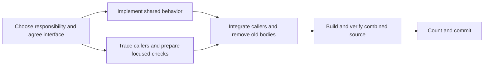

# Refactor iteration guide

Use this recipe for the active responsibility in [PLAN.md](PLAN.md). PLAN owns
the work order, validation requirements and completion rules. Plan a complete
replacement, then land one coherent change at a time. Parallel work should
shorten that replacement's critical path.

## What is slowing the current loop

Inspection at `ff02c9b7` on 2026-10-22 found:

| Observation | Consequence / action |
| --- | --- |
| PLAN was 5,372 lines / 403,488 bytes; item 4 started at line 1,651. | Keep current decisions here and in the compact plan; consult history only for a relevant question. |
| 29 of the last 30 first-parent commits changed PLAN; eight changed only Markdown/HTML. | Update current status in place when it changes. Put routine verification details in the implementation commit. These counts do not measure time spent. |
| The last room-scan stage's production logs report 51.17s and 68s; its prospective composition build reports 44.07s. | Reuse a matching build and stable working directory. These are recorded runs with different inputs, not a controlled build benchmark. |
| `tools/verify_dll.py::source_hash` took 0.032–0.038s across five local runs; `sh tools/progress.sh` took 0.81s. | Keep these inexpensive identity/accounting checks. |
| The same production log contains 1,968 warning lines and over 22,000 total lines. | Stream build output to a local file; inspect errors and relevant warnings, and return a concise result. |
| Cargo release already enables incremental compilation and 16 codegen units. The launcher already supports Cargo reuse, checkpoints, required probes and bounded tails. | Use those facilities before adding build profiles, caching systems or another runner. |
| The prospective projectile integration still adds 9,113 lines and retains legacy algorithms. | Share each algorithm across the real RAM and owned paths, migrate callers, then delete the superseded implementation. Additional outer wiring leaves the expensive work unfinished. |

The fresh timing samples used a changing development checkout and are diagnostic,
not a gameplay verdict. No new compiler or movie was started for this inspection;
another compiler was active. An overall speedup has not yet been measured.

## One pass, step by step

1. **Choose the next dependency.** Read PLAN's active item and inspect HEAD and
   the worktree. Continue existing work on that responsibility. Write the short
   task description below before broad implementation. Finish this step with a
   named deletion or safety/ownership outcome and a known validation route.
2. **Trace the complete interaction.** Identify callers, state reads/writes,
   captured versus live selectors, callbacks, failure prefixes and consumers.
   Reuse the relevant source audit and existing comparison fixtures. Decide the
   owner and observation points before splitting implementation across workers.
3. **Split only independent work.** Use the roles below if parallel work is
   authorized. Give each implementer a distinct file set and fixed interface.
   Keep shared registration, outer wiring and the mutable integration checkout
   with one integrator. The single-worker version follows the same steps.
4. **Implement and check locally.** Reuse the current comparison carrier and
   select its relevant cases. Build changed inputs once, then run the selected
   cases against that build while the source stays fixed. Add cases for new
   failure modes; compare actual old/new implementations and ordered effects.
   A small check while editing is feedback; completion still follows PLAN.
5. **Integrate one coherent change.** Bring the implementation and required
   caller migrations together, remove retired bodies, and update module/source
   registrations. Reconcile with current HEAD. Build and validate this combined
   source, including affected consumer/interaction checks. Independent passes
   do not validate the combined result.
6. **Finish the selected validation.** Follow PLAN's validation strategy and
   [movie commands](../movies/README.md). Reuse compatible checkpoints before
   affected setup; require changed branches and downstream effects. If temporary
   probes are removed, rebuild and repeat the measured segment on clean source.
   Reuse passing results only while their compiled inputs and relevant context
   remain unchanged. Name uncovered behavior and stop its further cleanup.
7. **Count and land.** Run `cargo fmt` followed by `cargo fmt --check` from the
   repository root, matching CI's default formatting settings. Scoped rustfmt
   invocations with import/module reordering disabled do not satisfy this check.
   Run `sh tools/progress.sh`, count all replacement costs,
   and explain increases. Recheck HEAD/index and commit only this change to main
   with commands, coverage and results. Update PLAN only when status, direction
   or a blocker changes. Start the next dependent step from the landed source.

Task description (in the working conversation or commit draft; no new registry):

```text
Responsibility and outcome:
Base commit; implementation files; shared files owned by the integrator:
State owner; inputs/results; observation/suspension points:
Callers to migrate; old implementation to delete; prerequisite change:
Selected actual-code cases / movie probes and effect tail; coverage limits:
Complete size/safety delta, or the remaining work needed to price it:
```

## Parallel work and the serial boundary

Start with one integrator and up to two independent workers when parallel work
is authorized. This is a starting limit, not a measured optimum. Increase it
only if independent work is waiting and memory/build/integration contention is
under control. A task must name its dependency before it can run in parallel.

| Role | Work that can overlap | Handoff / completion |
| --- | --- | --- |
| Implementer | Shared algorithm and local adapter in an isolated checkout/snapshot | Patch, exact input revision, migrated callers, deletion and selected check results |
| Validation / caller investigator | Trace consumers, select existing fixtures and probes, inspect checkpoint history, review the patch | Concrete missing cases, ordering/alias risks and the smallest applicable scenario |
| Integrator | Review completed work, prepare the next dependency and shared wiring | Final combined source, required builds/checks, complete count and main commit |

Two implementations can overlap only when neither depends on an unsettled
interface or shared mutable source. Give edits to `lib.rs`, `verify_source.rs`,
shared bank dispatch and PLAN to the integrator. Workers can describe the
needed edits in their handoff. In isolated builds they must still include all
registrations required to compile and pass source checks.



Use PLAN's measured resource budgets, not a fixed heavy-job count. Two isolated
builds achieved 1.50x throughput; three remains unproven. `CARGO_BUILD_JOBS=1`
limits one Cargo invocation and still permits parallel code generation. Coordinate
accepted launches through the existing conversation, including jobs before rustc
appears. Release compiler admission when compilation ends; overlap replays and
source work within their own resource needs. Compare completed useful work/time,
memory, paging and disk pressure before retaining higher concurrency.

Use existing isolated checkouts/snapshots for concurrent edits. Keep source
fixed during builds and checks, game/host artifacts local to that checkout,
and loaded Windows DLLs unchanged until their test process exits. Share registry
dependencies and source-checked immutable baselines, not whole target trees.
For disposable Cargo snapshots use `CARGO_INCREMENTAL=0`; preserve a useful
working cache through a sequence of edits. Normal Git writes take their own
short-lived locks. No reservation locks or new scheduling service are needed.

## Apply it to the current projectile work

Current completion status and the next dependency live in PLAN, with continuation
details in [HANDOFF.md](HANDOFF.md#paused-launch-draft). Read those before a new
assignment. The 2026-10-22 restart resolved the preserved beam-launch draft through
the seven steps above. Missile acceleration and extension creation are the next
dependent changes; keep their boundaries explicit.

The launch restart was single-worker, with aliasing, diagnostics and actual launch
consumers traced before integration. Subsequent authorized parallel work can use
a validation investigator for those independent questions. The integrator owns
shared wiring and final comparisons.
Keep the saved old decoder independent of the new one. Defer runtime ownership
implementation until its prerequisites are ready; its existing audit remains a
reference. Preserve the distinction between RAM compatibility and persistent
Session authority. Two workers rewriting the same owner are dependent work.

The active `runtime-impact-working/check_flight_control.py` accepts export names
to select cases; `build.py --library` builds the reference carrier separately
from the harness. Reuse this split when inputs match. The frozen stages are
historical; their passing checks cannot validate changed production code.
The carrier is edition 2021; final production compilation is edition 2024.
Paths and current preparation constraints are in
[HANDOFF.md](HANDOFF.md#local-work-and-validation).

Observation during wind-down: one other project agent was running; inspected
older verification/reduction/architecture/cleanup threads were inactive. The
active agent was already using serial compilers, selected cases and a reused
working cache. The next improvement therefore needs to address the cost of
maintaining and validating both paths, not merely repeat those instructions.
The two latest completed changes (`ba0d94c1`, `e3fadf56`) add 96 lines to the
complete prospective composition combined; their safety improvements do not
establish net reduction or persistent state ownership.

The latter commit reports 180.62s across six compiler invocations (carrier,
harness, production and prospective composition, including changed-source
rebuilds), versus 3.57s for its final selected comparison run. These are reported
stage timings, not total cycle time; required rebuilds are not automatically
redundant. Measure which compiled inputs changed before consolidating builds.
That historical finding is superseded by PLAN's measured concurrency policy.

## Windows shell setup

On this Windows workstation, a fresh PowerShell shell did not resolve `cargo`,
`rustc` or `sh`, and `python` resolved to the inactive Windows Store alias.
Use the already-installed tools for the current shell before running commands
from movies/README.md. These paths were checked on 2026-10-22; this does not
install software or change the machine's persistent environment.

```powershell
$iterationRust = "$env:USERPROFILE\.rustup\toolchains\stable-x86_64-pc-windows-gnu\bin"
$iterationTools = "$env:LOCALAPPDATA\sm-decomp-tools"
$env:PATH = "$iterationRust;$iterationTools\python-3.13.7;$env:LOCALAPPDATA\Programs\Git\bin;$env:PATH"
$env:LIBRARY_PATH = "$iterationTools\SDL2-2.32.10\SDL2-2.32.10\x86_64-w64-mingw32\lib"
$env:CARGO_BUILD_JOBS = "1"
Get-Command cargo,rustc,python,sh
```

The current stable compiler is intentional while the requested nightly remains
blocked as recorded in PLAN. Check the shared resource budget before
building. The launcher now selects Cargo automatically with this SDL2 environment.
Use this single final-build command, then the selected replay:

```powershell
python tools/verify_dll.py --build-only --frontend-check
python tools/verify_dll.py rom/sm.smc movies/any.inputs --checkpoint-in target/selected.smvchk --frames 120 --no-build
```

The checkpoint and 120-frame suffix above are placeholders: use the actual
selected scenario, required probes and effect tail. Normal builds and launcher
builds now use the same options. The default replay command also reuses matching
artifacts; `--no-build` explicitly rejects stale ones. `--direct` retains the
standalone path with checked unchanged-build reuse. Keep the environment stable.

The active local `runtime-impact-working/build.py` now hashes rustc dependency
files, compiler/options, native archives, linked library and output bytes before
skipping a component build. Runtime and harness have separate incremental caches
and logs (`runtime-build.log`, `harness-build.log`). A fixture-only edit rebuilds
the harness; call `python build.py --library` and `python build.py` without
rebuilding unchanged inputs. Existing compiled-source assertions remain required.
The original launch draft is preserved under `runtime-impact-working/launch-draft/`;
main and the harness now use the synchronized verified launch change, including
an independent old decoder on the reference side.

Measured runner improvement (2026-10-22): unchanged component library/harness
reuse took 0.08–0.12s each, versus a 21.37s unchanged library compile before the
fix. A backdated fixture edit correctly rebuilt the harness in 7.28s; restoring
it rebuilt in 7.73s, then reused in 0.11s. Switching normal Cargo to the old
launcher rebuilt the host in 6.50s; unchanged unified invocations compiled
nothing and checked source in 0.72–1.08s. Standalone reuse took 0.42s after its
20.90s build. These are selected local build timings, not full refactor-cycle
speedups. Seven actual-code component suites pass on the verified baseline;
backdated source recovery and stale-source rejection pass.

The committed launcher change adds 79 lines; the existing local comparison
runner grows 17 to 65 lines (+48) for checked reuse and incremental compilation.
Both costs are disclosed. No new runner, registry or scheduling service is added.

## Measure the next three implementation changes

Use existing command timings and a short note in each commit, not a dashboard:
time spent selecting/tracing, waiting for a compiler, building, running checks,
and reconciling integration. Record full game-library build count and repeated
setup/checkpoint frames. Separate cold, warm and changed-source builds and keep
toolchain/features comparable. Compare the median edit-to-verified-commit time,
then change the largest measured cost. Commit timestamps alone are not timings.

Next optimizations, conditional on those measurements:

- The duplicate unchanged-build work above is fixed. Keep one matching path per
  source snapshot and the required final release/frontend/verifier checks.
  Measure changed-source builds before changing optimization or package boundaries.
- If harness preparation dominates, extend the existing actual-code comparison
  entry points to select the missing cases. Avoid rebuilding an independent
  copy of the algorithm for each test. Keep frozen references distinguishable
  from production source and retain identity checks.
- If replay dominates, repair scenario selection or checkpoint placement in
  the existing verifier workflow. Retain comparisons, rendering and audio.
- If integration dominates, reduce simultaneous overlapping edits and settle
  the next interface first. Larger worker counts will otherwise add retries.

Package splitting is appropriate when a real responsibility meets the accepted
architecture contract. It is not the first build-speed experiment. A different
optimization level or warning suppression needs a measured benefit and must
not weaken the final checks.
