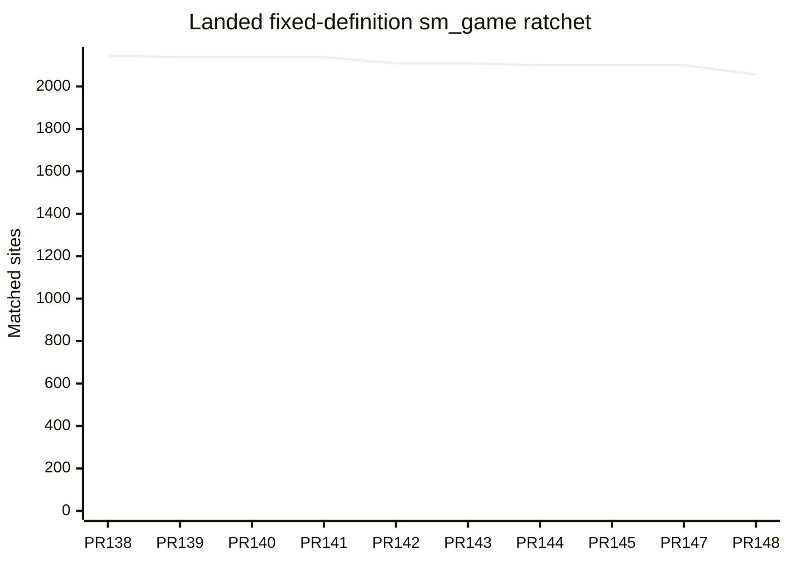
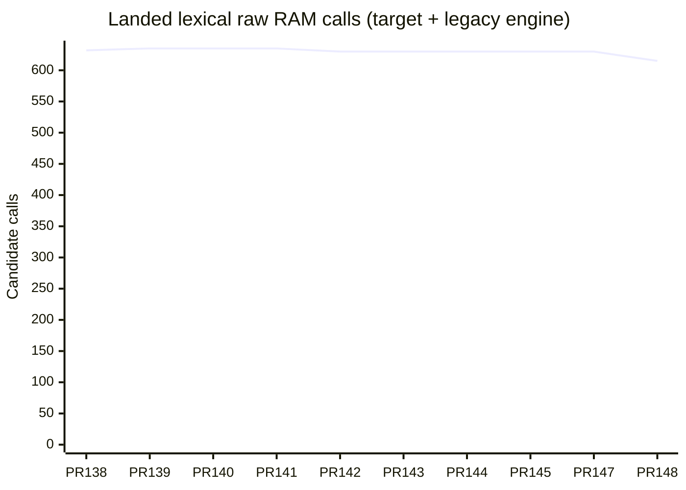

# Progress evidence snapshots

Collected from documentation at `260d11ef6406eb2a4ea053a7c633877f29a0b74e` on
2026-11-01. These are frozen assertions from the sources linked below. This
cleanup ran no engine build, replay, hosted job or live resource sample; it
does not promote any assertion to a fresh observation. Earlier dates and
embedded source/DLL pins define each snapshot's scope. Missing run/source
provenance is explicit; retain the original owned receipts before reusing proof.

PLAN holds current reporting and standing rules, REVIEW milestone decisions,
and the accepted architecture the destination. Issue #6 was retired by Jim on
2026-11-01; references below preserve historical provenance. Consult this document when you
need figures or recorded state; follow the source or original receipt when you
need its exact proof. Live jobs, owner claims and resource grants require fresh
observation at the work boundary.

For a new snapshot, state the observation date, source/run identity, command or
receipt and coverage scope here. Separate measured results, pending work and
unobserved cases. Stable guidance links to the relevant section instead of
copying totals, job inventories or timings. The historical sections below stay
dated; a new report cannot overwrite their failure identities or exclusions.
Schema IDs, stable budgets and pinned acceptance caps remain in their owning
contracts. Historical reconstruction counts remain in
[architecture references](target-architecture/REFERENCES.md#historical-source-size-observations).

Pending and unobserved engine scope is retained in the coordinator and endgame
snapshots below. Complete any%, 100%, low%, boot/transition/endgame acceptance is
not established by this documentation cleanup.

## Executable verifier and replay corrections, 2026-11-02

The corrected PR #151 source is
`64df7aec90d126cea3d157773d07c09be9058f5402026ef53e1248689cd1348e`.
Independent source review accepts the existing verifier's executable entry
point, Python orchestration, workflow artifacts, actual child identity guards
and both existing capture callers. The 154-unit runner and replay algorithms
remain unchanged. Local formatting, source inventory and ordinary
`cargo check --locked -p sm --features verify --no-default-features --lib --bin sm_verify`
pass with warnings denied; no executable or DLL was built or run locally.
CI build, linking, units and replays remain pending on this corrected source.

The preceding `0fee6028` passed CI but failed hosted replays. Liquid fill wrote
ascending addresses instead of the original descending `9C66..9C48` words;
the corrected traversal preserves native word order. Both dialogue adapters
also read jump binding `09B4` for run-button messages; selecting `09B6` restores
the original button glyph. Original item and route failures remain retained in
the dedicated verification owner's hosted failure handoff. The three failed
replay runs were cancelled after collecting their failures and timeout evidence;
no overall pass or corrected-source coverage transfers from them.

The `tools/progress.sh --markdown` path classification measures the correction
at +1 production Rust line and +173 verification Rust lines against `0fee6028`.
Its totals are 199,834 production and 61,723 verification lines. RAM coupling
remains 613 sites / 74 files: the full PR still retires 546 sites against main.
These fixes add no RAM retirement or compactness claim.

Cold checkpoint prefixes also exceeded existing hosted deadlines. Target and
host producer flags already use Rust optimization level 3. Guarded staged
capture/reuse and bounded shard packing are pending; timeouts remain failed
verification. Complete existing any%, 100% and low% acceptance is still open.

## Next ownership slice integration, 2026-11-02

PR #151 head `0fee6028c020227f42e3c17187afc64d3e94e5be` passed CI run
`41458754589`, including 154 verifier checks and all 29 state-layout tests.
Its corpus, route and oracle-lock gates remain pending at this observation;
these passing checks establish neither a landing nor full-movie acceptance.

On branch `land/owned-pattern152`, root applied the next reviewed overlay after
checking every current source preimage. Its initial packet identity is
`2cb8bf76c8a8c641ee7a887ac0647142aca2f4389258c1a0591ed40c90afd1b3`.
It retains 275 additional genuine RAM-access retirements, with two register
spelling changes excluded from that count. The packet's baseline omits the
existing `docs/LEGACY.md`; root separately bound that file to the parent Git
preimage and verified that its existing contents remain an unchanged prefix.

Formatting exposed six generated syntax defects, corrected before the first
compiler pass. Direct strict metadata compilation passed `sm_data` but failed
`sm_game` with 2,065 diagnostics, predominantly repeated macro-scope errors.
Other findings include conflicting imports, duplicate state/trait declarations
and missing owned actor modules referenced by dispatch. Original compiler
session 54349 ended with exit 1 and was collected; no compiler remained live.
The frozen verifier source at that pass was
`760ff9590a7098a10812178110b2d1caa6041345d29199916ab7382fe5afe830`.
The original log stays under
`$TEMP/collab/root-coordination/METADATA152_FIRST/sm_game.log`.

Source owners are correcting complete integration patterns and supplying the
missing actual actor implementations. This slice has no compiler, native,
replay or landing qualification. Formatter growth is not implementation savings;
its final physical line delta will be measured after these corrections.

## PR #151 hosted qualification correction, 2026-11-02

Published candidate `150fe6ed5ee77fb3a6b794b30e87f391b868b74d` retires
546 RAM accesses, from 1,159 sites / 88 files on main to 613 / 74.
PR #151 remains open; main is `558131e7208334a86a6de6945890fd8d4a73f616`.
Its physical production Rust delta is +15,629 lines and verification +925;
this is ownership migration, with no compactness claim.

Hosted CI run `41457358300` built the DLL successfully. Its `format` job
`125317319358` failed the target state-layout tests: four passed, 25 failed.
The correction supplies test owners through the production RAM decoder,
retains the constructor's uninitialized-owner assertion, emits odd-length
graphics/countdown bytes once, and removes the actor codec's duplicate FX
lighting emission. Actor alias readers and writers still resolve the same
canonical FX owner; production admission and the overlap check stay strict.
Independent source review passed correction patch
`80f30c3e297cb3e114e81a609539d05e0a8869d85020295ebeac79d4375e9ba4`;
formatting and diff checks passed. Corrected hosted tests and replays remain
pending. Original failure logs are retained under
`$TEMP/collab/root-coordination/pr151-format-job.log`.

The existing hosted workflows qualify the DLL and replays; further local DLL
qualification packets are stopped. Full existing any%, 100% and low% movie
acceptance remains open. The independently reviewed next migration overlay
retires 275 additional accesses, but has no compiler, replay or landing proof.

## Pause graphics adoption correction, 2026-11-02

Current corrected source is `fc299d1d9c38272c94cb4ab88f9d008cec7a6b876586ee086ef54c998248ee98`
with 927 members. Main remains `558131e7208334a86a6de6945890fd8d4a73f616`,
and PR #150 remains the latest landing. The first migration's 546 candidate
RAM-access retirements remain unlanded: 1,159 sites / 88 files to 613 / 74.
This correction adds 20 compatibility production lines; it claims no additional
RAM retirement, format change or compactness improvement.

Preceding `d1d2686f` passed compiler 66992, DLL/loader 28791, all 154 unit
checks and all seven fixtures. Original replay family 77998 passed the return
parameter row and both options-tour lockstep and check-lock commands. The next
command, the 1,512-frame pause-menu tour, failed the RAM comparison at tick 0.
The generic word decoder omitted 17 byte-owned saved pause graphics values;
menu adoption replaced the actual seed values with defaults before export.

Root stopped that already-failing native Job with exit 73 while retaining its
original supervisor. The supervisor collected the original child and all Job
members, recorded zero active descendants and closed both handles. This is
failed, partial replay evidence; the full pause row and remaining commands
remain unproved. Result `e000572a95c2adfd16eb60def112019b7e2bbf069e7d3263c0750a9c5a552f6f`,
closed receipt `2f15047f6c74b3d46fb9839e1fb28588b29a729ec677a2c7169d598946c78be2`
and log `049c16ec01b3e2b7d177ce5e7d4d0e27fd4b3b6aaa041c20af09c6473ebb3704`
are retained under `$TEMP/collab/post150-build-runway-resources/PRIMARY151_NATIVE_TWO_FIXTURE/rows/`.

Independent source review passed the correction's actual-byte import, epoch
invalidation, projection and changed-byte publication through the existing
Drop guard. Root applied its exact hunks; all 927 actual bytes, formatting and
diff checks pass. Fresh compiler 63904 passed in 82.75 seconds and DLL/loader
76174 passed in 169.65 seconds; both original families were collected with zero
active descendants and closed handles. The DLL is
`66f40af4eec75a0867d46d854d204751260e25b6f93f152e357d7e675610517d`.
Its four unchanged target libraries retain their original producer proofs;
compatibility and host code were freshly compiled. Corrected unit, fixture and
replay results remain pending. Hosted gates will qualify the published branch;
the unused local native packets retain their old HEAD and remain unexecuted.
Source and causal records are under `$TEMP/collab/pause-menu-window-drift-fix/`
and `runtime-corrections-source-review/FIRST_GRAPHICS_FIX/`.

The next composed source `5f147d5d97ce61f1a416b454af74cf877347afd524b7aaa77e6a6544675dfeb1`
has independently passed source review only. It retires 275 additional real
accesses, excluding two register spelling changes, and measures 336 sites / 44
files against the preceding 613 / 74. Its Rust growth is 45,214 target, 2,322
compatibility and 33 verification lines. Its current fixture corrections and
actual 12-byte suspended-work prelude are preserved; the new graphics fix
still needs sparse composition. No compiler, replay or landing proof transfers.

The save/death row's old 69,400-frame checkpoint has a stale layout. None of
the three newly generated checkpoints matches its input prefix. Prepared
continuation covers the entire boot prefix in seven genuine chunks and then
the original row, facts and tails; no chunk or remaining movie is counted as
executed. Full owned engine and complete any%, 100% and low% acceptance remain
unproved.

## Complete fixture lifecycle correction, 2026-11-02

Current source is `d1d2686f8195a36045756ea58435f3ed4dc968a5a2431bf80593442cdee50232`
with 927 members. The migration remains 546 candidate RAM-site retirements,
unlanded; main is still `558131e7208334a86a6de6945890fd8d4a73f616`.

Preceding `dbf5bc66` passed compiler 55846 and DLL/loader 50000. Actual units
82750 completed 154 checks: 152 passed and two failed, without a resource stop.
The numeric helper created an unrelated uninitialized Session; it now clones
the actual admitted checkpoint Session. Its ten-byte Botwoon assertion is
retained at the position derived from the current preceding owner sizes.
The cold-FX fixture now declares its genuine variable-B live region before
recording that region's native origin. All original rejection and value
assertions remain. No production validation or checkpoint format changed.

Independent source review passed for the formatted two-file patch. The
initial relative-string inventory ordering produced an incorrect source pin;
root, reviewer and author independently recomputed the canonical Windows-Path
ordering above, retaining the erroneous receipt. No checkpoint was restamped.
Fresh compiler, DLL and native qualification remain pending. Exact evidence
is under `$TEMP/collab/owned-movie-start-verification-source/FINAL_TWO_FIXTURES/`,
`runtime-corrections-source-review/TWO_FAILS/` and `root-coordination/PRIMARY151_TWO_FIXTURES/`.
Full owned engine and whole original movie acceptance remain unproved.
## Supplied controller-history correction, 2026-11-02

Current candidate source is `dbf5bc66713045dc6951e653d1611a8bde9a8a948d3257f0152182a70e495d96`
with 927 members. The migration still measures 1,159 to 613 RAM sites: 546
candidate retirements, unlanded. Main remains `558131e7208334a86a6de6945890fd8d4a73f616`.

Preceding source `f839bff8` passed compiler gate 52890 and genuine DLL/loader
30716, with original families collected and handles closed. Its units run
29763 completed all 154 checks: 148 passed and six failed, without a resource
stop. All six supplied-session starts rejected inconsistent controller history.
The shared fixture copied continuation fields but omitted its explicitly
supplied Display history. Four added lines copy all 28 typed history fields;
production validation and every registered check remain unchanged.

Independent source review and lossless patch reconstruction passed. Fresh
compiler, DLL, runtime, replay and capture qualification of `dbf5bc66` remain
pending. Exact records are under `$TEMP/collab/runtime-corrections-source-review/PERSISTENT_START/`,
`owned-movie-start-verification-source/PERSISTENT_FIXTURE_HISTORY/` and
`root-coordination/PRIMARY151_FIXTURE_HISTORY/`. Failed DLL 29337 and units
29763 retain their original results; neither supplies passing behavior proof.
Full owned boot-to-credits and complete existing movies remain unproved.
## Current qualification and cleanup, 2026-11-02

Main remains `558131e7208334a86a6de6945890fd8d4a73f616`; PR #150 is the latest
landing. Root applied five independently reviewed runtime, build and fixture
corrections to the first migration candidate. Current source is
`f839bff8221869d86171786481803147ac275beb19628a5f5034a4d3d2174b58`,
with 927 members. Format, diff and ratchet checks passed; fresh compiler, DLL
and runtime qualification of this corrected source remain pending.

| Measure | Landed baseline | Corrected candidate | Scope |
| --- | ---: | ---: | --- |
| Counted sm_game RAM sites | 1,159 | 613 | 546 candidate retirements, unlanded |
| Coupled files | 88 | 74 | 14 fewer, unlanded |
| Production ratchet counter | 173,506 | 199,373 | Advisory growth of 25,867; no compactness claim |

The preceding source `90a6f7799816365917c6d9c8338736190a7a99c07c413d880ab61cbf17051547`
passed the full strict compiler gate, original session 93757, and actual DLL
and separate loader checks, session 63124. Both original process families were
collected with zero descendants and closed handles. The DLL is
`1a7538c3e40065bfdfabc11b4287c9b5fb3f03394c3876070f09672899e18355`.
These results qualify that preceding source only.

Actual units session 36416 on that DLL failed and aborted during destructor
cleanup, exit 3221226505, without a resource stop. The original child was
collected and handles closed. The suite did not finish all 154 registered checks.
The corrections address an export that queried the unowned byte after the
seven countdown bytes, an optional FX projection that queried a nonexistent
cold Display, missing direct host dependencies in the authoritative build tool,
and two stale fixture assumptions. The display fixture now parses Workspace
before Revision through the actual field codecs. An independent complete
24,145-byte layout expansion proves that the source-publications descriptor
alone explains the schema fingerprint change; the whole-layout and required
descriptor checks remain. No checkpoint header was restamped.

Original failed gate 17188 on `2111be2f` retains its three Rust borrowing errors;
the subsequent corrected gate passed. DLL attempts 3419 and 59677 retain their
storage-cap failures and unverified final charges. Attempt 59677 completed five
library producers before exposing the missing host dependency arguments.
Session 63124 reused those exact completed libraries and compiled and loaded a
fresh corrected host. No failed attempt transfers DLL or replay proof. Full
receipts are under `$TEMP/collab/post150-build-runway-resources/`; corrected
source and review are under `root-coordination/PRIMARY151_RUNTIME_CORRECTIONS/`
and `runtime-corrections-source-review/`.

Autonomous cleanup completed: registered worktrees fell from 270 to the primary
alone, local branches from 582 to main and the current landing branch, and
remote heads from 114 to main alone. All 146 retained and 14 archive refs,
the obsolete baseline tag and five abandoned stashes were deleted. Root freshly
verified the remaining registrations and local and remote branches. Eight
minimal data providers retain 1,640 required files at their original paths,
without Git registrations. Primary source and index, 903 baseline files,
465 inputs and 115 canonical compiled artifacts match their pins. Cleanup's
earlier accidental deletion recovered 84 historical proof artifacts; 48 remain
explicitly absent. The current guard records that archival exception and checks
the 357 remaining protected entries; no historical preservation is claimed.
Cleanup handoff is `$TEMP/collab/abandoned-worktree-cleanup/HANDOFF.md`,
SHA-256 `c097d91da8cc47a674fced8b62ba634279a8f94782ba5aadbab17702c4f5163b`.

The next actor union measures 413 sites / 45 files against the first candidate's
613 / 74: 200 further candidate retirements. Its source review found a missing
Prepared Kraid observer method and failed-prefix publication suppression. The
first correction introduced an incomplete diagnostic enum consumer; the composer
is preparing a small second correction. No actor compiler or replay pass is
claimed. Its earlier target-package growth of 44,665 lines remains a cost; the
shared HDMA fallback retires zero raw callback sites, and full Prepared scheduling
remains unwired. Dedicated verification continues migration qualification;
new trick expansion waits. Complete any%, 100%, low%, boot, transitions and
endgame and the independent owned engine remain unproved.

## Landed RAM burndown, 2026-11-02

Root observed PR #150 merged at `2026-11-02T01:52:39Z`, with remote main
`558131e7208334a86a6de6945890fd8d4a73f616`. Original background watcher
37245 exited 0 after `bash tools/lane/watch.sh 150`. These are landed
observations; the older NEXT609 sections below retain their original scope.

| Landed source | Counted RAM sites | Coupled files | Sites retired in that slice |
| --- | ---: | ---: | ---: |
| Before PR #149 | 2,057 | 93 | — |
| PR #149, `811a77f9e` | 1,768 | 89 | 289 |
| PR #150, `558131e72` | 1,159 | 88 | 609 |

The two broad slices retire 898 counted sites. PR #150 moves sequence/control,
boss interactions, numeric display controls and HUD consumers to typed Session
owners. Its 487 direct RAM byte-call sites remain unchanged and are measured
separately; overlapping measures are never added. Target production increases
1,747 lines, compatibility 1,065 and verification 320; no line savings or
complete backend independence are claimed.

Exact source is `12b0fc3a8409a9371eec7db5fc599218c1e755c4f3151b46424537d42742b927`;
DLL is `b74760ac572af850648ada9730f5751c9c95c243bd65ca710f67a27acc9ea3f6`.
Strict gate, attested build, 148 registered checks, seven existing fixture
comparisons and 94 local replay jobs over 59 existing IDs passed. Replays include
the mandatory smokes, Morph1200, credits15900 and chain rooms 1, 6, 100, 200 and
320. Hosted CI, corpus `41362646223`, route and oracle-lock gates passed on that
exact head. Original handles and full guards are retained under
`$TEMP/collab/owned150-qualification/run-e/`.

The existing room/actor guard accepts the canonical DLL and rejects an isolated
omitted-descend mutant: actual boolean results 1/0, child exits 0/0. Original
build 87396 and witness 6225 completed with exit 0, no resource stop and closed
handles. Their complete guards and earlier behavior-neutral predicate mutant
are preserved in `$TEMP/collab/owned150-descend-mutant/run-a/HANDOFF.md`
(`e525e4cb33c2d5bc3d67b8197f061cf14c054c54838e13008f74a2be0f8e9a3b`).
The routine registration of this existing guard remains a separate prepared
patch; PR #150's registered table still has 148 cases.

After reconciling the primary checkout to landed main, root ran
`python -B tools/ram_ratchet.py --update`: measured 1,159 sites / 88 files and
physical production 183,835. The lowered baseline is pending with the next
code slice. The original primary baseline edit was preserved before checkout
reconciliation; the qualified source and DLL remain immutable.

**Pending:** the next gameplay/queue/window/FX and presentation source has not
landed. FX common-table, suspended Window and native alias ownership need a
complete corrective implementation and combined qualification. The bounded
Workspace ambiguity correction passed independent source review only.
Prepared actor execution and an existing-verifier upload observation producer
have dedicated source owners. No new scenario expansion is assigned.

**Unproved completion scope:** full existing any%, 100% and low% movies,
boot-to-endgame continuity, native upload suspension and complete owned engine
execution. The fresh source audit preserves the full-any missing-gameplay-fact
failure; seeded rooms and credits do not establish full movie continuation.
Its exact pins and next source contracts are in
`$TEMP/collab/migration-verification-reach-source/HANDOFF.md`
(`b699665844e5c9235380d6eb2eb1655efef5488d6d9b3abe784972abb9d1ee88`).

## Composition evidence, 2026-11-01

Root checked the working composition built from parent `260d11ef6406eb2a4ea053a7c633877f29a0b74e`
with documentation patch `e7324c0f`, sharding patch `2d0cc62c` and Spring Ball
observer patch `159aaeb8`. Its verifier source identity is
`ecb19a5392b04d59a9ee122e39698a37ca3ed5480858ade1553f2dc711308eb2`.
These are prepared-source observations, not qualification of the new observer.

| Scope | Actual evidence | Still required |
| --- | --- | --- |
| Prior L6 composition | Source `c4bac7c9`, DLL `0a1b5de7`: local gate, strict build and all 148 registered checks pass; original jobs terminal | Affected rows on the final composed source, then exact-head hosted gates |
| New source and metadata | `scenario.py lock --check` passes; 164 runnable rows remain in 44 shards; pending Spring Ball row is excluded; 163 local documentation links resolve | New exact-head gate and DLL |
| Physical Rust accounting | Production 179,209; verification 60,486 including `sm_tools`, measured from tracked Rust bytes with the existing physical classification | No architectural independence or full-game acceptance claimed by these totals |
| Spring Ball reach | Frozen source `ef9198ba` / DLL `2363b966`, faithful oracle-only trial: genuine pickup, grounded launch, rise/descent, landing at tick 987 and 192 follow-up frames | New named observer, paired patched/faithful checks, free run, deliberate mutation, lock and complete private bundle restore |

Exact root receipts are in `$TEMP/collab/docs-ci-coverage-composition/checks.json`,
`l6-integrated-260d11ef6/`, `l6-integrated-rows/` and
`verification-spring-ball-jump/`. CI timing/capacity evidence remains in
[VERIFICATION_SHARDING](VERIFICATION_SHARDING.md), rather than duplicated here.
The preceding CI slice, PR #145, landed at `534c5be320c20856e3ef5f710ea35f639579eea3`
after its exact-head gates passed; original watcher `25370` exited 0. This
landing does not qualify the prepared composition above.

## Root observations received 2026-11-01

Source: root coordinator's direct lane message during this cleanup. Exact
observation time and original gate-log paths were not supplied; retain the
original root receipts before transferring proof. This section supersedes the
older handoff snapshot only for the observations it names.

**Measured:** landing `260d11ef6`, source `c4bac7c9`, has actual `GATE OK` and
strict DLL `0a1b5de7` (32,233,472 bytes). Original build handles 40346/88750 are
terminal, active descendants 0. L6's original tally passed 12 rows / 13,656 ticks
and six locks / 4,604 ticks. Across 81 mapped keys, Game primitive count is 0 and
Runtime count 333,655; retained Game 2,464 byte writes and 261 paused primitives
are separate. These tally results do not qualify a changed source automatically.

**Landed:** PR #145 head `534c5be32`; hosted gates passed and original watcher
25370 exited 0. **Pending:** new landing rows have not started. Coverage
owner `verification_spring_ball_jump` is preparing genuine recorded 1,180-Tick
input with a 906-Tick pickup prefix; preparation is not executed coverage.

**Unobserved:** grapple variants missed both requested facts; natural apex is
unproved. Full engine and complete any%/100%/low% acceptance remain unproved.

CI concurrency and queue-duration measurements belong in the separate dated
[verification sharding report](VERIFICATION_SHARDING.md); PLAN's resource and
runner limits remain standing policy. No job completion is inferred from queues.

## Coordinator handoff snapshot

Document date: 2026-11-01. Source: [`docs/HANDOFF.md`](https://github.com/JimLundin/sm-decomp/blob/260d11ef6406eb2a4ea053a7c633877f29a0b74e/docs/HANDOFF.md).
These are retained document assertions, not checks rerun by this cleanup.

### Hand-off, 2026-11-01

Read AGENTS.md, PLAN and REVIEW, then sm-coordinate, sm-land and sm-resources.
Root owns Git, publication, ci-data uploads and result reports to Jim's #6.
The primary checkout is stale; use the landing worktree below.

#### First steps

1. Poll PR #145's original background watcher25370, then report its landing.
   Head534c5be32/branchland/batch13ac passed its local GATE OK; corpus41318110135
   and hosted gates are running. Its three-tool movie-map slice lowers baseline2100.
   Require exact-head GATE OK, CI, corpus, route and oracle-lock gates; start
   `bash tools/lane/watch.sh <pr>` in the background and report each landing.
2. Keep a dedicated gameplay coverage owner continuously supplied. Current owner
   `verification_grapple_ordinary_jump` runs the proved floor73 route. Reach of
   both D78F and airborne-standard-anchor remains unproved. Preserve prior
   trials; replenish with a fresh bounded agent from its handoff when it finishes.
   Report reached behavior, mutation sensitivity and passing rows separately.
3. Collect L6 actual tally rows/locks and qualify its current-main composition.
   Apply only the reconciled patch, then prove its actual new source/DLL.
4. Continue full any%, 100% and low% verification, including boot, transitions
   and endgame. `full_movie_continuation_source` owns the next source task;
   importing a prefix or passing room rows does not prove the complete movies.
5. Review Draygon tally instrumentation before granting a fresh build. Resume
   L4/D/C2/V2 and Cue/hardware work as measured resources permit.

#### Landed and ready

- Main is `49656229aed66d6c78d95b2b2c22a99cd2a0e6ad`. PRs #138 through #144
  landed. #144 landed at 13:59:37 UTC; watcher 31255 is terminal EXIT0.
  CI 41310808761, corpus 41310834695, route 41310808744 and all 30 lock jobs
  in 41310808806 passed. Preserve the original gate/DLL/replay receipts in
  `$TEMP/collab/land-botwoon-49656229a/`.
- Botwoon reduced complete RAM coupling from 2109 to **2100 sites / 96 files**.
  Physical production is **179304** (+5). Baseline2100 travels with this slice.
  Retained Game effects/history and unobserved initialization remain separate.
- #143 landed Metroid ice/missile and latch/bomb coverage. Both oracles, faithful
  free run and engine locks passed; deliberate mutants failed at ticks49/706.
- PR #145 three-tool movie-map patch SHA `206a2678ba3c43b1ae04e706654754648b0493e38e56e3fe8a37f2b04d31e5b5`
  adds verification374/removes61 (net313), production0. Full original map,
  strict9266 import/9267 rejection, encrypted three-member exact restore and
  all nine rejection controls pass; every qualification family is terminal.
  Missing members cannot borrow preexisting files. No new gameplay row or
  full-movie completion is claimed. Private bundle has not been uploaded.

#### Current engine and verification evidence

- L6 canonical source747bdb51/DLL0734dcb8 passed147 checks,68 patched rows,
  64 faithful rows and62 locks. Faithful Kraid pause1030 is a genuine retained
  preexisting failure; four400/950/1030/1960 exclusions remain disclosed.
  Current-main21-file patch SHA `558442994a813edd9c636a61253e36d901b701d4ea7c842c5e86a867660b3b6c`
  is applied after534c5be32; actual unqualified sourcec4bac7c9 has RAM2068/93,
  physical production-95, verification+3. Frozen new-head gate/DLL/replays
  must qualify it before publication; original canonical proofs remain separate.
- Actual L6 tally:12 patched rows pass/13656 ticks. Across81 reached mapped
  moved-body keys, Game primitive0/Runtime333655. Retained Game transfer
  effects2464 byte-write operations (original608 subset) and paused261
  primitives remain separate.98 body keys and271 capability/field gaps remain
  unmeasured. Six applicable locks match/4604ticks; all18 original jobs terminal.
  Preserve `$TEMP/collab/l6-moved-state-tally/` and `l6-tally-rows/`.
- Draygon sourcee6aab08d/DLLf36613f6 passed gate,26 patched/26 faithful rows
  and23 locks. Tally source20018391 needs correction before compilation: review
  found target telemetry and RMW undercounts. Source-only repair3137fdc6
  removes telemetry and preserves caller/primitive distinctions; independent
  review and separate build admission remain required. Canonical handoff:
  `$TEMP/collab/l5-draygon/qualification-20261101/HANDOFF.md`.
- Dedicated grapple predecessor proved spike-grounding83 and stableground73,
  not walljump or the required grapple event. Its prior six unique trials
  missed both facts. New ordinary-jump owner genuinely observed ground0 to
  ordinary2 at740 and release-zero755; both requested facts remain absent.
  Frozen sourceef9198ba/DLL2363b966 and genuine recorded
  equipment/input/CPU phase remain unchanged. Reach HANDOFF/NEXT_COMMAND in
  `$TEMP/collab/verification-grapple-edge-launch/` before continuation.
- Full any capture maps722077 events/106967 native reads/127725 rows.
  It has **984 requested-NMI work gaps across27 ranges**,117159 blocked rows
  and incomplete EOF. Only9266 steps qualify; first gap read ordinal9261
  differs because five supported steps do not poll. Full map SHA b2413c73;
  source/private evidence in `$TEMP/collab/full-movie-map-artifact-run/`.
- Original full-any replay115542 ticks had zero pair differences but only six
  intro facts and **121 missing gameplay facts**. Full100/low completion and
  genuine endgame continuation remain unproved; original movies end in gameplay.
- First native SendAPUData span:41 NMIs,98212 pre-effect writes (46183 APUIO,
  51906 PPU,123 control),124 APURAM samples/120 digests. Ordered work and
  independent APU execution need preservation. Pixel video identity and PCM
  are unmeasured. This proves only the first span, not all27 ranges. Logger,
  native, ROM and original observations match; all capture jobs are terminal.
  Reach `$TEMP/collab/full-movie-upload-bus-capture/SEAM-CONSTRAINTS.md`.
- Hardware scratch gate/build/148 checks pass; patched boot fails7952 HUD,
  faithful boot fails7892 DMA. Five controls and two actual locks pass.
  Diagnostic scratch patch9feeb89c remains off-tree/uncompiled; runtime stack
  phase and genuine SMAUX0d load/continuation remain unproved. Preserve
  `$TEMP/collab/hardware-scratch-qualification/HANDOFF.md`.
- Cue run41291863856 has154/160 passing rows; six zero-difference expectation
  failures retain their inventory. Safe diagnostics need actual qualification
  before checkpoint-policy/audio changes land. L4/D/C2/V2 remain open.

#### Resource admission

PLAN's **50GiB disk / 2GiB remaining RAM floors** override older skill figures.
Reserve remaining growth, including temporary outputs; allocated bytes are not
new reservations. Sample actual process families/handles at each boundary.
Cross-agent session IDs and formatted PowerShell tables do not prove termination.

Root successor cleanup recovered3497500658 bytes from1379 exact compiler files;
receipts `removed-root-approved.csv` and `removed-root-approved-additional.csv`
under `$TEMP/collab/resource-runway-successor/`. Earlier cleanup remains separate.
Preserve canonical/mutant DLLs, native/library guards, sources, private data and
all original failures/proofs. Latest disk was about53.8GiB; sample fresh.
PR145 local gate and L6 tally jobs are terminal; their budgets released.
Next L6 compiler/replay grants require a fresh sample and owned ceiling;
coverage300MiB/64MiB and source review128MiB/64MiB remain lightweight grants.
Future held builds are not live jobs.
`.ps1` execution stays disabled; use permitted inline PowerShell/Python launchers.

#### Retained origin/lane donors

These are the original retained donor pins; use the current owners and frozen
handoffs above for live qualification and new source, preserving donor patches.

| Branch | State | Handoff |
| --- | --- | --- |
| `lane/l4-cohorts` (`f8863ac38`) | 13 commits, typed copies for scroll, camera, rooms, melt, liquids, message box and fade; RAM sites 1835 → 1496. Rebased on `170979ac2`. Gate on the rebased tip, check-lock, and commit 13's replays still to run | `docs/handoff/l4-cohorts.md` |
| `lane/l5-slot-access` (`22bcb8d48`) | batch 1 has landed. Batch 2 (10 families, 1809 sites) is gated but not replay-qualified. The top commit is a Crocomire WIP with 2 compile errors. 58 errors remain before `SlotAccess for Game` can go | `docs/handoff/l5-slot-access.md` |
| `lane/l6-hosts-kraid` (`910e393ba`, on L5's `0cc19efe8`) | 7 families: fire arc, boulders, statues, etecoons, dachora, Mini Kraid, Kraid. 1803 sites. The first 5 pass lockstep; Mini Kraid and Kraid not replayed; no check-lock | `docs/handoff/l6-hosts-kraid.md` |
| `lane/d-free-run-drift` (`00ef5d5b1`) | 3 engine fixes: a held button dismisses a message box; the escape timer and liquids leave `$16`. 26 listed drift rows now match the lock. Needs lockstep on both oracles, then remove their `unlocked` notes and `lock --record`. The top commit is a WIP oracle change for item-gravity, which needs a full lock re-record | `docs/handoff/d-free-run-drift.md` |
| `lane/c2-reseed` (`cd241c5b1`) | WIP: recipes and scenario seeds for the 6 stale checkpoint rows. Next: corpus entries, LEGACY rows, bundle upload, then the checkpoint policy guard `7048175e9` | `docs/handoff/c2-reseed.md` |

Native video step 5 has source commit `38051cfd9` in `20261101/v2-native-video`;
its Samus typed VRAM sink still needs compilation/replays and remaining consumers.
See `docs/handoff/v2-native-video.md` and `$TEMP/collab/v2-native-video-20261101/HANDOFF.md`.
The finished lanes'
handoffs in `docs/handoff/*-done.md`, `f1-`, `o-` and `t-` explain those subsystems.

#### Open goals, in priority order

1. **Real decoupling.** Finish moving the actor families onto the lease (L5, L6), delete
   `SlotAccess for Game`, and land L4's typed copies. Measure: `ram_ratchet.py`.
2. **Verification.** Land D's fixes and unlock their rows; aim for every scenario locked.
   Harness step 5: retire whole-RAM comparison domain by domain (REVIEW lane S).
3. **Native video step 5,** then audio and the remaining endgame items in
   `docs/ENDGAME_SURVEY.md`.
4. **Coverage.** Run a coverage pass (`coverage.yml`, full_route), then add rows (`sm-scenario`).
5. **Later:** the sm-json-data importer (REVIEW lane S, condition 9), which also supplies the
   community room names Jim wants shown next to hex ids.

#### Jim's standing decisions

- The real game (hardware) is the authority. snesrev patches move to `follows`. A
  difference is fixed, or listed in `docs/LEGACY.md`, with no tolerances.
- Engine-only free run against the oracle digest lock is the frequent gate. Lockstep
  stays for locating faults (REVIEW condition 8).
- Production line count is advisory for now; the RAM ratchets are strict.
- Idiomatic Rust, official names, no lint `allow`s.
- Never commit ROM-derived bytes or JSON. Encrypted bundles on ci-data are
  pre-approved; unencrypted ROM data is never uploaded.
- Land small: at most about 25 commits per slice, and land the green prefix.
- Use fresh agents per task; retire them at task end with a handoff.
- The coordinator may edit REVIEW and PLAN to record Jim's decisions. Ask Jim before
  posting to #6, except result reports.

#### Machine

- Repo: `C:\Users\Jim.Lundin\Documents\Projects\sm-decomp`.
- Worktrees: `C:\Users\Jim.Lundin\AppData\Local\sm-decomp-experiments\<date>\<lane>`.
- The landing worktree is `...\20261029\collab-8b`.
- Python: `C:\Users\Jim.Lundin\AppData\Local\sm-decomp-tools\python-3.13.7\python.exe`.
- Toolchain: rustup `stable-x86_64-pc-windows-gnu`.
- ROM: `rom\sm.smc` in the repo (gitignored).
- Test executables can't run locally; CI runs them.
- Disk: about 50 GB free; see `sm-resources`.
- `$TEMP\collab\` holds lane scratch: replay and tally scripts, restored inputs and
  seeds. It isn't needed to continue, but saves time.

## Architecture snapshot

Document date: 2026-10-30. Source: [`docs/target-architecture/README.md`](https://github.com/JimLundin/sm-decomp/blob/260d11ef6406eb2a4ea053a7c633877f29a0b74e/docs/target-architecture/README.md).
These are retained document assertions, not checks rerun by this cleanup.

#### Current status (2026-10-30)

These notes record where the code stands; they do not change the design.

- `sm_data`, `sm_game`, `sm_runtime` and `sm_app` exist as workspace crates
  under `crates/`; `sm_tools` does not yet. Replay and import tooling is the
  verifier in `sm` and the Python scripts in `tools/`.
- CI requires `sm_game` and `sm_runtime` to depend only on `sm_data`, and
  `sm_data` to depend on nothing. All three forbid `unsafe`.
- Gameplay modules are moving from `sm/src/game/` into `sm_game` behind
  narrow host traits that `sm` implements. Moved code that still reads the
  RAM image is relocated, not owned: `tools/cycle_report.py` counts those
  files and sites.
- `sm_runtime` holds the shared scanline renderer, which the emulated PPU
  also uses, and Scene and message consumers. Audio is still in `sm`.
- `sm_app` is still the SDL2/OpenGL desktop built on `sm`, not the
  `winit`/`wgpu`/`cpal` runtime described here.
- No part of the game runs without the emulated backend, and no
  [validation gate](target-architecture/VALIDATION.md) has been run. [REVIEW](REVIEW.md)
  holds the current milestone phase.

## Responsibility migration snapshot

Document date: 2026-10-30. Source: [`docs/target-architecture/README.md`](https://github.com/JimLundin/sm-decomp/blob/260d11ef6406eb2a4ea053a7c633877f29a0b74e/docs/target-architecture/README.md).
These are retained document assertions, not checks rerun by this cleanup.

| Current responsibility | Destination | Removal condition | Status (2026-10-30) |
| --- | --- | --- | --- |
| `sm/src/game/`, `game_state.rs`, `ram_map.rs` | `sm_game`: owned Session and private gameplay modules | Complete producer/consumer cohorts use typed state; remaining RAM consumers have migrated. | Moving: `sm_game` has 363 files, 88 of them still on compat RAM or registers. |
| `main.rs`, `host.rs`, `config.rs`, host portions of `rtl.rs` | `sm_app`: input, clock, lifecycle; `sm_runtime`: devices/storage | Gameplay consumes recorded values and returns owned records without host policy. | `main.rs` and `config.rs` are in `crates/sm_app`; `host.rs` and `rtl.rs` remain in `sm`. |
| `platform/`, PPU/DMA drawing and effects | `sm_runtime`: our renderer/shaders; `sm_game`: Scene extraction | Complete drawing-to-pixels behavior is preserved; remaining game/oracle backend consumers are accounted for. | `platform/` is in `crates/sm_app`; the shared scanline core is in `sm_runtime`. |
| `spc_player.rs`, `native_audio.rs`, SNES audio/DSP | `sm_runtime`: our sequencer, voices, mixer/output | Cue order, instruments, pitch, envelopes, voice rules and echo have independent checks. | Still in `sm`; `sm_data` has a `Cue` record. |
| ROM tables, content interpretation, state formats | `sm_data`: validated definitions/records; `sm_tools`: offline importer/compiler | Prepared content and explicit schemas replace ROM layout as the public interface. | Records in `sm_data`, imported from the cartridge at load; no `sm_tools` yet. |
| `verify.rs`, `verify_dll.rs`, `cpu_infra.rs`, `verify/`, comparison tools | Development oracle; target `sm_tools`: replay/scenarios/capture | Equivalent observations/coverage exist before retiring the working comparison path. | Still in `sm` and `tools/`. |

## Phase 0 records and scheduling

Document date: 2026-10-30. Source: [`docs/PLAN.md`](https://github.com/JimLundin/sm-decomp/blob/260d11ef6406eb2a4ea053a7c633877f29a0b74e/docs/PLAN.md).
These are retained document assertions, not checks rerun by this cleanup.

#### Current phase and retained evidence

[REVIEW's Milestone plan](REVIEW.md#milestone-plan-2026-10-29) sets the active phase
(Phase 2, with lane S beside it). Phase 0 exited on 2026-10-30.

Schema15003 source622a573e / persisted layout7110b4dec014d09b fingerprints ordered
State fields/types and complete opaque/manual encodings. Source/native/ROM/input
qualification remains separate; matching layouts never permit header restamps.
Strict library/DLL/all147 registered checks/frontend/format pass; fresh initialized
captures and14 checkpoint rows pass; four fresh-only rejection checks run0 frames.
Both encrypted packs and complete selected restores are verified.
CI selects the two layout150 assets by verified digests for all14 checkpoint rows;
shard names retain distinct f158/checkpoints identities.
Scheduled full corpus passed twice (7cf2692, 213c458); Phase 0 is closed.
Push CI selects main; full-corpus cron runs at minute17 every3h to avoid the
hourly scheduling peak. This is a reliability experiment; missed-slot cause is unproved.
Read [current acceptance](REVIEW.md#retained-publication-and-acceptance) before
changing a retained owner. Preserve original source/DLL/native/input/loader pins,
unexecuted cases and exclusions in the original owned qualification receipts.
The [147 record](https://github.com/JimLundin/sm-decomp/blob/2c2928e725dc30cf6e1df32bfd5070c805bda3ef/docs/PLAN.md#current-work-and-limits),
[146 record](https://github.com/JimLundin/sm-decomp/blob/0ec67ed08e303adc0078c84ee54cb961df3563ba/docs/PLAN.md#current-work-and-limits),
[DSP93/earlier cohorts](https://github.com/JimLundin/sm-decomp/blob/170bc5351c64f0846bbcb7b4714064a7230db153/docs/PLAN.md#current-work-and-limits),
[SOURCE15–38](https://github.com/JimLundin/sm-decomp/blob/4c302a50/docs/PLAN.md#qualified-history)
and [M1a audit](archive/M1A-REVIEW.md) preserve historical proofs and scoped contracts.
Reach the applicable frozen record when touching its owner; history assigns no
work and authorizes no repeated accepted campaign.

## Resource snapshot

Document date: date not recorded in source. Source: [`docs/PLAN.md`](https://github.com/JimLundin/sm-decomp/blob/260d11ef6406eb2a4ea053a7c633877f29a0b74e/docs/PLAN.md).
These are retained document assertions, not checks rerun by this cleanup.

Streaming TAS imports reserve200MiB (measured90.5MiB), old whole-log imports3GiB.

## Review baseline

Document date: 2026-10-29. Source: [`docs/REVIEW.md`](https://github.com/JimLundin/sm-decomp/blob/260d11ef6406eb2a4ea053a7c633877f29a0b74e/docs/REVIEW.md).
These are retained document assertions, not checks rerun by this cleanup.

Measured at `2c2928e` with `python3 tools/cycle_report.py`: the 376 `game/`
files (118,152 lines) are, apart from 44 files (10,850 lines), tied into one
dependency cycle with `game_state`, `ram_map`, `rtl`, `cpu_infra` and `snes/`. The couplings holding the cycle together are the `Game` handle (145 files),
`ram_map` addresses (102 files), `rom_table_word` ROM reads (369 sites) and PPU
register writes (95 sites). Bank retirement stopped after 2026-10-27 12:47, and
the checkpoint source fingerprint (85 files, 46,745 lines) invalidated every
checkpoint on 9 of the first 11 commits of 2026-10-29.

## Ratchet review snapshot

Document date: 2026-10-30. Source: [`docs/REVIEW.md`](https://github.com/JimLundin/sm-decomp/blob/260d11ef6406eb2a4ea053a7c633877f29a0b74e/docs/REVIEW.md).
These are retained document assertions, not checks rerun by this cleanup.

`cycle_report.py`'s `sm_game_ram` total sites rose from 3,932 to 6,933 and
   coupled files from 67 to 111 between `9325dd0` and `54f1c79`, because moves
   carried `word!`/`slot!` addressing into `sm_game`; production grew 155,275 to
   172,456 while game code moved (moves add 1.3-1.9x lines of lease/host glue).

## Landing stall snapshot

Document date: 2026-10-31. Source: [`docs/REVIEW.md`](https://github.com/JimLundin/sm-decomp/blob/260d11ef6406eb2a4ea053a7c633877f29a0b74e/docs/REVIEW.md).
These are retained document assertions, not checks rerun by this cleanup.

#116: 94 commits, five red CI runs, main idle 7 h.

## Oracle and trick source snapshot

Document date: 2026-10-31. Source: [`docs/REVIEW.md`](https://github.com/JimLundin/sm-decomp/blob/260d11ef6406eb2a4ea053a7c633877f29a0b74e/docs/REVIEW.md).
These are retained document assertions, not checks rerun by this cleanup.

2026-10-31: patched oracle applies 174 entries the engine reproduces (39 gameplay-visible).
Oracle frame extraction: 21 outside modules (#6, 2026-10-31 21:20).
sm-json-data held 14,301 strats in 261 rooms, 6,161 with an entrance condition and
4,890 with an exit condition. No upstream revision is recorded in this passage;
pin it before importing. Map Rando had 8,500+ strat videos (CC0).

## Phase 0 qualification

Document date: 2026-10-30. Source: [`docs/REVIEW.md`](https://github.com/JimLundin/sm-decomp/blob/260d11ef6406eb2a4ea053a7c633877f29a0b74e/docs/REVIEW.md).
These are retained document assertions, not checks rerun by this cleanup.

Phase 0 schema15003 source622a573e / layout7110b4dec014d09b uses complete ordered
serialized State fields/types and opaque/manual wire protocols rather than source text.
Exact source review transfers1252 checks through the49-check three-cast correction;
strict library/DLL/all147 registered checks/frontend/format pass. Genuine initialized
captures and14 checkpoint rows pass; four fresh-only rejection checks run0 frames.
Both encrypted packs and complete selected restores are verified.
Source/native/ROM/input/loader proof stays separate from persisted compatibility;
old c975 captures must reject and are never restamped. Phase 0 closed on
2026-10-30 after two consecutive green scheduled full-corpus runs.
The [147 record](https://github.com/JimLundin/sm-decomp/blob/2c2928e725dc30cf6e1df32bfd5070c805bda3ef/docs/PLAN.md#current-work-and-limits) retains prior audio/source/native/runtime limits;
original15002 compile EXIT101 and bounded DLL disk-cap stop keep their attribution.

## Retained cohort proofs

Document date: dates and source/DLL pins retained below. Source: [`docs/REVIEW.md`](https://github.com/JimLundin/sm-decomp/blob/260d11ef6406eb2a4ea053a7c633877f29a0b74e/docs/REVIEW.md).
These are retained document assertions, not checks rerun by this cleanup.

Completed room/renderer/message/Scene/delivery reports are in the
[frozen history](https://github.com/JimLundin/sm-decomp/blob/170bc5351c64f0846bbcb7b4714064a7230db153/docs/REVIEW.md#current-publication-and-acceptance):

| Cohort | Qualified source / DLL | Retained evidence |
| --- | --- | --- |
| Room, 0fed8911 | 9787b619 / composition04–05 | 38 cases; 21,481 comparisons / 0; exact transfer/failure lineage |
| Shared renderer | c942fe04 / b01c2561 | 24 units; original 17 rows / 26,638 / 0; independent pixel witnesses |
| Message composition | 5787 / 8d58 | 26 units; 26 rows / 51,456 / 0; prepared display and content identity |
| Scene/native sharing | edbe402d / d02d370b | 46 units; original 26 rows / 199,063 / 0; atmospheric failure lineage |
| Delivery/settlement | dfdd6120 / 7fa1a335 | 48 units; original 26 rows / 199,063 / 0; register/routing/counter witnesses |

Frozen reports retain full hashes, native/cache/compiler/profile/source/codec/input/
loader pins, donor/caller costs, exact deltas and failed or unexecuted variants.
Read the relevant report and original owned receipts when touching its owner.

## Owned slice snapshot

Document date: date not recorded in source. Source: [`docs/REVIEW.md`](https://github.com/JimLundin/sm-decomp/blob/260d11ef6406eb2a4ea053a7c633877f29a0b74e/docs/REVIEW.md).
These are retained document assertions, not checks rerun by this cleanup.

Unchanged 295-line dialogue runner and frozen V03 renderer.
Six-role full-slice production estimate: +8,900..21,100, not blanket authorization.

## Daily report baseline

Document date: baseline 2c2928e; review 2026-10-29. Source: [`docs/REVIEW.md`](https://github.com/JimLundin/sm-decomp/blob/260d11ef6406eb2a4ea053a7c633877f29a0b74e/docs/REVIEW.md).
These are retained document assertions, not checks rerun by this cleanup.

| Measure | 2c2928e | Direction |
| --- | --- | --- |
| Lines in target packages | 0 | up |
| Lines outside the backend cycle (`tools/cycle_report.py`) | 10,850 | up |
| Legacy bank lines | 17,822 | 0 |
| Compat lines | about 12,900 Rust plus LakeSnes C | down |
| Unsafe fns/blocks/impls in `game/` (excluding compat) | 955 | 0 |
| Scheduled full corpus | failing | green |
| Validation gates passed | 0 of 6 | Gate 1 at phase 3 |

## README snapshot

Document date: 2026-10-30; counts explicitly pinned to f13baeee. Source: [`README.md`](https://github.com/JimLundin/sm-decomp/blob/260d11ef6406eb2a4ea053a7c633877f29a0b74e/README.md).
These are retained document assertions, not checks rerun by this cleanup.

#### Where it stands

The code began as a one-time c2rust translation of
[snesrev/sm](https://github.com/snesrev/sm) ([translation record](../tools/transpile/README.md))
and is now maintained by hand. Today the game runs as Rust gameplay driving
emulated SNES video and audio hardware. A built-in 65816 emulator runs the
original ROM alongside it as a reference (the oracle), so every frame of the
Rust game can be compared with the original.

Engine code is being moved, module by module, out of the compatibility crate
`sm` into target crates that the compiler keeps free of the emulator. Nothing
yet runs without the emulated hardware: the emulated PPU draws through
`sm_runtime`'s scanline renderer, but the game still runs on the emulated
machine, and the target-engine [validation gates](target-architecture/VALIDATION.md)
have not been run.

#### Crate layout

| Crate | Role |
| --- | --- |
| [`crates/sm_game`](../crates/sm_game/README.md) | Gameplay rules and the deterministic `Session` with typed state; about 102,000 lines. No dependency on the emulator or devices, though some moved code still reaches the RAM image through host traits; `unsafe` is forbidden. |
| [`crates/sm_data`](../crates/sm_data/README.md) | Content records built from bytes and validated when imported (tables, palettes, boss and enemy data). No dependencies; `unsafe` is forbidden. |
| [`crates/sm_runtime`](../crates/sm_runtime/README.md) | Shared scanline renderer for prepared media, plus Scene and message consumers. The destination for the renderer, audio and devices. |
| [`crates/sm_app`](../crates/sm_app/README.md) | The desktop binary `sm`: SDL2 window, input, configuration, OpenGL presentation and the run loop. Still built on `sm`. |
| [`sm`](../sm/README.md) | Compat: the `Game` handle, the SNES RAM image, emulated PPU/APU, the 65816 oracle, the verifier, and game code not yet migrated. It only shrinks. |

CI enforces the dependency direction: `sm_game` and `sm_runtime` may depend
only on `sm_data`, and `sm_data` depends on nothing. The planned `sm_tools`
crate (importer, replay) does not exist yet; replay and import tooling is the
verifier in `sm` plus the Python scripts in [`tools/`](../tools).

## Workflow inventory snapshot

Document date: date not recorded in source; captured at documentation base. Source: [`README.md`](https://github.com/JimLundin/sm-decomp/blob/260d11ef6406eb2a4ea053a7c633877f29a0b74e/README.md).
These are retained document assertions, not checks rerun by this cleanup.

| Check | Workflow | Runs | Covers |
| --- | --- | --- | --- |
| PR CI | [`ci.yml`](../.github/workflows/ci.yml) | Every pull request and push to main | Formatting, progress reports, dependency direction, target-crate tests, the `sm_data` ROM import check, Windows build of native libraries, verifier DLL and desktop, verifier unit tests, detached composition checks |
| Corpus | [`segments.yml`](../.github/workflows/segments.yml) | Every 3 hours, on dispatch, and after a push that deletes a legacy bank file | The 161 corpus scenarios of [`scenarios/corpus.toml`](../scenarios/corpus.toml): 247,574 selected frames covering every area and boss, item pickups, doors, elevators, saves, death and credits |
| Full route | [`full-route.yml`](../.github/workflows/full-route.yml) | Nightly and on dispatch | The whole 100% TAS, 222,788 frames, in 20,000-frame chunks started from checkpoints that the original produces from boot |
| Coverage | [`coverage.yml`](../.github/workflows/coverage.yml) | Manual | The corpus on an instrumented verifier; reports `sm_game` and `sm/src/game` code it never executes |

## Source count snapshot

Document date: 2026-10-30; f13baeee. Source: [`README.md`](https://github.com/JimLundin/sm-decomp/blob/260d11ef6406eb2a4ea053a7c633877f29a0b74e/README.md).
These are retained document assertions, not checks rerun by this cleanup.

A snapshot at `f13baeee` (2026-10-30); rerun the scripts for current numbers:

| Measure | Value |
| --- | ---: |
| `sm_game` lines | 101,999 |
| `sm_game` files still on compat RAM/registers | 88 of 363 |
| Legacy bank lines (`sm/src/game/sm_*.rs`) | 6,392 |
| `sm/src/game/` files using the `Game` handle | 123 |

## Endgame survey snapshot

Document date: 2026-10-31; 3ba4533a9. Source: [`docs/ENDGAME_SURVEY.md`](https://github.com/JimLundin/sm-decomp/blob/260d11ef6406eb2a4ea053a7c633877f29a0b74e/docs/ENDGAME_SURVEY.md).
These are retained document assertions, not checks rerun by this cleanup.

### Endgame survey: running without `sm`

What `sm_game` plus `sm_runtime` (with `sm_app` as the device shell) would
need to run the game with no `sm` crate and no emulated SNES. Surveyed on
`land/batch13` (3ba4533a9) on 2026-10-31. This is a survey, not a plan:
[REVIEW](REVIEW.md) owns the milestone order and
[the accepted destination](target-architecture/README.md) the design.

#### Where a frame runs today

`sm_app` calls `sm::rtl::rtl_run_frame`. That calls
`cpu_infra::rtl_run_frame_compare`, which in native mode (`RM_MINE`) runs
`sm_game::gameplay_frame::advance(Entry::Frame, game)` with `Game` as the host,
then `draw_frame_to_ppu`. The gameplay step is already in `sm_game`. Around it,
`sm` supplies:

- the RAM image;
- the emulated PPU, DMA/HDMA and beam timing;
- SPC700 audio;
- ROM access and patching;
- input latching;
- the recorder and snapshots.

`sm/src` outside `verification/` is about 34k lines:

| Area | Lines | Notes |
| --- | --- | --- |
| `sm/src/snes/` (CPU, PPU, DMA, SPC, DSP, cart) | 4.4k | |
| `sm/src/game/` | 12.4k | 51 files, almost all host adapters and Runtime glue |
| `game_state.rs` | 2.1k | |
| `cpu_infra.rs` | 1.7k | |
| `rtl.rs` | 1.5k | |
| `spc_player.rs` | 2.3k | |
| `verify*.rs` | 4.5k | |

#### Emulator- or verifier-only (not blockers)

These exist to compare against the original and can stay in a development
oracle (target `sm_tools`). They don't block a native build:

- `verify.rs`, `verify_dll.rs`, `verify/`, `verification/`, `verify_probe.rs`;
- `tracing.rs`, `oracle_mode.rs`, `oracle_patch_policy.rs`;
- the `RM_THEIRS`/`RM_BOTH` paths in `cpu_infra.rs`: `run_one_frame_of_game_emulated`, `_both` and the RunAsmCode hooks;
- `snes/cpu.rs`;
- `recording.rs` and the replay half of `rtl.rs`;
- `rom_patches.rs`, which patches the ROM for the oracle.

#### Blockers, biggest first

| # | Blocker | What it means | Suggested owner |
| --- | --- | --- | --- |
| 1 | **The RAM image is the state** | `Game`'s `WorkRam` (`game_state.rs`) is still where much of the game's state lives. `sm_game` reaches it through `CompatibilityRam`/`RawRam` in about 60 files, and `cycle_report` counts 3,534 RAM sites in 101 coupled files. A native build needs those fields in the owned `Session`, with no `Game`. | Domain lanes (one per subsystem cohort), tracked by the RAM ratchet |
| 2 | **Video goes through the emulated PPU** | `draw_frame_to_ppu` settles the frame on the emulated beam. VRAM, CGRAM and OAM transfers and register writes (`display_transfers.rs`, `display_refresh.rs`, `rtl` `WriteReg`, the `Registers` trait in 13 `sm_game` files) land in `snes/ppu.rs`. `sm_runtime`'s scanline renderer reads that PPU state. A native build needs Scene → `sm_runtime` renderer, with the PPU-state inputs owned by `sm_game`/`sm_runtime`. | Rendering lane (the `sm_runtime` owner) |
| 3 | **Beam, NMI and IRQ timing** | The frame settlement, scanline IRQs (`scanline_irq.rs`) and HDMA (`hdma*` in `sm_game`, executed by `snes/dma.rs`) depend on emulated `hPos`/`vPos` and `nmiWanted`. Mid-frame effects (HUD split, Draygon and Phantoon waves, room-loading IRQ commands) need a native per-scanline effect model in the renderer. | Rendering lane, with the HDMA/IRQ owners |
| 4 | **Audio is the SPC700** | `spc_player.rs`, `native_audio.rs`, `audio_*`, `apu_*` and `snes/spc.rs`/`dsp.rs` are about 4k lines. `sm_game` only queues cues (`queue_sound`/`queue_music` in 90 files). A native build needs the `sm_runtime` sequencer, voices and mixer, driven by the cue queue, plus `cpal` output in `sm_app`. | Audio lane (O, if the oracle work frees up) |
| 5 | **ROM reads at run time** | `rtl::rom_record`, `rom_table_word!` and native records (`native_rom.rs`, `rom.rs`, `Records`/`LoadedImage` in `sm_game`; table reads in 64 `sm_game` files) still read the cartridge image while playing. A native build needs prepared `sm_data` records loaded once (an `sm_tools` importer), with no ROM image in `Game`. | Data lane (the `sm_data` owner) |
| 6 | **The frame driver and host shell** | `rtl_run_frame` holds the bug-fix counter, the recorder, Samus mutation adoption, Session native adoption and audio input bracketing. `host.rs` and the `native_*.c` desktop, config and shader code (built with zig) do the rest. The device shell needs a Rust tick loop in `sm_app`/`sm_runtime` that calls `gameplay_frame::advance` on the Session, plus `winit`/`wgpu` replacing SDL2/GL. | Root/app lane |
| 7 | **The compat Runtime lease** | `sm_game` reaches most owned state through `LeaseActors::lease()`, which is `sm`'s `Runtime::new(game)` (import, export and preflight per lease). Botwoon's death signals and the boss `owned_call` routing are Runtime-only. A native build needs `sm_game` to own the Session directly, so leases become plain borrows. | G (actors), with the Session owners |
| 8 | **Host-trait implementations in `sm`** | Dozens of `sm_game` host traits are implemented on `Game` in `sm/src/game/` (`hosts.rs`, `species_host.rs`, `*_runtime.rs`, `menu_host.rs`, `room_state.rs`, `room_entry/compatibility.rs`). Each needs an `sm_game`-side implementation over the Session or `sm_runtime`. Most are thin, but there are many. | Per-domain lanes: E (menus, room state), H (Samus), G (actors) |
| 9 | **Save data and persistence** | SRAM saves (`save_ram.rs`), legacy snapshots (`snapshot_io.rs`, `rtl` save/load) and `persistent_session.rs` live in `sm`. `sm_game` has `save_file.rs` and the session checkpoint format. A native build needs save files written from the Session through `sm_runtime` storage. | E (menus/save) |
| 10 | **Remaining CPU-executed gameplay** | Bang's main AI still calls ROM code via `cpu_infra::call_routine`, which is the only remaining caller. It needs a native port before the CPU can go. | G |

Item 8 (menus): `MenuRuntime::message_box_das0l_value` is blocked on the checkpoint layout. It is a `raw` field of the checkpoint's `machine_state`, so it stays on `Game` until the checkpoint format is next bumped.

Inputs are close: `sm_game::external_inputs` exists, and the frame takes
controller 1 as `gameplay_frame::TickInput` (see item 6 below).

##### Item 5: what still reads the ROM (2026-10-31)

Run-time reads fall in three families. Counts are call sites in `sm_game`.

1. **Fixed tables.** These are `rom_table_word!`, `Content::table` and table
   pointers indexed by suit, frame, area or angle (about 60 sites). Each one
   becomes an `sm_data` constant pair (address, length), imported once in
   `register_rom` through `ImportedWords`/`ImportedGrid` and held in
   `RomRecords`. An index past the table, or an image other than the imported
   allocation (a patched oracle ROM), keeps the original load, so behaviour
   stays exact. About 40 tables are converted this way already (the
   `*_tables.rs`, `menu_lists`, `boss_lists` and `gameplay_tables` modules;
   their remaining "reads" are those fallbacks). Samus's palette pointer
   tables are the latest. Still raw: Samus's pose table ($91:B629, bytes per
   pose), the arm cannon offsets ($90:C7DF, $90:C7A5), the beam trail
   ($90:C3B1), the atmosphere table ($90:8BFF), demo inputs ($91:8000), sprite
   object tables ($B4:BDA8) and the HDMA wave ($88:EA8B).
2. **Pointer-chased content.** These are `native_record`, `Content::record`
   and `RomRecord` at an address taken from RAM or another table (about 220
   sites). They read palettes ($9B), spritemaps, tilemaps, room headers, map
   data, and the instruction lists of PLMs, enemies, sprite objects, palette
   effects, animated tiles and HDMA objects. Fixed tables cannot cover these.
   They need typed content keyed by the original address, such as a palette
   bank (`address → [u16; 16]`) or a decoded instruction-list arena per
   interpreter, imported once. The biggest consumers are `actors` (138 sites),
   `menus` (69), `player_projectiles` (33), `animated_tiles` and
   `palette_effects` (14 and 13). Each interpreter's lists are one
   conversion, and that conversion should replace the per-step decoder rather
   than wrap it.
3. **Image-identity hosts.** `native_image()` (42 sites) and `loaded_image()`
   (76 sites) mostly pass the image to families 1 and 2, or check which
   allocation is loaded. They go away with the two families above.

A native build therefore needs family 2 first. Family 1 is cheap and nearly
done, and family 3 follows.

##### Item 6: the frame driver (2026-10-31)

`sm_app` calls `rtl_run_frame(inputs, game)` once per frame. Around the
gameplay step, it still does these things in `sm`:

| Step | Where | What a native driver does instead |
| --- | --- | --- |
| Refuse CPU-mode frames for a prepared world; check Samus's binding (`preflight_samus_runtime`) | `rtl.rs` | The Session opens only on a validated binding (done: `scene::samus_binding`) |
| Open a Samus mutation interval, then adopt its result (`samus_mutation`, `finish_current`) | `rtl.rs`, `cpu_infra.rs` | Not needed once nothing outside the Session mutates the ROM or RAM |
| Cancel opposite d-pad directions (`0x30`, `0xc0`) unless verifying | `rtl.rs` | Host input policy: `sm_app` maps devices to `TickInput` |
| Replay or record the input word, snapshot flags | `rtl.rs` (`StateRecorder`) | `sm_app`'s input journal (CONTRACTS: Tick admission) |
| The bug-fix counter at `$C2` and its ROM patches | `rtl.rs` | Removed: snesrev patch selection, not gameplay |
| Bracket the frame's audio input (`begin_input`/`complete_input`), push the APU queue | `rtl.rs` | `TickOutput` cues to the `sm_runtime` sequencer |
| Run the frame: latch controller 1, `gameplay_frame::advance(Entry::Frame)` on `Game`, then `draw_frame_to_ppu` | `cpu_infra.rs` (`RM_MINE`) | `gameplay_frame::tick(input, session)`, then Scene to the `sm_runtime` renderer |
| Reconcile Session native adoption (`reconcile_current`) | `session_native_adoption.rs` | Not needed once Game holds no Session copy |
| Present the PPU frame (`sm_desktop_DrawPpuFrameWithPerf`) and read SDL input | `sm_app` with the `native_*.c` shell | `winit`/`wgpu` presenting the Scene |

The input side is small: the frame reads controller 1 only through
`menus::host::Host::nmi_controller_word`, the joypad register in NMI, and
the driver sets nothing else. The output side is the hard part. Display is
items 2–3 (the emulated PPU and beam), and audio is item 4 (the SPC700).

**Plan.**

1. Done in this change: `gameplay_frame::TickInput { buttons }` and
   `gameplay_frame::tick`. The tick latches controller 1 through
   `Host::latch_controller`, then runs the frame. Both of `sm`'s native
   frame paths (`RM_MINE` and the verifier's both-mode) call it.
2. G: one frame-level Runtime lease spans the whole tick, so the per-family
   lease borrows become borrows of that one lease (item 7). This starts
   after step 1 and G's family conversions.
3. Move the recorder, the opposite-direction policy and the input journal
   into `sm_app`, which hands `rtl_run_frame` a `TickInput`. The bug-fix
   counter stays oracle-only.
4. Return a `TickOutput` from `tick`: the frame's queued sound cues (already
   Session state) and the owned Display's Scene. `sm_app` then drives
   `sm_runtime` with them. This depends on items 2–4.
5. With items 1, 5 and 7 done, `tick` runs on the Session with no `Game`,
   and the Samus mutation and native adoption steps go away.
##### Item 2: video (2026-10-31)

**How a frame is drawn today.** `draw_frame_to_ppu` (`sm/src/cpu_infra.rs`)
settles the frame with `sm_game::scene::settle::settle`. That steps the
emulated beam four positions per row; at each row the emulated PPU runs the
line, `snes/dma.rs` runs HDMA, and `scanline_irq` handles the vertical IRQ.
The pieces are already split three ways:

| Piece | Where it lives | Native already? |
| --- | --- | --- |
| Scanline rasterization: sprite evaluation, BG modes 1 and 7, windows, mosaic, colour math, brightness | `sm_runtime::rendering` (`render_line`, `evaluate_sprites`, `affine_*`) | Yes. `snes/ppu.rs` only builds a `LineConfig` from PPU fields and calls it. |
| Register decoding ($21xx writes) | upstream LakeSnes `ppu_write`, linked as C (`snes/backend.c`) | No |
| VRAM, CGRAM and OAM storage and their ports | the C `Ppu` struct (`types.rs`), written by `display_transfers.rs`, DMA and `rtl` `WriteReg` | No |
| Per-row register changes (HDMA) and IRQ splits | `snes/dma.rs`, `scanline_irq.rs`, driven by the beam | No |
| A per-line Scene renderer | `sm_game::scene::commit::OwnedDisplay` commits `sm_data::scene` lines; `sm_runtime::scene::render` draws them | Yes, but only the verifier's room cases drive it |

So "a native renderer" is not a new rasterizer. The rasterizer is done and
shared. What is missing is the state it reads: a typed PPU state model in
`sm_runtime`, fed by `sm_game`'s typed display writes instead of $21xx
register pokes into an emulated chip.

**Plan.** Each step lands with its own differential check against the
emulated PPU, which stays as the oracle until the last step.

1. **Register model** (done; see below). `sm_runtime::rendering::registers`
   decodes every line-rendering register write ($2100, $2105-$2114,
   $211A-$2120, $2123-$2133), including the shared scroll latch, the Mode 7
   write latch and the colour data channel selects, and produces the line's
   `LineRegisters`. In verifier builds, every PPU write is applied to the
   model too and the decoded state must equal the C PPU's.
2. **Video memory model.** VRAM (with the $2115 increment and remap modes),
   CGRAM and OAM (with its low/high table write latch) as owned arrays with
   the same port semantics, in `sm_runtime::rendering::memory`. Verified the
   same way: per-write equality with the C `Ppu` arrays. With 1 and 2 the
   whole PPU input is native, so a `NativePpu` can implement `IndexedSource`
   and `SpriteInput` and render a line with no C state.
3. **Native line driver.** Replace `ppu_run_line`'s use of the C struct with
   `NativePpu`, still stepped by the existing beam and HDMA. The check is the
   one the verifier already has: rendered frames compare pixel for pixel with
   the oracle, now from independent state. Mosaic start line and sprite
   overflow, the two beam-timed values, move here.
4. **Typed producers.** `sm_game`'s display owners (`display_transfers`,
   `display_refresh`, the `Registers` trait users, HDMA objects) write
   `NativePpu` through typed calls instead of $21xx addresses. HDMA becomes a
   per-line table of register values that the line driver applies before
   each row, with no beam. Each producer converts with its own differential
   check, so the $21xx path and the typed path are compared while both exist.
5. **Frame without the beam.** `settle` runs over the native line driver and
   the IRQ handler's per-line register changes. The emulated PPU, `snes/dma.rs`
   and the LakeSnes backend are then oracle-only (`sm_tools`).

**Evidence caveat.** The oracle renders with the same `sm_runtime`
rasterizer, so pixel equality checks the state, not the rasterizer. Two
independent checks would close that: bsnes or lsnes screenshots at chain
seed frames (the capture already exists), or a frame-hash comparison against
the LakeSnes C renderer (`sm_backend_ppu_pixel`), which is still linked.

**Step 1 as landed.** The `registers` module is about 230 lines, with unit
tests for the latches, the window selects and the colour channels. The
verifier check is in `snes/ppu.rs` `ppu_write` under `cfg(sm_verify_dll)`.
It rebuilds the model from the C PPU before each write, applies the write
to both, and asserts that the two agree, so it covers every corpus and chain
row with no new runner.

#### Suggested order

1. Items 1 and 7 together. The Session owns state, and leases become borrows. Everything else depends on this.
2. Item 5, so no ROM image is needed at run time.
3. Items 2–4: video, timing and audio in `sm_runtime`.
4. Items 6, 8 and 9: the shell, the hosts and saves.
5. Item 10 at any point.

The verifier keeps the emulated path as the comparison until each slice has
replacement evidence, as the migration policy requires.

## Harness snapshot

Document date: 2026-10-31 design; 2026-11-01 implementation assertions. Source: [`docs/SCENARIO_HARNESS.md`](https://github.com/JimLundin/sm-decomp/blob/260d11ef6406eb2a4ea053a7c633877f29a0b74e/docs/SCENARIO_HARNESS.md).
These are retained document assertions, not checks rerun by this cleanup.

Status: **accepted by Jim, 2026-10-31; admitted under
[REVIEW's lane S conditions](REVIEW.md#scenario-harness-lane-s-jim-2026-10-31);
steps 1 to 3 landed (the standalone recorder is open): engine-only free run against
the committed oracle digest lock is the frequent gate (Jim, 2026-10-31, Decision 4);
step 4 in progress: scenarios as data, with `scenario lock` and `scenario cut`.** It expands
[Validation · Verification strategy](target-architecture/VALIDATION.md#verification-strategy)
into a concrete design. It is PLAN's one runner: the harness grows inside the current
verifier and then replaces it, and never runs beside it as a second framework. Its code
counts as verification, reported separately from production lines.

## Lock coverage snapshot

Document date: 2026-11-01. Source: [`docs/SCENARIO_HARNESS.md`](https://github.com/JimLundin/sm-decomp/blob/260d11ef6406eb2a4ea053a7c633877f29a0b74e/docs/SCENARIO_HARNESS.md).
These are retained document assertions, not checks rerun by this cleanup.

On 2026-11-01 the lock holds 619 of the 660 lockable scenarios: 99 of the 132
seeded and boot corpus rows and 520 of the routes' 528 rooms. The other 41 stay on
lockstep, listed in LEGACY.md. The 23 corpus rows that start from a checkpoint are
not lockable yet: they need an oracle-side prefix first.

## Harness measurements

Document date: 2026-10-31 design; adoption decision 2026-10-31. Source: [`docs/SCENARIO_HARNESS.md`](https://github.com/JimLundin/sm-decomp/blob/260d11ef6406eb2a4ea053a7c633877f29a0b74e/docs/SCENARIO_HARNESS.md).
These are retained document assertions, not checks rerun by this cleanup.

Design inventory: 34 normalization ranges; 3 snapshots and 2–3 restores per frame.
Manifest migration: all 687 rows came back unchanged; old formats deleted.
Adoption comparison: on the five step-1 rooms, engine-only free run measured
about 1.4x faster than lockstep (#6). This is historical timing, not a current
throughput claim. No measurement command or exact run ID is given in this passage.

## RAM source burndown, 2026-11-01

Measured 2026-11-01T19:52:57.915408+00:00; definition `ram-source-v1`, tool `4facec8db33cda690cd0a80007813b07ff2ec1f236500f29c94a7b2ada7cf174`.

Each site is a lexical source candidate/reference, not a resolved RAM operation. Typed Session field access is excluded. Address APIs can use typed Session; never sum them into raw RAM calls.

Native ratchet uses each pin's original definitions; fixed ratchet applies this tool's patterns to every pin. A definition change is not a code elimination. Raw-call curve includes target plus sm/src/game so migration between those paths earns no saving. Compat/oracle and verification remain separate.

| State | Pin | Observed UTC | Native ratchet | Fixed ratchet | Raw calls: target + legacy | Address APIs: target + legacy |
| --- | --- | --- | ---: | ---: | ---: | ---: |
| landed PR138 | `67996282ef072c126b0c34a1c570da077c8a51db` | 2026-11-01T07:36:03Z | 1842 | 2145 | 557 + 75 | 6323 + 127 |
| landed PR139 | `1e91c617c3b7c1fed10df539ef21ce2d43728dc7` | 2026-11-01T09:27:33Z | 2138 | 2138 | 557 + 78 | 6323 + 127 |
| landed PR140 | `e52d13b99f56c665ac22c05029af010ea3538d83` | 2026-11-01T09:50:02Z | 2138 | 2138 | 557 + 78 | 6323 + 127 |
| landed PR141 | `da5a5548312c42807d6a24f95fd14a3e1ad47b26` | 2026-11-01T11:15:16Z | 2138 | 2138 | 557 + 78 | 6323 + 127 |
| landed PR142 | `74a984d5ec4b43c60d4eef902754a19793a77e6a` | 2026-11-01T12:24:02Z | 2109 | 2109 | 552 + 78 | 6327 + 127 |
| landed PR143 | `02d4af54397b945e9dadfeaf542c8910ca11c05a` | 2026-11-01T13:14:31Z | 2109 | 2109 | 552 + 78 | 6327 + 127 |
| landed PR144 | `49656229aed66d6c78d95b2b2c22a99cd2a0e6ad` | 2026-11-01T13:59:37Z | 2100 | 2100 | 552 + 78 | 6327 + 127 |
| landed PR145 | `534c5be320c20856e3ef5f710ea35f639579eea3` | 2026-11-01T15:13:18Z | 2100 | 2100 | 552 + 78 | 6327 + 127 |
| landed PR147 | `33e8cbb8408b08e32b18bc648f4e9def226729e3` | 2026-11-01T17:49:03Z | 2100 | 2100 | 552 + 78 | 6327 + 127 |
| landed PR148 | `1785dbe22848aa9b33f1f5a3537e6e926ce5780b` | 2026-11-01T19:47:08Z | 2057 | 2057 | 538 + 77 | 6332 + 127 |
| pending PR149-pending | `2e7461c8535f4cda855c085f242bb186225eb213` | 2026-11-01T19:49:20Z | 2052 | 2052 | 538 + 77 | 6332 + 127 |
| pending boss-pending | `ae61cf1db93f330d91d804a2c8526099ed477287` | 2026-11-01T19:49:20Z | 2027 | 2027 | 538 + 77 | 5966 + 127 |

Landed measured interval: 12.185 hours; fixed-ratchet net removal 88 sites (7.22/hour); explicit raw-receiver call candidates net removal 17. This is an observed landing rate, not a forecast or source/build/replay speed.





X positions are landing events, not evenly spaced elapsed time; timestamps are in the table/CSV.

Source/review/build/replay/CI queue durations: not measured by Git timestamps; no timing claims inferred.

### Latest landed remaining inventory

| Scope | Raw calls | Raw bases | RAM macros | RAM views | Cohort copies | Address APIs | Unresolved methods | Backend references |
| --- | ---: | ---: | ---: | ---: | ---: | ---: | ---: | ---: |
| target | 538 | 0 | 902 | 687 | 300 | 6332 | 1206 | 1285 |
| legacy_engine | 77 | 0 | 258 | 21 | 2 | 127 | 175 | 536 |
| compat_oracle | 67 | 0 | 60 | 5 | 0 | 15 | 50 | 263 |
| verification | 824 | 0 | 4 | 44 | 1 | 77 | 341 | 970 |

The raw-call curve alone omits named macros, views and copies. These columns have different meanings and must not be summed into a resolved-operation total. Detailed remaining counts by path domain are in `domains.csv`.

### Definitions and evidence

`sites.csv.gz` gives immutable pin/blob, scope/domain, file, line/column/offset, exclusive kind and symbol. Deduplication identity is (pin,file,offset); most specific call kind wins, then dependency references. Different tokens in one statement can count separately. `domains.csv` gives path-defined remaining counts; `history.csv` is dated machine-readable evidence. Blob cache is local tooling output, not historical authority.

- `raw_ram_call`: RawRam method on an explicit .ram() receiver or file-local alias; lexical evidence, not type checking.
- `raw_base`: g_ram identifier or simple let alias; reference, not a resolved dereference/operation.
- `ram_macro`: word/checked_word/ram_word/slot/word_transfers invocations, outside macro definitions.
- `ram_view`: Existing named RAM/view call patterns; may project owned fields at runtime.
- `cohort_copy`: session_cohort load/with/with_projected calls, including file-local import aliases.
- `address_api`: SessionRam/SlotAccess/native-order methods, .word/.byte with imported RAM selector namespace, and session_slot macro; may use typed storage, never added to raw calls.
- `unresolved_method`: word/byte/read/write/copy method without explicit raw receiver or known address API spelling.
- `backend_reference`: Game/raw/interface/native/compat symbols and import aliases; references, not calls.

### Unresolved scope

- Lexical source inventory, not Rust name/type resolution or expanded operation counts; cfg branches counted regardless of build.
- SessionRam, SlotAccess and named views may select typed Session or RAM at runtime; no dynamic ownership inferred.
- File-local imports/simple let aliases only; shadowing, reexports across files, glob imports and function pointers unresolved.
- Macro definitions excluded from call totals; macro expansion multiplicity and custom/generated macros unresolved.
- Address construction, pointer dereferences hidden by arbitrary aliases/helpers, native foreign writers and external code unresolved.
- Paths define domains, not gameplay reach or semantic ownership; file moves between scopes require review.
- Zero matched candidates is not proof of zero engine RAM dependencies or complete gameplay coverage.

Reproduce this dated snapshot with the embedded immutable-pin manifest:

```powershell
python -B tools/cycle_report.py --ram-history --pins docs/PROGRESS_REPORT.md --output "$env:TEMP/collab/ram-burndown-rerun"
```

The command writes `history.csv`, `domains.csv`, `sites.csv.gz`, `blob-cache.csv.gz` and `report.md` only under the requested artifact directory. PR #146 was closed without a merge and is excluded. Pending labels retain their state at this observation; later acceptance requires a new dated manifest. The source-only tool change itself ran no build, native checks, replays or CI job.

Coordination update received from the root on 2026-11-01: Jim deleted issue #6 (API 410); its body and 50 comments are preserved in `$TEMP/collab/root-coordination/issue6-before-deletion.json`. New coordination updates use the conversation and repository. Earlier issue references above remain historical records. Complete engine and movie acceptance remains the goal.

```csv
pin,status,observed_at,evidence,label
67996282ef072c126b0c34a1c570da077c8a51db,landed,2026-11-01T07:36:03Z,gh pr view 138 mergeCommit/mergedAt,PR138
1e91c617c3b7c1fed10df539ef21ce2d43728dc7,landed,2026-11-01T09:27:33Z,gh pr view 139 mergeCommit/mergedAt,PR139
e52d13b99f56c665ac22c05029af010ea3538d83,landed,2026-11-01T09:50:02Z,gh pr view 140 mergeCommit/mergedAt,PR140
da5a5548312c42807d6a24f95fd14a3e1ad47b26,landed,2026-11-01T11:15:16Z,gh pr view 141 mergeCommit/mergedAt,PR141
74a984d5ec4b43c60d4eef902754a19793a77e6a,landed,2026-11-01T12:24:02Z,gh pr view 142 mergeCommit/mergedAt,PR142
02d4af54397b945e9dadfeaf542c8910ca11c05a,landed,2026-11-01T13:14:31Z,gh pr view 143 mergeCommit/mergedAt,PR143
49656229aed66d6c78d95b2b2c22a99cd2a0e6ad,landed,2026-11-01T13:59:37Z,gh pr view 144 mergeCommit/mergedAt,PR144
534c5be320c20856e3ef5f710ea35f639579eea3,landed,2026-11-01T15:13:18Z,gh pr view 145 mergeCommit/mergedAt,PR145
33e8cbb8408b08e32b18bc648f4e9def226729e3,landed,2026-11-01T17:49:03Z,gh pr view 147 mergeCommit/mergedAt + git ls-remote origin main,PR147
1785dbe22848aa9b33f1f5a3537e6e926ce5780b,landed,2026-11-01T19:47:08Z,gh pr view 148 mergeCommit/mergedAt + git ls-remote origin main,PR148
2e7461c8535f4cda855c085f242bb186225eb213,pending,2026-11-01T19:49:20Z,read-only Git observation of prepared PR149 source; not landed,PR149-pending
ae61cf1db93f330d91d804a2c8526099ed477287,pending,2026-11-01T19:49:20Z,read-only Git observation of root source-only boss150 pin; not landed,boss-pending
```


## Pattern migration: PR149 landed and NEXT609 prepared (2026-11-01)

Observed at 22:18 UTC. PR149 fast-forwarded main to `811a77f9eb79a589c566292947dca5b133c65c98` at 22:05:42 UTC. Its source `69fd9756...` and DLL `5ddb7dd6...` passed the strict gate, 148 unit checks and all 70 existing replay jobs (43 patched and 27 supported locks, 43 deduplicated rows); all original process families closed. CI, corpus, route and oracle-lock workflows passed on that exact head. Final evidence is `$TEMP/collab/ram-pattern149b-qualification/run-c/FINAL_QUALIFICATION_HANDOFF.md`; no inherited source proof or new scenarios.

| Observation | RAM sites | Coupled files | Status |
| --- | ---: | ---: | --- |
| Main before PR149 | 2,057 | 93 | Landed baseline `1785dbe` |
| Main after PR149 | 1,768 | 89 | Landed `811a77f` |
| NEXT609 single overlay | 1,159 | 88 | Reviewed source; executable qualification pending |

The next overlay combines sequence/control, named boss interactions and numeric display/HUD responsibilities once: 609 sites retired from current main. All eight import corrections survive. Canonical source `afb54857...` was formatted to `242549b0...`; formatting changed physical layout, not the retirement count. Final physical production is 183,746 lines (151,052 target and 32,694 compatibility), an increase of 2,723 from current main. Existing verification totals 60,783, increasing by 127. Helpers, adapters, fixtures and formatting expansion all count; no line savings are claimed. Exact final accounting and format pins are in `$TEMP/collab/root-coordination/next609-formatted-accounting.json` and `next609-format-delta.json`.

The ratchet baseline was lowered to 1,768/89 after the landing and is carried with the next code slice. Physical display aliases and native/DMA transfers remain charged; the next source packet retains all 487 direct game RAM byte calls. This counter alone does not prove RAM independence. Complete engine ownership, independent renderer/audio and the entire existing any%, 100% and low% movies remain open.

```csv
pin,status,observed_at,evidence,label
811a77f9eb79a589c566292947dca5b133c65c98,landed,2026-11-01T22:05:42Z,gh pr view 149 mergeCommit/mergedAt + watcher exit0 + main fast-forward,PR149
```


### PR150 compiler repair, 2026-11-01

The first local gate on `3d63baf07` failed: Torizo and Spore dispatch lacked the Runtime-only boss capabilities, the cinematic fixed-color bound was incomplete, and Clippy found a doc-comment spacing error. No DLL or replay started on that head. Original gate session 55391 closed with exit 1 and no resource stop; its frozen failure handoff is `$TEMP/collab/owned150-qualification/run/GATE_FAILURE_HANDOFF.md`. Hosted compiler jobs failed on the same family.

The reviewed seven-file repair routes boss callbacks through the existing lease tables, preserves physical Draygon selector/function reads and arbitrary dispatch inside the foreign interval, and reuses the active lease for four shared Spore aliases. It adds 88 production lines; verification is unchanged. This repair removes no additional RAM accesses: the combined candidate still measures 1,159 sites in 88 files, 609 fewer than main. Source `ca65aefd...` and patch `851edd97...` have independent source review in `$TEMP/collab/capability150-dispatch-review/HANDOFF.md`; compiler, DLL, fixture and replay qualification remain pending on a fresh sibling. No scenarios, locks or checkpoint schema changed.


### PR150 dispatch-boundary checks, 2026-11-01

Two constructed checks in the existing DLL actor suite exercise all four shared Spore callbacks through actual Draygon body and eye dispatch, odd/full actor selectors, literal movement/anchor effects and continued use of the same Runtime. A checked truncated-ROM eye callback verifies the physical allocation failure prefix and safe authority revocation. Existing movies do not deliberately install these aliases or truncate the loaded definition. Each check is below 100 formatted lines; shared fixtures and assertions count in the total 194-line verification increase. Production and the 609-access migration delta are unchanged.

Final formatted source `515db3da...` and witness patch `85f0b07a...` passed independent source review in `$TEMP/collab/boss-dispatch-witness-review/HANDOFF.md`; no compiler or replay result is implied. This source is frozen for strict gate, DLL, existing fixture-export comparisons and the 94-job existing-movie schedule. The checks observe final body-part values and Runtime usability; temporal X-before-Y ordering, hidden admission counts, injected stem-selector mutation and failed adoption inside the eye seam remain unobserved. No target hooks, new scenarios, locks or checkpoint format changes were added.


### PR150 scheduler bound, 2026-11-01

The original strict gate on `620d3fac4` closed with exit 1: four diagnostics required the scheduler lease's physical Game associated type to be Sized when passed to the existing generic Draygon dispatcher. All previous missing-capability diagnostics were resolved; the gate stopped without a resource failure. Frozen evidence is `$TEMP/collab/owned150-qualification/run-c/GATE_FAILURE_HANDOFF.md`.

The exact two-line amendment adds the Sized bound only to the scheduler's associated BossLease::Game capabilities. Both actual implementations use Game; runtime behavior, aliases and ordering are unchanged. Patch `49ba8260...` passed independent source review. It changes no production line count, verification count or RAM retirement total. The fresh source must pass a new strict gate before DLL and replay qualification.


### PR150 final compiler findings, 2026-11-01

The original gate on `ef85eff` resolved the Sized errors and exposed two remaining issues: `sequence_runtime` needed the SessionAccess trait import for its existing refresh_inputs calls, and a test projection had a blank line after its cfg attribute. Gate session 15124 closed with exit 1 without a resource stop; source and historical guards passed. The reviewed import/spacing amendment `e6580fb2...` preserves both refresh_inputs calls and the projection impl. Its one compatibility import line and one removed verification blank line are accounted separately. Fresh source qualification remains required; the combined 609 RAM-access retirement scope is unchanged.

### Broad ownership composition and build runway, 2026-11-02

Main and origin/main were freshly reconciled at `558131e7208334a86a6de6945890fd8d4a73f616`; PR150 remains merged. No new migration landed in this coordination cycle. The actual queue/Window/FX/Workspace/common-HDMA/actor-presentation overlay is pinned separately from its component drafts. Its current cold-start correction is source `cd0220d732a62ae0fc61bcf1146fd21e21ca7b935838db939101cc381e84c47c` with 920 framed members. Root verified the preceding combined source guard; the owner verified the corrected successor. Exact receipts live under `$TEMP/collab/broad-fx-dependency-composition/` and `$TEMP/collab/fx-ownerclosure-review/TARGET_REVIEW.md`.

The single overlay measures 1,159/88 to 760/85 counted RAM sites/coupled files: 399 candidate retirements. Direct byte-call syntax measures 487 to 412: 75 candidates, reported separately rather than added to the first counter. These are unlanded source measurements. The cold/owned/checkpoint correction passed focused source review; whole-source acceptance still requires callback ownership transitions, complete Workspace physical alias export/publication invalidation and actor DMA current-source closure. A reader-only Windows framing-order failure was preserved and corrected in a separate reader; it changed no engine bytes. No compiler, DLL, replay or current-codec proof is implied.

Concrete projectile and mechanism binding packets, the expanded Draygon/Ceres/Spore bodies and the genuine native frame-edge AV callback were delivered as source components. Ordinary typed access is distinguished from exceptional full/odd/native alias boundaries. Global player/control/save and Samus presentation bindings remain under implementation. Complete any%, 100% and low% movies, engine publication during native upload and suspended audio lifecycle remain unproved; the original full-any failure and accepted 94 replay results retain their original scope.

Root recovered 100,724,736 allocated bytes through lossless compression of three closed DLLs and thirteen closed metadata/library files. Every original SHA and logical length was preserved; the canonical 115-member compiled inventory and 405 protected members passed after compression. No proof or cache was retired. A cluster-rounding preflight failure caused no mutation; a later log-name collision stopped after seven completed files, and the remaining six ran separately with the partial receipt preserved. Exact results are `$TEMP/collab/root-coordination/post150-retained-dll-compression.json`, `post150-retained-metadata-compression.json` and `post150-retained-metadata-remaining-compression.json`. The smaller 200 MiB direct-workflow budget was rejected by measured source/output sizes; retain the 300 MiB fresh-workflow rule and freshly sample all reservations before compiler or capture admission.

### Daily status and module recovery, 2026-11-02

GitHub confirms PR150 merged at 01:52:39 UTC (02:52 Stockholm), main `558131e7208334a86a6de6945890fd8d4a73f616`. Its 609-site retirement lowered the landed ratchet from 1,768/89 to 1,159/88. Original strict gate/DLL, 148 checks, seven fixture comparisons and 94 replay jobs covering 59 existing IDs passed; this does not prove full movies.

Root staged the exact 32-file module-closure correction `6f5544af...` over reviewed `bc2b718c.../924`, preserving pending report, LEGACY and ratchet edits. All primary preimages matched before writes. Receipt: `$TEMP/collab/root-coordination/module-closure-primary-staging.json`. `cargo fmt --all` and `git diff --check` now pass. The formatted working source remains uncommitted and needs a new source pin, composed review, strict compiler/DLL and replay/codec qualification. The previous focused FX source acceptance does not transfer blanket acceptance to recovered leaves.

The current working tree ratchet independently confirms **619 sites/75 files**, against landed **1,159/88**: **540 candidate retirements**. These are not landed or behavior-qualified. Direct byte-call syntax was separately measured as 487 to 108 before formatting; counters overlap and are never added. The frozen overlay's target production grew 6,672 physical lines; adapters and retained compatibility remain counted, and no compactness or net source savings is claimed.

All 51 remaining ordinary actor bodies are supplied as source, alongside player/control/save, room/terrain, projectile and presentation components. Actual provider integration, compiler closure and behavior remain open. Hardware/presentation and major-boss owners are active on the next broad actor batch. The dedicated verification owner was renewed for affected existing rows and genuine current-codec capture/reopen/continuation commands; no new scenarios or tricks were authorized.

Full any%, 100% and low% acceptance, including boot/transitions/endgame continuation, remains unproved. Available physical RAM sampled at 3,534,952 KiB is below the existing compiler/DLL cap plus 2 GiB reserve; no compiler/DLL/replay job was admitted. Resource qualification and source integration are the immediate landing bottlenecks.

### Formatted-source checks and recovered build runway, 2026-11-02

Root applied the exact one-file mutation-anchor amendment `1778a9b4...`, preserving both mutations and their named witnesses. Existing session anchors now pass 52/52; detached anchors pass 56/56; anchor gate and source inventory pass. These are source checks, not executed mutant kills. The formatted engine source is `3dffdb678d2a9c22390c1cd7d2d8b036ffd48b1d3eb31989cdf9bcd7f3a3b449/926`; Python mutation support is pinned separately. Independent review found a recovered menu canvas/provider type mismatch, and the verification owner found that actual compatibility Session admission validates FX less strictly than target admission. Both corrections are in progress; compiler and behavioral qualification remain unrun.

The original producer of three retained collab-8b outputs was established from actual coverage-composition-15ac85f18 build60590 receipts, source/log/output pins, original explicit handle-closure handoff and supervisor finalizer. Six unpinned incremental outputs were excluded. Root then losslessly compressed the three exact outputs, recovering **140,234,752 allocated bytes**. All original logical lengths and SHA-256 values were preserved, and the original canonical 115-member compiled inventory and 405 protected members passed afterward. Receipt: `$TEMP/collab/root-coordination/post150-landing-three-compression.json`. Compressor session25961 exited0 and was collected. No proof or cache was deleted. Disk runway improved; full compiler/DLL RAM admission remains unavailable.

Hardware/presentation supplied 17 sparse source entries with actual helper and publisher bodies. A renewed owner is closing their real selected-image import/export and raster consumers. Actor composition now explicitly includes recovered shared sequence ownership and the omitted Room.scrolls dependency, and retains incomplete boss registries as open obligations. These are source progress, not callable or full-movie acceptance.

### Final composed FX source accepted, 2026-11-02

Root staged the independently reviewed public GameOwner admission correction `036d0164...` (four files) and narrow menu Canvas correction `474bdca1...` (five disjoint files). The real compatibility admission now rejects poisoned, uninitialized or conflicting FX ownership before installation, matching target validation. Menu composition uses lazy reads and current native order through publication-aware Session ports; successful byte prefixes invalidate actual source origins before the next access. No raw Workspace borrow was restored.

After collecting formatter session65923 exit0, the final source is **45cba02d4045bf6481a57f635d52bdee00da32c2f682b8e1d2e9113fcb9bab9c/926**. The earlier during-format `dacac1c1...` observation is transient and conveys no proof. The immutable reader is `$TEMP/collab/broad-fx-dependency-composition/FINAL_FORMATTED/frozen_reader.py` SHA `ea082c4b2e296bb9514b72eb77212ab1406922146a7cd22603256866fa196c72`. Final source review passes in `$TEMP/collab/fx-ownerclosure-review/FINAL_FORMATTED_SOURCE_ACCEPT.md`. All source guards and 833-declaration module closure pass. Format, diff check, inventory and mutation anchors (56 detached, 52 Session) pass. Compiler, DLL, executed checks, mutants, current owned codec captures and replays remain unrun.

Final single-overlay coupling remains 1,159/88 to **619/75**: 540 candidate RAM-site retirements. Direct syntax independently measures 487 to 108 and overlaps the ratchet. There are 153 proposed checks; all five added guards are under 100 formatted lines (44/89/77/50/76). All eight new mutation sites are reanchored and uniquely present in separately pinned support `2228cb61...`; none executed.

Whole-source physical costs remain explicit: target +12,963, compat +2,598, verification +797, external +77; gross target +13,014. Formatting contributes target +6,240, compat +1,102, verification +351 and external +40, with no benefit claimed. Implementation contributes target +6,723, compat +1,496, verification +446 and external +37. Exact accounting and retention maps are in FINAL_FORMATTED. The completion size goal remains open.

Room-scroll and remaining actor provider successors were supplied as source, with real physical/Phantoon/save/media obligations still named. A fresh global-frame source owner is extracting the authoritative frame/boot continuation into a narrow owned driver and connecting its actual production consumer. Genuine prepared-start import and Pending upload providers remain missing; constructed Session fixtures and legacy movie transport are not full movie proof. Root has delegated executable strict-gate preparation against the frozen source and will admit it only with freshly sampled full resource reservations. No PR or new landing has been created.

### First FX gate failure and ordered correction, 2026-11-02

The original strict gate on `45cba02d.../926` ran and closed with exit 1, zero active descendants and both original handles closed. This was a compiler failure, not a resource stop: peak private commitment was 1,600,851,968 bytes and minimum available RAM 3,428,118,528 bytes. Original gate log, diagnostics and closure remain immutable under `$TEMP/collab/post150-build-runway-resources/primary151-prep`. The root diagnostic index records 112 sm_game causes and 18 derived/lock diagnostics; the original canonical 115 compiled and 405 protected member guards passed before source correction.

Root preserved the original Cargo.lock and resolved its three missing application dependencies with full offline metadata; no dependency versions changed. Reviewed compiler, native-path and grapple-order packets were staged in 38 files and cargo fmt completed successfully. The grapple correction preserves fresh aliased tile/charge reads and timer/queue publication before fallible lookup; its new 51-line real-Game regression is appended as check 154. Ordered source review passes, while final formatted source/lock binding, fresh compilation and all runtime qualification remain pending.

The post-correction ratchet now measures **613 sites in 74 coupled files**, versus landed **1,159/88**: **546 candidate retirements and 14 fewer coupled files**. This supersedes the earlier 619/75 candidate measurement; it claims no new landing. The tool's production-line counter is 199,391 against 173,506 (+25,885), an advisory increase in that counter's scope, not a target-package-only measure. Compactness remains unresolved. git diff --check passes. No mutant has executed.

The next actor union includes source-guarded hardware graph and shared suspension corrections. Major-boss candidate bodies are excluded from complete READY until callable registries, admitted source providers, Kraid pause readback and actual native diagnostics close. Global frame/native upload implementation and a renewed dedicated verification owner continue; observed capture/reopen transport alone does not establish authentic owned movie starts. Complete any%, 100% and low% movies, boot, transitions and carried EOF remain unproved. Root is preparing a separately bound run-b gate; the failed original run must not be overwritten or relabeled.

### Corrected FX strict gate, 2026-11-02

The independently reviewed formatted correction is source `19dd55789457b0ae0b24d1919083418347cfa63a71ae933fca033f1c4b4a0173/927`; root verified all 927 exact working-tree payloads against the immutable reader. Fresh strict gate run-b launched under admission `188b7839...`, original tool session 85322, and closed with exit 1, zero active descendants and all original handles closed. There was no resource stop. Its eight sm_game diagnostics are one redundant tuple Field implementation, five missing finite Mode7Queue bounds and two unnecessary mutable bindings. Root's immutable diagnostic index is `$TEMP/collab/root-coordination/primary151-run-b-errors.json`. Derived missing-extern diagnostics do not represent additional engine causes.

Windows rejected the gate cleanup.ps1 -File invocation because script execution is disabled. No security policy was changed and no rejected deletion was retried. Original compiler outputs, logs, source/support pins and receipts are preserved. The next gate is being prepared with explicit intermediate retention and freshly measured storage admission, rather than claiming cleanup succeeded. Run-b lasted 89.18 seconds, peaked at 1,684,914,176 bytes private commitment, and charged 148,107,264 output bytes under its admitted 300 MiB ceiling.

The source owner is correcting those eight findings without changing tuple field order, queue behavior or ownership semantics. The next actor union reconciles the reviewed compiler/grapple correction through sparse exact preimages; major-boss incomplete registries/providers remain excluded. The migration ratchet remains an unlanded 546-site candidate. Compiler, DLL, runtime/codec/replays and all complete-movie acceptance remain open; no new landing is claimed.

### Strict FX lint closure and prepared-content integration, 2026-11-02

Original run-c session 25706 closed with exit 1, zero active descendants and all original handles closed. There was no resource stop. It reached beyond the eight previous type errors and exposed 19 lint/unused-code findings. Its explicit retention mode kept outputs and logs without invoking the rejected PowerShell cleanup script. Root preserved the complete index in `$TEMP/collab/root-coordination/primary151-run-c-errors.json`; the original run charged 158,048,256 output bytes and lasted 92.11 seconds.

Independent source review accepted the 13-file correction `7d58e524...` on source `07a18221.../927`. Lazy let-chains, loop selectors, array-row remainder behavior, source origins and ordered codec fields were reviewed. Boxing the legacy FX Owned state introduces three allocation sites plus take/deallocation/reboxing costs; this is an explicit resource change with unproved performance/OOM equivalence, not solely formatting. Root staged the exact reviewed files, cargo fmt and diff checks pass. Formatting changed two files and requires a new source pin and receipt binding before the next gate. Compiler, DLL and runtime/codec/replay qualification remain open.

The actor compositor repaired mutable fallback dependencies without changing source `ebe24c35.../1041`: the new reader embeds actual postimages and uses only the independently verified main558 base, with complete per-file/whole-source guards. Major-boss registries, packed pause/readback and native diagnostic source were supplied; hardware methods and actual prepared-content admission still require integration. A dedicated source owner is connecting the missing actor presentation Description assembly to the existing session-start prepare/admission seam.

The verification owner implemented sparse original-input phase attribution and audited 24 authentic mapped steps while preserving unsupported-step rejection. Full any%, 100% and low% input-file identities are now checked separately from engine-step/physical-frame interpretation. Genuine physical phase and second-port admission are missing, so complete movies, boot/transitions and carried EOF remain unproved. No new landing is claimed; the pending migration still measures 546 candidate RAM-site retirements.
