# Rebuild report

Generated by `cargo run -p tools --bin tools -- report --write` (`verify::report`) from this commit's tree; never edit it by hand.
`tools/check_report.sh` fails when it differs from what the tree generates.

How it is counted:

- **Score** is `tools size` (`verify::size`): weighted logic tokens, with the depth (Q1) and
  duplication parts it includes; **logic**, **types** and **data** are token counts, the last two
  not held against the budget. **Clumps** (Q2) is a diagnostic, not part of the score. Scores
  are rounded to whole tokens.
- **Model** is the files a domain owns, `crates/clean/<crate>`, its name with underscores for dashes; its score, fit and lines
  count those alone. `crates/clean/types` is a row of its own, **shared types**, with the domains
  whose model depends on it, and is counted once in the total.
- **Budget** and **units** are `tools spec-units` (`verify::spec_units`) on the domain's spec and
  vectors, k and the areas from the Budget section of its decode notes, which the implementer
  never sees (MODEL §1 decision 10). **Fit** is score ÷ budget; the total's score includes the
  shared types. An area's model score is the model files the registry
  (`verify::report::DOMAINS`) assigns it, less the functions it counts apart, plus the functions
  it assigns the area: a file that holds more than one area's code has a row per function counted
  apart (`fn` and its name), measured with the rest of the model. Files in no area are the
  domain's shared code and count in its total only. **Area fit** is the areas' score ÷ the
  budget, the shared code left out; **shared** is the shared code's share of the model's score,
  flagged when it is over 25 %, since no spec unit pays for it. The total's shared code
  includes the shared types.
- **Old code** is the Budget section's figure for the whole domain where it gives one, else the
  sum of its area `old` figures, at the commit its
  baseline or budget paragraph names last.
- **Lines** are code lines: non-blank, non-comment, tests excluded (`tests` directories,
  `tests.rs` files and `#[cfg(test)]` items). A file holds **tables and types** when its type
  and data tokens outnumber its logic tokens, else **logic**. **Logic-equivalent lines** are
  score ÷ 6: the old engine's density, about 5.5 to 7 weighted tokens per line,
  measured on samus-movement's old code at `c7f927ab6` and the camera's at `cfa5b8144`.

## Replay evidence

These are committed acceptance requirements, not a fresh replay run. One runner executes the selected production systems and compares independent observations. Each row keeps its own scope; overlapping cases are never added into whole-game progress.

### Scoped cases

| Case | Required outcome | Compared cuts | Null cuts | Gain over null | Fields | Outputs | Restorations |
| --- | --- | ---: | ---: | ---: | ---: | ---: | ---: |
| movement/D-inherited-cut | Pass | 1 | 0 | 1 | 0 | 4 | 1 |
| movement/W15 | Pass | 3 | 0 | 3 | 9 | 2 | 3 |
| audio/native-control | Pass | 184 | 1 | 183 | 7157 | 1276 | 184 |
| audio/native-expire-prefix | Pass | 65 | 1 | 64 | 2453 | 453 | 65 |
| ceres/door-closes-after-departure | Pass | 4 | 1 | 3 | 20 | 0 | 0 |
| weapons-contact/M0-four-searches | Pass | 4 | 0 | 4 | 4 | 4 | 4 |
| weapons-contact/M0-power-shot-drawing | Pass | 5 | 0 | 5 | 5 | 25 | 5 |
| camera/unchanged-centre-follow | Pass | 1 | 0 | 1 | 9 | 0 | 1 |
| hud/stationary-map-blink | Pass | 17 | 8 | 9 | 170 | 0 | 0 |
| appearance/standing-clip | Pass | 16 | 0 | 16 | 64 | 0 | 16 |
| progress/planet-awake-recorded | Pass | 1 | 0 | 1 | 19 | 0 | 0 |
| blocks/missing-requests | Unsupported at None: independent complete block seed and ordered reaction requests | 0 | 0 | unaccepted prefix | 0 | 0 | 0 |
| doors/missing-passage-inputs | Unsupported at None: independent complete passage seed and opportunity-time inputs | 0 | 0 | unaccepted prefix | 0 | 0 | 0 |
| audio-sender/missing-service-inputs | Unsupported at None: independent CPU sender seed and ordered queue/service inputs | 0 | 0 | unaccepted prefix | 0 | 0 | 0 |
| appearance/dry-colours-opening-actions | Unsupported at None: actual palette opportunities past the admitted opening returns | 0 | 0 | unaccepted prefix | 0 | 0 | 0 |
| movement-native-occupied-first-search | Pass | 1 | 0 | 1 | 2 | 0 | 1 |
| movement-native-enemy-stop-terrain-absence | Pass | 1 | 0 | 1 | 2 | 0 | 1 |
| connected-ordinary/early-mini-map | Pass | 2 | 0 | 2 | 11 | 0 | 2 |
| sender-offer/native-00 | Pass | 1 | 0 | 1 | 2 | 0 | 1 |
| sender-offer/native-01 | Pass | 1 | 0 | 1 | 2 | 0 | 1 |
| sender-offer/native-02 | Pass | 1 | 0 | 1 | 2 | 0 | 1 |
| sender-offer/native-03 | Pass | 1 | 0 | 1 | 2 | 0 | 1 |
| sender-offer/native-04 | Pass | 1 | 0 | 1 | 2 | 0 | 1 |
| sender-offer/native-05 | Pass | 1 | 0 | 1 | 2 | 0 | 1 |
| sender-offer/native-06 | Pass | 1 | 0 | 1 | 2 | 0 | 1 |
| sender-offer/native-07 | Pass | 1 | 0 | 1 | 2 | 0 | 1 |
| sender-offer/native-08 | Pass | 1 | 0 | 1 | 2 | 0 | 1 |
| sender-offer/native-09 | Pass | 1 | 0 | 1 | 2 | 0 | 1 |
| sender-offer/native-10 | Pass | 1 | 0 | 1 | 2 | 0 | 1 |
| sender-offer/native-11 | Pass | 1 | 0 | 1 | 2 | 0 | 1 |
| sender-offer/native-12 | Pass | 1 | 0 | 1 | 2 | 0 | 1 |
| sender-offer/native-13 | Pass | 1 | 0 | 1 | 2 | 0 | 1 |
| sender-offer/native-14 | Pass | 1 | 0 | 1 | 2 | 0 | 1 |
| sender-offer/native-15 | Pass | 1 | 0 | 1 | 2 | 0 | 1 |
| sender-offer/native-16 | Pass | 1 | 0 | 1 | 2 | 0 | 1 |
| sender-offer/native-17 | Pass | 1 | 0 | 1 | 2 | 0 | 1 |
| sender-offer/native-18 | Pass | 1 | 0 | 1 | 2 | 0 | 1 |
| sender-offer/ordered-pair | Pass | 1 | 0 | 1 | 2 | 0 | 1 |
| sender-offer/repeat-at-five | Pass | 1 | 0 | 1 | 2 | 0 | 1 |
| sender-offer/deny-at-six | Pass | 1 | 1 | 0 | 2 | 0 | 1 |
| sender-offer/deny-smaller-limit | Pass | 1 | 1 | 0 | 2 | 0 | 1 |
| sender-offer/deny-disabled | Pass | 1 | 1 | 0 | 2 | 0 | 1 |
| sender-offer/deny-demo | Pass | 1 | 1 | 0 | 2 | 0 | 1 |
| sender-offer/deny-explosion | Pass | 1 | 1 | 0 | 2 | 0 | 1 |
| movement/soft-touchdown-57 | Pass | 1 | 0 | 1 | 8 | 2 | 1 |
| movement/soft-touchdown-124 | Pass | 1 | 0 | 1 | 8 | 2 | 1 |
| health/ceres-tail-drawing-gauge | Pass | 2 | 0 | 2 | 18 | 36 | 2 |

- **movement/D-inherited-cut** witnesses samus-movement/TravelledDistances. Limits: one-step travel witness; upstream producers externally admitted; prior-cut observed actor roster; current actor-selection update and request timing unproved; movement receipts and downstream consumers outside declared comparisons; pixel composition omitted.
- **movement/W15** witnesses samus-movement/WallJump, samus-movement/TouchedCells. Limits: appearance feedback externally admitted; upstream producers externally admitted; prior-cut observed actor roster; current actor-selection update and request timing unproved; camera and pixel composition omitted.
- **audio/native-control** witnesses audio-transport/MusicalProgress, audio-transport/WholeArrangement, audio-transport/FinitePhrases, audio-transport/FrameCadence, audio-transport/PublishedReplies, audio-transport/StagedRequests, audio-transport/RequestDelivery, audio-transport/RequestRelease. Limits: locked room-entry audio side and three ready, empty senders admitted; each frame's offers are the cues the CPU newly presents in it; its audio cadence is the capture's port order; an effect turn under way at a cut completes in the next frame; the replies it had already published there are T1's and are not compared; sender queues and progress not compared: the capture records no CPU memory; CPU frame timing, the audio clock and the audio waveform are unproved; 77 independently named source-writer exclusions.
- **audio/native-expire-prefix** witnesses audio-transport/MusicalProgress, audio-transport/FrameCadence, audio-transport/PublishedReplies, audio-transport/StagedRequests, audio-transport/RequestDelivery, audio-transport/RequestRelease. Limits: locked room-entry audio side and three ready, empty senders admitted; each frame's offers are the cues the CPU newly presents in it; its audio cadence is the capture's port order; an effect turn under way at a cut completes in the next frame; the replies it had already published there are T1's and are not compared; sender queues and progress not compared: the capture records no CPU memory; CPU frame timing, the audio clock and the audio waveform are unproved; ends before external repeat-count intervention.
- **ceres/door-closes-after-departure** witnesses boss-ceres-ridley/Waiting, boss-ceres-ridley/SheIsNear, boss-ceres-ridley/Polling, boss-ceres-ridley/Closing, boss-ceres-ridley/Shown, boss-ceres-ridley/Solid. Limits: Samus position and station stage externally admitted; current-cut framework counter validates one externally scheduled run; actor selection and update timing unproved; opening sound and shake outputs omitted; pixel composition and downstream collision omitted; durable Ceres codec unavailable.
- **weapons-contact/M0-four-searches** witnesses weapons-projectiles/ShotSpacing, weapons-projectiles/HoldingShoot, weapons-projectiles/CannonOrigin, weapons-projectiles/InheritedMotion, weapons-projectiles/FlyingBeam, enemy-interactions/ContactAllowed, enemy-interactions/BoxOverlap, enemy-interactions/FirstPowerShot. Limits: four-step scoped weapons/contact witness; controller, movement inheritance, muzzle context, room geometry and actor opportunities externally admitted; actor selection and AI not executed; watch validates preceding contact fields; retained trail appearance, event consumers, OAM, pixels, door response and sound/shake effects uncompared; occupied starts require independent retained appearance and are unsupported.
- **weapons-contact/M0-power-shot-drawing** witnesses weapons-projectiles/ShotSpacing, weapons-projectiles/HoldingShoot, weapons-projectiles/CannonOrigin, weapons-projectiles/InheritedMotion, weapons-projectiles/FlyingBeam, weapons-projectiles/BeamTrail, weapons-projectiles/BeamVisibility, weapons-projectiles/EndingShot, enemy-interactions/ContactAllowed, enemy-interactions/BoxOverlap, enemy-interactions/FirstPowerShot. Limits: actual ordinary shot owner advances once from the vacant pool through removal; Frame lacks live fire PRE, complete controller and cannon handoff, active actor progression and surrounding drawing production; trail request and contact marker covered; trail allocation, door opening and receiver execution are excluded; flying picture inserts through the exact sprite encoder at an observed incoming cursor; full OAM image, hardware transfer and pixels are excluded.
- **camera/unchanged-centre-follow** witnesses world-camera/FollowingHer, world-camera/Remembering, world-camera/RememberedHeightFraction. Limits: one ordinary follow externally scheduled; movement centre and unchanged pose externally observed; no placement supplied; scroll producer externally observed; gameplay update scheduling and other room writers unproved; screen reads past the captured 50-byte run unsupported; downstream weapons receipt consumption and pixels omitted.
- **hud/stationary-map-blink** witnesses interface-hud/HerBlink, interface-hud/MiniMapWindow. Limits: drops represented by Nothing under unselected invariant; turn-on represented by false under powered-on invariant; all alternatives require complete production state/output equivalence proof; stationary upstream producer values borrowed and required unchanged; exactly one ordinary HUD invocation supplied by scoped schedule; caller timing unproved; click and switch events, video upload and composed pixels omitted; durable HUD codec unavailable.
- **appearance/standing-clip** witnesses samus-appearance/ClipPlays. Limits: unchanged dry standing figure; one ordinary animation update per advancing gameplay tick; movement, equipment and liquid producers externally admitted; appearance sound and drawing opportunities outside comparison; her kept action, cannon delay and colour sequences decoded once from the start record, carried and not compared; upstream timing and downstream pixels unproved.
- **progress/planet-awake-recorded** witnesses run-progress/EventsHappen. Limits: event-store comparison only; inventory, places and other Progress fields retained but unselected; other report producers are outside this witness; two observed fixed PlanetAwake setter visits; generic event arguments unavailable; upstream trigger timing is externally observed; checkpoint codec unavailable.
- **blocks/missing-requests** declares no rule witness. Limits: independent complete block seed and ordered reaction requests unavailable; boundary holds unsupported; no behaviour Pass.
- **doors/missing-passage-inputs** declares no rule witness. Limits: independent complete passage seed and opportunity-time inputs unavailable; boundary holds unsupported; no behaviour Pass.
- **audio-sender/missing-service-inputs** declares no rule witness. Limits: independent CPU sender seed and ordered queue/service inputs unavailable; boundary holds unsupported; no behaviour Pass.
- **appearance/dry-colours-opening-actions** declares no rule witness. Limits: actual palette opportunities past the admitted opening returns unavailable: production carries the frame through cut 8, and this row declares every palette opportunity in cuts 9 to 182, one per cut; they include Running at 9 to 15 and 158 to 182, the spin's steps at 16 to 28, the left spin at 80, Turning(Jump) in pose 30 at 106 to 111 and the landings at 57 and 124; at every declared cut compare visor delay, visor step and charge-glow position before and after, the application count and both unchanged colour banks; the first divergence to expect is the first Spinning, Jumping, Turning(Jump), Landing(Jump), Still or Moonwalking opportunity: cuts 16, 29, 36, 57, 156 and 157; the screw attack is off at every opportunity, so this row never reaches a spin with the screw attack on; the screw attack comes from the frame's equipment seeded once at the origin, not the live progress owner, so an item change mid-run would not be noticed; boundary holds unsupported; no behaviour Pass.
- **movement-native-occupied-first-search** witnesses samus-movement/TouchedCells. Limits: Direct selector-time scoped seed at within-video9233 source index424; completion4283 is not an NMI cut or preceding-cut continuation.; The complete ordered reached cells and the inside cells are compared. The original's work inside the step (motion, support and fit work, collision tests, the first request's enemy candidates, skip status) has no whole-frame counterpart and is not compared. Elapsed CPU timing remains unproved.; Actor selection, Frame production, full dispatcher and played-alone production remain external; actual outside-grid queries reject before retained state or outputs change..
- **movement-native-enemy-stop-terrain-absence** witnesses samus-movement/TouchedCells. Limits: Derived native seed changes exactly two actor centre words; unchanged private ROM and pads. Direct selector424 seed and complete opportunity4052 are within-video9233, not an NMI cut or preceding-cut continuation.; The complete ordered reached cells and the inside cells are compared, as the enemy stop leaves them. The original's work inside the step (the ordinary-right terrain tests the stop skips, motion, support and fit work, the first request's enemy candidates, skip status) has no whole-frame counterpart and is not compared.; Actor selection, Frame producers, full dispatcher, elapsed CPU timing and played-alone production remain external. Actual unadmitted grid queries reject atomically..
- **connected-ordinary/early-mini-map** witnesses samus-movement/MovesAsShePosed, interface-hud/Exploring, interface-hud/MiniMapWindow, interface-hud/HerBlink. Limits: full early coordinates, exploration and 15 Map cells at both opportunities; cut 79 compares completed Movement, Appearance and Camera and carries their live state into the second Map opportunity; cut 80 plays its whole frame, into a later Spinning pose, and compares only the early Map, read at her position after her moves; at cut 80 her position after her moves equals her position at the frame's end, so that cut does not tell the two apart; cut 79 does, where the early-map-reads-end-position fault fails; each cut plays the HUD's whole frame and compares only the early Map; the status bar draws borrowed values and is not compared; physical Frame scheduling, audio queue delivery, VRAM publication and played-alone progress remain unproved.
- **sender-offer/native-00** witnesses audio-transport/OfferAcceptance. Limits: independent start for one selected group; producer and permission flags externally observed; the frame's offers only: the bracket holds no service of the group, so no audio turn or service is played; comparison at the first following service entry, before the frame's service; the rest of the transport is a silent seed the frame never reads.
- **sender-offer/native-01** witnesses audio-transport/OfferAcceptance. Limits: independent start for one selected group; producer and permission flags externally observed; the frame's offers only: the bracket holds no service of the group, so no audio turn or service is played; comparison at the first following service entry, before the frame's service; the rest of the transport is a silent seed the frame never reads.
- **sender-offer/native-02** witnesses audio-transport/OfferAcceptance. Limits: independent start for one selected group; producer and permission flags externally observed; the frame's offers only: the bracket holds no service of the group, so no audio turn or service is played; comparison at the first following service entry, before the frame's service; the rest of the transport is a silent seed the frame never reads.
- **sender-offer/native-03** witnesses audio-transport/OfferAcceptance. Limits: independent start for one selected group; producer and permission flags externally observed; the frame's offers only: the bracket holds no service of the group, so no audio turn or service is played; comparison at the first following service entry, before the frame's service; the rest of the transport is a silent seed the frame never reads.
- **sender-offer/native-04** witnesses audio-transport/OfferAcceptance. Limits: independent start for one selected group; producer and permission flags externally observed; the frame's offers only: the bracket holds no service of the group, so no audio turn or service is played; comparison at the first following service entry, before the frame's service; the rest of the transport is a silent seed the frame never reads.
- **sender-offer/native-05** witnesses audio-transport/OfferAcceptance. Limits: independent start for one selected group; producer and permission flags externally observed; the frame's offers only: the bracket holds no service of the group, so no audio turn or service is played; comparison at the first following service entry, before the frame's service; the rest of the transport is a silent seed the frame never reads.
- **sender-offer/native-06** witnesses audio-transport/OfferAcceptance. Limits: independent start for one selected group; producer and permission flags externally observed; the frame's offers only: the bracket holds no service of the group, so no audio turn or service is played; comparison at the first following service entry, before the frame's service; the rest of the transport is a silent seed the frame never reads.
- **sender-offer/native-07** witnesses audio-transport/OfferAcceptance. Limits: independent start for one selected group; producer and permission flags externally observed; the frame's offers only: the bracket holds no service of the group, so no audio turn or service is played; comparison at the first following service entry, before the frame's service; the rest of the transport is a silent seed the frame never reads.
- **sender-offer/native-08** witnesses audio-transport/OfferAcceptance. Limits: independent start for one selected group; producer and permission flags externally observed; the frame's offers only: the bracket holds no service of the group, so no audio turn or service is played; comparison at the first following service entry, before the frame's service; the rest of the transport is a silent seed the frame never reads.
- **sender-offer/native-09** witnesses audio-transport/OfferAcceptance. Limits: independent start for one selected group; producer and permission flags externally observed; the frame's offers only: the bracket holds no service of the group, so no audio turn or service is played; comparison at the first following service entry, before the frame's service; the rest of the transport is a silent seed the frame never reads.
- **sender-offer/native-10** witnesses audio-transport/OfferAcceptance. Limits: independent start for one selected group; producer and permission flags externally observed; the frame's offers only: the bracket holds no service of the group, so no audio turn or service is played; comparison at the first following service entry, before the frame's service; the rest of the transport is a silent seed the frame never reads.
- **sender-offer/native-11** witnesses audio-transport/OfferAcceptance. Limits: independent start for one selected group; producer and permission flags externally observed; the frame's offers only: the bracket holds no service of the group, so no audio turn or service is played; comparison at the first following service entry, before the frame's service; the rest of the transport is a silent seed the frame never reads.
- **sender-offer/native-12** witnesses audio-transport/OfferAcceptance. Limits: independent start for one selected group; producer and permission flags externally observed; the frame's offers only: the bracket holds no service of the group, so no audio turn or service is played; comparison at the first following service entry, before the frame's service; the rest of the transport is a silent seed the frame never reads.
- **sender-offer/native-13** witnesses audio-transport/OfferAcceptance. Limits: independent start for one selected group; producer and permission flags externally observed; the frame's offers only: the bracket holds no service of the group, so no audio turn or service is played; comparison at the first following service entry, before the frame's service; the rest of the transport is a silent seed the frame never reads.
- **sender-offer/native-14** witnesses audio-transport/OfferAcceptance. Limits: independent start for one selected group; producer and permission flags externally observed; the frame's offers only: the bracket holds no service of the group, so no audio turn or service is played; comparison at the first following service entry, before the frame's service; the rest of the transport is a silent seed the frame never reads.
- **sender-offer/native-15** witnesses audio-transport/OfferAcceptance. Limits: independent start for one selected group; producer and permission flags externally observed; the frame's offers only: the bracket holds no service of the group, so no audio turn or service is played; comparison at the first following service entry, before the frame's service; the rest of the transport is a silent seed the frame never reads.
- **sender-offer/native-16** witnesses audio-transport/OfferAcceptance. Limits: independent start for one selected group; producer and permission flags externally observed; the frame's offers only: the bracket holds no service of the group, so no audio turn or service is played; comparison at the first following service entry, before the frame's service; the rest of the transport is a silent seed the frame never reads.
- **sender-offer/native-17** witnesses audio-transport/OfferAcceptance. Limits: independent start for one selected group; producer and permission flags externally observed; the frame's offers only: the bracket holds no service of the group, so no audio turn or service is played; comparison at the first following service entry, before the frame's service; the rest of the transport is a silent seed the frame never reads.
- **sender-offer/native-18** witnesses audio-transport/OfferAcceptance. Limits: independent start for one selected group; producer and permission flags externally observed; the frame's offers only: the bracket holds no service of the group, so no audio turn or service is played; comparison at the first following service entry, before the frame's service; the rest of the transport is a silent seed the frame never reads.
- **sender-offer/ordered-pair** witnesses audio-transport/OfferAcceptance. Limits: constructed queue control; the frame's offers only: no audio turn, service or live producer; the rest of the transport is a silent seed the frame never reads.
- **sender-offer/repeat-at-five** witnesses audio-transport/OfferAcceptance. Limits: constructed queue control; the frame's offers only: no audio turn, service or live producer; the rest of the transport is a silent seed the frame never reads.
- **sender-offer/deny-at-six** witnesses audio-transport/OfferAcceptance. Limits: constructed queue control; the frame's offers only: no audio turn, service or live producer; the rest of the transport is a silent seed the frame never reads.
- **sender-offer/deny-smaller-limit** witnesses audio-transport/OfferAcceptance. Limits: constructed queue control; the frame's offers only: no audio turn, service or live producer; the rest of the transport is a silent seed the frame never reads.
- **sender-offer/deny-disabled** witnesses audio-transport/OfferAcceptance. Limits: constructed queue control; the frame's offers only: no audio turn, service or live producer; the rest of the transport is a silent seed the frame never reads.
- **sender-offer/deny-demo** witnesses audio-transport/OfferAcceptance. Limits: constructed queue control; the frame's offers only: no audio turn, service or live producer; the rest of the transport is a silent seed the frame never reads.
- **sender-offer/deny-explosion** witnesses audio-transport/OfferAcceptance. Limits: constructed queue control; the frame's offers only: no audio turn, service or live producer; the rest of the transport is a silent seed the frame never reads.
- **movement/soft-touchdown-57** witnesses samus-movement/MovesAsShePosed, samus-movement/PoseFitAfterMoves, samus-movement/AcceptedFloorResponse, samus-movement/TouchdownRequests, audio-transport/OfferAcceptance. Limits: one ordinary Movement opportunity through the Contact offer and separate Appearance publication; Appearance publishes the clear command for the qualified dry arm with empty atmospheric slots; the next native Contact service-entry snapshot corroborates the post-offer FIFO; the bracket has no intervening Contact offer or service; the frame's offer only: no audio turn or service is played, and the rest of the transport is a silent seed the frame never reads; no native actor candidate visitation or individual terrain cell identities compared.
- **movement/soft-touchdown-124** witnesses samus-movement/MovesAsShePosed, samus-movement/PoseFitAfterMoves, samus-movement/AcceptedFloorResponse, samus-movement/TouchdownRequests, audio-transport/OfferAcceptance. Limits: one ordinary Movement opportunity through the Contact offer and separate Appearance publication; Appearance publishes the clear command for the qualified dry arm with empty atmospheric slots; the next native Contact service-entry snapshot corroborates the post-offer FIFO; the bracket has no intervening Contact offer or service; the frame's offer only: no audio turn or service is played, and the rest of the transport is a silent seed the frame never reads; no native actor candidate visitation or individual terrain cell identities compared.
- **health/ceres-tail-drawing-gauge** witnesses samus-health/TailHit, samus-health/PeriodicLoss, samus-health/LowEnergyWarning, samus-health/ProtectionTime, interface-hud/EnergyGauge. Limits: compared at the two frame cuts after the origin; reads inside the frame are not compared; Ridley tangibility, grip, overlap, tail geometry, damage configuration and suit arithmetic are upstream of the frame's tail impact; Warning comparison ends at the Health request, before the unadmitted Library 3 cue and receiver; Drawing compares its committed energy history; hurt flash and visible rendering require their own producers; HUD compares all sixteen CPU-side gauge words; IRQ and VRAM require separate proof; auxiliary native cut window outside the played-alone milestone.

### Integrated cases

| Case | Required outcome | Compared cuts | Null cuts | Gain over null | Fields | Outputs | Restorations |
| --- | --- | ---: | ---: | ---: | ---: | ---: | ---: |
| integrated/missing-dependency-closure | Unsupported at None: complete integrated production dependency closure | 0 | 0 | unaccepted prefix | 0 | 0 | 0 |
| connected-ordinary/carried-running-camera | Pass | 9 | 0 | 9 | 153 | 36 | 9 |
| connected-ordinary/run-release-floor-aim | Pass | 16 | 0 | 16 | 272 | 64 | 16 |

- **integrated/missing-dependency-closure** witnesses samus-movement/TravelledDistances. Limits: complete production dependency closure unavailable; boundary holds unsupported; no behaviour Pass.
- **connected-ordinary/carried-running-camera** witnesses samus-movement/MovesAsShePosed, samus-appearance/ClipPlays, world-camera/FollowingHer, world-camera/Remembering, world-camera/RememberedHeightFraction. Limits: Movement, Appearance and Camera share one carried production owner; actual-use external geometry, controls, room settings, the owners active at her stride (cinematic, boss, special colour time) and her shot's charge remain borrowed; her kept action, cannon delay and colour sequences are decoded once at the start, carried and not compared. Health, hardware time, actor lifecycle and played-alone Frame production remain unproved..
- **connected-ordinary/run-release-floor-aim** witnesses samus-movement/MovesAsShePosed, samus-movement/Dash, samus-movement/AimingAndShooting, samus-movement/SlopesCarry, samus-movement/SlopesSlowTheWalk, samus-movement/FollowingTheGround, samus-appearance/ClipPlays, world-camera/FollowingHer, world-camera/Remembering, world-camera/RememberedHeightFraction. Limits: Movement, Appearance and Camera share one carried production owner; actual-use external geometry, controls, room settings, the owners active at her stride (cinematic, boss, special colour time) and her shot's charge remain borrowed; her kept action, cannon delay and colour sequences are decoded once at the start, carried and not compared. Reached Air/Solid/Floor Surface only; all support checks remain unseated. Control hardware/bindings, equipment, parity/clock, energy/health, liquid, actors, room scripts, camera tuning and sound transport remain borrowed. Health, hardware time, actor lifecycle and played-alone Frame production remain unproved..

### Whole-movie cases

| Case | Required outcome | Compared cuts | Null cuts | Gain over null | Fields | Outputs | Restorations |
| --- | --- | ---: | ---: | ---: | ---: | ---: | ---: |
| movie/missing-power-on | Unsupported at None: complete production power-on and movie input pipeline | 0 | 0 | unaccepted prefix | 0 | 0 | 0 |

- **movie/missing-power-on** witnesses samus-movement/TravelledDistances. Limits: complete production dependency closure unavailable; boundary holds unsupported; no behaviour Pass.

A held Unsupported boundary remains Unsupported and proves no completed case. Earlier claim snapshots are retained in `scenarios/replay/prior-claims.toml`; `scenarios/replay/transition.toml` accounts for their replacement or retirement. Rule names identify intended witnesses, not a count of proven rules.

## Summary

| Domain | Model score | Budget | Fit | Area fit | Shared | Old code baseline | Model lines | Vectors |
| --- | ---: | ---: | ---: | ---: | ---: | ---: | ---: | ---: |
| audio-transport | 2,796 | 1,962 | 1.43 | 1.42 | 0 % | 0 | 566 | 77 |
| enemy-interactions | 264 | 362 | 0.73 | 0.73 | 0 % | - | 170 | 30 |
| weapons-projectiles | 4,035 | 2,062 | 1.96 | 1.94 | 1 % | 2,605 | 1,081 | 81 |
| samus-movement | 11,081 | 9,974 | 1.11 | 0.91 | 18 % | 12,724 | 4,483 | 493 |
| world-camera | 1,932 | 1,962 | 0.98 | 0.83 | 15 % | 2,274 | 675 | 103 |
| run-progress | 819 | 1,061 | 0.77 | 0.72 | 6 % | - | 437 | 76 |
| interface-hud | 2,855 | 2,412 | 1.18 | 0.90 | 24 % | 2,742 | 1,193 | 108 |
| world-blocks | 2,395 | 2,074 | 1.15 | 1.09 | 5 % | - | 1,076 | 100 |
| samus-appearance | 3,502 | 2,248 | 1.56 | 1.04 | 33 % (over 25 %) | 1,525 | 1,557 | 193 |
| boss-ceres-ridley | 2,051 | 1,887 | 1.09 | 0.65 | 40 % (over 25 %) | - | 908 | 88 |
| world-doors | 3,223 | 2,875 | 1.12 | 1.08 | 4 % | - | 950 | 70 |
| samus-health | 489 | 299 | 1.64 | 1.61 | 2 % | - | 246 | 27 |
| game-time | 298 | 187 | 1.59 | 1.59 | 0 % | - | 60 | 11 |
| world-quake | 145 | 62 | 2.33 | 2.13 | 9 % | - | 95 | 7 |
| game-random | 130 | 162 | 0.80 | 0.80 | 0 % | - | 58 | 11 |
| world-haze | 196 | 150 | 1.31 | 1.25 | 5 % | - | 109 | 8 |

## Models

### audio-transport

| File | Area | Holds | Score | Logic | Types | Data | Depth | Duplication | Clumps | Lines |
| --- | --- | --- | ---: | ---: | ---: | ---: | ---: | ---: | ---: | ---: |
| `crates/clean/audio_transport/src/catalogue.rs` | - | tables and types | 12 | 30 | 92 | 392 | 0 | 0 | 21 | 42 |
| `crates/clean/audio_transport/src/effects.rs` | effects | logic | 824 | 919 | 9 | 25 | 53 | 0 | 0 | 155 |
| `crates/clean/audio_transport/src/frame.rs` | transport | logic | 406 | 475 | 105 | 10 | 39 | 0 | 24 | 88 |
| `crates/clean/audio_transport/src/lib.rs` | - | logic | 0 | 47 | 12 | 0 | 0 | 0 | 0 | 13 |
| `crates/clean/audio_transport/src/music.rs` | music | logic | 1,237 | 1,266 | 29 | 1 | 86 | 40 | 45 | 202 |
| `crates/clean/audio_transport/src/sender.rs` | sender | logic | 318 | 310 | 37 | 31 | 52 | 15 | 0 | 66 |
| total | | | 2,796 | 3,047 | 284 | 459 | 229 | 55 | 90 | 566 |

### enemy-interactions

| File | Area | Holds | Score | Logic | Types | Data | Depth | Duplication | Clumps | Lines |
| --- | --- | --- | ---: | ---: | ---: | ---: | ---: | ---: | ---: | ---: |
| `crates/clean/enemy_interactions/src/lib.rs` | contact | tables and types | 264 | 334 | 400 | 121 | 10 | 0 | 0 | 170 |
| total | | | 264 | 334 | 400 | 121 | 10 | 0 | 0 | 170 |

### weapons-projectiles

| File | Area | Holds | Score | Logic | Types | Data | Depth | Duplication | Clumps | Lines |
| --- | --- | --- | ---: | ---: | ---: | ---: | ---: | ---: | ---: | ---: |
| `crates/clean/weapons_projectiles/src/catalogue.rs` | - | tables and types | 36 | 80 | 86 | 264 | 0 | 0 | 12 | 53 |
| `crates/clean/weapons_projectiles/src/domain.rs` | shots | tables and types | 376 | 556 | 1,385 | 148 | 8 | 28 | 0 | 365 |
| `crates/clean/weapons_projectiles/src/lib.rs` | shots | logic | 3,624 | 3,630 | 301 | 41 | 129 | 262 | 123 | 663 |
| total | | | 4,035 | 4,266 | 1,772 | 453 | 136 | 290 | 135 | 1,081 |

### samus-movement

| File | Area | Holds | Score | Logic | Types | Data | Depth | Duplication | Clumps | Lines |
| --- | --- | --- | ---: | ---: | ---: | ---: | ---: | ---: | ---: | ---: |
| `crates/clean/samus_movement/src/catalogue.rs` | - | tables and types | 0 | 13 | 136 | 1,055 | 0 | 0 | 0 | 286 |
| `crates/clean/samus_movement/src/change.rs` | pose chart | logic | 1,146 | 1,344 | 40 | 0 | 47 | 17 | 44 | 192 |
| `crates/clean/samus_movement/src/change.rs` `fn apply` | motion | logic | 239 | 244 | 0 | 0 | 8 | 0 | 6 | 23 |
| `crates/clean/samus_movement/src/chart/table.rs` | pose chart | tables and types | 0 | 65 | 28 | 1,298 | 0 | 0 | 0 | 289 |
| `crates/clean/samus_movement/src/chart.rs` | pose chart | logic | 1,041 | 1,162 | 177 | 0 | 46 | 17 | 0 | 170 |
| `crates/clean/samus_movement/src/collide.rs` | collision | logic | 2,333 | 2,458 | 220 | 23 | 137 | 59 | 25 | 338 |
| `crates/clean/samus_movement/src/fit.rs` | pose fit | logic | 674 | 784 | 65 | 0 | 14 | 36 | 39 | 118 |
| `crates/clean/samus_movement/src/jump_held.rs` | motion | logic | 239 | 325 | 71 | 14 | 8 | 12 | 5 | 59 |
| `crates/clean/samus_movement/src/lib.rs` | - | logic | 0 | 191 | 0 | 0 | 0 | 0 | 0 | 33 |
| `crates/clean/samus_movement/src/moves.rs` | - | logic | 1,294 | 1,302 | 39 | 0 | 61 | 138 | 41 | 179 |
| `crates/clean/samus_movement/src/rows.rs` | pose chart | tables and types | 267 | 369 | 862 | 380 | 5 | 13 | 0 | 353 |
| `crates/clean/samus_movement/src/rules.rs` | - | tables and types | 328 | 399 | 444 | 365 | 3 | 38 | 0 | 217 |
| `crates/clean/samus_movement/src/run.rs` | motion | logic | 1,040 | 1,146 | 129 | 0 | 64 | 67 | 19 | 175 |
| `crates/clean/samus_movement/src/samus.rs` | motion | logic | 370 | 509 | 377 | 0 | 10 | 42 | 0 | 150 |
| `crates/clean/samus_movement/src/situation.rs` | pose chart | tables and types | 114 | 252 | 349 | 6,519 | 12 | 0 | 0 | 1,483 |
| `crates/clean/samus_movement/src/step.rs` | motion | logic | 364 | 446 | 0 | 0 | 0 | 12 | 5 | 52 |
| `crates/clean/samus_movement/src/tick.rs` | motion | tables and types | 28 | 84 | 130 | 0 | 0 | 0 | 7 | 32 |
| `crates/clean/samus_movement/src/touchdown.rs` | - | logic | 262 | 286 | 18 | 29 | 27 | 0 | 0 | 65 |
| `crates/clean/samus_movement/src/travel.rs` | - | logic | 72 | 110 | 58 | 0 | 3 | 0 | 0 | 34 |
| `crates/clean/samus_movement/src/vertical.rs` | motion | logic | 1,271 | 1,470 | 127 | 0 | 41 | 27 | 24 | 235 |
| total | | | 11,081 | 12,959 | 3,270 | 9,683 | 485 | 477 | 213 | 4,483 |

### world-camera

| File | Area | Holds | Score | Logic | Types | Data | Depth | Duplication | Clumps | Lines |
| --- | --- | --- | ---: | ---: | ---: | ---: | ---: | ---: | ---: | ---: |
| `crates/clean/world_camera/src/axis.rs` | limits | logic | 949 | 1,118 | 91 | 12 | 33 | 25 | 8 | 187 |
| `crates/clean/world_camera/src/catalogue.rs` | - | tables and types | 0 | 13 | 85 | 466 | 0 | 0 | 0 | 155 |
| `crates/clean/world_camera/src/follow.rs` | follow | logic | 367 | 508 | 49 | 0 | 9 | 0 | 6 | 86 |
| `crates/clean/world_camera/src/input.rs` | - | tables and types | 0 | 20 | 106 | 0 | 0 | 0 | 0 | 25 |
| `crates/clean/world_camera/src/lib.rs` | - | logic | 295 | 433 | 144 | 0 | 4 | 26 | 7 | 93 |
| `crates/clean/world_camera/src/room.rs` | limits | logic | 242 | 308 | 88 | 3 | 10 | 0 | 0 | 71 |
| `crates/clean/world_camera/src/rules.rs` | follow | tables and types | 80 | 134 | 75 | 86 | 0 | 0 | 0 | 58 |
| total | | | 1,932 | 2,534 | 638 | 567 | 55 | 51 | 20 | 675 |

### run-progress

| File | Area | Holds | Score | Logic | Types | Data | Depth | Duplication | Clumps | Lines |
| --- | --- | --- | ---: | ---: | ---: | ---: | ---: | ---: | ---: | ---: |
| `crates/clean/run_progress/src/catalogue.rs` | - | tables and types | 9 | 37 | 87 | 406 | 0 | 0 | 84 | 126 |
| `crates/clean/run_progress/src/inventory.rs` | equipment | logic | 217 | 257 | 197 | 36 | 20 | 0 | 0 | 84 |
| `crates/clean/run_progress/src/lib.rs` | - | logic | 0 | 92 | 12 | 0 | 0 | 0 | 0 | 19 |
| `crates/clean/run_progress/src/percentage.rs` | percentage | logic | 74 | 111 | 3 | 0 | 2 | 0 | 0 | 12 |
| `crates/clean/run_progress/src/places.rs` | places | logic | 56 | 115 | 56 | 0 | 0 | 0 | 0 | 30 |
| `crates/clean/run_progress/src/progress.rs` | happened | tables and types | 0 | 51 | 89 | 0 | 0 | 0 | 0 | 17 |
| `crates/clean/run_progress/src/report.rs` | places | logic | 253 | 312 | 81 | 0 | 15 | 0 | 0 | 59 |
| `crates/clean/run_progress/src/room_states.rs` | rooms | logic | 168 | 223 | 120 | 0 | 8 | 0 | 0 | 51 |
| `crates/clean/run_progress/src/rules.rs` | - | tables and types | 42 | 85 | 63 | 85 | 0 | 0 | 0 | 39 |
| total | | | 819 | 1,283 | 708 | 527 | 45 | 0 | 84 | 437 |

### interface-hud

| File | Area | Holds | Score | Logic | Types | Data | Depth | Duplication | Clumps | Lines |
| --- | --- | --- | ---: | ---: | ---: | ---: | ---: | ---: | ---: | ---: |
| `crates/clean/interface_hud/src/catalogue.rs` | - | tables and types | 0 | 18 | 99 | 652 | 0 | 0 | 0 | 208 |
| `crates/clean/interface_hud/src/countdown.rs` | status | tables and types | 56 | 77 | 150 | 0 | 1 | 0 | 0 | 42 |
| `crates/clean/interface_hud/src/events.rs` | - | tables and types | 0 | 16 | 32 | 0 | 0 | 0 | 0 | 9 |
| `crates/clean/interface_hud/src/grid.rs` | - | logic | 224 | 368 | 68 | 0 | 3 | 0 | 0 | 55 |
| `crates/clean/interface_hud/src/inputs.rs` | - | tables and types | 81 | 177 | 574 | 16 | 3 | 0 | 0 | 140 |
| `crates/clean/interface_hud/src/inputs.rs` `fn has` | selection | logic | 43 | 50 | 0 | 0 | 0 | 0 | 0 | 7 |
| `crates/clean/interface_hud/src/item.rs` | selection | tables and types | 0 | 11 | 85 | 33 | 0 | 0 | 0 | 26 |
| `crates/clean/interface_hud/src/layout.rs` | status | tables and types | 94 | 147 | 63 | 237 | 11 | 0 | 0 | 52 |
| `crates/clean/interface_hud/src/lib.rs` | - | logic | 0 | 227 | 12 | 0 | 0 | 0 | 0 | 39 |
| `crates/clean/interface_hud/src/map.rs` | minimap | tables and types | 0 | 23 | 54 | 0 | 0 | 0 | 0 | 10 |
| `crates/clean/interface_hud/src/mini_map.rs` | minimap | logic | 754 | 906 | 116 | 59 | 46 | 13 | 24 | 173 |
| `crates/clean/interface_hud/src/pictures.rs` | status | logic | 127 | 204 | 154 | 0 | 0 | 0 | 0 | 46 |
| `crates/clean/interface_hud/src/rules.rs` | - | tables and types | 59 | 115 | 119 | 186 | 1 | 0 | 0 | 67 |
| `crates/clean/interface_hud/src/rules.rs` `fn reference` | minimap | logic | 38 | 43 | 0 | 0 | 2 | 0 | 0 | 11 |
| `crates/clean/interface_hud/src/selection.rs` | selection | logic | 237 | 306 | 0 | 0 | 4 | 0 | 0 | 39 |
| `crates/clean/interface_hud/src/state.rs` | - | tables and types | 59 | 117 | 169 | 0 | 0 | 0 | 0 | 47 |
| `crates/clean/interface_hud/src/status_bar.rs` | status | logic | 823 | 977 | 12 | 2 | 63 | 0 | 21 | 122 |
| `crates/clean/interface_hud/src/step.rs` | - | logic | 180 | 248 | 32 | 0 | 2 | 15 | 13 | 42 |
| `crates/clean/interface_hud/src/tile.rs` | - | tables and types | 82 | 167 | 174 | 34 | 2 | 0 | 0 | 58 |
| total | | | 2,855 | 4,197 | 1,913 | 1,219 | 135 | 28 | 58 | 1,193 |

### world-blocks

| File | Area | Holds | Score | Logic | Types | Data | Depth | Duplication | Clumps | Lines |
| --- | --- | --- | ---: | ---: | ---: | ---: | ---: | ---: | ---: | ---: |
| `crates/clean/world_blocks/src/catalogue.rs` | - | tables and types | 0 | 13 | 90 | 560 | 0 | 0 | 0 | 168 |
| `crates/clean/world_blocks/src/cells.rs` | - | tables and types | 129 | 233 | 260 | 0 | 2 | 0 | 0 | 93 |
| `crates/clean/world_blocks/src/cells.rs` `fn show` | places | tables and types | 25 | 32 | 0 | 44 | 0 | 0 | 0 | 9 |
| `crates/clean/world_blocks/src/cells.rs` `fn regrow` | places | logic | 40 | 48 | 0 | 0 | 3 | 0 | 0 | 6 |
| `crates/clean/world_blocks/src/cells.rs` `fn offset` | places | logic | 39 | 50 | 0 | 0 | 0 | 0 | 0 | 6 |
| `crates/clean/world_blocks/src/cells.rs` `fn answer` | breakables | tables and types | 7 | 12 | 0 | 38 | 0 | 0 | 0 | 6 |
| `crates/clean/world_blocks/src/cells.rs` `fn plain` | breakables | tables and types | 7 | 12 | 0 | 16 | 0 | 0 | 0 | 6 |
| `crates/clean/world_blocks/src/cells.rs` `fn met_as` | breakables | logic | 67 | 75 | 0 | 0 | 0 | 0 | 0 | 12 |
| `crates/clean/world_blocks/src/inputs.rs` | - | tables and types | 0 | 29 | 167 | 0 | 0 | 0 | 0 | 41 |
| `crates/clean/world_blocks/src/lib.rs` | - | logic | 0 | 155 | 0 | 0 | 0 | 0 | 0 | 22 |
| `crates/clean/world_blocks/src/places.rs` | places | logic | 755 | 843 | 194 | 1 | 111 | 0 | 0 | 172 |
| `crates/clean/world_blocks/src/reactions.rs` | places | tables and types | 96 | 162 | 233 | 4 | 2 | 0 | 0 | 75 |
| `crates/clean/world_blocks/src/report.rs` | - | tables and types | 0 | 20 | 40 | 0 | 0 | 0 | 0 | 9 |
| `crates/clean/world_blocks/src/rules.rs` | breakables | tables and types | 444 | 642 | 458 | 645 | 9 | 0 | 0 | 318 |
| `crates/clean/world_blocks/src/state.rs` | breakables | logic | 787 | 782 | 32 | 0 | 131 | 38 | 1 | 133 |
| total | | | 2,395 | 3,108 | 1,474 | 1,308 | 258 | 38 | 1 | 1,076 |

### samus-appearance

| File | Area | Holds | Score | Logic | Types | Data | Depth | Duplication | Clumps | Lines |
| --- | --- | --- | ---: | ---: | ---: | ---: | ---: | ---: | ---: | ---: |
| `crates/clean/samus_appearance/src/ahead.rs` | clip | logic | 102 | 157 | 37 | 0 | 1 | 0 | 0 | 27 |
| `crates/clean/samus_appearance/src/cannon.rs` | cannon | tables and types | 97 | 138 | 182 | 76 | 3 | 0 | 0 | 75 |
| `crates/clean/samus_appearance/src/catalogue.rs` | - | tables and types | 17 | 44 | 119 | 714 | 1 | 0 | 0 | 220 |
| `crates/clean/samus_appearance/src/clip.rs` | clip | tables and types | 292 | 481 | 519 | 60 | 0 | 0 | 0 | 160 |
| `crates/clean/samus_appearance/src/colours.rs` | palette | tables and types | 276 | 406 | 428 | 100 | 7 | 0 | 0 | 165 |
| `crates/clean/samus_appearance/src/inputs.rs` | - | tables and types | 173 | 312 | 388 | 105 | 3 | 17 | 0 | 141 |
| `crates/clean/samus_appearance/src/lib.rs` | - | logic | 0 | 209 | 0 | 0 | 0 | 0 | 0 | 33 |
| `crates/clean/samus_appearance/src/moves.rs` | moves | logic | 225 | 313 | 12 | 0 | 3 | 0 | 31 | 50 |
| `crates/clean/samus_appearance/src/play.rs` | clip | logic | 673 | 808 | 34 | 0 | 36 | 0 | 23 | 116 |
| `crates/clean/samus_appearance/src/rules.rs` | - | tables and types | 0 | 39 | 63 | 58 | 0 | 0 | 0 | 30 |
| `crates/clean/samus_appearance/src/run.rs` | run | logic | 245 | 344 | 24 | 39 | 11 | 0 | 17 | 66 |
| `crates/clean/samus_appearance/src/sounds.rs` | - | logic | 382 | 485 | 138 | 72 | 7 | 0 | 7 | 109 |
| `crates/clean/samus_appearance/src/starting.rs` | clip | tables and types | 249 | 303 | 104 | 428 | 12 | 0 | 7 | 147 |
| `crates/clean/samus_appearance/src/state.rs` | - | tables and types | 80 | 187 | 218 | 57 | 1 | 0 | 0 | 79 |
| `crates/clean/samus_appearance/src/state.rs` `fn on` | clip | logic | 63 | 69 | 0 | 0 | 7 | 0 | 6 | 8 |
| `crates/clean/samus_appearance/src/state.rs` `fn run_down` | clip | logic | 96 | 96 | 0 | 0 | 9 | 0 | 0 | 12 |
| `crates/clean/samus_appearance/src/state.rs` `fn after_lap` | run | logic | 33 | 41 | 0 | 0 | 0 | 0 | 0 | 6 |
| `crates/clean/samus_appearance/src/update.rs` | - | logic | 503 | 654 | 108 | 0 | 14 | 12 | 17 | 113 |
| total | | | 3,502 | 5,086 | 2,374 | 1,709 | 112 | 29 | 106 | 1,557 |

### boss-ceres-ridley

| File | Area | Holds | Score | Logic | Types | Data | Depth | Duplication | Clumps | Lines |
| --- | --- | --- | ---: | ---: | ---: | ---: | ---: | ---: | ---: | ---: |
| `crates/clean/boss_ceres_ridley/src/catalogue.rs` | - | tables and types | 17 | 44 | 115 | 560 | 1 | 0 | 0 | 182 |
| `crates/clean/boss_ceres_ridley/src/door.rs` | doors | logic | 522 | 583 | 165 | 15 | 25 | 51 | 0 | 130 |
| `crates/clean/boss_ceres_ridley/src/figure.rs` | doors | logic | 310 | 339 | 84 | 50 | 0 | 24 | 0 | 102 |
| `crates/clean/boss_ceres_ridley/src/inputs.rs` | - | tables and types | 0 | 29 | 51 | 1 | 0 | 0 | 0 | 15 |
| `crates/clean/boss_ceres_ridley/src/inputs.rs` `fn she_is_near` | doors | logic | 37 | 48 | 0 | 0 | 0 | 0 | 0 | 3 |
| `crates/clean/boss_ceres_ridley/src/inputs.rs` `fn gap` | doors | logic | 22 | 29 | 0 | 0 | 0 | 0 | 0 | 3 |
| `crates/clean/boss_ceres_ridley/src/inputs.rs` `fn escape_shake` | station | logic | 57 | 63 | 0 | 0 | 3 | 0 | 0 | 10 |
| `crates/clean/boss_ceres_ridley/src/lib.rs` | - | logic | 0 | 146 | 0 | 0 | 0 | 0 | 0 | 22 |
| `crates/clean/boss_ceres_ridley/src/lights.rs` | - | logic | 171 | 248 | 144 | 7 | 7 | 0 | 0 | 77 |
| `crates/clean/boss_ceres_ridley/src/look.rs` | - | tables and types | 7 | 16 | 23 | 16 | 0 | 0 | 0 | 14 |
| `crates/clean/boss_ceres_ridley/src/pad.rs` | - | logic | 490 | 574 | 234 | 19 | 16 | 40 | 0 | 149 |
| `crates/clean/boss_ceres_ridley/src/pad_wait.rs` | - | logic | 57 | 81 | 36 | 4 | 2 | 0 | 0 | 21 |
| `crates/clean/boss_ceres_ridley/src/phase.rs` | doors | logic | 272 | 314 | 123 | 36 | 1 | 24 | 0 | 97 |
| `crates/clean/boss_ceres_ridley/src/rules.rs` | - | tables and types | 77 | 122 | 139 | 29 | 0 | 0 | 0 | 51 |
| `crates/clean/boss_ceres_ridley/src/station.rs` | station | tables and types | 14 | 30 | 74 | 36 | 0 | 0 | 0 | 32 |
| total | | | 2,051 | 2,666 | 1,188 | 773 | 56 | 140 | 0 | 908 |

### world-doors

| File | Area | Holds | Score | Logic | Types | Data | Depth | Duplication | Clumps | Lines |
| --- | --- | --- | ---: | ---: | ---: | ---: | ---: | ---: | ---: | ---: |
| `crates/clean/world_doors/src/catalogue.rs` | - | tables and types | 17 | 45 | 111 | 497 | 1 | 0 | 0 | 164 |
| `crates/clean/world_doors/src/colours.rs` | passage | logic | 459 | 480 | 141 | 13 | 49 | 20 | 14 | 91 |
| `crates/clean/world_doors/src/io.rs` | - | tables and types | 70 | 137 | 369 | 0 | 0 | 0 | 0 | 106 |
| `crates/clean/world_doors/src/lib.rs` | - | logic | 0 | 104 | 0 | 0 | 0 | 0 | 0 | 16 |
| `crates/clean/world_doors/src/passage.rs` | passage | tables and types | 47 | 107 | 237 | 25 | 2 | 0 | 0 | 69 |
| `crates/clean/world_doors/src/rules.rs` | - | tables and types | 45 | 90 | 107 | 36 | 2 | 0 | 0 | 47 |
| `crates/clean/world_doors/src/step.rs` | passage | logic | 2,034 | 2,083 | 3 | 12 | 169 | 85 | 92 | 328 |
| `crates/clean/world_doors/src/view.rs` | passage | logic | 553 | 655 | 62 | 105 | 11 | 24 | 0 | 129 |
| total | | | 3,223 | 3,701 | 1,030 | 688 | 233 | 129 | 105 | 950 |

### samus-health

| File | Area | Holds | Score | Logic | Types | Data | Depth | Duplication | Clumps | Lines |
| --- | --- | --- | ---: | ---: | ---: | ---: | ---: | ---: | ---: | ---: |
| `crates/clean/samus_health/src/catalogue.rs` | - | tables and types | 8 | 35 | 81 | 157 | 0 | 0 | 3 | 58 |
| `crates/clean/samus_health/src/lib.rs` | current-energy | logic | 481 | 642 | 383 | 46 | 10 | 16 | 0 | 188 |
| total | | | 489 | 677 | 464 | 203 | 10 | 16 | 3 | 246 |

### game-time

| File | Area | Holds | Score | Logic | Types | Data | Depth | Duplication | Clumps | Lines |
| --- | --- | --- | ---: | ---: | ---: | ---: | ---: | ---: | ---: | ---: |
| `crates/clean/game_time/src/lib.rs` | clock | logic | 298 | 270 | 101 | 32 | 18 | 69 | 0 | 60 |
| total | | | 298 | 270 | 101 | 32 | 18 | 69 | 0 | 60 |

### world-quake

| File | Area | Holds | Score | Logic | Types | Data | Depth | Duplication | Clumps | Lines |
| --- | --- | --- | ---: | ---: | ---: | ---: | ---: | ---: | ---: | ---: |
| `crates/clean/world_quake/src/catalogue.rs` | - | tables and types | 13 | 29 | 141 | 37 | 0 | 0 | 0 | 43 |
| `crates/clean/world_quake/src/lib.rs` | quiet-quake | logic | 132 | 195 | 100 | 0 | 6 | 0 | 0 | 52 |
| total | | | 145 | 224 | 241 | 37 | 6 | 0 | 0 | 95 |

### game-random

| File | Area | Holds | Score | Logic | Types | Data | Depth | Duplication | Clumps | Lines |
| --- | --- | --- | ---: | ---: | ---: | ---: | ---: | ---: | ---: | ---: |
| `crates/clean/game_random/src/catalogue.rs` | - | tables and types | 0 | 6 | 137 | 41 | 0 | 0 | 0 | 35 |
| `crates/clean/game_random/src/lib.rs` | sequence | logic | 130 | 153 | 30 | 5 | 0 | 13 | 0 | 23 |
| total | | | 130 | 159 | 167 | 46 | 0 | 13 | 0 | 58 |

### world-haze

| File | Area | Holds | Score | Logic | Types | Data | Depth | Duplication | Clumps | Lines |
| --- | --- | --- | ---: | ---: | ---: | ---: | ---: | ---: | ---: | ---: |
| `crates/clean/world_haze/src/catalogue.rs` | - | tables and types | 9 | 29 | 108 | 99 | 0 | 0 | 3 | 49 |
| `crates/clean/world_haze/src/lib.rs` | backdrop | logic | 187 | 220 | 103 | 0 | 29 | 0 | 0 | 60 |
| total | | | 196 | 249 | 211 | 99 | 29 | 0 | 3 | 109 |

### Shared types

| Crate | Score | Logic | Types | Data | Depth | Duplication | Clumps | Lines |
| --- | ---: | ---: | ---: | ---: | ---: | ---: | ---: | ---: |
| shared types (`crates/clean/types`, used by audio-transport, weapons-projectiles, samus-movement, world-camera, run-progress, interface-hud, world-blocks, samus-appearance, boss-ceres-ridley, world-doors, samus-health, game-time, world-quake, game-random, world-haze) | 1,472 | 2,476 | 4,352 | 185 | 35 | 0 | 0 | 1,269 |

## Lines

| Domain | Model lines | Tables-and-types files | Logic files | Logic-equivalent lines (score ÷ 6) |
| --- | ---: | ---: | ---: | ---: |
| audio-transport | 566 | 42 | 524 | 466 |
| enemy-interactions | 170 | 170 | 0 | 44 |
| weapons-projectiles | 1,081 | 418 | 663 | 673 |
| samus-movement | 4,483 | 2,660 | 1,823 | 1,847 |
| world-camera | 675 | 238 | 437 | 322 |
| run-progress | 437 | 182 | 255 | 136 |
| interface-hud | 1,193 | 659 | 534 | 476 |
| world-blocks | 1,076 | 725 | 351 | 399 |
| samus-appearance | 1,557 | 1,017 | 540 | 584 |
| boss-ceres-ridley | 908 | 294 | 614 | 342 |
| world-doors | 950 | 386 | 564 | 537 |
| samus-health | 246 | 58 | 188 | 82 |
| game-time | 60 | 0 | 60 | 50 |
| world-quake | 95 | 43 | 52 | 24 |
| game-random | 58 | 35 | 23 | 22 |
| world-haze | 109 | 49 | 60 | 33 |
| shared types (`crates/clean/types`, used by audio-transport, weapons-projectiles, samus-movement, world-camera, run-progress, interface-hud, world-blocks, samus-appearance, boss-ceres-ridley, world-doors, samus-health, game-time, world-quake, game-random, world-haze) | 1,269 | 1,079 | 190 | 245 |
| total | 14,933 | 8,055 | 6,878 | 6,280 |

## Spec, budget and fit by area

### audio-transport

Spec [`docs/behaviours/audio-transport.md`](behaviours/audio-transport.md), k = 37.5. Old code 0, at `-` as its decode notes' Budget section states.

| Area | Entries | Units | Budget | Old code | Model score | Fit |
| --- | ---: | ---: | ---: | ---: | ---: | ---: |
| sender | 3 | 12.0 | 450 | 0 | 318 | 0.71 |
| effects | 3 | 19.3 | 725 | 0 | 824 | 1.14 |
| music | 5 | 17.0 | 637 | 0 | 1,237 | 1.94 |
| transport | 2 | 4.0 | 150 | 0 | 406 | 2.71 |
| shared (in no area) | | | | | 12 | |
| total | 13 | 52.3 | 1,962 | 0 | 2,796 | 1.43 |

Area fit 1.42: the areas' score, 2,784, ÷ the budget. Shared code 12, its share of the model 0 %.

### enemy-interactions

Spec [`docs/behaviours/enemy-interactions.md`](behaviours/enemy-interactions.md), k = 37.5. Old code -, at `-` as its decode notes' Budget section states.

| Area | Entries | Units | Budget | Old code | Model score | Fit |
| --- | ---: | ---: | ---: | ---: | ---: | ---: |
| contact | 3 | 9.7 | 362 | - | 264 | 0.73 |
| shared (in no area) | | | | | 0 | |
| total | 3 | 9.7 | 362 | - | 264 | 0.73 |

Area fit 0.73: the areas' score, 264, ÷ the budget. Shared code 0, its share of the model 0 %.

### weapons-projectiles

Spec [`docs/behaviours/weapons-projectiles.md`](behaviours/weapons-projectiles.md), k = 37.5. Old code 2,605, at `-` as its decode notes' Budget section states.

| Area | Entries | Units | Budget | Old code | Model score | Fit |
| --- | ---: | ---: | ---: | ---: | ---: | ---: |
| shots | 12 | 55.0 | 2,062 | 2,605 | 3,999 | 1.94 |
| shared (in no area) | | | | | 36 | |
| total | 12 | 55.0 | 2,062 | 2,605 | 4,035 | 1.96 |

Area fit 1.94: the areas' score, 3,999, ÷ the budget. Shared code 36, its share of the model 1 %.

### samus-movement

Spec [`docs/behaviours/samus-movement.md`](behaviours/samus-movement.md), k = 37.5. Old code 12,724, at `c7f927ab6` as its decode notes' Budget section states.

| Area | Entries | Units | Budget | Old code | Model score | Fit |
| --- | ---: | ---: | ---: | ---: | ---: | ---: |
| motion | 18 | 112.0 | 4,200 | 4,019 | 3,550 | 0.85 |
| pose fit | 2 | 18.3 | 687 | 1,549 | 674 | 0.98 |
| pose chart | 6 | 64.7 | 2,425 | 2,263 | 2,569 | 1.06 |
| collision | 8 | 71.0 | 2,662 | 4,893 | 2,333 | 0.88 |
| shared (in no area) | | | | | 1,956 | |
| total | 34 | 266.0 | 9,974 | 12,724 | 11,081 | 1.11 |

Area fit 0.91: the areas' score, 9,125, ÷ the budget. Shared code 1,956, its share of the model 18 %.

### world-camera

Spec [`docs/behaviours/world-camera.md`](behaviours/world-camera.md), k = 37.5. Old code 2,274, at `cc505407c` as its decode notes' Budget section states.

| Area | Entries | Units | Budget | Old code | Model score | Fit |
| --- | ---: | ---: | ---: | ---: | ---: | ---: |
| follow | 6 | 21.0 | 787 | 715 | 446 | 0.57 |
| limits | 9 | 31.3 | 1,175 | 1,559 | 1,191 | 1.01 |
| shared (in no area) | | | | | 295 | |
| total | 15 | 52.3 | 1,962 | 2,274 | 1,932 | 0.98 |

Area fit 0.83: the areas' score, 1,637, ÷ the budget. Shared code 295, its share of the model 15 %.

### run-progress

Spec [`docs/behaviours/run-progress.md`](behaviours/run-progress.md), k = 37.5. Old code -, at `-` as its decode notes' Budget section states.

| Area | Entries | Units | Budget | Old code | Model score | Fit |
| --- | ---: | ---: | ---: | ---: | ---: | ---: |
| happened | 3 | 3.3 | 125 | - | 0 | 0.00 |
| places | 6 | 8.3 | 312 | - | 308 | 0.99 |
| equipment | 3 | 7.7 | 287 | 232 | 217 | 0.76 |
| rooms | 1 | 7.0 | 262 | 185 | 168 | 0.64 |
| percentage | 1 | 2.0 | 75 | - | 74 | 0.99 |
| shared (in no area) | | | | | 51 | |
| total | 14 | 28.3 | 1,061 | - | 819 | 0.77 |

Area fit 0.72: the areas' score, 768, ÷ the budget. Shared code 51, its share of the model 6 %.

### interface-hud

Spec [`docs/behaviours/interface-hud.md`](behaviours/interface-hud.md), k = 37.5. Old code 2,742, at `387640758` as its decode notes' Budget section states.

| Area | Entries | Units | Budget | Old code | Model score | Fit |
| --- | ---: | ---: | ---: | ---: | ---: | ---: |
| status | 8 | 22.0 | 825 | 1,069 | 1,099 | 1.33 |
| selection | 4 | 11.0 | 412 | - | 280 | 0.68 |
| minimap | 9 | 31.3 | 1,175 | 1,673 | 792 | 0.67 |
| shared (in no area) | | | | | 684 | |
| total | 21 | 64.3 | 2,412 | 2,742 | 2,855 | 1.18 |

Area fit 0.90: the areas' score, 2,171, ÷ the budget. Shared code 684, its share of the model 24 %.

### world-blocks

Spec [`docs/behaviours/world-blocks.md`](behaviours/world-blocks.md), k = 37.5. Old code -, at `387640758` as its decode notes' Budget section states.

| Area | Entries | Units | Budget | Old code | Model score | Fit |
| --- | ---: | ---: | ---: | ---: | ---: | ---: |
| places | 7 | 22.3 | 837 | 1,252 | 954 | 1.14 |
| scroll | 1 | 4.0 | 150 | 1,145 | 0 | 0.00 |
| breakables | 10 | 29.0 | 1,087 | - | 1,312 | 1.21 |
| shared (in no area) | | | | | 129 | |
| total | 18 | 55.3 | 2,074 | - | 2,395 | 1.15 |

Area fit 1.09: the areas' score, 2,266, ÷ the budget. Shared code 129, its share of the model 5 %.

### samus-appearance

Spec [`docs/behaviours/samus-appearance.md`](behaviours/samus-appearance.md), k = 37.5. Old code 1,525, at `f1df56ede` as its decode notes' Budget section states.

| Area | Entries | Units | Budget | Old code | Model score | Fit |
| --- | ---: | ---: | ---: | ---: | ---: | ---: |
| clip | 11 | 34.3 | 1,287 | - | 1,474 | 1.15 |
| moves | 5 | 6.0 | 225 | - | 225 | 1.00 |
| run | 4 | 11.0 | 412 | - | 277 | 0.67 |
| cannon | 2 | 5.7 | 212 | - | 97 | 0.46 |
| palette | 1 | 3.0 | 112 | 183 | 276 | 2.46 |
| shared (in no area) | | | | | 1,153 | |
| total | 23 | 60.0 | 2,248 | 1,525 | 3,502 | 1.56 |

Area fit 1.04: the areas' score, 2,349, ÷ the budget. Shared code 1,153, its share of the model 33 % (over 25 %).

### boss-ceres-ridley

Spec [`docs/behaviours/boss-ceres-ridley.md`](behaviours/boss-ceres-ridley.md), k = 37.5. Old code -, at `-` as its decode notes' Budget section states.

| Area | Entries | Units | Budget | Old code | Model score | Fit |
| --- | ---: | ---: | ---: | ---: | ---: | ---: |
| doors | 9 | 25.3 | 950 | - | 1,162 | 1.22 |
| station | 2 | 5.3 | 200 | - | 71 | 0.35 |
| shaft | 5 | 12.3 | 462 | - | 0 | 0.00 |
| lights | 2 | 7.3 | 275 | - | 0 | 0.00 |
| shared (in no area) | | | | | 818 | |
| total | 18 | 50.3 | 1,887 | - | 2,051 | 1.09 |

Area fit 0.65: the areas' score, 1,232, ÷ the budget. Shared code 818, its share of the model 40 % (over 25 %).

### world-doors

Spec [`docs/behaviours/world-doors.md`](behaviours/world-doors.md), k = 37.5. Old code -, at `-` as its decode notes' Budget section states.

| Area | Entries | Units | Budget | Old code | Model score | Fit |
| --- | ---: | ---: | ---: | ---: | ---: | ---: |
| passage | 16 | 76.7 | 2,875 | - | 3,091 | 1.08 |
| shared (in no area) | | | | | 132 | |
| total | 16 | 76.7 | 2,875 | - | 3,223 | 1.12 |

Area fit 1.08: the areas' score, 3,091, ÷ the budget. Shared code 132, its share of the model 4 %.

### samus-health

Spec [`docs/behaviours/samus-health.md`](behaviours/samus-health.md), k = 37.5. Old code -, at `-` as its decode notes' Budget section states.

| Area | Entries | Units | Budget | Old code | Model score | Fit |
| --- | ---: | ---: | ---: | ---: | ---: | ---: |
| current-energy | 2 | 5.0 | 187 | - | 481 | 2.57 |
| protection | 2 | 3.0 | 112 | - | 0 | 0.00 |
| shared (in no area) | | | | | 8 | |
| total | 4 | 8.0 | 299 | - | 489 | 1.64 |

Area fit 1.61: the areas' score, 481, ÷ the budget. Shared code 8, its share of the model 2 %.

### game-time

Spec [`docs/behaviours/game-time.md`](behaviours/game-time.md), k = 37.5. Old code -, at `-` as its decode notes' Budget section states.

| Area | Entries | Units | Budget | Old code | Model score | Fit |
| --- | ---: | ---: | ---: | ---: | ---: | ---: |
| clock | 1 | 5.0 | 187 | - | 298 | 1.59 |
| shared (in no area) | | | | | 0 | |
| total | 1 | 5.0 | 187 | - | 298 | 1.59 |

Area fit 1.59: the areas' score, 298, ÷ the budget. Shared code 0, its share of the model 0 %.

### world-quake

Spec [`docs/behaviours/world-quake.md`](behaviours/world-quake.md), k = 37.5. Old code -, at `-` as its decode notes' Budget section states.

| Area | Entries | Units | Budget | Old code | Model score | Fit |
| --- | ---: | ---: | ---: | ---: | ---: | ---: |
| quiet-quake | 1 | 1.7 | 62 | - | 132 | 2.13 |
| shared (in no area) | | | | | 13 | |
| total | 1 | 1.7 | 62 | - | 145 | 2.33 |

Area fit 2.13: the areas' score, 132, ÷ the budget. Shared code 13, its share of the model 9 %.

### game-random

Spec [`docs/behaviours/game-random.md`](behaviours/game-random.md), k = 37.5. Old code -, at `-` as its decode notes' Budget section states.

| Area | Entries | Units | Budget | Old code | Model score | Fit |
| --- | ---: | ---: | ---: | ---: | ---: | ---: |
| sequence | 1 | 4.3 | 162 | - | 130 | 0.80 |
| shared (in no area) | | | | | 0 | |
| total | 1 | 4.3 | 162 | - | 130 | 0.80 |

Area fit 0.80: the areas' score, 130, ÷ the budget. Shared code 0, its share of the model 0 %.

### world-haze

Spec [`docs/behaviours/world-haze.md`](behaviours/world-haze.md), k = 37.5. Old code -, at `-` as its decode notes' Budget section states.

| Area | Entries | Units | Budget | Old code | Model score | Fit |
| --- | ---: | ---: | ---: | ---: | ---: | ---: |
| backdrop | 3 | 4.0 | 150 | - | 187 | 1.25 |
| shared (in no area) | | | | | 9 | |
| total | 3 | 4.0 | 150 | - | 196 | 1.31 |

Area fit 1.25: the areas' score, 187, ÷ the budget. Shared code 9, its share of the model 5 %.

## Production adapters and replay providers

Bridges and dedicated production adapters connect models to the engine. Replay providers compare model outputs against the oracle. Shared replay load, scheduling and comparison code stays outside the per-domain totals.

| Domain | Part | Files | Score | Logic | Types | Data | Depth | Duplication | Clumps | Lines |
| --- | --- | ---: | ---: | ---: | ---: | ---: | ---: | ---: | ---: | ---: |
| audio-transport | bridge | 1 | 261 | 341 | 67 | 0 | 4 | 14 | 0 | 71 |
| audio-transport | replay provider | 5 | 7,740 | 7,427 | 1,062 | 277 | 768 | 650 | 48 | 1,341 |
| enemy-interactions | bridge | 2 | 2,189 | 2,128 | 356 | 67 | 177 | 218 | 78 | 374 |
| enemy-interactions | replay provider | 2 | 4,889 | 4,628 | 331 | 130 | 360 | 495 | 59 | 752 |
| weapons-projectiles | bridge | 1 | 1,409 | 1,347 | 68 | 240 | 208 | 37 | 0 | 226 |
| weapons-projectiles | replay provider | 2 | 4,889 | 4,628 | 331 | 130 | 360 | 495 | 59 | 752 |
| samus-movement | bridge | 0 | 0 | 0 | 0 | 0 | 0 | 0 | 0 | 0 |
| samus-movement | replay provider | 3 | 6,694 | 6,715 | 535 | 290 | 347 | 720 | 61 | 1,156 |
| world-camera | bridge | 0 | 0 | 0 | 0 | 0 | 0 | 0 | 0 | 0 |
| world-camera | replay provider | 1 | 1,089 | 1,171 | 22 | 18 | 40 | 60 | 0 | 173 |
| run-progress | bridge | 0 | 0 | 0 | 0 | 0 | 0 | 0 | 0 | 0 |
| run-progress | replay provider | 1 | 987 | 1,003 | 65 | 335 | 90 | 64 | 16 | 187 |
| interface-hud | bridge | 1 | 148 | 141 | 40 | 34 | 38 | 0 | 0 | 35 |
| interface-hud | replay provider | 1 | 3,661 | 3,549 | 65 | 79 | 277 | 340 | 19 | 542 |
| world-blocks | bridge | 0 | 0 | 0 | 0 | 0 | 0 | 0 | 0 | 0 |
| world-blocks | replay provider | 0 | 0 | 0 | 0 | 0 | 0 | 0 | 0 | 0 |
| samus-appearance | bridge | 2 | 1,595 | 1,609 | 126 | 36 | 194 | 49 | 0 | 256 |
| samus-appearance | replay provider | 1 | 2,214 | 2,414 | 19 | 30 | 111 | 93 | 66 | 337 |
| boss-ceres-ridley | bridge | 0 | 0 | 0 | 0 | 0 | 0 | 0 | 0 | 0 |
| boss-ceres-ridley | replay provider | 1 | 1,375 | 1,531 | 35 | 116 | 51 | 74 | 57 | 261 |
| world-doors | bridge | 0 | 0 | 0 | 0 | 0 | 0 | 0 | 0 | 0 |
| world-doors | replay provider | 0 | 0 | 0 | 0 | 0 | 0 | 0 | 0 | 0 |
| samus-health | bridge | 0 | 0 | 0 | 0 | 0 | 0 | 0 | 0 | 0 |
| samus-health | replay provider | 3 | 2,835 | 3,101 | 694 | 87 | 102 | 234 | 23 | 653 |
| game-time | bridge | 0 | 0 | 0 | 0 | 0 | 0 | 0 | 0 | 0 |
| game-time | replay provider | 0 | 0 | 0 | 0 | 0 | 0 | 0 | 0 | 0 |
| world-quake | bridge | 0 | 0 | 0 | 0 | 0 | 0 | 0 | 0 | 0 |
| world-quake | replay provider | 0 | 0 | 0 | 0 | 0 | 0 | 0 | 0 | 0 |
| game-random | bridge | 0 | 0 | 0 | 0 | 0 | 0 | 0 | 0 | 0 |
| game-random | replay provider | 0 | 0 | 0 | 0 | 0 | 0 | 0 | 0 | 0 |
| world-haze | bridge | 0 | 0 | 0 | 0 | 0 | 0 | 0 | 0 | 0 |
| world-haze | replay provider | 0 | 0 | 0 | 0 | 0 | 0 | 0 | 0 | 0 |
| total | | | 41,973 | 41,733 | 3,816 | 1,869 | 3,126 | 3,540 | 484 | 7,116 |

## Engine services

The engine's code, every non-test source of `crates/game` without the bridges: production composition, state admission and exact encoding, beside the clean models.

| Part | Files | Logic-equivalent lines | Score | Logic | Types | Data | Depth | Duplication | Clumps | Lines |
| --- | ---: | ---: | ---: | ---: | ---: | ---: | ---: | ---: | ---: | ---: |
| production and exact services | 37 | 4,314 | 25,883 | 26,120 | 6,892 | 1,009 | 1,702 | 3,115 | 373 | 5,372 |
| bridges | 7 | 934 | 5,602 | 5,566 | 657 | 377 | 622 | 317 | 78 | 962 |
| rebuilt models, shared types included | 123 | 6,280 | 37,679 | 47,236 | 20,587 | 18,109 | 1,850 | 1,332 | 817 | 14,933 |

## Domain graph

The plan's domains ([domains.toml](architecture/domains.toml)) by area, with an arrow from a domain to each domain that reads its exports; the domains whose work has started are filled. Audio's sound requests are a convention, not arrows. The report's tests fail when a clean crate or its bridge uses a clean crate its domains don't read.

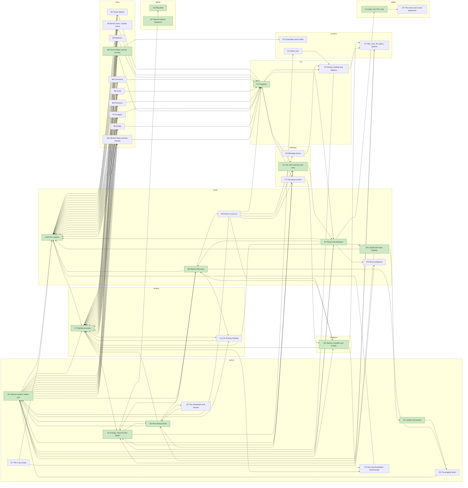

## Structure

How the code is built, read from the tree (`verify::report::structure`, over the size lexer's outline): the crates, then per clean model its modules, the interface its crate root exports, the shared types it takes and which of its modules uses which, then the shared types and the engine files that adapt each model. A module's items are those it declares for others (`pub` or `pub(crate)`), an enum with its variant count and a type's functions as `Type::{...}`, and how many it keeps private; what its doc says it is is its module doc's first sentence.

### Crates

The workspace's crates and the workspace crates each depends on. The clean room's crates are built from their specs alone; the engine runs them through its bridges, and the verification crates hold them to the oracle.

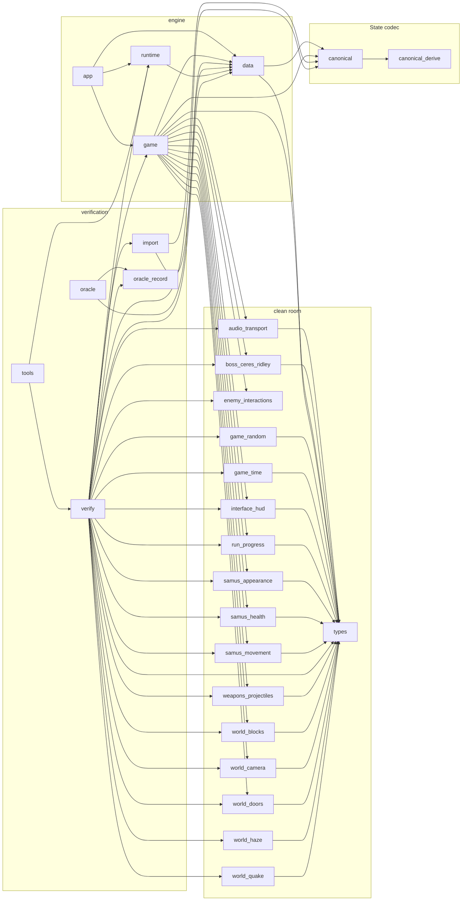

### audio-transport

`crates/clean/audio_transport`, 6 modules.

| Module | Area | Says it is | Items | Score | Lines |
| --- | --- | --- | --- | ---: | ---: |
| `catalogue.rs` | - | One catalogue row per named spec entry, with source-expected check families. | `enum BehaviourId (13)`, `struct Behaviour`, `fn catalogue` | 12 | 42 |
| `effects.rs` | effects | Spec: StagedRequests, EffectResources and ConnectedPitchMotion. | `fn turn`, 9 private | 824 | 155 |
| `frame.rs` | transport | Spec: FrameCadence and PublishedReplies. | `struct TurnCount`, `enum EffectCadence (2)`, `struct FrameCadence`, `fn play`, `TurnCount::{ZERO, ONE, TWO, new, get}`, 6 private | 406 | 88 |
| `lib.rs` | - | Audio transport, one frame at a time. | - | 0 | 13 |
| `music.rs` | music | Spec: MusicalProgress, FinitePhrases, WholeArrangement, LoudnessProgress and SongControls. | `fn turn`, `fn ramp_from`, 14 private | 1,237 | 202 |
| `sender.rs` | sender | Spec: OfferAcceptance, RequestDelivery and RequestRelease. | `struct Offer`, `fn offer`, `fn serve`, 2 private | 318 | 66 |

Its crate root exports:

- from `music`: `ramp_from`
- from `sender`: `Offer`
- from `types::audio`: `QueueAllowance`, `*`
- the module `catalogue`
- the module `frame`

The public functions a caller reaches through them:

```rust
catalogue() -> enum_map::EnumMap<BehaviourId, Behaviour>
TurnCount::new(turns: u8) -> Option<Self>
TurnCount::get(self) -> u8
play(state: &mut State, content: &Content, offers: &[Offer], cadence: FrameCadence)
ramp_from(loudness: Loudness, turns: NonZeroU8, target: u8) -> LoudnessRamp
```

Shared types it takes from `types`: `Kind`, `Switch`, `audio`. Other crates it uses: `std`.

Which module uses which, grouped by area (a module's own area, its functions counted elsewhere aside):

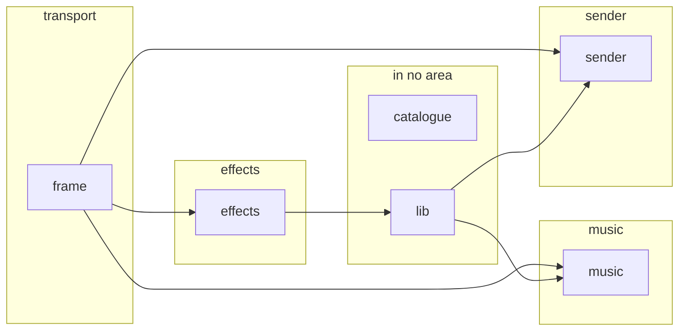

### enemy-interactions

`crates/clean/enemy_interactions`, 1 modules.

| Module | Area | Says it is | Items | Score | Lines |
| --- | --- | --- | --- | ---: | ---: |
| `lib.rs` | contact | Single-box Ceres-door contact with ordinary uncharged power shots. | `struct ProtectionFrames`, `struct ShotCount`, `struct Centre`, `struct Radii`, `struct ContactBox`, `enum DoorContact (3)`, `struct ContactConditions`, `enum ShotSlot (5)`, `const SHOT_SLOTS`, `enum ShotBody (3)`, `type Shots`, `fn consumption`, `enum BehaviourId (3)`, `enum Kind (2)`, `enum Switch (1)`, `struct Behaviour`, `fn behaviour`, `ContactConditions::allowed_box`, `ContactBox::overlaps_door`, 2 private | 264 | 170 |

Its crate root exports:


The public functions a caller reaches through them:

```rust
ContactConditions::allowed_box(self, door: DoorContact, count: ShotCount) -> Option<ContactBox>
ContactBox::overlaps_door(self, door: Self) -> bool
consumption(conditions: ContactConditions, door: DoorContact, count: ShotCount, shots: &Shots) -> Option<ShotSlot>
behaviour(id: BehaviourId) -> Behaviour
```

Shared types it takes from `types`: none. Other crates it uses: `enum_map`.

Which module uses which, grouped by area (a module's own area, its functions counted elsewhere aside):

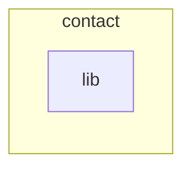

### weapons-projectiles

`crates/clean/weapons_projectiles`, 3 modules.

| Module | Area | Says it is | Items | Score | Lines |
| --- | --- | --- | --- | ---: | ---: |
| `catalogue.rs` | - | One entry for each named behaviour in the supplied specification. | `enum BehaviourId (12)`, `struct Behaviour`, `fn catalogue`, 1 private | 36 | 53 |
| `domain.rs` | shots | Quantities and caller contracts for the uncharged power beam. | `enum ShotSlot (5)`, `enum Heading (10)`, `struct Axes`, `struct FrameWord`, `struct ShotCount`, `struct FixedPosition`, `struct PixelFraction`, `struct BeamSpeed`, `struct Radius`, `struct Damage`, `struct FrameHold`, `struct ClipId`, `struct PictureId`, `struct TrailAppearanceId`, `struct ClipFrame`, `struct Frame`, `enum ClipEnding (2)`, `struct Clip`, `struct PowerBeam`, `struct Offset`, `enum MuzzleAim (3)`, `struct Muzzle`, `struct SamusCentre`, `struct ScreenOrigin`, `struct ScreenCentre`, `struct MovementDistance`, `struct Inheritance`, `enum UpdateMode (2)`, `struct CannonInput`, `struct RoomScreens`, `struct UpdateInput`, `struct ShotBody`, `enum ShotState (3)`, `struct State`, `enum Axis (2)`, `struct Contact`, `enum ContactResponse (2)`, `trait World`, `enum Event (5)`, `enum FlickerPhase (2)`, `enum DrawView (2)`, `struct PictureIntent`, `struct PictureIntents`, `ShotSlot::{DESCENDING, even}`, `Heading::axes`, `ClipFrame::{new, index, at}`, `Inheritance::stationary`, `ShotState::{body, body_mut}`, `State::{reset, consume}`, 1 private | 376 | 365 |
| `lib.rs` | shots | Uncharged power beam model. | `struct Rules`, `fn update_spacing`, `fn cannon_origin`, `fn inherited_motion`, `fn prepare_shot`, `fn accelerate`, `struct EdgeGeometry`, `fn edge_geometry`, `fn contact_edge`, `fn burst`, `fn muzzle_contact`, `fn update_trail`, `fn within_lifetime_view`, `fn inside_view`, `fn remove_shot`, `fn update_clip`, `fn update`, `fn pictures`, `Rules::REFERENCE`, `FixedPosition::{integer, fraction, from_parts, move_by}`, 35 private | 3,624 | 663 |

Its crate root exports:

- from `catalogue`: `*`
- from `domain`: `*`
- the module `catalogue`
- the module `domain`

The public functions a caller reaches through them:

```rust
catalogue() -> EnumMap<BehaviourId, Behaviour>
ShotSlot::even(self) -> bool
Heading::axes(self) -> Axes<i16>
ClipFrame::new(index: usize, frame_count: usize) -> Option<Self>
ClipFrame::index(self) -> usize
Inheritance::stationary() -> Self
ShotState::body(&self) -> Option<&ShotBody>
State::reset(fractions: EnumMap<ShotSlot, Axes<PixelFraction>>) -> Self
State::consume(&mut self, slot: ShotSlot)
FixedPosition::integer(self) -> u16
FixedPosition::fraction(self) -> PixelFraction
FixedPosition::from_parts(integer: u16, fraction: PixelFraction) -> Self
FixedPosition::move_by(&mut self, speed: BeamSpeed)
update_spacing(cooldown: &mut FrameWord, mode: UpdateMode, time_stopped: bool)
cannon_origin(input: &CannonInput) -> Option<(Heading, SamusCentre)>
inherited_motion(heading: Heading, movement: Inheritance) -> Axes<BeamSpeed>
prepare_shot(state: &mut State, input: &CannonInput, content: &PowerBeam, events: &mut Vec<Event>) -> Option<ShotSlot>
accelerate(body: &mut ShotBody, rules: Rules)
edge_geometry(centre: Axes<u16>, radius: Axes<Radius>, speed: BeamSpeed, axis: Axis, screens: u16) -> EdgeGeometry
contact_edge(body: &ShotBody, slot: ShotSlot, axis: Axis, room: RoomScreens, world: &mut impl World) -> bool
burst(shot: &mut ShotState, slot: ShotSlot, impact_clip: &ClipId, events: &mut Vec<Event>)
muzzle_contact(shot: &mut ShotState, slot: ShotSlot, input: &UpdateInput, content: &PowerBeam, world: &mut impl World, events: &mut Vec<Event>)
update_trail(body: &mut ShotBody, slot: ShotSlot, rules: Rules, events: &mut Vec<Event>)
within_lifetime_view(centre: Axes<u16>, camera: ScreenOrigin) -> bool
inside_view(centre: Axes<u16>, camera: ScreenOrigin) -> bool
remove_shot(shot: &mut ShotState, count: &mut ShotCount)
update_clip(body: &mut ShotBody, content: &PowerBeam) -> bool
update(state: &mut State, input: &UpdateInput, content: &PowerBeam, rules: Rules, world: &mut impl World) -> Vec<Event>
pictures(state: &State, phase: FlickerPhase, view: &DrawView) -> PictureIntents
```

Shared types it takes from `types`: `Checked`, `Kind`, `Switch`. Other crates it uses: `enum_map`, `serde`, `std`.

Which module uses which, grouped by area (a module's own area, its functions counted elsewhere aside):

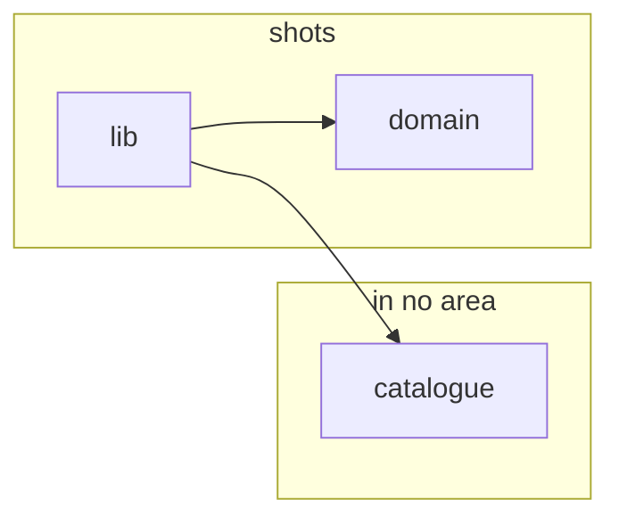

### samus-movement

`crates/clean/samus_movement`, 19 modules.

| Module | Area | Says it is | Items | Score | Lines |
| --- | --- | --- | --- | ---: | ---: |
| `catalogue.rs` | - | One entry per spec entry: what the player sees, its kind and its switch. | `enum BehaviourId (34)`, `struct Behaviour`, `const CATALOGUE` | 0 | 286 |
| `change.rs` | pose chart; `fn apply` in motion | `PoseFollows`: the pose change, once her moves are made. | `struct PoseChange`, `fn transition_firing_aim`, `Samus::{take_pose, apply}`, `Effect::lets_go`, 6 private | 1,385 | 215 |
| `chart/table.rs` | pose chart | The rows of `WhatHerMovesMet` and of `AnimationEnds` (§7), read in order, the first that fits. | `const MOVES_MET`, `const STEP_BLOCKED`, `const ANIMATION_ENDS`, 1 private | 0 | 289 |
| `chart.rs` | pose chart | §7: the pose chart's reader. | `struct Moment`, `struct Choice`, `enum Decider (5)`, `Choice::{chooses_anew, instead, blocked}`, `Moment::{next_pose, choose}`, 11 private | 1,041 | 170 |
| `collide.rs` | collision | Tilemap collision (`BlocksStopFlush`, `SolidEnemies`, `SlopesCarry`, `TouchedCells`, `OtherBlockKinds`): one axis at a time, against the room's grid of 16 px cells and the solid enemies' boxes. | `struct Bounds`, `enum Stop (3)`, `enum Probe (5)`, `struct Moved`, `fn vertical_heading`, `struct Axis`, `Bounds::axis`, `Tick::{inside, go, sideways, up_or_down, slope_check}`, 32 private | 2,333 | 338 |
| `fit.rs` | pose fit | `PoseFitAfterMoves`: when the pose she takes has a taller body, she looks up and down for room and is pushed clear of what is above or below her, or the change is refused or becomes a crouch. | `fn crouched`, `enum Fitted (4)`, `Fitted::{moved, takes_the_change}`, `Samus::fit`, 7 private | 674 | 118 |
| `jump_held.rs` | motion | `Jumping`, jump held through (§1.2): jump held through a landing, or through the end of a turn or of a landing, counts as a press for the pad chart the next frame, so she takes off again without pressing it. | `enum FrameBefore (2)`, `struct JumpHeld`, `JumpHeld::{NONE, pressed, then}`, `FrameBefore::left_behind`, 2 private | 239 | 59 |
| `lib.rs` | - | The samus-movement model, built from its behaviour spec alone: a character controller for Samus, stepped one 60 Hz frame at a time, her motion in fixed-point subpixels. | - | 0 | 33 |
| `moves.rs` | - | `MovesAsShePosed`: a frame's moves, as the pose she starts it in says: her horizontal move and the slope checks after it, the near-wall test, then the ground pull or her vertical move; facing the screen, the elevator's descent or nothing. | `struct MovesMade`, `Samus::make_moves`, 7 private | 1,294 | 179 |
| `rows.rs` | pose chart | The pose chart's vocabulary (§7). | `const FORWARD`, `const BACK`, `fn seen`, `enum Doing (14)`, `enum Drift (5)`, `enum Moves (5)`, `enum Footing (4)`, `struct Situation`, `struct Class`, `enum Test (13)`, `struct Aiming`, `enum NextFacing (3)`, `struct Next`, `enum Effect (12)`, `struct Entering`, `struct Beat`, `struct Row`, `enum RowId (77)`, `const AIM`, `const UP_DOWN`, `const UDA`, `const NO_CHANGE`, `const KEEP_POSE`, `const TO_STILL`, `const LOWERS_NOTHING`, `const TO_RUNNING`, `const TO_JUMPING`, `const TO_FALLING`, `const TO_SPINNING`, `const TO_TAKING_OFF`, `const TO_MOONWALKING`, `const TO_CROUCHING`, `const TO_MORPHING`, `const TO_TURNING`, `const FORWARD_AIM`, `const UP_AIM`, `const AIM_UP_ELSE_DOWN`, `const DOWN_TO_FORWARD`, `enum Met (5)`, `Next::pose_from`, `Entering::on` | 267 | 353 |
| `rules.rs` | - | The tuning parameters the model reads: one `Rules` a caller holds, whose `Default` is the vanilla game, the spec's numbers. | `enum SpeedCap (2)`, `enum Gait (7)`, `struct Limits`, `struct Speeds`, `enum Lowers (3)`, `struct WithItem`, `struct Bounce`, `struct Rules`, `WithItem::of`, `Rules::{limits, lowers, cap, rise_speed}`, `impl Default for Rules`, 1 private | 328 | 217 |
| `run.rs` | motion | Her run: her horizontal motion as a value of its own (§1.2 carrying on, her dash, dashing). | `enum Carry (2)`, `enum Dashing (2)`, `enum Stride (4)`, `fn running_with_run_held`, `struct Run`, `Run::{halt, skids, turn_round, end_skid, as_running, meet, launch, moving, dash_for_moves, stride}`, 8 private | 1,040 | 175 |
| `samus.rs` | motion | Samus as the player can tell her and what she remembers (§1, §1.2), and what a frame shows beyond her quantities: its outputs, for the caller to act on. | `enum Chosen (2)`, `struct Choices`, `enum Seat (2)`, `enum WallTest (3)`, `enum StandingAnimation (2)`, `fn sprite`, `struct Outcome`, `struct Samus`, `Choices::{starting_in, then, carried_on}`, `StandingAnimation::of`, `Samus::{rides_the_elevator, bounds, horizontal_probe, take_result}`, 1 private | 370 | 150 |
| `situation.rs` | pose chart | Her situation, classified once a frame from her pose at its start (`MovesAsShePosed`). | `struct UnknownPose`, `fn classify`, `static ENTERING`, `static CLASSES`, 47 private | 114 | 1,483 |
| `step.rs` | motion | One whole frame, in the order the spec gives it (`PoseFollows`, `MovesAsShePosed`): the cells she is inside; what she does and how she moves, as the pose she starts it in says; what her moves met; the pose she takes; and what she remembers for the next frame. | `Samus::step` | 364 | 52 |
| `tick.rs` | motion | One frame's play: what the frame brings from the player and the world (§1.3), and the room, the rules and the cells reached that the frame's moves and looks share (`TouchedCells`). | `struct Frame`, `struct Tick`, `Tick::new` | 28 | 32 |
| `touchdown.rs` | - | Spec: `TouchdownRequests`. | `fn opportunities`, 4 private | 262 | 65 |
| `travel.rs` | - | Spec: `TravelledDistances`. | `enum TravelKind (5)`, `struct TravelledDistances`, `TravelledDistances::{fresh, refresh, record}`, `impl Default for TravelledDistances` | 72 | 34 |
| `vertical.rs` | motion | Her vertical motion as a value of its own (§1 vertical speed and bounces, §1.2 falling at 0 and the moonfall). | `enum Phase (5)`, `struct Vertical`, `enum Course (3)`, `enum Contact (4)`, `Contact::rises`, `Vertical::{on_ground, has_motion, rising, heading_down, jump, end_rise, space_jump, enter_spin_from_a_turn, come_to_the_ground, course, grow, floor_stop, end_move, meet_in_moves, contact, meet, end_bounce}`, 6 private | 1,271 | 235 |

Its crate root exports:

- from `catalogue`: `Behaviour`, `BehaviourId`, `CATALOGUE`
- from `chart`: `Moment`
- from `jump_held`: `FrameBefore`, `JumpHeld`
- from `rows`: `Met`
- from `rules`: `Bounces`, `Rules`, `SpeedCap`, `WithItem`
- from `run`: `Carry`, `Dashing`, `Run`
- from `samus`: `Choices`, `Chosen`, `Outcome`, `Samus`, `Seat`, `StandingAnimation`, `WallTest`
- from `situation`: `UnknownPose`
- from `tick`: `Frame`
- from `travel`: `TravelKind`, `TravelledDistances`
- from `types`: `FloorResponse`, `FloorResponseKind`, `QueueAllowance`, `SoundIdentity`, `SoundLibrary`, `SoundRequest`, `VerticalSpeed`, `Direction`, `DirectionalTravels`, `FiringDirection`, `TravelDistance`
- from `vertical`: `Phase`, `Vertical`
- the module `catalogue`
- the module `rules`

The public functions a caller reaches through them:

```rust
Moment::next_pose(&self, pose: Pose) -> Result<Pose, UnknownPose>
WithItem::of(self, items: &Set<Item>) -> Fixed
Rules::limits(&self, gait: Gait) -> Limits
Rules::lowers(&self, by: Lowers) -> Fixed
Rules::cap(&self, speed: Fixed, top: Fixed) -> Fixed
Rules::rise_speed(&self, base: WithItem, items: &Set<Item>, dash: Fixed) -> Fixed
Choices::starting_in(pose: Pose) -> Self
Samus::step(&mut self, frame: &Frame, world: &dyn World, rules: &Rules) -> Result<Outcome, UnknownPose>
TravelledDistances::fresh() -> Self
TravelledDistances::refresh(&mut self)
TravelledDistances::record(&mut self, kind: TravelKind, direction: Direction, accepted: TravelDistance)
Vertical::on_ground(self) -> bool
```

Shared types it takes from `types`: `Action`, `Aim`, `Block`, `Body`, `Bounces`, `Buttons`, `Cell`, `Checked`, `ClipEnd`, `Direction`, `DirectionalTravels`, `Facing`, `FiringDirection`, `Fixed`, `FloorResponse`, `FloorResponseKind`, `Gun`, `Heading`, `Hitbox`, `Item`, `Kind`, `LandedFrom`, `Legs`, `Pair`, `Parity`, `Parts`, `Pose`, `Position`, `Px`, `QueueAllowance`, `Radius`, `Set`, `Side`, `Slope`, `SlopeFaces`, `SoundIdentity`, `SoundLibrary`, `SoundRequest`, `Sprite`, `Switch`, `Touch`, `TravelDistance`, `Turn`, `VerticalSpeed`, `Way`, `World`, `ZERO`, `button`, `fixed`, `part_below`, `px`. Other crates it uses: `core`.

Which module uses which, grouped by area (a module's own area, its functions counted elsewhere aside):

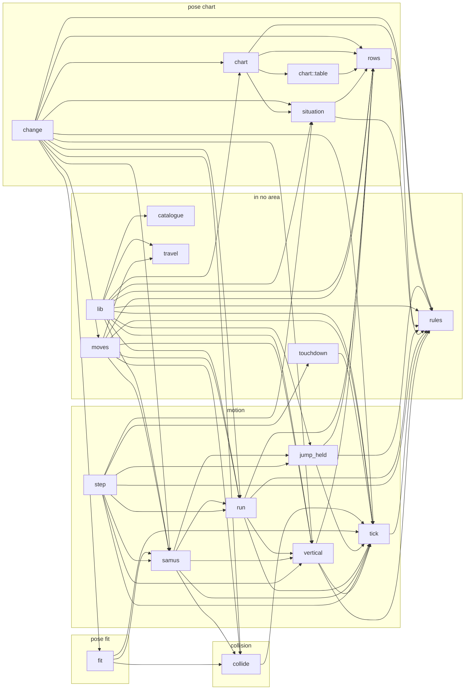

### world-camera

`crates/clean/world_camera`, 7 modules.

| Module | Area | Says it is | Items | Score | Lines |
| --- | --- | --- | --- | ---: | ---: |
| `axis.rs` | limits | One axis of a frame: the camera following her there (Spec: §2), and the room keeping the view in (Spec: §3): its edges, its closed and short screens, and how the view settles out of a closed screen. | `enum Axis (2)`, `struct Line`, `Line::{new, follow}`, 21 private | 949 | 187 |
| `catalogue.rs` | - | The catalogue: one behaviour per spec entry, with its kind, its switch and how it is checked. | `enum BehaviourId (15)`, `struct Behaviour`, `const CATALOGUE` | 0 | 155 |
| `follow.rs` | follow | Following her (Spec: §2): how positions compare, where the view aims, and how fast and how far it moves there. | `fn before`, `fn exceeds`, `fn max_by_before`, `fn min_by_exceeds`, `enum Going (2)`, `struct Move`, `fn aim`, `fn speed`, `fn distance`, `fn chase`, 3 private | 367 | 86 |
| `input.rs` | - | What the camera reads each frame (Spec: §1.3): her motion's outputs, the room, the lead setting and whether time is stopped. | `enum LeadSetting (4)`, `struct Samus`, `struct Frame` | 0 | 25 |
| `lib.rs` | - | The camera model, built from its behaviour spec alone: the screen's view following Samus. | `struct ViewPosition`, `struct RememberedPosition`, `struct Camera`, `Camera::{restore, initialise, with_view, with_remembered, vertical_fraction, position, seen, step}` | 295 | 93 |
| `room.rs` | limits | The room as the camera reads it (Spec: §1.3): its screens, run on as one strip, and its aim heights. | `const SCREEN`, `struct Heights`, `enum RoomError (3)`, `struct Room`, `Heights::height`, `Room::{new, screen}`, 2 private | 242 | 71 |
| `rules.rs` | follow | The tuning the camera reads: `Rules`, whose reference profile holds the spec's vanilla values. | `struct Leads`, `struct Rules`, `Rules::{lead, REFERENCE}`, 1 private | 80 | 58 |

Its crate root exports:

- from `catalogue`: `Behaviour`, `BehaviourId`, `CATALOGUE`
- from `input`: `Frame`, `LeadSetting`, `Samus`
- from `room`: `Heights`, `Room`, `RoomError`
- from `rules`: `Leads`, `Rules`

The public functions a caller reaches through them:

```rust
Camera::restore(view: ViewPosition, remembered: RememberedPosition, vertical_fraction: VerticalFraction) -> Self
Camera::initialise(view: ViewPosition, remembered: RememberedPosition) -> Self
Camera::with_view(mut self, view: ViewPosition) -> Self
Camera::with_remembered(mut self, remembered: RememberedPosition) -> Self
Camera::vertical_fraction(&self) -> VerticalFraction
Camera::position(&self) -> Pair<Fixed>
Camera::seen(&self) -> Position
Camera::step(self, rules: &Rules, frame: &Frame) -> Self
Room::new(run: Vec<ScreenKind>, size: Pair<usize>, heights: Heights) -> Result<Self, RoomError>
```

Shared types it takes from `types`: `Checked`, `Facing`, `Fixed`, `Kind`, `PIXEL`, `Pair`, `Parts`, `PlacementY`, `Position`, `Px`, `ScreenKind`, `Switch`, `VerticalFraction`, `below`, `fixed`, `px`. Other crates it uses: `core`.

Which module uses which, grouped by area (a module's own area, its functions counted elsewhere aside):

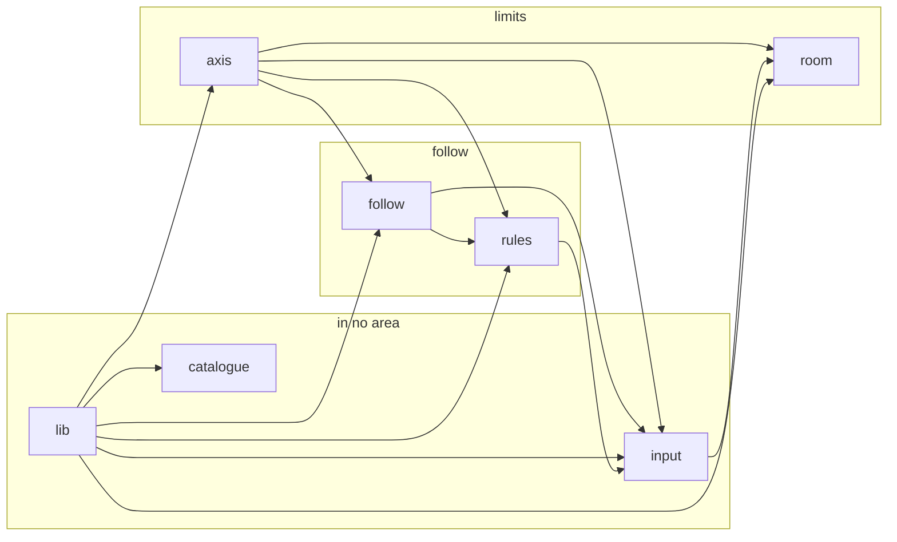

### run-progress

`crates/clean/run_progress`, 9 modules.

| Module | Area | Says it is | Items | Score | Lines |
| --- | --- | --- | --- | ---: | ---: |
| `catalogue.rs` | - | The catalogue: one behaviour for each entry of the progress spec. | `enum BehaviourId (14)`, `struct Behaviour`, `fn catalogue` | 9 | 126 |
| `inventory.rs` | equipment | What she has (spec §1.1, §4): her items and beams, hers and switched on, her capacities, what she holds and her reserve mode; and what taking an item, a beam or a tank gives her. | `type Count`, `enum Supply (5)`, `enum ReserveMode (3)`, `enum Pickup (3)`, `struct Supplies`, `struct Inventory`, `Inventory::take`, `impl Default for Supplies`, 3 private | 217 | 84 |
| `lib.rs` | - | The progress model, built from its behaviour spec alone: what the game remembers of her run besides where she is. | - | 0 | 19 |
| `percentage.rs` | percentage | The item percentage the ending shows. | `Inventory::item_percentage` | 74 | 12 |
| `places.rs` | places | What the places remember (spec §3): the item locations emptied and the doors that stay open, by id, and how she has each area's map. | `struct Remembered`, `enum MapStatus (3)`, `Remembered::{remember, contains}`, `MapStatus::is_known`, `impl Default for Remembered<Id>` | 56 | 30 |
| `progress.rs` | happened | The whole of what the game keeps of a run besides where she is (spec §1), and what has happened in the world (§2). | `struct Progress` | 0 | 17 |
| `report.rs` | places | What other domains report (spec §1.3), and how each report changes the progress. | `enum Report (10)`, `Progress::apply`, 1 private | 253 | 59 |
| `room_states.rs` | rooms | Which version of a room loads, given the run's progress (spec §5). | `enum Condition (6)`, `struct EnteredRoom`, `struct RoomStates`, `enum Version (2)`, `RoomStates::choose`, 1 private | 168 | 51 |
| `rules.rs` | - | The values the progress rules read: the reference profile holds the original game's. | `struct Rules`, `Rules::reference`, `impl Default for Rules`, 4 private | 42 | 39 |

Its crate root exports:

- from `catalogue`: `Behaviour`, `BehaviourId`, `catalogue`
- from `inventory`: `Count`, `Inventory`, `Pickup`, `ReserveMode`, `Supplies`, `Supply`
- from `places`: `MapStatus`, `Remembered`
- from `progress`: `Progress`
- from `report`: `Report`
- from `room_states`: `Condition`, `EnteredRoom`, `RoomStates`, `Version`
- from `rules`: `Rules`

The public functions a caller reaches through them:

```rust
catalogue() -> EnumMap<BehaviourId, Behaviour>
Inventory::item_percentage(&self, rules: &Rules) -> Count
Remembered::contains(&self, id: Id) -> bool
MapStatus::is_known(self) -> bool
Progress::apply(&mut self, rules: &Rules, reports: &[Report])
RoomStates::choose(&self, progress: &Progress, room: EnteredRoom) -> Version
Rules::reference() -> Self
```

Shared types it takes from `types`: `Area`, `Beam`, `BossKind`, `Checked`, `DoorId`, `Entrance`, `Event`, `Item`, `Kind`, `LocationId`, `Members`, `Set`, `StationId`, `Switch`. Other crates it uses: `core`, `enum_map`, `std`.

Which module uses which, grouped by area (a module's own area, its functions counted elsewhere aside):

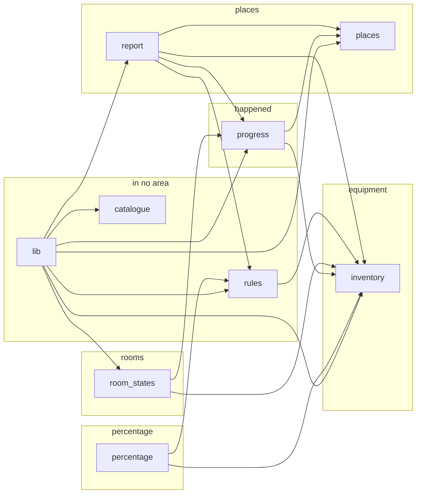

### interface-hud

`crates/clean/interface_hud`, 17 modules.

| Module | Area | Says it is | Items | Score | Lines |
| --- | --- | --- | --- | ---: | ---: |
| `catalogue.rs` | - | The catalogue: one behaviour per entry of the HUD's spec, with its kind, its switch and how the spec checks it. | `enum BehaviourId (21)`, `struct Behaviour`, `const CATALOGUE` | 0 | 208 |
| `countdown.rs` | status | The escape countdown (§5.1): the time remaining in the escape, shown over the room rather than in the status bar. | `enum Countdown (1)`, `enum CountdownRuns (2)`, `enum CountdownExpiry (1)`, `enum CountdownPicture (1)`, `struct CountdownAnswer`, `enum UnsupportedFrame (1)`, `Countdown::answer` | 56 | 42 |
| `events.rs` | - | What a frame reports for other domains to act on. | `enum HudEvent (2)` | 0 | 9 |
| `grid.rs` | - | A grid of cells, each holding a value: the HUD's cells, her map's pictures and the sets of her map's cells are each one. | `type Place`, `fn at`, `fn plus`, `struct Grid`, `Grid::{filled, get, set, contains, insert}`, `impl Default for Grid<T, COLUMNS, ROWS>`, 1 private | 224 | 55 |
| `inputs.rs` | -; `fn has` in selection | What the HUD reads each step (§1.3): in a frame of play, her stock as the frame begins and the buttons, which the selection reads; where she is on her map; the values other domains own as the frame ends, which the status bar draws; what other domains drop before the status bar and after it; and whether the scene runs the escape countdown. | `struct FrameCount`, `struct Energy`, `enum ReserveMode (2)`, `struct Reserve`, `struct Stock`, `struct Ammunition`, `struct Status`, `struct Equipped`, `struct StockAtStart`, `enum SelectButton (2)`, `enum CancelButton (3)`, `enum Mute (4)`, `struct Controls`, `struct Room`, `struct MiniMapInputs`, `enum Dropped (3)`, `struct FrameInputs`, `enum NewArea (2)`, `struct OutOfPlayInputs`, `Ammunition::{new, of, stocks}`, `StockAtStart::has`, 1 private | 123 | 147 |
| `item.rs` | selection | The items the HUD can select (§1.1). | `enum Ammo (3)`, `enum SelectableItem (3)`, `SelectableItem::ORDER` | 0 | 26 |
| `layout.rs` | status | Where things sit on the HUD (§1.2), as places on its grid: column across, row down. | `const TANKS`, `const ENERGY_DIGITS`, `fn ammo_digits`, `const RESERVE_SIGN`, `fn icon_top_left`, `const HER_CELL`, `const WINDOW_REACH`, `fn laid`, 3 private | 94 | 52 |
| `lib.rs` | - | The HUD model, built from its behaviour spec alone: the status bar at the top of the screen, the selected item and the mini-map. | - | 0 | 39 |
| `map.rs` | minimap | Her map, as the mini-map reads it (§1.3): 64 columns by 32 rows of cells, each cell's picture with its flips, its beyond pictures, and the cells it charts; and the sets of its cells. | `type MapCellSet`, `type MapPictures`, `struct HerMap` | 0 | 10 |
| `mini_map.rs` | minimap | The mini-map (§4): the 5 × 3 cells of her map around hers, the ones she has explored, her own cell blinking, the bosses that blank it, and the quirks at the map's first and last columns. | `HudState::{mini_map_turned_on, mini_map_turn, boss_blanks_the_map}`, 24 private | 754 | 173 |
| `pictures.rs` | status | The HUD's pictures (§1.4): content the importer supplies by name, which the caller gives each step. | `struct Icons`, `fn rows`, `struct HudPictures`, `Icons::of`, `HudPictures::blank_cell` | 127 | 46 |
| `rules.rs` | -; `fn reference` in minimap | The values the HUD's rules read: the reference profile holds the spec's; another `Rules` is an adjusted game. | `enum Boss (7)`, `struct Alternation`, `struct Rules`, `Alternation::first_half`, `Rules::reference`, `impl Default for Rules`, 3 private | 97 | 78 |
| `selection.rs` | selection | How Select, item cancel and another domain's drop change the selection (spec: CyclingItems, CancellingTheItem, OneShotItem, Switching). | `Selection::{apply_drop, respond_to_controls}`, 1 private | 237 | 39 |
| `state.rs` | - | What the HUD keeps from one frame to the next (§1): its cells, the values last shown, the selection, the explored cells, whether the mini-map is off, and the escape countdown. | `struct Shown`, `enum Selection (3)`, `enum MiniMapPower (2)`, `struct HudState`, `Selection::{item, one_shot}` | 59 | 47 |
| `status_bar.rs` | status | The status bar (§2): the energy and its tanks, the ammunition counts, the reserve sign, and the items' icons with the selection's highlight. | `HudState::draw_status_bar`, 11 private | 823 | 122 |
| `step.rs` | - | The HUD's steps: a frame of play, whole, and a step outside play. | `struct FrameOutputs`, `HudState::{frame_of_play, out_of_play}` | 180 | 42 |
| `tile.rs` | - | What a cell of the HUD shows (§1.4): a picture with its flips (the shared `Look`), in one of the HUD's eight colour sets; and the colour sets by the role the spec gives each. | `struct ColourSet`, `struct Tile`, `type HudGrid`, `const BLANK_COLOURS`, `const DIGIT_COLOURS`, `const FULL_TANK_COLOURS`, `const EMPTY_TANK_COLOURS`, `const SIGN_LIT`, `const SIGN_DIM`, `const PLAIN`, `const HIGHLIGHTED`, `const EXPLORED`, `const CHARTED`, `const BLINK`, `ColourSet::{new, number}`, `Tile::{new, in_colours}`, `impl TryFrom<u8> for ColourSet`, `impl From<ColourSet> for u8`, 1 private | 82 | 58 |

Its crate root exports:

- from `catalogue`: `Behaviour`, `BehaviourId`, `CATALOGUE`
- from `countdown`: `Countdown`, `CountdownAnswer`, `CountdownExpiry`, `CountdownPicture`, `CountdownRuns`, `UnsupportedFrame`
- from `events`: `HudEvent`
- from `grid`: `Grid`, `Place`
- from `inputs`: `Ammunition`, `CancelButton`, `Controls`, `Dropped`, `Energy`, `Equipped`, `FrameCount`, `FrameInputs`, `MiniMapInputs`, `Mute`, `NewArea`, `OutOfPlayInputs`, `Reserve`, `ReserveMode`, `Room`, `SelectButton`, `Status`, `Stock`, `StockAtStart`
- from `item`: `Ammo`, `SelectableItem`
- from `map`: `HerMap`, `MapCellSet`, `MapPictures`
- from `pictures`: `HudPictures`, `Icons`
- from `rules`: `Alternation`, `Boss`, `Rules`
- from `state`: `HudState`, `MiniMapPower`, `Selection`, `Shown`
- from `step`: `FrameOutputs`
- from `tile`: `ColourSet`, `HudGrid`, `Tile`
- from `types`: `Checked`, `Flip`, `Kind`, `Look`, `Pair`, `Picture`, `Screen`, `Switch`

The public functions a caller reaches through them:

```rust
Grid::filled(value: T) -> Self
Grid::get(&self, place: Place) -> Option<T>
Grid::set(&mut self, place: Place, value: T)
Grid::contains(&self, place: Place) -> bool
Grid::insert(&mut self, place: Place)
Ammunition::new(stocks: EnumMap<Ammo, Stock>) -> Option<Self>
Ammunition::of(&self, ammo: Ammo) -> &Stock
Ammunition::stocks(&self) -> impl Iterator<Item = (Ammo, &Stock)>
StockAtStart::has(&self, item: SelectableItem) -> bool
HudState::boss_blanks_the_map(&mut self, rules: &Rules, pictures: &HudPictures, boss: Boss, room: Place)
Icons::of(&self, item: SelectableItem) -> [&[Look]; 2]
HudPictures::blank_cell(&self) -> Tile
Alternation::first_half(self, frame: FrameCount) -> bool
Rules::reference() -> Self
Selection::item(self) -> Option<SelectableItem>
Selection::one_shot(self) -> Option<SelectableItem>
HudState::frame_of_play(&mut self, rules: &Rules, pictures: &HudPictures, inputs: &FrameInputs<'_>) -> Result<FrameOutputs, UnsupportedFrame>
HudState::out_of_play(&mut self, inputs: &OutOfPlayInputs<'_>)
ColourSet::new(number: u8) -> Option<Self>
ColourSet::number(self) -> u8
Tile::new(look: Look, colours: ColourSet) -> Self
Tile::in_colours(self, colours: ColourSet) -> Self
```

Shared types it takes from `types`: `Checked`, `Flip`, `Kind`, `Look`, `Pair`, `Picture`, `Screen`, `Switch`. Other crates it uses: `enum_map`, `serde`, `serde_big_array`, `std`.

Which module uses which, grouped by area (a module's own area, its functions counted elsewhere aside):

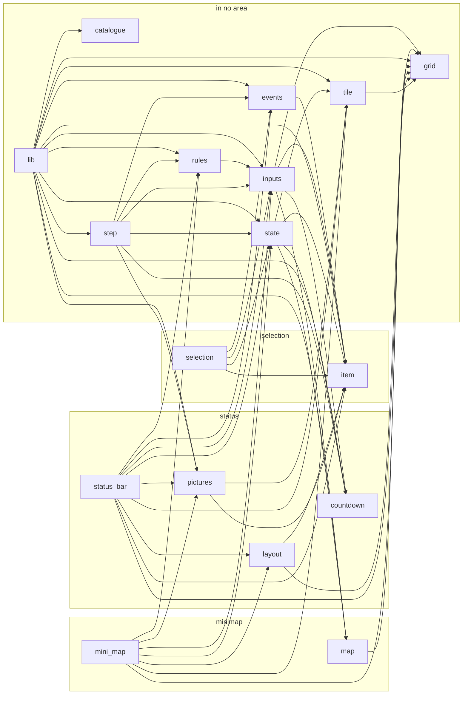

### world-blocks

`crates/clean/world_blocks`, 9 modules.

| Module | Area | Says it is | Items | Score | Lines |
| --- | --- | --- | --- | ---: | ---: |
| `catalogue.rs` | - | The catalogue: one behaviour per spec entry, with its kind, its switch and how it is checked. | `enum BehaviourId (18)`, `struct Behaviour`, `const CATALOGUE` | 0 | 168 |
| `cells.rs` | -; `fn show` in places, `fn regrow` in places, `fn offset` in places, `fn answer` in breakables, `fn plain` in breakables, `fn met_as` in breakables | The room's cells as this domain sees them: each cell's kind, mark and look (spec §1), and how a step writes a cell. | `struct Grid`, `type Tilemap`, `struct Tile`, `enum CellKind (4)`, `enum ReactingBody (2)`, `enum StandIn (2)`, `enum Answer (3)`, `enum Mark (7)`, `enum OtherMetAs (2)`, `enum Inside (2)`, `fn offset`, `Grid::{new, rows, get, get_mut}`, `CellKind::answer`, `ReactingBody::plain`, `Mark::met_as`, `Tile::{show, regrow}` | 314 | 138 |
| `inputs.rs` | - | What the frame and the room's start give the model (spec §1.3). | `enum Request (2)`, `enum Meeting (3)`, `enum Run (2)`, `enum Placement (3)`, `struct ScreenChange`, `struct OutsideTheRoom` | 0 | 41 |
| `lib.rs` | - | The blocks model, built from its behaviour spec alone: blocks that break and come back, the scroll cells that change which screens the view may show, and the stand-ins a room places. | - | 0 | 22 |
| `places.rs` | places | The places reactions run in (`Places`), and the run of what they hold (`TheScriptsRun`): at most 40 run at once, each one started takes the highest free place, and every frame that isn't paused each place from the highest down has its turn. | `const PLACE_COUNT`, `struct Places`, `enum Place (5)`, `struct Running`, `struct ScrollReaction`, `enum Touched (2)`, `Places::{take, full, hold_until_run, touch_scroll, run}`, `Running::started`, `impl Default for Places`, 7 private | 755 | 172 |
| `reactions.rs` | places | Reactions and their scripts: the imported assets (spec §2). | `const MOST_FRAMES`, `struct Frames`, `struct ReactionName`, `struct Reaction`, `enum Step (4)`, `struct SoundRequest`, `struct PatternCell`, `enum Becomes (4)`, `Frames::{ONE, new, count, less_one}`, `Reaction::{first_wait_of, regrows}` | 96 | 75 |
| `report.rs` | - | What a frame reports (spec §1.4) beyond the state's screens. | `struct Report` | 0 | 9 |
| `rules.rs` | breakables | The rules (spec §5, `BlocksMarkedNothing`): for each family, and for each family a cell marked `Nothing` is met as, what her touches and the hits ask of its cells. | `struct Rules`, `struct Row`, `enum TouchRule (2)`, `enum Starter (3)`, `struct HitRule`, `enum Bodies (2)`, `struct HoldUntilRun`, `struct Start`, `enum FirstStep (2)`, `enum Change (3)`, `Rules::reference`, `Row::answer`, `Starter::starts`, `Bodies::includes`, `FirstStep::index`, `Change::apply`, 23 private | 444 | 318 |
| `state.rs` | breakables | What the model remembers from frame to frame (spec §1.2): the cells, the places and the screens, and the two entry points that change them: the room's start and the frame's step. | `struct State`, `State::{start_room, step}`, 2 private | 787 | 133 |

Its crate root exports:

- from `catalogue`: `Behaviour`, `BehaviourId`, `CATALOGUE`
- from `cells`: `Answer`, `CellKind`, `Grid`, `Inside`, `Mark`, `OtherMetAs`, `ReactingBody`, `StandIn`, `Tile`, `Tilemap`
- from `inputs`: `Meeting`, `OutsideTheRoom`, `Placement`, `Request`, `Run`, `ScreenChange`
- from `places`: `PLACE_COUNT`, `Place`, `Places`, `Running`, `ScrollReaction`, `Touched`
- from `reactions`: `Becomes`, `Frames`, `MOST_FRAMES`, `PatternCell`, `Reaction`, `ReactionName`, `SoundRequest`, `Step`
- from `report`: `Report`
- from `rules`: `Bodies`, `Change`, `FirstStep`, `HitRule`, `HoldUntilRun`, `Row`, `Rules`, `Start`, `Starter`, `TouchRule`
- from `state`: `State`

The public functions a caller reaches through them:

```rust
Grid::new(rows: Vec<Vec<T>>) -> Option<Self>
Grid::rows(&self) -> &[Vec<T>]
Grid::get(&self, at: Pair<u16>) -> Option<&T>
Grid::get_mut(&mut self, at: Pair<u16>) -> Option<&mut T>
CellKind::answer(self) -> Answer
ReactingBody::plain(self) -> CellKind
Mark::met_as(&self) -> Option<MetAs>
Tile::show(&mut self, cell: &PatternCell)
Tile::regrow(&mut self, body: ReactingBody, whole_look: Option<Picture>)
Frames::new(count: u16) -> Option<Self>
Frames::count(self) -> u16
Frames::less_one(self) -> Option<Self>
Reaction::first_wait_of(&self, script: Script) -> Frames
Reaction::regrows(&self, script: Script) -> bool
Rules::reference() -> Self
Starter::starts(&self, way: Way, moving: Set<Motion>) -> bool
Bodies::includes(self, body: ReactingBody) -> bool
FirstStep::index(self, steps: &[Step]) -> usize
State::start_room(&mut self, placements: impl IntoIterator<Item = Placement>) -> Result<(), OutsideTheRoom>
State::step(&mut self, rules: &Rules, requests: &[Request], moving: Set<Motion>, run: Run) -> Result<Report, OutsideTheRoom>
```

Shared types it takes from `types`: `Cell`, `Checked`, `Family`, `Heading`, `HitBy`, `Kind`, `Look`, `MetAs`, `Motion`, `Pair`, `Picture`, `Point`, `Screen`, `ScreenKind`, `Script`, `Set`, `Switch`, `Way`, `by_member`. Other crates it uses: `enum_map`, `std`.

Which module uses which, grouped by area (a module's own area, its functions counted elsewhere aside):

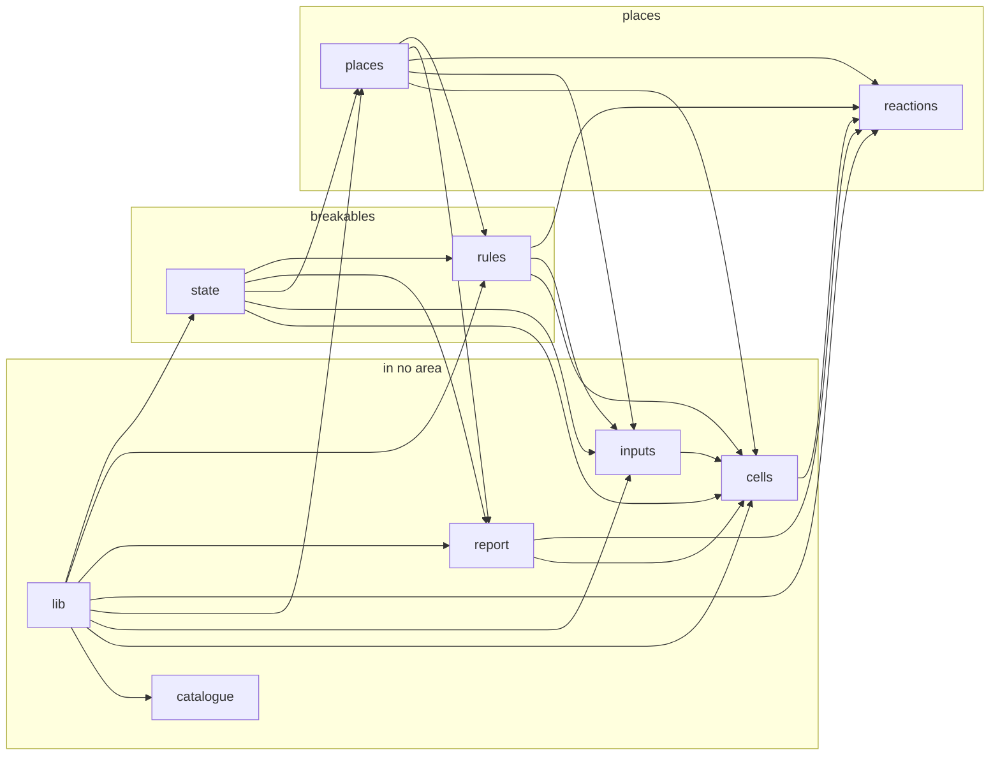

### samus-appearance

`crates/clean/samus_appearance`, 15 modules.

| Module | Area | Says it is | Items | Score | Lines |
| --- | --- | --- | --- | ---: | ---: |
| `ahead.rs` | clip | The read-ahead: what a caller asks of her State as the frame starts, before samus-movement's step: the end her clip reaches and whether her spin has turned far. | `struct Ahead`, `Ahead::of` | 102 | 27 |
| `cannon.rs` | cannon | When her cannon may follow the selected item: a delay of its own, apart from her animation and the HUD's mode. | `enum SelectedItem (6)`, `enum ControlEligibility (2)`, `struct ItemControlAnswer`, `enum ItemControls (2)`, `struct CannonDelay`, `CannonDelay::{INITIAL, new, remaining, may_follow, after}`, 2 private | 97 | 75 |
| `catalogue.rs` | - | The catalogue: one behaviour per entry of the spec. | `enum BehaviourId (23)`, `struct Behaviour`, `fn catalogue`, 1 private | 17 | 220 |
| `clip.rs` | clip | Her clips and the run's paces: the content the importer supplies, as typed values. | `struct Step`, `struct Frames`, `struct ShownFrames`, `struct Hold`, `struct Slowdown`, `struct Branch`, `enum Instruction (2)`, `enum Control (6)`, `struct Clip`, `struct Pace`, `struct Paces`, `Step::{FIRST, SECOND, next, before}`, `Frames::{NONE, LAST, slowed}`, `ShownFrames::{MOST, new, count, before_the_run_down}`, `Hold::{LONGEST, new, frames}`, `Slowdown::{MOST, NONE, new}`, `Control::end`, `Clip::{at, hold}`, `Pace::hold`, `impl TryFrom<u8> for ShownFrames`, `impl TryFrom<u8> for Hold`, `impl TryFrom<u8> for Slowdown`, 1 private | 292 | 160 |
| `colours.rs` | palette | Her colour sequences during ordinary dry movement: the visor and charge-glow sequences, readied while the shared current and target palettes stay with their owner. | `struct VisorDelay`, `struct VisorStep`, `struct ChargeGlowPosition`, `struct ColourSequences`, `const ORDINARY_READY`, `enum Suit (3)`, `enum RoomColours (3)`, `enum GrappleActivity (2)`, `enum LiquidLevel (2)`, `enum ColourEffect (6)`, `struct PaletteObservations`, `enum PaletteOpportunity (3)`, `enum DryColourReset (2)`, `struct Unrecognized`, `type DryColourOutcome`, `fn ordinary_dry_colours`, `VisorDelay::{new, ticks}`, `VisorStep::{new, entry}`, `ChargeGlowPosition::{RESET, new, picture}`, 6 private | 276 | 165 |
| `inputs.rs` | - | What a frame brings, each fact once, from the domain that owns it, and the content her animation plays. | `struct Figure`, `trait AnimationContent`, `struct MissingClip`, `fn clip_of`, `enum MoveEvent (3)`, `enum Dash (6)`, `struct Liquid`, `enum Activity (3)`, `struct Charge`, `struct Inputs`, `struct SoundsWaiting`, `Dash::{dashing_as_the_clip_moves_on, began, lost}`, `Liquid::NONE`, `Charge::{MOST, QUIET_BELOW, new, frames}`, `SoundsWaiting::{MOST, new, count}`, `impl TryFrom<u16> for Charge`, `impl TryFrom<u8> for SoundsWaiting` | 173 | 141 |
| `lib.rs` | - | Her appearance State ([`AppearanceState`]) holds all she remembers from one frame to the next: her step and the time left on it, the boost stage and the laps left, her kept action, the cannon selection delay, and the visor delay, visor sequence position and charge-glow position. | - | 0 | 33 |
| `moves.rs` | moves | What her moves do to her clip, before the time runs down. | `fn standing_restart`, `fn wall_jump_ready`, `fn fast_fall`, `fn rising_hold` | 225 | 50 |
| `play.rs` | clip | Her clip plays: the time runs down, and when it is over the clip moves on as its steps say. | `struct ClipPlay`, `ClipPlay::play`, 7 private | 673 | 116 |
| `rules.rs` | - | The spec's parameters, as a game's tuning: `Rules::VANILLA` holds the game's values, and any other `Rules` is an adjusted game. | `struct Rules`, `Rules::VANILLA` | 0 | 30 |
| `run.rs` | run | Her run: its pace while she dashes, and the speed booster's stages up to boosting. | `fn stride`, `fn hold_on`, `fn next_stage`, `fn boosting_lap_stage`, `fn dash_began`, `fn dash_lost`, 1 private | 245 | 66 |
| `sounds.rs` | - | Spec: `FootContact`, `SpinStarts`, `SpinEnds`, `AtTheDoor`. | `enum Sound (7)`, `enum SoundQueue (2)`, `struct SoundOffer`, `struct GraphicalContact`, `fn foot_contact`, `fn spin_start`, `fn at_the_door`, `fn spin_end`, `Sound::offer`, 3 private | 382 | 109 |
| `starting.rs` | clip | Taking another pose: where the clip of the pose she takes starts. | `fn start`, 11 private | 249 | 147 |
| `state.rs` | -; `fn on` in clip, `fn run_down` in clip, `fn after_lap` in run | What her appearance remembers from one frame to the next: her animation's four quantities (her step, the time left on it, the boost stage and the laps left), her kept action, the cannon selection delay, and her colour sequences. | `struct Playhead`, `enum RunDown (2)`, `struct Laps`, `enum LapsLeft (2)`, `struct Animation`, `struct AppearanceState`, `Playhead::{on, run_down}`, `Laps::{ONE, TWO, new, count}`, `LapsLeft::after_lap`, `Animation::with_playhead`, `AppearanceState::INITIAL`, 1 private | 271 | 105 |
| `update.rs` | - | A frame of her appearance: the frame's inputs and parts go in, her appearance State and the frame's outputs come out, each rule applied once, where it happens in the frame. | `enum FramePart (5)`, `struct Frame`, `struct FrameOutputs`, `fn update`, 2 private | 503 | 113 |

Its crate root exports:

- from `ahead`: `Ahead`
- from `cannon`: `CannonDelay`, `ControlEligibility`, `ItemControlAnswer`, `ItemControls`, `SelectedItem`
- from `catalogue`: `Behaviour`, `BehaviourId`, `catalogue`
- from `clip`: `Branch`, `Clip`, `Control`, `Frames`, `Hold`, `Instruction`, `Pace`, `Paces`, `ShownFrames`, `Slowdown`, `Step`
- from `colours`: `ChargeGlowPosition`, `ColourEffect`, `ColourSequences`, `DryColourOutcome`, `DryColourReset`, `GrappleActivity`, `LiquidLevel`, `PaletteObservations`, `PaletteOpportunity`, `RoomColours`, `Suit`, `Unrecognized`, `VisorDelay`, `VisorStep`
- from `inputs`: `Activity`, `AnimationContent`, `Charge`, `Dash`, `Figure`, `Inputs`, `Liquid`, `MissingClip`, `MoveEvent`, `SoundsWaiting`
- from `rules`: `Rules`
- from `sounds`: `GraphicalContact`, `Sound`, `SoundOffer`, `SoundQueue`
- from `state`: `Animation`, `AppearanceState`, `Laps`, `LapsLeft`, `Playhead`
- from `update`: `Frame`, `FrameOutputs`, `FramePart`, `update`

The public functions a caller reaches through them:

```rust
Ahead::of(state: &AppearanceState, figure: Figure, content: &impl AnimationContent) -> Result<Self, MissingClip>
CannonDelay::new(frames: u8) -> Option<Self>
CannonDelay::remaining(self) -> u8
CannonDelay::may_follow(self) -> bool
catalogue() -> EnumMap<BehaviourId, Behaviour>
Step::next(self) -> Option<Self>
Step::before(self) -> Option<Self>
Frames::slowed(self, slowdown: Slowdown) -> Self
ShownFrames::new(frames: u8) -> Option<Self>
ShownFrames::count(self) -> u8
ShownFrames::before_the_run_down(self) -> Frames
Hold::new(frames: u8) -> Option<Self>
Hold::frames(self) -> Frames
Slowdown::new(frames: u8) -> Option<Self>
Control::end(self) -> Option<ClipEnd>
Clip::at(&self, step: Step) -> Option<Instruction>
Clip::hold(&self, step: Step) -> Option<Hold>
Pace::hold(&self, step: Step) -> Option<Hold>
VisorDelay::new(ticks: u8) -> Self
VisorDelay::ticks(self) -> u8
VisorStep::new(entry: u8) -> Self
VisorStep::entry(self) -> u8
ChargeGlowPosition::new(picture: u8) -> Self
ChargeGlowPosition::picture(self) -> u8
Dash::dashing_as_the_clip_moves_on(self) -> bool
Dash::began(self) -> bool
Dash::lost(self) -> bool
Charge::new(frames: u16) -> Option<Self>
Charge::frames(self) -> u16
SoundsWaiting::new(waiting: u8) -> Option<Self>
SoundsWaiting::count(self) -> u8
Sound::offer(self) -> SoundOffer
Laps::new(count: u8) -> Option<Self>
Laps::count(self) -> u8
Animation::with_playhead(self, playhead: Playhead) -> Self
update(state: AppearanceState, frame: &Frame, content: &impl AnimationContent, rules: &Rules) -> Result<(AppearanceState, FrameOutputs), MissingClip>
```

Shared types it takes from `types`: `Action`, `Aim`, `Body`, `BoostStage`, `Checked`, `ClipEnd`, `Fixed`, `Item`, `Kind`, `LandedFrom`, `Parts`, `Pose`, `QueueAllowance`, `Set`, `Sprite`, `Switch`, `Turn`, `by_member`. Other crates it uses: `core`, `enum_map`, `serde`.

Which module uses which, grouped by area (a module's own area, its functions counted elsewhere aside):

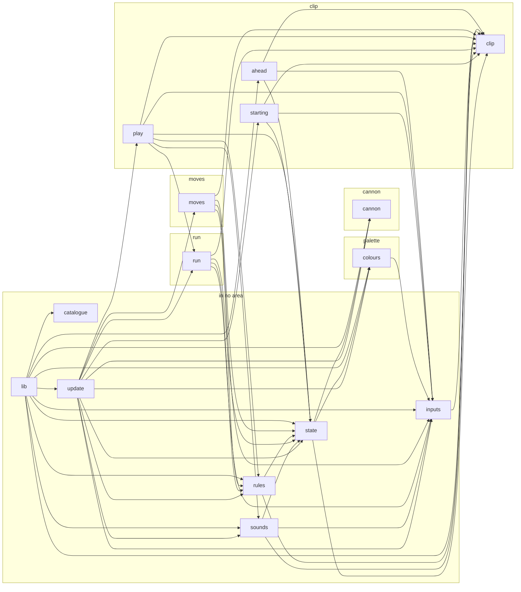

### boss-ceres-ridley

`crates/clean/boss_ceres_ridley`, 12 modules.

| Module | Area | Says it is | Items | Score | Lines |
| --- | --- | --- | --- | ---: | ---: |
| `catalogue.rs` | - | The catalogue: one behaviour for each entry of the spec, with its kind, its switch and how it is checked. | `enum BehaviourId (18)`, `struct Behaviour`, `fn catalogue`, 2 private | 17 | 182 |
| `door.rs` | doors | A Ceres door: how a room places it, and its run each frame the enemies run. | `const BOX_RADIUS`, `enum DoorKind (2)`, `struct CeresDoor`, `struct Placement`, `struct OpeningSound`, `struct Run`, `DoorKind::becomes_wall`, `OpeningSound::QUEUE_LIMIT`, `CeresDoor::{place, run, figure, hitbox}`, 1 private | 522 | 130 |
| `figure.rs` | doors | The figures a door holds: which one each phase shows, for each way the door faces. | `enum FigureLook (5)`, `struct Figure`, `struct Figures`, `fn figures`, `Figures::for_door`, 4 private | 310 | 102 |
| `inputs.rs` | -; `fn she_is_near` in doors, `fn gap` in doors, `fn escape_shake` in station | What a door reads as the frame starts, and the two rules that read only it: whether she is near, and whether the door starts a shake. | `struct Inputs`, `Inputs::{she_is_near, escape_shake}`, 2 private | 116 | 31 |
| `lib.rs` | - | The boss-ceres-ridley model, built from its behaviour spec alone. | - | 0 | 22 |
| `lights.rs` | - | The lights, one piece of the shaft as she arrives, which the shaft's overlay shows: the beacon pulsing through its colour sets and the platform below turning. | `struct FadeSteps`, `struct BeaconStep`, `struct LightsInputs`, `struct Lights`, `FadeSteps::{MOST, NONE, new, steps}`, `BeaconStep::{new, place}`, `Lights::step`, 5 private | 171 | 77 |
| `look.rs` | - | The two looks the pad and the platform each take in turn. | `enum AlternatingLook (2)`, `AlternatingLook::other` | 7 | 14 |
| `pad.rs` | - | The pad and the cover, one piece of the shaft as she arrives: the elevator's pad that holds her as a new game starts, lowers her down the shaft to its floor and lets her go; and the cover that hides the shaft's floor below it until she stands on it. | `struct Pad`, `struct PadFigure`, `struct Cover`, `struct PadAndCover`, `struct PadAndCoverFigures`, `struct PadAndCoverStep`, `PadAndCover::{arrival, run, holds_her}`, 12 private | 490 | 149 |
| `pad_wait.rs` | - | The pad's wait: how long the elevator's pad holds her still before it lowers her. | `struct PadWait`, `PadWait::{LONGEST, OVER, new, frames, counted_down}` | 57 | 21 |
| `phase.rs` | doors | A door's phase: where it stands in its cycle, with what each phase carries (its wait, and how far an opening or a closing has gone), and the tables of which phases are shown and solid. | `struct Wait`, `enum Quarter (4)`, `enum Phase (7)`, `Wait::{new, frames}`, `Quarter::next`, `Phase::{counted_down, shown, solid}`, 2 private | 272 | 97 |
| `rules.rs` | - | The station's tuning values, the doors' and the shaft's: every number a Parameter entry of the spec lists. | `struct Rules`, `impl Default for Rules`, 13 private | 77 | 51 |
| `station.rs` | station | The station around the doors and the shaft: its stage, the doors' two colour sets and the shakes they start. | `enum Stage (3)`, `enum ColourSet (2)`, `struct Shake`, `Stage::{ridley_has_fled, door_colours}` | 14 | 32 |

Its crate root exports:

- from `catalogue`: `Behaviour`, `BehaviourId`, `catalogue`
- from `door`: `BOX_RADIUS`, `CeresDoor`, `DoorKind`, `OpeningSound`, `Placement`, `Run`
- from `figure`: `Figure`, `FigureLook`
- from `inputs`: `Inputs`
- from `lights`: `BeaconStep`, `FadeSteps`, `Lights`, `LightsInputs`
- from `look`: `AlternatingLook`
- from `pad`: `Cover`, `Pad`, `PadAndCover`, `PadAndCoverFigures`, `PadAndCoverStep`, `PadFigure`
- from `pad_wait`: `PadWait`
- from `phase`: `Phase`, `Quarter`, `Wait`
- from `rules`: `Rules`
- from `station`: `ColourSet`, `Shake`, `Stage`

The public functions a caller reaches through them:

```rust
catalogue() -> EnumMap<BehaviourId, Behaviour>
DoorKind::becomes_wall(self, stage: Stage) -> bool
CeresDoor::place(kind: DoorKind, facing: Side, position: Pair<Px>, stage: Stage) -> Placement
CeresDoor::run(self, inputs: &Inputs, rules: &Rules) -> Run
CeresDoor::figure(self) -> Option<Figure>
CeresDoor::hitbox(self) -> Hitbox
Inputs::she_is_near(&self, door: Pair<Px>, reach: u16) -> bool
Inputs::escape_shake(&self, rules: &Rules) -> Option<Shake>
FadeSteps::new(steps: u8) -> Option<Self>
FadeSteps::steps(self) -> u8
BeaconStep::new(place: u16) -> Option<Self>
BeaconStep::place(self) -> u16
Lights::step(inputs: LightsInputs, rules: &Rules) -> Self
AlternatingLook::other(self) -> Self
PadAndCover::arrival(her: Pair<Px>, rules: &Rules) -> PadAndCoverStep
PadAndCover::run(self, her_y: Px, rules: &Rules) -> PadAndCoverStep
PadAndCover::holds_her(&self) -> bool
PadWait::new(frames: u16) -> Option<Self>
PadWait::frames(self) -> u16
Wait::new(frames: u16) -> Option<Self>
Wait::frames(self) -> u16
Quarter::next(self) -> Option<Self>
Phase::counted_down(mut self) -> Option<Self>
Phase::shown(self) -> bool
Phase::solid(self) -> bool
Stage::ridley_has_fled(self) -> bool
Stage::door_colours(self) -> ColourSet
```

Shared types it takes from `types`: `Checked`, `Hitbox`, `Kind`, `Pair`, `Px`, `Radius`, `Side`, `Switch`, `by_member`. Other crates it uses: `core`, `enum_map`.

Which module uses which, grouped by area (a module's own area, its functions counted elsewhere aside):

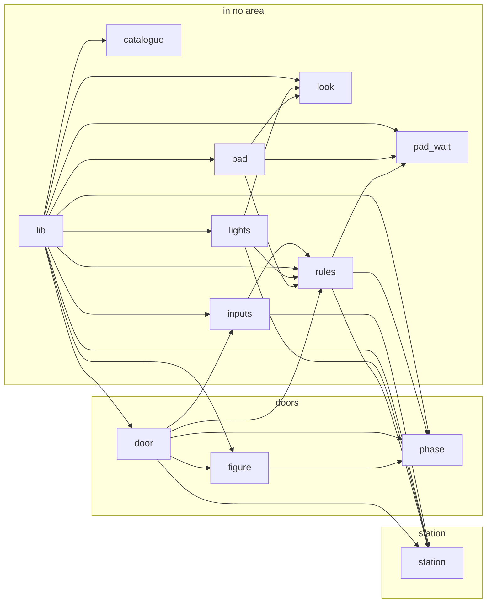

### world-doors

`crates/clean/world_doors`, 8 modules.

| Module | Area | Says it is | Items | Score | Lines |
| --- | --- | --- | --- | ---: | ---: |
| `catalogue.rs` | - | The catalogue: one behaviour for each entry of the spec, with its kind, its switch and how it is checked. | `enum BehaviourId (16)`, `struct Behaviour`, `const CATALOGUE`, `fn catalogue` | 17 | 164 |
| `colours.rs` | passage | The screen's colours as the passage reads and sets them: the dark colours it heads for, the fade's steps toward the colours headed for, and her visor's colour as she lands. | `const COLOURS`, `enum ColourGroup (5)`, `struct Palette`, `fn head_for_dark`, `fn light_visor`, `struct FadeTime`, `fn fade`, `FadeTime::{START, is_last, next}`, 5 private | 459 | 91 |
| `io.rs` | - | What a frame brings the doors and what the doors answer it. | `struct Scene`, `struct Inputs`, `enum Activity (6)`, `enum RoomCall (8)`, `enum RoomSound (3)`, `enum HerSound (2)`, `enum SlideScreen (2)`, `enum Finishing (3)`, `struct Report`, `struct Exports`, `Report::{play, of_passage}`, 1 private | 70 | 106 |
| `lib.rs` | - | The world-doors model, built from its behaviour spec alone: the passage through a door to a room, from the frame after she touches it until play goes on in the next room. | - | 0 | 16 |
| `passage.rs` | passage | The passage's state: what a caller holds from one frame to the next, saves and restores, and builds at any value the spec allows to start play part-way. | `enum Doors (2)`, `struct Passage`, `enum Phase (8)`, `enum Fetching (3)`, `const LAST_BEFORE_THE_SLIDE`, `const LAST_LANDING`, `struct WorkFrames`, `struct Arrival`, `Passage::START`, `WorkFrames::{FIRST, new, get, next}` | 47 | 69 |
| `rules.rs` | - | The tuning values the spec lists as parameters, with the spec's values as their default. | `enum Axis (2)`, `struct Rules`, `Axis::of`, `impl Default for Rules`, 6 private | 45 | 47 |
| `step.rs` | passage | The step: one frame of the doors, from the state a caller holds and what the frame brings to what the frame answers. | `Doors::step`, 18 private | 2,034 | 328 |
| `view.rs` | passage | Where the passage puts the view and her: the moves along the way she leaves, the squaring, the set-off, and where she is placed, lands and steps clear. | `fn toward`, `fn plus`, `fn pixels`, `fn at_pixels`, `fn squared`, `fn setting_off`, `fn place`, `fn settled`, `fn stepped_clear`, 11 private | 553 | 129 |

Its crate root exports:

- from `catalogue`: `Behaviour`, `BehaviourId`, `CATALOGUE`, `catalogue`
- from `colours`: `COLOURS`, `ColourGroup`, `FadeTime`, `Palette`
- from `io`: `Activity`, `Exports`, `Finishing`, `HerSound`, `Inputs`, `Report`, `RoomCall`, `RoomSound`, `Scene`, `SlideScreen`
- from `passage`: `Arrival`, `Doors`, `Fetching`, `LAST_BEFORE_THE_SLIDE`, `LAST_LANDING`, `Passage`, `Phase`, `WorkFrames`
- from `rules`: `Axis`, `Rules`

The public functions a caller reaches through them:

```rust
catalogue() -> EnumMap<BehaviourId, Behaviour>
FadeTime::is_last(self, steps: u8) -> bool
FadeTime::next(self, steps: u8) -> Option<Self>
Report::play() -> Self
WorkFrames::new(n: u8) -> Option<Self>
WorkFrames::get(self) -> u8
WorkFrames::next(self) -> Option<Self>
Axis::of(way: Heading) -> Self
Doors::step(self, scene: Scene, inputs: &Inputs, rules: &Rules) -> Exports
```

Shared types it takes from `types`: `Checked`, `Colour`, `Fixed`, `Heading`, `Kind`, `PIXEL`, `Pair`, `Parts`, `Position`, `Px`, `Set`, `Switch`, `ZERO`, `by_member`, `fixed`, `px`, `set_of`. Other crates it uses: `core`, `enum_map`.

Which module uses which, grouped by area (a module's own area, its functions counted elsewhere aside):

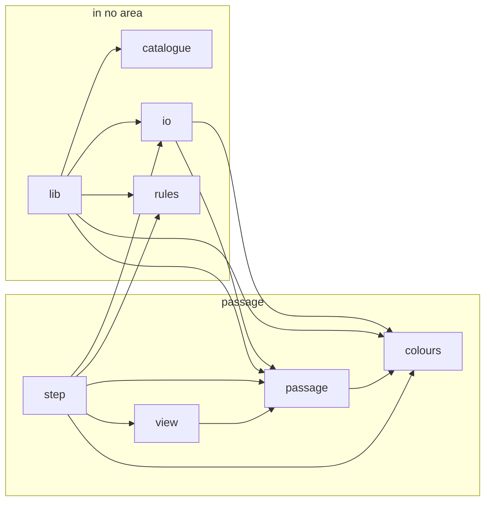

### samus-health

`crates/clean/samus_health`, 2 modules.

| Module | Area | Says it is | Items | Score | Lines |
| --- | --- | --- | --- | ---: | ---: |
| `catalogue.rs` | - | Spec entry metadata, separate from health decisions. | `enum BehaviourId (4)`, `struct Behaviour`, `fn behaviour`, `BehaviourId::ALL` | 8 | 58 |
| `lib.rs` | current-energy | Samus's current energy, her protection after Ridley's tail hits her in Ceres, and the low-energy warning, played one whole frame at a time by [`State::play_frame`]. | `const MAX_WHOLE_ENERGY`, `const REFERENCE_WARNING_THRESHOLD`, `struct WholeEnergy`, `struct EnergyAmount`, `struct EnergyLoss`, `enum Warning (2)`, `enum WarningSound (3)`, `enum TailImpact (2)`, `struct ProtectionFrames`, `struct State`, `struct PlayedFrame`, `struct Rules`, `WholeEnergy::{ZERO, new, get}`, `EnergyAmount::ZERO`, `EnergyLoss::ZERO`, `ProtectionFrames::{ZERO, TAIL_GRANT, new, get}`, `Rules::REFERENCE`, `State::play_frame`, `impl TryFrom<u16> for WholeEnergy`, `impl From<WholeEnergy> for u16`, `impl TryFrom<u8> for ProtectionFrames`, `impl From<ProtectionFrames> for u8`, 6 private | 481 | 188 |

Its crate root exports:

- from `catalogue`: `Behaviour`, `BehaviourId`, `behaviour`

The public functions a caller reaches through them:

```rust
behaviour(id: BehaviourId) -> Behaviour
WholeEnergy::new(value: u16) -> Option<Self>
WholeEnergy::get(self) -> u16
ProtectionFrames::new(frames: u8) -> Option<Self>
ProtectionFrames::get(self) -> u8
State::play_frame(self, tail: TailImpact, rules: &Rules) -> PlayedFrame
```

Shared types it takes from `types`: `Checked`, `Kind`, `Switch`. Other crates it uses: `serde`.

Which module uses which, grouped by area (a module's own area, its functions counted elsewhere aside):

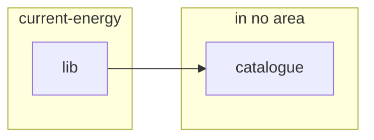

### game-time

`crates/clean/game_time`, 1 modules.

| Module | Area | Says it is | Items | Score | Lines |
| --- | --- | --- | --- | ---: | ---: |
| `lib.rs` | clock | The game-time model, built from its behaviour spec alone. | `struct QualifiedOpportunity`, `struct Clock`, `enum BehaviourId (1)`, `struct Behaviour`, `const BEHAVIOURS`, `Clock::{restore, time, set, advance}` | 298 | 60 |

Its crate root exports:

- from `types`: `PlayFrames`, `PlayHours`, `PlayMinutes`, `PlaySeconds`, `PlayTime`

The public functions a caller reaches through them:

```rust
Clock::restore(time: PlayTime) -> Self
Clock::time(&self) -> PlayTime
Clock::set(&mut self, time: PlayTime)
Clock::advance(&mut self, _opportunity: QualifiedOpportunity) -> PlayTime
```

Shared types it takes from `types`: `Checked`, `Kind`, `PlayFrames`, `PlayHours`, `PlayMinutes`, `PlaySeconds`, `PlayTime`, `Switch`. Other crates it uses: none.

Which module uses which, grouped by area (a module's own area, its functions counted elsewhere aside):

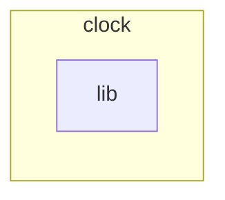

### world-quake

`crates/clean/world_quake`, 2 modules.

| Module | Area | Says it is | Items | Score | Lines |
| --- | --- | --- | --- | ---: | ---: |
| `catalogue.rs` | - | Behaviour metadata for the room quake model. | `enum BehaviourId (1)`, `enum Kind (1)`, `enum Switch (1)`, `enum Check (1)`, `struct Behaviour`, `const CATALOGUE`, `BehaviourId::as_str` | 13 | 43 |
| `lib.rs` | quiet-quake | Room quake state, quiet opportunities and Drawing's quiet displacement query. | `enum Opportunity (3)`, `enum UnsupportedReason (2)`, `struct QuietEffects`, `enum Outcome (3)`, `fn displacement`, `fn step` | 132 | 52 |

Its crate root exports:

- from `catalogue`: `Behaviour`, `BehaviourId`, `CATALOGUE`, `Check`, `Kind`, `Switch`
- from `types::quake`: `QuakeDuration`, `QuakePhase`, `State`

The public functions a caller reaches through them:

```rust
BehaviourId::as_str(self) -> &'static str
displacement(state: &State) -> Result<Pair<Fixed>, UnsupportedReason>
step(state: &mut State, opportunity: Opportunity) -> Outcome
```

Shared types it takes from `types`: `Fixed`, `Pair`, `ZERO`, `quake`. Other crates it uses: none.

Which module uses which, grouped by area (a module's own area, its functions counted elsewhere aside):

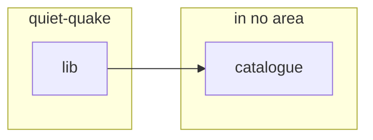

### game-random

`crates/clean/game_random`, 2 modules.

| Module | Area | Says it is | Items | Score | Lines |
| --- | --- | --- | --- | ---: | ---: |
| `catalogue.rs` | - | Catalogue of the shared sequence's specified behaviours. | `enum BehaviourId (1)`, `enum Kind (1)`, `enum Switch (1)`, `enum Check (1)`, `struct Behaviour`, `const CATALOGUE` | 0 | 35 |
| `lib.rs` | sequence | The numeric rules for the game's shared random sequence. | `fn advance_random`, 5 private | 130 | 23 |

Its crate root exports:

- from `catalogue`: `Behaviour`, `BehaviourId`, `CATALOGUE`, `Check`, `Kind`, `Switch`
- from `types`: `RandomNumber`, `RandomSequence`

The public functions a caller reaches through them:

```rust
advance_random(sequence: &mut RandomSequence) -> RandomNumber
```

Shared types it takes from `types`: `RandomNumber`, `RandomSequence`. Other crates it uses: none.

Which module uses which, grouped by area (a module's own area, its functions counted elsewhere aside):

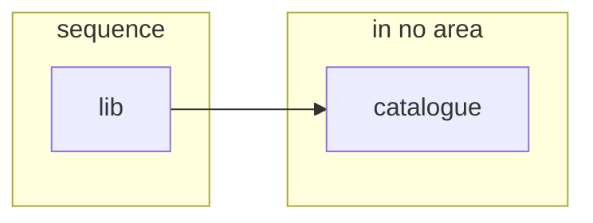

### world-haze

`crates/clean/world_haze`, 2 modules.

| Module | Area | Says it is | Items | Score | Lines |
| --- | --- | --- | --- | ---: | ---: |
| `catalogue.rs` | - | Catalogue of the ordinary Ceres haze rules. | `enum BehaviourId (3)`, `enum Kind (1)`, `enum Switch (1)`, `struct Behaviour`, `fn catalogue` | 9 | 49 |
| `lib.rs` | backdrop | The single-colour Ceres backdrop haze during ordinary room time. | `enum BandIntent (2)`, `enum ThirdBackground (1)`, `struct DisplayIntent`, `struct HazeStep`, `fn ordinary_opportunity`, 1 private | 187 | 60 |

Its crate root exports:

- from `catalogue`: `Behaviour`, `BehaviourId`, `Kind`, `Switch`, `catalogue`
- from `types::haze`: `HAZE_BAND_COUNT`, `HazeBands`, `HazeColour`, `HazeFade`, `HazeLevel`, `HazePeak`, `HazeState`

The public functions a caller reaches through them:

```rust
catalogue() -> EnumMap<BehaviourId, Behaviour>
ordinary_opportunity(mut state: HazeState) -> HazeStep
```

Shared types it takes from `types`: `Colour`, `haze`. Other crates it uses: `enum_map`.

Which module uses which, grouped by area (a module's own area, its functions counted elsewhere aside):


### Shared types by model

The public items of `crates/clean/types` the clean models share, and the models that name each.

| Item | Used by |
| --- | --- |
| `fn count_down` | - |
| `struct MusicTurns` | - |
| `struct EffectTurns` | - |
| `struct Loudness` | - |
| `struct TimbreId` | - |
| `enum PitchOffset (1)` | - |
| `enum EffectVoiceId (6)` | - |
| `enum VoiceId (3)` | - |
| `enum SoundGroup (3)` | - |
| `enum CueId (8)` | - |
| `enum Request (2)` | - |
| `enum CueAllowance (5)` | - |
| `enum OfferPermission (4)` | - |
| `enum SenderProgress (5)` | - |
| `const QUEUE_CAPACITY` | - |
| `struct CueQueue` | - |
| `struct QueueOverfull` | - |
| `struct SenderState` | - |
| `struct LoudnessRamp` | - |
| `enum TrackPosition (2)` | - |
| `struct Articulation` | - |
| `enum MusicEvent (13)` | - |
| `struct TrackContent` | - |
| `struct TrackState` | - |
| `struct SongMix` | - |
| `struct SongState` | - |
| `struct PitchMotion` | - |
| `struct EffectSpan` | - |
| `struct EffectPartContent` | - |
| `struct EffectClip` | - |
| `enum ReleaseMemory (2)` | - |
| `struct LivePart` | - |
| `enum PartState (2)` | - |
| `enum Playback (3)` | - |
| `type ReleaseHistory` | - |
| `struct GroupState` | - |
| `struct ResidentMusicReply` | - |
| `struct State` | - |
| `struct Content` | - |
| `const HAZE_BAND_COUNT` | - |
| `enum HazeColour (3)` | - |
| `struct HazePeak` | - |
| `struct HazeLevel` | - |
| `struct HazeBands` | - |
| `enum HazeFade (2)` | - |
| `struct HazeState` | - |
| `mod haze` | world-haze |
| `mod quake` | world-quake |
| `enum FiringDirection (10)` | samus-movement |
| `type Fixed` | samus-appearance, samus-movement, world-camera, world-doors, world-quake |
| `type Px` | boss-ceres-ridley, samus-movement, world-camera, world-doors |
| `fn fixed` | samus-movement, world-camera, world-doors |
| `fn px` | samus-movement, world-camera, world-doors |
| `trait Parts` | samus-appearance, samus-movement, world-camera, world-doors |
| `const ZERO` | samus-movement, world-doors, world-quake |
| `const PIXEL` | world-camera, world-doors |
| `fn part_below` | samus-movement |
| `fn below` | world-camera |
| `struct Pair` | boss-ceres-ridley, interface-hud, samus-movement, world-blocks, world-camera, world-doors, world-quake |
| `type Position` | samus-movement, world-camera, world-doors |
| `struct VerticalFraction` | world-camera |
| `struct PlacementY` | world-camera |
| `type Radius` | boss-ceres-ridley, samus-movement |
| `enum Heading (4)` | samus-movement, world-blocks, world-doors |
| `type Direction` | samus-movement |
| `struct TravelDistance` | samus-movement |
| `type DirectionalTravels` | samus-movement |
| `enum Side (2)` | boss-ceres-ridley, samus-movement |
| `enum Facing (3)` | samus-movement, world-camera |
| `enum Body (4)` | samus-appearance, samus-movement |
| `enum Action (16)` | samus-appearance, samus-movement |
| `enum Aim (5)` | samus-appearance, samus-movement |
| `enum Turn (4)` | samus-appearance, samus-movement |
| `enum LandedFrom (2)` | samus-appearance, samus-movement |
| `enum Gun (2)` | samus-movement |
| `enum Legs (2)` | samus-movement |
| `struct Pose` | samus-appearance, samus-movement |
| `enum Sprite (4)` | samus-appearance, samus-movement |
| `enum ClipEnd (2)` | samus-appearance, samus-movement |
| `enum BoostStage (5)` | samus-appearance |
| `enum Bounces (3)` | samus-movement |
| `struct VerticalSpeed` | samus-movement |
| `enum FloorResponseKind (7)` | samus-movement |
| `struct FloorResponse` | samus-movement |
| `enum SoundIdentity (4)` | samus-movement |
| `enum SoundLibrary (2)` | samus-movement |
| `struct QueueAllowance` | samus-appearance, samus-movement |
| `struct SoundRequest` | samus-movement |
| `struct Buttons` | samus-movement |
| `mod button` (RUN, JUMP, SHOOT, LEFT, RIGHT, UP, DOWN, AIM_UP, AIM_DOWN, SIDES, PAD) | samus-movement |
| `type Cell` | samus-movement, world-blocks |
| `enum Way (2)` | samus-movement, world-blocks |
| `struct Touch` | samus-movement |
| `enum Block (6)` | samus-movement |
| `enum Parity (2)` | samus-movement |
| `enum SlopeFaces (2)` | samus-movement |
| `struct SlopeFactor` | - |
| `struct Slope` | samus-movement |
| `struct Hitbox` | boss-ceres-ridley, samus-movement |
| `trait World` | samus-movement |
| `enum Kind (5)` | audio-transport, boss-ceres-ridley, game-time, interface-hud, run-progress, samus-appearance, samus-health, samus-movement, weapons-projectiles, world-blocks, world-camera, world-doors |
| `enum Switch (3)` | audio-transport, boss-ceres-ridley, game-time, interface-hud, run-progress, samus-appearance, samus-health, samus-movement, weapons-projectiles, world-blocks, world-camera, world-doors |
| `enum Checked (2)` | boss-ceres-ridley, game-time, interface-hud, run-progress, samus-appearance, samus-health, samus-movement, weapons-projectiles, world-blocks, world-camera, world-doors |
| `type Set` | run-progress, samus-appearance, samus-movement, world-blocks, world-doors |
| `fn set_of` | world-doors |
| `trait Members` | run-progress |
| `fn by_member` | boss-ceres-ridley, samus-appearance, world-blocks, world-doors |
| `enum Area (7)` | run-progress |
| `enum Item (11)` | run-progress, samus-appearance, samus-movement |
| `enum Beam (5)` | run-progress |
| `enum Event (18)` | run-progress |
| `enum BossKind (3)` | run-progress |
| `struct LocationId` | run-progress |
| `struct DoorId` | run-progress |
| `struct StationId` | run-progress |
| `struct Entrance` | run-progress |
| `const LAST_PICTURE` | - |
| `struct Picture` | interface-hud, world-blocks |
| `enum Flip (4)` | interface-hud |
| `struct Look` | interface-hud, world-blocks |
| `enum ScreenKind (3)` | world-blocks, world-camera |
| `type Screen` | interface-hud, world-blocks |
| `enum Point (3)` | world-blocks |
| `enum HitBy (6)` | world-blocks |
| `enum Motion (3)` | world-blocks |
| `enum Family (6)` | world-blocks |
| `enum MetAs (3)` | world-blocks |
| `enum Script (3)` | world-blocks |
| `mod audio` | audio-transport |
| `mod pitch` | - |
| `struct Colour` | world-doors, world-haze |
| `const PALETTE_SLOTS` | - |
| `struct Palette` | - |
| `struct Palettes` | - |
| `struct MusicalPitch` | - |
| `struct EffectPitch` | - |
| `struct PlayTime` | game-time |
| `struct QuakePhase` | - |
| `struct QuakeDuration` | - |
| `struct RoomQuakeState` | - |
| `struct RandomNumber` | game-random |
| `struct RandomSequence` | game-random |

### Bridges

The engine files (`crates/game/src`) that name each model's crate: its bridge, which the registry names, and the others. Names are what each takes from the model.

| Model | Engine file | Part | Names | Score | Lines |
| --- | --- | --- | --- | ---: | ---: |
| audio-transport | `crates/game/src/production/audio/admission.rs` | names it | `Content`, `CueId`, `EffectVoiceId`, `GroupState`, `MusicEvent`, `PartState`, `Playback`, `Request`, `SenderProgress`, `SongState`, `SoundGroup`, `State`, `TrackContent`, `TrackPosition` | 2,745 | 308 |
| audio-transport | `crates/game/src/production/audio.rs` | bridge | `Content`, `Offer`, `ResidentMusicReply`, `State`, `frame` | 261 | 71 |
| audio-transport | `crates/game/src/production/movement_touchdown.rs` | names it | `CueId`, `QueueAllowance`, `frame` | 380 | 99 |
| audio-transport | `crates/game/src/production/sender.rs` | names it | `CueId`, `Offer`, `OfferPermission`, `QueueAllowance` | 245 | 63 |
| audio-transport | `crates/game/src/production.rs` | names it | `Offer`, `State`, `frame` | 2,295 | 459 |
| audio-transport | `crates/game/src/state/owned.rs` | names it | `State` | 0 | 58 |
| enemy-interactions | `crates/game/src/enemy_interactions_bridge.rs` | bridge | - | 234 | 39 |
| enemy-interactions | `crates/game/src/production/weapons.rs` | bridge | `ContactConditions`, `DoorContact` | 1,955 | 335 |
| weapons-projectiles | `crates/game/src/production/content.rs` | names it | `Rules` | 285 | 89 |
| weapons-projectiles | `crates/game/src/production.rs` | names it | `State`, `UpdateInput` | 2,295 | 459 |
| weapons-projectiles | `crates/game/src/state/owned.rs` | names it | `State` | 0 | 58 |
| weapons-projectiles | `crates/game/src/weapons_projectiles_bridge.rs` | bridge | - | 1,409 | 226 |
| samus-movement | `crates/game/src/production/camera_semantic.rs` | names it | `Outcome`, `Samus` | 280 | 75 |
| samus-movement | `crates/game/src/production/connected.rs` | names it | `Outcome`, `Rules`, `Samus` | 1,079 | 232 |
| samus-movement | `crates/game/src/production/content.rs` | names it | `Rules` | 285 | 89 |
| samus-movement | `crates/game/src/production/movement.rs` | names it | `Frame`, `Outcome`, `Rules`, `Samus` | 430 | 105 |
| samus-movement | `crates/game/src/production/movement_touchdown.rs` | names it | `Outcome`, `Rules` | 380 | 99 |
| samus-movement | `crates/game/src/production/played.rs` | names it | `Dashing`, `Frame`, `Outcome`, `Rules`, `Samus`, `StandingAnimation`, `UnknownPose`, `WallTest` | 4,068 | 737 |
| samus-movement | `crates/game/src/production/shaft.rs` | names it | `Samus` | 360 | 77 |
| samus-movement | `crates/game/src/production.rs` | names it | `Outcome`, `Samus`, `UnknownPose` | 2,295 | 459 |
| samus-movement | `crates/game/src/state/owned.rs` | names it | `Samus` | 0 | 58 |
| world-camera | `crates/game/src/production/camera_semantic.rs` | names it | `Camera`, `Frame`, `Heights`, `LeadSetting`, `Room`, `Rules`, `Samus` | 280 | 75 |
| world-camera | `crates/game/src/production/connected.rs` | names it | `Camera` | 1,079 | 232 |
| world-camera | `crates/game/src/production/immutable.rs` | names it | `Rules` | 171 | 58 |
| world-camera | `crates/game/src/production/played.rs` | names it | `Camera`, `Frame`, `Heights`, `LeadSetting`, `RememberedPosition`, `Room`, `Samus`, `ViewPosition` | 4,068 | 737 |
| world-camera | `crates/game/src/production.rs` | names it | `Camera`, `Frame` | 2,295 | 459 |
| world-camera | `crates/game/src/state/owned.rs` | names it | `Camera` | 0 | 58 |
| run-progress | `crates/game/src/production/content.rs` | names it | `Rules` | 285 | 89 |
| run-progress | `crates/game/src/production/played.rs` | names it | `Progress` | 4,068 | 737 |
| run-progress | `crates/game/src/production/room_loading.rs` | names it | `Condition`, `EnteredRoom`, `Progress`, `RoomStates`, `Version` | 2,930 | 426 |
| run-progress | `crates/game/src/production.rs` | names it | `Progress`, `Report` | 2,295 | 459 |
| run-progress | `crates/game/src/state/owned.rs` | names it | `Progress` | 0 | 58 |
| interface-hud | `crates/game/src/production/connected/early_map.rs` | names it | `CancelButton`, `Controls`, `CountdownRuns`, `Dropped`, `FrameCount`, `FrameInputs`, `HerMap`, `HudPictures`, `MiniMapInputs`, `MiniMapPower`, `Mute`, `Pair`, `Room`, `Rules`, `SelectButton`, `Selection`, `Status`, `StockAtStart` | 290 | 84 |
| interface-hud | `crates/game/src/production/connected.rs` | names it | `HudState` | 1,079 | 232 |
| interface-hud | `crates/game/src/production/content.rs` | names it | `HudPictures` | 285 | 89 |
| interface-hud | `crates/game/src/production/entries.rs` | names it | `Boss`, `FrameInputs`, `FrameOutputs`, `HudPictures`, `HudState`, `OutOfPlayInputs`, `Place`, `Rules` | 1,159 | 230 |
| interface-hud | `crates/game/src/production/health_tail.rs` | names it | `Ammunition`, `CancelButton`, `Controls`, `CountdownRuns`, `Dropped`, `Energy`, `FrameCount`, `FrameInputs`, `HerMap`, `HudPictures`, `HudState`, `MiniMapInputs`, `MiniMapPower`, `Reserve`, `Room`, `Rules`, `SelectButton`, `Selection`, `Status`, `StockAtStart` | 668 | 188 |
| interface-hud | `crates/game/src/production/hud.rs` | bridge | `Flip`, `HudState`, `Place` | 148 | 35 |
| interface-hud | `crates/game/src/production/immutable.rs` | names it | `Rules` | 171 | 58 |
| interface-hud | `crates/game/src/production/played.rs` | names it | `Ammunition`, `CancelButton`, `Controls`, `CountdownRuns`, `Dropped`, `Energy`, `FrameCount`, `FrameInputs`, `FrameOutputs`, `HerMap`, `HudPictures`, `MiniMapInputs`, `Mute`, `NewArea`, `OutOfPlayInputs`, `Reserve`, `Room`, `Rules`, `SelectButton`, `Status`, `StockAtStart` | 4,068 | 737 |
| interface-hud | `crates/game/src/production/room_loading.rs` | names it | `Room` | 2,930 | 426 |
| interface-hud | `crates/game/src/production.rs` | names it | `FrameOutputs`, `HudState`, `UnsupportedFrame` | 2,295 | 459 |
| interface-hud | `crates/game/src/state/owned.rs` | names it | `HudState` | 0 | 58 |
| world-blocks | `crates/game/src/production/entries.rs` | names it | `Placement`, `Report`, `Request`, `Rules`, `Run`, `State` | 1,159 | 230 |
| world-blocks | `crates/game/src/production/immutable.rs` | names it | `Rules` | 171 | 58 |
| world-blocks | `crates/game/src/production.rs` | names it | `OutsideTheRoom`, `State` | 2,295 | 459 |
| world-blocks | `crates/game/src/state/owned.rs` | names it | `State` | 0 | 58 |
| samus-appearance | `crates/game/src/production/animation.rs` | names it | `AnimationContent`, `AppearanceState`, `Clip`, `Figure`, `Frame`, `FrameOutputs`, `FramePart`, `Inputs`, `ItemControls`, `MissingClip`, `Paces`, `PaletteOpportunity`, `Rules`, `update` | 256 | 78 |
| samus-appearance | `crates/game/src/production/appearance.rs` | names it | `Figure` | 20 | 18 |
| samus-appearance | `crates/game/src/production/connected/inputs.rs` | names it | `Activity`, `Charge`, `Liquid`, `SoundsWaiting` | 0 | 49 |
| samus-appearance | `crates/game/src/production/connected.rs` | names it | `Activity`, `Ahead`, `AppearanceState`, `Figure`, `GraphicalContact`, `Liquid`, `Rules`, `SoundOffer` | 1,079 | 232 |
| samus-appearance | `crates/game/src/production/content.rs` | names it | `Rules` | 285 | 89 |
| samus-appearance | `crates/game/src/production/movement.rs` | names it | `Figure` | 430 | 105 |
| samus-appearance | `crates/game/src/production/movement_touchdown.rs` | names it | `Figure` | 380 | 99 |
| samus-appearance | `crates/game/src/production/played.rs` | names it | `Activity`, `Ahead`, `AppearanceState`, `Dash`, `Figure`, `Inputs`, `MissingClip`, `MoveEvent`, `Rules`, `SoundOffer` | 4,068 | 737 |
| samus-appearance | `crates/game/src/production.rs` | names it | `AppearanceState`, `Frame`, `FrameOutputs` | 2,295 | 459 |
| samus-appearance | `crates/game/src/samus_appearance_bridge/import.rs` | bridge | `AnimationContent`, `Branch`, `Clip`, `Control`, `Figure`, `Hold`, `Instruction`, `Pace`, `Paces`, `Step` | 1,595 | 254 |
| samus-appearance | `crates/game/src/samus_appearance_bridge.rs` | bridge | - | 0 | 2 |
| samus-appearance | `crates/game/src/state/owned.rs` | names it | `AppearanceState` | 0 | 58 |
| boss-ceres-ridley | `crates/game/src/production/content.rs` | names it | `Rules` | 285 | 89 |
| boss-ceres-ridley | `crates/game/src/production/entries.rs` | names it | `CeresDoor`, `Inputs`, `Rules`, `Run` | 1,159 | 230 |
| boss-ceres-ridley | `crates/game/src/production/played.rs` | names it | `CeresDoor`, `Inputs`, `Lights`, `PadAndCover`, `Rules`, `Run`, `Stage` | 4,068 | 737 |
| boss-ceres-ridley | `crates/game/src/production/room_loading.rs` | names it | `CeresDoor`, `ColourSet`, `DoorKind`, `Stage` | 2,930 | 426 |
| boss-ceres-ridley | `crates/game/src/production/shaft.rs` | names it | `FadeSteps`, `Lights`, `LightsInputs`, `PadAndCover`, `Rules`, `Stage` | 360 | 77 |
| boss-ceres-ridley | `crates/game/src/production.rs` | names it | `CeresDoor`, `Inputs`, `Run` | 2,295 | 459 |
| boss-ceres-ridley | `crates/game/src/state/owned.rs` | names it | `CeresDoor` | 0 | 58 |
| world-doors | `crates/game/src/production/content.rs` | names it | `Rules` | 285 | 89 |
| world-doors | `crates/game/src/production/entries.rs` | names it | `Doors`, `Scene` | 1,159 | 230 |
| world-doors | `crates/game/src/production/played.rs` | names it | `Activity`, `Arrival`, `COLOURS`, `ColourGroup`, `Doors`, `Finishing`, `Inputs`, `Palette`, `Passage`, `Phase`, `Report`, `RoomCall`, `Rules`, `Scene` | 4,068 | 737 |
| world-doors | `crates/game/src/production/room_loading.rs` | names it | `Arrival`, `COLOURS`, `Palette`, `RoomCall` | 2,930 | 426 |
| world-doors | `crates/game/src/production/shaft.rs` | names it | `Doors`, `Palette`, `Passage`, `Phase` | 360 | 77 |
| world-doors | `crates/game/src/production.rs` | names it | `Exports`, `Inputs` | 2,295 | 459 |
| samus-health | `crates/game/src/production/content.rs` | names it | `Rules` | 285 | 89 |
| samus-health | `crates/game/src/production/health_tail.rs` | names it | `ProtectionFrames`, `Rules`, `State`, `TailImpact`, `WarningSound` | 668 | 188 |
| samus-health | `crates/game/src/production/played.rs` | names it | `PlayedFrame`, `Rules`, `State`, `TailImpact` | 4,068 | 737 |
