# Rebuild report

Generated by `cargo run -p tools --bin tools -- report --write` (`verify::report`) from this commit's tree; never edit it by hand.
`tools/check_report.sh` fails when it differs from what the tree generates.

How it is counted:

- **Score** is `tools size` (`verify::size`): weighted logic tokens, with the depth (Q1) and
  duplication parts it includes; **logic**, **types** and **data** are token counts, the last two
  not held against the budget. **Clumps** (Q2) is a diagnostic, not part of the score. Scores
  are rounded to whole tokens.
- **Model** is the files a domain owns, `crates/clean/<crate>`, its name with underscores for dashes; its score, fit and lines
  count those alone. `crates/clean/types` is a row of its own, **shared types**, with the domains
  whose model depends on it, and is counted once in the total.
- **Budget** and **units** are `tools spec-units` (`verify::spec_units`) on the domain's spec and
  vectors, k and the areas from the Budget section of its decode notes, which the implementer
  never sees (MODEL §1 decision 10). **Fit** is score ÷ budget; the total's score includes the
  shared types. An area's model score is the model files the registry
  (`verify::report::DOMAINS`) assigns it, less the functions it counts apart, plus the functions
  it assigns the area: a file that holds more than one area's code has a row per function counted
  apart (`fn` and its name), measured with the rest of the model. Files in no area are the
  domain's shared code and count in its total only. **Area fit** is the areas' score ÷ the
  budget, the shared code left out; **shared** is the shared code's share of the model's score,
  flagged when it is over 25 %, since no spec unit pays for it. The total's shared code
  includes the shared types.
- **Old code** is the Budget section's figure for the whole domain where it gives one, else the
  sum of its area `old` figures, at the commit its
  baseline or budget paragraph names last.
- **Lines** are code lines: non-blank, non-comment, tests excluded (`tests` directories,
  `tests.rs` files and `#[cfg(test)]` items). A file holds **tables and types** when its type
  and data tokens outnumber its logic tokens, else **logic**. **Logic-equivalent lines** are
  score ÷ 6: the old engine's density, about 5.5 to 7 weighted tokens per line,
  measured on samus-movement's old code at `c7f927ab6` and the camera's at `cfa5b8144`.

## Replay evidence

These are committed acceptance requirements, not a fresh replay run. One runner executes the selected production systems and compares independent observations. Each row keeps its own scope; overlapping cases are never added into whole-game progress.

### Scoped cases

| Case | Required outcome | Compared cuts | Null cuts | Gain over null | Fields | Outputs | Restorations |
| --- | --- | ---: | ---: | ---: | ---: | ---: | ---: |
| movement/D-inherited-cut | Pass | 1 | 0 | 1 | 0 | 4 | 1 |
| movement/W15 | Pass | 3 | 0 | 3 | 9 | 2 | 3 |
| audio/native-control | Pass | 184 | 0 | 184 | 7157 | 764 | 184 |
| audio/native-expire-prefix | Pass | 65 | 0 | 65 | 2453 | 269 | 65 |
| audio/native-expire-post64 | Pass | 119 | 0 | 119 | 4704 | 495 | 119 |
| ceres/door-closes-after-departure | Pass | 4 | 1 | 3 | 20 | 0 | 0 |
| weapons-contact/M0-four-searches | Pass | 4 | 0 | 4 | 4 | 4 | 4 |
| camera/unchanged-centre-follow | Pass | 1 | 0 | 1 | 9 | 0 | 1 |
| hud/stationary-map-blink | Pass | 17 | 8 | 9 | 170 | 0 | 0 |
| appearance/standing-clip | Pass | 16 | 0 | 16 | 64 | 0 | 16 |
| progress/planet-awake-recorded | Pass | 1 | 0 | 1 | 19 | 0 | 0 |
| blocks/missing-requests | Unsupported at None: independent complete block seed and ordered reaction requests | 0 | 0 | unaccepted prefix | 0 | 0 | 0 |
| doors/missing-passage-inputs | Unsupported at None: independent complete passage seed and opportunity-time inputs | 0 | 0 | unaccepted prefix | 0 | 0 | 0 |
| audio-sender/missing-service-inputs | Unsupported at None: independent CPU sender seed and ordered queue/service inputs | 0 | 0 | unaccepted prefix | 0 | 0 | 0 |
| movement-native-occupied-first-search | Pass | 1 | 0 | 1 | 7 | 0 | 1 |
| movement-native-enemy-stop-terrain-absence | Pass | 1 | 0 | 1 | 8 | 0 | 1 |

- **movement/D-inherited-cut** witnesses samus-movement/TravelledDistances. Limits: one-step travel witness; upstream producers externally admitted; prior-cut observed actor roster; current actor-selection update and request timing unproved; movement receipts and downstream consumers outside declared comparisons; pixel composition omitted.
- **movement/W15** witnesses samus-movement/WallJump, samus-movement/TouchedCells. Limits: appearance feedback externally admitted; upstream producers externally admitted; prior-cut observed actor roster; current actor-selection update and request timing unproved; camera and pixel composition omitted.
- **audio/native-control** witnesses audio-transport/MusicalProgress, audio-transport/WholeArrangement, audio-transport/VisibleCompletion, audio-transport/ReplyCadence. Limits: measured clock and physical presentations admitted; CPU workload and sender timing unproved; audio waveform omitted; 77 independently named source-writer exclusions.
- **audio/native-expire-prefix** witnesses audio-transport/MusicalProgress, audio-transport/VisibleCompletion, audio-transport/ReplyCadence. Limits: measured clock and physical requests admitted; ends before external repeat-count intervention; no through-intervention continuation claim; CPU timing and audio waveform unproved.
- **audio/native-expire-post64** witnesses audio-transport/MusicalProgress, audio-transport/FinitePhrases, audio-transport/WholeArrangement, audio-transport/VisibleCompletion, audio-transport/ReplyCadence. Limits: independent complete post-intervention seed at original cut64; compares original cuts65 through183; no through-intervention continuity claim; measured clock and physical requests admitted; CPU timing and audio waveform unproved.
- **ceres/door-closes-after-departure** witnesses boss-ceres-ridley/Waiting, boss-ceres-ridley/SheIsNear, boss-ceres-ridley/Polling, boss-ceres-ridley/Closing, boss-ceres-ridley/Shown, boss-ceres-ridley/Solid. Limits: Samus position and station stage externally admitted; current-cut framework counter validates one externally scheduled run; actor selection and update timing unproved; opening sound and shake outputs omitted; pixel composition and downstream collision omitted; durable Ceres codec unavailable.
- **weapons-contact/M0-four-searches** witnesses weapons-projectiles/ShotSpacing, weapons-projectiles/HoldingShoot, weapons-projectiles/CannonOrigin, weapons-projectiles/InheritedMotion, weapons-projectiles/FlyingBeam, enemy-interactions/ContactAllowed, enemy-interactions/BoxOverlap, enemy-interactions/FirstPowerShot. Limits: four-step scoped weapons/contact witness; controller, movement inheritance, muzzle context, room geometry and actor opportunities externally admitted; actor selection and AI not executed; watch validates preceding contact fields; retained trail appearance, event consumers, OAM, pixels, door response and sound/shake effects uncompared; occupied starts require independent retained appearance and are unsupported.
- **camera/unchanged-centre-follow** witnesses world-camera/FollowingHer, world-camera/Remembering, world-camera/RememberedHeightFraction. Limits: one ordinary follow externally scheduled; movement centre and unchanged pose externally observed; no placement supplied; scroll producer externally observed; gameplay update scheduling and other room writers unproved; screen reads past the captured 50-byte run unsupported; downstream weapons receipt consumption and pixels omitted.
- **hud/stationary-map-blink** witnesses interface-hud/HerBlink, interface-hud/MiniMapWindow. Limits: drops represented by Nothing under unselected invariant; turn-on represented by false under powered-on invariant; all alternatives require complete production state/output equivalence proof; stationary upstream producer values borrowed and required unchanged; exactly one ordinary HUD invocation supplied by scoped schedule; caller timing unproved; click and switch events, video upload and composed pixels omitted; durable HUD codec unavailable.
- **appearance/standing-clip** witnesses samus-appearance/ClipPlays. Limits: unchanged dry standing figure; one ordinary animation update per advancing gameplay tick; movement, equipment and liquid producers externally admitted; appearance sound and drawing opportunities outside comparison; upstream timing and downstream pixels unproved.
- **progress/planet-awake-recorded** witnesses run-progress/EventsHappen. Limits: event-store comparison only; inventory, places and other Progress fields retained but unselected; other report producers are outside this witness; two observed fixed PlanetAwake setter visits; generic event arguments unavailable; upstream trigger timing is externally observed; checkpoint codec unavailable.
- **blocks/missing-requests** declares no rule witness. Limits: independent complete block seed and ordered reaction requests unavailable; boundary holds unsupported; no behaviour Pass.
- **doors/missing-passage-inputs** declares no rule witness. Limits: independent complete passage seed and opportunity-time inputs unavailable; boundary holds unsupported; no behaviour Pass.
- **audio-sender/missing-service-inputs** declares no rule witness. Limits: independent CPU sender seed and ordered queue/service inputs unavailable; boundary holds unsupported; no behaviour Pass.
- **movement-native-occupied-first-search** witnesses samus-movement/MotionAttempts, samus-movement/ReachedEnemyCandidates, samus-movement/PerformedCollisionTests, samus-movement/PerformedSupportChecks, samus-movement/PerformedBodyFit. Limits: Direct selector-time scoped seed at within-video9233 source index424; completion4283 is not an NMI cut or preceding-cut continuation.; Complete ordered Motion/Support/BodyFit work, nested BodyFit checks, CollisionTests, reached cells, inside cells and skip status are compared; Motion ordinal0 also retains complete request and ordered considered candidate semantics.; One Miss candidate is order-insensitive; the separate derived enemy-stop witness checks forbidden ordinary-right terrain absence. Elapsed CPU timing remains unproved.; Actor selection, Frame production, full dispatcher and played-alone production remain external; actual outside-grid queries reject before retained state or outputs change..
- **movement-native-enemy-stop-terrain-absence** witnesses samus-movement/PerformedCollisionTests, samus-movement/MotionAttempts, samus-movement/ReachedEnemyCandidates, samus-movement/PerformedSupportChecks, samus-movement/PerformedBodyFit. Limits: Derived native seed changes exactly two actor centre words; unchanged private ROM and pads. Direct selector424 seed and complete opportunity4052 are within-video9233, not an NMI cut or preceding-cut continuation.; Independent Motion ordinal0 is the unique ordinary-right request; compare its forbidden ordinary-right CollisionTests first, then its complete request and ordered considered candidate semantics.; Native enemy stop skips ordinary terrain while retaining separate support and later downward terrain. The production fault omits the required eligible enemy input/stage, exposing actual forbidden terrain work; no internal clean-model reorder mutant was executed.; Complete ordered Motion/Support/BodyFit work, nested BodyFit checks, CollisionTests, reached cells, inside cells and skip status are compared. Actor selection, Frame producers, full dispatcher, elapsed CPU timing and played-alone production remain external. Actual unadmitted grid queries reject atomically..

### Integrated cases

| Case | Required outcome | Compared cuts | Null cuts | Gain over null | Fields | Outputs | Restorations |
| --- | --- | ---: | ---: | ---: | ---: | ---: | ---: |
| integrated/missing-dependency-closure | Unsupported at None: complete integrated production dependency closure | 0 | 0 | unaccepted prefix | 0 | 0 | 0 |
| movement-ceres/carried-position-proximity | Pass | 4 | 0 | 4 | 28 | 0 | 0 |
| connected-ordinary/carried-running-camera | Pass | 9 | 0 | 9 | 153 | 36 | 9 |
| connected-ordinary/run-release-floor-aim | Pass | 16 | 0 | 16 | 272 | 64 | 16 |
| frame/ordinary-requested-nmi-return | Pass | 1 | 0 | 1 | 13 | 2295 | 1 |
| frame/adjacent-actual-trial | Unsupported at Some(2): Frame(SpriteObjectsPreparation) | 1 | 0 | unaccepted prefix | 13 | 2295 | 0 |
| frame/adjacent-held-trial | Unsupported at Some(2): Frame(SpriteObjectsPreparation) | 1 | 0 | unaccepted prefix | 13 | 2295 | 0 |

- **integrated/missing-dependency-closure** witnesses samus-movement/TravelledDistances. Limits: complete production dependency closure unavailable; boundary holds unsupported; no behaviour Pass.
- **movement-ceres/carried-position-proximity** witnesses samus-movement/MovesAsShePosed, boss-ceres-ridley/Waiting, boss-ceres-ridley/SheIsNear, boss-ceres-ridley/Polling, boss-ceres-ridley/Closing, boss-ceres-ridley/Shown, boss-ceres-ridley/Solid. Limits: only carried prior whole-pixel movement to door proximity integrated; complete outputs retained but only declared position and door fields compared; unselected producers remain external; prior roster empty; current actor selection and timing unproved; appearance ahead remains external feedback; no durable Ceres codec, pixels, app, power-on or played-alone claim.
- **connected-ordinary/carried-running-camera** witnesses samus-movement/MovesAsShePosed, samus-appearance/ClipPlays, world-camera/FollowingHer, world-camera/Remembering, world-camera/RememberedHeightFraction. Limits: Movement, Appearance and Camera share one carried production owner; actual-use external geometry, controls, room settings and Contact guards remain borrowed. Health, hardware time, actor lifecycle and played-alone Frame production remain unproved..
- **connected-ordinary/run-release-floor-aim** witnesses samus-movement/MovesAsShePosed, samus-movement/Dash, samus-movement/AimingAndShooting, samus-movement/SlopesCarry, samus-movement/SlopesSlowTheWalk, samus-movement/FollowingTheGround, samus-appearance/ClipPlays, world-camera/FollowingHer, world-camera/Remembering, world-camera/RememberedHeightFraction. Limits: Movement, Appearance and Camera share one carried production owner; actual-use external geometry, controls, room settings and Contact guards remain borrowed. Reached Air/Solid/Floor Surface only; all support checks remain unseated. Control hardware/bindings, equipment, parity/clock, energy/health, liquid, actors, room scripts, camera tuning and sound transport remain borrowed. Health, hardware time, actor lifecycle and played-alone Frame production remain unproved..
- **frame/ordinary-requested-nmi-return** witnesses game-random/AdvanceRandom, world-haze/HazeBrightens, world-quake/QuietQuakePhase, game-time/PlayTimeAdvance, samus-movement/TravelledDistances, samus-appearance/ClipPlays, interface-hud/RetainedHudWork, interface-hud/EscapeCountdown, interface-hud/CountdownContinuation, audio-transport/SenderTiming, samus-health/PeriodicLoss, samus-health/LowEnergyWarning. Limits: one native admission through the requested NMI return on this retained frame; unselected preparation, actor and native-video semantics externally borrowed; selected movement, HUD, appearance, sender and physical progression require actual production owners; selected HUD countdown executes actual clean model; coarse MainGameplay route does not authorize countdown selection; countdown result and later Maintenance DTO never supply scene choice; missing/stale/unsupported scene input rejects before dependent effects; source qualification alone does not admit runtime or complete frame; current surfaces as history; later snapshot initializer; Environment-generated history; general liquid physics; non-Air transition; selected Appearance outputs; static source flags as runtime receipts.
- **frame/adjacent-actual-trial** witnesses game-random/AdvanceRandom, world-haze/HazeBrightens, world-haze/HazeSettles, world-quake/QuietQuakePhase, game-time/PlayTimeAdvance, samus-movement/TravelledDistances, samus-appearance/ClipPlays, interface-hud/RetainedHudWork, interface-hud/EscapeCountdown, interface-hud/CountdownContinuation, audio-transport/SenderTiming, samus-health/PeriodicLoss, samus-health/LowEnergyWarning. Limits: the retained liquid-history qualification covers the first captured frame; a later opportunity needs its own current-writer evidence; one native admission over two consecutive requested NMI returns; a missing recurring owner remains a typed boundary; unselected preparation, actor and native-video semantics externally borrowed; selected movement, HUD, appearance, sender and physical progression require actual production owners; selected HUD countdown executes actual clean model; coarse MainGameplay route does not authorize countdown selection; countdown result and later Maintenance DTO never supply scene choice; missing/stale/unsupported scene input rejects before dependent effects; source qualification alone does not admit runtime or complete frame; current surfaces as history; later snapshot initializer; Environment-generated history; general liquid physics; non-Air transition; selected Appearance outputs; static source flags as runtime receipts.
- **frame/adjacent-held-trial** witnesses game-random/AdvanceRandom, world-haze/HazeBrightens, world-haze/HazeSettles, world-quake/QuietQuakePhase, game-time/PlayTimeAdvance, samus-movement/TravelledDistances, samus-appearance/ClipPlays, interface-hud/RetainedHudWork, interface-hud/EscapeCountdown, interface-hud/CountdownContinuation, audio-transport/SenderTiming, samus-health/PeriodicLoss, samus-health/LowEnergyWarning. Limits: the retained liquid-history qualification covers the first captured frame; a later opportunity needs its own current-writer evidence; one native admission over two consecutive requested NMI returns; a missing recurring owner remains a typed boundary; unselected preparation, actor and native-video semantics externally borrowed; selected movement, HUD, appearance, sender and physical progression require actual production owners; selected HUD countdown executes actual clean model; coarse MainGameplay route does not authorize countdown selection; countdown result and later Maintenance DTO never supply scene choice; missing/stale/unsupported scene input rejects before dependent effects; source qualification alone does not admit runtime or complete frame; current surfaces as history; later snapshot initializer; Environment-generated history; general liquid physics; non-Air transition; selected Appearance outputs; static source flags as runtime receipts.

### Whole-movie cases

| Case | Required outcome | Compared cuts | Null cuts | Gain over null | Fields | Outputs | Restorations |
| --- | --- | ---: | ---: | ---: | ---: | ---: | ---: |
| movie/missing-power-on | Unsupported at None: complete production power-on and movie input pipeline | 0 | 0 | unaccepted prefix | 0 | 0 | 0 |

- **movie/missing-power-on** witnesses samus-movement/TravelledDistances. Limits: complete production dependency closure unavailable; boundary holds unsupported; no behaviour Pass.

A held Unsupported boundary remains Unsupported and proves no completed case. Earlier claim snapshots are retained in `scenarios/replay/prior-claims.toml`; `scenarios/replay/transition.toml` accounts for their replacement or retirement. Rule names identify intended witnesses, not a count of proven rules.

## Summary

| Domain | Model score | Budget | Fit | Area fit | Shared | Old code baseline | Model lines | Vectors |
| --- | ---: | ---: | ---: | ---: | ---: | ---: | ---: | ---: |
| audio-transport | 8,053 | 2,711 | 2.97 | 2.97 | 0 % | 0 | 1,459 | 112 |
| enemy-interactions | 264 | 362 | 0.73 | 0.73 | 0 % | - | 170 | 30 |
| weapons-projectiles | 4,035 | 2,062 | 1.96 | 1.94 | 1 % | 2,605 | 1,081 | 81 |
| samus-movement | 18,405 | 10,786 | 1.71 | 0.71 | 59 % (over 25 %) | 12,724 | 5,625 | 501 |
| world-camera | 1,932 | 1,962 | 0.98 | 0.83 | 15 % | 2,274 | 675 | 103 |
| run-progress | 819 | 1,061 | 0.77 | 0.72 | 6 % | - | 437 | 76 |
| interface-hud | 4,715 | 2,749 | 1.72 | 0.85 | 50 % (over 25 %) | 2,742 | 1,721 | 126 |
| world-blocks | 2,395 | 2,074 | 1.15 | 1.09 | 5 % | - | 1,076 | 100 |
| samus-appearance | 4,506 | 2,562 | 1.76 | 0.90 | 49 % (over 25 %) | 1,525 | 1,827 | 184 |
| boss-ceres-ridley | 1,299 | 1,150 | 1.13 | 1.07 | 5 % | - | 566 | 56 |
| world-doors | 3,374 | 2,912 | 1.16 | 1.11 | 4 % | - | 978 | 70 |
| samus-health | 278 | 187 | 1.49 | 1.45 | 3 % | - | 153 | 19 |
| game-time | 298 | 187 | 1.59 | 1.59 | 0 % | - | 60 | 11 |
| world-quake | 145 | 62 | 2.33 | 2.13 | 9 % | - | 95 | 7 |
| game-random | 130 | 162 | 0.80 | 0.80 | 0 % | - | 58 | 11 |
| world-haze | 196 | 150 | 1.31 | 1.25 | 5 % | - | 109 | 8 |

## Models

### audio-transport

| File | Area | Holds | Score | Logic | Types | Data | Depth | Duplication | Clumps | Lines |
| --- | --- | --- | ---: | ---: | ---: | ---: | ---: | ---: | ---: | ---: |
| `crates/clean/audio_transport/src/catalogue.rs` | - | tables and types | 12 | 30 | 104 | 554 | 0 | 0 | 36 | 54 |
| `crates/clean/audio_transport/src/effects.rs` | effects | logic | 1,754 | 1,699 | 208 | 185 | 193 | 56 | 9 | 354 |
| `crates/clean/audio_transport/src/lib.rs` | - | logic | 0 | 42 | 12 | 0 | 0 | 0 | 0 | 12 |
| `crates/clean/audio_transport/src/music.rs` | music | logic | 2,593 | 2,130 | 316 | 42 | 358 | 276 | 31 | 427 |
| `crates/clean/audio_transport/src/sender.rs` | sender | logic | 1,490 | 1,305 | 180 | 48 | 165 | 203 | 14 | 238 |
| `crates/clean/audio_transport/src/time.rs` | transport | logic | 184 | 273 | 30 | 1 | 2 | 0 | 0 | 43 |
| `crates/clean/audio_transport/src/transport.rs` | transport | logic | 2,020 | 1,908 | 193 | 45 | 134 | 215 | 84 | 331 |
| total | | | 8,053 | 7,387 | 1,043 | 875 | 851 | 749 | 173 | 1,459 |

### enemy-interactions

| File | Area | Holds | Score | Logic | Types | Data | Depth | Duplication | Clumps | Lines |
| --- | --- | --- | ---: | ---: | ---: | ---: | ---: | ---: | ---: | ---: |
| `crates/clean/enemy_interactions/src/lib.rs` | contact | tables and types | 264 | 334 | 400 | 121 | 10 | 0 | 0 | 170 |
| total | | | 264 | 334 | 400 | 121 | 10 | 0 | 0 | 170 |

### weapons-projectiles

| File | Area | Holds | Score | Logic | Types | Data | Depth | Duplication | Clumps | Lines |
| --- | --- | --- | ---: | ---: | ---: | ---: | ---: | ---: | ---: | ---: |
| `crates/clean/weapons_projectiles/src/catalogue.rs` | - | tables and types | 36 | 80 | 86 | 264 | 0 | 0 | 12 | 53 |
| `crates/clean/weapons_projectiles/src/domain.rs` | shots | tables and types | 376 | 556 | 1,385 | 148 | 8 | 28 | 0 | 365 |
| `crates/clean/weapons_projectiles/src/lib.rs` | shots | logic | 3,624 | 3,630 | 301 | 41 | 129 | 262 | 123 | 663 |
| total | | | 4,035 | 4,266 | 1,772 | 453 | 136 | 290 | 135 | 1,081 |

### samus-movement

| File | Area | Holds | Score | Logic | Types | Data | Depth | Duplication | Clumps | Lines |
| --- | --- | --- | ---: | ---: | ---: | ---: | ---: | ---: | ---: | ---: |
| `crates/clean/samus_movement/src/catalogue.rs` | - | tables and types | 0 | 13 | 150 | 1,272 | 0 | 0 | 0 | 342 |
| `crates/clean/samus_movement/src/change.rs` | pose chart | logic | 139 | 203 | 0 | 0 | 5 | 0 | 0 | 39 |
| `crates/clean/samus_movement/src/change.rs` `fn apply` | motion | logic | 251 | 256 | 0 | 0 | 8 | 0 | 0 | 24 |
| `crates/clean/samus_movement/src/chart/table.rs` | pose chart | tables and types | 0 | 65 | 28 | 1,298 | 0 | 0 | 0 | 289 |
| `crates/clean/samus_movement/src/chart.rs` | pose chart | logic | 958 | 1,071 | 143 | 0 | 44 | 17 | 0 | 150 |
| `crates/clean/samus_movement/src/collide.rs` | collision | logic | 2,946 | 2,931 | 266 | 59 | 202 | 114 | 4 | 420 |
| `crates/clean/samus_movement/src/fit.rs` | pose fit | logic | 74 | 115 | 40 | 0 | 0 | 0 | 0 | 31 |
| `crates/clean/samus_movement/src/jump_held.rs` | motion | logic | 227 | 325 | 71 | 14 | 8 | 0 | 5 | 59 |
| `crates/clean/samus_movement/src/lib.rs` | - | logic | 0 | 236 | 0 | 0 | 0 | 0 | 0 | 37 |
| `crates/clean/samus_movement/src/rows.rs` | pose chart | tables and types | 294 | 398 | 878 | 376 | 5 | 13 | 0 | 360 |
| `crates/clean/samus_movement/src/rules.rs` | - | tables and types | 328 | 399 | 444 | 365 | 3 | 38 | 0 | 217 |
| `crates/clean/samus_movement/src/run.rs` | motion | logic | 931 | 1,057 | 137 | 0 | 58 | 37 | 8 | 166 |
| `crates/clean/samus_movement/src/samus.rs` | motion | logic | 264 | 398 | 366 | 0 | 7 | 0 | 0 | 119 |
| `crates/clean/samus_movement/src/situation.rs` | pose chart | tables and types | 114 | 254 | 349 | 6,483 | 12 | 0 | 0 | 1,471 |
| `crates/clean/samus_movement/src/step.rs` | motion | logic | 74 | 114 | 0 | 0 | 6 | 0 | 8 | 19 |
| `crates/clean/samus_movement/src/suspended.rs` | - | logic | 10,114 | 8,103 | 930 | 0 | 1,073 | 1,566 | 169 | 1,526 |
| `crates/clean/samus_movement/src/tick.rs` | motion | tables and types | 0 | 31 | 164 | 0 | 0 | 0 | 0 | 25 |
| `crates/clean/samus_movement/src/touchdown.rs` | - | logic | 270 | 294 | 18 | 29 | 27 | 0 | 0 | 65 |
| `crates/clean/samus_movement/src/travel.rs` | - | logic | 72 | 110 | 58 | 0 | 3 | 0 | 0 | 34 |
| `crates/clean/samus_movement/src/vertical.rs` | motion | logic | 1,350 | 1,465 | 143 | 0 | 70 | 60 | 22 | 232 |
| total | | | 18,405 | 17,838 | 4,185 | 9,896 | 1,529 | 1,844 | 215 | 5,625 |

### world-camera

| File | Area | Holds | Score | Logic | Types | Data | Depth | Duplication | Clumps | Lines |
| --- | --- | --- | ---: | ---: | ---: | ---: | ---: | ---: | ---: | ---: |
| `crates/clean/world_camera/src/axis.rs` | limits | logic | 949 | 1,118 | 91 | 12 | 33 | 25 | 8 | 187 |
| `crates/clean/world_camera/src/catalogue.rs` | - | tables and types | 0 | 13 | 85 | 466 | 0 | 0 | 0 | 155 |
| `crates/clean/world_camera/src/follow.rs` | follow | logic | 367 | 508 | 49 | 0 | 9 | 0 | 6 | 86 |
| `crates/clean/world_camera/src/input.rs` | - | tables and types | 0 | 20 | 106 | 0 | 0 | 0 | 0 | 25 |
| `crates/clean/world_camera/src/lib.rs` | - | logic | 295 | 433 | 144 | 0 | 4 | 26 | 7 | 93 |
| `crates/clean/world_camera/src/room.rs` | limits | logic | 242 | 308 | 88 | 3 | 10 | 0 | 0 | 71 |
| `crates/clean/world_camera/src/rules.rs` | follow | tables and types | 80 | 134 | 75 | 86 | 0 | 0 | 0 | 58 |
| total | | | 1,932 | 2,534 | 638 | 567 | 55 | 51 | 20 | 675 |

### run-progress

| File | Area | Holds | Score | Logic | Types | Data | Depth | Duplication | Clumps | Lines |
| --- | --- | --- | ---: | ---: | ---: | ---: | ---: | ---: | ---: | ---: |
| `crates/clean/run_progress/src/catalogue.rs` | - | tables and types | 9 | 37 | 87 | 406 | 0 | 0 | 84 | 126 |
| `crates/clean/run_progress/src/inventory.rs` | equipment | logic | 217 | 257 | 197 | 36 | 20 | 0 | 0 | 84 |
| `crates/clean/run_progress/src/lib.rs` | - | logic | 0 | 92 | 12 | 0 | 0 | 0 | 0 | 19 |
| `crates/clean/run_progress/src/percentage.rs` | percentage | logic | 74 | 111 | 3 | 0 | 2 | 0 | 0 | 12 |
| `crates/clean/run_progress/src/places.rs` | places | logic | 56 | 115 | 56 | 0 | 0 | 0 | 0 | 30 |
| `crates/clean/run_progress/src/progress.rs` | happened | tables and types | 0 | 51 | 89 | 0 | 0 | 0 | 0 | 17 |
| `crates/clean/run_progress/src/report.rs` | places | logic | 253 | 312 | 81 | 0 | 15 | 0 | 0 | 59 |
| `crates/clean/run_progress/src/room_states.rs` | rooms | logic | 168 | 223 | 120 | 0 | 8 | 0 | 0 | 51 |
| `crates/clean/run_progress/src/rules.rs` | - | tables and types | 42 | 85 | 63 | 85 | 0 | 0 | 0 | 39 |
| total | | | 819 | 1,283 | 708 | 527 | 45 | 0 | 84 | 437 |

### interface-hud

| File | Area | Holds | Score | Logic | Types | Data | Depth | Duplication | Clumps | Lines |
| --- | --- | --- | ---: | ---: | ---: | ---: | ---: | ---: | ---: | ---: |
| `crates/clean/interface_hud/src/catalogue.rs` | - | tables and types | 0 | 18 | 109 | 807 | 0 | 0 | 0 | 246 |
| `crates/clean/interface_hud/src/countdown.rs` | status | tables and types | 36 | 55 | 143 | 0 | 0 | 0 | 0 | 33 |
| `crates/clean/interface_hud/src/countdown_work.rs` | status | logic | 157 | 221 | 45 | 0 | 5 | 0 | 0 | 46 |
| `crates/clean/interface_hud/src/events.rs` | - | tables and types | 0 | 16 | 32 | 0 | 0 | 0 | 0 | 9 |
| `crates/clean/interface_hud/src/grid.rs` | - | logic | 224 | 368 | 68 | 0 | 3 | 0 | 0 | 55 |
| `crates/clean/interface_hud/src/inputs.rs` | - | tables and types | 263 | 404 | 723 | 16 | 3 | 13 | 0 | 193 |
| `crates/clean/interface_hud/src/inputs.rs` `fn has` | selection | logic | 49 | 50 | 0 | 0 | 0 | 12 | 0 | 6 |
| `crates/clean/interface_hud/src/item.rs` | selection | tables and types | 0 | 11 | 85 | 33 | 0 | 0 | 0 | 26 |
| `crates/clean/interface_hud/src/layout.rs` | status | tables and types | 94 | 147 | 63 | 237 | 11 | 0 | 0 | 52 |
| `crates/clean/interface_hud/src/lib.rs` | - | logic | 0 | 259 | 12 | 0 | 0 | 0 | 0 | 45 |
| `crates/clean/interface_hud/src/map.rs` | minimap | tables and types | 0 | 23 | 54 | 0 | 0 | 0 | 0 | 10 |
| `crates/clean/interface_hud/src/mini_map.rs` | minimap | logic | 746 | 906 | 116 | 59 | 45 | 13 | 37 | 174 |
| `crates/clean/interface_hud/src/pictures.rs` | status | logic | 127 | 204 | 154 | 0 | 0 | 0 | 0 | 46 |
| `crates/clean/interface_hud/src/rules.rs` | - | tables and types | 59 | 115 | 119 | 186 | 1 | 0 | 0 | 67 |
| `crates/clean/interface_hud/src/rules.rs` `fn reference` | minimap | logic | 38 | 43 | 0 | 0 | 2 | 0 | 0 | 11 |
| `crates/clean/interface_hud/src/selection.rs` | selection | logic | 252 | 340 | 0 | 0 | 4 | 0 | 0 | 43 |
| `crates/clean/interface_hud/src/state.rs` | - | tables and types | 59 | 117 | 169 | 0 | 0 | 0 | 0 | 47 |
| `crates/clean/interface_hud/src/status_bar.rs` | status | logic | 846 | 1,022 | 12 | 2 | 62 | 0 | 19 | 130 |
| `crates/clean/interface_hud/src/step.rs` | - | logic | 141 | 214 | 0 | 0 | 2 | 0 | 7 | 38 |
| `crates/clean/interface_hud/src/tile.rs` | - | tables and types | 82 | 167 | 174 | 34 | 2 | 0 | 0 | 58 |
| `crates/clean/interface_hud/src/work.rs` | - | logic | 1,544 | 1,590 | 530 | 0 | 44 | 198 | 22 | 386 |
| total | | | 4,715 | 6,290 | 2,608 | 1,374 | 181 | 236 | 85 | 1,721 |

### world-blocks

| File | Area | Holds | Score | Logic | Types | Data | Depth | Duplication | Clumps | Lines |
| --- | --- | --- | ---: | ---: | ---: | ---: | ---: | ---: | ---: | ---: |
| `crates/clean/world_blocks/src/catalogue.rs` | - | tables and types | 0 | 13 | 90 | 560 | 0 | 0 | 0 | 168 |
| `crates/clean/world_blocks/src/cells.rs` | - | tables and types | 129 | 233 | 260 | 0 | 2 | 0 | 0 | 93 |
| `crates/clean/world_blocks/src/cells.rs` `fn show` | places | tables and types | 25 | 32 | 0 | 44 | 0 | 0 | 0 | 9 |
| `crates/clean/world_blocks/src/cells.rs` `fn regrow` | places | logic | 40 | 48 | 0 | 0 | 3 | 0 | 0 | 6 |
| `crates/clean/world_blocks/src/cells.rs` `fn offset` | places | logic | 39 | 50 | 0 | 0 | 0 | 0 | 0 | 6 |
| `crates/clean/world_blocks/src/cells.rs` `fn answer` | breakables | tables and types | 7 | 12 | 0 | 38 | 0 | 0 | 0 | 6 |
| `crates/clean/world_blocks/src/cells.rs` `fn plain` | breakables | tables and types | 7 | 12 | 0 | 16 | 0 | 0 | 0 | 6 |
| `crates/clean/world_blocks/src/cells.rs` `fn met_as` | breakables | logic | 67 | 75 | 0 | 0 | 0 | 0 | 0 | 12 |
| `crates/clean/world_blocks/src/inputs.rs` | - | tables and types | 0 | 29 | 167 | 0 | 0 | 0 | 0 | 41 |
| `crates/clean/world_blocks/src/lib.rs` | - | logic | 0 | 155 | 0 | 0 | 0 | 0 | 0 | 22 |
| `crates/clean/world_blocks/src/places.rs` | places | logic | 755 | 843 | 194 | 1 | 111 | 0 | 0 | 172 |
| `crates/clean/world_blocks/src/reactions.rs` | places | tables and types | 96 | 162 | 233 | 4 | 2 | 0 | 0 | 75 |
| `crates/clean/world_blocks/src/report.rs` | - | tables and types | 0 | 20 | 40 | 0 | 0 | 0 | 0 | 9 |
| `crates/clean/world_blocks/src/rules.rs` | breakables | tables and types | 444 | 642 | 458 | 645 | 9 | 0 | 0 | 318 |
| `crates/clean/world_blocks/src/state.rs` | breakables | logic | 787 | 782 | 32 | 0 | 131 | 38 | 1 | 133 |
| total | | | 2,395 | 3,108 | 1,474 | 1,308 | 258 | 38 | 1 | 1,076 |

### samus-appearance

| File | Area | Holds | Score | Logic | Types | Data | Depth | Duplication | Clumps | Lines |
| --- | --- | --- | ---: | ---: | ---: | ---: | ---: | ---: | ---: | ---: |
| `crates/clean/samus_appearance/src/ahead.rs` | clip | logic | 76 | 113 | 40 | 0 | 1 | 0 | 4 | 21 |
| `crates/clean/samus_appearance/src/cannon.rs` | cannon | tables and types | 168 | 230 | 220 | 76 | 5 | 0 | 0 | 99 |
| `crates/clean/samus_appearance/src/catalogue.rs` | - | tables and types | 0 | 18 | 122 | 807 | 0 | 0 | 0 | 238 |
| `crates/clean/samus_appearance/src/clip.rs` | clip | tables and types | 231 | 383 | 461 | 59 | 0 | 0 | 0 | 136 |
| `crates/clean/samus_appearance/src/colours.rs` | palette | tables and types | 202 | 276 | 380 | 25 | 4 | 0 | 0 | 113 |
| `crates/clean/samus_appearance/src/inputs.rs` | - | tables and types | 63 | 155 | 262 | 22 | 2 | 0 | 0 | 78 |
| `crates/clean/samus_appearance/src/lib.rs` | - | logic | 0 | 238 | 0 | 0 | 0 | 0 | 0 | 38 |
| `crates/clean/samus_appearance/src/moves.rs` | moves | logic | 196 | 287 | 0 | 0 | 1 | 0 | 27 | 40 |
| `crates/clean/samus_appearance/src/opportunity.rs` | - | logic | 476 | 611 | 352 | 62 | 12 | 17 | 5 | 195 |
| `crates/clean/samus_appearance/src/play.rs` | clip | logic | 755 | 826 | 3 | 0 | 43 | 46 | 49 | 110 |
| `crates/clean/samus_appearance/src/rules.rs` | - | tables and types | 0 | 39 | 63 | 58 | 0 | 0 | 0 | 30 |
| `crates/clean/samus_appearance/src/run.rs` | run | logic | 238 | 340 | 33 | 60 | 11 | 0 | 15 | 72 |
| `crates/clean/samus_appearance/src/starting.rs` | clip | tables and types | 261 | 304 | 117 | 464 | 12 | 13 | 5 | 153 |
| `crates/clean/samus_appearance/src/state.rs` | - | tables and types | 68 | 132 | 182 | 5 | 1 | 0 | 0 | 51 |
| `crates/clean/samus_appearance/src/state.rs` `fn on` | clip | logic | 63 | 67 | 0 | 0 | 7 | 0 | 0 | 8 |
| `crates/clean/samus_appearance/src/state.rs` `fn run_down` | clip | logic | 96 | 94 | 0 | 0 | 9 | 0 | 0 | 12 |
| `crates/clean/samus_appearance/src/state.rs` `fn after_lap` | run | logic | 33 | 39 | 0 | 0 | 0 | 0 | 0 | 6 |
| `crates/clean/samus_appearance/src/suspended.rs` | - | logic | 1,436 | 1,380 | 482 | 33 | 96 | 202 | 11 | 398 |
| `crates/clean/samus_appearance/src/update.rs` | - | logic | 148 | 203 | 3 | 0 | 5 | 0 | 10 | 29 |
| total | | | 4,506 | 5,735 | 2,720 | 1,671 | 206 | 278 | 124 | 1,827 |

### boss-ceres-ridley

| File | Area | Holds | Score | Logic | Types | Data | Depth | Duplication | Clumps | Lines |
| --- | --- | --- | ---: | ---: | ---: | ---: | ---: | ---: | ---: | ---: |
| `crates/clean/boss_ceres_ridley/src/catalogue.rs` | - | tables and types | 20 | 54 | 89 | 385 | 0 | 0 | 69 | 123 |
| `crates/clean/boss_ceres_ridley/src/door.rs` | doors | logic | 522 | 583 | 165 | 15 | 25 | 51 | 0 | 130 |
| `crates/clean/boss_ceres_ridley/src/figure.rs` | doors | logic | 310 | 339 | 84 | 50 | 0 | 24 | 0 | 102 |
| `crates/clean/boss_ceres_ridley/src/inputs.rs` | - | tables and types | 0 | 29 | 51 | 1 | 0 | 0 | 0 | 15 |
| `crates/clean/boss_ceres_ridley/src/inputs.rs` `fn she_is_near` | doors | logic | 37 | 48 | 0 | 0 | 0 | 0 | 0 | 3 |
| `crates/clean/boss_ceres_ridley/src/inputs.rs` `fn gap` | doors | logic | 22 | 29 | 0 | 0 | 0 | 0 | 0 | 3 |
| `crates/clean/boss_ceres_ridley/src/inputs.rs` `fn escape_shake` | station | logic | 57 | 63 | 0 | 0 | 3 | 0 | 0 | 10 |
| `crates/clean/boss_ceres_ridley/src/lib.rs` | - | logic | 0 | 92 | 0 | 0 | 0 | 0 | 0 | 14 |
| `crates/clean/boss_ceres_ridley/src/phase.rs` | doors | logic | 272 | 314 | 123 | 36 | 1 | 24 | 0 | 97 |
| `crates/clean/boss_ceres_ridley/src/rules.rs` | - | tables and types | 47 | 70 | 94 | 24 | 0 | 0 | 0 | 37 |
| `crates/clean/boss_ceres_ridley/src/station.rs` | station | tables and types | 14 | 30 | 74 | 36 | 0 | 0 | 0 | 32 |
| total | | | 1,299 | 1,651 | 680 | 547 | 29 | 99 | 69 | 566 |

### world-doors

| File | Area | Holds | Score | Logic | Types | Data | Depth | Duplication | Clumps | Lines |
| --- | --- | --- | ---: | ---: | ---: | ---: | ---: | ---: | ---: | ---: |
| `crates/clean/world_doors/src/catalogue.rs` | - | tables and types | 17 | 45 | 111 | 497 | 1 | 0 | 0 | 164 |
| `crates/clean/world_doors/src/colours.rs` | passage | logic | 459 | 480 | 141 | 13 | 49 | 20 | 14 | 91 |
| `crates/clean/world_doors/src/io.rs` | - | tables and types | 82 | 154 | 424 | 0 | 0 | 0 | 0 | 122 |
| `crates/clean/world_doors/src/lib.rs` | - | logic | 0 | 108 | 0 | 0 | 0 | 0 | 0 | 17 |
| `crates/clean/world_doors/src/passage.rs` | passage | tables and types | 47 | 107 | 237 | 25 | 2 | 0 | 0 | 69 |
| `crates/clean/world_doors/src/rules.rs` | - | tables and types | 45 | 90 | 107 | 36 | 2 | 0 | 0 | 47 |
| `crates/clean/world_doors/src/step.rs` | passage | logic | 2,173 | 2,213 | 3 | 12 | 169 | 101 | 92 | 339 |
| `crates/clean/world_doors/src/view.rs` | passage | logic | 553 | 655 | 62 | 105 | 11 | 24 | 0 | 129 |
| total | | | 3,374 | 3,852 | 1,085 | 688 | 233 | 145 | 105 | 978 |

### samus-health

| File | Area | Holds | Score | Logic | Types | Data | Depth | Duplication | Clumps | Lines |
| --- | --- | --- | ---: | ---: | ---: | ---: | ---: | ---: | ---: | ---: |
| `crates/clean/samus_health/src/catalogue.rs` | - | tables and types | 8 | 35 | 77 | 78 | 0 | 0 | 0 | 37 |
| `crates/clean/samus_health/src/lib.rs` | current-energy | logic | 270 | 373 | 261 | 37 | 5 | 0 | 0 | 116 |
| total | | | 278 | 408 | 338 | 115 | 5 | 0 | 0 | 153 |

### game-time

| File | Area | Holds | Score | Logic | Types | Data | Depth | Duplication | Clumps | Lines |
| --- | --- | --- | ---: | ---: | ---: | ---: | ---: | ---: | ---: | ---: |
| `crates/clean/game_time/src/lib.rs` | clock | logic | 298 | 270 | 101 | 32 | 18 | 69 | 0 | 60 |
| total | | | 298 | 270 | 101 | 32 | 18 | 69 | 0 | 60 |

### world-quake

| File | Area | Holds | Score | Logic | Types | Data | Depth | Duplication | Clumps | Lines |
| --- | --- | --- | ---: | ---: | ---: | ---: | ---: | ---: | ---: | ---: |
| `crates/clean/world_quake/src/catalogue.rs` | - | tables and types | 13 | 29 | 141 | 37 | 0 | 0 | 0 | 43 |
| `crates/clean/world_quake/src/lib.rs` | quiet-quake | logic | 132 | 195 | 100 | 0 | 6 | 0 | 0 | 52 |
| total | | | 145 | 224 | 241 | 37 | 6 | 0 | 0 | 95 |

### game-random

| File | Area | Holds | Score | Logic | Types | Data | Depth | Duplication | Clumps | Lines |
| --- | --- | --- | ---: | ---: | ---: | ---: | ---: | ---: | ---: | ---: |
| `crates/clean/game_random/src/catalogue.rs` | - | tables and types | 0 | 6 | 137 | 41 | 0 | 0 | 0 | 35 |
| `crates/clean/game_random/src/lib.rs` | sequence | logic | 130 | 153 | 30 | 5 | 0 | 13 | 0 | 23 |
| total | | | 130 | 159 | 167 | 46 | 0 | 13 | 0 | 58 |

### world-haze

| File | Area | Holds | Score | Logic | Types | Data | Depth | Duplication | Clumps | Lines |
| --- | --- | --- | ---: | ---: | ---: | ---: | ---: | ---: | ---: | ---: |
| `crates/clean/world_haze/src/catalogue.rs` | - | tables and types | 9 | 29 | 108 | 99 | 0 | 0 | 3 | 49 |
| `crates/clean/world_haze/src/lib.rs` | backdrop | logic | 187 | 220 | 103 | 0 | 29 | 0 | 0 | 60 |
| total | | | 196 | 249 | 211 | 99 | 29 | 0 | 3 | 109 |

### Shared types

| Crate | Score | Logic | Types | Data | Depth | Duplication | Clumps | Lines |
| --- | ---: | ---: | ---: | ---: | ---: | ---: | ---: | ---: |
| shared types (`crates/clean/types`, used by audio-transport, weapons-projectiles, samus-movement, world-camera, run-progress, interface-hud, world-blocks, samus-appearance, boss-ceres-ridley, world-doors, samus-health, game-time, world-quake, game-random, world-haze) | 1,604 | 2,706 | 5,717 | 130 | 33 | 0 | 0 | 1,525 |

## Lines

| Domain | Model lines | Tables-and-types files | Logic files | Logic-equivalent lines (score ÷ 6) |
| --- | ---: | ---: | ---: | ---: |
| audio-transport | 1,459 | 54 | 1,405 | 1,342 |
| enemy-interactions | 170 | 170 | 0 | 44 |
| weapons-projectiles | 1,081 | 418 | 663 | 673 |
| samus-movement | 5,625 | 2,704 | 2,921 | 3,068 |
| world-camera | 675 | 238 | 437 | 322 |
| run-progress | 437 | 182 | 255 | 136 |
| interface-hud | 1,721 | 741 | 980 | 786 |
| world-blocks | 1,076 | 725 | 351 | 399 |
| samus-appearance | 1,827 | 898 | 929 | 751 |
| boss-ceres-ridley | 566 | 207 | 359 | 216 |
| world-doors | 978 | 402 | 576 | 562 |
| samus-health | 153 | 37 | 116 | 46 |
| game-time | 60 | 0 | 60 | 50 |
| world-quake | 95 | 43 | 52 | 24 |
| game-random | 58 | 35 | 23 | 22 |
| world-haze | 109 | 49 | 60 | 33 |
| shared types (`crates/clean/types`, used by audio-transport, weapons-projectiles, samus-movement, world-camera, run-progress, interface-hud, world-blocks, samus-appearance, boss-ceres-ridley, world-doors, samus-health, game-time, world-quake, game-random, world-haze) | 1,525 | 1,355 | 170 | 267 |
| total | 17,615 | 8,258 | 9,357 | 8,741 |

## Spec, budget and fit by area

### audio-transport

Spec [`docs/behaviours/audio-transport.md`](behaviours/audio-transport.md), k = 37.5. Old code 0, at `-` as its decode notes' Budget section states.

| Area | Entries | Units | Budget | Old code | Model score | Fit |
| --- | ---: | ---: | ---: | ---: | ---: | ---: |
| sender | 4 | 14.0 | 525 | 0 | 1,490 | 2.84 |
| effects | 4 | 23.0 | 862 | 0 | 1,754 | 2.03 |
| music | 6 | 21.0 | 787 | 0 | 2,593 | 3.30 |
| transport | 5 | 14.3 | 537 | 0 | 2,204 | 4.10 |
| shared (in no area) | | | | | 12 | |
| total | 19 | 72.3 | 2,711 | 0 | 8,053 | 2.97 |

Area fit 2.97: the areas' score, 8,041, ÷ the budget. Shared code 12, its share of the model 0 %.

### enemy-interactions

Spec [`docs/behaviours/enemy-interactions.md`](behaviours/enemy-interactions.md), k = 37.5. Old code -, at `-` as its decode notes' Budget section states.

| Area | Entries | Units | Budget | Old code | Model score | Fit |
| --- | ---: | ---: | ---: | ---: | ---: | ---: |
| contact | 3 | 9.7 | 362 | - | 264 | 0.73 |
| shared (in no area) | | | | | 0 | |
| total | 3 | 9.7 | 362 | - | 264 | 0.73 |

Area fit 0.73: the areas' score, 264, ÷ the budget. Shared code 0, its share of the model 0 %.

### weapons-projectiles

Spec [`docs/behaviours/weapons-projectiles.md`](behaviours/weapons-projectiles.md), k = 37.5. Old code 2,605, at `-` as its decode notes' Budget section states.

| Area | Entries | Units | Budget | Old code | Model score | Fit |
| --- | ---: | ---: | ---: | ---: | ---: | ---: |
| shots | 12 | 55.0 | 2,062 | 2,605 | 3,999 | 1.94 |
| shared (in no area) | | | | | 36 | |
| total | 12 | 55.0 | 2,062 | 2,605 | 4,035 | 1.96 |

Area fit 1.94: the areas' score, 3,999, ÷ the budget. Shared code 36, its share of the model 1 %.

### samus-movement

Spec [`docs/behaviours/samus-movement.md`](behaviours/samus-movement.md), k = 37.5. Old code 12,724, at `c7f927ab6` as its decode notes' Budget section states.

| Area | Entries | Units | Budget | Old code | Model score | Fit |
| --- | ---: | ---: | ---: | ---: | ---: | ---: |
| motion | 20 | 117.0 | 4,387 | 4,019 | 3,097 | 0.71 |
| pose fit | 3 | 20.3 | 762 | 1,549 | 74 | 0.10 |
| pose chart | 6 | 64.3 | 2,412 | 2,263 | 1,505 | 0.62 |
| collision | 12 | 86.0 | 3,225 | 4,893 | 2,946 | 0.91 |
| shared (in no area) | | | | | 10,784 | |
| total | 41 | 287.7 | 10,786 | 12,724 | 18,405 | 1.71 |

Area fit 0.71: the areas' score, 7,621, ÷ the budget. Shared code 10,784, its share of the model 59 % (over 25 %).

### world-camera

Spec [`docs/behaviours/world-camera.md`](behaviours/world-camera.md), k = 37.5. Old code 2,274, at `cc505407c` as its decode notes' Budget section states.

| Area | Entries | Units | Budget | Old code | Model score | Fit |
| --- | ---: | ---: | ---: | ---: | ---: | ---: |
| follow | 6 | 21.0 | 787 | 715 | 446 | 0.57 |
| limits | 9 | 31.3 | 1,175 | 1,559 | 1,191 | 1.01 |
| shared (in no area) | | | | | 295 | |
| total | 15 | 52.3 | 1,962 | 2,274 | 1,932 | 0.98 |

Area fit 0.83: the areas' score, 1,637, ÷ the budget. Shared code 295, its share of the model 15 %.

### run-progress

Spec [`docs/behaviours/run-progress.md`](behaviours/run-progress.md), k = 37.5. Old code -, at `-` as its decode notes' Budget section states.

| Area | Entries | Units | Budget | Old code | Model score | Fit |
| --- | ---: | ---: | ---: | ---: | ---: | ---: |
| happened | 3 | 3.3 | 125 | - | 0 | 0.00 |
| places | 6 | 8.3 | 312 | - | 308 | 0.99 |
| equipment | 3 | 7.7 | 287 | 232 | 217 | 0.76 |
| rooms | 1 | 7.0 | 262 | 185 | 168 | 0.64 |
| percentage | 1 | 2.0 | 75 | - | 74 | 0.99 |
| shared (in no area) | | | | | 51 | |
| total | 14 | 28.3 | 1,061 | - | 819 | 0.77 |

Area fit 0.72: the areas' score, 768, ÷ the budget. Shared code 51, its share of the model 6 %.

### interface-hud

Spec [`docs/behaviours/interface-hud.md`](behaviours/interface-hud.md), k = 37.5. Old code 2,742, at `387640758` as its decode notes' Budget section states.

| Area | Entries | Units | Budget | Old code | Model score | Fit |
| --- | ---: | ---: | ---: | ---: | ---: | ---: |
| status | 10 | 25.0 | 937 | 1,069 | 1,259 | 1.34 |
| selection | 5 | 12.0 | 450 | - | 301 | 0.67 |
| minimap | 10 | 33.3 | 1,250 | 1,673 | 784 | 0.63 |
| unassigned | 1 | 3.0 | 112 | - | 0 | 0.00 |
| shared (in no area) | | | | | 2,371 | |
| total | 26 | 73.3 | 2,749 | 2,742 | 4,715 | 1.72 |

Area fit 0.85: the areas' score, 2,344, ÷ the budget. Shared code 2,371, its share of the model 50 % (over 25 %).

### world-blocks

Spec [`docs/behaviours/world-blocks.md`](behaviours/world-blocks.md), k = 37.5. Old code -, at `387640758` as its decode notes' Budget section states.

| Area | Entries | Units | Budget | Old code | Model score | Fit |
| --- | ---: | ---: | ---: | ---: | ---: | ---: |
| places | 7 | 22.3 | 837 | 1,252 | 954 | 1.14 |
| scroll | 1 | 4.0 | 150 | 1,145 | 0 | 0.00 |
| breakables | 10 | 29.0 | 1,087 | - | 1,312 | 1.21 |
| shared (in no area) | | | | | 129 | |
| total | 18 | 55.3 | 2,074 | - | 2,395 | 1.15 |

Area fit 1.09: the areas' score, 2,266, ÷ the budget. Shared code 129, its share of the model 5 %.

### samus-appearance

Spec [`docs/behaviours/samus-appearance.md`](behaviours/samus-appearance.md), k = 37.5. Old code 1,525, at `f1df56ede` as its decode notes' Budget section states.

| Area | Entries | Units | Budget | Old code | Model score | Fit |
| --- | ---: | ---: | ---: | ---: | ---: | ---: |
| clip | 13 | 40.7 | 1,525 | - | 1,481 | 0.97 |
| moves | 5 | 6.0 | 225 | - | 196 | 0.87 |
| run | 3 | 10.0 | 375 | - | 270 | 0.72 |
| cannon | 3 | 8.7 | 325 | - | 168 | 0.52 |
| palette | 2 | 3.0 | 112 | 183 | 202 | 1.80 |
| shared (in no area) | | | | | 2,190 | |
| total | 26 | 68.3 | 2,562 | 1,525 | 4,506 | 1.76 |

Area fit 0.90: the areas' score, 2,316, ÷ the budget. Shared code 2,190, its share of the model 49 % (over 25 %).

### boss-ceres-ridley

Spec [`docs/behaviours/boss-ceres-ridley.md`](behaviours/boss-ceres-ridley.md), k = 37.5. Old code -, at `-` as its decode notes' Budget section states.

| Area | Entries | Units | Budget | Old code | Model score | Fit |
| --- | ---: | ---: | ---: | ---: | ---: | ---: |
| doors | 9 | 25.3 | 950 | - | 1,162 | 1.22 |
| station | 2 | 5.3 | 200 | - | 71 | 0.35 |
| shared (in no area) | | | | | 67 | |
| total | 11 | 30.7 | 1,150 | - | 1,299 | 1.13 |

Area fit 1.07: the areas' score, 1,232, ÷ the budget. Shared code 67, its share of the model 5 %.

### world-doors

Spec [`docs/behaviours/world-doors.md`](behaviours/world-doors.md), k = 37.5. Old code -, at `-` as its decode notes' Budget section states.

| Area | Entries | Units | Budget | Old code | Model score | Fit |
| --- | ---: | ---: | ---: | ---: | ---: | ---: |
| passage | 16 | 77.7 | 2,912 | - | 3,231 | 1.11 |
| shared (in no area) | | | | | 143 | |
| total | 16 | 77.7 | 2,912 | - | 3,374 | 1.16 |

Area fit 1.11: the areas' score, 3,231, ÷ the budget. Shared code 143, its share of the model 4 %.

### samus-health

Spec [`docs/behaviours/samus-health.md`](behaviours/samus-health.md), k = 37.5. Old code -, at `-` as its decode notes' Budget section states.

| Area | Entries | Units | Budget | Old code | Model score | Fit |
| --- | ---: | ---: | ---: | ---: | ---: | ---: |
| current-energy | 2 | 5.0 | 187 | - | 270 | 1.45 |
| shared (in no area) | | | | | 8 | |
| total | 2 | 5.0 | 187 | - | 278 | 1.49 |

Area fit 1.45: the areas' score, 270, ÷ the budget. Shared code 8, its share of the model 3 %.

### game-time

Spec [`docs/behaviours/game-time.md`](behaviours/game-time.md), k = 37.5. Old code -, at `-` as its decode notes' Budget section states.

| Area | Entries | Units | Budget | Old code | Model score | Fit |
| --- | ---: | ---: | ---: | ---: | ---: | ---: |
| clock | 1 | 5.0 | 187 | - | 298 | 1.59 |
| shared (in no area) | | | | | 0 | |
| total | 1 | 5.0 | 187 | - | 298 | 1.59 |

Area fit 1.59: the areas' score, 298, ÷ the budget. Shared code 0, its share of the model 0 %.

### world-quake

Spec [`docs/behaviours/world-quake.md`](behaviours/world-quake.md), k = 37.5. Old code -, at `-` as its decode notes' Budget section states.

| Area | Entries | Units | Budget | Old code | Model score | Fit |
| --- | ---: | ---: | ---: | ---: | ---: | ---: |
| quiet-quake | 1 | 1.7 | 62 | - | 132 | 2.13 |
| shared (in no area) | | | | | 13 | |
| total | 1 | 1.7 | 62 | - | 145 | 2.33 |

Area fit 2.13: the areas' score, 132, ÷ the budget. Shared code 13, its share of the model 9 %.

### game-random

Spec [`docs/behaviours/game-random.md`](behaviours/game-random.md), k = 37.5. Old code -, at `-` as its decode notes' Budget section states.

| Area | Entries | Units | Budget | Old code | Model score | Fit |
| --- | ---: | ---: | ---: | ---: | ---: | ---: |
| sequence | 1 | 4.3 | 162 | - | 130 | 0.80 |
| shared (in no area) | | | | | 0 | |
| total | 1 | 4.3 | 162 | - | 130 | 0.80 |

Area fit 0.80: the areas' score, 130, ÷ the budget. Shared code 0, its share of the model 0 %.

### world-haze

Spec [`docs/behaviours/world-haze.md`](behaviours/world-haze.md), k = 37.5. Old code -, at `-` as its decode notes' Budget section states.

| Area | Entries | Units | Budget | Old code | Model score | Fit |
| --- | ---: | ---: | ---: | ---: | ---: | ---: |
| backdrop | 3 | 4.0 | 150 | - | 187 | 1.25 |
| shared (in no area) | | | | | 9 | |
| total | 3 | 4.0 | 150 | - | 196 | 1.31 |

Area fit 1.25: the areas' score, 187, ÷ the budget. Shared code 9, its share of the model 5 %.

## Production adapters and replay providers

Bridges and dedicated production adapters connect models to the engine. Replay providers compare model outputs against the oracle. Shared retained-frame load, scheduling and comparison code stays outside the per-domain totals.

| Domain | Part | Files | Score | Logic | Types | Data | Depth | Duplication | Clumps | Lines |
| --- | --- | ---: | ---: | ---: | ---: | ---: | ---: | ---: | ---: | ---: |
| audio-transport | bridge | 0 | 0 | 0 | 0 | 0 | 0 | 0 | 0 | 0 |
| audio-transport | replay provider | 3 | 4,755 | 3,845 | 505 | 110 | 659 | 566 | 31 | 693 |
| enemy-interactions | bridge | 1 | 234 | 241 | 3 | 60 | 32 | 0 | 0 | 39 |
| enemy-interactions | replay provider | 0 | 0 | 0 | 0 | 0 | 0 | 0 | 0 | 0 |
| weapons-projectiles | bridge | 1 | 1,409 | 1,347 | 68 | 240 | 208 | 37 | 0 | 226 |
| weapons-projectiles | replay provider | 1 | 3,309 | 2,840 | 50 | 61 | 258 | 452 | 40 | 401 |
| samus-movement | bridge | 0 | 0 | 0 | 0 | 0 | 0 | 0 | 0 | 0 |
| samus-movement | replay provider | 1 | 4,369 | 4,078 | 125 | 176 | 425 | 408 | 63 | 638 |
| world-camera | bridge | 0 | 0 | 0 | 0 | 0 | 0 | 0 | 0 | 0 |
| world-camera | replay provider | 1 | 1,089 | 1,171 | 22 | 18 | 40 | 60 | 0 | 173 |
| run-progress | bridge | 0 | 0 | 0 | 0 | 0 | 0 | 0 | 0 | 0 |
| run-progress | replay provider | 1 | 987 | 1,003 | 65 | 335 | 90 | 64 | 16 | 187 |
| interface-hud | bridge | 4 | 6,504 | 5,454 | 551 | 55 | 540 | 1,221 | 65 | 969 |
| interface-hud | replay provider | 3 | 5,057 | 4,631 | 436 | 347 | 325 | 655 | 16 | 877 |
| world-blocks | bridge | 0 | 0 | 0 | 0 | 0 | 0 | 0 | 0 | 0 |
| world-blocks | replay provider | 0 | 0 | 0 | 0 | 0 | 0 | 0 | 0 | 0 |
| samus-appearance | bridge | 3 | 3,062 | 3,139 | 329 | 45 | 264 | 171 | 0 | 530 |
| samus-appearance | replay provider | 2 | 2,558 | 2,507 | 130 | 30 | 136 | 248 | 26 | 371 |
| boss-ceres-ridley | bridge | 1 | 1,706 | 1,810 | 184 | 32 | 56 | 112 | 0 | 310 |
| boss-ceres-ridley | replay provider | 1 | 1,331 | 1,506 | 17 | 113 | 33 | 72 | 60 | 251 |
| world-doors | bridge | 0 | 0 | 0 | 0 | 0 | 0 | 0 | 0 | 0 |
| world-doors | replay provider | 0 | 0 | 0 | 0 | 0 | 0 | 0 | 0 | 0 |
| samus-health | bridge | 2 | 2,413 | 2,443 | 448 | 7 | 192 | 145 | 0 | 493 |
| samus-health | replay provider | 1 | 670 | 704 | 18 | 0 | 21 | 13 | 9 | 99 |
| game-time | bridge | 1 | 698 | 800 | 136 | 7 | 47 | 18 | 0 | 142 |
| game-time | replay provider | 0 | 0 | 0 | 0 | 0 | 0 | 0 | 0 | 0 |
| world-quake | bridge | 1 | 586 | 686 | 138 | 7 | 53 | 0 | 0 | 131 |
| world-quake | replay provider | 0 | 0 | 0 | 0 | 0 | 0 | 0 | 0 | 0 |
| game-random | bridge | 1 | 879 | 932 | 245 | 3 | 79 | 54 | 0 | 185 |
| game-random | replay provider | 0 | 0 | 0 | 0 | 0 | 0 | 0 | 0 | 0 |
| world-haze | bridge | 1 | 653 | 822 | 168 | 62 | 21 | 14 | 0 | 176 |
| world-haze | replay provider | 0 | 0 | 0 | 0 | 0 | 0 | 0 | 0 | 0 |
| total | | | 42,270 | 39,959 | 3,638 | 1,708 | 3,476 | 4,307 | 324 | 6,891 |

## Engine services

The engine's code, every non-test source of `crates/game` without the bridges: production composition, state admission and exact encoding, beside the clean models.

| Part | Files | Logic-equivalent lines | Score | Logic | Types | Data | Depth | Duplication | Clumps | Lines |
| --- | ---: | ---: | ---: | ---: | ---: | ---: | ---: | ---: | ---: | ---: |
| production and exact services | 110 | 29,086 | 174,514 | 138,584 | 25,058 | 2,062 | 10,353 | 43,656 | 2,513 | 26,897 |
| bridges | 16 | 3,024 | 18,145 | 17,674 | 2,270 | 518 | 1,491 | 1,770 | 65 | 3,201 |
| rebuilt models, shared types included | 123 | 8,741 | 52,446 | 58,294 | 24,088 | 18,486 | 3,624 | 3,811 | 1,013 | 17,615 |

## Domain graph

The plan's domains ([domains.toml](architecture/domains.toml)) by area, with an arrow from a domain to each domain that reads its exports; the domains whose work has started are filled. Audio's sound requests are a convention, not arrows. The report's tests fail when a clean crate or its bridge uses a clean crate its domains don't read.

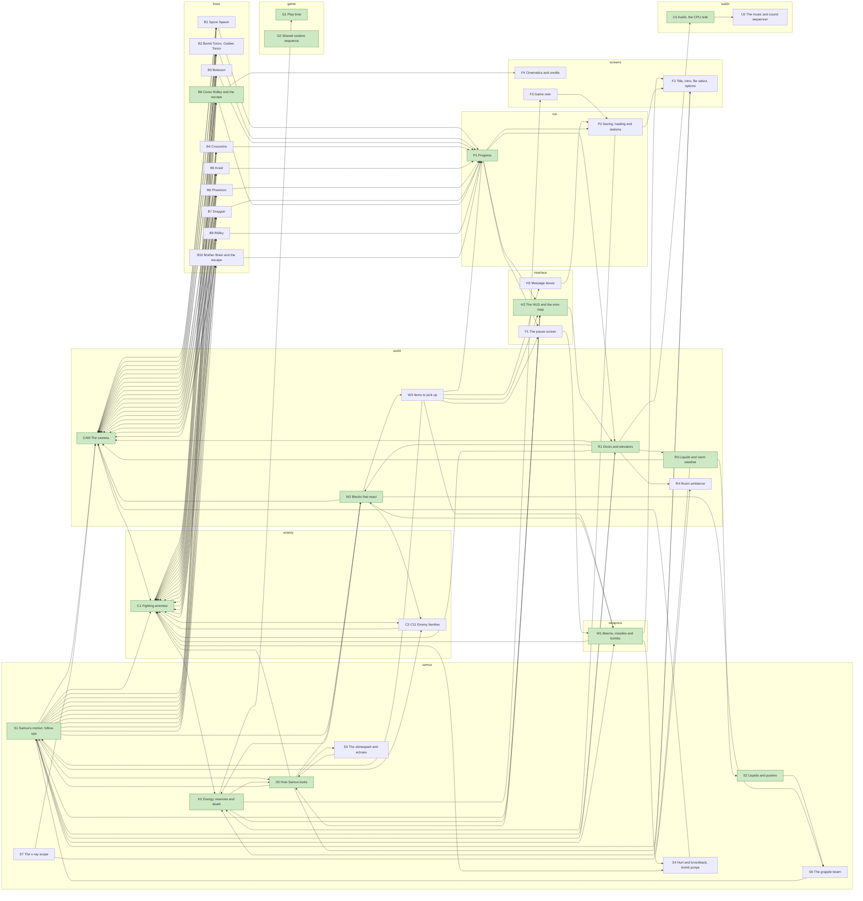

## Structure

How the code is built, read from the tree (`verify::report::structure`, over the size lexer's outline): the crates, then per clean model its modules, the interface its crate root exports, the shared types it takes and which of its modules uses which, then the shared types and the engine files that adapt each model. A module's items are those it declares for others (`pub` or `pub(crate)`), an enum with its variant count and a type's functions as `Type::{...}`, and how many it keeps private; what its doc says it is is its module doc's first sentence.

### Crates

The workspace's crates and the workspace crates each depends on. The clean room's crates are built from their specs alone; the engine runs them through its bridges, and the verification crates hold them to the oracle.

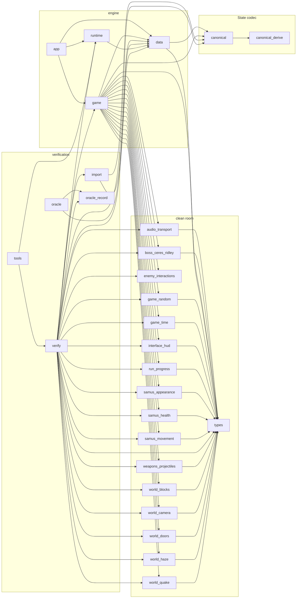

### audio-transport

`crates/clean/audio_transport`, 7 modules.

| Module | Area | Says it is | Items | Score | Lines |
| --- | --- | --- | --- | ---: | ---: |
| `catalogue.rs` | - | One catalogue row per named spec entry, with source-expected check families. | `enum BehaviourId (19)`, `struct Behaviour`, `fn catalogue` | 12 | 54 |
| `effects.rs` | effects | Spec: EffectResources, ConnectedPitchMotion and EffectTiming. | `fn group`, `fn owned`, `struct EffectResult`, `fn turn`, `fn motion`, 23 private | 1,754 | 354 |
| `lib.rs` | - | Admitted audio transport. | - | 0 | 12 |
| `music.rs` | music | Spec: MusicalProgress, FinitePhrases, WholeArrangement and MusicTiming. | `struct MusicResult`, `fn turn`, `fn preview`, `fn start_ramp`, `fn volume`, 39 private | 2,593 | 427 |
| `sender.rs` | sender | Spec: SenderTiming. | `fn offer`, `enum SenderOutput (3)`, `enum SenderProfile (1)`, `fn begin`, `fn reply`, `struct ReplyInput`, `fn advance_with_inputs`, `fn advance`, 6 private | 1,490 | 238 |
| `time.rs` | transport | Spec: VisibleCompletion. | `fn instant`, `fn cycles`, `fn whole`, `fn halves`, `fn compare`, `fn add`, `fn subtract`, `fn floor` | 184 | 43 |
| `transport.rs` | transport | Spec: IndependentCadence, StableRequests, ClockObservation and ReplyCadence. | `fn distribute`, `enum Output (4)`, `struct Input`, `fn advance`, `fn initialize`, `fn elapsed`, `Input::{cue, absence}`, 24 private | 2,020 | 331 |

Its crate root exports:

- from `types::audio`: `QueueAllowance`, `*`
- the module `catalogue`
- the module `effects`
- the module `music`
- the module `sender`
- the module `time`
- the module `transport`

The public functions a caller reaches through them:

```rust
catalogue() -> enum_map::EnumMap<BehaviourId, Behaviour>
group(cue: CueId) -> SoundGroup
owned(playback: &Playback) -> BTreeSet<EffectVoiceId>
turn(group: SoundGroup, state: &GroupState, content: &Content, occupied: &BTreeSet<EffectVoiceId>, echo_voices: &BTreeSet<crate::VoiceId>) -> EffectResult
motion(live: &mut LivePart) -> u64
turn(song: &SongState, content: &[TrackContent]) -> MusicResult
preview(track: &TrackState, graph: &TrackContent) -> AudioCycles
start_ramp(track: &mut TrackState, turns: NonZeroU8, target: u8) -> u64
volume(track: &mut TrackState, tone: bool) -> u64
offer(state: &mut SenderState, cue: CueId, allowance: QueueAllowance, permission: OfferPermission)
begin(state: &mut SenderState, profile: SenderProfile)
reply(state: &mut SenderState, value: Request)
advance_with_inputs(state: &mut SenderState, elapsed: CpuMasterTicks, inputs: &[ReplyInput]) -> Vec<SenderOutput>
advance(state: &mut SenderState, elapsed: CpuMasterTicks) -> Vec<SenderOutput>
instant(numerator: u64, denominator: NonZeroU64) -> AudioInstant
cycles(value: u64) -> AudioInstant
whole(value: BigUint) -> AudioInstant
halves(value: u64) -> AudioInstant
compare(a: impl Borrow<AudioInstant>, b: impl Borrow<AudioInstant>) -> std::cmp::Ordering
add(a: impl Borrow<AudioInstant>, b: impl Borrow<AudioInstant>) -> AudioInstant
subtract(a: impl Borrow<AudioInstant>, b: impl Borrow<AudioInstant>) -> AudioInstant
floor(a: impl Borrow<AudioInstant>) -> BigUint
distribute(phase: &mut CadencePhase, batch: u8) -> (bool, bool)
Input::cue(at: AudioInstant, cue: crate::CueId) -> Self
Input::absence(at: AudioInstant, group: SoundGroup) -> Self
advance(state: &mut State, content: &Content, elapsed: AudioInstant, inputs: &[Input]) -> Vec<Output>
initialize(state: &mut State)
elapsed(work: AudioCycles) -> AudioInstant
```

Shared types it takes from `types`: `Kind`, `Switch`, `audio`. Other crates it uses: `num_bigint`, `num_traits`, `std`.

Which module uses which, grouped by area (a module's own area, its functions counted elsewhere aside):

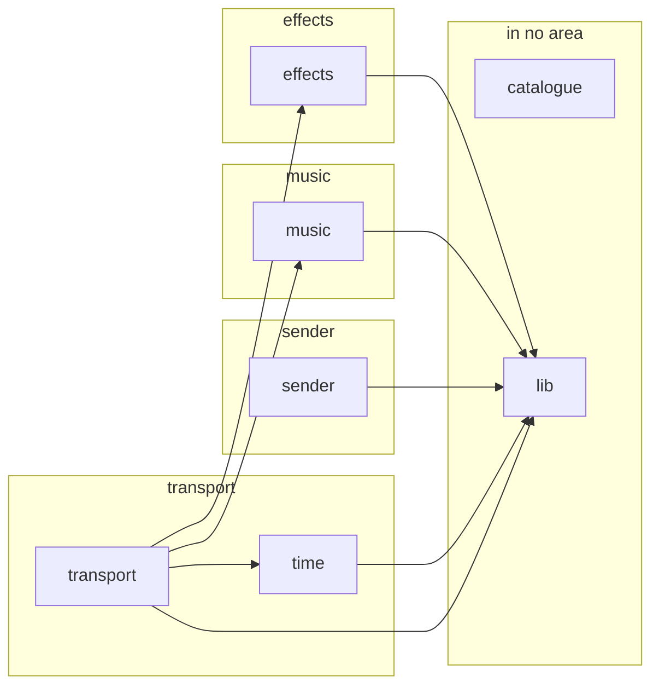

### enemy-interactions

`crates/clean/enemy_interactions`, 1 modules.

| Module | Area | Says it is | Items | Score | Lines |
| --- | --- | --- | --- | ---: | ---: |
| `lib.rs` | contact | Single-box Ceres-door contact with ordinary uncharged power shots. | `struct ProtectionFrames`, `struct ShotCount`, `struct Centre`, `struct Radii`, `struct ContactBox`, `enum DoorContact (3)`, `struct ContactConditions`, `enum ShotSlot (5)`, `const SHOT_SLOTS`, `enum ShotBody (3)`, `type Shots`, `fn consumption`, `enum BehaviourId (3)`, `enum Kind (2)`, `enum Switch (1)`, `struct Behaviour`, `fn behaviour`, `ContactConditions::allowed_box`, `ContactBox::overlaps_door`, 2 private | 264 | 170 |

Its crate root exports:


The public functions a caller reaches through them:

```rust
ContactConditions::allowed_box(self, door: DoorContact, count: ShotCount) -> Option<ContactBox>
ContactBox::overlaps_door(self, door: Self) -> bool
consumption(conditions: ContactConditions, door: DoorContact, count: ShotCount, shots: &Shots) -> Option<ShotSlot>
behaviour(id: BehaviourId) -> Behaviour
```

Shared types it takes from `types`: none. Other crates it uses: `enum_map`.

Which module uses which, grouped by area (a module's own area, its functions counted elsewhere aside):

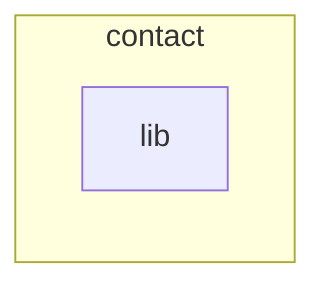

### weapons-projectiles

`crates/clean/weapons_projectiles`, 3 modules.

| Module | Area | Says it is | Items | Score | Lines |
| --- | --- | --- | --- | ---: | ---: |
| `catalogue.rs` | - | One entry for each named behaviour in the supplied specification. | `enum BehaviourId (12)`, `struct Behaviour`, `fn catalogue`, 1 private | 36 | 53 |
| `domain.rs` | shots | Quantities and caller contracts for the uncharged power beam. | `enum ShotSlot (5)`, `enum Heading (10)`, `struct Axes`, `struct FrameWord`, `struct ShotCount`, `struct FixedPosition`, `struct PixelFraction`, `struct BeamSpeed`, `struct Radius`, `struct Damage`, `struct FrameHold`, `struct ClipId`, `struct PictureId`, `struct TrailAppearanceId`, `struct ClipFrame`, `struct Frame`, `enum ClipEnding (2)`, `struct Clip`, `struct PowerBeam`, `struct Offset`, `enum MuzzleAim (3)`, `struct Muzzle`, `struct SamusCentre`, `struct ScreenOrigin`, `struct ScreenCentre`, `struct MovementDistance`, `struct Inheritance`, `enum UpdateMode (2)`, `struct CannonInput`, `struct RoomScreens`, `struct UpdateInput`, `struct ShotBody`, `enum ShotState (3)`, `struct State`, `enum Axis (2)`, `struct Contact`, `enum ContactResponse (2)`, `trait World`, `enum Event (5)`, `enum FlickerPhase (2)`, `enum DrawView (2)`, `struct PictureIntent`, `struct PictureIntents`, `ShotSlot::{DESCENDING, even}`, `Heading::axes`, `ClipFrame::{new, index, at}`, `Inheritance::stationary`, `ShotState::{body, body_mut}`, `State::{reset, consume}`, 1 private | 376 | 365 |
| `lib.rs` | shots | Uncharged power beam model. | `struct Rules`, `fn update_spacing`, `fn cannon_origin`, `fn inherited_motion`, `fn prepare_shot`, `fn accelerate`, `struct EdgeGeometry`, `fn edge_geometry`, `fn contact_edge`, `fn burst`, `fn muzzle_contact`, `fn update_trail`, `fn within_lifetime_view`, `fn inside_view`, `fn remove_shot`, `fn update_clip`, `fn update`, `fn pictures`, `Rules::REFERENCE`, `FixedPosition::{integer, fraction, from_parts, move_by}`, 35 private | 3,624 | 663 |

Its crate root exports:

- from `catalogue`: `*`
- from `domain`: `*`
- the module `catalogue`
- the module `domain`

The public functions a caller reaches through them:

```rust
catalogue() -> EnumMap<BehaviourId, Behaviour>
ShotSlot::even(self) -> bool
Heading::axes(self) -> Axes<i16>
ClipFrame::new(index: usize, frame_count: usize) -> Option<Self>
ClipFrame::index(self) -> usize
Inheritance::stationary() -> Self
ShotState::body(&self) -> Option<&ShotBody>
State::reset(fractions: EnumMap<ShotSlot, Axes<PixelFraction>>) -> Self
State::consume(&mut self, slot: ShotSlot)
FixedPosition::integer(self) -> u16
FixedPosition::fraction(self) -> PixelFraction
FixedPosition::from_parts(integer: u16, fraction: PixelFraction) -> Self
FixedPosition::move_by(&mut self, speed: BeamSpeed)
update_spacing(cooldown: &mut FrameWord, mode: UpdateMode, time_stopped: bool)
cannon_origin(input: &CannonInput) -> Option<(Heading, SamusCentre)>
inherited_motion(heading: Heading, movement: Inheritance) -> Axes<BeamSpeed>
prepare_shot(state: &mut State, input: &CannonInput, content: &PowerBeam, events: &mut Vec<Event>) -> Option<ShotSlot>
accelerate(body: &mut ShotBody, rules: Rules)
edge_geometry(centre: Axes<u16>, radius: Axes<Radius>, speed: BeamSpeed, axis: Axis, screens: u16) -> EdgeGeometry
contact_edge(body: &ShotBody, slot: ShotSlot, axis: Axis, room: RoomScreens, world: &mut impl World) -> bool
burst(shot: &mut ShotState, slot: ShotSlot, impact_clip: &ClipId, events: &mut Vec<Event>)
muzzle_contact(shot: &mut ShotState, slot: ShotSlot, input: &UpdateInput, content: &PowerBeam, world: &mut impl World, events: &mut Vec<Event>)
update_trail(body: &mut ShotBody, slot: ShotSlot, rules: Rules, events: &mut Vec<Event>)
within_lifetime_view(centre: Axes<u16>, camera: ScreenOrigin) -> bool
inside_view(centre: Axes<u16>, camera: ScreenOrigin) -> bool
remove_shot(shot: &mut ShotState, count: &mut ShotCount)
update_clip(body: &mut ShotBody, content: &PowerBeam) -> bool
update(state: &mut State, input: &UpdateInput, content: &PowerBeam, rules: Rules, world: &mut impl World) -> Vec<Event>
pictures(state: &State, phase: FlickerPhase, view: &DrawView) -> PictureIntents
```

Shared types it takes from `types`: `Checked`, `Kind`, `Switch`. Other crates it uses: `enum_map`, `serde`, `std`.

Which module uses which, grouped by area (a module's own area, its functions counted elsewhere aside):

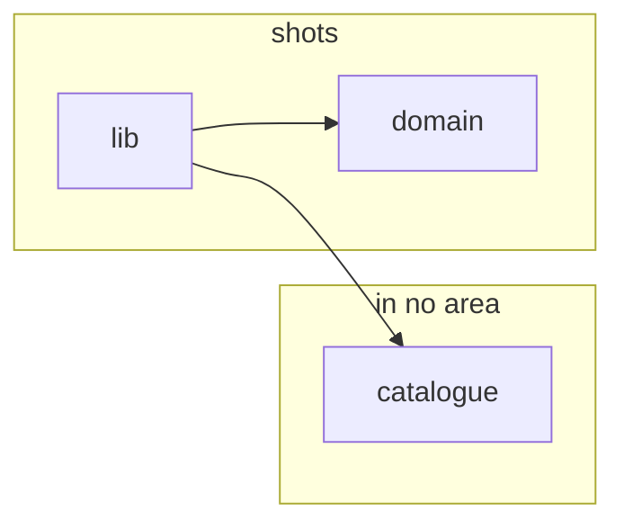

### samus-movement

`crates/clean/samus_movement`, 19 modules.

| Module | Area | Says it is | Items | Score | Lines |
| --- | --- | --- | --- | ---: | ---: |
| `catalogue.rs` | - | One entry per spec entry: what the player sees, its kind and its switch. | `enum BehaviourId (41)`, `struct Behaviour`, `const CATALOGUE` | 0 | 342 |
| `change.rs` | pose chart; `fn apply` in motion | Spec: `PoseFollows`. | `fn transition_firing_aim`, `Effect::lets_go`, `Samus::apply` | 390 | 63 |
| `chart/table.rs` | pose chart | The rows of `WhatHerMovesMet` and of `AnimationEnds` (§7), read in order, the first that fits. | `const MOVES_MET`, `const STEP_BLOCKED`, `const ANIMATION_ENDS`, 1 private | 0 | 289 |
| `chart.rs` | pose chart | §7: the pose chart's reader. | `struct Moment`, `struct Choice`, `Choice::{instead, blocked}`, `Moment::{next_pose, choose}`, 11 private | 958 | 150 |
| `collide.rs` | collision | Tilemap collision (`BlocksStopFlush`, `SolidEnemies`, `SlopesCarry`, `TouchedCells`, `OtherBlockKinds`): one axis at a time, against the room's grid of 16 px cells and the solid enemies' boxes. | `struct Bounds`, `enum Stop (3)`, `enum Probe (5)`, `struct Moved`, `struct Axis`, `Bounds::axis`, `Tick::{inside, go, support}`, 32 private | 2,946 | 420 |
| `fit.rs` | pose fit | Spec: `PoseFitAfterMoves`. | `fn crouched`, `enum Fitted (4)`, `Fitted::moved` | 74 | 31 |
| `jump_held.rs` | motion | `Jumping`, jump held through (§1.2): jump held through a landing, or through the end of a turn or of a landing, counts as a press for the pad chart the next frame, so she takes off again without pressing it. | `enum FrameBefore (2)`, `struct JumpHeld`, `JumpHeld::{NONE, pressed, then}`, `FrameBefore::left_behind`, 2 private | 227 | 59 |
| `lib.rs` | - | The samus-movement model, built from its behaviour spec alone: a character controller for Samus, stepped one 60 Hz frame at a time, her motion in fixed-point subpixels. | - | 0 | 37 |
| `rows.rs` | pose chart | The pose chart's vocabulary (§7). | `const FORWARD`, `const BACK`, `fn seen`, `enum Doing (14)`, `enum Drift (5)`, `enum Moves (5)`, `enum Footing (4)`, `struct Situation`, `struct Class`, `enum Test (13)`, `struct Aiming`, `enum NextFacing (3)`, `struct Next`, `enum Effect (13)`, `struct Entering`, `enum Was (2)`, `struct Beat`, `struct Row`, `enum RowId (76)`, `const AIM`, `const UP_DOWN`, `const UDA`, `const NO_CHANGE`, `const KEEP_POSE`, `const TO_STILL`, `const LOWERS_NOTHING`, `const TO_RUNNING`, `const TO_JUMPING`, `const TO_FALLING`, `const TO_SPINNING`, `const TO_TAKING_OFF`, `const TO_MOONWALKING`, `const TO_CROUCHING`, `const TO_MORPHING`, `const TO_TURNING`, `const FORWARD_AIM`, `const UP_AIM`, `const AIM_UP_ELSE_DOWN`, `const DOWN_TO_FORWARD`, `enum Met (5)`, `Next::pose_from`, `Entering::on` | 294 | 360 |
| `rules.rs` | - | The tuning parameters the model reads: one `Rules` a caller holds, whose `Default` is the vanilla game, the spec's numbers. | `enum SpeedCap (2)`, `enum Gait (7)`, `struct Limits`, `struct Speeds`, `enum Lowers (3)`, `struct WithItem`, `struct Bounce`, `struct Rules`, `WithItem::of`, `Rules::{limits, lowers, cap, rise_speed}`, `impl Default for Rules`, 1 private | 328 | 217 |
| `run.rs` | motion | Her run: her horizontal motion as a value of its own (§1.2 carrying on, her dash, dashing). | `enum Carry (2)`, `enum Dashing (2)`, `enum Stride (4)`, `fn running_with_run_held`, `struct Run`, `Run::{halt, skids, turn_round, end_skid, as_running, meet, launch, moving, dash_for_moves, stride}`, 7 private | 931 | 166 |
| `samus.rs` | motion | Samus as the player can tell her and what she remembers (§1, §1.2), and what a frame shows beyond her quantities: its outputs, for the caller to act on. | `enum Spin (4)`, `enum Seat (2)`, `enum WallTest (3)`, `enum StandingAnimation (2)`, `fn sprite`, `struct Outcome`, `struct Samus`, `Spin::then`, `StandingAnimation::of`, `Samus::{rides_the_elevator, take_result}` | 264 | 119 |
| `situation.rs` | pose chart | Her situation, classified once a frame from her pose at its start (`MovesAsShePosed`). | `struct UnknownPose`, `fn classify`, `static ENTERING`, `static CLASSES`, 47 private | 114 | 1,471 |
| `step.rs` | motion | Spec: `SuspendedMovement`. | `Samus::step` | 74 | 19 |
| `suspended.rs` | - | Spec: `PerformedMotionDecisions`, `SuspendedMovement`. | `struct SelectedChoice`, `enum LocalRule (20)`, `struct MotionRequest`, `struct DecisionInputs`, `enum MovementDecision (7)`, `struct DecisionOutputs`, `struct SuspendedMovement`, `SuspendedMovement::{new, is_complete, offer, complete}`, `impl From<Choice> for SelectedChoice`, 44 private | 10,114 | 1,526 |
| `tick.rs` | motion | One frame's play: what the frame brings from the player and the world (§1.3), and the room, the rules and the cells reached that the frame's moves and looks share (`TouchedCells`). | `struct Frame`, `struct Tick` | 0 | 25 |
| `touchdown.rs` | - | Spec: `TouchdownRequests`. | `fn opportunities`, 4 private | 270 | 65 |
| `travel.rs` | - | Spec: `TravelledDistances`. | `enum TravelKind (5)`, `struct TravelledDistances`, `TravelledDistances::{fresh, refresh, record}`, `impl Default for TravelledDistances` | 72 | 34 |
| `vertical.rs` | motion | Her vertical motion as a value of its own (§1 vertical speed and bounces, §1.2 falling at 0 and the moonfall). | `enum Phase (5)`, `struct Vertical`, `enum Course (3)`, `enum Contact (4)`, `Contact::rises`, `Vertical::{on_ground, has_motion, rising, heading_down, jump, end_rise, space_jump, enter_spin_from_a_turn, come_to_the_ground, course, end_move, meet_in_moves, contact, meet, end_bounce}`, 7 private | 1,350 | 232 |

Its crate root exports:

- from `catalogue`: `Behaviour`, `BehaviourId`, `CATALOGUE`
- from `chart`: `Moment`
- from `jump_held`: `FrameBefore`, `JumpHeld`
- from `rows`: `Met`
- from `rules`: `Bounces`, `Rules`, `SpeedCap`, `WithItem`
- from `run`: `Carry`, `Dashing`, `Run`
- from `samus`: `Outcome`, `Samus`, `Seat`, `Spin`, `StandingAnimation`, `WallTest`
- from `situation`: `UnknownPose`
- from `tick`: `Frame`
- from `travel`: `TravelKind`, `TravelledDistances`
- from `types`: `BodyFitConsideration`, `BodyFitResult`, `CandidateCount`, `CandidateIndex`, `CandidateResult`, `ClearanceRoom`, `CollisionPurpose`, `CollisionTest`, `CollisionTests`, `EnemyCandidate`, `EnemySearch`, `FloorResponse`, `FloorResponseKind`, `MotionAttempt`, `MotionResult`, `MotionSkipReason`, `MovementWork`, `PixelGap`, `PlacementDistance`, `QueueAllowance`, `RequestEffect`, `RequestedWorld`, `SoundIdentity`, `SoundLibrary`, `SoundRequest`, `SupportCheck`, `SupportResult`, `SupportSurface`, `VerticalMotionAtTest`, `VerticalSpeed`, `Direction`, `DirectionalTravels`, `FiringDirection`, `TravelDistance`
- from `vertical`: `Phase`, `Vertical`
- the module `catalogue`
- the module `rules`
- the module `suspended`

The public functions a caller reaches through them:

```rust
Moment::next_pose(&self, pose: Pose) -> Result<Pose, UnknownPose>
WithItem::of(self, items: &Set<Item>) -> Fixed
Rules::limits(&self, gait: Gait) -> Limits
Rules::lowers(&self, by: Lowers) -> Fixed
Rules::cap(&self, speed: Fixed, top: Fixed) -> Fixed
Rules::rise_speed(&self, base: WithItem, items: &Set<Item>, dash: Fixed) -> Fixed
Samus::step(&mut self, frame: &Frame, world: &dyn World, rules: &Rules) -> Result<Outcome, UnknownPose>
SuspendedMovement::new(state: Samus) -> Result<Self, UnknownPose>
SuspendedMovement::is_complete(&self) -> bool
SuspendedMovement::offer(&mut self, frame: &Frame, world: &dyn World, rules: &Rules) -> Result<Option<&MovementDecision>, UnknownPose>
SuspendedMovement::complete(&mut self, f: &Frame, w: &dyn World, r: &Rules) -> Result<(), UnknownPose>
TravelledDistances::fresh() -> Self
TravelledDistances::refresh(&mut self)
TravelledDistances::record(&mut self, kind: TravelKind, direction: Direction, accepted: TravelDistance)
Vertical::on_ground(self) -> bool
```

Shared types it takes from `types`: `Action`, `Aim`, `Block`, `Body`, `BodyFitConsideration`, `BodyFitResult`, `Bounces`, `Buttons`, `CandidateCount`, `CandidateIndex`, `CandidateResult`, `Cell`, `Checked`, `ClearanceRoom`, `ClipEnd`, `CollisionPurpose`, `CollisionTest`, `CollisionTests`, `Direction`, `DirectionalTravels`, `EnemyCandidate`, `EnemySearch`, `Facing`, `FiringDirection`, `Fixed`, `FloorResponse`, `FloorResponseKind`, `Gun`, `Heading`, `Hitbox`, `Item`, `Kind`, `LandedFrom`, `Legs`, `MotionAttempt`, `MotionResult`, `MotionSkipReason`, `MovementWork`, `Pair`, `Parity`, `Parts`, `PixelGap`, `PlacementDistance`, `Pose`, `Position`, `Px`, `QueueAllowance`, `Radius`, `RequestEffect`, `RequestedWorld`, `Set`, `Side`, `Slope`, `SlopeFaces`, `SoundIdentity`, `SoundLibrary`, `SoundRequest`, `Sprite`, `SupportCheck`, `SupportResult`, `SupportSurface`, `Switch`, `Touch`, `TravelDistance`, `Turn`, `VerticalMotionAtTest`, `VerticalSpeed`, `Way`, `World`, `ZERO`, `button`, `fixed`, `part_below`, `px`. Other crates it uses: `core`.

Which module uses which, grouped by area (a module's own area, its functions counted elsewhere aside):

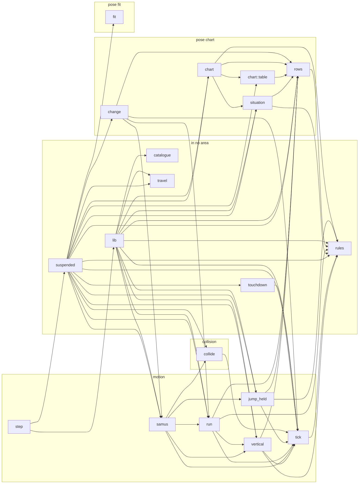

### world-camera

`crates/clean/world_camera`, 7 modules.

| Module | Area | Says it is | Items | Score | Lines |
| --- | --- | --- | --- | ---: | ---: |
| `axis.rs` | limits | One axis of a frame: the camera following her there (Spec: §2), and the room keeping the view in (Spec: §3): its edges, its closed and short screens, and how the view settles out of a closed screen. | `enum Axis (2)`, `struct Line`, `Line::{new, follow}`, 21 private | 949 | 187 |
| `catalogue.rs` | - | The catalogue: one behaviour per spec entry, with its kind, its switch and how it is checked. | `enum BehaviourId (15)`, `struct Behaviour`, `const CATALOGUE` | 0 | 155 |
| `follow.rs` | follow | Following her (Spec: §2): how positions compare, where the view aims, and how fast and how far it moves there. | `fn before`, `fn exceeds`, `fn max_by_before`, `fn min_by_exceeds`, `enum Going (2)`, `struct Move`, `fn aim`, `fn speed`, `fn distance`, `fn chase`, 3 private | 367 | 86 |
| `input.rs` | - | What the camera reads each frame (Spec: §1.3): her motion's outputs, the room, the lead setting and whether time is stopped. | `enum LeadSetting (4)`, `struct Samus`, `struct Frame` | 0 | 25 |
| `lib.rs` | - | The camera model, built from its behaviour spec alone: the screen's view following Samus. | `struct ViewPosition`, `struct RememberedPosition`, `struct Camera`, `Camera::{restore, initialise, with_view, with_remembered, vertical_fraction, position, seen, step}` | 295 | 93 |
| `room.rs` | limits | The room as the camera reads it (Spec: §1.3): its screens, run on as one strip, and its aim heights. | `const SCREEN`, `struct Heights`, `enum RoomError (3)`, `struct Room`, `Heights::height`, `Room::{new, screen}`, 2 private | 242 | 71 |
| `rules.rs` | follow | The tuning the camera reads: `Rules`, whose reference profile holds the spec's vanilla values. | `struct Leads`, `struct Rules`, `Rules::{lead, REFERENCE}`, 1 private | 80 | 58 |

Its crate root exports:

- from `catalogue`: `Behaviour`, `BehaviourId`, `CATALOGUE`
- from `input`: `Frame`, `LeadSetting`, `Samus`
- from `room`: `Heights`, `Room`, `RoomError`
- from `rules`: `Leads`, `Rules`

The public functions a caller reaches through them:

```rust
Camera::restore(view: ViewPosition, remembered: RememberedPosition, vertical_fraction: VerticalFraction) -> Self
Camera::initialise(view: ViewPosition, remembered: RememberedPosition) -> Self
Camera::with_view(mut self, view: ViewPosition) -> Self
Camera::with_remembered(mut self, remembered: RememberedPosition) -> Self
Camera::vertical_fraction(&self) -> VerticalFraction
Camera::position(&self) -> Pair<Fixed>
Camera::seen(&self) -> Position
Camera::step(self, rules: &Rules, frame: &Frame) -> Self
Room::new(run: Vec<ScreenKind>, size: Pair<usize>, heights: Heights) -> Result<Self, RoomError>
```

Shared types it takes from `types`: `Checked`, `Facing`, `Fixed`, `Kind`, `PIXEL`, `Pair`, `Parts`, `PlacementY`, `Position`, `Px`, `ScreenKind`, `Switch`, `VerticalFraction`, `below`, `fixed`, `px`. Other crates it uses: `core`.

Which module uses which, grouped by area (a module's own area, its functions counted elsewhere aside):

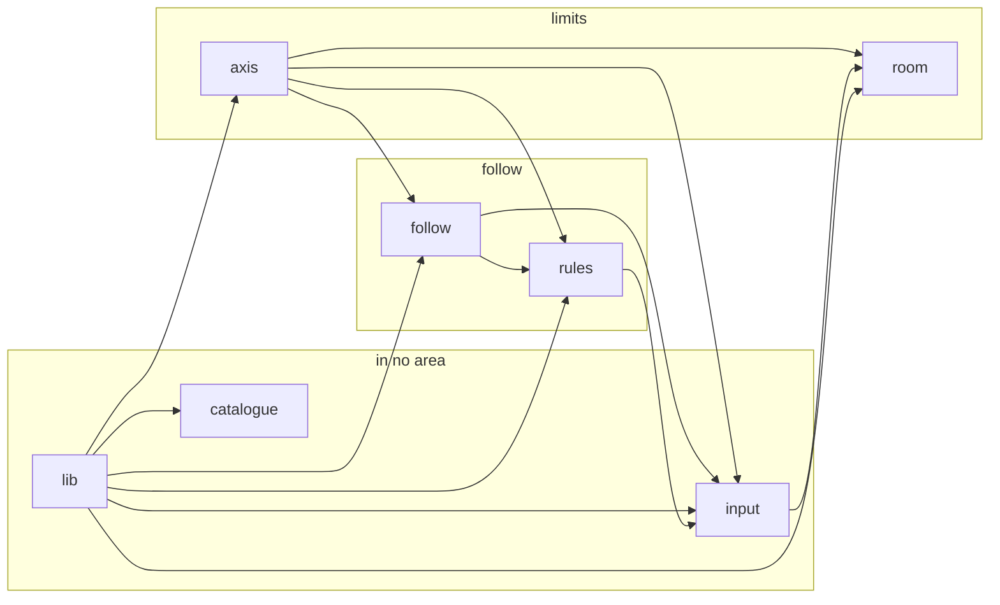

### run-progress

`crates/clean/run_progress`, 9 modules.

| Module | Area | Says it is | Items | Score | Lines |
| --- | --- | --- | --- | ---: | ---: |
| `catalogue.rs` | - | The catalogue: one behaviour for each entry of the progress spec. | `enum BehaviourId (14)`, `struct Behaviour`, `fn catalogue` | 9 | 126 |
| `inventory.rs` | equipment | What she has (spec §1.1, §4): her items and beams, hers and switched on, her capacities, what she holds and her reserve mode; and what taking an item, a beam or a tank gives her. | `type Count`, `enum Supply (5)`, `enum ReserveMode (3)`, `enum Pickup (3)`, `struct Supplies`, `struct Inventory`, `Inventory::take`, `impl Default for Supplies`, 3 private | 217 | 84 |
| `lib.rs` | - | The progress model, built from its behaviour spec alone: what the game remembers of her run besides where she is. | - | 0 | 19 |
| `percentage.rs` | percentage | The item percentage the ending shows. | `Inventory::item_percentage` | 74 | 12 |
| `places.rs` | places | What the places remember (spec §3): the item locations emptied and the doors that stay open, by id, and how she has each area's map. | `struct Remembered`, `enum MapStatus (3)`, `Remembered::{remember, contains}`, `MapStatus::is_known`, `impl Default for Remembered<Id>` | 56 | 30 |
| `progress.rs` | happened | The whole of what the game keeps of a run besides where she is (spec §1), and what has happened in the world (§2). | `struct Progress` | 0 | 17 |
| `report.rs` | places | What other domains report (spec §1.3), and how each report changes the progress. | `enum Report (10)`, `Progress::apply`, 1 private | 253 | 59 |
| `room_states.rs` | rooms | Which version of a room loads, given the run's progress (spec §5). | `enum Condition (6)`, `struct EnteredRoom`, `struct RoomStates`, `enum Version (2)`, `RoomStates::choose`, 1 private | 168 | 51 |
| `rules.rs` | - | The values the progress rules read: the reference profile holds the original game's. | `struct Rules`, `Rules::reference`, `impl Default for Rules`, 4 private | 42 | 39 |

Its crate root exports:

- from `catalogue`: `Behaviour`, `BehaviourId`, `catalogue`
- from `inventory`: `Count`, `Inventory`, `Pickup`, `ReserveMode`, `Supplies`, `Supply`
- from `places`: `MapStatus`, `Remembered`
- from `progress`: `Progress`
- from `report`: `Report`
- from `room_states`: `Condition`, `EnteredRoom`, `RoomStates`, `Version`
- from `rules`: `Rules`

The public functions a caller reaches through them:

```rust
catalogue() -> EnumMap<BehaviourId, Behaviour>
Inventory::item_percentage(&self, rules: &Rules) -> Count
Remembered::contains(&self, id: Id) -> bool
MapStatus::is_known(self) -> bool
Progress::apply(&mut self, rules: &Rules, reports: &[Report])
RoomStates::choose(&self, progress: &Progress, room: EnteredRoom) -> Version
Rules::reference() -> Self
```

Shared types it takes from `types`: `Area`, `Beam`, `BossKind`, `Checked`, `DoorId`, `Entrance`, `Event`, `Item`, `Kind`, `LocationId`, `Members`, `Set`, `StationId`, `Switch`. Other crates it uses: `core`, `enum_map`, `std`.

Which module uses which, grouped by area (a module's own area, its functions counted elsewhere aside):

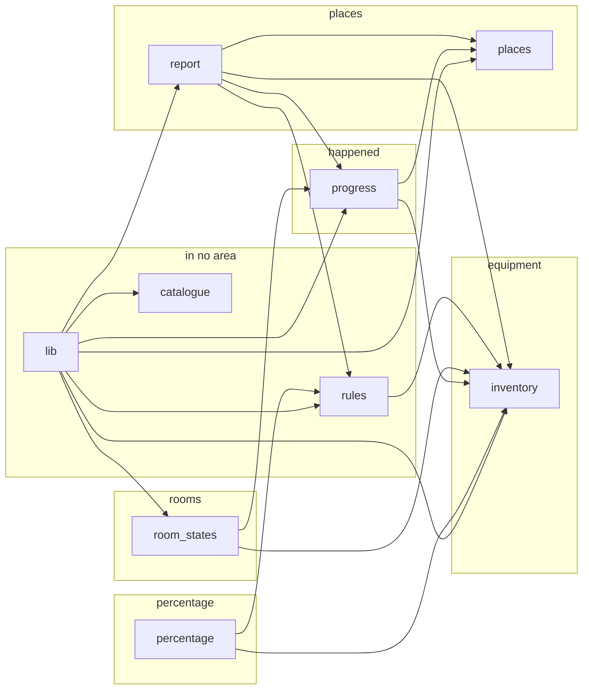

### interface-hud

`crates/clean/interface_hud`, 19 modules.

| Module | Area | Says it is | Items | Score | Lines |
| --- | --- | --- | --- | ---: | ---: |
| `catalogue.rs` | - | The catalogue: one behaviour per entry of the HUD's spec, with its kind, its switch and how the spec checks it. | `enum BehaviourId (26)`, `struct Behaviour`, `const CATALOGUE` | 0 | 246 |
| `countdown.rs` | status | Spec: EscapeCountdown. | `enum Countdown (1)`, `enum CountdownExpiry (1)`, `enum CountdownPicture (1)`, `enum CountdownOpportunity (1)`, `struct CountdownAnswer`, `Countdown::answer` | 36 | 33 |
| `countdown_work.rs` | status | Spec: CountdownContinuation. | `struct CountdownWork`, `CountdownWork::{new, choose, apply, answer, state, publication}` | 157 | 46 |
| `events.rs` | - | What a frame reports for other domains to act on. | `enum HudEvent (2)` | 0 | 9 |
| `grid.rs` | - | A grid of cells, each holding a value: the HUD's cells, her map's pictures and the sets of her map's cells are each one. | `type Place`, `fn at`, `fn plus`, `struct Grid`, `Grid::{filled, get, set, contains, insert}`, `impl Default for Grid<T, COLUMNS, ROWS>`, 1 private | 224 | 55 |
| `inputs.rs` | -; `fn has` in selection | What the HUD reads each step (§1.3): in a frame of play, the values other domains own, the buttons, what other domains drop before the status bar and after it, and where she is on her map; outside play, the mini-map's turn-on, a new area and a drop. | `struct FrameCount`, `struct Energy`, `enum ReserveMode (2)`, `struct Reserve`, `struct Stock`, `struct Ammunition`, `struct Equipped`, `struct Status`, `struct ItemControlInputs`, `enum SelectButton (2)`, `enum CancelButton (3)`, `enum Mute (4)`, `struct Controls`, `struct Room`, `struct MiniMapInputs`, `enum Dropped (3)`, `struct FrameInputs`, `struct StatusInputs`, `enum NewArea (2)`, `struct OutOfPlayInputs`, `Ammunition::{new, of, stocks}`, `ItemControlInputs::{from_frame, has}`, `Status::has`, `StatusInputs::from_frame`, `impl TryFrom<EnumMap<Ammo, Stock>> for Ammunition`, 2 private | 312 | 199 |
| `item.rs` | selection | The items the HUD can select (§1.1). | `enum Ammo (3)`, `enum SelectableItem (3)`, `SelectableItem::ORDER` | 0 | 26 |
| `layout.rs` | status | Where things sit on the HUD (§1.2), as places on its grid: column across, row down. | `const TANKS`, `const ENERGY_DIGITS`, `fn ammo_digits`, `const RESERVE_SIGN`, `fn icon_top_left`, `const HER_CELL`, `const WINDOW_REACH`, `fn laid`, 3 private | 94 | 52 |
| `lib.rs` | - | The HUD model, built from its behaviour spec alone: the status bar at the top of the screen, the selected item and the mini-map. | - | 0 | 45 |
| `map.rs` | minimap | Her map, as the mini-map reads it (§1.3): 64 columns by 32 rows of cells, each cell's picture with its flips, its beyond pictures, and the cells it charts; and the sets of its cells. | `type MapCellSet`, `type MapPictures`, `struct HerMap` | 0 | 10 |
| `mini_map.rs` | minimap | The mini-map (§4): the 5 × 3 cells of her map around hers, the ones she has explored, her own cell blinking, the bosses that blank it, and the quirks at the map's first and last columns. | `HudState::{mini_map_turned_on, movement_map, mini_map_updates, explore_and_draw_mini_map, boss_blanks_the_map}`, 22 private | 746 | 174 |
| `pictures.rs` | status | The HUD's pictures (§1.4): content the importer supplies by name, which the caller gives each step. | `struct Icons`, `fn rows`, `struct HudPictures`, `Icons::of`, `HudPictures::blank_cell` | 127 | 46 |
| `rules.rs` | -; `fn reference` in minimap | The values the HUD's rules read: the reference profile holds the spec's; another `Rules` is an adjusted game. | `enum Boss (7)`, `struct Alternation`, `struct Rules`, `Alternation::first_half`, `Rules::reference`, `impl Default for Rules`, 3 private | 97 | 78 |
| `selection.rs` | selection | How Select, item cancel and another domain's drop change the selection (spec: CyclingItems, CancellingTheItem, OneShotItem, Switching). | `Selection::{apply_drop, apply_item_controls}`, `HudState::item_controls`, 1 private | 252 | 43 |
| `state.rs` | - | What the HUD keeps from one frame to the next (§1): its cells, the values last shown, the selection, the explored cells, mini-map power and independently owned escape countdown. | `struct Shown`, `enum Selection (3)`, `enum MiniMapPower (2)`, `struct HudState`, `Selection::{item, one_shot}` | 59 | 47 |
| `status_bar.rs` | status | The status bar (§2): the energy and its tanks, the ammunition counts, the reserve sign, and the items' icons with the selection's highlight. | `HudState::{refresh_status, energy_gauge, ammo_counts, reserve_sign, icon_appears, highlight, one_shot_flash}`, 5 private | 846 | 130 |
| `step.rs` | - | Whole-frame and outside-play entries. | `HudState::{frame_of_play, out_of_play}` | 141 | 38 |
| `tile.rs` | - | What a cell of the HUD shows (§1.4): a picture with its flips (the shared `Look`), in one of the HUD's eight colour sets; and the colour sets by the role the spec gives each. | `struct ColourSet`, `struct Tile`, `type HudGrid`, `const BLANK_COLOURS`, `const DIGIT_COLOURS`, `const FULL_TANK_COLOURS`, `const EMPTY_TANK_COLOURS`, `const SIGN_LIT`, `const SIGN_DIM`, `const PLAIN`, `const HIGHLIGHTED`, `const EXPLORED`, `const CHARTED`, `const BLINK`, `ColourSet::{new, number}`, `Tile::{new, in_colours}`, `impl TryFrom<u8> for ColourSet`, `impl From<ColourSet> for u8`, 1 private | 82 | 58 |
| `work.rs` | - | Spec: ItemControls, MiniMapUpdate, StatusRefresh, RetainedHudWork. | `enum Observation (3)`, `enum HudOpportunity (4)`, `struct ControlAnswer`, `struct DisplayInputs`, `struct DisplayAnswer`, `struct MapAnswer`, `struct MovementInputs`, `struct StatusAnswer`, `struct EventCursor`, `struct HudWork`, `DisplayInputs::{from_frame, status_inputs, mini_map}`, `MovementInputs::{capture, as_mini_map}`, `EventCursor::next_event`, `HudWork::{new, begin, frame_count, opportunity, choose_controls, choose_display, choose_mini_map, choose_status, mini_map, status, apply, state, controls, display, initial_highlight, events, publication}`, 1 private | 1,544 | 386 |

Its crate root exports:

- from `catalogue`: `Behaviour`, `BehaviourId`, `CATALOGUE`
- from `countdown`: `Countdown`, `CountdownAnswer`, `CountdownExpiry`, `CountdownOpportunity`, `CountdownPicture`
- from `countdown_work`: `CountdownWork`
- from `events`: `HudEvent`
- from `grid`: `Grid`, `Place`
- from `inputs`: `Ammunition`, `CancelButton`, `Controls`, `Dropped`, `Energy`, `Equipped`, `FrameCount`, `FrameInputs`, `ItemControlInputs`, `MiniMapInputs`, `Mute`, `NewArea`, `OutOfPlayInputs`, `Reserve`, `ReserveMode`, `Room`, `SelectButton`, `Status`, `StatusInputs`, `Stock`
- from `item`: `Ammo`, `SelectableItem`
- from `map`: `HerMap`, `MapCellSet`, `MapPictures`
- from `pictures`: `HudPictures`, `Icons`
- from `rules`: `Alternation`, `Boss`, `Rules`
- from `state`: `HudState`, `MiniMapPower`, `Selection`, `Shown`
- from `tile`: `ColourSet`, `HudGrid`, `Tile`
- from `types`: `Checked`, `Flip`, `Kind`, `Look`, `Pair`, `Picture`, `Screen`, `Switch`
- from `work`: `ControlAnswer`, `DisplayAnswer`, `DisplayInputs`, `EventCursor`, `HudOpportunity`, `HudWork`, `MapAnswer`, `MovementInputs`, `Observation`, `StatusAnswer`

The public functions a caller reaches through them:

```rust
CountdownWork::new(state: HudState) -> Self
CountdownWork::choose(&mut self, opportunity: CountdownOpportunity) -> bool
CountdownWork::apply(&mut self) -> bool
CountdownWork::answer(&self) -> &Observation<CountdownAnswer>
CountdownWork::state(&self) -> &HudState
CountdownWork::publication(&self) -> Option<(&HudState, &CountdownAnswer)>
Grid::filled(value: T) -> Self
Grid::get(&self, place: Place) -> Option<T>
Grid::set(&mut self, place: Place, value: T)
Grid::contains(&self, place: Place) -> bool
Grid::insert(&mut self, place: Place)
Ammunition::new(stocks: EnumMap<Ammo, Stock>) -> Option<Self>
Ammunition::of(&self, ammo: Ammo) -> &Stock
Ammunition::stocks(&self) -> impl Iterator<Item = (Ammo, &Stock)>
ItemControlInputs::from_frame(inputs: &FrameInputs<'_>) -> Self
ItemControlInputs::has(&self, item: SelectableItem) -> bool
Status::has(&self, item: SelectableItem) -> bool
StatusInputs::from_frame(inputs: &FrameInputs<'_>) -> Self
HudState::boss_blanks_the_map(&mut self, rules: &Rules, pictures: &HudPictures, boss: Boss, room: Place)
Icons::of(&self, item: SelectableItem) -> [&[Look]; 2]
HudPictures::blank_cell(&self) -> Tile
Alternation::first_half(self, frame: FrameCount) -> bool
Rules::reference() -> Self
HudState::item_controls(&mut self, controls: &ItemControlInputs) -> Option<HudEvent>
Selection::item(self) -> Option<SelectableItem>
Selection::one_shot(self) -> Option<SelectableItem>
HudState::frame_of_play(&mut self, rules: &Rules, pictures: &HudPictures, inputs: &FrameInputs<'_>) -> Vec<HudEvent>
HudState::out_of_play(&mut self, inputs: &OutOfPlayInputs<'_>)
ColourSet::new(number: u8) -> Option<Self>
ColourSet::number(self) -> u8
Tile::new(look: Look, colours: ColourSet) -> Self
Tile::in_colours(self, colours: ColourSet) -> Self
DisplayInputs::from_frame(inputs: &FrameInputs<'_>) -> Self
DisplayInputs::status_inputs(&self) -> StatusInputs
DisplayInputs::mini_map(&self) -> MiniMapInputs<'_>
MovementInputs::capture(inputs: &MiniMapInputs<'_>, mother_brain_falls: bool) -> Self
MovementInputs::as_mini_map(&self) -> MiniMapInputs<'_>
EventCursor::next_event(&mut self, work: &HudWork) -> Option<HudEvent>
HudWork::new(state: HudState) -> Self
HudWork::begin(state: HudState, frame: FrameCount) -> Self
HudWork::frame_count(&self) -> Option<FrameCount>
HudWork::opportunity(&self) -> Option<HudOpportunity>
HudWork::choose_controls(&mut self, inputs: ItemControlInputs) -> bool
HudWork::choose_display(&mut self, rules: &Rules, pictures: &HudPictures, inputs: DisplayInputs) -> bool
HudWork::choose_mini_map(&mut self, rules: &Rules, pictures: &HudPictures, inputs: MovementInputs) -> bool
HudWork::choose_status(&mut self, rules: &Rules, pictures: &HudPictures, inputs: StatusInputs) -> bool
HudWork::mini_map(&self) -> Observation<&MapAnswer>
HudWork::status(&self) -> &Observation<StatusAnswer>
HudWork::apply(&mut self) -> bool
HudWork::state(&self) -> &HudState
HudWork::controls(&self) -> &Observation<ControlAnswer>
HudWork::display(&self) -> &Observation<DisplayAnswer>
HudWork::initial_highlight(&self) -> Option<SelectableItem>
HudWork::events(&self) -> &[HudEvent]
HudWork::publication(&self) -> Option<(&HudState, &[HudEvent])>
```

Shared types it takes from `types`: `Checked`, `Flip`, `Kind`, `Look`, `Pair`, `Picture`, `Screen`, `Switch`. Other crates it uses: `enum_map`, `serde`, `serde_big_array`, `std`.

Which module uses which, grouped by area (a module's own area, its functions counted elsewhere aside):

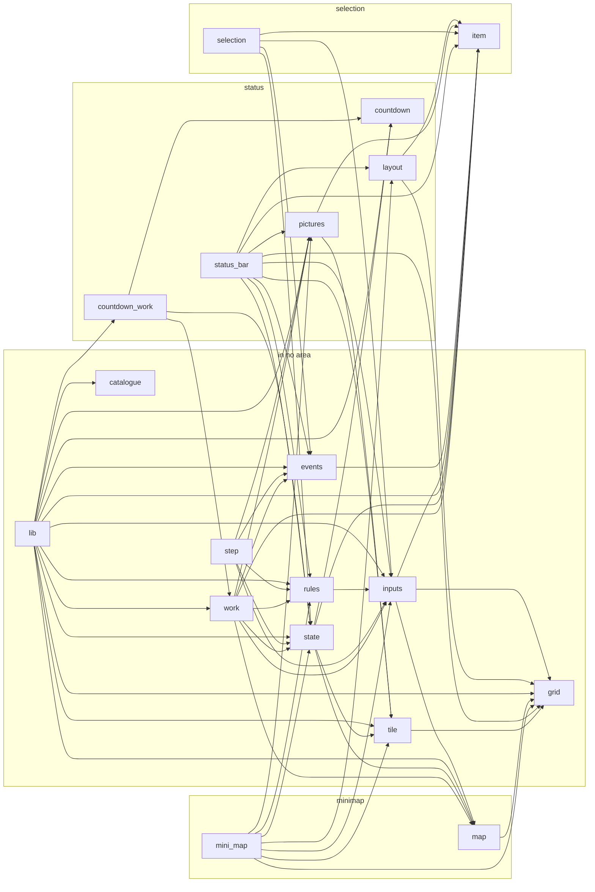

### world-blocks

`crates/clean/world_blocks`, 9 modules.

| Module | Area | Says it is | Items | Score | Lines |
| --- | --- | --- | --- | ---: | ---: |
| `catalogue.rs` | - | The catalogue: one behaviour per spec entry, with its kind, its switch and how it is checked. | `enum BehaviourId (18)`, `struct Behaviour`, `const CATALOGUE` | 0 | 168 |
| `cells.rs` | -; `fn show` in places, `fn regrow` in places, `fn offset` in places, `fn answer` in breakables, `fn plain` in breakables, `fn met_as` in breakables | The room's cells as this domain sees them: each cell's kind, mark and look (spec §1), and how a step writes a cell. | `struct Grid`, `type Tilemap`, `struct Tile`, `enum CellKind (4)`, `enum ReactingBody (2)`, `enum StandIn (2)`, `enum Answer (3)`, `enum Mark (7)`, `enum OtherMetAs (2)`, `enum Inside (2)`, `fn offset`, `Grid::{new, rows, get, get_mut}`, `CellKind::answer`, `ReactingBody::plain`, `Mark::met_as`, `Tile::{show, regrow}` | 314 | 138 |
| `inputs.rs` | - | What the frame and the room's start give the model (spec §1.3). | `enum Request (2)`, `enum Meeting (3)`, `enum Run (2)`, `enum Placement (3)`, `struct ScreenChange`, `struct OutsideTheRoom` | 0 | 41 |
| `lib.rs` | - | The blocks model, built from its behaviour spec alone: blocks that break and come back, the scroll cells that change which screens the view may show, and the stand-ins a room places. | - | 0 | 22 |
| `places.rs` | places | The places reactions run in (`Places`), and the run of what they hold (`TheScriptsRun`): at most 40 run at once, each one started takes the highest free place, and every frame that isn't paused each place from the highest down has its turn. | `const PLACE_COUNT`, `struct Places`, `enum Place (5)`, `struct Running`, `struct ScrollReaction`, `enum Touched (2)`, `Places::{take, full, hold_until_run, touch_scroll, run}`, `Running::started`, `impl Default for Places`, 7 private | 755 | 172 |
| `reactions.rs` | places | Reactions and their scripts: the imported assets (spec §2). | `const MOST_FRAMES`, `struct Frames`, `struct ReactionName`, `struct Reaction`, `enum Step (4)`, `struct SoundRequest`, `struct PatternCell`, `enum Becomes (4)`, `Frames::{ONE, new, count, less_one}`, `Reaction::{first_wait_of, regrows}` | 96 | 75 |
| `report.rs` | - | What a frame reports (spec §1.4) beyond the state's screens. | `struct Report` | 0 | 9 |
| `rules.rs` | breakables | The rules (spec §5, `BlocksMarkedNothing`): for each family, and for each family a cell marked `Nothing` is met as, what her touches and the hits ask of its cells. | `struct Rules`, `struct Row`, `enum TouchRule (2)`, `enum Starter (3)`, `struct HitRule`, `enum Bodies (2)`, `struct HoldUntilRun`, `struct Start`, `enum FirstStep (2)`, `enum Change (3)`, `Rules::reference`, `Row::answer`, `Starter::starts`, `Bodies::includes`, `FirstStep::index`, `Change::apply`, 23 private | 444 | 318 |
| `state.rs` | breakables | What the model remembers from frame to frame (spec §1.2): the cells, the places and the screens, and the two entry points that change them: the room's start and the frame's step. | `struct State`, `State::{start_room, step}`, 2 private | 787 | 133 |

Its crate root exports:

- from `catalogue`: `Behaviour`, `BehaviourId`, `CATALOGUE`
- from `cells`: `Answer`, `CellKind`, `Grid`, `Inside`, `Mark`, `OtherMetAs`, `ReactingBody`, `StandIn`, `Tile`, `Tilemap`
- from `inputs`: `Meeting`, `OutsideTheRoom`, `Placement`, `Request`, `Run`, `ScreenChange`
- from `places`: `PLACE_COUNT`, `Place`, `Places`, `Running`, `ScrollReaction`, `Touched`
- from `reactions`: `Becomes`, `Frames`, `MOST_FRAMES`, `PatternCell`, `Reaction`, `ReactionName`, `SoundRequest`, `Step`
- from `report`: `Report`
- from `rules`: `Bodies`, `Change`, `FirstStep`, `HitRule`, `HoldUntilRun`, `Row`, `Rules`, `Start`, `Starter`, `TouchRule`
- from `state`: `State`

The public functions a caller reaches through them:

```rust
Grid::new(rows: Vec<Vec<T>>) -> Option<Self>
Grid::rows(&self) -> &[Vec<T>]
Grid::get(&self, at: Pair<u16>) -> Option<&T>
Grid::get_mut(&mut self, at: Pair<u16>) -> Option<&mut T>
CellKind::answer(self) -> Answer
ReactingBody::plain(self) -> CellKind
Mark::met_as(&self) -> Option<MetAs>
Tile::show(&mut self, cell: &PatternCell)
Tile::regrow(&mut self, body: ReactingBody, whole_look: Option<Picture>)
Frames::new(count: u16) -> Option<Self>
Frames::count(self) -> u16
Frames::less_one(self) -> Option<Self>
Reaction::first_wait_of(&self, script: Script) -> Frames
Reaction::regrows(&self, script: Script) -> bool
Rules::reference() -> Self
Starter::starts(&self, way: Way, moving: Set<Motion>) -> bool
Bodies::includes(self, body: ReactingBody) -> bool
FirstStep::index(self, steps: &[Step]) -> usize
State::start_room(&mut self, placements: impl IntoIterator<Item = Placement>) -> Result<(), OutsideTheRoom>
State::step(&mut self, rules: &Rules, requests: &[Request], moving: Set<Motion>, run: Run) -> Result<Report, OutsideTheRoom>
```

Shared types it takes from `types`: `Cell`, `Checked`, `Family`, `Heading`, `HitBy`, `Kind`, `Look`, `MetAs`, `Motion`, `Pair`, `Picture`, `Point`, `Screen`, `ScreenKind`, `Script`, `Set`, `Switch`, `Way`, `by_member`. Other crates it uses: `enum_map`, `std`.

Which module uses which, grouped by area (a module's own area, its functions counted elsewhere aside):

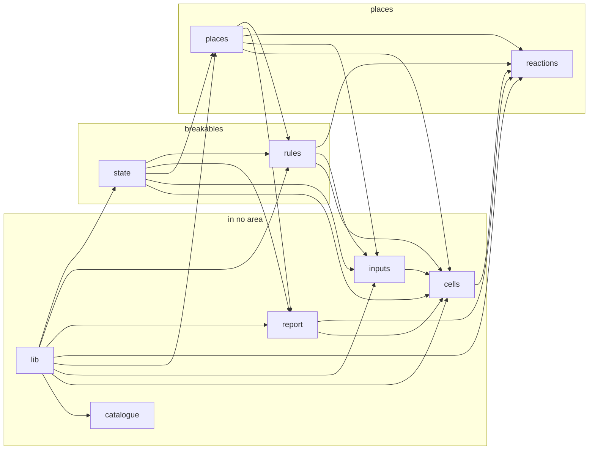

### samus-appearance

`crates/clean/samus_appearance`, 16 modules.

| Module | Area | Says it is | Items | Score | Lines |
| --- | --- | --- | --- | ---: | ---: |
| `ahead.rs` | clip | What a caller reads as the frame starts, before samus-movement's step: the end her clip reaches and whether her spin has turned far. | `struct Ahead`, `Ahead::of` | 76 | 21 |
| `cannon.rs` | cannon | Persistent cannon readiness, independent of animation and HUD mode. | `enum SelectedItem (6)`, `enum ControlEligibility (2)`, `struct ItemControlAnswer`, `struct CannonDelay`, `struct Look`, `enum CannonObservation (3)`, `CannonDelay::{INITIAL, new, remaining, may_follow, controls_completed, initialize}`, `CannonObservation::{choose, complete}`, 2 private | 168 | 99 |
| `catalogue.rs` | - | The catalogue: one behaviour per entry of the spec. | `enum BehaviourId (26)`, `struct Behaviour`, `const CATALOGUE` | 0 | 238 |
| `clip.rs` | clip | Her clips and the run's paces: the content the importer supplies, as typed values. | `struct Step`, `struct Frames`, `struct Hold`, `struct Slowdown`, `struct Branch`, `enum Instruction (2)`, `enum Control (6)`, `struct Clip`, `struct Pace`, `struct Paces`, `Step::{FIRST, SECOND, next, before}`, `Frames::{NONE, LAST, slowed}`, `Hold::{LONGEST, new, frames}`, `Slowdown::{MOST, NONE, new}`, `Control::end`, `Clip::{at, hold}`, `Pace::hold`, `impl TryFrom<u8> for Hold`, `impl TryFrom<u8> for Slowdown`, 1 private | 231 | 136 |
| `colours.rs` | palette | Ordinary dry-run sequence preparation, independent of the shared palette banks. | `struct VisorDelay`, `struct VisorStep`, `struct ChargeGlowPosition`, `struct ColourSequences`, `enum Suit (3)`, `enum RoomColours (3)`, `enum GrappleActivity (2)`, `enum LiquidLevel (2)`, `enum ColourEffect (6)`, `struct RunColourFacts`, `struct UnsupportedRunColours`, `struct RunColourWork`, `RunColourWork::{UNOBSERVED, observe, pending, complete}`, 3 private | 202 | 113 |
| `inputs.rs` | - | What a frame reads, each from the domain that owns it. | `struct Figure`, `trait Content`, `enum MoveEvent (4)`, `enum Dash (3)`, `struct Liquid`, `struct Inputs`, `struct SoundsWaiting`, `Liquid::NONE`, `SoundsWaiting::{MOST, NONE, new, count}`, `impl TryFrom<u8> for SoundsWaiting` | 63 | 78 |
| `lib.rs` | - | The samus-appearance model, built from its behaviour spec alone: her animation's timing, appearance opportunities and independent cannon readiness. | - | 0 | 38 |
| `moves.rs` | moves | What her moves do to her clip, before the time runs down. | `fn standing_restart`, `fn wall_jump_ready`, `fn fast_fall`, `fn rising_hold` | 196 | 40 |
| `opportunity.rs` | - | Spec: `FootContact`, `SpinStarts`, `SpinEnds`, `AtTheDoor`. | `enum ContactSuppressor (3)`, `enum CinematicActivity (2)`, `struct Charge`, `enum SoundRequest (6)`, `enum SoundQueue (2)`, `struct GraphicalContact`, `struct OpportunityOutput`, `enum Opportunity (4)`, `Charge::{MOST, QUIET_CUTOFF, new, frames}`, `SoundRequest::{queue, max_waiting}`, `Opportunity::read`, `impl TryFrom<u16> for Charge`, 5 private | 476 | 195 |
| `play.rs` | clip | Her clip plays: the time runs down, and when it is over the clip moves on as its steps say. | `fn play`, 5 private | 755 | 110 |
| `rules.rs` | - | The spec's parameters, as a game's tuning: `Rules::VANILLA` holds the game's values, and any other `Rules` is an adjusted game. | `struct Rules`, `Rules::VANILLA` | 0 | 30 |
| `run.rs` | run | Her run: its pace while she dashes, and the speed booster's stages up to boosting. | `fn stride`, `fn hold_on`, `fn next_stage`, `fn boosting_lap_stage`, `fn dash_began`, `fn dash_lost`, 2 private | 238 | 72 |
| `starting.rs` | clip | Taking another pose: where the clip of the pose she takes starts. | `fn start`, 12 private | 261 | 153 |
| `state.rs` | -; `fn on` in clip, `fn run_down` in clip, `fn after_lap` in run | The four persistent animation quantities: her step, the time left on it, the boost stage and the laps left. | `struct Playhead`, `enum RunDown (2)`, `struct Laps`, `enum LapsLeft (2)`, `struct State`, `Playhead::{on, run_down}`, `Laps::{ONE, TWO, new, count}`, `LapsLeft::after_lap`, 1 private | 259 | 77 |
| `suspended.rs` | - | Spec: `PerformedAnimationDecisions`, `SuspendedAppearance`. | `enum AppearanceRead (4)`, `enum AnimationDecision (8)`, `enum Answer (6)`, `enum PublishedSound (2)`, `struct OfferedDecision`, `enum Receipt (2)`, `struct AnimationInputs`, `enum WorkStep (2)`, `struct SuspendedAppearance`, `AppearanceRead::read`, `SuspendedAppearance::{new, animation_steps, offer, complete, finish}`, `impl From<Opportunity<'_>> for AppearanceRead`, `impl Content for AnimationInputs`, 3 private | 1,436 | 398 |
| `update.rs` | - | Spec: `PerformedAnimationDecisions`. | `fn update` | 148 | 29 |

Its crate root exports:

- from `ahead`: `Ahead`
- from `cannon`: `CannonDelay`, `CannonObservation`, `ControlEligibility`, `ItemControlAnswer`, `Look`, `SelectedItem`
- from `catalogue`: `Behaviour`, `BehaviourId`, `CATALOGUE`
- from `clip`: `Branch`, `Clip`, `Control`, `Frames`, `Hold`, `Instruction`, `Pace`, `Paces`, `Slowdown`, `Step`
- from `colours`: `ChargeGlowPosition`, `ColourEffect`, `ColourSequences`, `GrappleActivity`, `LiquidLevel`, `RoomColours`, `RunColourFacts`, `RunColourWork`, `Suit`, `UnsupportedRunColours`, `VisorDelay`, `VisorStep`
- from `inputs`: `Content`, `Dash`, `Figure`, `Inputs`, `Liquid`, `MoveEvent`, `SoundsWaiting`
- from `opportunity`: `Charge`, `CinematicActivity`, `ContactSuppressor`, `GraphicalContact`, `Opportunity`, `OpportunityOutput`, `SoundQueue`, `SoundRequest`
- from `rules`: `Rules`
- from `state`: `Laps`, `LapsLeft`, `Playhead`, `RunDown`, `State`
- from `suspended`: `AnimationDecision`, `AnimationInputs`, `Answer`, `AppearanceRead`, `OfferedDecision`, `PublishedSound`, `Receipt`, `SuspendedAppearance`, `WorkStep`
- from `types`: `PALETTE_SLOTS`, `Palette`, `Palettes`
- from `update`: `update`

The public functions a caller reaches through them:

```rust
Ahead::of(playhead: Playhead, clip: &Clip) -> Self
CannonDelay::new(observations: u8) -> Option<Self>
CannonDelay::remaining(self) -> u8
CannonDelay::may_follow(self) -> bool
CannonDelay::controls_completed(&mut self, answer: ItemControlAnswer)
CannonDelay::initialize(&mut self)
CannonObservation::choose(&mut self, answer: ItemControlAnswer) -> bool
CannonObservation::complete(&mut self, look: &mut Look) -> bool
Step::next(self) -> Option<Self>
Step::before(self) -> Option<Self>
Frames::slowed(self, slowdown: Slowdown) -> Self
Hold::new(frames: u8) -> Option<Self>
Hold::frames(self) -> Frames
Slowdown::new(frames: u8) -> Option<Self>
Control::end(self) -> Option<ClipEnd>
Clip::at(&self, step: Step) -> Option<Instruction>
Clip::hold(&self, step: Step) -> Option<Hold>
Pace::hold(&self, step: Step) -> Option<Hold>
RunColourWork::observe(&mut self, facts: Option<RunColourFacts>) -> Result<bool, UnsupportedRunColours>
RunColourWork::pending(&self) -> Option<&RunColourFacts>
RunColourWork::complete(&mut self, sequences: &mut ColourSequences) -> bool
SoundsWaiting::new(waiting: u8) -> Option<Self>
SoundsWaiting::count(self) -> u8
Charge::new(frames: u16) -> Option<Self>
Charge::frames(self) -> u16
SoundRequest::queue(self) -> SoundQueue
SoundRequest::max_waiting(self) -> u8
Opportunity::read(self) -> OpportunityOutput
Playhead::on(step: Step, hold: Option<Hold>, slowdowns: &[Slowdown]) -> Self
Playhead::run_down(self, clip: &Clip) -> RunDown
Laps::new(count: u8) -> Option<Self>
Laps::count(self) -> u8
LapsLeft::after_lap(self) -> Option<Laps>
AppearanceRead::read(&self) -> OpportunityOutput
SuspendedAppearance::new(state: State, animation: Option<AnimationInputs>, steps: Vec<WorkStep>) -> Self
SuspendedAppearance::animation_steps() -> Vec<WorkStep>
SuspendedAppearance::offer(&mut self) -> Option<&OfferedDecision>
SuspendedAppearance::complete(&mut self) -> bool
SuspendedAppearance::finish(&mut self)
update(state: State, inputs: &Inputs, content: &impl Content, rules: &Rules) -> (State, Option<AnimationSound>)
```

Shared types it takes from `types`: `Action`, `Aim`, `AnimationSound`, `Body`, `BoostStage`, `Checked`, `ClipEnd`, `Fixed`, `Item`, `Kind`, `LandedFrom`, `PALETTE_SLOTS`, `Palette`, `Palettes`, `Parts`, `Pose`, `Position`, `Set`, `Sprite`, `Switch`, `Turn`. Other crates it uses: `core`, `enum_map`, `serde`.

Which module uses which, grouped by area (a module's own area, its functions counted elsewhere aside):

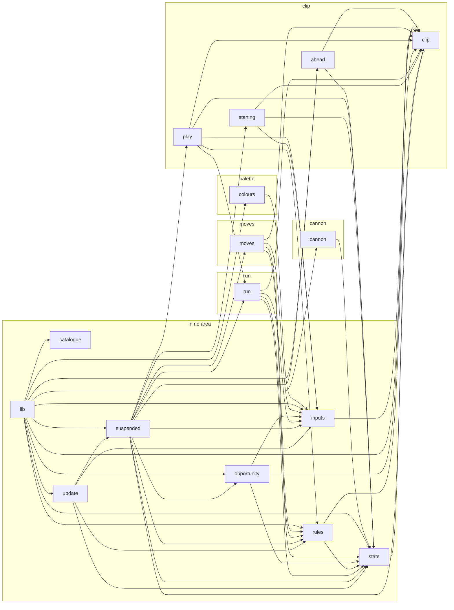

### boss-ceres-ridley

`crates/clean/boss_ceres_ridley`, 8 modules.

| Module | Area | Says it is | Items | Score | Lines |
| --- | --- | --- | --- | ---: | ---: |
| `catalogue.rs` | - | The catalogue: one behaviour for each entry of the spec, with its kind, its switch and how it is checked. | `enum BehaviourId (11)`, `struct Behaviour`, `fn catalogue`, `BehaviourId::behaviour` | 20 | 123 |
| `door.rs` | doors | A Ceres door: how a room places it, and its run each frame the enemies run. | `const BOX_RADIUS`, `enum DoorKind (2)`, `struct CeresDoor`, `struct Placement`, `struct OpeningSound`, `struct Run`, `DoorKind::becomes_wall`, `OpeningSound::QUEUE_LIMIT`, `CeresDoor::{place, run, figure, hitbox}`, 1 private | 522 | 130 |
| `figure.rs` | doors | The figures a door holds: which one each phase shows, for each way the door faces. | `enum FigureLook (5)`, `struct Figure`, `struct Figures`, `fn figures`, `Figures::for_door`, 4 private | 310 | 102 |
| `inputs.rs` | -; `fn she_is_near` in doors, `fn gap` in doors, `fn escape_shake` in station | What a door reads as the frame starts, and the two rules that read only it: whether she is near, and whether the door starts a shake. | `struct Inputs`, `Inputs::{she_is_near, escape_shake}`, 2 private | 116 | 31 |
| `lib.rs` | - | The boss-ceres-ridley model, part 1: the Ceres doors, built from its behaviour spec alone. | - | 0 | 14 |
| `phase.rs` | doors | A door's phase: where it stands in its cycle, with what each phase carries (its wait, and how far an opening or a closing has gone), and the tables of which phases are shown and solid. | `struct Wait`, `enum Quarter (4)`, `enum Phase (7)`, `Wait::{new, frames}`, `Quarter::next`, `Phase::{counted_down, shown, solid}`, 2 private | 272 | 97 |
| `rules.rs` | - | The doors' tuning values: every number a Parameter entry of the spec lists. | `struct Rules`, `impl Default for Rules`, 8 private | 47 | 37 |
| `station.rs` | station | The station around the doors: its stage, the doors' two colour sets and the shakes they start. | `enum Stage (3)`, `enum ColourSet (2)`, `struct Shake`, `Stage::{ridley_has_fled, door_colours}` | 14 | 32 |

Its crate root exports:

- from `catalogue`: `Behaviour`, `BehaviourId`, `catalogue`
- from `door`: `BOX_RADIUS`, `CeresDoor`, `DoorKind`, `OpeningSound`, `Placement`, `Run`
- from `figure`: `Figure`, `FigureLook`
- from `inputs`: `Inputs`
- from `phase`: `Phase`, `Quarter`, `Wait`
- from `rules`: `Rules`
- from `station`: `ColourSet`, `Shake`, `Stage`

The public functions a caller reaches through them:

```rust
BehaviourId::behaviour(self) -> Behaviour
catalogue() -> EnumMap<BehaviourId, Behaviour>
DoorKind::becomes_wall(self, stage: Stage) -> bool
CeresDoor::place(kind: DoorKind, facing: Side, position: Pair<Px>, stage: Stage) -> Placement
CeresDoor::run(self, inputs: &Inputs, rules: &Rules) -> Run
CeresDoor::figure(self) -> Option<Figure>
CeresDoor::hitbox(self) -> Hitbox
Inputs::she_is_near(&self, door: Pair<Px>, reach: u16) -> bool
Inputs::escape_shake(&self, rules: &Rules) -> Option<Shake>
Wait::new(frames: u16) -> Option<Self>
Wait::frames(self) -> u16
Quarter::next(self) -> Option<Self>
Phase::counted_down(mut self) -> Option<Self>
Phase::shown(self) -> bool
Phase::solid(self) -> bool
Stage::ridley_has_fled(self) -> bool
Stage::door_colours(self) -> ColourSet
```

Shared types it takes from `types`: `Checked`, `Hitbox`, `Kind`, `Pair`, `Px`, `Radius`, `Side`, `Switch`. Other crates it uses: `core`, `enum_map`.

Which module uses which, grouped by area (a module's own area, its functions counted elsewhere aside):

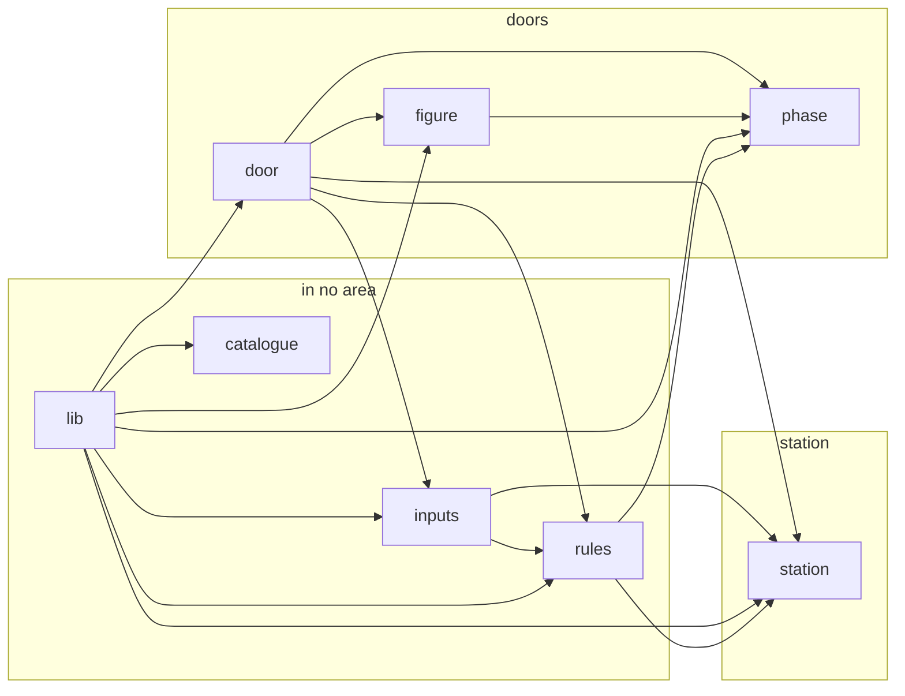

### world-doors

`crates/clean/world_doors`, 8 modules.

| Module | Area | Says it is | Items | Score | Lines |
| --- | --- | --- | --- | ---: | ---: |
| `catalogue.rs` | - | The catalogue: one behaviour for each entry of the spec, with its kind, its switch and how it is checked. | `enum BehaviourId (16)`, `struct Behaviour`, `const CATALOGUE`, `fn catalogue` | 17 | 164 |
| `colours.rs` | passage | The screen's colours as the passage reads and sets them: the dark colours it heads for, the fade's steps toward the colours headed for, and her visor's colour as she lands. | `const COLOURS`, `enum ColourGroup (5)`, `struct Palette`, `fn head_for_dark`, `fn light_visor`, `struct FadeTime`, `fn fade`, `FadeTime::{START, is_last, next}`, 5 private | 459 | 91 |
| `io.rs` | - | What a frame brings the doors and what the doors answer it. | `struct Scene`, `struct Inputs`, `enum Activity (6)`, `enum RoomCall (8)`, `enum RoomSound (3)`, `enum HerSound (2)`, `enum CostEvent (5)`, `enum Cost (3)`, `enum SlideScreen (2)`, `enum Finishing (3)`, `struct Report`, `struct Exports`, `Report::{play, of_passage}`, 1 private | 82 | 122 |
| `lib.rs` | - | The world-doors model, built from its behaviour spec alone: the passage through a door to a room, from the frame after she touches it until play goes on in the next room. | - | 0 | 17 |
| `passage.rs` | passage | The passage's state: what a caller holds from one frame to the next, saves and restores, and builds at any value the spec allows to start play part-way. | `enum Doors (2)`, `struct Passage`, `enum Phase (8)`, `enum Fetching (3)`, `const LAST_BEFORE_THE_SLIDE`, `const LAST_LANDING`, `struct WorkFrames`, `struct Arrival`, `Passage::START`, `WorkFrames::{FIRST, new, get, next}` | 47 | 69 |
| `rules.rs` | - | The tuning values the spec lists as parameters, with the spec's values as their default. | `enum Axis (2)`, `struct Rules`, `Axis::of`, `impl Default for Rules`, 6 private | 45 | 47 |
| `step.rs` | passage | The step: one frame of the doors, from the state a caller holds and what the frame brings to what the frame answers. | `Doors::step`, 18 private | 2,173 | 339 |
| `view.rs` | passage | Where the passage puts the view and her: the moves along the way she leaves, the squaring, the set-off, and where she is placed, lands and steps clear. | `fn toward`, `fn plus`, `fn pixels`, `fn at_pixels`, `fn squared`, `fn setting_off`, `fn place`, `fn settled`, `fn stepped_clear`, 11 private | 553 | 129 |

Its crate root exports:

- from `catalogue`: `Behaviour`, `BehaviourId`, `CATALOGUE`, `catalogue`
- from `colours`: `COLOURS`, `ColourGroup`, `FadeTime`, `Palette`
- from `io`: `Activity`, `Cost`, `CostEvent`, `Exports`, `Finishing`, `HerSound`, `Inputs`, `Report`, `RoomCall`, `RoomSound`, `Scene`, `SlideScreen`
- from `passage`: `Arrival`, `Doors`, `Fetching`, `LAST_BEFORE_THE_SLIDE`, `LAST_LANDING`, `Passage`, `Phase`, `WorkFrames`
- from `rules`: `Axis`, `Rules`

The public functions a caller reaches through them:

```rust
catalogue() -> EnumMap<BehaviourId, Behaviour>
FadeTime::is_last(self, steps: u8) -> bool
FadeTime::next(self, steps: u8) -> Option<Self>
Report::play() -> Self
WorkFrames::new(n: u8) -> Option<Self>
WorkFrames::get(self) -> u8
WorkFrames::next(self) -> Option<Self>
Axis::of(way: Heading) -> Self
Doors::step(self, scene: Scene, inputs: &Inputs, rules: &Rules) -> Exports
```

Shared types it takes from `types`: `Checked`, `Colour`, `Fixed`, `Heading`, `Kind`, `PIXEL`, `Pair`, `Parts`, `Position`, `Px`, `Set`, `Switch`, `ZERO`, `by_member`, `fixed`, `px`, `set_of`. Other crates it uses: `core`, `enum_map`.

Which module uses which, grouped by area (a module's own area, its functions counted elsewhere aside):

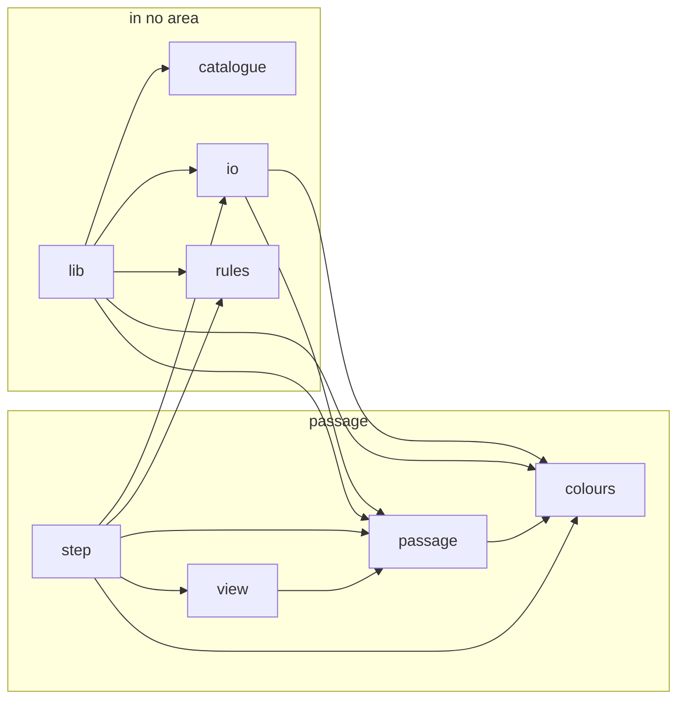

### samus-health

`crates/clean/samus_health`, 2 modules.

| Module | Area | Says it is | Items | Score | Lines |
| --- | --- | --- | --- | ---: | ---: |
| `catalogue.rs` | - | Spec entry metadata, separate from health decisions. | `enum BehaviourId (2)`, `struct Behaviour`, `fn behaviour`, `BehaviourId::ALL` | 8 | 37 |
| `lib.rs` | current-energy | Current energy and warning requests for already qualified health opportunities. | `const MAX_WHOLE_ENERGY`, `const REFERENCE_WARNING_THRESHOLD`, `struct WholeEnergy`, `struct EnergyAmount`, `struct EnergyLoss`, `enum Warning (2)`, `enum WarningSound (3)`, `struct State`, `struct Rules`, `WholeEnergy::{ZERO, new, get}`, `EnergyAmount::ZERO`, `EnergyLoss::ZERO`, `Rules::REFERENCE`, `State::health_opportunity`, `impl TryFrom<u16> for WholeEnergy`, `impl From<WholeEnergy> for u16`, 1 private | 270 | 116 |

Its crate root exports:

- from `catalogue`: `Behaviour`, `BehaviourId`, `behaviour`

The public functions a caller reaches through them:

```rust
behaviour(id: BehaviourId) -> Behaviour
WholeEnergy::new(value: u16) -> Option<Self>
WholeEnergy::get(self) -> u16
State::health_opportunity(&mut self, rules: &Rules) -> WarningSound
```

Shared types it takes from `types`: `Checked`, `Kind`, `Switch`. Other crates it uses: `serde`.

Which module uses which, grouped by area (a module's own area, its functions counted elsewhere aside):

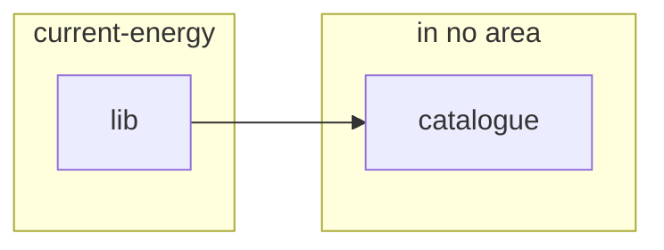

### game-time

`crates/clean/game_time`, 1 modules.

| Module | Area | Says it is | Items | Score | Lines |
| --- | --- | --- | --- | ---: | ---: |
| `lib.rs` | clock | The game-time model, built from its behaviour spec alone. | `struct QualifiedOpportunity`, `struct Clock`, `enum BehaviourId (1)`, `struct Behaviour`, `const BEHAVIOURS`, `Clock::{restore, time, set, advance}` | 298 | 60 |

Its crate root exports:

- from `types`: `PlayFrames`, `PlayHours`, `PlayMinutes`, `PlaySeconds`, `PlayTime`

The public functions a caller reaches through them:

```rust
Clock::restore(time: PlayTime) -> Self
Clock::time(&self) -> PlayTime
Clock::set(&mut self, time: PlayTime)
Clock::advance(&mut self, _opportunity: QualifiedOpportunity) -> PlayTime
```

Shared types it takes from `types`: `Checked`, `Kind`, `PlayFrames`, `PlayHours`, `PlayMinutes`, `PlaySeconds`, `PlayTime`, `Switch`. Other crates it uses: none.

Which module uses which, grouped by area (a module's own area, its functions counted elsewhere aside):

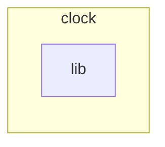

### world-quake

`crates/clean/world_quake`, 2 modules.

| Module | Area | Says it is | Items | Score | Lines |
| --- | --- | --- | --- | ---: | ---: |
| `catalogue.rs` | - | Behaviour metadata for the room quake model. | `enum BehaviourId (1)`, `enum Kind (1)`, `enum Switch (1)`, `enum Check (1)`, `struct Behaviour`, `const CATALOGUE`, `BehaviourId::as_str` | 13 | 43 |
| `lib.rs` | quiet-quake | Room quake state, quiet opportunities and Drawing's quiet displacement query. | `enum Opportunity (3)`, `enum UnsupportedReason (2)`, `struct QuietEffects`, `enum Outcome (3)`, `fn displacement`, `fn step` | 132 | 52 |

Its crate root exports:

- from `catalogue`: `Behaviour`, `BehaviourId`, `CATALOGUE`, `Check`, `Kind`, `Switch`
- from `types::quake`: `QuakeDuration`, `QuakePhase`, `State`

The public functions a caller reaches through them:

```rust
BehaviourId::as_str(self) -> &'static str
displacement(state: &State) -> Result<Pair<Fixed>, UnsupportedReason>
step(state: &mut State, opportunity: Opportunity) -> Outcome
```

Shared types it takes from `types`: `Fixed`, `Pair`, `ZERO`, `quake`. Other crates it uses: none.

Which module uses which, grouped by area (a module's own area, its functions counted elsewhere aside):

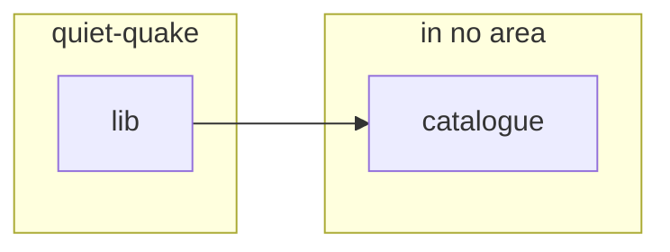

### game-random

`crates/clean/game_random`, 2 modules.

| Module | Area | Says it is | Items | Score | Lines |
| --- | --- | --- | --- | ---: | ---: |
| `catalogue.rs` | - | Catalogue of the shared sequence's specified behaviours. | `enum BehaviourId (1)`, `enum Kind (1)`, `enum Switch (1)`, `enum Check (1)`, `struct Behaviour`, `const CATALOGUE` | 0 | 35 |
| `lib.rs` | sequence | The numeric rules for the game's shared random sequence. | `fn advance_random`, 5 private | 130 | 23 |

Its crate root exports:

- from `catalogue`: `Behaviour`, `BehaviourId`, `CATALOGUE`, `Check`, `Kind`, `Switch`
- from `types`: `RandomNumber`, `RandomSequence`

The public functions a caller reaches through them:

```rust
advance_random(sequence: &mut RandomSequence) -> RandomNumber
```

Shared types it takes from `types`: `RandomNumber`, `RandomSequence`. Other crates it uses: none.

Which module uses which, grouped by area (a module's own area, its functions counted elsewhere aside):

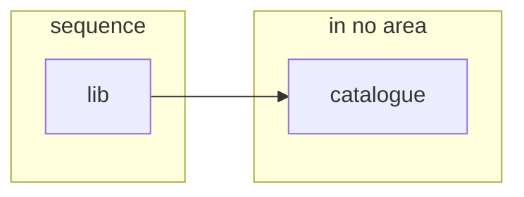

### world-haze

`crates/clean/world_haze`, 2 modules.

| Module | Area | Says it is | Items | Score | Lines |
| --- | --- | --- | --- | ---: | ---: |
| `catalogue.rs` | - | Catalogue of the ordinary Ceres haze rules. | `enum BehaviourId (3)`, `enum Kind (1)`, `enum Switch (1)`, `struct Behaviour`, `fn catalogue` | 9 | 49 |
| `lib.rs` | backdrop | The single-colour Ceres backdrop haze during ordinary room time. | `enum BandIntent (2)`, `enum ThirdBackground (1)`, `struct DisplayIntent`, `struct HazeStep`, `fn ordinary_opportunity`, 1 private | 187 | 60 |

Its crate root exports:

- from `catalogue`: `Behaviour`, `BehaviourId`, `Kind`, `Switch`, `catalogue`
- from `types::haze`: `HAZE_BAND_COUNT`, `HazeBands`, `HazeColour`, `HazeFade`, `HazeLevel`, `HazePeak`, `HazeState`

The public functions a caller reaches through them:

```rust
catalogue() -> EnumMap<BehaviourId, Behaviour>
ordinary_opportunity(mut state: HazeState) -> HazeStep
```

Shared types it takes from `types`: `Colour`, `haze`. Other crates it uses: `enum_map`.

Which module uses which, grouped by area (a module's own area, its functions counted elsewhere aside):


### Shared types by model

The public items of `crates/clean/types` the clean models share, and the models that name each.

| Item | Used by |
| --- | --- |
| `struct AudioInstant` | - |
| `struct InstantFraction` | - |
| `enum FractionError (2)` | - |
| `struct ExactCpuMasterTicks` | - |
| `type CpuMasterTicks` | - |
| `fn CpuMasterTicks` | - |
| `struct ExactAudioCycles` | - |
| `type AudioCycles` | - |
| `fn AudioCycles` | - |
| `struct ExtraHandlingWork` | - |
| `struct MusicTurns` | - |
| `struct EffectTurns` | - |
| `struct Loudness` | - |
| `struct TimbreId` | - |
| `enum PitchOffset (1)` | - |
| `enum EffectVoiceId (6)` | - |
| `enum VoiceId (3)` | - |
| `enum SoundGroup (3)` | - |
| `enum CueId (8)` | - |
| `enum Request (2)` | - |
| `enum CueAllowance (5)` | - |
| `enum OfferPermission (4)` | - |
| `enum SenderProgress (5)` | - |
| `struct SenderState` | - |
| `struct SenderCompletion` | - |
| `struct SenderResult` | - |
| `struct LoudnessRamp` | - |
| `enum TrackPosition (2)` | - |
| `struct Articulation` | - |
| `enum MusicEvent (13)` | - |
| `struct TrackContent` | - |
| `struct TrackState` | - |
| `struct SongMix` | - |
| `struct SongState` | - |
| `struct PitchMotion` | - |
| `struct EffectSpan` | - |
| `struct EffectPartContent` | - |
| `struct EffectClip` | - |
| `enum ReleaseMemory (2)` | - |
| `struct LivePart` | - |
| `enum PartState (2)` | - |
| `enum Playback (3)` | - |
| `type ReleaseHistory` | - |
| `struct GroupState` | - |
| `struct CadencePhase` | - |
| `struct AudioCyclePhase` | - |
| `struct PhaseOutOfRange` | - |
| `struct ClockState` | - |
| `struct ResidentMusicReply` | - |
| `enum Reply (2)` | - |
| `enum ReplyLine (2)` | - |
| `enum CompletionResult (2)` | - |
| `struct StableSample` | - |
| `enum Continuation (3)` | - |
| `enum AudioPhase (6)` | - |
| `struct State` | - |
| `struct Content` | - |
| `const HAZE_BAND_COUNT` | - |
| `enum HazeColour (3)` | - |
| `struct HazePeak` | - |
| `struct HazeLevel` | - |
| `struct HazeBands` | - |
| `enum HazeFade (2)` | - |
| `struct HazeState` | - |
| `mod haze` | world-haze |
| `mod quake` | world-quake |
| `enum FiringDirection (10)` | samus-movement |
| `type Fixed` | samus-appearance, samus-movement, world-camera, world-doors, world-quake |
| `type Px` | boss-ceres-ridley, samus-movement, world-camera, world-doors |
| `fn fixed` | samus-movement, world-camera, world-doors |
| `fn px` | samus-movement, world-camera, world-doors |
| `trait Parts` | samus-appearance, samus-movement, world-camera, world-doors |
| `const ZERO` | samus-movement, world-doors, world-quake |
| `const PIXEL` | world-camera, world-doors |
| `fn part_below` | samus-movement |
| `fn below` | world-camera |
| `struct Pair` | boss-ceres-ridley, interface-hud, samus-movement, world-blocks, world-camera, world-doors, world-quake |
| `type Position` | samus-appearance, samus-movement, world-camera, world-doors |
| `struct VerticalFraction` | world-camera |
| `struct PlacementY` | world-camera |
| `type Radius` | boss-ceres-ridley, samus-movement |
| `enum Heading (4)` | samus-movement, world-blocks, world-doors |
| `type Direction` | samus-movement |
| `struct TravelDistance` | samus-movement |
| `type DirectionalTravels` | samus-movement |
| `enum Side (2)` | boss-ceres-ridley, samus-movement |
| `enum Facing (3)` | samus-movement, world-camera |
| `enum Body (4)` | samus-appearance, samus-movement |
| `enum Action (16)` | samus-appearance, samus-movement |
| `enum Aim (5)` | samus-appearance, samus-movement |
| `enum Turn (4)` | samus-appearance, samus-movement |
| `enum LandedFrom (2)` | samus-appearance, samus-movement |
| `enum Gun (2)` | samus-movement |
| `enum Legs (2)` | samus-movement |
| `struct Pose` | samus-appearance, samus-movement |
| `enum Sprite (4)` | samus-appearance, samus-movement |
| `enum ClipEnd (2)` | samus-appearance, samus-movement |
| `enum BoostStage (5)` | samus-appearance |
| `enum Bounces (3)` | samus-movement |
| `struct VerticalSpeed` | samus-movement |
| `enum FloorResponseKind (7)` | samus-movement |
| `struct FloorResponse` | samus-movement |
| `enum SoundIdentity (4)` | samus-movement |
| `enum SoundLibrary (2)` | samus-movement |
| `struct QueueAllowance` | samus-movement |
| `struct SoundRequest` | samus-movement |
| `enum VerticalMotionAtTest (2)` | samus-movement |
| `enum CollisionPurpose (8)` | samus-movement |
| `struct CollisionTest` | samus-movement |
| `type CollisionTests` | samus-movement |
| `struct CandidateCount` | samus-movement |
| `struct CandidateIndex` | samus-movement |
| `struct ClearanceRoom` | samus-movement |
| `struct PixelGap` | samus-movement |
| `struct PlacementDistance` | samus-movement |
| `enum CandidateResult (4)` | samus-movement |
| `struct EnemyCandidate` | samus-movement |
| `struct EnemySearch` | samus-movement |
| `enum RequestedWorld (3)` | samus-movement |
| `enum MotionResult (3)` | samus-movement |
| `enum RequestEffect (2)` | samus-movement |
| `struct MotionAttempt` | samus-movement |
| `enum MotionSkipReason (1)` | samus-movement |
| `enum SupportSurface (2)` | samus-movement |
| `enum SupportResult (4)` | samus-movement |
| `struct SupportCheck` | samus-movement |
| `enum BodyFitResult (5)` | samus-movement |
| `struct BodyFitConsideration` | samus-movement |
| `enum MovementWork (3)` | samus-movement |
| `enum AnimationSound (4)` | samus-appearance |
| `struct Buttons` | samus-movement |
| `mod button` (RUN, JUMP, SHOOT, LEFT, RIGHT, UP, DOWN, AIM_UP, AIM_DOWN, SIDES, PAD) | samus-movement |
| `type Cell` | samus-movement, world-blocks |
| `enum Way (2)` | samus-movement, world-blocks |
| `struct Touch` | samus-movement |
| `enum Block (6)` | samus-movement |
| `enum Parity (2)` | samus-movement |
| `enum SlopeFaces (2)` | samus-movement |
| `struct SlopeFactor` | - |
| `struct Slope` | samus-movement |
| `struct Hitbox` | boss-ceres-ridley, samus-movement |
| `trait World` | samus-movement |
| `enum Kind (5)` | audio-transport, boss-ceres-ridley, game-time, interface-hud, run-progress, samus-appearance, samus-health, samus-movement, weapons-projectiles, world-blocks, world-camera, world-doors |
| `enum Switch (3)` | audio-transport, boss-ceres-ridley, game-time, interface-hud, run-progress, samus-appearance, samus-health, samus-movement, weapons-projectiles, world-blocks, world-camera, world-doors |
| `enum Checked (2)` | boss-ceres-ridley, game-time, interface-hud, run-progress, samus-appearance, samus-health, samus-movement, weapons-projectiles, world-blocks, world-camera, world-doors |
| `type Set` | run-progress, samus-appearance, samus-movement, world-blocks, world-doors |
| `fn set_of` | world-doors |
| `trait Members` | run-progress |
| `fn by_member` | world-blocks, world-doors |
| `enum Area (7)` | run-progress |
| `enum Item (11)` | run-progress, samus-appearance, samus-movement |
| `enum Beam (5)` | run-progress |
| `enum Event (18)` | run-progress |
| `enum BossKind (3)` | run-progress |
| `struct LocationId` | run-progress |
| `struct DoorId` | run-progress |
| `struct StationId` | run-progress |
| `struct Entrance` | run-progress |
| `const LAST_PICTURE` | - |
| `struct Picture` | interface-hud, world-blocks |
| `enum Flip (4)` | interface-hud |
| `struct Look` | interface-hud, world-blocks |
| `enum ScreenKind (3)` | world-blocks, world-camera |
| `type Screen` | interface-hud, world-blocks |
| `enum Point (3)` | world-blocks |
| `enum HitBy (6)` | world-blocks |
| `enum Motion (3)` | world-blocks |
| `enum Family (6)` | world-blocks |
| `enum MetAs (3)` | world-blocks |
| `enum Script (3)` | world-blocks |
| `mod audio` | audio-transport |
| `mod pitch` | - |
| `struct Colour` | world-doors, world-haze |
| `const PALETTE_SLOTS` | samus-appearance |
| `struct Palette` | samus-appearance |
| `struct Palettes` | samus-appearance |
| `struct MusicalPitch` | - |
| `struct EffectPitch` | - |
| `struct PlayTime` | game-time |
| `struct QuakePhase` | - |
| `struct QuakeDuration` | - |
| `struct RoomQuakeState` | - |
| `struct RandomNumber` | game-random |
| `struct RandomSequence` | game-random |

### Bridges

The engine files (`crates/game/src`) that name each model's crate: its bridge, which the registry names, and the others. Names are what each takes from the model.

| Model | Engine file | Part | Names | Score | Lines |
| --- | --- | --- | --- | ---: | ---: |
| audio-transport | `crates/game/src/production/appearance.rs` | names it | `CueId`, `OfferPermission`, `QueueAllowance`, `SenderState`, `SoundGroup` | 1,611 | 298 |
| audio-transport | `crates/game/src/production/content.rs` | names it | `Content`, `SoundGroup` | 285 | 94 |
| audio-transport | `crates/game/src/production/frame/post_down_contract.rs` | names it | `OfferPermission` | 316 | 70 |
| audio-transport | `crates/game/src/production/frame/sender_caller.rs` | names it | `CueId`, `OfferPermission`, `SoundGroup`, `sender` | 1,609 | 276 |
| audio-transport | `crates/game/src/production/frame/sender_contract.rs` | names it | `CueId`, `OfferPermission`, `Request`, `SenderProgress`, `SenderState`, `SoundGroup` | 2,075 | 328 |
| audio-transport | `crates/game/src/production/frame/sender_stage.rs` | names it | `CpuMasterTicks`, `CueId`, `ExactCpuMasterTicks`, `OfferPermission`, `Request`, `SenderCompletion`, `SenderProgress`, `SenderState`, `SoundGroup`, `effects`, `sender` | 2,700 | 339 |
| audio-transport | `crates/game/src/production/frame/state.rs` | names it | `SenderState`, `SoundGroup`, `sender` | 1,579 | 321 |
| audio-transport | `crates/game/src/production/sender.rs` | names it | `CpuMasterTicks`, `CueId`, `ExactCpuMasterTicks`, `OfferPermission`, `QueueAllowance`, `Request`, `SenderProgress`, `SenderState`, `SoundGroup`, `effects`, `sender` | 780 | 115 |
| audio-transport | `crates/game/src/production.rs` | names it | `AudioInstant`, `SenderState`, `State`, `sender`, `transport` | 2,456 | 515 |
| audio-transport | `crates/game/src/state/owned.rs` | names it | `SenderState`, `State` | 0 | 66 |
| enemy-interactions | `crates/game/src/enemy_interactions_bridge.rs` | bridge | - | 234 | 39 |
| enemy-interactions | `crates/game/src/production/weapons.rs` | names it | `ContactConditions`, `DoorContact` | 1,714 | 257 |
| weapons-projectiles | `crates/game/src/production/content.rs` | names it | `Rules` | 285 | 94 |
| weapons-projectiles | `crates/game/src/production.rs` | names it | `State`, `UpdateInput` | 2,456 | 515 |
| weapons-projectiles | `crates/game/src/state/owned.rs` | names it | `State` | 0 | 66 |
| weapons-projectiles | `crates/game/src/weapons_projectiles_bridge.rs` | bridge | - | 1,409 | 226 |
| samus-movement | `crates/game/src/production/camera_semantic.rs` | names it | `Samus` | 309 | 75 |
| samus-movement | `crates/game/src/production/connected/appearance.rs` | names it | `Dashing`, `Samus`, `WallTest`, `suspended` | 1,037 | 179 |
| samus-movement | `crates/game/src/production/connected/transition.rs` | names it | `StandingAnimation`, `WallTest` | 1,798 | 216 |
| samus-movement | `crates/game/src/production/connected.rs` | names it | `Frame`, `Outcome`, `Rules`, `Samus`, `suspended` | 2,346 | 395 |
| samus-movement | `crates/game/src/production/content.rs` | names it | `Rules` | 285 | 94 |
| samus-movement | `crates/game/src/production/frame/animation_caller.rs` | names it | `Dashing`, `Outcome`, `StandingAnimation`, `WallTest` | 2,212 | 289 |
| samus-movement | `crates/game/src/production/frame/borrowed_player_preparation/actor_tests.rs` | names it | `Bounces`, `Carry`, `Dashing`, `Frame`, `JumpHeld`, `Phase`, `Rules`, `Run`, `Samus`, `Seat`, `Spin`, `Vertical` | 2,767 | 451 |
| samus-movement | `crates/game/src/production/frame/borrowed_player_preparation.rs` | names it | `Samus`, `suspended` | 2,428 | 843 |
| samus-movement | `crates/game/src/production/frame/caller.rs` | names it | `Rules` | 18,457 | 2,503 |
| samus-movement | `crates/game/src/production/frame/camera_stage/contract.rs` | names it | `Carry` | 620 | 104 |
| samus-movement | `crates/game/src/production/frame/inputs.rs` | names it | `Frame` | 215 | 99 |
| samus-movement | `crates/game/src/production/frame/inside_contract.rs` | names it | `suspended` | 2,024 | 288 |
| samus-movement | `crates/game/src/production/frame/inside_world.rs` | names it | `Frame`, `Rules`, `suspended` | 1,462 | 266 |
| samus-movement | `crates/game/src/production/frame/interruption_caller.rs` | names it | `suspended` | 1,017 | 176 |
| samus-movement | `crates/game/src/production/frame/late_movement.rs` | names it | `Rules`, `suspended` | 4,053 | 442 |
| samus-movement | `crates/game/src/production/frame/motion_reset_contract.rs` | names it | `suspended` | 570 | 107 |
| samus-movement | `crates/game/src/production/frame/movement_caller.rs` | names it | `Carry`, `Dashing`, `Rules`, `Samus`, `SpeedCap`, `suspended` | 4,582 | 659 |
| samus-movement | `crates/game/src/production/frame/movement_down_contract.rs` | names it | `Rules`, `Samus`, `Seat`, `suspended` | 5,600 | 676 |
| samus-movement | `crates/game/src/production/frame/movement_ground_contract.rs` | names it | `Rules`, `Samus`, `Seat`, `Spin`, `suspended` | 3,404 | 343 |
| samus-movement | `crates/game/src/production/frame/movement_pair_contract.rs` | names it | `Rules`, `suspended` | 5,123 | 565 |
| samus-movement | `crates/game/src/production/frame/movement_stage.rs` | names it | `Frame`, `Rules`, `suspended` | 1,615 | 223 |
| samus-movement | `crates/game/src/production/frame/movement_support_contract.rs` | names it | `Rules`, `suspended` | 5,369 | 571 |
| samus-movement | `crates/game/src/production/frame/player_continuation_caller.rs` | names it | `suspended` | 4,679 | 602 |
| samus-movement | `crates/game/src/production/frame/pose_fit_caller.rs` | names it | `suspended` | 2,130 | 249 |
| samus-movement | `crates/game/src/production/frame/pose_input.rs` | names it | `Moment` | 715 | 167 |
| samus-movement | `crates/game/src/production/frame/run_caller.rs` | names it | `suspended` | 1,871 | 199 |
| samus-movement | `crates/game/src/production/movement.rs` | names it | `Frame`, `Outcome`, `Rules`, `Samus` | 305 | 52 |
| samus-movement | `crates/game/src/production/movement_ceres.rs` | names it | `Frame`, `Outcome`, `Rules` | 167 | 43 |
| samus-movement | `crates/game/src/production/movement_work.rs` | names it | `Frame`, `Outcome`, `Rules`, `Samus`, `suspended` | 938 | 172 |
| samus-movement | `crates/game/src/production.rs` | names it | `Frame`, `Outcome`, `Samus`, `UnknownPose` | 2,456 | 515 |
| samus-movement | `crates/game/src/state/owned.rs` | names it | `Samus` | 0 | 66 |
| world-camera | `crates/game/src/production/camera_semantic.rs` | names it | `Camera`, `Frame`, `Heights`, `LeadSetting`, `Room`, `Rules`, `Samus` | 309 | 75 |
| world-camera | `crates/game/src/production/connected.rs` | names it | `Camera` | 2,346 | 395 |
| world-camera | `crates/game/src/production/frame/camera_stage.rs` | names it | `Frame`, `Heights`, `LeadSetting`, `Leads`, `Room`, `RoomError`, `Rules`, `Samus` | 1,433 | 308 |
| world-camera | `crates/game/src/production/immutable.rs` | names it | `Rules` | 171 | 58 |
| world-camera | `crates/game/src/production.rs` | names it | `Camera`, `Frame` | 2,456 | 515 |
| world-camera | `crates/game/src/state/owned.rs` | names it | `Camera` | 0 | 66 |
| run-progress | `crates/game/src/production/content.rs` | names it | `Rules` | 285 | 94 |
| run-progress | `crates/game/src/production.rs` | names it | `Progress`, `Report` | 2,456 | 515 |
| run-progress | `crates/game/src/state/owned.rs` | names it | `Progress` | 0 | 66 |
| interface-hud | `crates/game/src/production/appearance/cannon_tests.rs` | names it | `Ammo`, `Ammunition`, `CancelButton`, `ControlAnswer`, `Equipped`, `HudEvent`, `ItemControlInputs`, `SelectButton`, `SelectableItem`, `Selection` | 832 | 85 |
| interface-hud | `crates/game/src/production/appearance.rs` | names it | `ControlAnswer`, `Selection` | 1,611 | 298 |
| interface-hud | `crates/game/src/production/content.rs` | names it | `HudPictures` | 285 | 94 |
| interface-hud | `crates/game/src/production/entries.rs` | names it | `Boss`, `FrameInputs`, `HudEvent`, `HudPictures`, `HudState`, `OutOfPlayInputs`, `Place`, `Rules` | 970 | 201 |
| interface-hud | `crates/game/src/production/frame/borrowed_player_preparation/actor_tests.rs` | names it | `Countdown`, `HudPictures`, `ItemControlInputs` | 2,767 | 451 |
| interface-hud | `crates/game/src/production/frame/borrowed_player_preparation.rs` | names it | `Selection` | 2,428 | 843 |
| interface-hud | `crates/game/src/production/frame/caller.rs` | names it | `CancelButton`, `HudPictures`, `Observation`, `SelectButton`, `Selection` | 18,457 | 2,503 |
| interface-hud | `crates/game/src/production/frame/countdown_caller.rs` | bridge | `CountdownAnswer`, `CountdownOpportunity`, `Observation` | 943 | 175 |
| interface-hud | `crates/game/src/production/frame/drawing_owners.rs` | names it | `Observation` | 1,150 | 256 |
| interface-hud | `crates/game/src/production/frame/drawing_scalar_owners.rs` | names it | `Observation` | 224 | 55 |
| interface-hud | `crates/game/src/production/frame/early_hud_caller.rs` | names it | `CancelButton`, `FrameCount`, `Observation`, `SelectButton`, `Selection` | 1,958 | 202 |
| interface-hud | `crates/game/src/production/frame/hud.rs` | bridge | `ControlAnswer`, `CountdownAnswer`, `CountdownOpportunity`, `CountdownWork`, `DisplayAnswer`, `DisplayInputs`, `Flip`, `FrameCount`, `HudEvent`, `HudOpportunity`, `HudPictures`, `HudState`, `HudWork`, `ItemControlInputs`, `MovementInputs`, `Observation`, `Place`, `Rules`, `StatusInputs` | 1,720 | 272 |
| interface-hud | `crates/game/src/production/frame/hud_camera_caller.rs` | names it | `HudOpportunity`, `HudPictures`, `MiniMapPower`, `MovementInputs`, `Observation`, `Rules`, `Selection` | 1,097 | 191 |
| interface-hud | `crates/game/src/production/frame/hud_controls_inputs.rs` | names it | `Ammo`, `Ammunition`, `CancelButton`, `Equipped`, `ItemControlInputs`, `SelectButton`, `Stock` | 429 | 116 |
| interface-hud | `crates/game/src/production/frame/hud_controls_owner.rs` | names it | `CancelButton`, `Observation`, `SelectButton`, `Selection` | 286 | 45 |
| interface-hud | `crates/game/src/production/frame/hud_map_caller.rs` | bridge | - | 2,493 | 334 |
| interface-hud | `crates/game/src/production/frame/hud_stage/controls_tests.rs` | names it | `Ammunition`, `CancelButton`, `Countdown`, `Equipped`, `HudGrid`, `HudState`, `MapCellSet`, `SelectButton`, `SelectableItem`, `Shown`, `Stock` | 878 | 96 |
| interface-hud | `crates/game/src/production/frame/hud_stage.rs` | names it | `ControlAnswer`, `DisplayInputs`, `Dropped`, `FrameCount`, `HerMap`, `HudEvent`, `HudOpportunity`, `HudPictures`, `ItemControlInputs`, `MiniMapPower`, `Mute`, `Observation`, `Room`, `Rules`, `SelectableItem`, `Selection`, `Status` | 906 | 239 |
| interface-hud | `crates/game/src/production/frame/late_hud.rs` | bridge | - | 1,348 | 188 |
| interface-hud | `crates/game/src/production/frame/motion_reset_contract.rs` | names it | `CancelButton`, `Observation`, `SelectButton`, `Selection` | 570 | 107 |
| interface-hud | `crates/game/src/production/frame/player_continuation_caller.rs` | names it | `Observation` | 4,679 | 602 |
| interface-hud | `crates/game/src/production/frame/s6_drawing.rs` | names it | `Selection` | 2,321 | 276 |
| interface-hud | `crates/game/src/production/immutable.rs` | names it | `Rules` | 171 | 58 |
| interface-hud | `crates/game/src/production.rs` | names it | `HudEvent`, `HudState` | 2,456 | 515 |
| interface-hud | `crates/game/src/state/owned.rs` | names it | `HudState` | 0 | 66 |
| world-blocks | `crates/game/src/production/entries.rs` | names it | `Placement`, `Report`, `Request`, `Rules`, `Run`, `State` | 970 | 201 |
| world-blocks | `crates/game/src/production/immutable.rs` | names it | `Rules` | 171 | 58 |
| world-blocks | `crates/game/src/production.rs` | names it | `OutsideTheRoom`, `State` | 2,456 | 515 |
| world-blocks | `crates/game/src/state/owned.rs` | names it | `State` | 0 | 66 |
| samus-appearance | `crates/game/src/production/animation.rs` | names it | `AnimationInputs`, `Clip`, `Content`, `Figure`, `Inputs`, `Paces`, `Rules`, `State`, `update` | 446 | 105 |
| samus-appearance | `crates/game/src/production/appearance/cannon_tests.rs` | names it | `CannonDelay` | 832 | 85 |
| samus-appearance | `crates/game/src/production/appearance.rs` | names it | `Ahead`, `CannonDelay`, `CannonObservation`, `Clip`, `ControlEligibility`, `GraphicalContact`, `ItemControlAnswer`, `OfferedDecision`, `PublishedSound`, `SelectedItem`, `SoundRequest`, `State`, `SuspendedAppearance`, `WorkStep` | 1,611 | 298 |
| samus-appearance | `crates/game/src/production/connected/appearance.rs` | names it | `Ahead`, `AnimationDecision`, `AnimationInputs`, `AppearanceRead`, `Dash`, `Figure`, `Inputs`, `MoveEvent`, `SuspendedAppearance`, `WorkStep` | 1,037 | 179 |
| samus-appearance | `crates/game/src/production/connected/inputs.rs` | names it | `CinematicActivity`, `ContactSuppressor`, `Liquid`, `SoundsWaiting` | 0 | 49 |
| samus-appearance | `crates/game/src/production/connected.rs` | names it | `Ahead`, `AnimationDecision`, `AnimationInputs`, `CinematicActivity`, `Figure`, `GraphicalContact`, `Liquid`, `PublishedSound`, `Receipt`, `Rules`, `State`, `SuspendedAppearance`, `WorkStep` | 2,346 | 395 |
| samus-appearance | `crates/game/src/production/content.rs` | names it | `Rules` | 285 | 94 |
| samus-appearance | `crates/game/src/production/frame/animation_caller.rs` | names it | `Dash`, `Figure`, `Inputs`, `Liquid`, `MoveEvent`, `SoundsWaiting` | 2,212 | 289 |
| samus-appearance | `crates/game/src/production/frame/appearance_caller.rs` | names it | `Ahead`, `AnimationDecision`, `Answer`, `AppearanceRead`, `CinematicActivity`, `ContactSuppressor`, `Dash`, `Figure`, `Frames`, `Inputs`, `Instruction`, `Liquid`, `PublishedSound`, `Receipt`, `Rules`, `Step`, `WorkStep` | 5,045 | 708 |
| samus-appearance | `crates/game/src/production/frame/appearance_stage.rs` | names it | `AnimationDecision`, `AnimationInputs`, `AppearanceRead`, `CinematicActivity`, `ContactSuppressor`, `Figure`, `OfferedDecision`, `WorkStep` | 902 | 115 |
| samus-appearance | `crates/game/src/production/frame/caller.rs` | names it | `Rules` | 18,457 | 2,503 |
| samus-appearance | `crates/game/src/production/frame/contact_contract.rs` | names it | `AppearanceRead`, `ContactSuppressor`, `Frames`, `GraphicalContact`, `PublishedSound`, `Receipt`, `SoundRequest`, `WorkStep` | 1,040 | 205 |
| samus-appearance | `crates/game/src/production/frame/drawing_owners.rs` | names it | `CannonDelay` | 1,150 | 256 |
| samus-appearance | `crates/game/src/production/frame/inputs.rs` | names it | `Ahead`, `Figure` | 215 | 99 |
| samus-appearance | `crates/game/src/production/frame/liquid_history.rs` | names it | `Liquid` | 954 | 186 |
| samus-appearance | `crates/game/src/production/frame/movement_caller.rs` | names it | `Figure` | 4,582 | 659 |
| samus-appearance | `crates/game/src/production/frame/pose_fit_caller.rs` | names it | `CinematicActivity` | 2,130 | 249 |
| samus-appearance | `crates/game/src/production/frame/post_down_caller.rs` | names it | `PublishedSound`, `Receipt`, `SoundQueue`, `SoundRequest` | 4,685 | 639 |
| samus-appearance | `crates/game/src/production/frame/rendering_stage.rs` | names it | `AppearanceRead`, `Figure`, `Receipt`, `Step`, `WorkStep` | 3,142 | 484 |
| samus-appearance | `crates/game/src/production/frame/samus_palette.rs` | bridge | `ColourEffect`, `ColourSequences`, `GrappleActivity`, `LapsLeft`, `Liquid`, `RoomColours`, `RunColourFacts`, `RunColourWork`, `Suit` | 1,379 | 258 |
| samus-appearance | `crates/game/src/production/frame/state.rs` | names it | `Ahead`, `AppearanceRead`, `Clip`, `Figure` | 1,579 | 321 |
| samus-appearance | `crates/game/src/production/frame/suffix_caller.rs` | names it | `Figure`, `Step` | 7,820 | 1,192 |
| samus-appearance | `crates/game/src/production/movement_work.rs` | names it | `Figure` | 938 | 172 |
| samus-appearance | `crates/game/src/production.rs` | names it | `Inputs`, `PublishedSound`, `State` | 2,456 | 515 |
| samus-appearance | `crates/game/src/samus_appearance_bridge/import.rs` | bridge | `Branch`, `Clip`, `Content`, `Control`, `Figure`, `Hold`, `Instruction`, `Pace`, `Paces`, `Step` | 1,683 | 270 |
| samus-appearance | `crates/game/src/samus_appearance_bridge.rs` | bridge | - | 0 | 2 |
| samus-appearance | `crates/game/src/state/owned.rs` | names it | `State` | 0 | 66 |
| boss-ceres-ridley | `crates/game/src/production/content.rs` | names it | `Rules` | 285 | 94 |
| boss-ceres-ridley | `crates/game/src/production/entries.rs` | names it | `CeresDoor`, `Inputs`, `Rules`, `Run` | 970 | 201 |
| boss-ceres-ridley | `crates/game/src/production/frame/actor_doors.rs` | bridge | `CeresDoor`, `DoorKind`, `Inputs`, `Phase`, `Rules`, `Stage`, `Wait` | 1,706 | 310 |
| boss-ceres-ridley | `crates/game/src/production/movement_ceres.rs` | names it | `CeresDoor`, `Inputs`, `Rules`, `Run`, `Stage` | 167 | 43 |
| boss-ceres-ridley | `crates/game/src/production.rs` | names it | `CeresDoor`, `Inputs`, `Run` | 2,456 | 515 |
| boss-ceres-ridley | `crates/game/src/state/owned.rs` | names it | `CeresDoor` | 0 | 66 |
| world-doors | `crates/game/src/production/content.rs` | names it | `Rules` | 285 | 94 |
| world-doors | `crates/game/src/production/entries.rs` | names it | `Doors`, `Scene` | 970 | 201 |
| world-doors | `crates/game/src/production.rs` | names it | `Exports`, `Inputs` | 2,456 | 515 |
| samus-health | `crates/game/src/production/frame/health.rs` | bridge | `State` | 1,311 | 300 |
| samus-health | `crates/game/src/production/frame/maintenance.rs` | bridge | `Rules`, `WarningSound` | 1,102 | 193 |
| game-time | `crates/game/src/production/frame/play_time.rs` | bridge | `Clock`, `PlayFrames`, `PlayTime`, `QualifiedOpportunity` | 698 | 142 |
| world-quake | `crates/game/src/production/frame/drawing_owners.rs` | names it | `displacement` | 1,150 | 256 |
| world-quake | `crates/game/src/production/frame/room_quake.rs` | bridge | `Opportunity`, `Outcome`, `State`, `step` | 586 | 131 |
| game-random | `crates/game/src/production/frame/random.rs` | bridge | `RandomNumber`, `RandomSequence`, `advance_random` | 879 | 185 |
| world-haze | `crates/game/src/production/frame/haze.rs` | bridge | `BandIntent`, `BehaviourId`, `HazeColour`, `HazeState`, `ThirdBackground`, `ordinary_opportunity` | 653 | 176 |
