# Rebuild report

Generated by `cargo run -p tools --bin tools -- report --write` (`verify::report`) from this commit's tree; never edit it by hand.
`tools/check_report.sh` fails when it differs from what the tree generates.

How it is counted:

- **Score** is `tools size` (`verify::size`): weighted logic tokens, with the depth (Q1) and
  duplication parts it includes; **logic**, **types** and **data** are token counts, the last two
  not held against the budget. **Clumps** (Q2) is a diagnostic, not part of the score. Scores
  are rounded to whole tokens.
- **Model** is the files a domain owns, `crates/clean/<crate>`, its name with underscores for dashes; its score, fit and lines
  count those alone. `crates/clean/types` is a row of its own, **shared types**, with the domains
  whose model depends on it, and is counted once in the total.
- **Budget** and **units** are `tools spec-units` (`verify::spec_units`) on the domain's spec and
  vectors, k and the areas from the Budget section of its decode notes, which the implementer
  never sees (MODEL §1 decision 10). **Fit** is score ÷ budget; the total's score includes the
  shared types. An area's model score is the model files the registry
  (`verify::report::DOMAINS`) assigns it, less the functions it counts apart, plus the functions
  it assigns the area: a file that holds more than one area's code has a row per function counted
  apart (`fn` and its name), measured with the rest of the model. Files in no area are the
  domain's shared code and count in its total only. **Area fit** is the areas' score ÷ the
  budget, the shared code left out; **shared** is the shared code's share of the model's score,
  flagged when it is over 25 %, since no spec unit pays for it. The total's shared code
  includes the shared types.
- **Old code** is the Budget section's figure for the whole domain where it gives one, else the
  sum of its area `old` figures, at the commit its
  baseline or budget paragraph names last.
- **Lines** are code lines: non-blank, non-comment, tests excluded (`tests` directories,
  `tests.rs` files and `#[cfg(test)]` items). A file holds **tables and types** when its type
  and data tokens outnumber its logic tokens, else **logic**. **Logic-equivalent lines** are
  score ÷ 6: the old engine's density, about 5.5 to 7 weighted tokens per line,
  measured on samus-movement's old code at `c7f927ab6` and the camera's at `cfa5b8144`.

## Summary

| Domain | Model score | Budget | Fit | Area fit | Shared | Old code | Model lines | Logic-equivalent lines | Harness frames | Vectors |
| --- | ---: | ---: | ---: | ---: | ---: | ---: | ---: | ---: | ---: | ---: |
| weapons-projectiles | 4,035 | 2,062 | 1.96 | 1.94 | 1 % | 2,605 | 1,081 | 673 | 22,290 | 81 |
| samus-movement | 9,400 | 8,987 | 1.05 | 1.01 | 3 % | 12,724 | 4,084 | 1,567 | 20,856 | 345 |
| world-camera | 1,839 | 1,762 | 1.04 | 0.93 | 11 % | 2,274 | 631 | 306 | 23,501 | 83 |
| run-progress | 819 | 1,061 | 0.77 | 0.72 | 6 % | - | 437 | 136 | 40,442 | 76 |
| interface-hud | 2,700 | 2,337 | 1.16 | 0.82 | 29 % (over 25 %) | 2,742 | 1,087 | 450 | 26,821 | 95 |
| world-blocks | 2,395 | 2,074 | 1.15 | 1.09 | 5 % | - | 1,076 | 399 | 23,517 | 100 |
| samus-appearance | 2,191 | 1,412 | 1.55 | 1.41 | 9 % | 1,525 | 879 | 365 | 20,977 | 98 |
| boss-ceres-ridley | 1,299 | 1,150 | 1.13 | 1.07 | 5 % | - | 566 | 216 | 5,437 | 56 |
| world-doors | 3,374 | 2,912 | 1.16 | 1.11 | 4 % | - | 978 | 562 | 1,863 | 70 |
| shared types (`crates/clean/types`, used by weapons-projectiles, samus-movement, world-camera, run-progress, interface-hud, world-blocks, samus-appearance, boss-ceres-ridley, world-doors) | 751 | - | - | - | - | - | 552 | 125 | - | - |
| total | 28,801 | 23,757 | 1.21 | 1.10 | 9 % | - | 11,371 | 4,800 | 185,704 | 1,004 |

## Models

### weapons-projectiles

| File | Area | Holds | Score | Logic | Types | Data | Depth | Duplication | Clumps | Lines |
| --- | --- | --- | ---: | ---: | ---: | ---: | ---: | ---: | ---: | ---: |
| `crates/clean/weapons_projectiles/src/catalogue.rs` | - | tables and types | 36 | 80 | 86 | 264 | 0 | 0 | 12 | 53 |
| `crates/clean/weapons_projectiles/src/domain.rs` | shots | tables and types | 376 | 556 | 1,385 | 148 | 8 | 28 | 0 | 365 |
| `crates/clean/weapons_projectiles/src/lib.rs` | shots | logic | 3,624 | 3,630 | 301 | 41 | 129 | 262 | 123 | 663 |
| total | | | 4,035 | 4,266 | 1,772 | 453 | 136 | 290 | 135 | 1,081 |

### samus-movement

| File | Area | Holds | Score | Logic | Types | Data | Depth | Duplication | Clumps | Lines |
| --- | --- | --- | ---: | ---: | ---: | ---: | ---: | ---: | ---: | ---: |
| `crates/clean/samus_movement/src/catalogue.rs` | - | tables and types | 0 | 13 | 128 | 931 | 0 | 0 | 0 | 254 |
| `crates/clean/samus_movement/src/change.rs` | pose fit | logic | 77 | 185 | 0 | 0 | 0 | 0 | 0 | 26 |
| `crates/clean/samus_movement/src/change.rs` `fn change_pose` | pose chart | logic | 296 | 295 | 0 | 0 | 23 | 0 | 0 | 34 |
| `crates/clean/samus_movement/src/change.rs` `fn apply` | motion | logic | 251 | 253 | 0 | 0 | 8 | 0 | 1 | 24 |
| `crates/clean/samus_movement/src/chart/table.rs` | pose chart | tables and types | 0 | 65 | 28 | 1,298 | 0 | 0 | 0 | 289 |
| `crates/clean/samus_movement/src/chart.rs` | pose chart | logic | 958 | 1,071 | 135 | 0 | 44 | 17 | 0 | 150 |
| `crates/clean/samus_movement/src/collide.rs` | collision | logic | 2,317 | 2,374 | 191 | 23 | 150 | 77 | 1 | 306 |
| `crates/clean/samus_movement/src/fit.rs` | pose fit | logic | 562 | 634 | 46 | 0 | 39 | 0 | 0 | 92 |
| `crates/clean/samus_movement/src/jump_held.rs` | motion | logic | 227 | 325 | 55 | 14 | 8 | 0 | 0 | 59 |
| `crates/clean/samus_movement/src/lib.rs` | - | logic | 0 | 141 | 0 | 0 | 0 | 0 | 0 | 25 |
| `crates/clean/samus_movement/src/moves.rs` | motion | logic | 1,117 | 1,166 | 72 | 0 | 60 | 70 | 10 | 178 |
| `crates/clean/samus_movement/src/rows.rs` | pose chart | tables and types | 294 | 398 | 862 | 376 | 5 | 13 | 0 | 360 |
| `crates/clean/samus_movement/src/rules.rs` | - | tables and types | 328 | 394 | 410 | 365 | 3 | 38 | 0 | 222 |
| `crates/clean/samus_movement/src/run.rs` | motion | logic | 889 | 1,018 | 105 | 0 | 45 | 37 | 0 | 162 |
| `crates/clean/samus_movement/src/samus.rs` | motion | logic | 288 | 437 | 249 | 0 | 7 | 0 | 0 | 117 |
| `crates/clean/samus_movement/src/situation.rs` | pose chart | tables and types | 114 | 254 | 349 | 6,483 | 12 | 0 | 0 | 1,471 |
| `crates/clean/samus_movement/src/step.rs` | motion | logic | 477 | 576 | 0 | 0 | 6 | 12 | 0 | 74 |
| `crates/clean/samus_movement/src/tick.rs` | motion | tables and types | 15 | 58 | 98 | 0 | 0 | 0 | 0 | 23 |
| `crates/clean/samus_movement/src/vertical.rs` | motion | logic | 1,191 | 1,364 | 111 | 0 | 42 | 27 | 17 | 218 |
| total | | | 9,400 | 11,021 | 2,839 | 9,490 | 449 | 291 | 29 | 4,084 |

### world-camera

| File | Area | Holds | Score | Logic | Types | Data | Depth | Duplication | Clumps | Lines |
| --- | --- | --- | ---: | ---: | ---: | ---: | ---: | ---: | ---: | ---: |
| `crates/clean/world_camera/src/axis.rs` | limits | logic | 951 | 1,083 | 91 | 12 | 31 | 50 | 9 | 186 |
| `crates/clean/world_camera/src/catalogue.rs` | - | tables and types | 0 | 13 | 83 | 435 | 0 | 0 | 0 | 143 |
| `crates/clean/world_camera/src/follow.rs` | follow | logic | 360 | 492 | 49 | 0 | 9 | 0 | 6 | 84 |
| `crates/clean/world_camera/src/input.rs` | - | tables and types | 0 | 20 | 106 | 0 | 0 | 0 | 0 | 25 |
| `crates/clean/world_camera/src/lib.rs` | - | logic | 207 | 300 | 63 | 0 | 3 | 26 | 7 | 64 |
| `crates/clean/world_camera/src/room.rs` | limits | logic | 242 | 308 | 88 | 3 | 10 | 0 | 0 | 71 |
| `crates/clean/world_camera/src/rules.rs` | follow | tables and types | 80 | 134 | 75 | 86 | 0 | 0 | 0 | 58 |
| total | | | 1,839 | 2,350 | 555 | 536 | 53 | 76 | 21 | 631 |

### run-progress

| File | Area | Holds | Score | Logic | Types | Data | Depth | Duplication | Clumps | Lines |
| --- | --- | --- | ---: | ---: | ---: | ---: | ---: | ---: | ---: | ---: |
| `crates/clean/run_progress/src/catalogue.rs` | - | tables and types | 9 | 37 | 87 | 406 | 0 | 0 | 84 | 126 |
| `crates/clean/run_progress/src/inventory.rs` | equipment | logic | 217 | 257 | 197 | 36 | 20 | 0 | 0 | 84 |
| `crates/clean/run_progress/src/lib.rs` | - | logic | 0 | 92 | 12 | 0 | 0 | 0 | 0 | 19 |
| `crates/clean/run_progress/src/percentage.rs` | percentage | logic | 74 | 111 | 3 | 0 | 2 | 0 | 0 | 12 |
| `crates/clean/run_progress/src/places.rs` | places | logic | 56 | 115 | 56 | 0 | 0 | 0 | 0 | 30 |
| `crates/clean/run_progress/src/progress.rs` | happened | tables and types | 0 | 51 | 89 | 0 | 0 | 0 | 0 | 17 |
| `crates/clean/run_progress/src/report.rs` | places | logic | 253 | 312 | 81 | 0 | 15 | 0 | 0 | 59 |
| `crates/clean/run_progress/src/room_states.rs` | rooms | logic | 168 | 223 | 120 | 0 | 8 | 0 | 0 | 51 |
| `crates/clean/run_progress/src/rules.rs` | - | tables and types | 42 | 85 | 63 | 85 | 0 | 0 | 0 | 39 |
| total | | | 819 | 1,283 | 708 | 527 | 45 | 0 | 84 | 437 |

### interface-hud

| File | Area | Holds | Score | Logic | Types | Data | Depth | Duplication | Clumps | Lines |
| --- | --- | --- | ---: | ---: | ---: | ---: | ---: | ---: | ---: | ---: |
| `crates/clean/interface_hud/src/catalogue.rs` | - | tables and types | 0 | 18 | 97 | 621 | 0 | 0 | 0 | 198 |
| `crates/clean/interface_hud/src/events.rs` | - | tables and types | 0 | 8 | 25 | 0 | 0 | 0 | 0 | 6 |
| `crates/clean/interface_hud/src/grid.rs` | - | logic | 220 | 359 | 56 | 0 | 3 | 0 | 0 | 54 |
| `crates/clean/interface_hud/src/inputs.rs` | - | tables and types | 81 | 169 | 510 | 16 | 3 | 0 | 0 | 133 |
| `crates/clean/interface_hud/src/inputs.rs` `fn has` | selection | logic | 47 | 54 | 0 | 0 | 0 | 0 | 0 | 7 |
| `crates/clean/interface_hud/src/item.rs` | selection | tables and types | 0 | 11 | 67 | 33 | 0 | 0 | 0 | 22 |
| `crates/clean/interface_hud/src/layout.rs` | status | tables and types | 94 | 147 | 63 | 237 | 11 | 0 | 0 | 52 |
| `crates/clean/interface_hud/src/lib.rs` | - | logic | 0 | 198 | 12 | 0 | 0 | 0 | 0 | 34 |
| `crates/clean/interface_hud/src/map.rs` | minimap | tables and types | 0 | 15 | 50 | 0 | 0 | 0 | 0 | 9 |
| `crates/clean/interface_hud/src/mini_map.rs` | minimap | logic | 654 | 795 | 116 | 59 | 36 | 13 | 16 | 153 |
| `crates/clean/interface_hud/src/pictures.rs` | status | logic | 127 | 196 | 146 | 0 | 0 | 0 | 0 | 45 |
| `crates/clean/interface_hud/src/rules.rs` | - | tables and types | 59 | 107 | 103 | 186 | 1 | 0 | 0 | 66 |
| `crates/clean/interface_hud/src/rules.rs` `fn reference` | minimap | logic | 38 | 43 | 0 | 0 | 2 | 0 | 0 | 11 |
| `crates/clean/interface_hud/src/selection.rs` | selection | logic | 242 | 318 | 0 | 0 | 4 | 0 | 0 | 41 |
| `crates/clean/interface_hud/src/state.rs` | - | tables and types | 59 | 110 | 132 | 0 | 0 | 0 | 0 | 45 |
| `crates/clean/interface_hud/src/status_bar.rs` | status | logic | 709 | 858 | 12 | 2 | 60 | 0 | 11 | 109 |
| `crates/clean/interface_hud/src/step.rs` | - | logic | 317 | 381 | 0 | 0 | 17 | 0 | 7 | 56 |
| `crates/clean/interface_hud/src/tile.rs` | - | tables and types | 55 | 113 | 140 | 34 | 2 | 0 | 0 | 46 |
| total | | | 2,700 | 3,900 | 1,529 | 1,188 | 137 | 13 | 33 | 1,087 |

### world-blocks

| File | Area | Holds | Score | Logic | Types | Data | Depth | Duplication | Clumps | Lines |
| --- | --- | --- | ---: | ---: | ---: | ---: | ---: | ---: | ---: | ---: |
| `crates/clean/world_blocks/src/catalogue.rs` | - | tables and types | 0 | 13 | 90 | 560 | 0 | 0 | 0 | 168 |
| `crates/clean/world_blocks/src/cells.rs` | - | tables and types | 129 | 233 | 260 | 0 | 2 | 0 | 0 | 93 |
| `crates/clean/world_blocks/src/cells.rs` `fn show` | places | tables and types | 25 | 32 | 0 | 44 | 0 | 0 | 0 | 9 |
| `crates/clean/world_blocks/src/cells.rs` `fn regrow` | places | logic | 40 | 48 | 0 | 0 | 3 | 0 | 0 | 6 |
| `crates/clean/world_blocks/src/cells.rs` `fn offset` | places | logic | 39 | 50 | 0 | 0 | 0 | 0 | 0 | 6 |
| `crates/clean/world_blocks/src/cells.rs` `fn answer` | breakables | tables and types | 7 | 12 | 0 | 38 | 0 | 0 | 0 | 6 |
| `crates/clean/world_blocks/src/cells.rs` `fn plain` | breakables | tables and types | 7 | 12 | 0 | 16 | 0 | 0 | 0 | 6 |
| `crates/clean/world_blocks/src/cells.rs` `fn met_as` | breakables | logic | 67 | 75 | 0 | 0 | 0 | 0 | 0 | 12 |
| `crates/clean/world_blocks/src/inputs.rs` | - | tables and types | 0 | 29 | 167 | 0 | 0 | 0 | 0 | 41 |
| `crates/clean/world_blocks/src/lib.rs` | - | logic | 0 | 155 | 0 | 0 | 0 | 0 | 0 | 22 |
| `crates/clean/world_blocks/src/places.rs` | places | logic | 755 | 843 | 194 | 1 | 111 | 0 | 0 | 172 |
| `crates/clean/world_blocks/src/reactions.rs` | places | tables and types | 96 | 162 | 233 | 4 | 2 | 0 | 0 | 75 |
| `crates/clean/world_blocks/src/report.rs` | - | tables and types | 0 | 20 | 40 | 0 | 0 | 0 | 0 | 9 |
| `crates/clean/world_blocks/src/rules.rs` | breakables | tables and types | 444 | 642 | 458 | 645 | 9 | 0 | 0 | 318 |
| `crates/clean/world_blocks/src/state.rs` | breakables | logic | 787 | 782 | 32 | 0 | 131 | 38 | 1 | 133 |
| total | | | 2,395 | 3,108 | 1,474 | 1,308 | 258 | 38 | 1 | 1,076 |

### samus-appearance

| File | Area | Holds | Score | Logic | Types | Data | Depth | Duplication | Clumps | Lines |
| --- | --- | --- | ---: | ---: | ---: | ---: | ---: | ---: | ---: | ---: |
| `crates/clean/samus_appearance/src/ahead.rs` | clip | logic | 76 | 113 | 32 | 0 | 1 | 0 | 4 | 21 |
| `crates/clean/samus_appearance/src/catalogue.rs` | - | tables and types | 0 | 18 | 100 | 466 | 0 | 0 | 0 | 150 |
| `crates/clean/samus_appearance/src/clip.rs` | clip | tables and types | 196 | 317 | 339 | 59 | 0 | 0 | 0 | 117 |
| `crates/clean/samus_appearance/src/inputs.rs` | - | tables and types | 46 | 114 | 224 | 22 | 2 | 0 | 0 | 70 |
| `crates/clean/samus_appearance/src/lib.rs` | - | logic | 0 | 121 | 0 | 0 | 0 | 0 | 0 | 18 |
| `crates/clean/samus_appearance/src/moves.rs` | moves | logic | 278 | 366 | 3 | 0 | 1 | 12 | 38 | 47 |
| `crates/clean/samus_appearance/src/play.rs` | clip | logic | 755 | 826 | 3 | 0 | 43 | 46 | 55 | 110 |
| `crates/clean/samus_appearance/src/rules.rs` | - | tables and types | 0 | 39 | 55 | 57 | 0 | 0 | 0 | 24 |
| `crates/clean/samus_appearance/src/run.rs` | run | logic | 238 | 340 | 33 | 60 | 11 | 0 | 15 | 72 |
| `crates/clean/samus_appearance/src/starting.rs` | clip | tables and types | 261 | 304 | 117 | 464 | 12 | 13 | 5 | 153 |
| `crates/clean/samus_appearance/src/state.rs` | - | tables and types | 50 | 103 | 141 | 0 | 2 | 0 | 0 | 45 |
| `crates/clean/samus_appearance/src/state.rs` `fn on` | clip | logic | 63 | 67 | 0 | 0 | 7 | 0 | 0 | 8 |
| `crates/clean/samus_appearance/src/state.rs` `fn run_down` | clip | logic | 96 | 94 | 0 | 0 | 9 | 0 | 0 | 12 |
| `crates/clean/samus_appearance/src/state.rs` `fn after_lap` | run | logic | 30 | 36 | 0 | 0 | 0 | 0 | 0 | 6 |
| `crates/clean/samus_appearance/src/update.rs` | - | logic | 104 | 181 | 3 | 0 | 0 | 0 | 15 | 26 |
| total | | | 2,191 | 3,039 | 1,050 | 1,128 | 86 | 71 | 131 | 879 |

### boss-ceres-ridley

| File | Area | Holds | Score | Logic | Types | Data | Depth | Duplication | Clumps | Lines |
| --- | --- | --- | ---: | ---: | ---: | ---: | ---: | ---: | ---: | ---: |
| `crates/clean/boss_ceres_ridley/src/catalogue.rs` | - | tables and types | 20 | 54 | 89 | 385 | 0 | 0 | 69 | 123 |
| `crates/clean/boss_ceres_ridley/src/door.rs` | doors | logic | 522 | 583 | 165 | 15 | 25 | 51 | 0 | 130 |
| `crates/clean/boss_ceres_ridley/src/figure.rs` | doors | logic | 310 | 339 | 84 | 50 | 0 | 24 | 0 | 102 |
| `crates/clean/boss_ceres_ridley/src/inputs.rs` | - | tables and types | 0 | 29 | 51 | 1 | 0 | 0 | 0 | 15 |
| `crates/clean/boss_ceres_ridley/src/inputs.rs` `fn she_is_near` | doors | logic | 37 | 48 | 0 | 0 | 0 | 0 | 0 | 3 |
| `crates/clean/boss_ceres_ridley/src/inputs.rs` `fn gap` | doors | logic | 22 | 29 | 0 | 0 | 0 | 0 | 0 | 3 |
| `crates/clean/boss_ceres_ridley/src/inputs.rs` `fn escape_shake` | station | logic | 57 | 63 | 0 | 0 | 3 | 0 | 0 | 10 |
| `crates/clean/boss_ceres_ridley/src/lib.rs` | - | logic | 0 | 92 | 0 | 0 | 0 | 0 | 0 | 14 |
| `crates/clean/boss_ceres_ridley/src/phase.rs` | doors | logic | 272 | 314 | 123 | 36 | 1 | 24 | 0 | 97 |
| `crates/clean/boss_ceres_ridley/src/rules.rs` | - | tables and types | 47 | 70 | 94 | 24 | 0 | 0 | 0 | 37 |
| `crates/clean/boss_ceres_ridley/src/station.rs` | station | tables and types | 14 | 30 | 74 | 36 | 0 | 0 | 0 | 32 |
| total | | | 1,299 | 1,651 | 680 | 547 | 29 | 99 | 69 | 566 |

### world-doors

| File | Area | Holds | Score | Logic | Types | Data | Depth | Duplication | Clumps | Lines |
| --- | --- | --- | ---: | ---: | ---: | ---: | ---: | ---: | ---: | ---: |
| `crates/clean/world_doors/src/catalogue.rs` | - | tables and types | 17 | 45 | 111 | 497 | 1 | 0 | 0 | 164 |
| `crates/clean/world_doors/src/colours.rs` | passage | logic | 459 | 480 | 141 | 13 | 49 | 20 | 14 | 91 |
| `crates/clean/world_doors/src/io.rs` | - | tables and types | 82 | 154 | 424 | 0 | 0 | 0 | 0 | 122 |
| `crates/clean/world_doors/src/lib.rs` | - | logic | 0 | 108 | 0 | 0 | 0 | 0 | 0 | 17 |
| `crates/clean/world_doors/src/passage.rs` | passage | tables and types | 47 | 107 | 237 | 25 | 2 | 0 | 0 | 69 |
| `crates/clean/world_doors/src/rules.rs` | - | tables and types | 45 | 90 | 107 | 36 | 2 | 0 | 0 | 47 |
| `crates/clean/world_doors/src/step.rs` | passage | logic | 2,173 | 2,213 | 3 | 12 | 169 | 101 | 92 | 339 |
| `crates/clean/world_doors/src/view.rs` | passage | logic | 553 | 655 | 62 | 105 | 11 | 24 | 0 | 129 |
| total | | | 3,374 | 3,852 | 1,085 | 688 | 233 | 145 | 105 | 978 |

### Shared types

| Crate | Score | Logic | Types | Data | Depth | Duplication | Clumps | Lines |
| --- | ---: | ---: | ---: | ---: | ---: | ---: | ---: | ---: |
| shared types (`crates/clean/types`, used by weapons-projectiles, samus-movement, world-camera, run-progress, interface-hud, world-blocks, samus-appearance, boss-ceres-ridley, world-doors) | 751 | 1,140 | 1,527 | 107 | 17 | 0 | 0 | 552 |

## Lines

| Domain | Model lines | Tables-and-types files | Logic files | Logic-equivalent lines (score ÷ 6) |
| --- | ---: | ---: | ---: | ---: |
| weapons-projectiles | 1,081 | 418 | 663 | 673 |
| samus-movement | 4,084 | 2,619 | 1,465 | 1,567 |
| world-camera | 631 | 226 | 405 | 306 |
| run-progress | 437 | 182 | 255 | 136 |
| interface-hud | 1,087 | 577 | 510 | 450 |
| world-blocks | 1,076 | 725 | 351 | 399 |
| samus-appearance | 879 | 559 | 320 | 365 |
| boss-ceres-ridley | 566 | 207 | 359 | 216 |
| world-doors | 978 | 402 | 576 | 562 |
| shared types (`crates/clean/types`, used by weapons-projectiles, samus-movement, world-camera, run-progress, interface-hud, world-blocks, samus-appearance, boss-ceres-ridley, world-doors) | 552 | 552 | 0 | 125 |
| total | 11,371 | 6,467 | 4,904 | 4,800 |

## Spec, budget and fit by area

### weapons-projectiles

Spec [`docs/behaviours/weapons-projectiles.md`](behaviours/weapons-projectiles.md), k = 37.5. Old code 2,605, at `-` as its decode notes' Budget section states.

| Area | Entries | Units | Budget | Old code | Model score | Fit |
| --- | ---: | ---: | ---: | ---: | ---: | ---: |
| shots | 12 | 55.0 | 2,062 | 2,605 | 3,999 | 1.94 |
| shared (in no area) | | | | | 36 | |
| total | 12 | 55.0 | 2,062 | 2,605 | 4,035 | 1.96 |

Area fit 1.94: the areas' score, 3,999, ÷ the budget. Shared code 36, its share of the model 1 %.

### samus-movement

Spec [`docs/behaviours/samus-movement.md`](behaviours/samus-movement.md), k = 37.5. Old code 12,724, at `c7f927ab6` as its decode notes' Budget section states.

| Area | Entries | Units | Budget | Old code | Model score | Fit |
| --- | ---: | ---: | ---: | ---: | ---: | ---: |
| motion | 15 | 96.0 | 3,600 | 4,019 | 4,455 | 1.24 |
| pose fit | 2 | 18.3 | 687 | 1,549 | 639 | 0.93 |
| pose chart | 6 | 63.3 | 2,375 | 2,263 | 1,662 | 0.70 |
| collision | 7 | 62.0 | 2,325 | 4,893 | 2,317 | 1.00 |
| shared (in no area) | | | | | 328 | |
| total | 30 | 239.7 | 8,987 | 12,724 | 9,400 | 1.05 |

Area fit 1.01: the areas' score, 9,072, ÷ the budget. Shared code 328, its share of the model 3 %.

### world-camera

Spec [`docs/behaviours/world-camera.md`](behaviours/world-camera.md), k = 37.5. Old code 2,274, at `cc505407c` as its decode notes' Budget section states.

| Area | Entries | Units | Budget | Old code | Model score | Fit |
| --- | ---: | ---: | ---: | ---: | ---: | ---: |
| follow | 5 | 15.7 | 587 | 715 | 439 | 0.75 |
| limits | 9 | 31.3 | 1,175 | 1,559 | 1,193 | 1.02 |
| shared (in no area) | | | | | 207 | |
| total | 14 | 47.0 | 1,762 | 2,274 | 1,839 | 1.04 |

Area fit 0.93: the areas' score, 1,632, ÷ the budget. Shared code 207, its share of the model 11 %.

### run-progress

Spec [`docs/behaviours/run-progress.md`](behaviours/run-progress.md), k = 37.5. Old code -, at `-` as its decode notes' Budget section states.

| Area | Entries | Units | Budget | Old code | Model score | Fit |
| --- | ---: | ---: | ---: | ---: | ---: | ---: |
| happened | 3 | 3.3 | 125 | - | 0 | 0.00 |
| places | 6 | 8.3 | 312 | - | 308 | 0.99 |
| equipment | 3 | 7.7 | 287 | 232 | 217 | 0.76 |
| rooms | 1 | 7.0 | 262 | 185 | 168 | 0.64 |
| percentage | 1 | 2.0 | 75 | - | 74 | 0.99 |
| shared (in no area) | | | | | 51 | |
| total | 14 | 28.3 | 1,061 | - | 819 | 0.77 |

Area fit 0.72: the areas' score, 768, ÷ the budget. Shared code 51, its share of the model 6 %.

### interface-hud

Spec [`docs/behaviours/interface-hud.md`](behaviours/interface-hud.md), k = 37.5. Old code 2,742, at `387640758` as its decode notes' Budget section states.

| Area | Entries | Units | Budget | Old code | Model score | Fit |
| --- | ---: | ---: | ---: | ---: | ---: | ---: |
| status | 7 | 21.0 | 787 | 1,069 | 929 | 1.18 |
| selection | 4 | 10.0 | 375 | - | 289 | 0.77 |
| minimap | 9 | 31.3 | 1,175 | 1,673 | 692 | 0.59 |
| shared (in no area) | | | | | 790 | |
| total | 20 | 62.3 | 2,337 | 2,742 | 2,700 | 1.16 |

Area fit 0.82: the areas' score, 1,910, ÷ the budget. Shared code 790, its share of the model 29 % (over 25 %).

### world-blocks

Spec [`docs/behaviours/world-blocks.md`](behaviours/world-blocks.md), k = 37.5. Old code -, at `387640758` as its decode notes' Budget section states.

| Area | Entries | Units | Budget | Old code | Model score | Fit |
| --- | ---: | ---: | ---: | ---: | ---: | ---: |
| places | 7 | 22.3 | 837 | 1,252 | 954 | 1.14 |
| scroll | 1 | 4.0 | 150 | 1,145 | 0 | 0.00 |
| breakables | 10 | 29.0 | 1,087 | - | 1,312 | 1.21 |
| shared (in no area) | | | | | 129 | |
| total | 18 | 55.3 | 2,074 | - | 2,395 | 1.15 |

Area fit 1.09: the areas' score, 2,266, ÷ the budget. Shared code 129, its share of the model 5 %.

### samus-appearance

Spec [`docs/behaviours/samus-appearance.md`](behaviours/samus-appearance.md), k = 37.5. Old code 1,525, at `f1df56ede` as its decode notes' Budget section states.

| Area | Entries | Units | Budget | Old code | Model score | Fit |
| --- | ---: | ---: | ---: | ---: | ---: | ---: |
| clip | 7 | 21.7 | 812 | - | 1,446 | 1.78 |
| moves | 5 | 6.0 | 225 | - | 278 | 1.24 |
| run | 3 | 10.0 | 375 | - | 267 | 0.71 |
| shared (in no area) | | | | | 200 | |
| total | 15 | 37.7 | 1,412 | 1,525 | 2,191 | 1.55 |

Area fit 1.41: the areas' score, 1,991, ÷ the budget. Shared code 200, its share of the model 9 %.

### boss-ceres-ridley

Spec [`docs/behaviours/boss-ceres-ridley.md`](behaviours/boss-ceres-ridley.md), k = 37.5. Old code -, at `-` as its decode notes' Budget section states.

| Area | Entries | Units | Budget | Old code | Model score | Fit |
| --- | ---: | ---: | ---: | ---: | ---: | ---: |
| doors | 9 | 25.3 | 950 | - | 1,162 | 1.22 |
| station | 2 | 5.3 | 200 | - | 71 | 0.35 |
| shared (in no area) | | | | | 67 | |
| total | 11 | 30.7 | 1,150 | - | 1,299 | 1.13 |

Area fit 1.07: the areas' score, 1,232, ÷ the budget. Shared code 67, its share of the model 5 %.

### world-doors

Spec [`docs/behaviours/world-doors.md`](behaviours/world-doors.md), k = 37.5. Old code -, at `-` as its decode notes' Budget section states.

| Area | Entries | Units | Budget | Old code | Model score | Fit |
| --- | ---: | ---: | ---: | ---: | ---: | ---: |
| passage | 16 | 77.7 | 2,912 | - | 3,231 | 1.11 |
| shared (in no area) | | | | | 143 | |
| total | 16 | 77.7 | 2,912 | - | 3,374 | 1.16 |

Area fit 1.11: the areas' score, 3,231, ÷ the budget. Shared code 143, its share of the model 4 %.

## Bridges and harnesses

The bridge (`crates/game/src/<bridge>*`) answers the model's world from the engine; the harness (`crates/verify/src/harness/<harness>*`) checks the model against the oracle. Neither is the model's.

| Domain | Part | Files | Score | Logic | Types | Data | Depth | Duplication | Clumps | Lines |
| --- | --- | ---: | ---: | ---: | ---: | ---: | ---: | ---: | ---: | ---: |
| weapons-projectiles | bridge | 0 | 0 | 0 | 0 | 0 | 0 | 0 | 0 | 0 |
| weapons-projectiles | harness | 1 | 6,084 | 5,183 | 191 | 223 | 890 | 405 | 0 | 824 |
| samus-movement | bridge | 4 | 3,158 | 3,753 | 286 | 197 | 127 | 90 | 3 | 597 |
| samus-movement | harness | 2 | 6,833 | 6,899 | 760 | 890 | 429 | 529 | 22 | 1,298 |
| world-camera | bridge | 1 | 505 | 696 | 21 | 93 | 1 | 17 | 0 | 120 |
| world-camera | harness | 2 | 6,082 | 6,206 | 784 | 266 | 290 | 432 | 30 | 1,066 |
| run-progress | bridge | 1 | 1,343 | 1,634 | 54 | 195 | 31 | 45 | 22 | 272 |
| run-progress | harness | 3 | 7,869 | 7,442 | 1,053 | 1,221 | 811 | 609 | 62 | 1,401 |
| interface-hud | bridge | 1 | 2,314 | 2,476 | 119 | 133 | 157 | 111 | 16 | 388 |
| interface-hud | harness | 2 | 5,599 | 5,855 | 834 | 468 | 329 | 223 | 30 | 1,036 |
| world-blocks | bridge | 1 | 7,107 | 6,889 | 439 | 264 | 661 | 500 | 97 | 1,062 |
| world-blocks | harness | 2 | 6,672 | 6,007 | 833 | 210 | 895 | 453 | 0 | 982 |
| samus-appearance | bridge | 2 | 1,743 | 2,087 | 201 | 136 | 89 | 50 | 19 | 352 |
| samus-appearance | harness | 2 | 3,714 | 4,020 | 421 | 136 | 116 | 178 | 14 | 591 |
| boss-ceres-ridley | bridge | 1 | 1,118 | 1,286 | 71 | 181 | 11 | 63 | 0 | 222 |
| boss-ceres-ridley | harness | 1 | 3,328 | 3,084 | 561 | 96 | 317 | 344 | 7 | 556 |
| world-doors | bridge | 0 | 0 | 0 | 0 | 0 | 0 | 0 | 0 | 0 |
| world-doors | harness | 1 | 6,207 | 5,883 | 1,195 | 438 | 342 | 622 | 31 | 1,081 |
| total | | | 69,674 | 69,400 | 7,823 | 5,147 | 5,493 | 4,668 | 353 | 11,848 |

## Harness floors and vectors

Frames matched and verified on every unmasked field, per row (`crates/verify/src/harness/floors.txt`).

| Row | weapons-projectiles | samus-movement | world-camera | run-progress | interface-hud | world-blocks | samus-appearance | boss-ceres-ridley | world-doors |
| --- | ---: | ---: | ---: | ---: | ---: | ---: | ---: | ---: | ---: |
| any-ceres-arrival | 0 | 0 | 0 | 222 | 30 | 0 | 0 | 32 | 0 |
| any-fly-to-ceres | 0 | 0 | 0 | 802 | 0 | 0 | 0 | 0 | 0 |
| any-intro-0568 | 0 | 0 | 0 | 1,649 | 0 | 0 | 0 | 0 | 0 |
| any-intro-2219 | 0 | 0 | 0 | 2,103 | 0 | 0 | 0 | 0 | 0 |
| any-intro-4323 | 0 | 0 | 0 | 1,688 | 0 | 0 | 0 | 0 | 0 |
| any-intro-6012 | 0 | 0 | 0 | 1,499 | 0 | 0 | 0 | 0 | 0 |
| any-power-on | 0 | 0 | 0 | 182 | 0 | 0 | 0 | 0 | 0 |
| any-zebes-arrival | 0 | 0 | 0 | 231 | 30 | 0 | 0 | 59 | 0 |
| area-brinstar | 476 | 476 | 476 | 476 | 476 | 476 | 476 | 0 | 0 |
| area-maridia | 391 | 252 | 257 | 428 | 301 | 254 | 255 | 0 | 104 |
| area-norfair | 309 | 209 | 208 | 374 | 252 | 205 | 209 | 0 | 104 |
| boss-kraid-defeated | 728 | 1,024 | 1,068 | 1,137 | 1,090 | 1,068 | 1,023 | 0 | 20 |
| boss-phantoon | 1,648 | 1,920 | 2,062 | 2,108 | 2,062 | 2,057 | 1,952 | 0 | 0 |
| chain-0012-91F8 | 421 | 421 | 1,031 | 1,032 | 1,031 | 1,030 | 421 | 0 | 0 |
| chain-0013-92FD | 594 | 598 | 599 | 599 | 599 | 598 | 599 | 0 | 0 |
| chain-0014-96BA | 322 | 343 | 342 | 506 | 386 | 340 | 343 | 0 | 104 |
| chain-0043-9AD9 | 400 | 417 | 416 | 417 | 416 | 415 | 417 | 0 | 0 |
| chain-0057-9FBA | 409 | 537 | 549 | 549 | 549 | 547 | 535 | 0 | 0 |
| chain-0059-A293 | 367 | 519 | 584 | 777 | 736 | 583 | 512 | 0 | 0 |
| chain-0097-ACF0 | 792 | 663 | 662 | 817 | 713 | 660 | 663 | 0 | 111 |
| chain-0100-B07A | 179 | 277 | 284 | 285 | 284 | 283 | 277 | 0 | 0 |
| chain-0106-AD5E | 587 | 496 | 600 | 782 | 649 | 597 | 487 | 0 | 104 |
| chain-0163-A890 | 0 | 28 | 27 | 30 | 27 | 26 | 28 | 0 | 0 |
| chain-0220-D017 | 141 | 145 | 144 | 538 | 454 | 143 | 144 | 0 | 0 |
| chain-0224-D0B9 | 316 | 159 | 335 | 512 | 379 | 332 | 159 | 0 | 104 |
| chain-0232-D5A7 | 578 | 599 | 632 | 706 | 632 | 631 | 601 | 0 | 0 |
| chain-0234-D51E | 153 | 145 | 152 | 153 | 152 | 152 | 153 | 0 | 0 |
| chain-0314-DAE1 | 126 | 444 | 450 | 465 | 450 | 449 | 443 | 0 | 0 |
| chain-any-0001-DF45 | 301 | 149 | 249 | 411 | 293 | 248 | 149 | 408 | 104 |
| chain-any-0002-DF8D | 280 | 120 | 119 | 281 | 163 | 119 | 120 | 278 | 104 |
| chain-any-0003-DFD7 | 344 | 182 | 181 | 344 | 225 | 181 | 182 | 341 | 104 |
| chain-any-0004-E021 | 263 | 102 | 101 | 263 | 145 | 101 | 102 | 260 | 104 |
| chain-any-0005-E06B | 316 | 94 | 93 | 320 | 161 | 93 | 94 | 178 | 169 |
| chain-any-0006-E0B5 | 1,404 | 1,491 | 1,609 | 1,775 | 1,652 | 1,609 | 1,486 | 84 | 104 |
| chain-any-0007-E06B | 258 | 96 | 95 | 258 | 139 | 95 | 96 | 255 | 104 |
| chain-any-0008-E021 | 182 | 100 | 99 | 263 | 144 | 99 | 100 | 260 | 105 |
| chain-any-0009-DFD7 | 319 | 163 | 168 | 330 | 212 | 168 | 162 | 327 | 104 |
| chain-any-0010-DF8D | 256 | 91 | 111 | 278 | 157 | 111 | 90 | 276 | 106 |
| chain-any-0011-DF45 | 162 | 164 | 163 | 2,123 | 2,053 | 163 | 163 | 2,123 | 0 |
| event-zebes-awake | 76 | 128 | 179 | 178 | 179 | 179 | 126 | 0 | 0 |
| item-charge-beam | 808 | 469 | 479 | 919 | 479 | 477 | 480 | 0 | 0 |
| item-energy-tank | 113 | 240 | 239 | 259 | 239 | 238 | 240 | 0 | 0 |
| item-morph-ball | 1,407 | 1,028 | 1,028 | 1,427 | 1,028 | 1,027 | 1,028 | 0 | 0 |
| item-plasma-beam | 69 | 145 | 145 | 169 | 145 | 145 | 146 | 0 | 0 |
| item-reserve-tank | 787 | 413 | 413 | 1,229 | 413 | 411 | 414 | 0 | 0 |
| item-wave-beam | 13 | 37 | 36 | 59 | 36 | 35 | 37 | 0 | 0 |
| samus-bomb-jump-vertical | 285 | 286 | 314 | 1,058 | 314 | 313 | 314 | 0 | 0 |
| samus-ceres-push | 1,466 | 1,710 | 1,777 | 1,776 | 1,777 | 1,777 | 1,705 | 0 | 0 |
| samus-grapple-release | 154 | 243 | 448 | 488 | 488 | 487 | 248 | 0 | 0 |
| samus-grapple-walljump | 103 | 114 | 114 | 174 | 174 | 173 | 114 | 0 | 0 |
| samus-input-poses | 448 | 297 | 397 | 559 | 441 | 396 | 297 | 556 | 104 |
| samus-mockball | 129 | 129 | 129 | 129 | 129 | 128 | 129 | 0 | 0 |
| samus-screw-attack | 859 | 862 | 945 | 945 | 945 | 944 | 859 | 0 | 0 |
| samus-shinespark-left | 294 | 316 | 418 | 418 | 418 | 417 | 316 | 0 | 0 |
| samus-shinespark-right | 270 | 293 | 405 | 405 | 405 | 404 | 293 | 0 | 0 |
| samus-shinespark-up | 193 | 212 | 393 | 393 | 393 | 392 | 212 | 0 | 0 |
| samus-shinespark-up-left | 246 | 267 | 418 | 418 | 418 | 417 | 267 | 0 | 0 |
| samus-space-jump-chain | 383 | 383 | 383 | 383 | 383 | 382 | 383 | 0 | 0 |
| samus-square-slope-reserve | 392 | 37 | 36 | 398 | 36 | 35 | 37 | 0 | 0 |
| samus-walljump-16 | 157 | 157 | 157 | 157 | 157 | 156 | 157 | 0 | 0 |
| samus-walljump-22 | 163 | 163 | 163 | 163 | 163 | 162 | 163 | 0 | 0 |
| samus-walljump-28 | 169 | 169 | 169 | 169 | 169 | 168 | 169 | 0 | 0 |
| terrain-quicksand | 284 | 334 | 450 | 456 | 450 | 421 | 402 | 0 | 0 |
| total | 22,290 in 63 rows | 20,856 in 63 rows | 23,501 in 63 rows | 40,442 in 63 rows | 26,821 in 63 rows | 23,517 in 63 rows | 20,977 in 63 rows | 5,437 in 63 rows | 1,863 in 63 rows |

| Domain | Vectors | Pose steps |
| --- | ---: | ---: |
| weapons-projectiles | 81 | 0 |
| samus-movement | 345 | 64 |
| world-camera | 83 | 0 |
| run-progress | 76 | 0 |
| interface-hud | 95 | 0 |
| world-blocks | 100 | 0 |
| samus-appearance | 98 | 0 |
| boss-ceres-ridley | 56 | 0 |
| world-doors | 70 | 0 |

## Oracle coverage

Over every row the floors name (`crates/verify/src/harness/coverage.txt`, which the floor tests hold equal to a run over every row). A frame is compared unless the domain doesn't run in it or the harness couldn't decode it; it is matched and verified when every unmasked field matched the oracle, and unverified when it matched only through a stand-in's answer copied from the next record. The null model is a step that does nothing, on the same frames; a model's **gain** is the frames it matched beyond the null model's, what the rows prove of it (MODEL §4).

| Domain | Gain over null | Matched and verified | Null model | Compared | Unverified | Frames |
| --- | ---: | ---: | ---: | ---: | ---: | ---: |
| weapons-projectiles | 124 (0.5 %) | 22,290 | 22,166 | 23,468 | 0 | 40,835 |
| samus-movement | 15,256 (72.6 %) | 20,856 | 5,600 | 21,001 | 0 | 40,835 |
| world-camera | 14,333 (60.7 %) | 23,501 | 9,168 | 23,603 | 0 | 40,835 |
| run-progress | 28 (0.1 %) | 40,442 | 40,414 | 40,451 | 7 | 40,835 |
| interface-hud | 2,853 (10.6 %) | 26,821 | 23,968 | 26,823 | 2 | 37,669 |
| world-blocks | 602 (2.6 %) | 23,517 | 22,915 | 23,603 | 86 | 35,949 |
| samus-appearance | 20,420 (97.3 %) | 20,977 | 557 | 20,977 | 0 | 37,669 |
| boss-ceres-ridley | 2,204 (40.5 %) | 5,437 | 3,233 | 5,437 | 0 | 40,835 |
| world-doors | 1,863 (99.1 %) | 1,863 | 0 | 1,880 | 17 | 39,824 |

Per declared field, the compared frames on which it was compared and those on which a mask, by its named writer, put it out of scope. The summary's harness frames count a frame matched on its unmasked fields alone.

| Domain | Field | Compared | Masked |
| --- | --- | ---: | ---: |
| weapons-projectiles | phase | 23,468 | 0 |
| weapons-projectiles | free-trails | 20,754 | 2,714 |
| weapons-projectiles | cooldown | 23,468 | 0 |
| weapons-projectiles | count | 23,468 | 0 |
| weapons-projectiles | consumed | 23,468 | 0 |
| weapons-projectiles | retained-fractions | 23,468 | 0 |
| weapons-projectiles | position | 23,468 | 0 |
| weapons-projectiles | heading | 23,468 | 0 |
| weapons-projectiles | speed | 23,468 | 0 |
| weapons-projectiles | radius | 23,468 | 0 |
| weapons-projectiles | damage | 23,468 | 0 |
| weapons-projectiles | live-trail | 23,468 | 0 |
| weapons-projectiles | clip | 23,468 | 0 |
| weapons-projectiles | cursor | 23,468 | 0 |
| weapons-projectiles | hold | 23,468 | 0 |
| weapons-projectiles | picture | 23,468 | 0 |
| samus-movement | position.x | 20,580 | 421 |
| samus-movement | position.y | 19,674 | 1,327 |
| samus-movement | base_speed | 20,574 | 427 |
| samus-movement | extra_run | 20,574 | 427 |
| samus-movement | dashing | 20,949 | 52 |
| samus-movement | mode | 20,873 | 128 |
| samus-movement | vertical_speed | 20,574 | 427 |
| samus-movement | vertical | 20,943 | 58 |
| samus-movement | bounce | 21,001 | 0 |
| samus-movement | rising | 20,943 | 58 |
| samus-movement | placed | 19,492 | 1,509 |
| samus-movement | heading_down | 20,635 | 366 |
| samus-movement | vertical_speed_after_moves | 20,361 | 640 |
| samus-movement | handed_over | 21,001 | 0 |
| world-camera | position.x | 23,484 | 119 |
| world-camera | position.y | 23,176 | 427 |
| world-camera | seen | 0 | 23,603 |
| run-progress | items | 40,451 | 0 |
| run-progress | items switched on | 40,451 | 0 |
| run-progress | beams | 40,451 | 0 |
| run-progress | beams switched on | 40,451 | 0 |
| run-progress | capacities | 40,451 | 0 |
| run-progress | what she holds | 39,740 | 711 |
| run-progress | reserve mode | 40,451 | 0 |
| run-progress | events | 40,451 | 0 |
| run-progress | zebetites | 40,451 | 0 |
| run-progress | bosses defeated | 40,451 | 0 |
| run-progress | emptied places | 40,451 | 0 |
| run-progress | open doors | 40,451 | 0 |
| run-progress | maps | 40,451 | 0 |
| run-progress | stations saved at | 40,451 | 0 |
| run-progress | items placed | 40,451 | 0 |
| run-progress | room state | 20 | 40,431 |
| interface-hud | status bar | 26,823 | 0 |
| interface-hud | values last shown | 26,823 | 0 |
| interface-hud | selected item | 26,823 | 0 |
| interface-hud | one-shot item | 26,823 | 0 |
| interface-hud | mini-map window | 25,778 | 1,045 |
| interface-hud | explored cells | 25,778 | 1,045 |
| interface-hud | mini-map off | 26,823 | 0 |
| world-blocks | places | 23,603 | 0 |
| world-blocks | cells | 23,603 | 0 |
| world-blocks | screens | 23,603 | 0 |
| samus-appearance | step | 20,977 | 0 |
| samus-appearance | time_left | 20,977 | 0 |
| samus-appearance | stage | 20,976 | 1 |
| samus-appearance | laps_left | 20,976 | 1 |
| boss-ceres-ridley | phase | 5,437 | 0 |
| boss-ceres-ridley | figure | 5,437 | 0 |
| boss-ceres-ridley | shown | 5,437 | 0 |
| boss-ceres-ridley | solid | 5,437 | 0 |
| boss-ceres-ridley | new figure | 5,437 | 0 |
| boss-ceres-ridley | shake | 5,056 | 381 |
| boss-ceres-ridley | colours | 3,847 | 1,590 |
| boss-ceres-ridley | box | 5,437 | 0 |
| world-doors | her | 1,880 | 0 |
| world-doors | seen | 1,880 | 0 |
| world-doors | camera | 1,880 | 0 |
| world-doors | motion | 1,880 | 0 |
| world-doors | finished | 1,880 | 0 |
| world-doors | hud count | 1,880 | 0 |
| world-doors | phase | 1,880 | 0 |
| world-doors | colours | 1,880 | 0 |
| world-doors | colours.bg2_9_14 | 1,879 | 1 |
| world-doors | colours.bg7_sp7_1_14 | 1,864 | 16 |
| world-doors | silence | 1,880 | 0 |
| world-doors | sounds held | 1,880 | 0 |
| world-doors | mini-map | 18 | 1,862 |
| world-doors | enemies | 1,341 | 539 |
| world-doors | her sound | 1,880 | 0 |

Per catalogue entry, the frames that exercised it with every field its output reaches compared, those of them matched and verified, those of them on which the null model matched every such field too, and the frames that exercised it unchecked: one of its fields masked, or an output (an event) the harness doesn't compare. Its proof is the rows' **gain** over the null model; an entry the null model matches on as many frames as the model is **unproven** by the rows, since doing nothing would pass them too, and one no frame exercises with its fields compared is checked by its **vectors only**.

| Domain | Entry | Proof | Matched and verified | Null model | Exercised | Unchecked |
| --- | --- | ---: | ---: | ---: | ---: | ---: |
| weapons-projectiles | BeamPictures | unproven | 528 | 1,177 | 1,705 | 0 |
| weapons-projectiles | BeamTrail | gain 4 | 4 | 0 | 4 | 0 |
| weapons-projectiles | BeamVisibility | vectors only | - | - | 0 | 0 |
| weapons-projectiles | CannonOrigin | gain 1 | 1 | 0 | 1 | 0 |
| weapons-projectiles | EndingShot | unproven | 527 | 1,647 | 1,704 | 0 |
| weapons-projectiles | FlyingBeam | gain 4 | 4 | 0 | 4 | 0 |
| weapons-projectiles | HoldingShoot | unproven | 96 | 744 | 840 | 0 |
| weapons-projectiles | InheritedMotion | gain 1 | 1 | 0 | 1 | 0 |
| weapons-projectiles | LeavingView | gain 1 | 4 | 3 | 4 | 0 |
| weapons-projectiles | MuzzleContact | gain 1 | 1 | 0 | 1 | 0 |
| weapons-projectiles | ShotContact | gain 4 | 4 | 0 | 4 | 0 |
| weapons-projectiles | ShotSpacing | unproven | 21,112 | 21,135 | 22,290 | 0 |
| samus-movement | Aiming | vectors only | - | - | 0 | 3,473 |
| samus-movement | AimingAndShooting | gain 3,127 | 3,632 | 505 | 3,638 | 62 |
| samus-movement | AnimationEnds | gain 401 | 410 | 9 | 422 | 0 |
| samus-movement | BlocksStopFlush | gain 7,639 | 12,637 | 4,998 | 12,681 | 158 |
| samus-movement | Dash | gain 5,712 | 5,721 | 9 | 5,733 | 52 |
| samus-movement | Dashing | gain 256 | 5,771 | 5,515 | 5,791 | 13 |
| samus-movement | DriftInTheAir | gain 5,287 | 7,332 | 2,045 | 7,369 | 296 |
| samus-movement | FollowingTheGround | gain 1,147 | 12,227 | 11,080 | 12,250 | 1,086 |
| samus-movement | HowSheIsDrawn | vectors only | - | - | 0 | 0 |
| samus-movement | Jumping | gain 316 | 321 | 5 | 323 | 11 |
| samus-movement | Landing | gain 193 | 193 | 0 | 193 | 5 |
| samus-movement | Moonfall | gain 630 | 751 | 121 | 751 | 66 |
| samus-movement | MovesAsShePosed | gain 14,111 | 19,609 | 5,498 | 19,674 | 1,327 |
| samus-movement | OtherBlockKinds | vectors only | - | - | 0 | 0 |
| samus-movement | PadChart | vectors only | - | - | 0 | 21,001 |
| samus-movement | PoseFitAfterMoves | gain 454 | 454 | 0 | 455 | 35 |
| samus-movement | PoseFollows | vectors only | - | - | 0 | 21,001 |
| samus-movement | RidingTheElevator | vectors only | - | - | 0 | 906 |
| samus-movement | RisingAndFalling | gain 6,943 | 7,131 | 188 | 7,166 | 499 |
| samus-movement | ShrinkingLowersHer | gain 67 | 67 | 0 | 67 | 2 |
| samus-movement | SlopesCarry | gain 77 | 80 | 3 | 80 | 1 |
| samus-movement | SlopesSlowTheWalk | vectors only | - | - | 0 | 0 |
| samus-movement | SolidEnemies | gain 4,925 | 7,198 | 2,273 | 7,203 | 442 |
| samus-movement | SpeedBuildsAndBrakes | gain 7,456 | 13,108 | 5,652 | 13,131 | 205 |
| samus-movement | TouchedCells | vectors only | - | - | 0 | 20,518 |
| samus-movement | TurningRound | gain 1,548 | 1,565 | 17 | 1,593 | 11 |
| samus-movement | WallJump | gain 281 | 281 | 0 | 281 | 23 |
| samus-movement | WallsAndCeilings | gain 1,182 | 1,656 | 474 | 1,682 | 31 |
| samus-movement | WhatHerMovesMet | vectors only | - | - | 0 | 2,196 |
| samus-movement | WordwiseTopSpeed | vectors only | - | - | 0 | 0 |
| world-camera | AimingHeight | gain 7,433 | 8,474 | 1,041 | 8,474 | 229 |
| world-camera | BelowTheRoom | gain 3,565 | 4,255 | 690 | 4,255 | 84 |
| world-camera | ClosedScreens | gain 6,303 | 10,120 | 3,817 | 10,120 | 162 |
| world-camera | CreepReadsRightward | gain 114 | 506 | 392 | 506 | 6 |
| world-camera | DownwardLooksAhead | gain 1 | 1 | 0 | 1 | 0 |
| world-camera | FollowingHer | gain 14,183 | 15,037 | 854 | 15,037 | 321 |
| world-camera | LeadingHer | gain 10,877 | 11,520 | 643 | 11,520 | 50 |
| world-camera | PushCarries | vectors only | - | - | 0 | 0 |
| world-camera | Remembering | gain 14,183 | 23,159 | 8,976 | 23,159 | 444 |
| world-camera | RoomEdges | gain 11,277 | 19,742 | 8,465 | 19,742 | 367 |
| world-camera | ScreensRunOn | vectors only | - | - | 0 | 0 |
| world-camera | Settling | gain 9,422 | 18,384 | 8,962 | 18,384 | 304 |
| world-camera | ShortScreens | gain 7,122 | 21,947 | 14,825 | 21,947 | 407 |
| world-camera | TimeStopped | unproven | 113 | 113 | 113 | 6 |
| run-progress | BossesDefeated | unproven | 0 | 0 | 4 | 0 |
| run-progress | DoorsStayOpen | gain 2 | 2 | 0 | 5 | 0 |
| run-progress | EmptiedLocations | gain 14 | 14 | 0 | 14 | 0 |
| run-progress | EventsHappen | gain 1 | 1 | 0 | 1 | 0 |
| run-progress | ItemPercentage | vectors only | - | - | 0 | 0 |
| run-progress | ItemsPlacedCount | gain 3 | 3 | 0 | 3 | 0 |
| run-progress | MapOnArrival | vectors only | - | - | 0 | 0 |
| run-progress | MapsByArea | vectors only | - | - | 0 | 0 |
| run-progress | RoomStates | gain 7 | 20 | 13 | 20 | 0 |
| run-progress | StationsSavedAt | gain 1 | 1 | 0 | 1 | 0 |
| run-progress | TakingBeams | gain 4 | 4 | 0 | 4 | 0 |
| run-progress | TakingItems | gain 2 | 2 | 0 | 2 | 0 |
| run-progress | Tanks | gain 8 | 8 | 0 | 8 | 0 |
| run-progress | ZebetitesCounted | vectors only | - | - | 0 | 0 |
| interface-hud | AmmoCounts | gain 50 | 50 | 0 | 50 | 0 |
| interface-hud | AutoReserveSign | gain 805 | 13,853 | 13,048 | 13,853 | 0 |
| interface-hud | BossBlanksTheMap | gain 1 | 1 | 0 | 1 | 0 |
| interface-hud | CancellingTheItem | gain 37 | 53 | 16 | 53 | 0 |
| interface-hud | CyclingItems | gain 90 | 90 | 0 | 90 | 0 |
| interface-hud | DiagonalPicture | unproven | 68 | 68 | 68 | 23 |
| interface-hud | EnergyGauge | gain 659 | 659 | 0 | 659 | 0 |
| interface-hud | Exploring | gain 70 | 16,197 | 16,127 | 16,197 | 1,045 |
| interface-hud | FirstColumnsShift | vectors only | - | - | 0 | 0 |
| interface-hud | HerBlink | gain 2,116 | 16,197 | 14,081 | 16,197 | 1,045 |
| interface-hud | IconsAppear | vectors only | - | - | 0 | 0 |
| interface-hud | LastColumnsShift | vectors only | - | - | 0 | 0 |
| interface-hud | MiniMapStill | unproven | 6,542 | 6,542 | 6,542 | 0 |
| interface-hud | MiniMapWindow | gain 2,116 | 16,197 | 14,081 | 16,197 | 1,045 |
| interface-hud | OneShotFlash | gain 12 | 50 | 38 | 50 | 0 |
| interface-hud | OneShotItem | gain 5 | 90 | 85 | 90 | 0 |
| interface-hud | OutOfPlay | unproven | 3,036 | 3,036 | 3,038 | 0 |
| interface-hud | SelectionHighlight | gain 127 | 127 | 0 | 127 | 0 |
| interface-hud | SwitchClick | vectors only | - | - | 0 | 127 |
| interface-hud | Switching | vectors only | - | - | 0 | 139 |
| world-blocks | AnswersToHerMotion | vectors only | - | - | 0 | 293 |
| world-blocks | BlocksMarkedNothing | vectors only | - | - | 0 | 0 |
| world-blocks | BombBlocks | gain 5 | 5 | 0 | 5 | 0 |
| world-blocks | BombsReveal | vectors only | - | - | 0 | 0 |
| world-blocks | CrumbleBlocks | gain 98 | 98 | 0 | 98 | 0 |
| world-blocks | FullPlacesLetHerThrough | vectors only | - | - | 0 | 0 |
| world-blocks | PatternCells | gain 248 | 248 | 0 | 249 | 0 |
| world-blocks | Places | gain 108 | 108 | 0 | 108 | 0 |
| world-blocks | PowerBombBlocks | gain 2 | 2 | 0 | 2 | 0 |
| world-blocks | Regrowing | gain 27 | 27 | 0 | 27 | 0 |
| world-blocks | RoomStart | vectors only | - | - | 0 | 0 |
| world-blocks | ScrollCells | gain 14 | 197 | 183 | 197 | 0 |
| world-blocks | ShotBlocks | gain 2 | 2 | 0 | 2 | 0 |
| world-blocks | Sounds | vectors only | - | - | 0 | 106 |
| world-blocks | SpeedBlocks | vectors only | - | - | 0 | 0 |
| world-blocks | SuperMissileBlocks | gain 1 | 1 | 0 | 1 | 0 |
| world-blocks | TheScriptsRun | gain 595 | 595 | 0 | 596 | 0 |
| world-blocks | WhatTheScreenRedraws | vectors only | - | - | 0 | 249 |
| samus-appearance | BoostStages | gain 342 | 346 | 4 | 346 | 0 |
| samus-appearance | BoostingLap | gain 5 | 5 | 0 | 5 | 0 |
| samus-appearance | Breathing | gain 33 | 33 | 0 | 33 | 0 |
| samus-appearance | ClipControls | gain 546 | 547 | 1 | 547 | 0 |
| samus-appearance | ClipEnds | gain 417 | 417 | 0 | 417 | 0 |
| samus-appearance | ClipPlays | gain 20,420 | 20,977 | 557 | 20,977 | 0 |
| samus-appearance | FastFall | gain 6 | 6 | 0 | 6 | 0 |
| samus-appearance | HandOverSlowdown | vectors only | - | - | 0 | 0 |
| samus-appearance | RisingHold | gain 20 | 20 | 0 | 20 | 0 |
| samus-appearance | RunPace | gain 2,087 | 2,087 | 0 | 2,087 | 0 |
| samus-appearance | SpinTurnedFar | vectors only | - | - | 0 | 3,230 |
| samus-appearance | StandingRestart | gain 30 | 32 | 2 | 32 | 0 |
| samus-appearance | StartingClip | gain 4,705 | 5,260 | 555 | 5,260 | 0 |
| samus-appearance | WallJumpBranch | gain 11 | 14 | 3 | 14 | 0 |
| samus-appearance | WallJumpReady | gain 73 | 77 | 4 | 77 | 0 |
| boss-ceres-ridley | Closing | gain 45 | 45 | 0 | 45 | 0 |
| boss-ceres-ridley | EscapeShakes | gain 722 | 2,069 | 1,347 | 2,069 | 138 |
| boss-ceres-ridley | Opening | gain 50 | 50 | 0 | 50 | 0 |
| boss-ceres-ridley | Polling | gain 942 | 942 | 0 | 942 | 0 |
| boss-ceres-ridley | RoomStart | gain 32 | 32 | 0 | 32 | 0 |
| boss-ceres-ridley | ShaftWall | gain 1 | 254 | 253 | 254 | 0 |
| boss-ceres-ridley | SheIsNear | gain 952 | 952 | 0 | 952 | 0 |
| boss-ceres-ridley | Shown | gain 51 | 2,218 | 2,167 | 2,218 | 0 |
| boss-ceres-ridley | Solid | gain 50 | 2,218 | 2,168 | 2,218 | 0 |
| boss-ceres-ridley | TheDoorsColours | gain 11 | 11 | 0 | 11 | 0 |
| boss-ceres-ridley | Waiting | gain 1,954 | 2,207 | 253 | 2,207 | 0 |
| world-doors | Arriving | gain 1,071 | 1,071 | 0 | 1,088 | 0 |
| world-doors | Building | gain 52 | 52 | 0 | 52 | 0 |
| world-doors | Carrying | gain 1,071 | 1,071 | 0 | 1,088 | 0 |
| world-doors | Fading | gain 400 | 500 | 100 | 500 | 15 |
| world-doors | FinishedFrames | gain 1,846 | 1,863 | 17 | 1,880 | 0 |
| world-doors | Landing | gain 68 | 92 | 24 | 92 | 0 |
| world-doors | PassageTime | gain 724 | 1,863 | 1,139 | 1,880 | 0 |
| world-doors | Quieting | gain 18 | 18 | 0 | 18 | 24 |
| world-doors | SettingOff | gain 17 | 17 | 0 | 17 | 0 |
| world-doors | SheKeepsHerMotion | unproven | 1,863 | 1,880 | 1,880 | 0 |
| world-doors | Sliding | gain 1,071 | 1,071 | 0 | 1,088 | 0 |
| world-doors | Squaring | gain 50 | 50 | 0 | 50 | 0 |
| world-doors | TheFades | gain 433 | 540 | 107 | 540 | 17 |
| world-doors | TheTouch | vectors only | - | - | 0 | 0 |
| world-doors | WhatRuns | unproven | 18 | 18 | 18 | 497 |
| world-doors | WhereSheLands | gain 35 | 109 | 74 | 109 | 0 |

## Engine not yet rebuilt

The engine's code, every non-test source of `crates/game` without the bridges: what the rebuilt domains have yet to replace, beside what they hold.

| Part | Files | Logic-equivalent lines | Score | Logic | Types | Data | Depth | Duplication | Clumps | Lines |
| --- | ---: | ---: | ---: | ---: | ---: | ---: | ---: | ---: | ---: | ---: |
| engine, not yet rebuilt | 49 | 4,981 | 29,887 | 31,503 | 10,292 | 1,912 | 2,323 | 2,768 | 629 | 6,920 |
| bridges | 11 | 2,881 | 17,288 | 18,821 | 1,191 | 1,199 | 1,076 | 874 | 157 | 3,013 |
| rebuilt models, shared types included | 90 | 4,800 | 28,801 | 35,610 | 13,219 | 15,972 | 1,442 | 1,022 | 607 | 11,371 |

## Timeline


For each whole movie the lock's rows are cut from, which stretches of its frames each check covers (`verify::report::timeline`, `docs/timeline.svg`), from committed data alone: a row cut from a seed covers the movie from that seed's frame (`movies/room-seeds-<capture>.csv`) for its frames. Per frame a track's cover is from 0 to 1, the most any row gives it: **recorded** and **cached** give a row's frames 1 when the lock holds the row and when the harnesses run it (the rows the floors name); a **model** gives the share of the row's frames its harness floor matches; the **free-run gate** the share of the row's compared streams (all but `wram`) that are green; **lockstep** the share of its Ticks fully equal. The picture shades a stretch by the mean over its frames; the figures are the frames covered, each weighed by its cover, and their share of the movie. A row from power-on covers, from frame 0, the movie its id's first word names. 21 of the lock's rows (25,475 frames) start from power-on or a derived seed in no movie, and are not drawn.

### The any% movie

129,712 frames, 208 rows of the lock.

| Track | Frames covered | Share of the movie |
| --- | ---: | ---: |
| recorded: the lock's rows | 113,716 | 87.7 % |
| cached for the harnesses | 17,538 | 13.5 % |
| boss-ceres-ridley model matches | 4,878 | 3.8 % |
| game-time model matches | 17,328 | 13.4 % |
| interface-hud model matches | 7,462 | 5.8 % |
| run-progress model matches | 17,121 | 13.2 % |
| samus-appearance model matches | 4,692 | 3.6 % |
| samus-movement model matches | 4,668 | 3.6 % |
| weapons-projectiles model matches | 5,731 | 4.4 % |
| world-blocks model matches | 5,038 | 3.9 % |
| world-camera model matches | 5,045 | 3.9 % |
| world-doors model matches | 1,105 | 0.9 % |
| free-run gate: green streams | 1,399 | 1.1 % |
| lockstep: Ticks fully equal | 1,153 | 0.9 % |

### The low% (13%) movie

167,797 frames, 5 rows of the lock.

| Track | Frames covered | Share of the movie |
| --- | ---: | ---: |
| recorded: the lock's rows | 5,908 | 3.5 % |
| cached for the harnesses | 0 | 0.0 % |
| boss-ceres-ridley model matches | 0 | 0.0 % |
| game-time model matches | 0 | 0.0 % |
| interface-hud model matches | 0 | 0.0 % |
| run-progress model matches | 0 | 0.0 % |
| samus-appearance model matches | 0 | 0.0 % |
| samus-movement model matches | 0 | 0.0 % |
| weapons-projectiles model matches | 0 | 0.0 % |
| world-blocks model matches | 0 | 0.0 % |
| world-camera model matches | 0 | 0.0 % |
| world-doors model matches | 0 | 0.0 % |
| free-run gate: green streams | 0 | 0.0 % |
| lockstep: Ticks fully equal | 0 | 0.0 % |

### The 100% movie

222,788 frames, 415 rows of the lock.

| Track | Frames covered | Share of the movie |
| --- | ---: | ---: |
| recorded: the lock's rows | 145,139 | 65.1 % |
| cached for the harnesses | 20,480 | 9.2 % |
| boss-ceres-ridley model matches | 556 | 0.2 % |
| game-time model matches | 17,605 | 7.9 % |
| interface-hud model matches | 16,607 | 7.5 % |
| run-progress model matches | 20,432 | 9.2 % |
| samus-appearance model matches | 14,157 | 6.4 % |
| samus-movement model matches | 14,062 | 6.3 % |
| weapons-projectiles model matches | 14,425 | 6.5 % |
| world-blocks model matches | 15,735 | 7.1 % |
| world-camera model matches | 15,763 | 7.1 % |
| world-doors model matches | 752 | 0.3 % |
| free-run gate: green streams | 596 | 0.3 % |
| lockstep: Ticks fully equal | 1,391 | 0.6 % |

### The Spore Spawn RTA movie

33,342 frames, 2 rows of the lock.

| Track | Frames covered | Share of the movie |
| --- | ---: | ---: |
| recorded: the lock's rows | 2,378 | 7.1 % |
| cached for the harnesses | 0 | 0.0 % |
| boss-ceres-ridley model matches | 0 | 0.0 % |
| game-time model matches | 0 | 0.0 % |
| interface-hud model matches | 0 | 0.0 % |
| run-progress model matches | 0 | 0.0 % |
| samus-appearance model matches | 0 | 0.0 % |
| samus-movement model matches | 0 | 0.0 % |
| weapons-projectiles model matches | 0 | 0.0 % |
| world-blocks model matches | 0 | 0.0 % |
| world-camera model matches | 0 | 0.0 % |
| world-doors model matches | 0 | 0.0 % |
| free-run gate: green streams | 0 | 0.0 % |
| lockstep: Ticks fully equal | 0 | 0.0 % |

## The ladder

Each rung of the ladder toward the headline milestone (`[[rung]]` in `docs/architecture/domains.toml`) over the lock's rows that start inside its stretch. A rung counts every compared stream but those `[[stream]]` gives through work it doesn't need; the milestone counts every one. **Rows start** are the rows the free-run gate starts from their seeds (`ROW starts` in `scenarios/locks/lsnes.green.txt`); **green pairs** their (row, stream) pairs green over the streams counted, those on a steady stream (`[[steady]]`), which the rows hold green whether or not the engine plays them, in brackets apart.

| Rung | Streams counted | Rows | Rows start | Green pairs |
| --- | --- | ---: | ---: | ---: |
| M0 | vram, cgram, oam, sram, ppu, timing | 1, 345 frames | 1 of 1 | 0 of 4 (and 2 of 2 on sram, timing) |
| M1 | vram, cgram, oam, sram, ppu, video, timing | 5, 1,624 frames | 5 of 5 | 0 of 25 (and 10 of 10 on sram, timing) |
| M2 | vram, cgram, oam, sram, ppu, video, timing | 10, 4,534 frames | 10 of 10 | 0 of 50 (and 20 of 20 on sram, timing) |

The domain free run (`crates/verify/src/harness/free_floors.txt`), which doesn't need the gate to start a row, accounts for each of a row's frames after its seed once: **compared**, run from a seed and held or diverged, **held** being a floor under those that matched (a **masked** one is compared on the fields no other writer moved); **out of scope**, a frame the domain doesn't run in or another domain owns, such as a door passage for every domain but world-doors and play for world-doors; **unreached**, a frame the domain answers for but doesn't compare, because its model doesn't take it yet or the harness can't decode it; or **folded**, a record the domain folds into the frame before it, such as a lag record. A domain's **scope** is its compared and unreached frames. The share held is of the frames compared, so it reads the same for a domain that compares every frame and one that compares a few; the **null model** held is what a step that does nothing, carried from the same seeds and ending its segments at its own divergences, holds of those frames, the baseline the held frames are read against; the share compared is of the frames in scope. The frames no model domain compares are the rung's gap; game-time, the clock, compares every frame and is left out of it.

**M0**: 344 frames after its rows' seeds, 0 (0.0 %) compared by no model domain.

| Domain free run | Held of compared | Null model held | Compared of in scope | Masked | Unreached | Out of scope | Folded |
| --- | ---: | ---: | ---: | ---: | ---: | ---: | ---: |
| boss-ceres-ridley | 341 of 341 (100.0 %) | 127 (37.2 %) | 341 of 341 (100.0 %) | 0 | 0 | 3 | 0 |
| game-time | 344 of 344 (100.0 %) | 162 (47.1 %) | 344 of 344 (100.0 %) | 0 | 0 | 0 | 0 |
| interface-hud | 225 of 225 (100.0 %) | 204 (90.7 %) | 225 of 225 (100.0 %) | 19 | 0 | 0 | 119 |
| run-progress | 344 of 344 (100.0 %) | 344 (100.0 %) | 344 of 344 (100.0 %) | 0 | 0 | 0 | 0 |
| samus-appearance | 182 of 182 (100.0 %) | 6 (3.3 %) | 182 of 182 (100.0 %) | 0 | 0 | 43 | 119 |
| samus-movement | 182 of 182 (100.0 %) | 0 (0.0 %) | 182 of 182 (100.0 %) | 5 | 0 | 162 | 0 |
| weapons-projectiles | 344 of 344 (100.0 %) | 328 (95.3 %) | 344 of 344 (100.0 %) | 161 | 0 | 0 | 0 |
| world-blocks | 181 of 181 (100.0 %) | 181 (100.0 %) | 181 of 181 (100.0 %) | 0 | 0 | 105 | 58 |
| world-camera | 181 of 181 (100.0 %) | 13 (7.2 %) | 181 of 181 (100.0 %) | 0 | 0 | 163 | 0 |
| world-doors | 105 of 105 (100.0 %) | 0 (0.0 %) | 105 of 105 (100.0 %) | 0 | 0 | 182 | 57 |

**M1**: 1,619 frames after its rows' seeds, 0 (0.0 %) compared by no model domain.

| Domain free run | Held of compared | Null model held | Compared of in scope | Masked | Unreached | Out of scope | Folded |
| --- | ---: | ---: | ---: | ---: | ---: | ---: | ---: |
| boss-ceres-ridley | 1,465 of 1,465 (100.0 %) | 573 (39.1 %) | 1,465 of 1,465 (100.0 %) | 0 | 0 | 154 | 0 |
| game-time | 1,619 of 1,619 (100.0 %) | 871 (53.8 %) | 1,619 of 1,619 (100.0 %) | 0 | 0 | 0 | 0 |
| interface-hud | 987 of 987 (100.0 %) | 902 (91.4 %) | 987 of 987 (100.0 %) | 68 | 0 | 0 | 632 |
| run-progress | 1,619 of 1,619 (100.0 %) | 1,619 (100.0 %) | 1,619 of 1,619 (100.0 %) | 0 | 0 | 0 | 0 |
| samus-appearance | 647 of 647 (100.0 %) | 8 (1.2 %) | 647 of 647 (100.0 %) | 0 | 0 | 340 | 632 |
| samus-movement | 647 of 647 (100.0 %) | 2 (0.3 %) | 647 of 647 (100.0 %) | 13 | 0 | 972 | 0 |
| weapons-projectiles | 1,504 of 1,504 (100.0 %) | 1,425 (94.7 %) | 1,504 of 1,619 (92.9 %) | 866 | 115 | 0 | 0 |
| world-blocks | 743 of 743 (100.0 %) | 742 (99.9 %) | 743 of 743 (100.0 %) | 0 | 0 | 590 | 286 |
| world-camera | 743 of 743 (100.0 %) | 141 (19.0 %) | 743 of 743 (100.0 %) | 0 | 0 | 876 | 0 |
| world-doors | 590 of 590 (100.0 %) | 0 (0.0 %) | 590 of 590 (100.0 %) | 0 | 0 | 748 | 281 |

**M2**: 4,524 frames after its rows' seeds, 0 (0.0 %) compared by no model domain.

| Domain free run | Held of compared | Null model held | Compared of in scope | Masked | Unreached | Out of scope | Folded |
| --- | ---: | ---: | ---: | ---: | ---: | ---: | ---: |
| boss-ceres-ridley | 2,667 of 2,667 (100.0 %) | 1,159 (43.5 %) | 2,667 of 2,667 (100.0 %) | 0 | 0 | 1,857 | 0 |
| game-time | 4,524 of 4,524 (100.0 %) | 1,689 (37.3 %) | 4,524 of 4,524 (100.0 %) | 0 | 0 | 0 | 0 |
| interface-hud | 3,292 of 3,292 (100.0 %) | 3,151 (95.7 %) | 3,292 of 3,292 (100.0 %) | 145 | 0 | 0 | 1,232 |
| run-progress | 4,524 of 4,524 (100.0 %) | 4,518 (99.9 %) | 4,524 of 4,524 (100.0 %) | 5 | 0 | 0 | 0 |
| samus-appearance | 2,581 of 2,581 (100.0 %) | 41 (1.6 %) | 2,581 of 2,581 (100.0 %) | 0 | 0 | 711 | 1,232 |
| samus-movement | 2,577 of 2,588 (99.6 %) | 32 (1.2 %) | 2,588 of 2,614 (99.0 %) | 82 | 26 | 1,910 | 0 |
| weapons-projectiles | 3,923 of 3,923 (100.0 %) | 3,609 (92.0 %) | 3,923 of 4,524 (86.7 %) | 1,600 | 601 | 0 | 0 |
| world-blocks | 2,825 of 2,825 (100.0 %) | 2,824 (100.0 %) | 2,825 of 2,825 (100.0 %) | 0 | 0 | 1,118 | 581 |
| world-camera | 2,825 of 2,825 (100.0 %) | 762 (27.0 %) | 2,825 of 2,825 (100.0 %) | 21 | 0 | 1,699 | 0 |
| world-doors | 1,118 of 1,118 (100.0 %) | 0 (0.0 %) | 1,118 of 1,118 (100.0 %) | 1 | 0 | 2,835 | 571 |

## Domain graph

The plan's domains ([domains.toml](architecture/domains.toml)) by area, with an arrow from a domain to each domain that reads its exports; the domains whose work has started are filled. Audio's sound requests are a convention, not arrows. The report's tests fail when a clean crate or its bridge uses a clean crate its domains don't read.

```mermaid
flowchart LR
  subgraph area_samus [samus]
    S1["S1 Samus's motion: follow-ups"]
    S2["S2 Liquids and pushes"]
    S5["S5 How Samus looks"]
    H1["H1 Energy, reserves and death"]
    S4["S4 Hurt and knockback, bomb jumps"]
    S3["S3 The shinespark and echoes"]
    S6["S6 The grapple beam"]
    S7["S7 The x-ray scope"]
  end
  subgraph area_weapons [weapons]
    W1["W1 Beams, missiles and bombs"]
  end
  subgraph area_world [world]
    CAM["CAM The camera"]
    W2["W2 Blocks that react"]
    R1["R1 Doors and elevators"]
    R3["R3 Liquids and room weather"]
    R4["R4 Room ambience"]
    W3["W3 Items to pick up"]
  end
  subgraph area_enemy [enemy]
    C1["C1 Fighting enemies"]
    C2_C11["C2-C11 Enemy families"]
  end
  subgraph area_boss [boss]
    B8["B8 Ceres Ridley and the escape"]
    B1["B1 Spore Spawn"]
    B2["B2 Bomb Torizo, Golden Torizo"]
    B3["B3 Botwoon"]
    B4["B4 Crocomire"]
    B5["B5 Kraid"]
    B6["B6 Phantoon"]
    B7["B7 Draygon"]
    B9["B9 Ridley"]
    B10["B10 Mother Brain and the escape"]
  end
  subgraph area_interface [interface]
    H2["H2 The HUD and the mini-map"]
    H3["H3 Message boxes"]
    F1["F1 The pause screen"]
  end
  subgraph area_run [run]
    P1["P1 Progress"]
    P2["P2 Saving, loading and stations"]
  end
  subgraph area_screens [screens]
    F2["F2 Title, intro, file select, options"]
    F4["F4 Cinematics and credits"]
    F3["F3 Game over"]
  end
  subgraph area_audio [audio]
    U1["U1 Audio, the CPU side"]
    U2["U2 The music and sound sequencer"]
  end
  S5 --> S1
  S6 --> S1
  W3 --> S1
  R1 --> S1
  S1 --> CAM
  S4 --> CAM
  S7 --> CAM
  W2 --> CAM
  R1 --> CAM
  R3 --> CAM
  B1 --> CAM
  B2 --> CAM
  B3 --> CAM
  B4 --> CAM
  B5 --> CAM
  B6 --> CAM
  B7 --> CAM
  B8 --> CAM
  B9 --> CAM
  B10 --> CAM
  R3 --> S2
  S1 --> S5
  S3 --> S5
  H1 --> S5
  W3 --> H2
  H1 --> H2
  P1 --> H2
  S1 --> W2
  S5 --> W2
  W1 --> W2
  R1 --> W2
  W3 --> P1
  B1 --> P1
  B2 --> P1
  B3 --> P1
  B4 --> P1
  B5 --> P1
  B6 --> P1
  B7 --> P1
  B8 --> P1
  B9 --> P1
  B10 --> P1
  S1 --> R1
  P1 --> R1
  H2 --> R1
  S1 --> W1
  W3 --> W1
  F1 --> W1
  S1 --> C1
  S5 --> C1
  CAM --> C1
  W1 --> C1
  R1 --> C1
  C2_C11 --> C1
  B1 --> C1
  B2 --> C1
  B3 --> C1
  B4 --> C1
  B5 --> C1
  B6 --> C1
  B7 --> C1
  B8 --> C1
  B9 --> C1
  B10 --> C1
  W2 --> H1
  R3 --> H1
  C1 --> H1
  P2 --> H1
  W1 --> S4
  C1 --> S4
  S1 --> B8
  CAM --> B8
  C1 --> B8
  S1 --> F2
  S5 --> F2
  W1 --> F2
  P2 --> F2
  B8 --> F4
  R1 --> R3
  S7 --> R4
  R1 --> R4
  H3 --> P2
  P1 --> P2
  F3 --> P2
  R1 --> U1
  U1 --> U2
  W2 --> W3
  W3 --> H3
  S1 --> C2_C11
  W2 --> C2_C11
  C1 --> C2_C11
  S1 --> B1
  CAM --> B1
  C1 --> B1
  S1 --> B2
  CAM --> B2
  C1 --> B2
  S1 --> B3
  CAM --> B3
  C1 --> B3
  S1 --> B4
  CAM --> B4
  C1 --> B4
  S1 --> B5
  CAM --> B5
  C1 --> B5
  S1 --> B6
  CAM --> B6
  C1 --> B6
  S1 --> B7
  CAM --> B7
  C1 --> B7
  S1 --> B9
  CAM --> B9
  C1 --> B9
  S1 --> B10
  CAM --> B10
  C1 --> B10
  S5 --> S3
  S2 --> S6
  W2 --> S6
  W3 --> F1
  P1 --> F1
  H1 --> F3
  classDef started fill:#cde8c4,stroke:#3c7a2e
  class S1,CAM,S2,S5,H2,W2,P1,R1,W1,B8 started
```

## Structure

How the code is built, read from the tree (`verify::report::structure`, over the size lexer's outline): the crates, then per clean model its modules, the interface its crate root exports, the shared types it takes and which of its modules uses which, then the shared types and the engine files that adapt each model. A module's items are those it declares for others (`pub` or `pub(crate)`), an enum with its variant count and a type's functions as `Type::{...}`, and how many it keeps private; what its doc says it is is its module doc's first sentence.

### Crates

The workspace's crates and the workspace crates each depends on. The clean room's crates are built from their specs alone; the engine runs them through its bridges, and the verification crates hold them to the oracle.

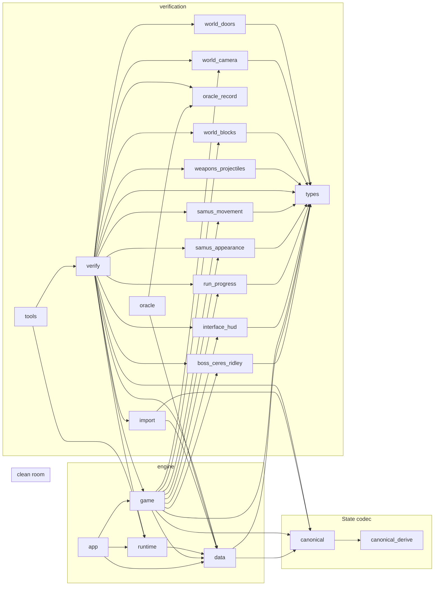

### weapons-projectiles

`crates/clean/weapons_projectiles`, 3 modules.

| Module | Area | Says it is | Items | Score | Lines |
| --- | --- | --- | --- | ---: | ---: |
| `catalogue.rs` | - | One entry for each named behaviour in the supplied specification. | `enum BehaviourId (12)`, `struct Behaviour`, `fn catalogue`, 1 private | 36 | 53 |
| `domain.rs` | shots | Quantities and caller contracts for the uncharged power beam. | `enum ShotSlot (5)`, `enum Heading (10)`, `struct Axes`, `struct FrameWord`, `struct ShotCount`, `struct FixedPosition`, `struct PixelFraction`, `struct BeamSpeed`, `struct Radius`, `struct Damage`, `struct FrameHold`, `struct ClipId`, `struct PictureId`, `struct TrailAppearanceId`, `struct ClipFrame`, `struct Frame`, `enum ClipEnding (2)`, `struct Clip`, `struct PowerBeam`, `struct Offset`, `enum MuzzleAim (3)`, `struct Muzzle`, `struct SamusCentre`, `struct ScreenOrigin`, `struct ScreenCentre`, `struct MovementDistance`, `struct Inheritance`, `enum UpdateMode (2)`, `struct CannonInput`, `struct RoomScreens`, `struct UpdateInput`, `struct ShotBody`, `enum ShotState (3)`, `struct State`, `enum Axis (2)`, `struct Contact`, `enum ContactResponse (2)`, `trait World`, `enum Event (5)`, `enum FlickerPhase (2)`, `enum DrawView (2)`, `struct PictureIntent`, `struct PictureIntents`, `ShotSlot::{DESCENDING, even}`, `Heading::axes`, `ClipFrame::{new, index, at}`, `Inheritance::stationary`, `ShotState::{body, body_mut}`, `State::{reset, consume}`, 1 private | 376 | 365 |
| `lib.rs` | shots | Uncharged power beam model. | `struct Rules`, `fn update_spacing`, `fn cannon_origin`, `fn inherited_motion`, `fn prepare_shot`, `fn accelerate`, `struct EdgeGeometry`, `fn edge_geometry`, `fn contact_edge`, `fn burst`, `fn muzzle_contact`, `fn update_trail`, `fn within_lifetime_view`, `fn inside_view`, `fn remove_shot`, `fn update_clip`, `fn update`, `fn pictures`, `Rules::REFERENCE`, `FixedPosition::{integer, fraction, from_parts, move_by}`, 35 private | 3,624 | 663 |

Its crate root exports:

- from `catalogue`: `*`
- from `domain`: `*`
- the module `catalogue`
- the module `domain`

The public functions a caller reaches through them:

```rust
catalogue() -> EnumMap<BehaviourId, Behaviour>
ShotSlot::even(self) -> bool
Heading::axes(self) -> Axes<i16>
ClipFrame::new(index: usize, frame_count: usize) -> Option<Self>
ClipFrame::index(self) -> usize
Inheritance::stationary() -> Self
ShotState::body(&self) -> Option<&ShotBody>
State::reset(fractions: EnumMap<ShotSlot, Axes<PixelFraction>>) -> Self
State::consume(&mut self, slot: ShotSlot)
FixedPosition::integer(self) -> u16
FixedPosition::fraction(self) -> PixelFraction
FixedPosition::from_parts(integer: u16, fraction: PixelFraction) -> Self
FixedPosition::move_by(&mut self, speed: BeamSpeed)
update_spacing(cooldown: &mut FrameWord, mode: UpdateMode, time_stopped: bool)
cannon_origin(input: &CannonInput) -> Option<(Heading, SamusCentre)>
inherited_motion(heading: Heading, movement: Inheritance) -> Axes<BeamSpeed>
prepare_shot(state: &mut State, input: &CannonInput, content: &PowerBeam, events: &mut Vec<Event>) -> Option<ShotSlot>
accelerate(body: &mut ShotBody, rules: Rules)
edge_geometry(centre: Axes<u16>, radius: Axes<Radius>, speed: BeamSpeed, axis: Axis, screens: u16) -> EdgeGeometry
contact_edge(body: &ShotBody, slot: ShotSlot, axis: Axis, room: RoomScreens, world: &mut impl World) -> bool
burst(shot: &mut ShotState, slot: ShotSlot, impact_clip: &ClipId, events: &mut Vec<Event>)
muzzle_contact(shot: &mut ShotState, slot: ShotSlot, input: &UpdateInput, content: &PowerBeam, world: &mut impl World, events: &mut Vec<Event>)
update_trail(body: &mut ShotBody, slot: ShotSlot, rules: Rules, events: &mut Vec<Event>)
within_lifetime_view(centre: Axes<u16>, camera: ScreenOrigin) -> bool
inside_view(centre: Axes<u16>, camera: ScreenOrigin) -> bool
remove_shot(shot: &mut ShotState, count: &mut ShotCount)
update_clip(body: &mut ShotBody, content: &PowerBeam) -> bool
update(state: &mut State, input: &UpdateInput, content: &PowerBeam, rules: Rules, world: &mut impl World) -> Vec<Event>
pictures(state: &State, phase: FlickerPhase, view: &DrawView) -> PictureIntents
```

Shared types it takes from `types`: `Checked`, `Kind`, `Switch`. Other crates it uses: `enum_map`, `serde`, `std`.

Which module uses which, grouped by area (a module's own area, its functions counted elsewhere aside):

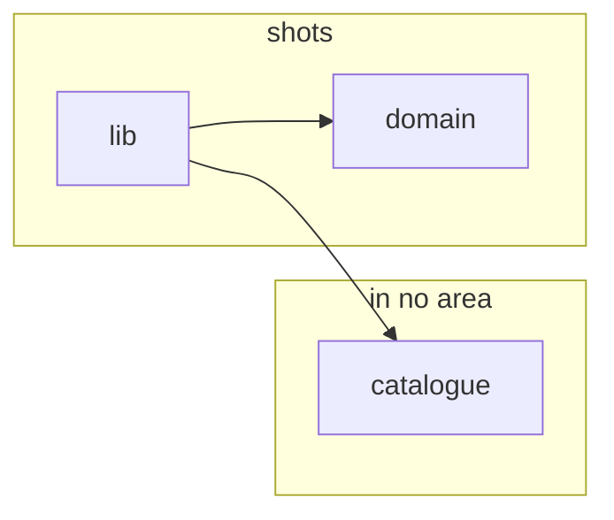

### samus-movement

`crates/clean/samus_movement`, 17 modules.

| Module | Area | Says it is | Items | Score | Lines |
| --- | --- | --- | --- | ---: | ---: |
| `catalogue.rs` | - | One entry per spec entry: what the player sees, its kind and its switch. | `enum BehaviourId (30)`, `struct Behaviour`, `const CATALOGUE` | 0 | 254 |
| `change.rs` | pose fit; `fn change_pose` in pose chart, `fn apply` in motion | The pose change at a frame's end (`PoseFollows`, `PoseFitAfterMoves`): whether she takes the pose chosen, where pose fit or the shrink places her, then what her moves met and the change's effects. | `Samus::change_pose`, 3 private | 624 | 84 |
| `chart/table.rs` | pose chart | The rows of `WhatHerMovesMet` and of `AnimationEnds` (§7), read in order, the first that fits. | `const MOVES_MET`, `const STEP_BLOCKED`, `const ANIMATION_ENDS`, 1 private | 0 | 289 |
| `chart.rs` | pose chart | §7: the pose chart's reader. | `struct Moment`, `struct Choice`, `Choice::{instead, blocked}`, `Moment::{next_pose, choose}`, 11 private | 958 | 150 |
| `collide.rs` | collision | Tilemap collision (`BlocksStopFlush`, `SolidEnemies`, `SlopesCarry`, `TouchedCells`, `OtherBlockKinds`): one axis at a time, against the room's grid of 16 px cells and the solid enemies' boxes. | `struct Bounds`, `enum Stop (3)`, `enum Probe (5)`, `struct Moved`, `struct Axis`, `Bounds::axis`, `Tick::{inside, go, vmove, slope_checks}`, 31 private | 2,317 | 306 |
| `fit.rs` | pose fit | `PoseFitAfterMoves`: placing her body when the pose change grows it, by looks that test a move without making it, from her box and her poses alone. | `fn crouched`, `enum Fitted (4)`, `Fitted::moved`, `Samus::fit`, 3 private | 562 | 92 |
| `jump_held.rs` | motion | `Jumping`, jump held through (§1.2): jump held through a landing, or through the end of a turn or of a landing, counts as a press for the pad chart the next frame, so she takes off again without pressing it. | `enum FrameBefore (2)`, `struct JumpHeld`, `JumpHeld::{NONE, pressed, then}`, `FrameBefore::left_behind`, 2 private | 227 | 59 |
| `lib.rs` | - | The samus-movement model, built from its behaviour spec alone: a character controller for Samus, stepped one 60 Hz frame at a time, her motion in fixed-point subpixels. | - | 0 | 25 |
| `moves.rs` | motion | Her moves in a frame, as the pose at its start says (`MovesAsShePosed`): horizontally, the near-wall test, then the ground pull or her vertical move, and after the pose is chosen the aim change's step; what they met (`WhatHerMovesMet`), and what they do to her dashing (`Dashing`). | `struct Meeting`, `Samus::{moves, step_forward}`, 7 private | 1,117 | 178 |
| `rows.rs` | pose chart | The pose chart's vocabulary (§7). | `const FORWARD`, `const BACK`, `fn seen`, `enum Doing (14)`, `enum Drift (5)`, `enum Moves (5)`, `enum Footing (4)`, `struct Situation`, `struct Class`, `enum Test (13)`, `struct Aiming`, `enum NextFacing (3)`, `struct Next`, `enum Effect (13)`, `struct Entering`, `enum Was (2)`, `struct Beat`, `struct Row`, `enum RowId (76)`, `const AIM`, `const UP_DOWN`, `const UDA`, `const NO_CHANGE`, `const KEEP_POSE`, `const TO_STILL`, `const LOWERS_NOTHING`, `const TO_RUNNING`, `const TO_JUMPING`, `const TO_FALLING`, `const TO_SPINNING`, `const TO_TAKING_OFF`, `const TO_MOONWALKING`, `const TO_CROUCHING`, `const TO_MORPHING`, `const TO_TURNING`, `const FORWARD_AIM`, `const UP_AIM`, `const AIM_UP_ELSE_DOWN`, `const DOWN_TO_FORWARD`, `enum Met (5)`, `Next::pose_from`, `Entering::on` | 294 | 360 |
| `rules.rs` | - | The tuning parameters the model reads: one `Rules` a caller holds, whose `Default` is the vanilla game, the spec's numbers. | `enum SpeedCap (2)`, `enum Gait (7)`, `struct Limits`, `struct Speeds`, `enum Lowers (3)`, `struct WithItem`, `enum Bounces (3)`, `struct Bounce`, `struct Rules`, `WithItem::of`, `Rules::{limits, lowers, cap, rise_speed}`, `impl Default for Rules`, 1 private | 328 | 222 |
| `run.rs` | motion | Her run: her horizontal motion as a value of its own (§1.2 carrying on, her dash, dashing). | `enum Carry (2)`, `enum Dashing (2)`, `enum Stride (4)`, `fn running_with_run_held`, `struct Run`, `Run::{halt, skids, turn_round, end_skid, as_running, meet, launch, moving, stride}`, 7 private | 889 | 162 |
| `samus.rs` | motion | Samus as the player can tell her and what she remembers (§1, §1.2), and what a frame shows beyond her quantities: its outputs, for the caller to act on. | `enum Spin (4)`, `enum Seat (2)`, `enum WallTest (3)`, `enum StandingAnimation (2)`, `fn sprite`, `struct Outcome`, `struct Samus`, `Spin::then`, `StandingAnimation::of`, `Samus::{rides_the_elevator, bounds, take_result}` | 288 | 117 |
| `situation.rs` | pose chart | Her situation, classified once a frame from her pose at its start (`MovesAsShePosed`). | `struct UnknownPose`, `fn classify`, `static ENTERING`, `static CLASSES`, 47 private | 114 | 1,471 |
| `step.rs` | motion | One frame of her motion, in the order `PoseFitAfterMoves` gives: she moves as the pose at its start says (`MovesAsShePosed`, `moves`); what those moves met is known; the pose is chosen (`PoseFollows`, `chart`) and the aim change's step made; then the pose change (`change`): pose fit or the shrink places her, and what she met and the change's effects act, where the change is taken. | `Samus::step` | 477 | 74 |
| `tick.rs` | motion | One frame's play: what the frame brings from the player and the world (§1.3), and the room, the rules and the cells reached that the frame's moves and looks share (`TouchedCells`). | `struct Frame`, `struct Tick`, `Tick::body` | 15 | 23 |
| `vertical.rs` | motion | Her vertical motion as a value of its own (§1 vertical speed and bounces, §1.2 falling at 0 and the moonfall). | `enum Phase (5)`, `struct Vertical`, `enum Course (3)`, `enum Contact (4)`, `Contact::rises`, `Vertical::{on_ground, has_motion, rising, heading_down, jump, end_rise, space_jump, enter_spin_from_a_turn, come_to_the_ground, course, end_move, meet_in_moves, contact, meet, end_bounce}`, 7 private | 1,191 | 218 |

Its crate root exports:

- from `catalogue`: `Behaviour`, `BehaviourId`, `CATALOGUE`
- from `chart`: `Moment`
- from `jump_held`: `FrameBefore`, `JumpHeld`
- from `rows`: `Met`
- from `rules`: `Bounces`, `Rules`, `SpeedCap`, `WithItem`
- from `run`: `Carry`, `Dashing`, `Run`
- from `samus`: `Outcome`, `Samus`, `Seat`, `Spin`, `StandingAnimation`, `WallTest`
- from `situation`: `UnknownPose`
- from `tick`: `Frame`
- from `vertical`: `Phase`, `Vertical`
- the module `catalogue`
- the module `rules`

The public functions a caller reaches through them:

```rust
Moment::next_pose(&self, pose: Pose) -> Result<Pose, UnknownPose>
WithItem::of(self, items: &Set<Item>) -> Fixed
Rules::limits(&self, gait: Gait) -> Limits
Rules::lowers(&self, by: Lowers) -> Fixed
Rules::cap(&self, speed: Fixed, top: Fixed) -> Fixed
Rules::rise_speed(&self, base: WithItem, items: &Set<Item>, dash: Fixed) -> Fixed
Samus::step(&mut self, frame: &Frame, world: &dyn World, rules: &Rules) -> Result<Outcome, UnknownPose>
Vertical::on_ground(self) -> bool
```

Shared types it takes from `types`: `Action`, `Aim`, `Block`, `Body`, `Buttons`, `Cell`, `Checked`, `ClipEnd`, `Facing`, `Fixed`, `Gun`, `Heading`, `Hitbox`, `Item`, `Kind`, `LandedFrom`, `Legs`, `Pair`, `Parity`, `Parts`, `Pose`, `Position`, `Px`, `Radius`, `Set`, `Side`, `Slope`, `SlopeFaces`, `Sprite`, `Switch`, `Touch`, `Turn`, `Way`, `World`, `ZERO`, `button`, `fixed`, `part_below`, `px`. Other crates it uses: `core`.

Which module uses which, grouped by area (a module's own area, its functions counted elsewhere aside):

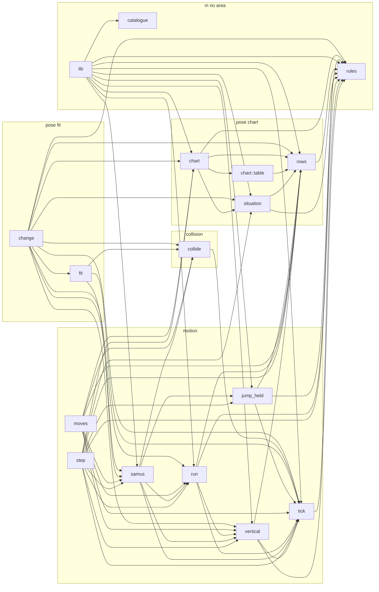

### world-camera

`crates/clean/world_camera`, 7 modules.

| Module | Area | Says it is | Items | Score | Lines |
| --- | --- | --- | --- | ---: | ---: |
| `axis.rs` | limits | One axis of a frame: the camera following her there (Spec: §2), and the room keeping the view in (Spec: §3): its edges, its closed and short screens, and how the view settles out of a closed screen. | `enum Axis (2)`, `struct Line`, `Line::{new, follow}`, 20 private | 951 | 186 |
| `catalogue.rs` | - | The catalogue: one behaviour per spec entry, with its kind, its switch and how it is checked. | `enum BehaviourId (14)`, `struct Behaviour`, `const CATALOGUE` | 0 | 143 |
| `follow.rs` | follow | Following her (Spec: §2): how positions compare, where the view aims, and how fast and how far it moves there. | `fn before`, `fn exceeds`, `fn max_by_before`, `fn min_by_exceeds`, `enum Going (2)`, `struct Move`, `fn aim`, `fn speed`, `fn chase`, 3 private | 360 | 84 |
| `input.rs` | - | What the camera reads each frame (Spec: §1.3): her motion's outputs, the room, the lead setting and whether time is stopped. | `enum LeadSetting (4)`, `struct Samus`, `struct Frame` | 0 | 25 |
| `lib.rs` | - | The camera model, built from its behaviour spec alone: the screen's view following Samus. | `struct Camera`, `Camera::{new, position, seen, step}` | 207 | 64 |
| `room.rs` | limits | The room as the camera reads it (Spec: §1.3): its screens, run on as one strip, and its aim heights. | `const SCREEN`, `struct Heights`, `enum RoomError (3)`, `struct Room`, `Heights::height`, `Room::{new, screen}`, 2 private | 242 | 71 |
| `rules.rs` | follow | The tuning the camera reads: `Rules`, whose reference profile holds the spec's vanilla values. | `struct Leads`, `struct Rules`, `Rules::{lead, REFERENCE}`, 1 private | 80 | 58 |

Its crate root exports:

- from `catalogue`: `Behaviour`, `BehaviourId`, `CATALOGUE`
- from `input`: `Frame`, `LeadSetting`, `Samus`
- from `room`: `Heights`, `Room`, `RoomError`
- from `rules`: `Leads`, `Rules`

The public functions a caller reaches through them:

```rust
Camera::new(position: Pair<Fixed>, her: Position) -> Self
Camera::position(&self) -> Pair<Fixed>
Camera::seen(&self) -> Position
Camera::step(self, rules: &Rules, frame: &Frame) -> Self
Room::new(run: Vec<ScreenKind>, size: Pair<usize>, heights: Heights) -> Result<Self, RoomError>
```

Shared types it takes from `types`: `Checked`, `Facing`, `Fixed`, `Kind`, `PIXEL`, `Pair`, `Parts`, `Position`, `Px`, `ScreenKind`, `Switch`, `below`, `fixed`, `px`. Other crates it uses: `core`.

Which module uses which, grouped by area (a module's own area, its functions counted elsewhere aside):

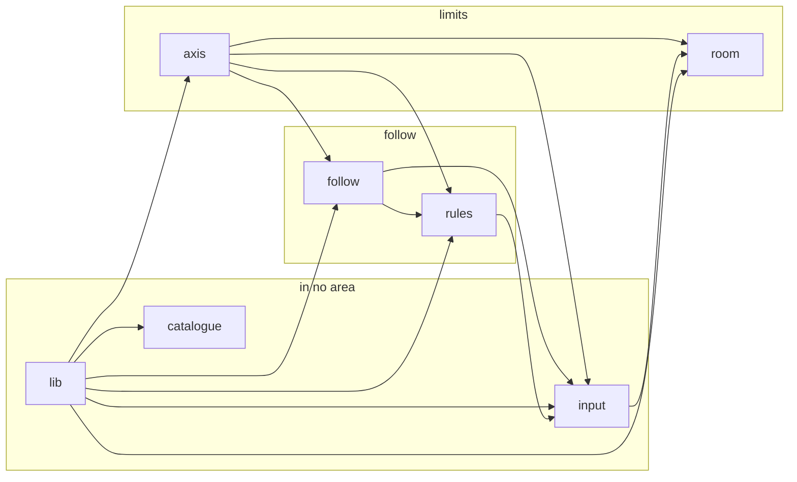

### run-progress

`crates/clean/run_progress`, 9 modules.

| Module | Area | Says it is | Items | Score | Lines |
| --- | --- | --- | --- | ---: | ---: |
| `catalogue.rs` | - | The catalogue: one behaviour for each entry of the progress spec. | `enum BehaviourId (14)`, `struct Behaviour`, `fn catalogue` | 9 | 126 |
| `inventory.rs` | equipment | What she has (spec §1.1, §4): her items and beams, hers and switched on, her capacities, what she holds and her reserve mode; and what taking an item, a beam or a tank gives her. | `type Count`, `enum Supply (5)`, `enum ReserveMode (3)`, `enum Pickup (3)`, `struct Supplies`, `struct Inventory`, `Inventory::take`, `impl Default for Supplies`, 3 private | 217 | 84 |
| `lib.rs` | - | The progress model, built from its behaviour spec alone: what the game remembers of her run besides where she is. | - | 0 | 19 |
| `percentage.rs` | percentage | The item percentage the ending shows. | `Inventory::item_percentage` | 74 | 12 |
| `places.rs` | places | What the places remember (spec §3): the item locations emptied and the doors that stay open, by id, and how she has each area's map. | `struct Remembered`, `enum MapStatus (3)`, `Remembered::{remember, contains}`, `MapStatus::is_known`, `impl Default for Remembered<Id>` | 56 | 30 |
| `progress.rs` | happened | The whole of what the game keeps of a run besides where she is (spec §1), and what has happened in the world (§2). | `struct Progress` | 0 | 17 |
| `report.rs` | places | What other domains report (spec §1.3), and how each report changes the progress. | `enum Report (10)`, `Progress::apply`, 1 private | 253 | 59 |
| `room_states.rs` | rooms | Which version of a room loads, given the run's progress (spec §5). | `enum Condition (6)`, `struct EnteredRoom`, `struct RoomStates`, `enum Version (2)`, `RoomStates::choose`, 1 private | 168 | 51 |
| `rules.rs` | - | The values the progress rules read: the reference profile holds the original game's. | `struct Rules`, `Rules::reference`, `impl Default for Rules`, 4 private | 42 | 39 |

Its crate root exports:

- from `catalogue`: `Behaviour`, `BehaviourId`, `catalogue`
- from `inventory`: `Count`, `Inventory`, `Pickup`, `ReserveMode`, `Supplies`, `Supply`
- from `places`: `MapStatus`, `Remembered`
- from `progress`: `Progress`
- from `report`: `Report`
- from `room_states`: `Condition`, `EnteredRoom`, `RoomStates`, `Version`
- from `rules`: `Rules`

The public functions a caller reaches through them:

```rust
catalogue() -> EnumMap<BehaviourId, Behaviour>
Inventory::item_percentage(&self, rules: &Rules) -> Count
Remembered::contains(&self, id: Id) -> bool
MapStatus::is_known(self) -> bool
Progress::apply(&mut self, rules: &Rules, reports: &[Report])
RoomStates::choose(&self, progress: &Progress, room: EnteredRoom) -> Version
Rules::reference() -> Self
```

Shared types it takes from `types`: `Area`, `Beam`, `BossKind`, `Checked`, `DoorId`, `Entrance`, `Event`, `Item`, `Kind`, `LocationId`, `Members`, `Set`, `StationId`, `Switch`. Other crates it uses: `core`, `enum_map`, `std`.

Which module uses which, grouped by area (a module's own area, its functions counted elsewhere aside):

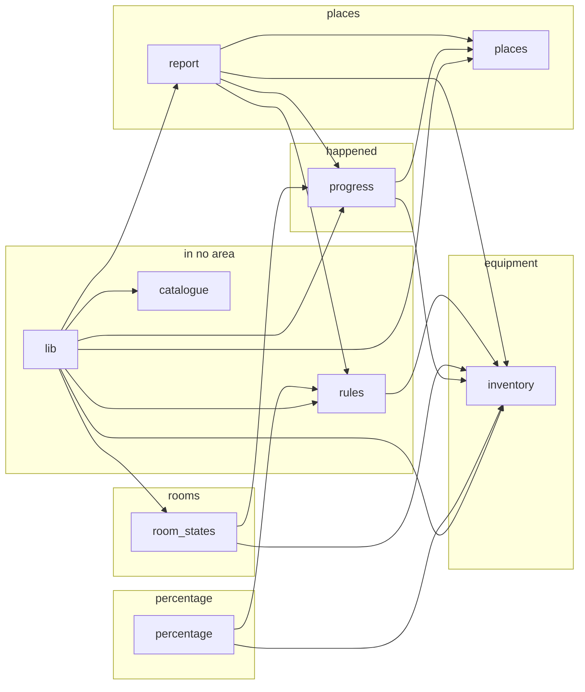

### interface-hud

`crates/clean/interface_hud`, 16 modules.

| Module | Area | Says it is | Items | Score | Lines |
| --- | --- | --- | --- | ---: | ---: |
| `catalogue.rs` | - | The catalogue: one behaviour per entry of the HUD's spec, with its kind, its switch and how the spec checks it. | `enum BehaviourId (20)`, `struct Behaviour`, `const CATALOGUE` | 0 | 198 |
| `events.rs` | - | What a frame reports for other domains to act on. | `enum HudEvent (2)` | 0 | 6 |
| `grid.rs` | - | A grid of cells, each holding a value: the HUD's cells, her map's pictures and the sets of her map's cells are each one. | `type Place`, `fn at`, `fn plus`, `struct Grid`, `Grid::{filled, get, set, contains, insert}`, `impl Default for Grid<T, COLUMNS, ROWS>`, 1 private | 220 | 54 |
| `inputs.rs` | -; `fn has` in selection | What the HUD reads each step (§1.3): in a frame of play, the values other domains own, the buttons, what other domains drop before the status bar and after it, and where she is on her map; outside play, the mini-map's turn-on, a new area and a drop. | `struct FrameCount`, `struct Energy`, `enum ReserveMode (2)`, `struct Reserve`, `struct Stock`, `struct Ammunition`, `struct Equipped`, `struct Status`, `enum SelectButton (2)`, `enum CancelButton (3)`, `enum Mute (4)`, `struct Controls`, `struct Room`, `struct MiniMapInputs`, `enum Dropped (3)`, `struct FrameInputs`, `enum NewArea (2)`, `struct OutOfPlayInputs`, `Ammunition::{new, of, stocks}`, `Status::has`, 1 private | 127 | 140 |
| `item.rs` | selection | The items the HUD can select (§1.1). | `enum Ammo (3)`, `enum SelectableItem (3)`, `SelectableItem::ORDER` | 0 | 22 |
| `layout.rs` | status | Where things sit on the HUD (§1.2), as places on its grid: column across, row down. | `const TANKS`, `const ENERGY_DIGITS`, `fn ammo_digits`, `const RESERVE_SIGN`, `fn icon_top_left`, `const HER_CELL`, `const WINDOW_REACH`, `fn laid`, 3 private | 94 | 52 |
| `lib.rs` | - | The HUD model, built from its behaviour spec alone: the status bar at the top of the screen, the selected item and the mini-map. | - | 0 | 34 |
| `map.rs` | minimap | Her map, as the mini-map reads it (§1.3): 64 columns by 32 rows of cells, each cell's picture with its flips, its beyond pictures, and the cells it charts; and the sets of its cells. | `type MapCellSet`, `type MapPictures`, `struct HerMap` | 0 | 9 |
| `mini_map.rs` | minimap | The mini-map (§4): the 5 × 3 cells of her map around hers, the ones she has explored, her own cell blinking, the bosses that blank it, and the quirks at the map's first and last columns. | `HudState::{mini_map_updates, explore_and_draw_mini_map, boss_blanks_the_map}`, 22 private | 654 | 153 |
| `pictures.rs` | status | The HUD's pictures (§1.4): content the importer supplies by name, which the caller gives each step. | `struct Icons`, `fn rows`, `struct HudPictures`, `Icons::of`, `HudPictures::blank_cell` | 127 | 45 |
| `rules.rs` | -; `fn reference` in minimap | The values the HUD's rules read: the reference profile holds the spec's; another `Rules` is an adjusted game. | `enum Boss (7)`, `struct Alternation`, `struct Rules`, `Alternation::first_half`, `Rules::reference`, `impl Default for Rules`, 3 private | 97 | 77 |
| `selection.rs` | selection | How Select, item cancel and another domain's drop change the selection (spec: CyclingItems, CancellingTheItem, OneShotItem, Switching). | `Selection::apply_drop`, `HudState::press_buttons`, 1 private | 242 | 41 |
| `state.rs` | - | What the HUD keeps from one frame to the next (§1): its cells, the values last shown, the selection, the explored cells and whether the mini-map is off. | `struct Shown`, `enum Selection (3)`, `enum MiniMapPower (2)`, `struct HudState`, `Selection::{item, one_shot}` | 59 | 45 |
| `status_bar.rs` | status | The status bar (§2): the energy and its tanks, the ammunition counts, the reserve sign, and the items' icons with the selection's highlight. | `HudState::{energy_gauge, ammo_counts, reserve_sign, icon_appears, highlight, one_shot_flash}`, 5 private | 709 | 109 |
| `step.rs` | - | The steps of the HUD, each its own entry on its state (§1.3; §5: the order that matters). | `HudState::{frame_of_play, out_of_play}`, 1 private | 317 | 56 |
| `tile.rs` | - | What a cell of the HUD shows (§1.4): a picture with its flips (the shared `Look`), in one of the HUD's eight colour sets; and the colour sets by the role the spec gives each. | `struct ColourSet`, `struct Tile`, `type HudGrid`, `const BLANK_COLOURS`, `const DIGIT_COLOURS`, `const FULL_TANK_COLOURS`, `const EMPTY_TANK_COLOURS`, `const SIGN_LIT`, `const SIGN_DIM`, `const PLAIN`, `const HIGHLIGHTED`, `const EXPLORED`, `const CHARTED`, `const BLINK`, `ColourSet::{new, number}`, `Tile::{new, in_colours}`, 1 private | 55 | 46 |

Its crate root exports:

- from `catalogue`: `Behaviour`, `BehaviourId`, `CATALOGUE`
- from `events`: `HudEvent`
- from `grid`: `Grid`, `Place`
- from `inputs`: `Ammunition`, `CancelButton`, `Controls`, `Dropped`, `Energy`, `Equipped`, `FrameCount`, `FrameInputs`, `MiniMapInputs`, `Mute`, `NewArea`, `OutOfPlayInputs`, `Reserve`, `ReserveMode`, `Room`, `SelectButton`, `Status`, `Stock`
- from `item`: `Ammo`, `SelectableItem`
- from `map`: `HerMap`, `MapCellSet`, `MapPictures`
- from `pictures`: `HudPictures`, `Icons`
- from `rules`: `Alternation`, `Boss`, `Rules`
- from `state`: `HudState`, `MiniMapPower`, `Selection`, `Shown`
- from `tile`: `ColourSet`, `HudGrid`, `Tile`
- from `types`: `Checked`, `Flip`, `Kind`, `Look`, `Pair`, `Picture`, `Screen`, `Switch`

The public functions a caller reaches through them:

```rust
Grid::filled(value: T) -> Self
Grid::get(&self, place: Place) -> Option<T>
Grid::set(&mut self, place: Place, value: T)
Grid::contains(&self, place: Place) -> bool
Grid::insert(&mut self, place: Place)
Ammunition::new(stocks: EnumMap<Ammo, Stock>) -> Option<Self>
Ammunition::of(&self, ammo: Ammo) -> &Stock
Ammunition::stocks(&self) -> impl Iterator<Item = (Ammo, &Stock)>
Status::has(&self, item: SelectableItem) -> bool
HudState::boss_blanks_the_map(&mut self, rules: &Rules, pictures: &HudPictures, boss: Boss, room: Place)
Icons::of(&self, item: SelectableItem) -> [&[Look]; 2]
HudPictures::blank_cell(&self) -> Tile
Alternation::first_half(self, frame: FrameCount) -> bool
Rules::reference() -> Self
Selection::item(self) -> Option<SelectableItem>
Selection::one_shot(self) -> Option<SelectableItem>
HudState::frame_of_play(&mut self, rules: &Rules, pictures: &HudPictures, inputs: &FrameInputs<'_>) -> Vec<HudEvent>
HudState::out_of_play(&mut self, inputs: &OutOfPlayInputs<'_>)
ColourSet::new(number: u8) -> Option<Self>
ColourSet::number(self) -> u8
Tile::new(look: Look, colours: ColourSet) -> Self
Tile::in_colours(self, colours: ColourSet) -> Self
```

Shared types it takes from `types`: `Checked`, `Flip`, `Kind`, `Look`, `Pair`, `Picture`, `Screen`, `Switch`. Other crates it uses: `enum_map`, `std`.

Which module uses which, grouped by area (a module's own area, its functions counted elsewhere aside):

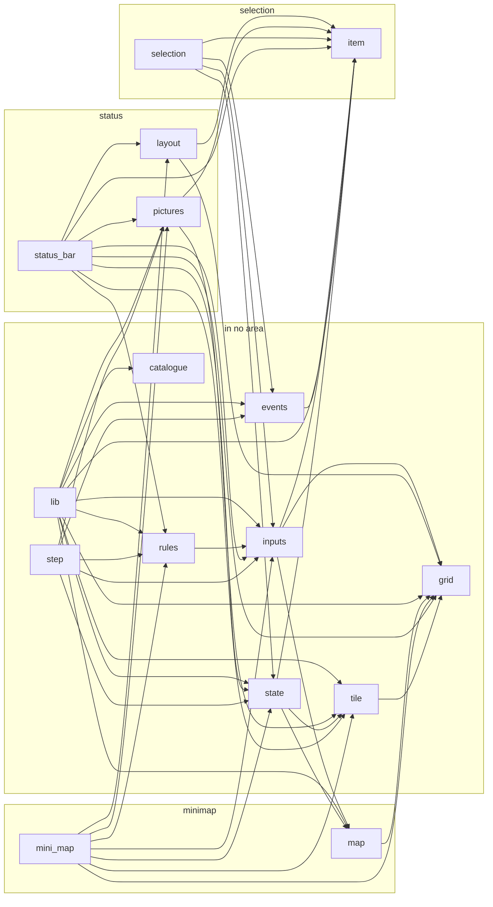

### world-blocks

`crates/clean/world_blocks`, 9 modules.

| Module | Area | Says it is | Items | Score | Lines |
| --- | --- | --- | --- | ---: | ---: |
| `catalogue.rs` | - | The catalogue: one behaviour per spec entry, with its kind, its switch and how it is checked. | `enum BehaviourId (18)`, `struct Behaviour`, `const CATALOGUE` | 0 | 168 |
| `cells.rs` | -; `fn show` in places, `fn regrow` in places, `fn offset` in places, `fn answer` in breakables, `fn plain` in breakables, `fn met_as` in breakables | The room's cells as this domain sees them: each cell's kind, mark and look (spec §1), and how a step writes a cell. | `struct Grid`, `type Tilemap`, `struct Tile`, `enum CellKind (4)`, `enum ReactingBody (2)`, `enum StandIn (2)`, `enum Answer (3)`, `enum Mark (7)`, `enum OtherMetAs (2)`, `enum Inside (2)`, `fn offset`, `Grid::{new, rows, get, get_mut}`, `CellKind::answer`, `ReactingBody::plain`, `Mark::met_as`, `Tile::{show, regrow}` | 314 | 138 |
| `inputs.rs` | - | What the frame and the room's start give the model (spec §1.3). | `enum Request (2)`, `enum Meeting (3)`, `enum Run (2)`, `enum Placement (3)`, `struct ScreenChange`, `struct OutsideTheRoom` | 0 | 41 |
| `lib.rs` | - | The blocks model, built from its behaviour spec alone: blocks that break and come back, the scroll cells that change which screens the view may show, and the stand-ins a room places. | - | 0 | 22 |
| `places.rs` | places | The places reactions run in (`Places`), and the run of what they hold (`TheScriptsRun`): at most 40 run at once, each one started takes the highest free place, and every frame that isn't paused each place from the highest down has its turn. | `const PLACE_COUNT`, `struct Places`, `enum Place (5)`, `struct Running`, `struct ScrollReaction`, `enum Touched (2)`, `Places::{take, full, hold_until_run, touch_scroll, run}`, `Running::started`, `impl Default for Places`, 7 private | 755 | 172 |
| `reactions.rs` | places | Reactions and their scripts: the imported assets (spec §2). | `const MOST_FRAMES`, `struct Frames`, `struct ReactionName`, `struct Reaction`, `enum Step (4)`, `struct SoundRequest`, `struct PatternCell`, `enum Becomes (4)`, `Frames::{ONE, new, count, less_one}`, `Reaction::{first_wait_of, regrows}` | 96 | 75 |
| `report.rs` | - | What a frame reports (spec §1.4) beyond the state's screens. | `struct Report` | 0 | 9 |
| `rules.rs` | breakables | The rules (spec §5, `BlocksMarkedNothing`): for each family, and for each family a cell marked `Nothing` is met as, what her touches and the hits ask of its cells. | `struct Rules`, `struct Row`, `enum TouchRule (2)`, `enum Starter (3)`, `struct HitRule`, `enum Bodies (2)`, `struct HoldUntilRun`, `struct Start`, `enum FirstStep (2)`, `enum Change (3)`, `Rules::reference`, `Row::answer`, `Starter::starts`, `Bodies::includes`, `FirstStep::index`, `Change::apply`, 23 private | 444 | 318 |
| `state.rs` | breakables | What the model remembers from frame to frame (spec §1.2): the cells, the places and the screens, and the two entry points that change them: the room's start and the frame's step. | `struct State`, `State::{start_room, step}`, 2 private | 787 | 133 |

Its crate root exports:

- from `catalogue`: `Behaviour`, `BehaviourId`, `CATALOGUE`
- from `cells`: `Answer`, `CellKind`, `Grid`, `Inside`, `Mark`, `OtherMetAs`, `ReactingBody`, `StandIn`, `Tile`, `Tilemap`
- from `inputs`: `Meeting`, `OutsideTheRoom`, `Placement`, `Request`, `Run`, `ScreenChange`
- from `places`: `PLACE_COUNT`, `Place`, `Places`, `Running`, `ScrollReaction`, `Touched`
- from `reactions`: `Becomes`, `Frames`, `MOST_FRAMES`, `PatternCell`, `Reaction`, `ReactionName`, `SoundRequest`, `Step`
- from `report`: `Report`
- from `rules`: `Bodies`, `Change`, `FirstStep`, `HitRule`, `HoldUntilRun`, `Row`, `Rules`, `Start`, `Starter`, `TouchRule`
- from `state`: `State`

The public functions a caller reaches through them:

```rust
Grid::new(rows: Vec<Vec<T>>) -> Option<Self>
Grid::rows(&self) -> &[Vec<T>]
Grid::get(&self, at: Pair<u16>) -> Option<&T>
Grid::get_mut(&mut self, at: Pair<u16>) -> Option<&mut T>
CellKind::answer(self) -> Answer
ReactingBody::plain(self) -> CellKind
Mark::met_as(&self) -> Option<MetAs>
Tile::show(&mut self, cell: &PatternCell)
Tile::regrow(&mut self, body: ReactingBody, whole_look: Option<Picture>)
Frames::new(count: u16) -> Option<Self>
Frames::count(self) -> u16
Frames::less_one(self) -> Option<Self>
Reaction::first_wait_of(&self, script: Script) -> Frames
Reaction::regrows(&self, script: Script) -> bool
Rules::reference() -> Self
Starter::starts(&self, way: Way, moving: Set<Motion>) -> bool
Bodies::includes(self, body: ReactingBody) -> bool
FirstStep::index(self, steps: &[Step]) -> usize
State::start_room(&mut self, placements: impl IntoIterator<Item = Placement>) -> Result<(), OutsideTheRoom>
State::step(&mut self, rules: &Rules, requests: &[Request], moving: Set<Motion>, run: Run) -> Result<Report, OutsideTheRoom>
```

Shared types it takes from `types`: `Cell`, `Checked`, `Family`, `Heading`, `HitBy`, `Kind`, `Look`, `MetAs`, `Motion`, `Pair`, `Picture`, `Point`, `Screen`, `ScreenKind`, `Script`, `Set`, `Switch`, `Way`, `by_member`. Other crates it uses: `enum_map`, `std`.

Which module uses which, grouped by area (a module's own area, its functions counted elsewhere aside):

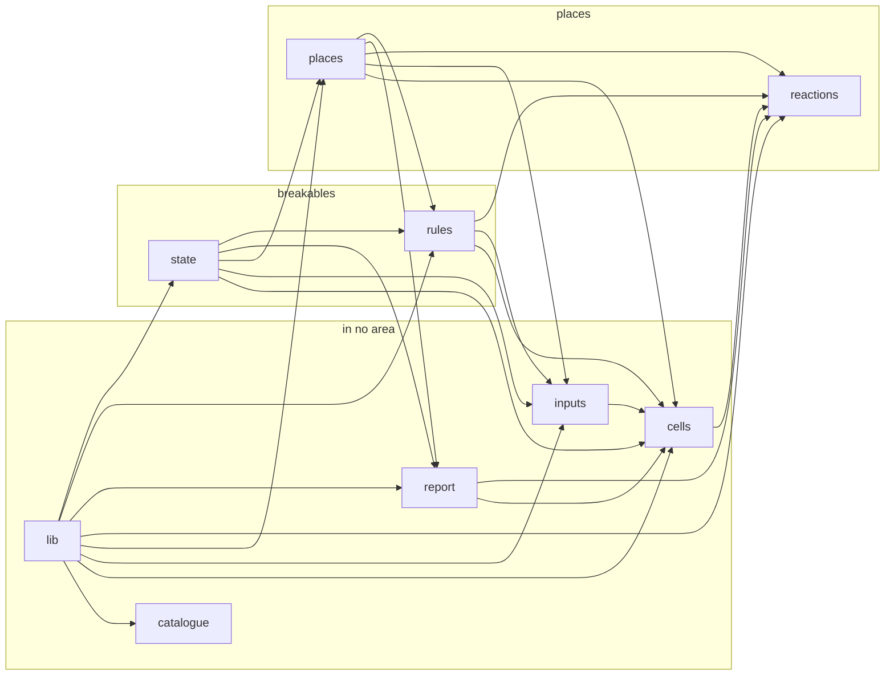

### samus-appearance

`crates/clean/samus_appearance`, 12 modules.

| Module | Area | Says it is | Items | Score | Lines |
| --- | --- | --- | --- | ---: | ---: |
| `ahead.rs` | clip | What a caller reads as the frame starts, before samus-movement's step: the end her clip reaches and whether her spin has turned far. | `struct Ahead`, `Ahead::of` | 76 | 21 |
| `catalogue.rs` | - | The catalogue: one behaviour per entry of the spec. | `enum BehaviourId (15)`, `struct Behaviour`, `const CATALOGUE` | 0 | 150 |
| `clip.rs` | clip | Her clips and the run's paces: the content the importer supplies, as typed values. | `struct Step`, `struct Frames`, `struct Hold`, `struct Slowdown`, `struct Branch`, `enum Instruction (2)`, `enum Control (6)`, `struct Clip`, `struct Pace`, `struct Paces`, `Step::{FIRST, SECOND, next, before}`, `Frames::{NONE, LAST, slowed}`, `Hold::{LONGEST, new, frames}`, `Slowdown::{MOST, NONE, new}`, `Control::end`, `Clip::{at, hold}`, `Pace::hold`, 1 private | 196 | 117 |
| `inputs.rs` | - | What a frame reads, each from the domain that owns it. | `struct Figure`, `trait Content`, `enum MoveEvent (4)`, `enum Dash (3)`, `struct Liquid`, `struct Inputs`, `struct SoundsWaiting`, `Liquid::NONE`, `SoundsWaiting::{MOST, NONE, new, count}` | 46 | 70 |
| `lib.rs` | - | The samus-appearance model, built from its behaviour spec alone: her animation's timing. | - | 0 | 18 |
| `moves.rs` | moves | What her moves do to her clip, before the time runs down. | `fn her_moves`, 4 private | 278 | 47 |
| `play.rs` | clip | Her clip plays: the time runs down, and when it is over the clip moves on as its steps say. | `fn play`, 5 private | 755 | 110 |
| `rules.rs` | - | The spec's parameters, as a game's tuning: `Rules::VANILLA` holds the game's values, and any other `Rules` is an adjusted game. | `struct Rules`, `Rules::VANILLA` | 0 | 24 |
| `run.rs` | run | Her run: its pace while she dashes, and the speed booster's stages up to boosting. | `fn stride`, `fn hold_on`, `fn next_stage`, `fn boosting_lap_stage`, `fn dash_began`, `fn dash_lost`, 2 private | 238 | 72 |
| `starting.rs` | clip | Taking another pose: where the clip of the pose she takes starts. | `fn start`, 12 private | 261 | 153 |
| `state.rs` | -; `fn on` in clip, `fn run_down` in clip, `fn after_lap` in run | What the domain remembers from one frame to the next: her step, the time left on it, the boost stage and the laps left. | `struct Playhead`, `enum RunDown (2)`, `struct Laps`, `enum LapsLeft (2)`, `struct State`, `Playhead::{on, run_down}`, `Laps::{new, count}`, `LapsLeft::after_lap`, 1 private | 238 | 71 |
| `update.rs` | - | A frame of her animation, in the order that matters. | `fn update` | 104 | 26 |

Its crate root exports:

- from `ahead`: `Ahead`
- from `catalogue`: `Behaviour`, `BehaviourId`, `CATALOGUE`
- from `clip`: `Branch`, `Clip`, `Control`, `Frames`, `Hold`, `Instruction`, `Pace`, `Paces`, `Slowdown`, `Step`
- from `inputs`: `Content`, `Dash`, `Figure`, `Inputs`, `Liquid`, `MoveEvent`, `SoundsWaiting`
- from `rules`: `Rules`
- from `state`: `Laps`, `LapsLeft`, `Playhead`, `RunDown`, `State`
- from `update`: `update`

The public functions a caller reaches through them:

```rust
Ahead::of(playhead: Playhead, clip: &Clip) -> Self
Step::next(self) -> Option<Self>
Step::before(self) -> Option<Self>
Frames::slowed(self, slowdown: Slowdown) -> Self
Hold::new(frames: u8) -> Option<Self>
Hold::frames(self) -> Frames
Slowdown::new(frames: u8) -> Option<Self>
Control::end(self) -> Option<ClipEnd>
Clip::at(&self, step: Step) -> Option<Instruction>
Clip::hold(&self, step: Step) -> Option<Hold>
Pace::hold(&self, step: Step) -> Option<Hold>
SoundsWaiting::new(waiting: u8) -> Option<Self>
SoundsWaiting::count(self) -> u8
Playhead::on(step: Step, hold: Option<Hold>, slowdowns: &[Slowdown]) -> Self
Playhead::run_down(self, clip: &Clip) -> RunDown
Laps::new(count: u8) -> Option<Self>
Laps::count(self) -> u8
LapsLeft::after_lap(self) -> Option<Laps>
update(state: State, inputs: &Inputs, content: &impl Content, rules: &Rules) -> (State, Option<AnimationSound>)
```

Shared types it takes from `types`: `Action`, `Aim`, `AnimationSound`, `Body`, `BoostStage`, `Checked`, `ClipEnd`, `Fixed`, `Item`, `Kind`, `LandedFrom`, `Parts`, `Pose`, `Set`, `Sprite`, `Switch`, `Turn`. Other crates it uses: `core`, `enum_map`.

Which module uses which, grouped by area (a module's own area, its functions counted elsewhere aside):

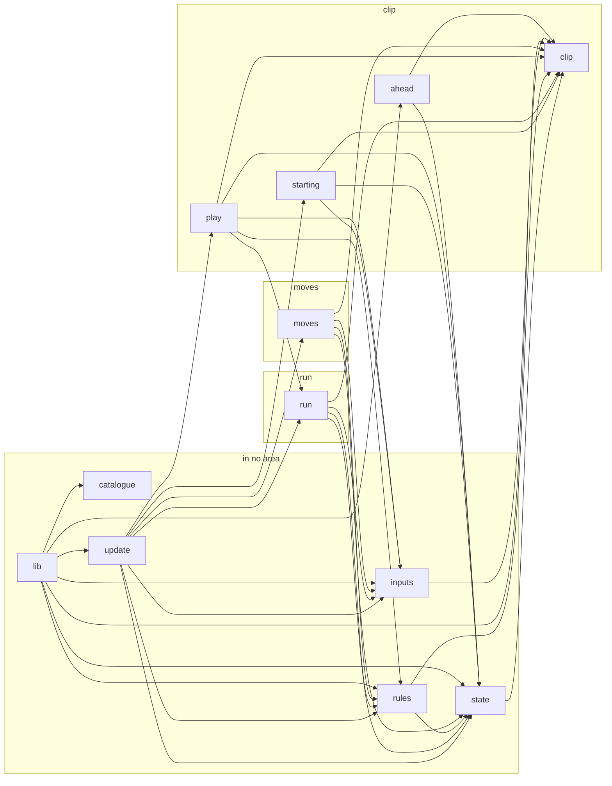

### boss-ceres-ridley

`crates/clean/boss_ceres_ridley`, 8 modules.

| Module | Area | Says it is | Items | Score | Lines |
| --- | --- | --- | --- | ---: | ---: |
| `catalogue.rs` | - | The catalogue: one behaviour for each entry of the spec, with its kind, its switch and how it is checked. | `enum BehaviourId (11)`, `struct Behaviour`, `fn catalogue`, `BehaviourId::behaviour` | 20 | 123 |
| `door.rs` | doors | A Ceres door: how a room places it, and its run each frame the enemies run. | `const BOX_RADIUS`, `enum DoorKind (2)`, `struct CeresDoor`, `struct Placement`, `struct OpeningSound`, `struct Run`, `DoorKind::becomes_wall`, `OpeningSound::QUEUE_LIMIT`, `CeresDoor::{place, run, figure, hitbox}`, 1 private | 522 | 130 |
| `figure.rs` | doors | The figures a door holds: which one each phase shows, for each way the door faces. | `enum FigureLook (5)`, `struct Figure`, `struct Figures`, `fn figures`, `Figures::for_door`, 4 private | 310 | 102 |
| `inputs.rs` | -; `fn she_is_near` in doors, `fn gap` in doors, `fn escape_shake` in station | What a door reads as the frame starts, and the two rules that read only it: whether she is near, and whether the door starts a shake. | `struct Inputs`, `Inputs::{she_is_near, escape_shake}`, 2 private | 116 | 31 |
| `lib.rs` | - | The boss-ceres-ridley model, part 1: the Ceres doors, built from its behaviour spec alone. | - | 0 | 14 |
| `phase.rs` | doors | A door's phase: where it stands in its cycle, with what each phase carries (its wait, and how far an opening or a closing has gone), and the tables of which phases are shown and solid. | `struct Wait`, `enum Quarter (4)`, `enum Phase (7)`, `Wait::{new, frames}`, `Quarter::next`, `Phase::{counted_down, shown, solid}`, 2 private | 272 | 97 |
| `rules.rs` | - | The doors' tuning values: every number a Parameter entry of the spec lists. | `struct Rules`, `impl Default for Rules`, 8 private | 47 | 37 |
| `station.rs` | station | The station around the doors: its stage, the doors' two colour sets and the shakes they start. | `enum Stage (3)`, `enum ColourSet (2)`, `struct Shake`, `Stage::{ridley_has_fled, door_colours}` | 14 | 32 |

Its crate root exports:

- from `catalogue`: `Behaviour`, `BehaviourId`, `catalogue`
- from `door`: `BOX_RADIUS`, `CeresDoor`, `DoorKind`, `OpeningSound`, `Placement`, `Run`
- from `figure`: `Figure`, `FigureLook`
- from `inputs`: `Inputs`
- from `phase`: `Phase`, `Quarter`, `Wait`
- from `rules`: `Rules`
- from `station`: `ColourSet`, `Shake`, `Stage`

The public functions a caller reaches through them:

```rust
BehaviourId::behaviour(self) -> Behaviour
catalogue() -> EnumMap<BehaviourId, Behaviour>
DoorKind::becomes_wall(self, stage: Stage) -> bool
CeresDoor::place(kind: DoorKind, facing: Side, position: Pair<Px>, stage: Stage) -> Placement
CeresDoor::run(self, inputs: &Inputs, rules: &Rules) -> Run
CeresDoor::figure(self) -> Option<Figure>
CeresDoor::hitbox(self) -> Hitbox
Inputs::she_is_near(&self, door: Pair<Px>, reach: u16) -> bool
Inputs::escape_shake(&self, rules: &Rules) -> Option<Shake>
Wait::new(frames: u16) -> Option<Self>
Wait::frames(self) -> u16
Quarter::next(self) -> Option<Self>
Phase::counted_down(mut self) -> Option<Self>
Phase::shown(self) -> bool
Phase::solid(self) -> bool
Stage::ridley_has_fled(self) -> bool
Stage::door_colours(self) -> ColourSet
```

Shared types it takes from `types`: `Checked`, `Hitbox`, `Kind`, `Pair`, `Px`, `Radius`, `Side`, `Switch`. Other crates it uses: `core`, `enum_map`.

Which module uses which, grouped by area (a module's own area, its functions counted elsewhere aside):

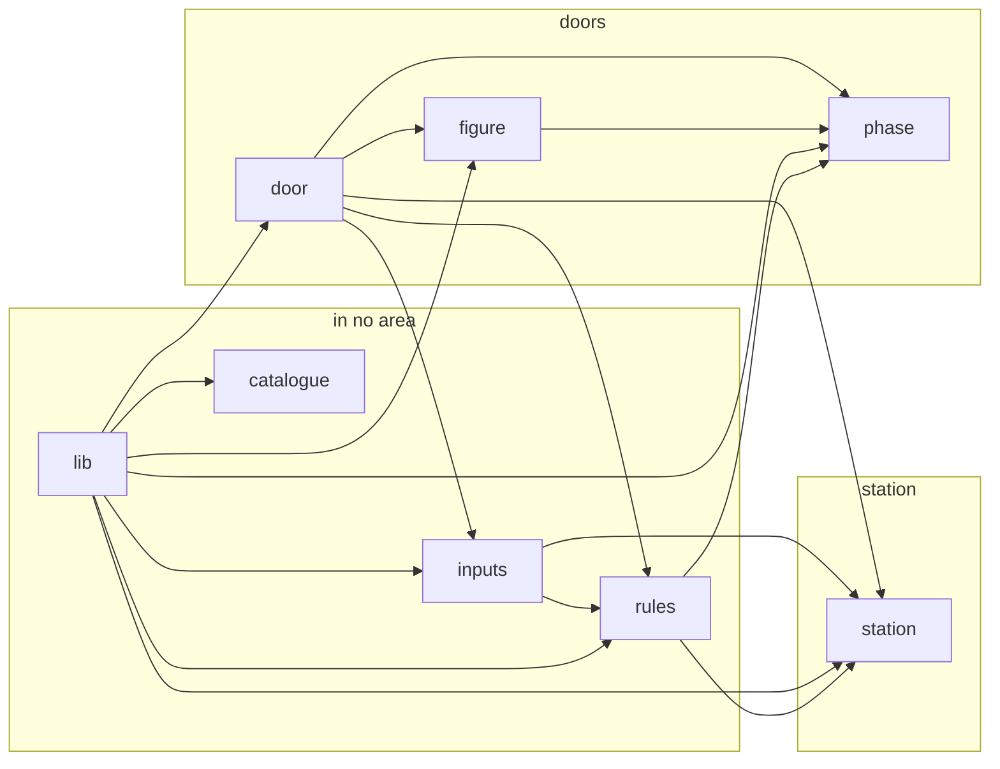

### world-doors

`crates/clean/world_doors`, 8 modules.

| Module | Area | Says it is | Items | Score | Lines |
| --- | --- | --- | --- | ---: | ---: |
| `catalogue.rs` | - | The catalogue: one behaviour for each entry of the spec, with its kind, its switch and how it is checked. | `enum BehaviourId (16)`, `struct Behaviour`, `const CATALOGUE`, `fn catalogue` | 17 | 164 |
| `colours.rs` | passage | The screen's colours as the passage reads and sets them: the dark colours it heads for, the fade's steps toward the colours headed for, and her visor's colour as she lands. | `const COLOURS`, `enum ColourGroup (5)`, `struct Palette`, `fn head_for_dark`, `fn light_visor`, `struct FadeTime`, `fn fade`, `FadeTime::{START, is_last, next}`, 5 private | 459 | 91 |
| `io.rs` | - | What a frame brings the doors and what the doors answer it. | `struct Scene`, `struct Inputs`, `enum Activity (6)`, `enum RoomCall (8)`, `enum RoomSound (3)`, `enum HerSound (2)`, `enum CostEvent (5)`, `enum Cost (3)`, `enum SlideScreen (2)`, `enum Finishing (3)`, `struct Report`, `struct Exports`, `Report::{play, of_passage}`, 1 private | 82 | 122 |
| `lib.rs` | - | The world-doors model, built from its behaviour spec alone: the passage through a door to a room, from the frame after she touches it until play goes on in the next room. | - | 0 | 17 |
| `passage.rs` | passage | The passage's state: what a caller holds from one frame to the next, saves and restores, and builds at any value the spec allows to start play part-way. | `enum Doors (2)`, `struct Passage`, `enum Phase (8)`, `enum Fetching (3)`, `const LAST_BEFORE_THE_SLIDE`, `const LAST_LANDING`, `struct WorkFrames`, `struct Arrival`, `Passage::START`, `WorkFrames::{FIRST, new, get, next}` | 47 | 69 |
| `rules.rs` | - | The tuning values the spec lists as parameters, with the spec's values as their default. | `enum Axis (2)`, `struct Rules`, `Axis::of`, `impl Default for Rules`, 6 private | 45 | 47 |
| `step.rs` | passage | The step: one frame of the doors, from the state a caller holds and what the frame brings to what the frame answers. | `Doors::step`, 18 private | 2,173 | 339 |
| `view.rs` | passage | Where the passage puts the view and her: the moves along the way she leaves, the squaring, the set-off, and where she is placed, lands and steps clear. | `fn toward`, `fn plus`, `fn pixels`, `fn at_pixels`, `fn squared`, `fn setting_off`, `fn place`, `fn settled`, `fn stepped_clear`, 11 private | 553 | 129 |

Its crate root exports:

- from `catalogue`: `Behaviour`, `BehaviourId`, `CATALOGUE`, `catalogue`
- from `colours`: `COLOURS`, `ColourGroup`, `FadeTime`, `Palette`
- from `io`: `Activity`, `Cost`, `CostEvent`, `Exports`, `Finishing`, `HerSound`, `Inputs`, `Report`, `RoomCall`, `RoomSound`, `Scene`, `SlideScreen`
- from `passage`: `Arrival`, `Doors`, `Fetching`, `LAST_BEFORE_THE_SLIDE`, `LAST_LANDING`, `Passage`, `Phase`, `WorkFrames`
- from `rules`: `Axis`, `Rules`

The public functions a caller reaches through them:

```rust
catalogue() -> EnumMap<BehaviourId, Behaviour>
FadeTime::is_last(self, steps: u8) -> bool
FadeTime::next(self, steps: u8) -> Option<Self>
Report::play() -> Self
WorkFrames::new(n: u8) -> Option<Self>
WorkFrames::get(self) -> u8
WorkFrames::next(self) -> Option<Self>
Axis::of(way: Heading) -> Self
Doors::step(self, scene: Scene, inputs: &Inputs, rules: &Rules) -> Exports
```

Shared types it takes from `types`: `Checked`, `Colour`, `Fixed`, `Heading`, `Kind`, `PIXEL`, `Pair`, `Parts`, `Position`, `Px`, `Set`, `Switch`, `ZERO`, `by_member`, `fixed`, `px`, `set_of`. Other crates it uses: `core`, `enum_map`.

Which module uses which, grouped by area (a module's own area, its functions counted elsewhere aside):

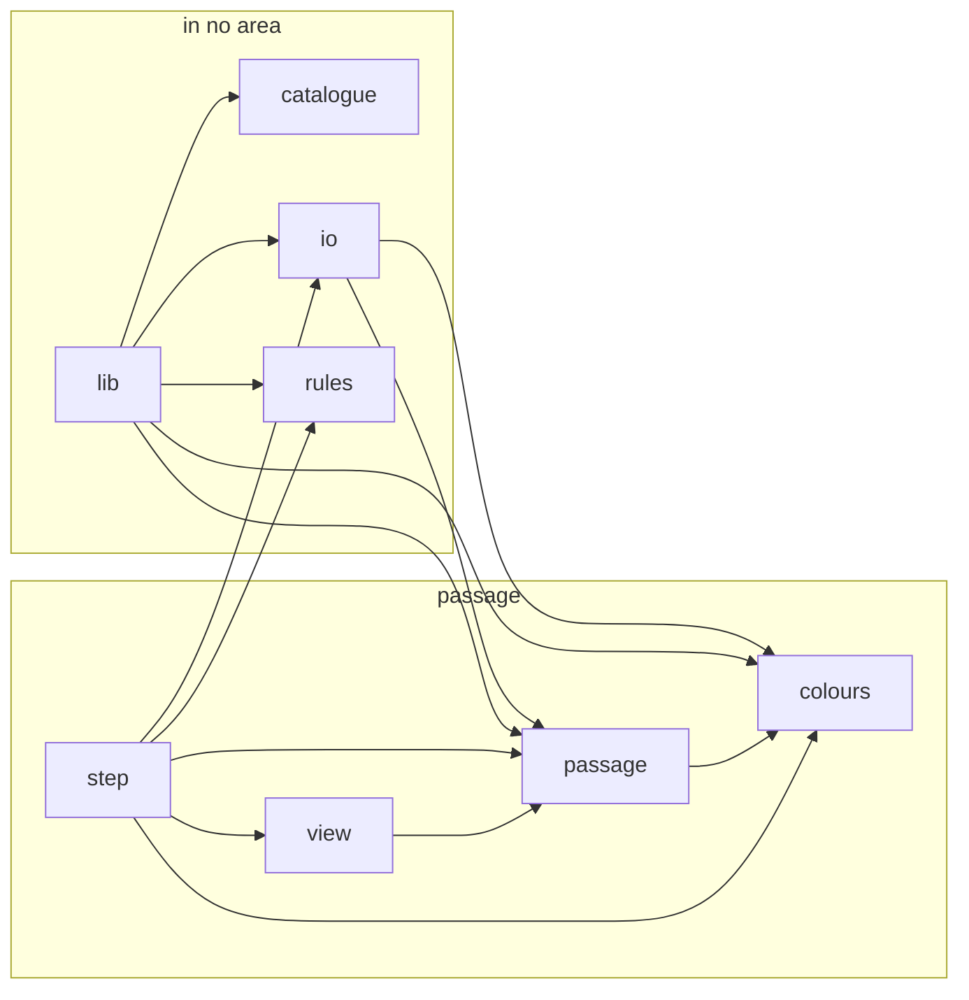

### Shared types by model

The public items of `crates/clean/types` the clean models share, and the models that name each.

| Item | Used by |
| --- | --- |
| `type Fixed` | samus-appearance, samus-movement, world-camera, world-doors |
| `type Px` | boss-ceres-ridley, samus-movement, world-camera, world-doors |
| `fn fixed` | samus-movement, world-camera, world-doors |
| `fn px` | samus-movement, world-camera, world-doors |
| `trait Parts` | samus-appearance, samus-movement, world-camera, world-doors |
| `const ZERO` | samus-movement, world-doors |
| `const PIXEL` | world-camera, world-doors |
| `fn part_below` | samus-movement |
| `fn below` | world-camera |
| `struct Colour` | world-doors |
| `struct Pair` | boss-ceres-ridley, interface-hud, samus-movement, world-blocks, world-camera, world-doors |
| `type Position` | samus-movement, world-camera, world-doors |
| `type Radius` | boss-ceres-ridley, samus-movement |
| `enum Heading (4)` | samus-movement, world-blocks, world-doors |
| `enum Side (2)` | boss-ceres-ridley, samus-movement |
| `enum Facing (3)` | samus-movement, world-camera |
| `enum Body (4)` | samus-appearance, samus-movement |
| `enum Action (16)` | samus-appearance, samus-movement |
| `enum Aim (5)` | samus-appearance, samus-movement |
| `enum Turn (4)` | samus-appearance, samus-movement |
| `enum LandedFrom (2)` | samus-appearance, samus-movement |
| `enum Gun (2)` | samus-movement |
| `enum Legs (2)` | samus-movement |
| `struct Pose` | samus-appearance, samus-movement |
| `enum Sprite (4)` | samus-appearance, samus-movement |
| `enum ClipEnd (2)` | samus-appearance, samus-movement |
| `enum BoostStage (5)` | samus-appearance |
| `enum AnimationSound (4)` | samus-appearance |
| `struct Buttons` | samus-movement |
| `mod button` (RUN, JUMP, SHOOT, LEFT, RIGHT, UP, DOWN, AIM_UP, AIM_DOWN, SIDES, PAD) | samus-movement |
| `type Cell` | samus-movement, world-blocks |
| `enum Way (2)` | samus-movement, world-blocks |
| `struct Touch` | samus-movement |
| `enum Block (6)` | samus-movement |
| `enum Parity (2)` | samus-movement |
| `enum SlopeFaces (2)` | samus-movement |
| `struct Slope` | samus-movement |
| `struct Hitbox` | boss-ceres-ridley, samus-movement |
| `trait World` | samus-movement |
| `enum Kind (5)` | boss-ceres-ridley, interface-hud, run-progress, samus-appearance, samus-movement, weapons-projectiles, world-blocks, world-camera, world-doors |
| `enum Switch (3)` | boss-ceres-ridley, interface-hud, run-progress, samus-appearance, samus-movement, weapons-projectiles, world-blocks, world-camera, world-doors |
| `enum Checked (2)` | boss-ceres-ridley, interface-hud, run-progress, samus-appearance, samus-movement, weapons-projectiles, world-blocks, world-camera, world-doors |
| `type Set` | run-progress, samus-appearance, samus-movement, world-blocks, world-doors |
| `fn set_of` | world-doors |
| `trait Members` | run-progress |
| `fn by_member` | world-blocks, world-doors |
| `enum Area (7)` | run-progress |
| `enum Item (11)` | run-progress, samus-appearance, samus-movement |
| `enum Beam (5)` | run-progress |
| `enum Event (18)` | run-progress |
| `enum BossKind (3)` | run-progress |
| `struct LocationId` | run-progress |
| `struct DoorId` | run-progress |
| `struct StationId` | run-progress |
| `struct Entrance` | run-progress |
| `const LAST_PICTURE` | - |
| `struct Picture` | interface-hud, world-blocks |
| `enum Flip (4)` | interface-hud |
| `struct Look` | interface-hud, world-blocks |
| `enum ScreenKind (3)` | world-blocks, world-camera |
| `type Screen` | interface-hud, world-blocks |
| `enum Point (3)` | world-blocks |
| `enum HitBy (6)` | world-blocks |
| `enum Motion (3)` | world-blocks |
| `enum Family (6)` | world-blocks |
| `enum MetAs (3)` | world-blocks |
| `enum Script (3)` | world-blocks |

### Bridges

The engine files (`crates/game/src`) that name each model's crate: its bridge, which the registry names, and the others. Names are what each takes from the model.

| Model | Engine file | Part | Names | Score | Lines |
| --- | --- | --- | --- | ---: | ---: |
| samus-movement | `crates/game/src/samus_appearance_bridge.rs` | names it | `Dashing`, `Outcome`, `StandingAnimation`, `WallTest` | 575 | 147 |
| samus-movement | `crates/game/src/samus_movement_bridge/frame.rs` | bridge | `Frame` | 352 | 71 |
| samus-movement | `crates/game/src/samus_movement_bridge/state.rs` | bridge | `Bounces`, `Carry`, `Dashing`, `FrameBefore`, `JumpHeld`, `Moment`, `Phase`, `Run`, `Samus`, `Seat`, `Spin`, `Vertical` | 978 | 186 |
| samus-movement | `crates/game/src/samus_movement_bridge/step.rs` | bridge | `Outcome`, `Rules`, `Samus`, `SpeedCap` | 544 | 126 |
| samus-movement | `crates/game/src/samus_movement_bridge.rs` | bridge | - | 1,285 | 214 |
| world-camera | `crates/game/src/session.rs` | names it | `RoomError` | 579 | 211 |
| world-camera | `crates/game/src/world_camera_bridge.rs` | bridge | `Camera`, `Frame`, `Heights`, `LeadSetting`, `Room`, `RoomError`, `Rules`, `Samus` | 505 | 120 |
| run-progress | `crates/game/src/run_progress_bridge.rs` | bridge | `Condition`, `EnteredRoom`, `Inventory`, `Pickup`, `Progress`, `Remembered`, `Report`, `ReserveMode`, `RoomStates`, `Rules`, `Supplies`, `Supply`, `Version` | 1,343 | 272 |
| interface-hud | `crates/game/src/interface_hud_bridge.rs` | bridge | `Ammo`, `Ammunition`, `CancelButton`, `ColourSet`, `Controls`, `Dropped`, `Energy`, `Equipped`, `Flip`, `FrameCount`, `FrameInputs`, `HerMap`, `HudGrid`, `HudPictures`, `HudState`, `Icons`, `MapCellSet`, `MapPictures`, `MiniMapInputs`, `MiniMapPower`, `Mute`, `Place`, `Reserve`, `ReserveMode`, `Room`, `Rules`, `SelectButton`, `SelectableItem`, `Selection`, `Shown`, `Status`, `Stock`, `Tile` | 2,314 | 388 |
| world-blocks | `crates/game/src/world_blocks_bridge.rs` | bridge | `Becomes`, `CellKind`, `Frames`, `Grid`, `Inside`, `Mark`, `Meeting`, `OtherMetAs`, `OutsideTheRoom`, `PatternCell`, `Place`, `Placement`, `Places`, `ReactingBody`, `Reaction`, `ReactionName`, `Request`, `Rules`, `Run`, `Running`, `ScreenChange`, `ScrollReaction`, `SoundRequest`, `StandIn`, `State`, `Step`, `Tile`, `Touched` | 7,107 | 1,062 |
| samus-appearance | `crates/game/src/samus_appearance_bridge/import.rs` | bridge | `Branch`, `Clip`, `Content`, `Control`, `Figure`, `Hold`, `Instruction`, `Pace`, `Paces`, `Step` | 1,168 | 205 |
| samus-appearance | `crates/game/src/samus_appearance_bridge.rs` | bridge | `Ahead`, `Dash`, `Frames`, `Inputs`, `Laps`, `LapsLeft`, `Liquid`, `MoveEvent`, `Playhead`, `Rules`, `SoundsWaiting`, `State`, `Step`, `update` | 575 | 147 |
| boss-ceres-ridley | `crates/game/src/boss_ceres_ridley_bridge.rs` | bridge | `CeresDoor`, `DoorKind`, `FigureLook`, `Inputs`, `Phase`, `Placement`, `Quarter`, `Rules`, `Stage`, `Wait` | 1,118 | 222 |
