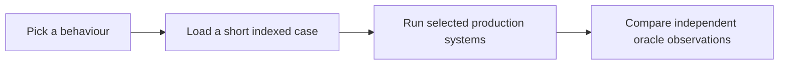
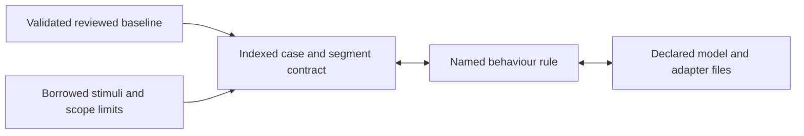

# Status: how to measure it

Current acceptance is indexed production replay. The committed
[index](../scenarios/replay/index.toml), [baseline](../scenarios/replay/baseline.toml) and
[transition ledger](../scenarios/replay/transition.toml) define witnesses, exact obligations and
reviewed replacement/loss dispositions. Generated numbers live in [REPORT](REPORT.md) and the
README status; regenerate them as [BUILDING](BUILDING.md#the-status-and-the-report) describes.



## The headline milestone

The goal remains power-on through Ceres using movie inputs only, every compared cut and output
byte matching. Scoped and integrated witnesses are useful progress but do not substitute for
whole-movie execution. Required missing boot, clock, controller, actor or passage owners remain
explicit unsupported boundaries. Borrowed facts never count as modeled producers.

## Frames played alone

The rung measure is the number of cuts a room plays alone from its seed.
[`verify::replay::played`](../crates/verify/src/replay/played.rs) admits the whole-frame
owner [`game::production::played`](../crates/game/src/production/played.rs) once from the seed
record. Each frame of play it steps her clip's look ahead, `Samus::step`, the animation update,
the camera and the doors, once each, in any pose with imported content. A frame whose moves
reach a door to a room plays out whole; from the next, while the passage runs, the doors step
alone and move her position, the view, where the camera last saw her and the colours. As each
of the passage's calls is done, the room's loading
([`game::production::room_loading`](../crates/game/src/production/room_loading.rs)) loads its
part of the next room from the imported world, tilesets, species and sprite palettes, in the
version her progress chooses. Fetching the tiles heads the colours for the tileset's. Fetching
the contents heads the sprite rows for her suit's, the species' the version loads, the common
sprites' and the flashing enemies' palettes, and the Ceres doors' colour set for the station's
stage. It also shows her shots' palette for the beams she has switched on at once. Each later
cut's only new input is the movie's pad from the preceding vblank. The run compares those
owners with the record at every NMI return and stops at the first difference or the first
unsupported pose or content. Room facts with no selected producer yet are read once from the
seed and held; `SEED_HELD` names them, and each is a missing owner. Her spin's frame count is model
history the record cannot tell apart in a spin's first two frames, so it is compared only
through its effects. The comparison is at frame cuts; it does not compare intra-frame bus
timing. While she follows the pad the game keeps no way for her run of its own, so her run's way
is compared only while she carries on, and otherwise through her position.

Lag is borrowed until the platform's costs are modelled (MODEL decision 35); `BORROWED` names
it. The runner reads one fact per cut from the record: whether the NMI found the frame's work
finished. A lag NMI finds it part-done, so the game commits no new picture (the screen keeps the
previous snapshot) and the work runs on into the next frame. In a passage this is the doors'
"work done" input: the phase holds, and only the placing and the slide move. The contents'
fetch is the exception, borrowed as done on its first frame. Its work waits on its own uploads,
so every NMI through it is a lag NMI, and none says when its colours were set. The record shows
them set within the slide and the visor lit as the slide ends, and only a fetch done before
the slide's end does that. Its first frame is the earliest such frame. The colours are
compared only at cuts whose work finished, since a lag cut finds a fade's step part-done. The
game's frame counter, and so her parity, counts each NMI that reads the pad. A lag cut in play
is still a named stop: the M0 row has none, so no record yet shows how it plays.

```sh
$TOOLS replay played chain-any-0003-DFD7 0 344 \
  --cache "$CACHE" --rom "$ROM" --lock scenarios/locks/lsnes.toml
```

It prints one `PLAYED_ALONE` line: the cuts held and where the run stopped, by cut and field or
dependency name only. CI runs it for the M0 row from its seed (cut 0) and from cut 6 when
dispatched with the target `played`. It is a diagnostic, not yet an indexed obligation.

Two planted faults in the fault matrix stop that run at a recorded cut. A pad one frame stale
fails the runner's pad alignment check at cut 2, and a camera State held rather than carried
differs at cut 1 in `camera.view.x.fraction`. Each plays cuts 1 to 41 of the M0 row, a span
the run holds.

## Intra-frame timing and the played-alone run

Rungs compare owners' State and output bytes at NMI cuts (MODEL decision 35). Intra-frame
timing is T1's: absolute master-tick clocks, ordered hardware callbacks, ordered CPU port
access, the Contact latches at post-RTI clocks and Random's ordered device transfers. No
indexed case compares them, and production has no frame caller that schedules them.

The played-alone run carries Movement, Appearance, Camera and Doors from the M0 seed. The HUD,
Health, Random and Haze fields at those frames are covered only by their models' vectors and
by the scoped `health/ceres-tail-drawing-gauge`, `hud/stationary-map-blink` and
`connected-ordinary/early-mini-map` cases, until their owners join the loop. Weapons, Contact,
the sound queue and the Ceres door actor at the opening shot wait for the loop in the same way.
The [transition](../scenarios/replay/transition.toml) records each retired frame case, the
owners its cut-level fields wait for and the indexed cases that still witness part of it.

The played-alone run, once indexed for M0, accounts for the row's earlier claims. It covers
42 transition claims on `chain-any-0003-DFD7`: the floor and free-run floor of each of
`samus-movement`, `samus-appearance`, `world-camera`, `interface-hud`, `game-time`,
`boss-ceres-ridley`, `weapons-projectiles`, `enemy-interactions` and `audio-transport`; the
fourteen camera receipt floors; the three lockstep entries; and the seven CI requirements,
`ordinary/*` at 183 cuts and `movement/M0-*` at 181. It also covers the seven matching
prior-claim requirements. Each is accounted for once the run holds through the cuts it claims.
Claims past cut 184 need the lag cuts as borrowed inputs: `interface-hud` at 225, and
`game-time`, `boss-ceres-ridley`, `weapons-projectiles` and the receipt frame count at 341 or
more. The row's `run-progress`, `world-blocks`, `world-doors`, `uncompared` and stream-gate
entries don't depend on the played-alone run.

## The models' gain over the null model

A witness must exercise a rule, not merely compare unchanged fields. Catalogue entries name
rules; cases are witnesses and many cases may be needed per rule. Unit vectors and adjusted
parameter vectors remain development checks. Meaningful planted faults establish whether
indexed comparisons distinguish incorrect behaviour. Historical null-model and harness figures
are not current production acceptance and must be labelled as historical evidence.

[`tools/mutants.toml`](../tools/mutants.toml) pins one production wiring fault per supported
responsibility to its exact recorded Difference cut and field. With `SM_CACHE`, `SM_ROM` and
`SM_AUDIO_NATIVE` set, `python3 tools/check_mutants.py` first requires a Pass, temporarily
applies each fault, restores the source byte for byte, then requires the original complete
receipt again, including its digest and counts. Each fault's `before` text must match its
file exactly once, so a refactor that moves or duplicates a patched line fails Quality's
fault-runner test and the fault plan before any build. Full pull-request, scheduled and manual CI
run every fault. A fast-forward to main reuses a successful pull-request verdict for the
same head and tested tree. Missing evidence runs every fault. The supported responsibility
inventory comes from the index and reviewed baseline, so omitting an owner fails the check.
Weapons and contact have separate faults in their shared case. The movement/Ceres connection
has a separate fault substituting the door centre for held movement proximity.

These faults exercise movement scheduling, elapsed audio time, cannon permission, contact
permission, camera following, HUD clock input, animation scheduling, event delivery and Ceres
scheduling. They prove the named comparisons detect those errors within the existing scoped
cases and the narrowly integrated movement/Ceres connection. They do not prove all rules,
borrowed producers, omitted outputs or pixels. Unsupported
cases remain held boundaries and require no fault credit until they have reviewed Pass cases.

## Scoped Ceres tail contact

The indexed `health/ceres-tail-drawing-gauge` case starts from the authenticated native cut
992. Its input-only scoped actor requests current protection twice and delivers one impact
before Maintenance on the first opportunity. Current Health carries energy, pending loss,
warning and protection between those reads. Drawing commits its own energy history, ordinary
HUD status publishes the CPU gauge, and the qualified late close ages protection before the
next actor query. The scoped and retained Drawing callers share the live energy comparison
and fresh energy-history commit. The retained caller also qualifies controls and rendering.
Both opportunities compare independent observations, including all sixteen
gauge words. The protected duplicate and a stale gauge with current shown energy are separate
constructed controls. Physical gauge writes require separate timing and publication evidence.

The actor's geometry and hit selection, the Warning receiver, and Drawing's hurt-flash and
rendering producers require separate admission. The scope includes two auxiliary cuts and
adds no played-alone frames.

## The ratchets and floors

The replay baseline binds the exact index bytes to each measured result, comparison counters
and observation digest. Behaviour obligations require completed comparisons. Boundary
obligations require the exact named Unsupported result and remain distinct from passing cases.
Missing source data, a zero-case selection, an empty comparison schedule or an earlier boundary
cannot satisfy the corresponding obligation. The transition ledger accounts for retired
lockstep, gate, localiser, per-domain execution and frame case claims; there is no second
acceptance runner.

```sh
TOOLS=target/verify/tools
INDEX=scenarios/replay/index.toml
$TOOLS replay list "$INDEX" --rule samus-movement/TravelledDistances
$TOOLS replay run "$INDEX" --case movement/D-inherited-cut \
  --cache "$CACHE" --bundle "$BUNDLE" --rom "$ROM" --native "$NATIVE"
$TOOLS replay check "$INDEX" --all --baseline scenarios/replay/baseline.toml \
  --cache "$CACHE" --bundle "$BUNDLE" --rom "$ROM" --native "$NATIVE"
```

`run` reports selected outcomes; `check` compares them with the reviewed baseline. `--write`
writes safe TOML receipts containing IDs, counts, field names and hashes, not ROM-derived values.
Local case selection is useful diagnosis; required acceptance runs the complete index. Cases
carry production State from the admitted start with no feedback from expected records and no
automatic reseed after failure. Scope declares selected owners, borrowed stimuli, compared
fields/outputs and excluded consumers. A movement case without rendering proves no pixels.

## Scoped sender offers

Install the encrypted [sender offer fixture](../tools/ci/fetch_sender_offers.sh)
with `bash tools/ci/fetch_sender_offers.sh "$ROM" "$NATIVE"`, then select
`--rule audio-transport/OfferAcceptance --native "$NATIVE"` in the shared replay command.

Each recorded case admits one group's independent starting bracket and the borrowed offer
from `inputs.toml`. The case calls the production AudioSender Offer entry. It compares
the full oldest-first FIFO and committed progress against `expected.toml` at the first
following selected-group service entry. The index uses the source video cut and the
ingress identity distinguishes the two offers at cuts 157 and 183. Source chronology
qualifies the borrowed cross-group order. Live producer order, physical timing, replies
after the initial bracket and sender service are outside this scope.

The constructed cases exercise same-group order, duplicates, capacity, reduced allowance
and three suppressors. The saved final cut checks restoration of the complete scoped
sender, including the seed reply. Each native case has one independent seed.

## Live soft touchdown

The two Magnet Stairs windows start at their own locked predecessors. Each decodes Movement's
complete prior state and committed figure and supplies the observed controls, prior terrain and
two solid actors in their current Movement-entry order. The scoped caller plays Movement's whole
frame. It sends the actual Land request to the Contact FIFO with the producer's allowance and
current suppression, then passes the separate graphics opportunity and selected figure to the
dry Appearance arm. The replay compares her landing position and vertical speed, her downward
travel after the floor clips it, her position after her moves (where the pose fit starts), the
accepted response, the Contact offer and Appearance clear publication. The requested downward
distance, the fit's result and its clearance tests happen inside the frame, have no whole-frame
counterpart and are not compared. The scoped Contact owner stops after the offer.
The next native service-entry snapshot independently corroborates its FIFO. The pinned bracket
contains no intervening Contact offer or service, and the case advances neither the intervening
clock nor the service. The offer and clear command count as two scoped outputs. The publication
counter measures physical callback streams and is zero here.

Install the [touchdown fixture](../tools/ci/fetch_movement_touchdown.sh) and the sender-offer
fixture under the same native source directory. Use the common replay command with
`--case movement/soft-touchdown-57 --case movement/soft-touchdown-124`. The checkpoints
restore each disjoint window from its own starting owners. The physical ring and Contact port
service have separate boundaries.

## Live gameplay sound producers

Select the two `gameplay-sound/` cases with the shared replay command. Install the
[sender brackets](../tools/ci/fetch_sender_offers.sh) and [passage
fixture](../tools/ci/fetch_passage_offers.sh) under the same native directory.

At cut 183 the scoped passage starts at the retained touched doorway and evaluates the ordinary
Doors first-entry and Appearance `PassageEntry` decisions. The current Action silence and the
room's Ambient silence enter through the same sender Offer path before Hold. The comparison
checks global order, the two complete at-use FIFO windows, committed terminal queues and the
Hold transition. Public saves after each offer restore the remaining publications and refuse
advancement at the sender-service boundary. The held-shoot control keeps the Ambient offer
and Hold while the Appearance read emits no Action cue.

Native cut 184 independently shows both active senders AwaitCue while all three FIFOs are
empty. The following production owner is physical sender and readiness service. The scoped
live audio callers still leave spin start/end, impact, wall-jump, hard landing and unrelated
actors unsupported.


## Finding the code for a replay segment

The read-only `map` command joins the typed index and validated reviewed baseline with
[rule-to-code metadata](../scenarios/replay/code-map.toml). It executes no replay and needs no
ROM or cache. Each rule declares model and adapter files; navigation targets point to its
catalogue or specification. Targets are existing repository-relative files, without line or
symbol claims. The complete mapping is validated before filtering: missing, duplicate,
unknown and dangling entries fail even when the query selects another rule.



Run from the repository root, using the `TOOLS` and `INDEX` above:

```sh
$TOOLS replay map "$INDEX"
$TOOLS replay map "$INDEX" --case movement/W15
$TOOLS replay map "$INDEX" --rule samus-movement/TravelledDistances
$TOOLS replay map "$INDEX" --path crates/clean/samus_movement/src/travel.rs
$TOOLS replay map "$INDEX" --mapping scenarios/replay/code-map.toml \
  --baseline scenarios/replay/baseline.toml --repo . --case audio/native-expire-post64
```

Mapping and baseline paths default to `code-map.toml` and `baseline.toml` beside the index.
`--repo` defaults to the working directory and sets the root for target validation; other
argument paths resolve from the working directory. `--path` requires the exact declared
forward-slash repository-relative filename. Multiple `--case` values select their union;
case, rule and path filters intersect. An unknown selector or empty result fails.

The TOML report keeps `declaration` from the index, `reviewed_requirement` from the baseline
and `declared_relevance` from the mapping separate. Requirements include exact expected
outcomes, counts and observation digests; they are reviewed obligations, not fresh results.
Borrowed providers, phases, fields and limits stay in the declaration and do not become rule
proof. File links express declared relevance, not exhaustive impact or measured coverage.

The default query shows all indexed cases, including three empty-rule boundaries with empty code
links. A travel-file query includes the scoped witness and the integrated and movie held
Unsupported boundaries. A boundary's rule references do not make it a passing behaviour proof.
Mapping queries never select or skip landing checks; the complete index remains required.

Cache cuts are local to the named record row: W15 starts at cut 814 and compares cuts 815
through 817 of `item-morph-ball`. Native seeds and checkpoints use native fixture coordinates;
the post-intervention audio case compares original fixture cuts 65 through 183 from its
independent cut-64 seed. Power-on starts have their own coordinate family. The report exposes
the index's lock path and source declarations; it supplies no movie-global offset conversion.

## Making the record cache


`CACHE` is made by `oracle corpus ROM scenarios/lock.toml DATA --oracle lsnes --native-seeds
BUNDLE/seeds --from-frame-pads PADS --cache CACHE --only ROW` (ORACLE §6): lsnes plays the row's
frame pads from its native seed and writes the lean tier, `CACHE/ROW/lean.bin` and, last,
`lean.txt` with the lock pins `verify::cache` checks: about 2 KB a frame, each frame's memory
changes with the whole memories every 256th frame. `DATA` is the old lock's decrypted bundles
(corpus still reads each row's seed and movie name there); `--cache-pictures` writes the full
tier instead (`records.bin`, `index.txt`, 330 KB a frame with its picture), which only the
compositor's checks need. `tools cache-lean` turns a full tier into a lean one.

`tools/oracle/record_caches.sh ROWS BUNDLE DATA ROM CACHE [JOBS]` does it for a list of rows,
8 lsnes at a time, skipping rows already cached, one log line per row; with `WATCH_PCS` set it
passes `--watch-pcs` too, for the `hits.txt` the independent causal input providers can read.
`ORACLE` names the oracle command (the Python DLL runner where Defender blocks executables).

## The movement/Ceres connection

The indexed `movement-ceres/carried-position-proximity` case admits complete movement and slot0
Ceres owners together at cut6 of `chain-any-0003-DFD7`, then compares positions and five door fields
at7..10. Production derives Ceres proximity from held movement whole pixels before advancing
movement. Both owners and all outputs commit atomically. No separate writable position receipt
or record refresh exists. Both scoped and connected recipes call the same adapters.

Its external ordinary opportunities come from the reviewed passive capture pinned by
[movement-opportunities-capture-manifest.toml](../scenarios/replay/movement-opportunities-capture-manifest.toml),
[provenance](../scenarios/replay/movement-opportunities-capture-pins.toml) and
[first-record manifest](../scenarios/replay/movement-opportunities-first-record-manifest.toml).
`tools/ci/fetch_movement_opportunities.sh` fetches the immutable encrypted evidence into the
`movement-opportunities-v1` child of the `--native` directory. Rust admission checks file integrity,
independent input-record alignment, requested cut identity, exact ordered completed work and
all actual-read premises. Missing evidence is DataFailure; incompatible intact opportunities
are Unsupported. Expected observations never supply these facts.

Prior cuts6..9 must have empty interactive rosters before any actor geometry is decoded. World,
controls, equipment, appearance ahead feedback, station stage and actor scheduling remain
external. The case proves only this position connection and its declared comparisons; no durable
Ceres continuation, pixels, application, power-on or played-alone coverage follows.

## Carried ordinary movement, appearance and camera

The connected ordinary witness starts once at cut6 and compares nine actual opportunities
through cut15 in one production owner, which steps each model once per frame in the played
owner's order. Complete Movement, the four Appearance quantities, the playing Figure and all
nine Camera components are observed, along with four directional travels per frame. Ahead reads
the retained playing state before her moves; Appearance plays her stride, the animation update
and the pose selection from movement's outcome; Camera follows the finished movement and
retains its history.

The separately checked current source has five clip holds, four advances, its first wrap at
cut14 and one marked Contact at cut10, with its graphical contact and Footstep request. The
indexed case checks each cut's continuation from a checkpoint.

Controls, equipment, liquid, energy, occupancy, Contact guards, current terrain and actors,
and room settings are authenticated borrowed stimuli. Actor lifecycle, receiver execution,
health arithmetic, elapsed hardware time, complete Frame scheduling and played-alone
production remain outside this witness. Its package is fetched by
[the pinned connected fixture script](../tools/ci/fetch_connected_ordinary.sh); the declaration,
reviewed outcome and code navigation are in the existing replay index, baseline and mapping.

The second ordinary witness admits once at cut126 and carries the same selected owners through
cut142. It exercises current Run release and resumed growth, alternating Forward/DownForward
aim selection and its extra horizontal move, and reached non-square Floor/Surface terrain.
Its floor factors, vertical surface responses and unseated support checks are bounded witnesses;
stepped and ceiling terrain remain unsupported. The stale-Run fault is caught at cut141's complete movement State.
The [pinned second fixture](../tools/ci/fetch_connected_run_slope.sh) keeps its admission and source
identity separate from the first witness. The same borrowed producers and omitted consumers apply.

The scoped early mini-map witness starts once at cut 78 of the room-seeded Ceres row.
At 79 and 80 the staged HUD reads movement's position after her moves, before the aim step and
pose change, from the frame's outcome. It compares both exact early axes, the complete explored
bitmap and the fifteen mini-map cells. Cut 79 also compares complete Movement, Appearance with
Figure, and Camera against the independent carried record. Cut 80 plays its whole frame, into
the later spinning pose, and compares only the map. The ordinary and restored executions
compare both frames, and a frame without the map's inputs is rejected before any change.

The [early mini-map fixture](../tools/ci/fetch_movement_early_map.sh) supplies the independently
qualified current collision roster, control, room, clock and other borrowed inputs. Late HUD
status, physical Frame scheduling, VRAM and audio delivery are outside this scope.

## Scoped ordinary power shot and drawing

`weapons-contact/M0-power-shot-drawing` admits the vacant shot pool at cut 156 of
`chain-any-0003-DFD7`. The same weapon owner advances through the spawn, trail request and
actor 1 consuming shot slot 0 at cut 160. W1 carries the marked body until the next update
removes it. The exact sprite encoder receives the actual flying pictures on cuts 157 and
159. The witness compares the attributed low entry and high pair at each insertion, and
the absence of pictures at the other cuts. The pre-draw cursor, camera and phase come
from the independent watched fixture. The earlier drawing producers, full OAM contents
and hardware service are outside the scope.

The [drawing fixture installer](../tools/ci/fetch_shot_contact.sh) installs its hash-pinned
files.

