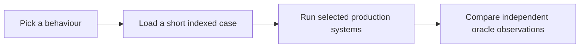

# Status: how to measure it

Current acceptance is indexed production replay. The committed
[index](../scenarios/replay/index.toml), [baseline](../scenarios/replay/baseline.toml) and
[transition ledger](../scenarios/replay/transition.toml) define witnesses, exact obligations and
reviewed replacement/loss dispositions. Generated numbers live in [REPORT](REPORT.md) and the
README status; regenerate them as [BUILDING](BUILDING.md#the-status-and-the-report) describes.



## The headline milestone

The goal remains power-on through Ceres using movie inputs only, every compared cut and output
byte matching. Scoped and integrated witnesses are useful progress but do not substitute for
whole-movie execution. Required missing boot, clock, controller, actor or passage owners remain
explicit unsupported boundaries. Borrowed facts never count as modeled producers.

## The models' gain over the null model

A witness must exercise a rule, not merely compare unchanged fields. Catalogue entries name
rules; cases are witnesses and many cases may be needed per rule. Unit vectors and adjusted
parameter vectors remain development checks. Meaningful planted faults establish whether
indexed comparisons distinguish incorrect behaviour. Historical null-model and harness figures
are not current production acceptance and must be labelled as historical evidence.

## The ratchets and floors

The replay baseline binds the exact index bytes to each measured result, comparison counters
and observation digest. Behaviour obligations require completed comparisons. Boundary
obligations require the exact named Unsupported result and remain distinct from passing cases.
Missing source data, a zero-case selection, an empty comparison schedule or an earlier boundary
cannot satisfy the corresponding obligation. The transition ledger accounts for retired
lockstep, gate, localiser and per-domain execution claims; there is no second acceptance runner.

```sh
TOOLS=target/verify/tools
INDEX=scenarios/replay/index.toml
$TOOLS replay list "$INDEX" --rule samus-movement/TravelledDistances
$TOOLS replay run "$INDEX" --case movement/D-inherited-cut \
  --cache "$CACHE" --bundle "$BUNDLE" --rom "$ROM" --native "$NATIVE"
$TOOLS replay check "$INDEX" --all --baseline scenarios/replay/baseline.toml \
  --cache "$CACHE" --bundle "$BUNDLE" --rom "$ROM" --native "$NATIVE"
```

`run` reports selected outcomes; `check` compares them with the reviewed baseline. `--write`
writes safe TOML receipts containing IDs, counts, field names and hashes, not ROM-derived values.
Local case selection is useful diagnosis; required acceptance runs the complete index. Cases
carry production State from the admitted start with no feedback from expected records and no
automatic reseed after failure. Scope declares selected owners, borrowed stimuli, compared
fields/outputs and excluded consumers. A movement case without rendering proves no pixels.

## Making the record cache


`CACHE` is made by `oracle corpus ROM scenarios/lock.toml DATA --oracle lsnes --native-seeds
BUNDLE/seeds --from-frame-pads PADS --cache CACHE --only ROW` (ORACLE §6): lsnes plays the row's
frame pads from its native seed and writes the lean tier, `CACHE/ROW/lean.bin` and, last,
`lean.txt` with the lock pins `verify::cache` checks: about 2 KB a frame, each frame's memory
changes with the whole memories every 256th frame. `DATA` is the old lock's decrypted bundles
(corpus still reads each row's seed and movie name there); `--cache-pictures` writes the full
tier instead (`records.bin`, `index.txt`, 330 KB a frame with its picture), which only the
compositor's checks need. `tools cache-lean` turns a full tier into a lean one.

`tools/oracle/record_caches.sh ROWS BUNDLE DATA ROM CACHE [JOBS]` does it for a list of rows,
8 lsnes at a time, skipping rows already cached, one log line per row; with `WATCH_PCS` set it
passes `--watch-pcs` too, for the `hits.txt` the independent causal input providers can read.
`ORACLE` names the oracle command (the Python DLL runner where Defender blocks executables).
