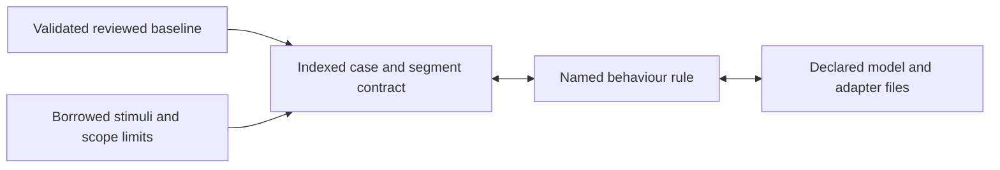

# Status: how to measure it

Acceptance is indexed production replay (MODEL §1 decisions 32 and 33). The committed
[index](../scenarios/replay/index.toml), [baseline](../scenarios/replay/baseline.toml) and
[transition ledger](../scenarios/replay/transition.toml) define witnesses, exact obligations and
reviewed replacement/loss dispositions. What counts as progress toward the headline milestone is
[MODEL §6](architecture/MODEL.md#6-how-progress-is-measured). `tools report` prints the generated
numbers, and the README shows the progress; [BUILDING](BUILDING.md#the-readme-and-the-report)
describes both. The record cache the cases read is made as [ORACLE §6](ORACLE.md#6-commands)
shows.

## Running indexed replay

What the index and baseline oblige is
[ARCHITECTURE §11](architecture/ARCHITECTURE.md#11-the-engine--oracle-comparison-contract):
behaviour obligations require completed comparisons, and boundary obligations the exact named
Unsupported result.

```sh
TOOLS=target/verify/tools
INDEX=scenarios/replay/index.toml
$TOOLS replay list "$INDEX" --rule samus-movement/TravelledDistances
$TOOLS replay run "$INDEX" --case movement/D-inherited-cut \
  --cache "$CACHE" --bundle "$BUNDLE" --rom "$ROM" --native "$NATIVE"
$TOOLS replay check "$INDEX" --all --baseline scenarios/replay/baseline.toml \
  --cache "$CACHE" --bundle "$BUNDLE" --rom "$ROM" --native "$NATIVE"
```

`run` reports selected outcomes; `check` compares them with the reviewed baseline. `--write`
writes safe TOML receipts containing IDs, counts, field names and hashes, not ROM-derived values.
Local case selection is useful diagnosis; required acceptance runs the complete index, with no
automatic reseed after a failure.

## Frames played alone

The rung measure is the number of cuts a room plays alone from its seed.
[`verify::replay::played`](../crates/verify/src/replay/played.rs) admits the whole-frame
owner [`game::production::played`](../crates/game/src/production/played.rs) once from the seed
record. Each frame of play it steps her clip's look ahead, `Samus::step`, the animation update,
the camera and the doors, once each, in any pose with imported content. Each frame of play
starts with her health (samus-health's whole frame, with no tail impact: Ridley's fight is not
in the loop) and ends, after her moves, with the HUD's frame of play. The HUD reads her position after
her moves, the energy Health leaves and its held neighbours. While a passage runs, the HUD takes
its step outside play, turned on when the doors turn the mini-map on. The run also compares
Health's State (energy, pending loss, warning, protection) and the HUD's State (the mini-map's
window, the status bar, the explored cells, the values last shown, the selection and the
mini-map's off), each part by name: Health at every cut, the HUD at every cut but the lag cuts
of the contents' fetch, from its first frame to the slide's end, which can find the fetch
part-done (Ridley's placing blanks the mini-map within it, below). The game's count of finished frames, which the
HUD reads as a frame begins (her cell's blink), is the played owner's too: a finished frame
counts it, and each frame on which the doors restart it (world-doors' `FinishedFrames`) counts
from 0. It is compared as `frame-count` at every cut. A frame whose moves
reach a door to a room plays out whole; from the next, while the passage runs, the doors step
alone and move her position, the view, where the camera last saw her and the colours. As each
of the passage's calls is done, the room's loading
([`game::production::room_loading`](../crates/game/src/production/room_loading.rs)) loads its
part of the next room from the imported world, tilesets, species and sprite palettes, in the
version her progress chooses. Building the room gives what play reads of her room from the
version's imported level and scroll areas: what her moves meet (its blocks, with those its
scroll PLMs and extensions place, and no actor's box), its doors to other rooms by cell, and
the camera's room (its screens, size and scrollers; the scroll areas past a preset room's
screens stay as they were), and turns the camera's lead back to ahead, as the original's build
does. The blocks PLMs place are set as the room is built, where the original sets them as its
contents are fetched; nothing reads her room between, and a version placing PLMs whose blocks
no owner places is refused at the build. Fetching the tiles heads the colours for the tileset's. Fetching
the contents heads the sprite rows for her suit's, the species' the version loads, the common
sprites' and the flashing enemies' palettes, then Ridley's room's colours where it places him
and the Ceres doors' colour set for the station's stage in the palette each door's placing names
(boss-ceres-ridley's `TheDoorsColours`), and refuses a version placing any other actor, whose
box no owner here places. The
room's setup and the door's own code are not run: the world names each by what it does
(`RoomSetup`, `DoorRule`), and fetching the contents refuses each that no owner models as a
named Unsupported (`LoadFault::RoomSetup`, `LoadFault::DoorRule`). It lets through only what
changes nothing play reads: no code; the station's haze (`RoomSetup::CeresHaze`), the setup
of the rooms on 0001's and 0003's paths, which only blends a backdrop colour over the screen;
the haze of Ridley's room (`RoomSetup::CeresRidleyHaze`), which also sets the tile bases and
the screen mode its floor is drawn with, which the loop doesn't draw; and the way out of the station's elevator room (`DoorRule::FromCeresElevatorShaft`), which
only turns the screen out of its rotating view: it sets the mode 7 flag and the PPU's fake mode,
which no loop owner produces and the run does not compare. The way into it is still refused. Fetching
the contents also shows her shots' palette for the beams she has switched on at once. Each later
cut's only new input is the movie's pad from the preceding vblank. The controller starts as the
seed leaves it, with the game's last read and the buttons that went down at it, so a button
held through the seed is not pressed again on the first cut. Her kept action, which the
record keeps as a movement type, is decoded as the one action her own poses (the map's) of
that type share, and refused where they share none; poses outside her map are not counted, a
limit of the decode, though the kept action is carried and no frame these runs play reads it. The run compares those
owners with the record at every NMI return and stops at the first difference or the first
unsupported pose or content. Room facts with no selected producer yet are read once from the
seed and held; `SEED_HELD` names them, and each is a missing owner. Her choices of her pose,
whether her latest and the one before it left her in a spin or a wall jump, are read from the
record's pose history (the old and old-old poses' movement types, which the game shifts only on
a frame that chooses) and compared at every cut as `movement.choices`. The comparison is at frame
cuts; it does not compare intra-frame bus timing. While she follows the pad the game keeps no way for her run of its own, so her run's way
is compared only while she carries on, and otherwise through her position.

The room's Ceres doors (boss-ceres-ridley's `CeresDoor`) play in the loop too. Their State is
decoded once from the seed record, each door in the room's order of its enemies, and carried
with nothing fed back. Each frame of play runs every door once through `CeresDoor::run`, before
her moves, reading where she was at the end of the last frame and the station's stage. Her
motion meets the boxes of the doors that were solid as the frame began. The original meets the
boxes in slot order and the held boxes keep no slots, so the doors' boxes come last and the
runner refuses a seed holding an actor box in a slot after a door's. In a passage the doors run on the frames of work the passage says the enemies run.
Fetching the next room's contents lets the last room's doors go and places the next room's
from the imported world: the version her progress chooses lists the Ceres doors its enemy
population places. The run compares how many doors the room holds, and each door's phase, wait, figure,
shown and solid, by its place (`ceres.0.phase`), at every cut whose frame of work finished,
since a lag cut can find the room's enemies part-built, with whether Ridley draws it
(`ceres.0.drawn-with-ridley`). The escape refuses the frame: its shakes read the screen's
shaking, which is not in the loop. A door's
request for its opening sound is produced but not compared: it belongs to the audio boundary
(MODEL decision 37), whose owner is not in the loop yet.

The Ceres shaft as she arrives (boss-ceres-ridley part 2) plays in room 1. The elevator's pad
and the cover below it (`PadAndCover`) are decoded once from the seed record, from their enemy
projectile slots, and carried. A seed whose lock on her disagrees with the pad's presence is
refused. They run once each frame of play, and on each frame of work a passage runs the
projectiles, after her own frame. While the pad holds her, her moves and her animation don't
run, and its run sets her height; the camera then reads her where the pad leaves her, with
nothing placing her, and the HUD's mini-map where her own frame left her. She is let go after
her frame on the pad's last run. The run compares the pad (its wait, position and look) and the
cover's position at every cut (`shaft.pad`, `shaft.cover`); their figures are drawing and are
not compared. The shaft's overlay is the actor of the doors' species the seed record or the
next room's contents place with first parameter 2. On each frame the room's enemies run, it
steps the lights (`Lights::step`) with the count of finished frames, the doors' fade's steps
taken and the station's stage; the beacon's step sets the six screen colours its imported
colour set names, compared as `doors.colours.screen`. The platform's look is the planes', which
the loop doesn't draw: it is produced and not compared. As the colours come up the lights run before
the fade's step, and read its steps taken without it; no record yet shows that order or that
case in a played run, since room 1 is not entered by a door before the escape, so unit tests
alone check them. In the escape a later piece owns the
overlay, so a room holding it refuses the frame (`Fault::Escape`). The count of finished frames
in sixteen bits, which nothing restarts, is the played owner's: carried from the seed's value,
it counts each frame the doors report finished or restarting, so the borrowed lag decides it.
It is compared as `finished-frames` at every cut, and her parity is its parity as the frame
begins.

Lag is borrowed until the platform's costs are modelled (MODEL decision 35); `BORROWED` names
it. The runner reads one fact per cut from the record: whether the NMI found the frame's work
finished. A lag NMI finds it part-done, so the game commits no new picture (the screen keeps the
previous snapshot) and the work runs on into the next frame. In a passage this is the doors'
"work done" input: the phase holds, and only the placing and the slide move. The contents'
fetch is the exception, borrowed as done on its first frame. Its work waits on its own uploads,
so every NMI through it is a lag NMI, and none says when its colours were set. The record shows
them set within the slide and the visor lit as the slide ends, and only a fetch done before
the slide's end does that. Its first frame is the earliest such frame. The colours are
compared only at cuts whose work finished, since a lag cut finds a fade's step part-done. A
lag cut in play is still a named stop: the M0 row has none, so no record yet shows how it plays.

Two more facts are borrowed, the second only through a passage. Audio's answer to the passage, whether a track waits in
the queue of tracks as the frame of work begins, is read from the record's music queue as the
main loop's start steps it once (world-doors' decode); the passage into Ridley's room waits on it
for 68 frames as his room's music loads; the earlier passages of these rows play as ready. Every
frame draws the game's random number once (game-random's `AdvanceRandom`) as its work begins,
whenever the last NMI found the last frame's work finished. In play the played State carries the
number from the seed and every draw is the loop's; it is compared as `random` at every finished
cut in play. Through a passage the number before the frame's draw is borrowed, the record's at
the preceding cut: no owner here models a passage's draws, whose own frames draw it on some
frames and not others, so a number carried through one falls out of step at the first passage
(0002's cut 238). The loop carries on from the passage's last borrowed draw.

Ridley's room as she enters (boss-ceres-ridley part 3) plays from room 5's passage into it.
Fetching the contents of a version whose population places Ceres Ridley places him first
(`CeresRidley::place`, his own place whatever the placement says, unless progress counts the
station's boss beaten), then the door of his room (`RidleyDoor`, the first parameter 3). The
importer names the door actors' first parameters 3, 5 and 6 as the door of his room and the
getaway's two walls; the walls are placed by his getaway, a later piece, so no population of
these rows places them. His placing hands on a boss encountered, which the HUD meets outside a
frame of play (interface-hud's `BossBlanksTheMap`, Ridley in Ceres: no screens explored), its
one producer here; the stage, which the played State carries from the seed and his placing sets
(calm); his room's colours, which the contents' fetch writes as the fade's goal (the baby's and
the door's own palette from his room's imported colours, the doors' palette black but for its
first colour, then the door's calm set in its own palette); and the music's stop and the shake's
stop, which are produced and not compared (audio's boundary and the screen's shaking are not in
the loop). Each frame the room's enemies run, his run comes first, reading whether a passage is
under way and the frame's random number; the doors run after him reading whether he is beaten
(progress's, held: no run here beats him). The baby's colour sets go to the screen's sprite row 3
at once, compared as `doors.colours.screen`, and its cry is produced and not compared. His
drawing, his look, the baby's and the doors he draws closed, is produced for drawing and not
compared. The run compares whether he is placed and his phase, wait, look, position and the
baby's routine, runs and position (`ridley.phase`, `ridley.baby.routine`) at every cut whose
frame of work finished. His waking (boss-ceres-ridley §13) runs in the played frame. His content,
the eye's 64 steps and the body's 16 colour sets, is imported and checked once. The eye's set
goes to the screen at once on colours 12 to 14 of sprite row 7 (the body's would go to colours 1
to 11 of rows 7 and 1), compared as `doors.colours.screen`; the run also compares his count,
runs, the roar's figure and its runs, his look, and whether he is tangible, moving and roaring,
read from his slot's properties and his words. What is played is his eye's fade, its first 26 of
64 steps (room 6's cuts 513 to 538). The body's fade, his wait, his roar, his turning tangible,
moving and roaring, and the two refusals (`Fault::RidleyTangible`, his tail's touch being part
4b's, and `Fault::RidleyFlying`, part 4c's) are reached by no played cut: they hold by the
vectors and the production tests only. The fight's music and the roar are produced and not
compared. Her going backwards, which the camera reads, is her skid or her moonwalk
(world-camera's `LeadingHer`); room 6's moonwalk at its left edge is the first played frame
that tells the moonwalk apart, at cut 352.

```sh
$TOOLS replay played chain-any-0003-DFD7 0 344 \
  --cache "$CACHE" --rom "$ROM" --lock scenarios/locks/lsnes.toml
```

It prints one `PLAYED_ALONE` line: the cuts held and where the run stopped, by cut and field or
dependency name only. An end past the row's last cut plays on through the rows that continue it,
the same capture's next seeds, without a new seed: each row's cut 0 is the video frame after
the last cut of the row before, and the run's cuts count on through it. The seed room's
geometry, door cells and camera room are held from the seed; each room a passage brings her
into is built from the imported world, with its map room and its Ceres doors. Played alone,
`chain-any-0001-DF45` holds all 411 cuts from her arrival: the pad lowers her from cut 29 and
lets her go at cut 101, and she leaves by room 1's door. `chain-any-0002-DF8D` alone holds all
281 cuts, `chain-any-0004-E021` all 263, and `chain-any-0006-E0B5`, Ridley's room, 538 from its
seed. Played back to back, the Ceres rows from `chain-any-0001-DF45` hold 2,162 cuts, through
rooms 2 to 5 and on to cut 538 of `chain-any-0006-E0B5`, and from `chain-any-0003-DFD7` 1,468;
from her arrival (`any-ceres-arrival`, below) they hold 2,385. Each stops at room 6's cut 539 in
`movement.pose`: her crouched turn, begun at 535, ends a frame later in production than in the
record, a samus-movement case whose amendment is specced and imported (knockback's round).
CI runs it for the M0 row from its seed (cut 0) and from cut 6 when dispatched with the target
`played`. It is a diagnostic, not yet an indexed obligation.

Thirty planted faults in the fault matrix, those of the responsibility `played`, stop
that run, or the run of another Ceres row from its seed, at a recorded cut. For example, a pad one frame stale fails the runner's pad alignment
check at cut 2, and a camera State held rather than carried differs at cut 1 in
`camera.view.x.fraction`. Every button held at the seed taken as newly pressed differs at
cut 17 in `movement.jump-held`, played from the M0 row's cut 16. A frame on which the doors
restart the frame count counted on instead differs at cut 238 in `frame-count`. The last room's
geometry, doors and camera room kept after a passage builds the next differ, played back to back
from the M0 row's seed, at cut 348 (the next row's cut 3) in `movement.position`. Of the Ceres doors' faults,
their State held rather than carried differs at cut 1 in `ceres.0.wait`, and the doors reading her position after her moves rather
than before differs at cut 7 in `ceres.0.phase`. In room 1, the pad's carry dropped from her
height differs at cut 29 in `movement.position`; the beacon reading the count as the frame
leaves it differs at cut 7, and reading no fade's steps at cut 257, in `doors.colours.screen`;
and a frame whose work overran counted as finished differs at cut 253 in `finished-frames`. The
beacon reading the HUD's count instead holds all 411 cuts: it reads bits 3 to 5 of the count,
which the two counts share until a passage restarts the HUD's, and no frame of the overlay
follows a restart before the escape. In Ridley's room, played from room 5's seed
(`chain-any-0005-E06B`), the slam's hold a frame longer differs at cut 288 in `ceres.0.wait`;
the passage into his room taken as finding the music always ready differs at cut 216 in
`ceres.0.phase`; Ridley read as no passage under way, so waiting from the passage's fade in, at cut 282 in
`ridley.phase`; his room's colours a colour out of place at cut 211, the passage's first cut
whose work finished after the fetch, in `doors.colours.goal`; and the HUD meeting Ridley in
Norfair rather than in Ceres at cut 211 in `hud.explored`. Played from room 6's seed, the baby's
colour sets not shown differ at cut 151 in `doors.colours.screen` (its first set, at 145, holds
the colours the row holds), and the random number not drawn as the frame's work begins at cut 1
in `random`.

The M0 row never shows a door blocking her: a fault that drops the doors' boxes from what her
motion meets holds all 344 cuts, and rows 0004 and 0005 as far as they play; the door of
Ridley's room locks behind her, out of her way. Only the unit
test of a door that opens in the frame still blocking her catches it. Retiring the indexed
case `movement-ceres/carried-position-proximity` lost its gating obligation, which the
diagnostic played run compares but does not gate. That loss is accepted until the played run
is indexed.

### The intro's last pages

`any-intro-6012`, the intro's last pages, plays alone from cut 1, inside page 4's turn: the
dissolve to the scene, the only stage a run is admitted at. The intro's State is admitted from
the seed's intro work RAM (the stage, the dissolve's count, the colours' levels and steps and the
colours shown, the picture's height, the baby, the page, the eyes, the caret, the glows, the
click turn and the brightness), with the language from the options' setting; its content (the
pages', the eyes', the baby's and the caret's scripts, the full colours, the dissolves' sets, the
caret's colours and home) is imported from the player's ROM, and nothing of room play is read.
It holds 1,498 cuts, 1,496 in full: at each finished cut the stage, the dissolve's count, the
colours and the colours shown, the height, each script's name, step, hold and repeat count, the
caret's place and whether it shows, the glows, the click turn, the clicks against the sound
queue's index, the music's stop against the music queue's, the brightness, the fade's count and
the equipment returned; at the 2 lag cuts, 129 and 403, which are borrowed, the brightness
alone. VRAM (E2), OAM (E1), the colour blend's bands (E3) and the PPU mirrors (E3) are masked.
The intro's end, the blank, `IntroEnds` and the equipment returned, falls in the next frame,
the flight's seed, outside the row: the played run does not witness it, its vectors and unit
test do, and it becomes live at the join into the flight. A model that never moves differs at
cut 2 in `intro.dissolve`; a press dropped by the runner differs at cut 1186 in `intro.stage`.

### The flight to Ceres

A row seeded at the flight to Ceres's first frame plays the flight alone
(`game::production::played::flight`, the screens-flight model), from the model's start with the
scene imported from the player's ROM and nothing of room play read from the seed. It steps once
per frame of work that finished, borrowing the lag and whether a track waits in audio's queue as
the frame began. `any-fly-to-ceres` holds all 802 cuts: the stage, the plane's angle, zoom and
position, its transformation and scroll, the flash, the brightness and the fade's count, the
label's step and hold, the sprites by the slot each kind takes, the places the sprite drawing is
told and whether it is done, and the letters the label types, compared from the setup's end at
cut 32 (before it, the brightness alone). Not compared: the colour cycles (R4), CGRAM's setup load
at cut 32, OAM, mode 7 VRAM, the BG1 tilemap's emptying, the letters' palette, priority and flips,
and the PPU mirrors the stages write. A lagged frame stepped as finished differs at cut 1 in
`flight.stage`. The join into the arrival's seed (movie frame 8,315) is a later piece.

### Her arrival at Ceres

Her arrival at Ceres (screens-arrival, F4's first piece) plays alone from the intro's last frame
(`any-ceres-arrival`, seed movie frame 8,315): 222 of 222 cuts, and on into Ceres's first room
with no new seed, 2,359 cuts back to back to Ridley's waking (movie frames 8,316 to 10,674). A
seed in the preparation holds the intro's RAM, so the run builds State from the start: the shaft
loaded by the room's loading with its two Ceres doors and the shaft's overlay and the colours the
fade in heads for (her row the start's own), a fresh Samus at the start's place, the camera at the
start's view, her health as a new file starts it, a blank HUD. From the seed come the new file's
progress, energy and items and the other held facts, and the platform's frame counts and the
random number, which run on through the preparation. Through the preparation (cuts 1-191) the run
compares the screen's brightness and the random number; the stage follows the borrowed readiness
("the start ready", R2/C1's loading with T1's lag). From cut 192 every owner is compared, but the
HUD at cut 192: the load flow's start-up of the HUD is held from the record there, all but the
mini-map's power, which her arrival sets and is compared from 193 (an interface-hud amendment for
the HUD's start-up is queued). The fade in (193-222) is play, then PictureBrightens and
PlayBegins; the brightness and the fade's count are compared. Planted fault: the fade's rhythm 0
for 1 fails at cut 192, `arrival.fade-count`.

### From power-on

From the console's power-on, `any-power-on` plays the front end alone
(`game::production::played::front_end`, the screens-boot model). There is no seed record: the
run starts from the model's power-on State and reads nothing of cut 0. Cut 0's work RAM is the
emulator's power-on fill; its save memory is the movie's starting save memory, which P2 will
read as the game settles (cuts 263 to 270). Each cut borrows two inputs, which the run's receipt
lists (a power-on run holds nothing from a seed). One is whether its frame of work finished,
with a vblank without NMI counted as not finished. The other is whether the boot's driver
upload ended in its interval (CPU and audio timing until T1): a CPU write of 0 to APU port 1
straight after ports 2-3, looked for at every cut. An end outside the sound's load is bad data,
so a run that reaches the title found exactly one. Before the logo only the screen's blank is
compared, because the level under the blank first comes from the platform's power-on value.
After that the run compares the screen and its level, and the hold's frames left while the
logo is held. It compares the count of finished frames at finished cuts before the load (until
the clear in cut 4's interval the count is the emulator's fill) and at every cut while the
sound loads. While the game settles, the count is compared from the third cut after the
upload's end: the settle's clear runs through that cut and the two after it. The boot holds
its 270 cuts; at cut 271 the title begins and the run plays on (below). On the boot alone, a
step that does nothing holds 17. The upload's end moved to cut 252 differs at cut 255 in
`power-on.finished-frames`. A hold of 119 differs at cut 33 in `power-on.hold`. By the root's
ruling, recorded on 2026-11-24 in session #758, the lit cuts 18 to 166 count as played on the
comparisons this spec makes, with the logo's picture listed as not compared until its spec
lands. Limits:
- an end one cut late (254) is not caught, because the count is 150 on both sides at 254 and
  0 on both sides from 257;
- the logo's picture is not compared: OAM, CGRAM and VRAM at the lit cuts 18 to 166;
- the other display registers set at cut 5 are not compared: `obsel`, `bgmode` and `tm`;
- `$05B8` (every NMI counted) and the lag counts `$05BA`/`$05BB` are not compared;
- the APU port contents are not compared; only the upload's end is borrowed;
- the pad is not compared: the game reads the movie's pad from cut 18, and no boot rule acts on it;
- the settle's save memory and random number are not compared before cut 271.

### The title, file select and options

`any-power-on` plays on past the boot through the title, file select and the options menu
(the screens-title, screens-file-select and screens-options models, one step per file under
`game::production::played::front_end`), to the options' hand-on to the intro. Cut 568 is the
first cut of the next row, `any-intro-0568`, which the run reaches as the row that follows a
power-on row. The run holds 567 cuts and stops at cut 568 with `HandedOn(IntroBegins)`: the
options hand on to the intro, which the front end does not yet own.

From cut 271 it compares the screen, the game state and the count of finished frames at every
cut; at finished cuts, the random number, the sounds against the queues (accumulated over each
finished cut, because a sound can appear at a lag cut), the title's countdown, file select's
and the options' cursors, and the options' block size and settings (Japanese text,
weapon-reset, moonwalk). Borrowed, as the run's receipt lists: the frames of work finished in
each interval (from the cut kind, and 2 wherever the game's count steps by 2 at a `Requested`
cut), the random number as the game settles, and P2's save-memory answers.

Planted faults: a title fast step of 3 differs at cut 308 in `front-end.screen`; a file
select menu pace of 3 at cut 403 in `front-end.screen`; file select drawing a random number on a
frame of work that goes on at cut 395 in `front-end.random`; ChoiceMade's sound coded 2Bh at cut
433 in `front-end.sounds`; Up moving the options' cursor down at cut 488 in `options.cursor`; the
options keeping the settings they were handed at cut 519 in `options.moonwalk`. The boot's two
faults fail where they did on the longer run. Limits:
- from the title on, the count of finished frames is the sum of the borrowed steps, which are
  read from the game's own count, so comparing it is not an independent check; the screen and
  the random number check those cuts. A step of 2 is taken at any `Requested` cut; this run
  sees one at cut 308 alone;
- how the file begins is the harness's P2 answer for a new file (the intro), not observed: the
  run stops at 568 on the model's own hand-on to the intro, and nothing at 568 is compared;
- the order of the sounds asked for within one interval is not compared, within a queue or
  across queues: expected and played are each sorted before they are compared;
- save memory (SRAM) is not compared;
- the pictures are not compared: OAM, CGRAM and VRAM;
- the queues' heads and timers are not compared, only the sounds in them;
- the sub-stage indexes are not compared.

## Intra-frame timing and the played-alone run

Intra-frame timing is T1's (MODEL decision 35): absolute master-tick clocks, ordered hardware
callbacks, ordered CPU port access, the Contact latches at post-RTI clocks and Random's ordered
device transfers. No indexed case compares them.

The played-alone run carries Movement, Appearance, Camera, Doors, the colours, Health and the
HUD from the M0 seed, in room 1 the shaft's pad, cover and lights, and in Ridley's room Ridley and
the baby. The frame's draw of the random number is in the loop, and the number before it is
carried in play, where it is compared, and borrowed only through a passage; the Haze fields, and the Random fields through a passage, are covered only by their models' vectors
until their owners join the loop. Weapons, Contact,
the sound queue and the Ceres door actor at the opening shot wait for the loop in the same way.
The [transition](../scenarios/replay/transition.toml) records each retired frame case, the
owners its cut-level fields wait for and the indexed cases that still witness part of it.

The played-alone run, once indexed for M0, accounts for the row's earlier claims. It covers
42 transition claims on `chain-any-0003-DFD7`: the floor and free-run floor of each of
`samus-movement`, `samus-appearance`, `world-camera`, `interface-hud`, `game-time`,
`boss-ceres-ridley`, `weapons-projectiles`, `enemy-interactions` and `audio-transport`; the
fourteen camera receipt floors; the three lockstep entries; and the seven CI requirements,
`ordinary/*` at 183 cuts and `movement/M0-*` at 181. It also covers the seven matching
prior-claim requirements. Each is accounted for once the run holds through the cuts it claims.
Claims past cut 184 need the lag cuts as borrowed inputs: `interface-hud` at 225, and
`game-time`, `boss-ceres-ridley`, `weapons-projectiles` and the receipt frame count at 341 or
more. The row's `run-progress`, `world-blocks`, `world-doors`, `uncompared` and stream-gate
entries don't depend on the played-alone run.

## The models' gain over the null model

A witness must exercise a rule, not merely compare unchanged fields. Null-model and harness
figures from before indexed replay are labelled as historical evidence, never as acceptance.

[`tools/mutants.toml`](../tools/mutants.toml) pins one production wiring fault per supported
responsibility to its exact recorded Difference cut and field. With `SM_CACHE`, `SM_ROM` and
`SM_AUDIO_NATIVE` set, `python3 tools/check_mutants.py` first requires a Pass, temporarily
applies each fault, restores the source byte for byte, then requires the original complete
receipt again, including its digest and counts. Each fault's `before` text must match its
file exactly once, so a refactor that moves or duplicates a patched line fails Quality's
fault-runner test and the fault plan before any build. Full pull-request, scheduled and manual CI
run every fault. A fast-forward to main reuses a successful pull-request verdict for the
same head and tested tree. Missing evidence runs every fault. The supported responsibility
inventory comes from the index and reviewed baseline, so omitting an owner fails the check.
Weapons and contact have separate faults in their shared case. The played run's faults are
listed under Frames played alone.

These faults exercise movement scheduling, the audio frame's cadence, cannon permission, contact
permission, camera following, HUD clock input, animation scheduling, event delivery and Ceres scheduling. They
prove the named comparisons detect those errors within the existing scoped cases and the
played run. They do not prove all rules,
borrowed producers, omitted outputs or pixels. Unsupported
cases remain held boundaries and require no fault credit until they have reviewed Pass cases.

## Scoped Ceres tail contact

The indexed `health/ceres-tail-drawing-gauge` case starts from the authenticated native cut
992 and plays the next two frames whole. Each frame's borrowed inputs are Ridley's tail impact
(an eligible hit on the first frame, none on the second), the clock and equipment that admit
the frame, and the HUD's neighbours. Each frame plays Health once
(`samus_health::State::play_frame`), commits Drawing's energy history from the frame's Health,
and plays the HUD's one frame of play, its status bar reading the frame's whole energy. Each
cut compares Health's complete State, Drawing's energy history, the gauge's shown energy and
redraw, the Warning request, the protection Drawing reads and all sixteen CPU gauge words
against independent observations. Reads inside the frame are not compared. A protected repeat
of the hit and a stale gauge with current shown energy are separate constructed controls.

The actor's geometry and hit selection, the Warning receiver, and Drawing's hurt-flash and
rendering producers require separate admission. The scope includes two auxiliary cuts and
adds no played-alone frames.

## Scoped sender offers

Install the encrypted [sender offer fixture](../tools/ci/fetch_sender_offers.sh)
with `bash tools/ci/fetch_sender_offers.sh "$ROM" "$NATIVE"`, then select
`--rule audio-transport/OfferAcceptance --native "$NATIVE"` in the shared replay command.

Each recorded case admits one group's independent starting queue and progress and the
borrowed offer from `inputs.toml`. It plays one frame through production's audio owner with that
offer and a cadence of no audio turn and no service: the window's bracket holds no service of the
group between the seed and the comparison. The rest of the transport is a silent seed such a
frame never reads. The case compares the full oldest-first queue and progress against
`expected.toml` at the following selected-group service entry, before that service. The index
uses the source video cut, and the ingress identity distinguishes the two offers at cuts 157 and
183. Source chronology qualifies the borrowed cross-group order. Live producer order and the
sender service are outside this scope.

The constructed cases exercise same-group order, duplicates, capacity, reduced allowance
and three suppressors. The saved final cut checks restoration of the complete transport State.
Each native case has one independent seed.

## Native audio frames

`audio/native-control` (cuts 0 to 183) and `audio/native-expire-prefix` (cuts 0 to 64) play
the opening room's audio one frame at a time from the ROM-imported resident bank, the capture's
loaded audio side and the load's three ready senders. The native capture's port log supplies each
frame's borrowed inputs: the cues the CPU newly presents in the frame are its offers, and its
cadence is the effect turns completed before and after its first CPU write and its completed
music turns. A turn is complete at its Contact reply. The cases compare the song and release
fields, the four replies and the three request lines at every cut; the model's sender service
writes the request lines, so they witness RequestDelivery and RequestRelease. A cut can fall
inside an effect turn, after its Action and Ambient replies and before Contact's; the frame
form completes that turn in the next frame, and those replies are not compared (12 in the
control arm, 2 in the expiry prefix). The capture records no CPU memory, so the senders' queues
and progress are not compared. The expiry arm's post-intervention seed carries no sender State,
so its cuts 65 to 183 are not indexed.

## Live soft touchdown

The two Magnet Stairs windows start at their own locked predecessors. Each decodes Movement's
complete prior state and committed figure and supplies the observed controls, prior terrain and
two solid actors in their current Movement-entry order. The scoped caller plays Movement's whole
frame. It sends the actual Land request to the Contact FIFO with the producer's allowance and
current suppression, then passes the separate graphics opportunity and selected figure to the
dry Appearance arm. The replay compares her landing position and vertical speed, her downward
travel after the floor clips it, her position after her moves (where the pose fit starts), the
accepted response, the Contact offer and Appearance clear publication. The requested downward
distance, the fit's result and its clearance tests happen inside the frame, have no whole-frame
counterpart and are not compared. The Contact offer plays one frame of the carried transport with a cadence of no audio turn
and no service, and the next native service-entry snapshot independently corroborates its queue.
The pinned bracket contains no intervening Contact offer or service. The offer and clear
command count as two scoped outputs.

Install the [touchdown fixture](../tools/ci/fetch_movement_touchdown.sh) and the sender-offer
fixture under the same native source directory. Use the common replay command with
`--case movement/soft-touchdown-57 --case movement/soft-touchdown-124`. The checkpoints
restore each disjoint window from its own starting owners.

## Finding the code for a replay segment

The read-only `map` command joins the typed index and validated reviewed baseline with
[rule-to-code metadata](../scenarios/replay/code-map.toml). It executes no replay and needs no
ROM or cache. Each rule declares model and adapter files; navigation targets point to its
catalogue or specification. Targets are existing repository-relative files, without line or
symbol claims. The complete mapping is validated before filtering: missing, duplicate,
unknown and dangling entries fail even when the query selects another rule.



Run from the repository root, using the `TOOLS` and `INDEX` above:

```sh
$TOOLS replay map "$INDEX"
$TOOLS replay map "$INDEX" --case movement/W15
$TOOLS replay map "$INDEX" --rule samus-movement/TravelledDistances
$TOOLS replay map "$INDEX" --path crates/clean/samus_movement/src/travel.rs
$TOOLS replay map "$INDEX" --mapping scenarios/replay/code-map.toml \
  --baseline scenarios/replay/baseline.toml --repo . --case audio/native-control
```

Mapping and baseline paths default to `code-map.toml` and `baseline.toml` beside the index.
`--repo` defaults to the working directory and sets the root for target validation; other
argument paths resolve from the working directory. `--path` requires the exact declared
forward-slash repository-relative filename. Multiple `--case` values select their union;
case, rule and path filters intersect. An unknown selector or empty result fails.

The TOML report keeps `declaration` from the index, `reviewed_requirement` from the baseline
and `declared_relevance` from the mapping separate. Requirements include exact expected
outcomes, counts and observation digests; they are reviewed obligations, not fresh results.
Borrowed providers, phases, fields and limits stay in the declaration and do not become rule
proof. File links express declared relevance, not exhaustive impact or measured coverage.

The default query shows all indexed cases, including three empty-rule boundaries with empty code
links. A travel-file query includes the scoped witness and the integrated and movie held
Unsupported boundaries. A boundary's rule references do not make it a passing behaviour proof.
Mapping queries never select or skip landing checks; the complete index remains required.

Cache cuts are local to the named record row: W15 starts at cut 814 and compares cuts 815
through 817 of `item-morph-ball`. Native seeds and records use native fixture coordinates:
`audio/native-control` compares fixture cuts 0 through 183, and the Ceres tail record's case
compares cuts 993 and 994 after its cut-992 origin. Power-on starts have their own coordinate
family. The report exposes
the index's lock path and source declarations; it supplies no movie-global offset conversion.

## Carried ordinary movement, appearance and camera

The connected ordinary witness starts once at cut6 and compares nine actual opportunities
through cut15 in one production owner, which steps each model once per frame in the played
owner's order. Complete Movement, the four Appearance quantities, the playing Figure and all
nine Camera components are observed, along with four directional travels per frame. The
read-ahead asks the retained appearance State before her moves; Appearance plays a frame of
play from one set of inputs and movement's outcome (her work prepared, her stride, her clip,
the pose she takes and her drawing); Camera follows the finished movement and retains its
history. The owner carries her whole appearance State, decoded once from the start's record:
her animation, kept action, cannon delay and colour sequences. Her item controls and the
palette opportunity have no producer in the loop, so the delay and the sequences carry as
decoded; only the four animation quantities are compared.

The separately checked current source has five clip holds, four advances, its first wrap at
cut14 and one marked Contact at cut10, with its graphical contact and Footstep offer. The
indexed case checks each cut's continuation from a checkpoint.

Controls, equipment, liquid, energy, occupancy, the owners active at her stride, the charge,
current terrain and actors, and room settings are authenticated borrowed stimuli. Actor lifecycle, receiver execution,
health arithmetic and played-alone production remain outside this witness. Its package is
fetched by [the pinned connected fixture script](../tools/ci/fetch_connected_ordinary.sh); the declaration,
reviewed outcome and code navigation are in the existing replay index, baseline and mapping.

The second ordinary witness admits once at cut126 and carries the same selected owners through
cut142. It exercises current Run release and resumed growth, alternating Forward/DownForward
aim selection and its extra horizontal move, and reached non-square Floor/Surface terrain.
Its floor factors, vertical surface responses and unseated support checks are bounded witnesses;
stepped and ceiling terrain remain unsupported. The stale-Run fault is caught at cut141's complete movement State.
The [pinned second fixture](../tools/ci/fetch_connected_run_slope.sh) keeps its admission and source
identity separate from the first witness. The same borrowed producers and omitted consumers apply.

The scoped early mini-map witness starts once at cut 78 of the room-seeded Ceres row.
At 79 and 80 the HUD plays its whole frame, its mini-map read at movement's position after her
moves, before the aim step and pose change, from the frame's outcome. It compares both exact early axes, the complete explored
bitmap and the fifteen mini-map cells. Cut 79 also compares complete Movement, her animation's four
quantities with Figure, and Camera against the independent carried record; the rest of her
appearance State is carried and not compared. Cut 80 plays its whole frame, into
the later spinning pose, and compares only the map. The ordinary and restored executions
compare both frames, and a frame without the map's inputs is rejected before any change.

The [early mini-map fixture](../tools/ci/fetch_movement_early_map.sh) supplies the independently
qualified current collision roster, control, room, clock and other borrowed inputs; the record
pairs supply her stock as the frame begins and the values the status bar draws, which are not
compared. VRAM and audio delivery are outside this scope.

## Scoped ordinary power shot and drawing

`weapons-contact/M0-power-shot-drawing` admits the vacant shot pool at cut 156 of
`chain-any-0003-DFD7`. The same weapon owner advances through the spawn, trail request and
actor 1 consuming shot slot 0 at cut 160. W1 carries the marked body until the next update
removes it. The exact sprite encoder receives the actual flying pictures on cuts 157 and
159. The witness compares the attributed low entry and high pair at each insertion, and
the absence of pictures at the other cuts. The pre-draw cursor, camera and phase come
from the independent watched fixture. The earlier drawing producers, full OAM contents
and hardware service are outside the scope.

The [drawing fixture installer](../tools/ci/fetch_shot_contact.sh) installs its hash-pinned
files.

