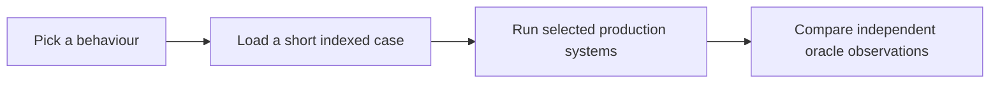
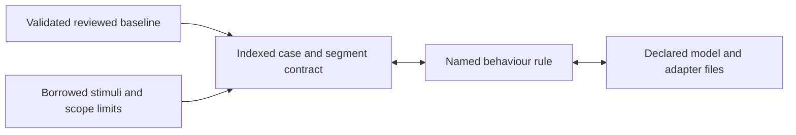

# Status: how to measure it

Current acceptance is indexed production replay. The committed
[index](../scenarios/replay/index.toml), [baseline](../scenarios/replay/baseline.toml) and
[transition ledger](../scenarios/replay/transition.toml) define witnesses, exact obligations and
reviewed replacement/loss dispositions. Generated numbers live in [REPORT](REPORT.md) and the
README status; regenerate them as [BUILDING](BUILDING.md#the-status-and-the-report) describes.



## The headline milestone

The goal remains power-on through Ceres using movie inputs only, every compared cut and output
byte matching. Scoped and integrated witnesses are useful progress but do not substitute for
whole-movie execution. Required missing boot, clock, controller, actor or passage owners remain
explicit unsupported boundaries. Borrowed facts never count as modeled producers.

## The models' gain over the null model

A witness must exercise a rule, not merely compare unchanged fields. Catalogue entries name
rules; cases are witnesses and many cases may be needed per rule. Unit vectors and adjusted
parameter vectors remain development checks. Meaningful planted faults establish whether
indexed comparisons distinguish incorrect behaviour. Historical null-model and harness figures
are not current production acceptance and must be labelled as historical evidence.

[`tools/mutants.toml`](../tools/mutants.toml) pins one production wiring fault per supported
responsibility to its exact recorded Difference cut and field. With `SM_CACHE`, `SM_ROM` and
`SM_AUDIO_NATIVE` set, `python3 tools/check_mutants.py` first requires a Pass, temporarily
applies each fault, restores the source byte for byte, then requires the original complete
receipt again, including its digest and counts. CI runs this check; the supported responsibility
inventory comes from the index and reviewed baseline, so omitting an owner fails the check.
Weapons and contact have separate faults in their shared case. The movement/Ceres connection
has a separate fault substituting the door centre for held movement proximity.

These faults exercise movement scheduling, elapsed audio time, cannon permission, contact
permission, camera following, HUD clock input, animation scheduling, event delivery, Ceres
scheduling and the Haze band's native colour write. They prove the named comparisons detect those errors within the existing scoped
cases and the narrowly integrated movement/Ceres connection. They do not prove all rules,
borrowed producers, omitted outputs or pixels. Unsupported
cases remain held boundaries and require no fault credit until they have reviewed Pass cases.

## The ratchets and floors

The replay baseline binds the exact index bytes to each measured result, comparison counters
and observation digest. Behaviour obligations require completed comparisons. Boundary
obligations require the exact named Unsupported result and remain distinct from passing cases.
Missing source data, a zero-case selection, an empty comparison schedule or an earlier boundary
cannot satisfy the corresponding obligation. The transition ledger accounts for retired
lockstep, gate, localiser and per-domain execution claims; there is no second acceptance runner.

```sh
TOOLS=target/verify/tools
INDEX=scenarios/replay/index.toml
$TOOLS replay list "$INDEX" --rule samus-movement/TravelledDistances
$TOOLS replay run "$INDEX" --case movement/D-inherited-cut \
  --cache "$CACHE" --bundle "$BUNDLE" --rom "$ROM" --native "$NATIVE"
$TOOLS replay check "$INDEX" --all --baseline scenarios/replay/baseline.toml \
  --cache "$CACHE" --bundle "$BUNDLE" --rom "$ROM" --native "$NATIVE"
```

`run` reports selected outcomes; `check` compares them with the reviewed baseline. `--write`
writes safe TOML receipts containing IDs, counts, field names and hashes, not ROM-derived values.
Local case selection is useful diagnosis; required acceptance runs the complete index. Cases
carry production State from the admitted start with no feedback from expected records and no
automatic reseed after failure. Scope declares selected owners, borrowed stimuli, compared
fields/outputs and excluded consumers. A movement case without rendering proves no pixels.

## Scoped sender offers

Install the encrypted [sender offer fixture](../tools/ci/fetch_sender_offers.sh)
with `bash tools/ci/fetch_sender_offers.sh "$ROM" "$NATIVE"`, then select
`--rule audio-transport/OfferAcceptance --native "$NATIVE"` in the shared replay command.

Each recorded case admits one group's independent starting bracket and the borrowed offer
from `inputs.toml`. The case calls the production AudioSender Offer entry. It compares
the full oldest-first FIFO and committed progress against `expected.toml` at the first
following selected-group service entry. The index uses the source video cut and the
ingress identity distinguishes the two offers at cuts 157 and 183. Source chronology
qualifies the borrowed cross-group order. Live producer order, physical timing, replies
after the initial bracket and sender service are outside this scope.

The constructed cases exercise same-group order, duplicates, capacity, reduced allowance
and three suppressors. The saved final cut checks restoration of the complete scoped
sender, including the seed reply. Each native case has one independent seed.

## Live soft touchdown

The two Magnet Stairs windows start at their own locked predecessors. Each decodes Movement's
complete prior state and committed figure and supplies the observed controls, prior terrain and
two solid actors in their current Movement-entry order. The scoped caller runs Movement and
pose fit. It sends the actual Land request to the Contact FIFO with the producer's allowance and
current suppression, then passes the separate graphics opportunity and selected figure to the
dry Appearance arm. The replay compares the floor clip, ordered fit, accepted response,
Contact offer and Appearance clear publication. The scoped Contact owner stops after the offer.
The next native service-entry snapshot independently corroborates its FIFO. The pinned bracket
contains no intervening Contact offer or service, and the case advances neither the intervening
clock nor the service. The offer and clear command count as two scoped outputs. The publication
counter measures physical callback streams and is zero here.

Install the [touchdown fixture](../tools/ci/fetch_movement_touchdown.sh) and the sender-offer
fixture under the same native source directory. Use the common replay command with
`--case movement/soft-touchdown-57 --case movement/soft-touchdown-124`. The checkpoints
restore each disjoint window from its own starting owners. The physical ring and Contact port
service have separate boundaries. The retained Frame still requires the timed body-growth
and fit work profile and the actual touchdown dispatch and graphics opportunities.

## Finding the code for a replay segment

The read-only `map` command joins the typed index and validated reviewed baseline with
[rule-to-code metadata](../scenarios/replay/code-map.toml). It executes no replay and needs no
ROM or cache. Each rule declares model and adapter files; navigation targets point to its
catalogue or specification. Targets are existing repository-relative files, without line or
symbol claims. The complete mapping is validated before filtering: missing, duplicate,
unknown and dangling entries fail even when the query selects another rule.



Run from the repository root, using the `TOOLS` and `INDEX` above:

```sh
$TOOLS replay map "$INDEX"
$TOOLS replay map "$INDEX" --case movement/W15
$TOOLS replay map "$INDEX" --rule samus-movement/TravelledDistances
$TOOLS replay map "$INDEX" --path crates/clean/samus_movement/src/travel.rs
$TOOLS replay map "$INDEX" --mapping scenarios/replay/code-map.toml \
  --baseline scenarios/replay/baseline.toml --repo . --case audio/native-expire-post64
```

Mapping and baseline paths default to `code-map.toml` and `baseline.toml` beside the index.
`--repo` defaults to the working directory and sets the root for target validation; other
argument paths resolve from the working directory. `--path` requires the exact declared
forward-slash repository-relative filename. Multiple `--case` values select their union;
case, rule and path filters intersect. An unknown selector or empty result fails.

The TOML report keeps `declaration` from the index, `reviewed_requirement` from the baseline
and `declared_relevance` from the mapping separate. Requirements include exact expected
outcomes, counts and observation digests; they are reviewed obligations, not fresh results.
Borrowed providers, phases, fields and limits stay in the declaration and do not become rule
proof. File links express declared relevance, not exhaustive impact or measured coverage.

The default query shows all indexed cases, including three empty-rule boundaries with empty code
links. A travel-file query includes the scoped witness and the integrated and movie held
Unsupported boundaries. A boundary's rule references do not make it a passing behaviour proof.
Mapping queries never select or skip landing checks; the complete index remains required.

Cache cuts are local to the named record row: W15 starts at cut 814 and compares cuts 815
through 817 of `item-morph-ball`. Native seeds and checkpoints use native fixture coordinates;
the post-intervention audio case compares original fixture cuts 65 through 183 from its
independent cut-64 seed. Power-on starts have their own coordinate family. The report exposes
the index's lock path and source declarations; it supplies no movie-global offset conversion.

## Making the record cache


`CACHE` is made by `oracle corpus ROM scenarios/lock.toml DATA --oracle lsnes --native-seeds
BUNDLE/seeds --from-frame-pads PADS --cache CACHE --only ROW` (ORACLE §6): lsnes plays the row's
frame pads from its native seed and writes the lean tier, `CACHE/ROW/lean.bin` and, last,
`lean.txt` with the lock pins `verify::cache` checks: about 2 KB a frame, each frame's memory
changes with the whole memories every 256th frame. `DATA` is the old lock's decrypted bundles
(corpus still reads each row's seed and movie name there); `--cache-pictures` writes the full
tier instead (`records.bin`, `index.txt`, 330 KB a frame with its picture), which only the
compositor's checks need. `tools cache-lean` turns a full tier into a lean one.

`tools/oracle/record_caches.sh ROWS BUNDLE DATA ROM CACHE [JOBS]` does it for a list of rows,
8 lsnes at a time, skipping rows already cached, one log line per row; with `WATCH_PCS` set it
passes `--watch-pcs` too, for the `hits.txt` the independent causal input providers can read.
`ORACLE` names the oracle command (the Python DLL runner where Defender blocks executables).

## The movement/Ceres connection

The indexed `movement-ceres/carried-position-proximity` case admits complete movement and slot0
Ceres owners together at cut6 of `chain-any-0003-DFD7`, then compares positions and five door fields
at7..10. Production derives Ceres proximity from held movement whole pixels before advancing
movement. Both owners and all outputs commit atomically. No separate writable position receipt
or record refresh exists. Both scoped and connected recipes call the same adapters.

Its external ordinary opportunities come from the reviewed passive capture pinned by
[movement-opportunities-capture-manifest.toml](../scenarios/replay/movement-opportunities-capture-manifest.toml),
[provenance](../scenarios/replay/movement-opportunities-capture-pins.toml) and
[first-record manifest](../scenarios/replay/movement-opportunities-first-record-manifest.toml).
`tools/ci/fetch_movement_opportunities.sh` fetches the immutable encrypted evidence into the
`movement-opportunities-v1` child of the `--native` directory. Rust admission checks file integrity,
independent input-record alignment, requested cut identity, exact ordered completed work and
all actual-read premises. Missing evidence is DataFailure; incompatible intact opportunities
are Unsupported. Expected observations never supply these facts.

Prior cuts6..9 must have empty interactive rosters before any actor geometry is decoded. World,
controls, equipment, appearance ahead feedback, station stage and actor scheduling remain
external. The case proves only this position connection and its declared comparisons; no durable
Ceres continuation, pixels, application, power-on or played-alone coverage follows.

## Carried ordinary movement, appearance and camera

The connected ordinary witness starts once at cut6 and compares nine actual opportunities
through cut15 in one production owner. Complete Movement, the four Appearance quantities,
the playing Figure and all nine Camera components are observed, along with four directional
travels per opportunity. Ahead reads retained playing state before motion; actual movement
completion publishes the accepted pose before selected-clip initialization; Camera follows
actual finished movement and retains its history.

The separately checked current source has five clip holds, four advances, its first wrap at
cut14 and one marked Contact at cut10. Complete returned Contact graphics, Footstep requests
and Appearance receipts survive internal yields and delivered-history retirement. The indexed
case checks ordinary cut continuations; the separate production test restores every internal
semantic yield and rejects changes to its retained current inputs atomically.

Controls, equipment, liquid, energy, occupancy, Contact guards, current terrain and actors,
and room settings are authenticated borrowed stimuli. Actor lifecycle, receiver execution,
health arithmetic, elapsed hardware time, complete Frame scheduling and played-alone
production remain outside this witness. Its package is fetched by
[the pinned connected fixture script](../tools/ci/fetch_connected_ordinary.sh); the declaration,
reviewed outcome and code navigation are in the existing replay index, baseline and mapping.

The second ordinary witness admits once at cut126 and carries the same selected owners through
cut142. It exercises current Run release and resumed growth, alternating Forward/DownForward
aim selection and its extra horizontal move, and reached non-square Floor/Surface terrain.
Its floor factors, vertical surface responses and unseated support checks are bounded witnesses;
stepped and ceiling terrain remain unsupported. Complete ordinary and internal yield restoration
uses the same production entry. The stale-Run fault is caught at cut141's complete movement State.
The [pinned second fixture](../tools/ci/fetch_connected_run_slope.sh) keeps its admission and source
identity separate from the first witness. The same borrowed producers and omitted consumers apply.

## Scoped ordinary power shot and drawing

`weapons-contact/M0-power-shot-drawing` admits the vacant shot pool at cut 156 of
`chain-any-0003-DFD7`. The same weapon owner advances through the spawn, trail request and
actor 1 consuming shot slot 0 at cut 160. W1 carries the marked body until the next update
removes it. The exact sprite encoder receives the actual flying pictures on cuts 157 and
159. The witness compares the attributed low entry and high pair at each insertion, and
the absence of pictures at the other cuts. The pre-draw cursor, camera and phase come
from the independent watched fixture. The earlier drawing producers, full OAM contents
and hardware service are outside the scope.

The separate actor opening at cut 157 survives suppressed native fire. The contact
receiver runs later, at cut 160, with no observable side effects in the native trace.
The scoped replay exercises contact geometry and the consumed marker. It borrows the
actor roster and has no selected opening, shot-response or trail allocation producer.
Frame's live PoseInput configurations cover qualified quiet running paths. A complete
cut-156 Frame admission and the fire-capable PoseInput route are still missing. The later
projectile preparation guards mapped shoot with the qualified selection and Cannon readiness
as `Frame(WeaponPrePreparation)`. This cut has no integrated evidence reaching that guard.
Actor progression and the surrounding drawing owners are also missing for the chain.

The [fixture installer](../tools/ci/fetch_shot_contact.sh) installs the two hash-pinned
input and comparison files under the native fixture directory.

## Cut-156 Frame opening

The [shot Frame fixture installer](../tools/ci/fetch_shot_frame_origin.sh) installs
the requested-return RTI-prefetch donor and the separately acquired true-resume hardware,
WRAM and APURAM. RTI-prefetch supplies sender provenance. Its clock stays at its original
phase. The independent resume ABI supplies the new line and refresh phase at resume.
The complete Frame origin importer can select the checked resume sender and early profiles.
The older Ready, empty and absent sender origins remain supported.

The opening imports Contact AwaitClear with an empty queue and the held Footstep reply
through checked resident aliases. The independently qualified sender clock has no active
service and rebases with hardware at the actual resume. The actual software acknowledgment
guard and current Ready/Empty Music inputs come from resume WRAM. A separate borrowed Music
receipt is revalidated and consumed after the complete charged operation.

The bounded opening runs through ordinary production admission, Frame advance and
content-bound checkpoints. It shares the full Frame caller's Acknowledgment and Music
selection and completion. The 36 Acknowledgment exposures take 232 ticks. The 70 Music exposures
take 466 intrinsic ticks plus the hardware refresh and complete at resume+738. The
fixture-backed check compares direct and restored work from an interior Music charge.
The next selected owner requires Haze preparation. Its physical work, later IRQ and
standing pose remain outside the admitted opening. The compact RTI-prefetch provenance
packet has no same-origin frame profile members and admits no Frame execution.

## Steady Haze through LayerBlend

Install the [Steady fixture](../tools/ci/fetch_shot_steady_haze.sh) alongside the
true-resume opening. The two indexed scoped cases carry the actual Acknowledgment and
Music before selecting the current ordinary Steady Haze. At resume+1726 the Haze head
has retained the sixteen original bands and prepared black and the exclusion of
background three. Finish updates both live scheduler countdowns and the software mask
by resume+3246. Hardware Channels Three and Eight retain their independently admitted
configuration and enables. Finish and LayerBlend each charge one 40-tick hardware
refresh. The scope has no hardware register callbacks or IRQ service.

LayerBlend uses the four actual defaults and preserves Window Two. The nine terminal
mirrors include the fixed-operand colour-math selection at resume+4194. The independent
source records ten ordered stores, including the colour-math default before its override.
The scoped comparison covers the terminal mirrors. The same-duration control changes one
band, the first scheduler countdown and the left Window Two edge, with independent
comparison after the affected owners run.

Local indices 0 through 3 compare Music, Haze retain, Finish and LayerBlend. Both cases
hold `Frame(RandomPreparation)` at local index 4, with the arithmetic operand and
sampled result bindings still unqualified. Indexed replay restores at the four compared
stage cuts. Fixture tests also split charge inside the Haze head, Finish and LayerBlend.

## Retained native frame

`frame/ordinary-requested-nmi-return` admits one native state from `chain-any-0003-DFD7`.
Its hardware clock advances 359,922 master ticks to the requested NMI return. Replay compares
2,295 ordered callbacks by time, class, register and value. The thirteen endpoint fields cover elapsed time, play time, room shake,
the shared random sequence and five Health quantities. The five Health values stay
equal to their admitted values in this case. The null model completes zero cuts.

The indexed checkpoint reopens the completed state. Fixture tests also resume from the
HUD interruption, in-flight late HUD status work and native NMI entry. They compare the
full callback stream, endpoint observations and terminal state through return. The late HUD
test tracks one queued request through its VRAM payload and retirement. On the next advance,
production consumes the acknowledged request and executes the quiet Music opportunity from
carried state. Service-marker callbacks carry no service-slot identity, and the comparison
excludes internal hardware events.

The [case declaration](../scenarios/replay/index.toml) lists the borrowed preparation, actor,
scene and native video inputs. The [fixture loader](../tools/ci/fetch_retained_frame.sh)
fetches the pinned inputs and independent observations under the replay native directory.
The power-on milestone is measured separately using movie inputs alone.

The indexed adjacent Haze cases each admit once and
repeat the first return's 2,295 callback and 13 field comparisons. The oracle runs use the
recorded pad change and a held-input control. Production checks the actual first sampled word
and its new presses, carries the returned Haze owner into settling, preserves the live band
buffer, and compares the settling readiness, completion and LayerBlend clocks. The restored
continuation compares all nine LayerBlend settings with the independently recorded writes.

The restored continuation compares both Random draws against independent completion,
operand-write and product-sample observations. It also resumes a shifted Drawing interrupt
inside the current room queries and completes HUD weapons, quiet Projectile traversal,
MotionReset and Samus interaction. Both carried Ceres doors enter ActorUpdate with wait one.
Each completes its poll with wait two, the same geometry and a graphics update. The restored
actor charge rejects the stale pose and the earlier door waits. The returned actor result
supplies the no-hurt Health join.

SpriteObjects and ContactReset read current state. Run consumes the current controller and
inventory. On odd parity, Down tests the right-hand floor cell first and stops with no
displacement. The non-last animation hold suppresses the footstep, so FootContact completes
and Poststep runs without queuing sound. The mini-map uses the carried HUD clock, current
position, inventory and Health. At Ready and return the two controller trials compare the
published tilemap and exploration bitmap with independent observations. A resumed refresh
reaches the same cuts and outputs.

Both controller trials carry the borrowed scene choice across the first native return. The
adjacent Timer reads it after the two drawing interrupts and runs the HUD's dormant countdown.
The mini-map returns at 91,486 ticks into the second interval. Timer hands off at 92,242 ticks
with one countdown answer and no additional device outputs. Both trials match all 203 ordered
callbacks through that handoff. Animation receives current whole energy from the
first Maintenance result after the adjacent no-hurt actor and both drawing interrupts
return. Public restore checks all five carried Health quantities. The carried playhead selects
the current running hold in the second interval. Both arms compare the return at +93,464 ticks,
including the same mapped step, one hold decrement, unchanged boost stage and laps, complete
Health and 203 ordered callbacks. The CPU profile supplies 177 exposures and 1,158 intrinsic
ticks. Hardware contributes a 40-tick refresh and a 24-tick descriptor-only HDMA service.
Both cases stop at `Frame(InterruptionPreparation)` on cut 2. Indexed replay restores each
completed cut-one checkpoint and checks the same held return, typed stop and ordered publications.
Fixture tests also restore at Timer handoff, during Animation charge and at Animation return.
The captured Ceres read independently qualifies the scene through that use. See the
[reviewed baseline](../scenarios/replay/baseline.toml). The
[adjacent native fixture](../tools/ci/fetch_retained_haze.sh) provides ordered callbacks.
The [retained fixture installer](../tools/ci/fetch_retained_frame.sh) also provides the
independently qualified CPU profile and playhead comparison. The second full callback stream, second
controller latch, later Health maintenance and second requested NMI return remain unverified.
