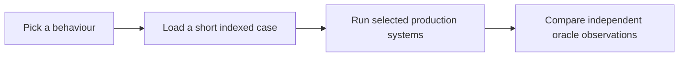
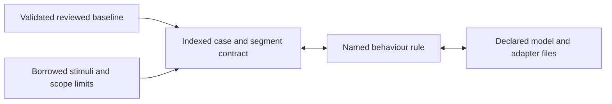

# Status: how to measure it

Current acceptance is indexed production replay. The committed
[index](../scenarios/replay/index.toml), [baseline](../scenarios/replay/baseline.toml) and
[transition ledger](../scenarios/replay/transition.toml) define witnesses, exact obligations and
reviewed replacement/loss dispositions. Generated numbers live in [REPORT](REPORT.md) and the
README status; regenerate them as [BUILDING](BUILDING.md#the-status-and-the-report) describes.



## The headline milestone

The goal remains power-on through Ceres using movie inputs only, every compared cut and output
byte matching. Scoped and integrated witnesses are useful progress but do not substitute for
whole-movie execution. Required missing boot, clock, controller, actor or passage owners remain
explicit unsupported boundaries. Borrowed facts never count as modeled producers.

## The models' gain over the null model

A witness must exercise a rule, not merely compare unchanged fields. Catalogue entries name
rules; cases are witnesses and many cases may be needed per rule. Unit vectors and adjusted
parameter vectors remain development checks. Meaningful planted faults establish whether
indexed comparisons distinguish incorrect behaviour. Historical null-model and harness figures
are not current production acceptance and must be labelled as historical evidence.

[`tools/mutants.toml`](../tools/mutants.toml) pins one production wiring fault per supported
responsibility to its exact recorded Difference cut and field. With `SM_CACHE`, `SM_ROM` and
`SM_AUDIO_NATIVE` set, `python3 tools/check_mutants.py` first requires a Pass, temporarily
applies each fault, restores the source byte for byte, then requires the original complete
receipt again, including its digest and counts. CI runs this check; the supported responsibility
inventory comes from the index and reviewed baseline, so omitting an owner fails the check.
Weapons and contact have separate faults in their shared case. The movement/Ceres connection
has a separate fault substituting the door centre for held movement proximity.

These faults exercise movement scheduling, elapsed audio time, cannon permission, contact
permission, camera following, HUD clock input, animation scheduling, event delivery and Ceres
scheduling. They prove the named comparisons detect those errors within the existing scoped
cases and the narrowly integrated movement/Ceres connection. They do not prove all rules,
borrowed producers, omitted outputs or pixels. Unsupported
cases remain held boundaries and require no fault credit until they have reviewed Pass cases.

## The ratchets and floors

The replay baseline binds the exact index bytes to each measured result, comparison counters
and observation digest. Behaviour obligations require completed comparisons. Boundary
obligations require the exact named Unsupported result and remain distinct from passing cases.
Missing source data, a zero-case selection, an empty comparison schedule or an earlier boundary
cannot satisfy the corresponding obligation. The transition ledger accounts for retired
lockstep, gate, localiser and per-domain execution claims; there is no second acceptance runner.

```sh
TOOLS=target/verify/tools
INDEX=scenarios/replay/index.toml
$TOOLS replay list "$INDEX" --rule samus-movement/TravelledDistances
$TOOLS replay run "$INDEX" --case movement/D-inherited-cut \
  --cache "$CACHE" --bundle "$BUNDLE" --rom "$ROM" --native "$NATIVE"
$TOOLS replay check "$INDEX" --all --baseline scenarios/replay/baseline.toml \
  --cache "$CACHE" --bundle "$BUNDLE" --rom "$ROM" --native "$NATIVE"
```

`run` reports selected outcomes; `check` compares them with the reviewed baseline. `--write`
writes safe TOML receipts containing IDs, counts, field names and hashes, not ROM-derived values.
Local case selection is useful diagnosis; required acceptance runs the complete index. Cases
carry production State from the admitted start with no feedback from expected records and no
automatic reseed after failure. Scope declares selected owners, borrowed stimuli, compared
fields/outputs and excluded consumers. A movement case without rendering proves no pixels.

## Finding the code for a replay segment

The read-only `map` command joins the typed index and validated reviewed baseline with
[rule-to-code metadata](../scenarios/replay/code-map.toml). It executes no replay and needs no
ROM or cache. Each rule declares model and adapter files; navigation targets point to its
catalogue or specification. Targets are existing repository-relative files, without line or
symbol claims. The complete mapping is validated before filtering: missing, duplicate,
unknown and dangling entries fail even when the query selects another rule.



Run from the repository root, using the `TOOLS` and `INDEX` above:

```sh
$TOOLS replay map "$INDEX"
$TOOLS replay map "$INDEX" --case movement/W15
$TOOLS replay map "$INDEX" --rule samus-movement/TravelledDistances
$TOOLS replay map "$INDEX" --path crates/clean/samus_movement/src/travel.rs
$TOOLS replay map "$INDEX" --mapping scenarios/replay/code-map.toml \
  --baseline scenarios/replay/baseline.toml --repo . --case audio/native-expire-post64
```

Mapping and baseline paths default to `code-map.toml` and `baseline.toml` beside the index.
`--repo` defaults to the working directory and sets the root for target validation; other
argument paths resolve from the working directory. `--path` requires the exact declared
forward-slash repository-relative filename. Multiple `--case` values select their union;
case, rule and path filters intersect. An unknown selector or empty result fails.

The TOML report keeps `declaration` from the index, `reviewed_requirement` from the baseline
and `declared_relevance` from the mapping separate. Requirements include exact expected
outcomes, counts and observation digests; they are reviewed obligations, not fresh results.
Borrowed providers, phases, fields and limits stay in the declaration and do not become rule
proof. File links express declared relevance, not exhaustive impact or measured coverage.

The default query shows all 17 cases, including three empty-rule boundaries with empty code
links. A travel-file query includes the scoped witness and the integrated and movie held
Unsupported boundaries. A boundary's rule references do not make it a passing behaviour proof.
Mapping queries never select or skip landing checks; the complete index remains required.

Cache cuts are local to the named record row: W15 starts at cut 814 and compares cuts 815
through 817 of `item-morph-ball`. Native seeds and checkpoints use native fixture coordinates;
the post-intervention audio case compares original fixture cuts 65 through 183 from its
independent cut-64 seed. Power-on starts have their own coordinate family. The report exposes
the index's lock path and source declarations; it supplies no movie-global offset conversion.

## Making the record cache


`CACHE` is made by `oracle corpus ROM scenarios/lock.toml DATA --oracle lsnes --native-seeds
BUNDLE/seeds --from-frame-pads PADS --cache CACHE --only ROW` (ORACLE §6): lsnes plays the row's
frame pads from its native seed and writes the lean tier, `CACHE/ROW/lean.bin` and, last,
`lean.txt` with the lock pins `verify::cache` checks: about 2 KB a frame, each frame's memory
changes with the whole memories every 256th frame. `DATA` is the old lock's decrypted bundles
(corpus still reads each row's seed and movie name there); `--cache-pictures` writes the full
tier instead (`records.bin`, `index.txt`, 330 KB a frame with its picture), which only the
compositor's checks need. `tools cache-lean` turns a full tier into a lean one.

`tools/oracle/record_caches.sh ROWS BUNDLE DATA ROM CACHE [JOBS]` does it for a list of rows,
8 lsnes at a time, skipping rows already cached, one log line per row; with `WATCH_PCS` set it
passes `--watch-pcs` too, for the `hits.txt` the independent causal input providers can read.
`ORACLE` names the oracle command (the Python DLL runner where Defender blocks executables).

## The movement/Ceres connection

The indexed `movement-ceres/carried-position-proximity` case admits complete movement and slot0
Ceres owners together at cut6 of `chain-any-0003-DFD7`, then compares positions and five door fields
at7..10. Production derives Ceres proximity from held movement whole pixels before advancing
movement. Both owners and all outputs commit atomically. No separate writable position receipt
or record refresh exists. Both scoped and connected recipes call the same adapters.

Its external ordinary opportunities come from the reviewed passive capture pinned by
[movement-opportunities-capture-manifest.toml](../scenarios/replay/movement-opportunities-capture-manifest.toml),
[provenance](../scenarios/replay/movement-opportunities-capture-pins.toml) and
[first-record manifest](../scenarios/replay/movement-opportunities-first-record-manifest.toml).
`tools/ci/fetch_movement_opportunities.sh` fetches the immutable encrypted evidence into the
`movement-opportunities-v1` child of the `--native` directory. Rust admission checks file integrity,
independent input-record alignment, requested cut identity, exact ordered completed work and
all actual-read premises. Missing evidence is DataFailure; incompatible intact opportunities
are Unsupported. Expected observations never supply these facts.

Prior cuts6..9 must have empty interactive rosters before any actor geometry is decoded. World,
controls, equipment, appearance ahead feedback, station stage and actor scheduling remain
external. The case proves only this position connection and its declared comparisons; no durable
Ceres continuation, pixels, application, power-on or played-alone coverage follows.
