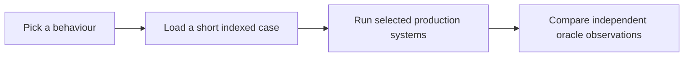

# The engine's architecture

[MODEL](MODEL.md) wins where architectural decisions disagree. Decisions 32 and 33 govern
production replay and previous-gameplay removal. The ledger retains design decisions; current
implementation and unsupported boundaries are described below. See
[PRINCIPLES](PRINCIPLES.md) and [ORACLE](../ORACLE.md).

## 1. Summary

The engine admits complete clean model state through `game::production::Production` and
advances selected responsibilities with typed inputs. `verify::replay` calls this entry; the
`super-metroid` entry returns `UnsupportedPowerOn`. Previous executable gameplay and writable
shadow State are absent. Required missing behaviour returns explicit `Unsupported`.

A catalogue rule is not a case. Many cases can witness one rule, and one case can witness
several rules. The case declares inputs, selected systems, observations and limits.

## 2. What the engine is

Clean Rust models decide gameplay. Adapters hold the model's complete State, answer typed
content/environment queries and publish actual outputs. Imported content, codecs, encoding
and runtime rendering remain separate services. No expected record enters production.
A scoped entry does not imply boot, general actor dispatch, room loading or CPU timing.

## 3. Decisions at a glance

| # | Decision | Principles | Section |
| --- | --- | --- | --- |
| D1 | Crates with plain names | P3, P5, P15 | 4 |
| D2 | Two public engine traits (`Family`, `Canonical`) and concrete context types | K3, P16 | 4.3 |
| D3 | State is a public plain-data schema with private behaviour; one authority | P5, P6, P8 | 5.1 |
| D4 | `RoomScoped` is one struct, so the door's reset list is a type | P8, K2 | 5.1 |
| D5 | Video memory is a SNES-layout image, justified by readbacks and stale display | P1, P6 | 5.3 |
| D6 | The Tick is one video frame in hardware order, from cut to cut | P4, P9 | 6.1 |
| D7 | A named beam-sync point in the main strand places the scan-out | P4, P9 | 6.2 |
| D8 | NMI timing (`OnTime` or `Overrun`) is a Tick input from a timing source | P4, P17 | 6.4 |
| D9 | CPU time is a named cost model of the routines whose frame count depends on it | P2, P9 | 6.5 |
| D10 | Main strand: a bounded stack of typed continuation frames; interrupt strand: a typed command chain | P9, K2 | 6.6 |
| D11 | The line program places changes at (line, dot); the dots are oracle rules | P4 | 6.7 |
| D12 | Slot store with per-family policy | P7, P9 | 7.1 |
| D13 | One `Program<F>` interpreter for every ROM instruction list | P7, P16, K3 | 7.2 |
| D14 | AI concrete per species until two share a shape; bosses as data-driven phase tables | P16, P15 | 7.3 |
| D15 | Content decoded at load; dense IDs inside, stable keys outside; overlays | P1, P7, K1 | 8 |
| D16 | Intents are the model's primary output; one encoder makes the exact output | P18, K4 | 9 |
| D17 | A CPU line compositor writing PPU-domain pixels; `wgpu` presents | P12, P14 | 9.3 |
| D18 | Sound: protocol and driver model in the Session; synthesis in `runtime` | P18, P4 | 9.4 |
| D19 | Profiles: Reference, Gameplay (resolved `Rules`), Timing source, Presentation, Input | P17, P4 | 10 |
| D20 | The oracle contract: one record per video frame, cut at each NMI return | P5, P12 | 11.1 |
| D21 | One decoder, one projection per stream, compared at quiescent cuts | P6, P7 | 11.2 |
| D22 | Green = every compared stream matches, plus facts; locks keyed by (row, oracle) | P10, P11, P13 | 11.4 |
| D23 | Speed targets | P14 | 12 |
| D24 | Size, trait and behaviour-catalogue budgets, reported on every landing | P16, P20 | 13 |
| D25 | Each stream's lock comes from the most accurate oracle producing it | P10, P12 | 11.4 |
| D26 | Short trick movies from seeds; full TAS movies nightly | P10, P11 | 11.4 |

## 4. Packages and ownership

`game` owns production admission, carried clean State and advancement; `verify` owns input
admission, observations and comparison; `tools` owns CLI selection. Independent capture stays
in `oracle`/`oracle_record`. [The crate table](../../crates/README.md) lists dependencies.
No engine crate depends on verification. `game` and `runtime` do not depend on each other or
reach ROM import. `tools/check_crate_rules.sh` checks the dependency and source restrictions.
Concrete production recipes use existing clean entries. Domain traits answer environment
queries; they cannot supply a second gameplay dispatcher. `Canonical` supplies codecs.

### 4.1 Crates

Production, observation and CLI have separate crate owners. Clean State uses serde for its
representation. The engine's `Canonical` envelope embeds shape-pinned `Model
` values and
owns the schema check, byte encoding and field diff. `canonical_derive` uses only `proc_macro`
and the standard library.

### 4.2 Dependency rules (checked in CI)

Quality checks dependencies and source restrictions with `tools/check_crate_rules.sh`.

### 4.3 The trait budget

Concrete recipes and read-only domain traits avoid a second dispatcher; new traits remain design changes.

## 5. State

`game::state::owned::OwnedState` holds complete clean model values. Available serializable
States use `canonical::model::Model
` with checked shape pins. Each quantity has one writable
owner. There is no old Samus, room, actor or PLM mirror. Admission checks state, content and
rules before advancing.
Clean models own their typed populations. Independently admitted collision geometry is a
borrowed dependency, not proof of actor lifecycle. Portable video memory belongs to display
records and rendering; motion-only State does not imply video ownership or pixel equality.

### 5.1 The State schema

Owned variants contain complete clean State. Admission and shape pins validate the selected value.
A resident audio session holds the transport, the three real CPU senders and the measured
relationship between their loaded CPU and audio frontiers. Its immutable context selects the
ROM-imported bank and the authenticated room origin. Both identities are checked at restore.

### 5.2 The slot store and leftover state

Missing actor/PLM lifecycle is unsupported. Borrowed solid boxes are independent scoped inputs.

### 5.3 Video memory

Display records retain video memory for downstream composition, separate from movement State.

## 6. The Tick

Production carries admitted State over the whole case. Frame cases compare declared cuts;
native audio cases compare transport milestones. Concrete recipes order actual clean calls
and pass outputs to selected consumers. A selected producer cannot be overridden by a tape.
Every changing dependency comes from production or an independently admitted source with a
limited claim. Expected next-state changes cannot manufacture requests, contacts or timing.

Captured frame parity, animation context or clock intervals do not prove the missing producer.
No old `game_time`, strand dispatcher or continuation stack fills that gap. Clean models retain
their own pending work. Missing boot, passage, history, preparation, RNG or timing behaviour
prevents the corresponding integrated claim. Every declared cut remains accounted for.

Advance uses candidate state and commits only on success. A failure changes neither owned
State nor publications. Runtime rendering is downstream and cannot affect gameplay.

### 6.1 What a Tick is

A declared cut-to-cut advance carries selected State. Native audio uses transport milestones.
The played-alone owner, `game::production::played`, steps one whole frame per NMI cut: her
clip's look ahead, her moves, her animation, the camera and the doors, once each. While a
passage runs the doors step alone, and `game::production::room_loading` loads what each of
their calls names of the next room from our own room and tileset formats.

### 6.2 The beam-sync point

Captured cut schedules are independent facts. A scoped schedule input proves no CPU synchronization.

### 6.3 Order within the Tick

The concrete selected recipe orders actual clean calls and routes actual outputs to its consumers.

### 6.4 NMI timing and lag

Rungs compare owners' State and output bytes at NMI cuts (MODEL decision 35). The software
request, hardware wait, NMI entry and handler return, and their clocks, are T1's; no production
path schedules them. A lag cut inside a rung is an explicit borrowed input.

### 6.5 Named CPU costs

[T1](domains.md#platform-and-tracks-not-clean-room-hardware-formats-or-the-originals-timing)
owns named CPU costs, beam scheduling and hardware arbitration outside the clean room.

The existing `AudioSender` production entry retains CPU master ticks and advances the clean
sender's intrinsic timed service under an admitted timing profile and ordered physical replies.
That scoped service does not supply a whole-frame clock. Its clock inputs do not imply a
power-on epoch or prove beam phase; each scoped case must declare the timing facts it admits.
Required missing timing remains unsupported.

### 6.6 Strands and continuations

Each clean model retains its own pending work between calls. D10 describes the general strand
design.

### 6.7 The line program

The compositor takes a separate `DisplayFrame` with line-1 registers, writes ordered by their
first visible line, overscan and field parity, plus `VideoMemory`. No production path assembles
that compositor input yet.

### 6.8 Input, RNG and failures

Independent typed stimuli enter production; candidate State and outputs commit together on success.
The played-alone run's only new input at each cut is the movie's pad from the preceding vblank.

## 7. Actors, slots and the interpreter

Clean owners retain their own typed populations, including shots and trails. No inert old
actor or PLM slots substitute for missing AI or lifecycle. Typed imported behaviour tables
stay data, interpreted by the clean model specified for that mechanism. The old enemy/PLM
execution tree is absent. Ceres door/contact selection does not imply general enemy AI,
protection ordering, RNG, actor timing or Ridley's fight.

### 7.1 The slot store

Shot/trail populations belong to their clean owner. Old inert actor slots are absent.

### 7.2 One instruction-list interpreter

Typed behaviour tables are interpreted within their clean model, not by a retained old runner.

### 7.3 AI, machines and bosses

A Ceres door/contact scope establishes no general enemy AI or lifecycle claim.

## 8. Content and IDs

The player supplies the ROM. `import` converts assets into typed `data` formats at the edge;
production validates selected content and holds it with State and rules. ROM-derived bytes
remain outside commits and logs. Catalogue IDs name rules; replay IDs name witnesses. Neither
ID decides gameplay. See [assets](assets.md).

## 9. Output and the presentation boundary

Production publishes complete selected model outputs. Replay compares the fields and outputs
its plan declares. Motion, semantic pose, contacts, travel and intents can be compared without
pixels. `runtime` composes immutable display records into pictures. D17 describes the window
presentation target.

Native audio holds committed and pending transport State and publishes actual model milestones
from admitted clock and physical requests. This does not prove the CPU request producer or
whole-engine timing. No sound-driver code is emulated. Audio waveforms are not compared.

### 9.1 Exact output and intent output

Compare actual model receipts and selected exact encodings. The scoped HUD entry returns
semantic events. Delivery of item switches and click requests has no production path yet.

### 9.2 The presentation boundary

Presentation reads immutable output and feeds no gameplay State back.

### 9.3 The renderer

Compositing independently admitted records proves the compositor, not production generation.

### 9.4 Sound

`Scope::ResidentAudio` admits the opening Ceres ROM bank with a common room-load origin for
transport and all three CPU senders. The fresh load checks the tracks, resources, sender queues,
physical latch directions, complete release histories, timer and first observation. It initializes
the polling episode once. A canonical checkpoint carries the loaded clock relation, content
identity and each owner's pending work. Restoration checks the selected context and resumes
at the saved phase. A caller supplies the imported `ResidentAudio`, the authenticated
`audio::Origin` and both typed state inputs. `audio::Load` carries the three sender values,
effect request latches and one ordered release entry for Action and Ambient and two for Contact.
`audio::State::opening_ceres` checks these against the complete sequencer State. The caller
then admits `ProductionSeed::ResidentAudio` with the checked `ProductionContent::ResidentAudio`
and fixed `ProductionRules::Audio`. The replay adapter is a complete example of that sequence.
[Opening-room loader](../../crates/verify/src/replay/audio/room_load.rs)

`Scope::Audio` advances the same transport from a scoped starting state and admitted
presentation times. `Scope::AudioSender` advances one sender under its admitted profile.
Physical sender service joined to the resident transport, and synthesis in `runtime`, remain
separate from room-load admission.

### 9.5 Saves

`Production::save` captures the state after a successful advance. `SavedProduction` holds
canonical bytes containing the State schema and selected State, plus the immutable context in
memory. `Production::restore` checks content and rules by value equality, decodes the selected
schema and revalidates the joined State. Standalone Audio's portable envelope depends on its
own payload schema. The resident envelope also checks its stored origin and bank identities.
Scopes lacking a codec return `SaveFault::Unsupported`. Checkpoints are in-memory values.

## 10. Options and profiles

Reference rules are selected at admission and held with content. Adjusted behaviours belong
to named rules and vectors, never case IDs or expected outcomes. Scope selects responsibilities
and claim limits, not alternate implementations.

## 11. The engine ↔ oracle comparison contract

Independent unmodified emulator capture supplies pinned records and inputs under
[ORACLE](../ORACLE.md). Initial observation-to-clean conversion happens once. Subsequent
records supply expected observations only. The one `verify::replay` runner advances production
and compares actual owned State and outputs. Decoding is not gameplay, and no expected field
is copied into carried State.

The strict index declares cases, source pins and comparison plans. The baseline binds the exact
index to measured results, counts and observation digests. An expected unsupported boundary
can meet a baseline obligation but remains unsupported, never a successful gameplay case.
Missing data, zero comparisons and absent output fields do not establish equality.

Separate lockstep, gate, localiser and domain-harness executors are retired. Their replacement
and reviewed losses are in [the replay transition](../../scenarios/replay/transition.toml).
Meaningful production/provider mutants test whether indexed witnesses detect faults.

Raw WRAM remains capture evidence, not production State. Unobserved hardware leftovers,
sound-driver upload bytes and audio waveforms are not equality claims. Missing PPU fields and
oracle representation limits remain named in
[LEGACY](../LEGACY.md#comparison-representation-limits). Scoped exclusions are declared per case.

### 11.1 What the oracle provides

Pinned unmodified capture supplies independent expectations and source evidence.

### 11.2 Decoder, projections and streams

Initial conversion happens once; later oracle decode is observation-only.

### 11.3 Facts

Missing evidence is not equality. Zero-comparison cases cannot pass.

### 11.4 Locks and green

The exact-index baseline keeps completed behaviour and expected unsupported boundaries distinct.

### 11.5 Lockstep and mutants

The old executors are retired; the transition ledger names replacements and losses. Mutants exercise production replay.

### 11.6 What isn't compared, by name

WRAM is evidence; unobserved hardware leftovers, upload bytes and audio waveforms are not equality claims.

## 12. Speed

Replay benchmarks use the same selected cases and production runner as acceptance. Each
result names its scope and comparison plan; unavailable whole-engine execution supplies no
whole-engine throughput claim.

## 13. Size, trait and behaviour budgets

**D24.** Every landing reports its size with `tools size` (weighted logical tokens, with the data
and the declarations reported beside them, MODEL §1 decision 5), per crate and per MODEL layer so
the routine-port share is visible and falls; the trait budget (§4.3); and the behaviour catalogue
(MODEL §3, §6): behaviours catalogued, proven exact and switchable (P20). A rebuilt domain's budget
comes from its spec (MODEL §1 decision 7). After independent review, the root uses the advisory
comparison to decide whether a cut is worthwhile (MODEL §1 decision 19).

## 14. Checkpoints and starts

A cache-cut start admits State once and compares following cuts. Native starts use pinned
independent seeds. Restore uses saved production State rather than expected records. A
whole-movie claim requires actual power-on ownership and movie inputs only; missing owners
remain explicit unsupported boundaries.

## 15. Build order

The lowest unmet rung determines work. Wiring existing clean capabilities uses production
and indexed witnesses. Missing rules go through observer/implementer clean-room rounds;
engineering cannot recreate them to preserve an old prefix. See
[MODEL §5](MODEL.md#5-how-the-work-is-planned) and [the plan](domains.md#4-order).

Platform timing schedules and charges work owned by those models and services. Missing actor
selection, audio queue rules or NMI gameplay mutations need clean rules or explicitly scoped
external producers; timing machinery cannot supply their gameplay decisions.

## 16. Lessons

Preserve behaviour rather than original routine shapes. A second verification engine cannot
prove production. Carried State, independent inputs, explicit unsupported boundaries and
fault witnesses make claims reviewable. Old source is available through git history.
