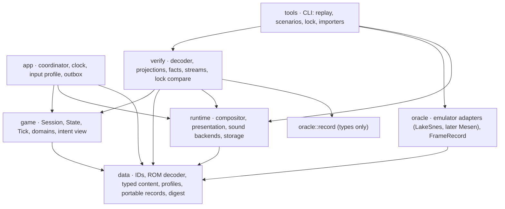

# The engine's architecture

Architecture lane, `research/architecture`, 2026-11-05. This is a draft for Jim's review. It
changes no code.

This document decides the architecture of the new engine. It is built on the principles in
[PRINCIPLES.md](PRINCIPLES.md), which come from the [retrospective](RETROSPECTIVE.md). Each
decision cites the principles it follows (P1-P19 for design, K1-K10 for code) and names the
alternative it rejects. The draft it starts from is
[FOUNDATION.md](../foundation/FOUNDATION.md) (J1-J24), together with its three requirement
reports. Where this document says "as FOUNDATION §x", that section is adopted unchanged and
not repeated here. [Section 14](#14-what-changed-from-foundation) lists every change made to
FOUNDATION.

Companion documents:

- [ROBUSTNESS.md](ROBUSTNESS.md) walks through each future feature (widescreen, audio
  upgrades, quick transitions, native lag, custom content, multiple oracles, Map Rando and
  others) and shows how it is added and what it touches.
- [QUESTIONS.md](QUESTIONS.md) holds the few goal questions that are Jim's to answer.

The oracle is the one in [docs/oracle/HARNESS.md](https://github.com/JimLundin/sm-decomp/blob/94d3c697a/docs/oracle/HARNESS.md)
(`research/oracle-harness`): upstream LakeSnes running the unmodified ROM with a real beam,
and with the SPC700 and DSP running the game's own sound driver. This changes several of
FOUNDATION's premises. FOUNDATION was written against the old frame stepper, which had no
beam during CPU execution, 45 kept patches and a native sound player.

## 1. Summary

1. **The engine is ordinary Rust over typed state.** There is no 65816 emulation, no
   bytecode VM and no RAM image ([section 2](#2-how-the-approaches-compare)).
2. **The Tick is one video frame in hardware order.** The main thread resumes after the
   previous NMI, the beam scans out the picture while the interrupt strand runs at its
   lines, the rest of the main iteration runs, and then the next NMI comes. A frame ends at
   the **commit cut**, the return from its NMI. That point exists in every oracle. Lag is
   the NMI's kind, and **NMI timing is an input to the Tick**. Today it is recorded from the
   oracle. Later it comes from a native cost model.
3. **CPU time is modelled only where the original's frame count depends on it**, and it is
   modelled as named costs (bytes decompressed, bytes uploaded), not as instructions. The
   real-beam oracle makes loading time CPU-bound.
4. **The State is plain data with one authority.** Room-scoped state is one struct. Video
   memory is a SNES-layout image, because the game reads it back and shows stale contents.
5. **Two kinds of output.** The **exact output** is what the oracle compares: video memory,
   the display frame, the sound port writes and SRAM. The **intent output** is the meaning
   behind it: the camera, the level layers, sprite draws at full precision, effect
   parameters, music cues. Presentation upgrades read intent and never write back.
6. **One slot store, one instruction-list interpreter, one continuation stack.** Generic
   layers are built when their second real user exists. Slice 0 has two families with
   instruction lists, so `Program<F>` is justified there. `Machine<S, A, M, X>` is not, yet.
7. **Content is decoded once from the ROM at load time** into typed records. Dense IDs are
   used inside the engine, stable keys for anything persisted. Overlays (Map Rando worlds,
   custom content, media packs) produce the same records.
8. **Options are profiles resolved when the Session opens.** The profiles are Reference
   (the oracle's rules), Gameplay, Timing source, Presentation and Input. Each field has
   one reader.
9. **The comparison contract is one-way.** The oracle emits raw records. One decoder turns
   them into a State. One projection per stream reads either State. A row is green when
   every compared stream matches at the quiescent cuts and every fact holds.
10. **Verified speed is a slice-0 requirement:** at least 1,000 Ticks/s with every stream
    on one CI core.

## 2. How the approaches compare

Jim asked whether the proposal is "some stack-based VM". It is not. This section explains
each approach in plain terms.

| | Game logic is | State is | What is compared | Why it went wrong, or what it costs |
| --- | --- | --- | --- | --- |
| **Attempt 1** (transpile) | snesrev's C routines, transpiled into Rust functions that read and write a byte array | the 128 KiB WRAM image and the PPU registers. Addresses are the names. | WRAM byte for byte against an oracle running the same harness | The shape of the code was the C's. The oracle was patched to fit the C. Correct meant "agrees with a sibling" (Retro A1, V1). |
| **Attempt 2** (extraction) | typed Rust modules, but each Tick they ran inside the old game. A lease decoded RAM into a Session, ran, and encoded it back. Host traits and `foreign` reached old code. | two authorities, RAM and Session, with a codec kept exact in both directions | still RAM, through the codec | The codec cost 85% of each Tick, the Session stayed RAM-shaped, and the engine never ran alone (Retro A2-A4). |
| **FOUNDATION** | typed Rust domains, one instruction-list interpreter, a continuation stack for the original's nested waits, generic `Machine` state machines | a public plain-data State, plus a SNES-layout video memory image | outputs and a State decoded from oracle RAM | Sound in itself, but its Tick copies the old frame stepper "by construction" (no overrun lag, line-granular interrupts, kept patches). It also builds generic frameworks before any row is green, and it has no facts and no speed target (Retro section 5). |
| **This architecture** | typed Rust domains, with FOUNDATION's continuations and interpreter, and frameworks only where they have two users | as FOUNDATION, plus explicit NMI timing and named CPU costs | as FOUNDATION, at quiescent cuts, plus facts | See sections 5 and 10 for what changes and why. |

**What the pieces are, concretely.**

- **The game logic is ordinary Rust.** Samus's physics, collision, enemy AI, bosses, doors,
  menus and the HUD are functions over typed structs, called in the original's order.
  Nothing interprets game logic.
- **The continuation stack is not a VM.** The original sometimes waits for the next frame
  from deep inside a routine. An item's message box, for example, opens from inside the PLM
  handler, which runs inside the gameplay pass, and the rest of that pass resumes about 370
  frames later. To resume at that exact point, the engine records where it stopped as a
  short list of typed values, for example `[MainLoop, Gameplay(Plms), Plms { slot: 3 },
  MessageBox(Shown)]`. Each value is a variant of a closed Rust enum with about ten
  variants. Each variant's step function is ordinary Rust that knows how to continue. There
  is no instruction pointer into code, no bytecode, no general call and no scheduler. It is
  a bookmark, saved in the Checkpoint. The alternatives are worse: `async` can't be saved,
  and re-running the pass to skip finished work would repeat side effects and RNG calls.
- **The instruction-list interpreter walks data that is already data in the ROM.** The
  original drives PLMs, enemies, sprite objects, HDMA objects, palette effects and animated
  tiles with *instruction lists*: tables in the ROM of the form "show spritemap X for 4
  frames, play sound 12, go to step 3". The original's own code is a small interpreter
  over them. We decode those tables at load time into typed steps (`Step::Show`,
  `Step::Core(Goto)`, `Step::Family(..)`) and walk them with one loop shared by every
  family. It is a table walker over typed records, as in the original. The behaviour inside
  a step, such as an AI routine or a collision check, is Rust.
- **There is no 65816 anywhere in the engine.** The emulator exists only in the oracle crate.

## 3. Decisions at a glance

| # | Decision | Principles | Section |
| --- | --- | --- | --- |
| D1 | Fresh crates with plain names (`data`, `game`, `runtime`, `app`, `oracle`, `verify`, `tools`, `canonical`); old `sm_*` crates keep their names until deleted; CI forbids any new crate depending on `sm` or `sm_*` | P3, P5, P15 | 4 |
| D2 | Two public engine traits (`Family`, `Canonical`) and concrete context types; trait list kept in this doc | K3, P16 | 4.3 |
| D3 | State is a public plain-data schema with private behaviour; one authority | P5, P6, P8 | 5.1 |
| D4 | `RoomScoped` is one struct, so the door's reset list is a type | P8, K2 | 5.1 |
| D5 | Video memory is a SNES-layout image in the State, justified by readbacks and stale-content display | P1, P6 | 5.3 |
| D6 | The Tick is one video frame in hardware order, from cut to cut | P4, P9 | 6.1 |
| D7 | A named beam-sync point in the main strand places the scan-out | P4, P9 | 6.2 |
| D8 | NMI timing (`OnTime` or `Overrun`) is a Tick input from a timing source | P4, P17 | 6.4 |
| D9 | CPU time is a named cost model of the routines whose frame count depends on it | P2, P9 | 6.5 |
| D10 | Main strand as a bounded stack of typed continuation frames; interrupt strand as a typed command chain | P9, K2 | 6.6 |
| D11 | The line program places changes at (line, dot); the dot positions are oracle rules | P4 | 6.7 |
| D12 | Slot store with per-family policy (as FOUNDATION 4.2) | P7, P9 | 7.1 |
| D13 | One `Program<F>` interpreter; family ops dispatch through `Family`'s concrete context, with no host trait | P7, P16, K3 | 7.2 |
| D14 | AI and boss machines are concrete per species until two share a shape; bosses get a data-driven phase table design at their cluster | P16, P15 | 7.3 |
| D15 | Content is decoded at load time; dense IDs inside, stable keys outside; overlays produce the same records | P1, P7, K1 | 8 |
| D16 | Exact output and intent output; presentation receives `&State` and intent | P18, K4 | 9 |
| D17 | The renderer is a CPU line compositor writing PPU-domain pixels, with `wgpu` presentation | P12, P14 | 9.3 |
| D18 | Sound: CPU protocol and a driver model in the Session; synthesis behind a backend in `runtime` | P18, P4 | 9.4 |
| D19 | Profiles: Reference (`OracleRules`), Gameplay (resolved `Rules`), Timing source, Presentation, Input | P17, P4 | 10 |
| D20 | The oracle contract: one record per video frame, cut at each NMI return, raw machine data | P5, P12 | 11.1 |
| D21 | One decoder (oracle record → State), one projection per stream, compared at quiescent cuts | P6, P7 | 11.2 |
| D22 | Green = every compared stream matches, plus the row's facts; locks keyed by (row, oracle) | P10, P11, P13 | 11.4 |
| D23 | A speed budget with a slice-0 exit target | P14 | 12 |
| D24 | A per-domain size budget and a trait budget, reported on every landing | P16 | 13 |

## 4. Packages and ownership

### 4.1 Crates



| Crate | Owns | Must not |
| --- | --- | --- |
| `data` | IDs and stable keys; the ROM decoder and its tables; typed content; world records; profiles; the portable records that `game` emits and `runtime` consumes (display frame, video memory image, sound frame, intent view); the address map as a side output; the shared digest | hold mutable state or rules |
| `game` | `Session`, the `State` schema and its codec, the Tick, strands, slot store, interpreter, every gameplay domain, the CPU-side sound protocol and driver model, the cost model, SRAM, the intent view (`view::describe(&State)`) | touch pixels, samples, files, devices or addresses (K1) |
| `runtime` | the line compositor, `wgpu` presentation, the wide renderer, sound backends (N-SPC sequencer and DSP, replacements), `cpal`, storage | feed anything back into the Session |
| `app` | the run coordinator, Tick admission at the Reference cadence, the input profile, effect delivery, cutovers | contain gameplay |
| `oracle` | the emulator adapters, `Oracle` trait, `FrameRecord`, seeds, the lock recorder | depend on `game`, `verify` or any old `sm_*` crate |
| `verify` | the oracle record → State decoder, one projection per stream, facts, the stream digests, free-run and lockstep comparison | be depended on by an engine crate |
| `tools` | the command line over the above, the Map Rando and sm-json-data importers | contain comparison logic of its own |
| `canonical` | the `Canonical` derive (proc macro, `syn` and `quote` at build time) | anything else |

**D1. Fresh crates with plain names; the old crates keep theirs until deleted.** Jim
decided (2026-11-05) that the new crates have no `sm_` prefix and are named for what they
are. The prefix only existed because the first attempt took `sm` and `game`. The new crates
are `data`, `game`, `runtime`, `app`, `oracle`, `verify` and `tools`, plus the derive crate
`canonical`, named for the derive it provides. The app's binary has a user-facing name
(working name `super-metroid`). Checks on the names: none shadows a built-in crate (`core`,
`std`, `alloc`, `test`, `proc_macro`) or a dependency we are likely to take, and the derive
crate isn't called `derive`.

**The old crates are not renamed.** FOUNDATION's J7 renamed them to `crates/legacy/*_v1` so
that new and old couldn't be confused or linked. With the new names, they no longer collide:
`game` is old and `game` is new. The separation is enforced by a CI check that fails if
any new crate depends on `sm` or on any `sm_*` package, by name (rule 2). That saves a
mechanical commit across the old code and its CI. The old crates are deleted as the new
engine covers what they did (REVIEW's deletion measure). Modules carry over only from a closed list (the digest, the line compositor
from `gate1/render`, the lock reader), and each one names the contract it meets.
*Principles:* P3, P5, P15. *Rejected:* new modules inside the old crates. That would be
one compile unit, easy to reuse by accident, and attempt 2's trap (Retro A1). *Rejected:*
new crate names, which contradict the accepted package names.

**Why `verify` is separate from `tools`.** The decoder and projections are the riskiest
verification code (Retro section 5, V5). They need their own mutants and their own budget,
and the CLI should not be able to grow a second comparison path (P7). `oracle` keeps its
record types in a module that `verify` can use without pulling in an emulator. So the
decoder can be tested from stored records, and the harness doesn't depend on the engine
(P5).

### 4.2 Dependency rules (checked in CI)

1. No engine crate (`data`, `game`, `runtime`, `app`) depends on `oracle`,
   `verify`, `tools`, `sm` or any `sm_*` crate.
2. `game` and `runtime` do not depend on each other.
3. `oracle` depends only on `data` (for the digest).
4. Engine crates contain no `cfg(verify)`, probe or observer (P6, PLAN).
5. No SNES address literal appears in `game`, `runtime` or `app` (K1).

### 4.3 The trait budget

**D2.** The engine's public traits are listed here, each with its users. A new trait is a
design change to this document (K3, P16).

| Trait | Crate | Implementations | Why it is a trait |
| --- | --- | --- | --- |
| `Family` | `data` | in slice 0: `Plm`, `Enemy`, `SamusAnimation`. Later: enemy projectiles, Samus projectiles, sprite objects, HDMA objects, palette FX, animated tiles, demo input, cinematic scripts | the interpreter is generic over the family's payload, op and pre-op types |
| `Canonical` | `game` (derived by `canonical`) | every State type | the encode, decode and diff of one canonical codec (K6) |

Outside the engine: `Oracle` in `oracle` (LakeSnes, then Mesen), and a `SoundBackend`
and `MusicSource` pair in `runtime` (the N-SPC backend and the replacement backends).

FOUNDATION's `Interpret<F>` host trait is dropped. A family's op handler is an associated
function on the family that takes a **concrete context struct**, for example
`PlmContext<'a> { level: &'a mut Level, plms: &'a mut PlmSlots, sound: &'a mut SoundCpu, .. }`.
These are disjoint borrows built by the pass that runs the family. So there is no host
object for code to hide behind (Retro A2). `Machine<S, A, M, X>` is deferred (D14).

## 5. State

### 5.1 The State schema

**D3.** The State is the whole Session as public plain data: structs and enums with no
behaviour. It is the Checkpoint's schema, the decoder's output and the projections' input.
Mutation and rules are private to `game`. Opening a Session from a State validates its
invariants. The domain table is FOUNDATION §4.1, with three additions:

- `timing`: the NMI timing state, including the cost model's accumulator (D8, D9);
- `phase` is not part of it. Checkpoints and seeds both sit at cuts (D6), so there is never
  a half-done Tick to store;
- `sound.driver`: the driver model, which includes the driver's polling-clock phase (D18).

Two rules keep the schema honest (P6):

- **Every field has an engine reader.** A field exists because a rule reads it, never because
  the oracle has a byte there. The decoder's coverage test runs both ways. Every field has a
  decode rule or a named "oracle has no equivalent" reason, and every oracle byte the decoder
  reads lands in a field that a rule reads. Bytes it doesn't read appear in the nightly
  unowned-RAM report (section 11.6).
- **Values are typed.** Enums with data, newtypes and flag sets, as AGENTS.md requires. The
  original's numbers appear only at the edges: the decoder, the projections, the SRAM codec
  and the OAM and port encoders.

*Principles:* P5, P6, P8. *Rejected:* domain state private with a separate inspection API.
The decoder must build the same values the engine runs on, or the two-projection problem
comes back (Retro A5). *Rejected:* a RAM-shaped Session, the cause of Retro A3.

**D4. `RoomScoped`.** As FOUNDATION §4.1. Everything reset by a room transition is in one
struct, so replacing it is the reset. What a transition keeps from the old room on purpose
is a named field in the transition's keep table. *Principles:* P8, K2.

### 5.2 Leftover slot state

As FOUNDATION §4.2 and J11. The store never clears common fields, and spawn code writes what
the original's init writes. A species whose behaviour reads an uninitialised species
variable gets a named `Residue` field when the oracle shows it, listed in LEGACY. *Principles:*
P1, P9.

### 5.3 Video memory

**D5.** `VideoMemory { vram, cgram, oam, oam_high }` is SNES-layout State. Writes go only
through commit-point guards (`CommitPoint::{Nmi, Loading, BlankLine}`), which the type system
enforces (K4).

The reason is behaviour, not comparison (Retro section 5, A3):

1. **The game reads video memory back.** The pause screen backs up BG2 and the x-ray
   background is read from VRAM (R16). The State must hold those bytes.
2. **Stale contents are visible.** The original leaves tiles, tilemap entries and OAM
   entries from earlier uploads in place and shows them. LEGACY's faithful-oracle rows show
   that: scratch DMA'd into sprite VRAM, garbage item graphics after unpause, one frame of
   mini-map from scratch. A typed scene would have to reproduce every leftover.
3. **What the game uploads is already bytes.** Decompressed tiles, tilemaps, palettes and
   Samus's per-pose blocks.

What the image does not carry is meaning. Widescreen and HD art need that, so the intent
output carries it (D16). *Rejected:* a typed scene projected into SNES layout for
verification (FOUNDATION's own rejected alternative). It would reimplement every upload
twice and could not show stale contents. *Rejected:* the image in the renderer only. The
game reads it back.

## 6. The Tick

### 6.1 What a Tick is

**D6.** A Tick is one video frame, from one commit cut to the next. The **commit cut** is the
return from an NMI, requested or lag. Seeds, Checkpoints and oracle records all sit at cuts.

On the console, the order within one video frame (cut k-1 to cut k) is:

1. NMI k-1 has returned. The main thread resumes after its wait.
2. In vblank, the main loop's first phase runs (the HDMA object handler: the music queue, a
   pending power bomb, the six HDMA objects, layer blending).
3. The beam scans out picture k-1: lines 0-224, HDMA at each line, and the interrupt strand
   at its lines (the HUD split, the door commands). Meanwhile the rest of the main iteration
   runs: RNG, OAM, the game state dispatch, the sound handler, OAM finalisation. Then it
   yields at its wait.
4. NMI k arrives at vblank. It commits the batch if the main thread requested it, or counts
   lag if not. The pad is auto-read. Then it returns: cut k.

The engine runs exactly this order. The one difference is that phase 3's interleaving is
serialised at a named point (D7).

**Why the cut, and not FOUNDATION's "end of the lines".** On hardware and on a real-beam
emulator, the lines of picture k-1 run *concurrently* with main iteration k. There is no
instant at which "the lines are done and the next iteration hasn't started". That point
existed only in the old frame stepper (HARNESS.md: "a sample point that is not a hardware
instant"). The NMI return exists in every oracle. *Principles:* P4, P12. *Rejected:*
FOUNDATION's main → NMI → lines Tick ending after the lines. It can't be cut on Mesen or on
the real-beam LakeSnes.

### 6.2 The beam-sync point

**D7.** The engine can't interleave two strands instruction by instruction, and it doesn't
need to. Each continuation frame declares a **beam-sync point**: the place in its step where
the scan-out (interrupt strand plus HDMA over lines 0-224) runs. For the main loop, the point
is after the HDMA object handler. For every other frame (message box, door, pause and the
rest), it is before the frame's per-Tick work, unless a measurement says otherwise. If the
main strand is still waiting when the Tick starts (a lag frame, or an overrun from the
previous Tick), the scan-out runs first.

This reproduces the consequences that matter:

- Picture k-1 reads the HDMA tables written by iteration k's HDMA object handler, because on
  hardware that handler finishes in vblank, before line 0. The old stepper got this the other
  way round, which was one of its artefacts.
- Main-strand code after the sync point sees the interrupt strand's effects for the whole
  picture. Examples are the door IRQ's scrolling and the HUD's register state.

The sync positions are a measurement made before the main loop is built (P2): the harness's
per-line tier reports the line at which the HDMA object handler finished in every frame of
the corpus. A frame where it finishes after line 0 is a tearing frame, and those go into
LEGACY until the cost model can place them. *Principles:* P4, P9. *Rejected:* a full CPU
timing model to interleave the strands, which is emulation (P9). *Rejected:* scan-out at the
end of the Tick, which is the old stepper's order.

### 6.3 Order within the Tick

`Session::step(input)` runs Tick k:

1. **Resume the main strand.** If it is waiting for an NMI that has been answered, it runs
   until its frame's beam-sync point. If it is still waiting (lag, or overrun), it doesn't
   run.
2. **Scan-out of picture k-1.** For each line from 0 to 224: apply the line's changes, run
   the enabled HDMA channels from their current tables, and run the interrupt command due at
   this line at its dot (D11). The result is the display frame of picture k-1.
3. **Finish the main strand.** It runs until it yields (`Wait::Nmi`, `Wait::LagFrame` or
   `Wait::Until(c)`), with costs charged as in D9.
4. **NMI k.** The timing input says whether the NMI arrived after the main strand yielded
   (`OnTime`) or during its work (`Overrun`). It takes the commit path only if the strand has
   yielded `Wait::Nmi`, it is `OnTime`, and the request is set. Otherwise it takes the lag
   path. The commit order, the counters and the latch are as FOUNDATION §5.1 step 2 and §5.2.
   The pad is auto-read every NMI.
5. **Cut k.** `TickOutput { tick, nmi: NmiKind, picture: DisplayFrame /* of k-1 */,
   sound: SoundFrame, save: Option<SramWrite>, failure: Option<OriginalFailure> }`.

The input is needed only at step 4. So the app can split the Tick for latency: `begin()` runs
steps 1-2 and returns the picture, and `end(input)` runs steps 3-5. `begin` returns a guard
that borrows the Session, so no Checkpoint can be taken mid-Tick (K4). Replays and
verification call `step`, which is `begin` plus `end`.

The gameplay pass's 19 phases and the `$A0` enemy order are as FOUNDATION §5.1. The
domain report's "(confirm)" rows are checked against the bank logs before their families are
built (P2).

### 6.4 NMI timing and lag

**D8.** Lag is the NMI's kind, and the engine decides it from two things:

- **Structural lag** comes from the strands. A `Wait::LagFrame`, a `Wait::Until(c)` that is
  still false, or a frame count in a cursor (`$85:8574`'s 2 frames, `$85:8493`'s 360 or 10)
  all produce lag NMIs. This is behaviour, as FOUNDATION §5.3.
- **Overrun lag** is an NMI that arrives while the main strand is still working. Whether it
  did is the Tick's `timing: NmiTiming::{OnTime, Overrun}` input. A **timing source**
  supplies it.

| Timing source | Where `NmiTiming` comes from | Used by |
| --- | --- | --- |
| `Recorded` | the oracle record's NMI kinds and interrupted PCs, stored in the lock and the replay | the gate. The engine follows the oracle's lag exactly, as Jim directed. |
| `Modeled` | the cost model (D9): the Tick's accumulated cost against the frame budget | live play and anything with no oracle (Map Rando seeds, options) |
| `None` | always `OnTime` | the default for live play until the model exists. This is FOUNDATION's J1 behaviour, kept only as a profile. |

An overrun needs no special path. The main strand finishes its iteration in Tick k and yields
`Wait::Nmi`. NMI k takes the lag path because it is `Overrun`, and the request stays pending.
In Tick k+1 the strand is still waiting, so it doesn't run, and NMI k+1 commits. That
reproduces the console's pattern: one iteration across two frames, its batch committed one
frame late, and no second RNG call. Overruns of several frames are several `Overrun` Ticks.

**What can't match yet.** At an overrun cut the oracle's main thread is mid-routine, so its
typed state isn't comparable. The comparison handles this with quiescent cuts (D21). Picture
tearing and R11's multiplier clobber inside overrun frames are LEGACY rows until the model
can place work at lines.

**The model is checked separately.** The `timing` stream compares the Modeled source's
schedule with the oracle's. So a model error is reported as a timing failure. It never shows
up as a gameplay divergence, and it never hides one (P11, P13). *Principles:* P4, P17.
*Rejected:* FOUNDATION's J1 "no overrun lag" as structure. The new oracle has overrun lag.
*Rejected:* a cycle-exact CPU model, which is emulation (P9).

### 6.5 Named CPU costs

**D9.** This changes FOUNDATION's direction (J18: "no CPU-time cost model"), so it is set out
here as a hypothesis, the evidence for it, a bounded model, the test that confirms or
rejects it, and what happens when the model is wrong.

**The hypothesis (H9).** On a real-beam oracle, the number of lag NMIs during certain busy
routines depends on CPU time. That time varies with the data the routine processes. The
routines are decompression during door and room loading, the CPU's handshake loop that
uploads song data to the APU, and DMA under forced blank. So the length of a door
transition depends on the rooms involved.

**Why we believe it before measuring.**

- The bank-log reading in the frame report lists the door's room load as "load the room
  header and decompress level, scroll and CRE data (`$E36E`, overrun lag under black)". It
  also names "decompression in loading states" among the sources of overrun lag (frame
  report §3 and §6).
- Map Rando ships a `decompression` patch in its speed and flow group (Map Rando report §9).
  A patch that only speeds up decompression is worth shipping only if decompression time is
  visible as frames.
- The old frame stepper ran a whole load inside one frame, so it could not show the effect.
  That is why FOUNDATION's open question 2 ("door loading lag per room") stayed open.

This is evidence, not proof. Busy-waits that spin on an IRQ-set flag (`$82:E06B`, `$E50D`,
`$E526`) are a different case. Their length is the interrupt strand's timing, which is
structural (`Wait::Until`). They are not CPU cost.

**The test, before any cost code exists** (P2). The harness plays the movies from power-on
and reports, for every busy span (a run of frames whose NMIs interrupted a PC that isn't a
wait site):

- the span's first and last frame, the room pair, and the door;
- a histogram of interrupted PCs, which tells us *which* routine the NMIs landed in;
- each decompression call's source, output size and command mix;
- the DMA bytes per frame under forced blank;
- the APU upload bytes;
- the frames in busy spans per row, which section 11.2 needs.

The outcomes and what each one means:

| Outcome | Meaning | What the engine does |
| --- | --- | --- |
| H9 holds: the lag count is a function of the named work | the model below | cost table, gated by the `timing` stream |
| The count is constant per transition kind | there is no CPU-time dependence worth modelling | a structural count per kind in `Rules`, and D9 is dropped |
| The count varies, but not predictably from the named work | the model would have to approach emulation | vanilla uses a per-(room, state, door) table of recorded counts, which is exact. Unseen content (Map Rando, custom rooms) uses the nearest model estimate, and the difference is listed as a limit. |

**The model, bounded.** If H9 holds:

- **Admission rule.** A routine gets a cost only if the harness shows NMIs landing inside it
  on corpus rows. Everything else runs within its frame, and the model never sees it. The
  expected list is short: the decompressor, the APU upload loop, forced-blank DMA, and
  possibly the level data copy. The list is confirmed by the histogram above, not assumed.
- **Unit of cost.** A cost is per unit of the routine's input: per decompression command of
  a kind and length, per byte uploaded, per DMA byte (a hardware rule: 8 master cycles per
  byte, plus a per-transfer overhead). It is never per instruction. A per-frame overhead
  table covers the NMI paths, the IRQ handlers and HDMA per active channel per line, because
  those steal time from the busy routine.
- **Size cap.** The table is expected to have about 10-30 rows. The model has no CPU
  registers, no instruction decoding and no branches on data values below the routine's own
  units. If reaching zero-frame residuals needs more than that, we stop and review. The
  fallback is the recorded-count table, not a bigger model (P16, P9).
- **Measured, not derived.** The bank logs give the code paths, the harness measurements give
  the cycles, and the table is fitted and then checked on every busy span in the corpus.
- **How the engine runs it.** The busy routine does its work in one Tick and charges its
  costs. The timing source then counts how many NMIs arrive before the strand yields, and
  those Ticks are `Overrun`. Partial state at overrun cuts isn't compared (D21), so the order
  inside the span doesn't matter. What matters is the number of frames, the forced-blank
  picture, the aggregated port log, and the state at the next quiescent cut.

**When the model is off by a frame.**

- **In the gate:** nothing changes for gameplay. The gate runs `Recorded` timing, so every
  gameplay stream is checked on the oracle's own frame schedule. The `timing` stream fails on
  that row at the first wrong busy span. Its report names the span's first Tick, the door
  and room pair, the work quantities, and the predicted against the recorded frame count,
  with the residual in cycles. So it is localised without lockstep, and green (row, `timing`)
  pairs measure the model's progress.
- **In live play, or a `Modeled` replay of a console movie:** the door finishes one Tick
  early or late. Everything after it is shifted by a frame relative to the console. The
  NMI counters, and the animations that count all NMIs, differ by one, and a recorded movie
  desyncs from that door on. That is why the `timing` stream is a gate in its own right for
  live-play fidelity, and why `Recorded` never hides it.

**Gameplay overruns** (busy rooms) use the same mechanism later, with costs per unit of
gameplay work. This is native lag (ROBUSTNESS §4). It needs no foundation change: only more
table rows, admitted by the same rule.

*Principles:* P2, P4, P9, P16. *Rejected:* FOUNDATION's J18 as written, because door
transitions would be wrong in live play on the new oracle if H9 holds. *Rejected:* emulating
the decompressor's instructions (P9). *Rejected:* recorded timing only, which leaves live play
and Map Rando seeds without load times.

### 6.6 Strands and continuations

**D10.** As FOUNDATION §4.5. The main strand is `MainStrand { frames: Vec<Frame> (at most 8),
waiting: Option<Wait> }` over a closed `Frame` enum. Each step returns `Next::{Continue,
Call(Frame), Return, Yield(Wait)}`. The `Wait` and `Condition` sets are closed and typed. The
interrupt strand is the typed `IrqCommand` chain. Two additions:

- each `Frame` variant declares its beam-sync point (D7);
- a busy routine charges named costs (D9).

**The kept patches are gone.** The new oracle runs the unmodified ROM. So the message box
runs where the ROM calls it (`$85:8080`, from inside the PLM instruction), the soft reset and
the gunship's save confirmation have hardware timing, and the door busy-waits are real
busy-waits. The engine models those as `Wait::Until(c)` tested each Tick, and that matches
because the console's busy-wait also ends at a frame boundary that the oracle observes. Each
of these is checked when its row turns green. FOUNDATION's J2 ("reproduce the kept `b` and `c`
patches") no longer applies (P4, P12).

*Rejected:* `async` or generators, which can't be saved in a Checkpoint and aren't stable.
*Rejected:* re-running a pass and skipping finished work, which repeats side effects and RNG
calls. *Rejected:* a general script VM, excluded by the accepted destination and P9.

### 6.7 The line program

**D11.** As FOUNDATION §5.4 and §6.1: the Session evaluates HDMA and the interrupt strand,
and the display frame carries typed changes. One change: a change is placed at
`LinePoint { line, dot }`, not just at a line.

- HDMA writes take effect at the start of their line. That is hardware behaviour, and they
  are always placed at dot 0.
- An interrupt command's register write lands at a dot that depends on its handler's code
  path. Those dots are a table in `OracleRules`, measured with the harness's per-line tier
  (which reports where each IRQ-handler write landed). For an oracle with line-granular
  interrupts, every dot is the line end. So "a write at line L takes effect from line L+1"
  (R13) is one rule value, not a structure.
- The compositor splits a line at a dot only when a change has one, so the common case costs
  nothing.

*Principles:* P4. *Rejected:* FOUNDATION's line-only granularity, which hard-codes the old
stepper's rule.

### 6.8 Input

As FOUNDATION §5.2: `TickInput { pad, timing, commands }`, with `pad` as auto-read at this
Tick's NMI. A requested NMI latches it for the next Tick, and every NMI sets `auto_read`.
Session commands (quick reload and the like) are recorded inputs. Lag isn't an input: the
replay's lag marks become expected `timing` and `input` observations. The overrun schedule is
an input only under `Recorded` (D8).

### 6.9 RNG and failures

As FOUNDATION §5.6. RNG is one value with its own arithmetic and a call counter. A lag Tick
doesn't call it, and nor does an overrun Tick's second frame. Original crashes are a typed
`OriginalFailure`, and engine faults are `SessionFault`. A full table is gameplay.

## 7. Actors, slots and the interpreter

### 7.1 The slot store

**D12.** As FOUNDATION §4.2: `SlotStore` with the family's capacity, spawn order, run order
(live passes re-read occupancy) and deletion rule; `SlotIndex`, `SlotRef` with the original's
reuse semantics, and `Handle` with a generation check where behaviour must not follow reuse.
Multipart bosses are groups of consecutive slots with typed part roles. *Principles:* P1, P7,
P9.

The store is generic over the family's common fields and body, because slice 0 has two
users (PLMs and enemies) and the policies differ (P16). It has no trait of its own. Its
policy is a value.

### 7.2 One instruction-list interpreter

**D13.** As FOUNDATION §4.3: `Program<F> { steps }`, `Step::{Show, Core(CoreOp), Family(F::Op)}`,
`Cursor<F>`, labels instead of addresses, and a step bound validated at load. One change:
there is no `Interpret<F>` host trait.

```rust
pub trait Family: Copy + 'static {
    type Payload: Copy;           // spritemap, block draw, HDMA table, ...
    type Op: Copy;                // the family's own instructions
    type PreOp: Copy + Default;
    type Context<'a>;             // concrete disjoint borrows for this family's pass
    fn pre_op(cx: &mut Self::Context<'_>, pre: Self::PreOp, cursor: &mut Cursor<Self>) -> Flow;
    fn show(cx: &mut Self::Context<'_>, payload: Self::Payload);
    fn op(cx: &mut Self::Context<'_>, op: Self::Op, cursor: &mut Cursor<Self>) -> Flow;
}
pub fn run<F: Family>(programs: &Programs<F>, cursor: &mut Cursor<F>, cx: &mut F::Context<'_>)
    -> Result<Lifetime, InterpretFault>;
```

Sound requests are a core op that writes into the context's `SoundCpu` field, so every
family's context has one. The first users are slice 0's PLMs (door caps and the item) and
enemies. `SamusAnimation` (the animation delay lists) follows in slice 0 or step 1. The
other families join as their clusters arrive. *Principles:* P7, P16, K3. *Rejected:* one
interpreter per family, which repeats the same loop eight times (P7). *Rejected:* the
`Interpret<F>` host object (K3, Retro A2).

### 7.3 AI, machines and bosses

**D14.** Species AI is a Rust enum of states per species, each with a handler. That is the
smallest concrete shape for slice 0's enemies. FOUNDATION's generic `Machine<S, A, M, X>` is
deferred until two species families show the same shape in code. Then it is extracted, with
both as users, as an `[exact]` refactor (P16, Retro W5).

Bosses are designed at their cluster (build step 7) as **data-driven phase tables**, as Jim's
ruling asks. Each boss is a typed table of phases. A phase has entry actions, a motion rule
and exits (timer, contact, health, part dead), and a small set of combinators interprets the
table. Motion that is maths (swoops, neck chains, figure-eights) stays a Rust function per
motion variant. The table and its interpreter are built when the first two bosses (Spore
Spawn, Bomb Torizo) are designed together, so the shape comes from two real users.
*Principles:* P15, P16. *Rejected:* building the generic machine now, before any row is green
(Retro section 5, risk c).

## 8. Content and IDs

**D15.** As FOUNDATION §7.1-7.4, with three changes.

1. **Dense IDs inside, stable keys outside.** Inside the engine, content is referred to by
   dense typed indices (`RoomId`, `DoorwayId`, `ProgramId<F>`, `SpeciesId`), which are fast and
   compact in the State. Anything persisted or exchanged uses **stable keys**: replays, Player
   saves, topology files, Map Rando mappings, LEGACY rows. A key is either
   `Vanilla(<the original's identity>)` or `Pack(<pack>, <name>)`. `Content` maps keys to IDs
   when it loads. Checkpoints use dense IDs and carry the content fingerprint, so a Checkpoint
   only opens against the content it was made with.
2. **Content is a base plus overlays.** The base is decoded from the ROM. Overlays come after
   it in order: a world (topology, placements, item placement), custom rooms and programs,
   media packs. The whole set is validated after composition. The gameplay fingerprint hashes
   the gameplay-relevant records. The media revision hashes the presentation records.
3. **Custom content uses the existing vocabulary as data.** New rooms, placements, enemy and
   PLM placements, instruction lists made of existing ops, palettes, tiles and songs are all
   data. New *vocabulary* (a new species AI, a new PLM op, a new mechanic) is a new enum
   variant with its Rust handler. That is additive engine code, not a plugin system and not a
   foundation change.

The decoder emits the `AddressMap` for verification only (K1). Labels name program places
(FOUNDATION §7.2). The world, doorways, placements, topology and locks are FOUNDATION §7.3.
*Principles:* P1, P7, P17, K1. *Rejected:* stable keys used inside the State, which are slow
to compare and make the State depend on how content is named. *Rejected:* content baked in at
build time, which rules out Map Rando seeds and custom content without a rebuild.

## 9. Output and the presentation boundary

### 9.1 Exact output and intent output

**D16.** Each Tick produces two kinds of output, and they never feed back.

| | Exact output | Intent output |
| --- | --- | --- |
| What | what the oracle compares: video memory (in the State), the display frame (uploads with commit points, registers at line 0, changes at `LinePoint`s), the port frame and port log, SRAM writes | what the exact bytes mean: the camera and level layers in room coordinates, sprite entries at full precision (pre-OAM), effect parameters, the HUD's values, music cues and sound requests |
| Produced by | the Tick itself, in `TickOutput` and the State | `game::view::describe(&State, &ViewRequest) -> View`, a pure function, called only when a presentation profile needs it |
| Consumed by | the vanilla renderer and sound backend; verification | wide rendering, HD art, interpolation, replacement audio, overlays, accessibility |
| Compared | yes, every stream | no. It is checked against the exact output (below). |

The intent view contains:

- `camera`: the layer 1 and layer 2 positions in room pixels, and the room and its state;
- `level`: borrowed views of the room's block grids for layers 1 and 2, with the tileset's
  tile table ID and the scroll map (which scroll regions are hidden);
- `sprites`: every sprite entry the drawing code produced, in draw order, at full `i32`
  precision before the original's OAM encoding (9-bit X, high table, the 128 limit). It also
  includes, on request, **margin draws**: entries for live actors outside the processing
  window, produced by the same draw functions reading the same State;
- `effects`: typed parameters (power bomb centre, radius and phase; x-ray origin, angle and
  width; FX kind and level; fades; shake offsets; flashes);
- `hud`: energy, ammo, selection, timer, mini-map cells;
- `sound`: cues as `(SongSetId, track)`, effects as `(library, SoundId)`, uploads.

**One source for both.** The drawing code emits full-precision sprite entries, and the
**OAM encoder** turns them into OAM bytes with the original's rules. So the exact OAM and
the intent sprites can't disagree, and there is no second drawing path (P7). The same holds
for effects. The power bomb's window table is computed from its parameters, and the intent
view carries those parameters.

**The check.** On every corpus row, a scheduled job renders the intent view at native width
(256) with the wide renderer and compares it with the exact picture. The two must be
identical. This proves that the intent layer means what the exact layer shows, on every row
the corpus covers, and it fails as soon as one drifts (P11, P18). *Principles:* P18, P7, K4.
*Rejected:* enhancements reading the SNES-layout bytes. That loses identity (a tile with no
source, a sprite clipped at 256) and pushes changes into the exact path. *Rejected:* a
separate "modern scene" built in parallel, which is two drawing paths (Retro A5).

### 9.2 The presentation boundary

Presentation gets `&State`, the `TickOutput` and the `View`, and nothing mutable (K4). It
cannot change gameplay, RNG or timing. Display scaling, monitor refresh, interpolation and
replacement audio all live here. As the old CONTRACTS put it: present the latest picture,
never replay sounds when a presentation is repeated, never vary the Tick.

### 9.3 The renderer

**D17.** As FOUNDATION §6.2, with two changes.

1. **The compositor writes PPU-domain pixels**: 15-bit BGR after colour math, plus each
   line's master brightness and forced-blank flag. Presentation converts them to the screen's
   colour space. So the `video` stream doesn't depend on any one emulator's colour
   conversion, and two oracles can agree byte for byte (HARNESS.md records the same choice).
2. **The renderer keeps its own video memory mirror** and applies every Tick's uploads at
   their commit points, even on Ticks it doesn't present. A scheduled check confirms that the
   mirror equals the State's image at every cut. Uploads are small per Tick (a few KiB). Loads
   under forced blank are large but rare.

The compositor is a CPU line compositor (the `gate1/render` branch's `draw_line` and
per-pixel composer move into fresh `runtime`, under D1's closed list). `wgpu` scales and
presents. The wide renderer (ROBUSTNESS §1) is a second consumer of the same mirror and the
`View`. *Principles:* P12, P14. *Rejected:* GPU composition now. Exactness is easier to reach
and prove on the CPU, and the per-pixel cost was measured (`gate1/render`: Mode 1 with BG3 at
normal priority is the slow path). If GPU composition is needed later, the display frame is
the same input.

### 9.4 Sound

**D18.** The Session holds everything the game can observe about sound. The runtime holds
everything it can only hear.

- **Session:** the CPU side as FOUNDATION §6.3 (the music queue, three library handshakes, the
  caps and drops), plus the **driver model**. That is what the driver echoes on each port and
  when, modelled in Tick time with the driver's polling-clock phase as a rational accumulator
  in the State. On the new oracle the real N-SPC driver runs on the SPC700, so the echo timing
  is the real driver's, and the model is fitted to it by measurement (P2): log the port reads
  per frame over the sound rows. If the echoes depend on sequencer state (voices busy, tempo
  ticks), the sequencer's control part moves into the Session as a Tick-stepped model. That is
  FOUNDATION's J16 rule, kept.
- **Output:** `SoundFrame { ports: PortFrame, log: PortLog, intent: Vec<SoundIntent> }`.
- **Runtime:** a `SoundBackend` plays the intent. The vanilla backend is the N-SPC sequencer,
  voices, DSP and echo, playing the ROM's banks. It is checked sample-exact against the
  oracle's audio tier in a nightly audio check on the sound rows. Replacement backends
  (ROBUSTNESS §2) implement the same trait.

*Principles:* P18, P4, P2. *Rejected:* the sequencer entirely in the Session (heavier
Checkpoints, and mixing doesn't belong to gameplay). *Rejected:* the acks in the runtime. Then
the game's observable state would depend on a backend, and a replacement backend would change
gameplay.

### 9.5 Saves and effects

As FOUNDATION §6.4. SRAM is State. The save routine writes the slot synchronously, and the
Tick's output carries an owned `SramWrite`. The original's corrupt-slot clear is vanilla
behaviour. "Never silently reset" applies to our own container file. The outbox, capacities
and epochs follow CONTRACTS.

## 10. Options and profiles

**D19.** A Session opens with a content set and five profiles. Each profile field is read by
exactly one module (P17).

| Profile | Owner | In the gameplay fingerprint | Contents |
| --- | --- | --- | --- |
| `ReferenceProfile` | `data` | yes | cadence (NTSC, exact rational); `OracleRules`: the oracle's identity and version, the IRQ write dots (D11), beam-sync measurements (D7), the cost table (D9), the driver model's constants (D18), and any oracle-specific LEGACY behaviour. A new oracle or a corrected measurement changes this data, not types. |
| `GameplayProfile` | `data` | yes | the rule options (suits, door and transition timing, movement capabilities, shinespark cost, pickups, refills, drops, respawn, bosses, escape, glitch policy, failure policy), the `Viewport` (ROBUSTNESS §1), and the `LagModel` for live play. Presets: `VANILLA`, and later `MAP_RANDO_BASE`. |
| `TimingSource` | `app` / `tools` | recorded in the replay | `Recorded(schedule)`, `Modeled` or `None` (D8) |
| `PresentationProfile` | `runtime` | no (media revision) | view width and margin policy, palettes and themes, the Samus sheet, HD packs, shake and flash levels, the sound backend and music source, the resampler |
| `InputProfile` | `app` | no | physical to logical buttons, spin lock, the bindings that emit Session commands |

**Profiles resolve into rules at open.** `GameplayProfile` is resolved once into a `Rules`
value that the Session holds. Each module reads its own section. For example, the door
transition reads `rules.doors: DoorTiming`, a typed table of fade lengths, scroll speeds and
skips. An option is a different value in that table, not an `if` inside the step. So "quick
transitions" is a different `DoorTiming`, and vanilla is the table decoded from the ROM. That
keeps option code out of the logic paths (P17, P16).

**Vanilla checks.** Every corpus row runs on `VANILLA`. A test checks that every option at
its default produces the vanilla digests. A non-default option is tested by its own
scenarios, with facts, because no oracle exists for it.

*Principles:* P17, P4. *Rejected:* options read wherever they apply (`if profile.x` in many
modules), which is attempt 2's tangle. *Rejected:* compile-time features for options, which
would be several builds and several paths (P7).

## 11. The engine ↔ oracle comparison contract

### 11.1 What the oracle provides

**D20.** This was sent to the harness lane as contract v1 and refined for HARNESS.md.

- **One record per video frame.** Record k covers the interval (cut k-1, cut k] and the state
  at cut k. The cut is the return of every NMI, requested or lag.
- **Per record, required:**
  - frame index; the pad word auto-read at NMI k; the oracle's identity (emulator, version,
    patch set, which is empty);
  - NMI k's kind (`Requested` or `Lag`) and the interrupted PC. An interrupted PC that isn't a
    wait site marks an **overrun**;
  - the CPU registers at the cut;
  - raw WRAM (128 KiB), VRAM (64 KiB), CGRAM (512 B), OAM (544 B) and SRAM;
  - the architectural PPU and CPU-I/O registers at the cut, as a fixed struct with no latches,
    port pointers, open bus or renderer scratch. It includes `NMITIMEN`, `VTIME`, `HTIME`,
    `HDMAEN` and the eight DMA channel register sets;
  - the ordered APU port log for the interval: writes and reads, `(port, value)`, from the CPU
    and from DMA;
  - the picture scanned out in the interval (the one committed by NMI k-1): 256 × 224 (or 239
    with overscan) in PPU-domain 15-bit BGR, with per-line brightness and forced blank.
- **Optional tiers** (selected per run): (a) per-line register state, with the line *and dot*
  of each HDMA and IRQ-handler write, and the line at which the HDMA object handler finished;
  (b) SPC700 RAM, DSP registers and SPC700 registers at the cut; (c) the interval's audio
  samples; (d) a log of NMI and IRQ entries.
- **Seeds** are a record at a cut (with tier b) plus the emulator's own state blob. The engine
  opens only from the record, through the decoder. The blob only resumes that emulator.
  Seeds are cut by playing the movies from power-on in our harness. The old lsnes seeds are
  for migration only.
- **Determinism.** Given the ROM, the start and the pads, the records are bit-identical on
  every host.

*Principles:* P5, P12, P4. *Rejected:* emulator-internal state in the record (the old `ppu`
stream: Retro V1, HARNESS.md). *Rejected:* one record per requested NMI. Pads and lag are per
video frame, and a record per frame keeps lag as an observation.

### 11.2 Decoder, projections and streams

**D21.**

- **One decoder** (`verify::decode`) turns a record into a `State` and a `Quiescence`. It
  reads WRAM through `ram_map.rs`, uses the `AddressMap` for every ROM pointer, and copies
  video memory and SRAM. It maps the PC and stack to a `MainStrand`. A cut whose main thread
  is at a known wait site is **quiescent**. A cut at an unknown site is
  `DecodeError::UnknownYieldSite` (P9). An overrun cut is `Quiescence::Busy`.
- **One projection per stream** (a table of `fn(&State, &mut Vec<u8>)`) reads either State:
  the engine's own, or the decoded oracle's. So the two sides can only disagree through
  behaviour or the decoder.
- **Streams:**

| Stream | Engine side | Oracle side | Folded into the running digest |
| --- | --- | --- | --- |
| `vram`, `cgram`, `oam` | the State's image | the record's image | at quiescent cuts |
| `sram` | the State's SRAM | the record's SRAM | at quiescent cuts |
| `ppu` | the State's committed registers, encoded to the architectural struct | the record's struct | at quiescent cuts |
| `apu` | the Tick's port log | the record's port log | concatenated over each busy span, folded at the span's closing quiescent cut. Every interval folds when there's no span. |
| `video` | the compositor's PPU-domain picture | the record's picture | every frame |
| `timing` | the NMI kind per frame, and under `Modeled` the predicted arrival | the record's kind and overrun flag | every frame |
| `input`, `samus`, `camera`, `room`, `progress`, `actors`, `effects`, `rng` | projection of the engine's State | the same projection of the decoded State | at quiescent cuts |
| `wram` | not produced | the record's WRAM | diagnostic only: the nightly unowned-RAM report |
| `audio` | the vanilla backend's samples | tier c | nightly, on sound rows |

**Why quiescent cuts.** At an overrun cut the oracle is mid-routine, and no engine state
corresponds to it. Comparing there would force the engine to copy the original's
instruction-level progress, which is emulation (P9). Logs that accumulate during the span,
and the picture, are still compared.

**Partial comparison at busy cuts.** Each costed routine (D9) declares the State domains it
writes. At a busy cut inside a routine, every typed stream whose domains the routine *can't*
write is still compared. For example, decompression writes the room's level and tile
buffers, so `samus`, `progress`, `rng` and `input` are compared at every cut inside a load.
A gameplay overrun is a different case. It interrupts the gameplay pass, which can write
anything, so no typed stream is compared at its cuts.

**What this gives up.** Typed coverage is lost only on the busy frames, and only for the
domains the busy routine writes. How many frames that is per row is one of the measurements
D9 asks the harness for. The expectation, to be replaced by the number, is that busy frames
are a few per door transition and APU upload, so a small share of a row's Ticks, and none on
rows without loading or busy rooms. Gameplay overruns are the unknown. If a row turns out to
have many, its typed coverage is reported beside its result, so the loss is visible rather
than silent (P12).

*Principles:* P6, P7, P9. *Rejected:* comparing every cut, which is impossible without
emulation. *Rejected:* skipping busy spans entirely, which would lose the port handshake
during APU uploads.

### 11.3 Facts

Every row has facts: typed predicates over the projected State that prove the row reached
its behaviour. Examples: "Morph Ball collected by Tick 900", "the message box shown for 370
or more lag Ticks", "Samus in room 9E9F at the end". Facts are evaluated on the oracle when
the row is locked, which proves the row itself reaches its behaviour. They are evaluated
again on the engine in every gate run. Facts are written with the row and live in
`scenarios/*.toml` as typed predicates. *Principles:* P10, P11 (Retro V3, rule 16).

### 11.4 Locks and green

**D22.**

- **Locks are keyed by (row, oracle, oracle version).** Each lock holds the running digest
  per stream with a mark every 1,000 frames, the overrun schedule (for `Recorded`), and the
  facts' results. They are recorded oracle-side, before any new engine code exists, so the
  lock can't follow the engine (Retro section 5, risk e).
- **Green on the new engine** means the row's free run, with the `Recorded` timing source,
  matches the lock on every compared stream (every stream except `wram` and `audio`), every
  fact holds, and the build excludes `sm` and every `sm_*` crate by name. The gate is: the number of
  green rows doesn't fall, and Quality passes. Green (row, stream) pairs are reported and
  ratcheted, so progress inside a row is protected.
- **Reports keep three things apart:** reached (facts), matches (streams) and deterministic
  (Checkpoint → restore → advance gives the same digests).
- **Cross-oracle.** When a second oracle exists, a disagreement report steps both with the
  same pads and diffs records stream by stream. A disagreement is a dispute for a hardware
  capture, not an engine bug. The primary oracle for the gate is named in the
  `ReferenceProfile`. Changing it re-locks the corpus oracle-side.

*Principles:* P10, P11, P12, P13.

### 11.5 Lockstep and mutants

- **Lockstep localises.** A lock mismatch reruns its 1,000-frame span with the oracle beside
  the engine. Each quiescent cut is decoded, and `Canonical::diff` names the first differing
  field.
- **Mutants.** Every gate stream has a scheduled typed mutant that must fail it, and so does
  the decoder (a decode rule mutated must break a row). A surviving mutant is a red job
  (P11).

### 11.6 What isn't compared, by name

- **WRAM scratch.** The nightly unowned-RAM report lists oracle WRAM bytes that change during
  the corpus and that no decode rule reads. Each one is either named as scratch in LEGACY, or
  becomes a State field when a behaviour reads it (Retro section 5, V2).
- **Overrun-frame tearing and multiplier clobber.** LEGACY rows, per row and frame, until the
  cost model places work at lines.
- **Oracle-versus-hardware differences.** LEGACY, with the oracle's identity.

## 12. Speed

**D23.** Verified speed is a slice-0 exit criterion (P14, Retro V4, rule 17).

| Mode | Target at slice 0's exit | Measured how |
| --- | --- | --- |
| free run against the lock, every stream including `video` | ≥ 1,000 Ticks/s on one CI core | `tools` on the slice's rows, reported on every landing relative to the oracle in the same job |
| free run, picture off (digests of everything else) | ≥ 3,000 Ticks/s | same |
| headless engine, no verification | ≥ 5,000 Ticks/s | same |
| lockstep (oracle, decode and diff per cut) | bounded by the oracle | reported, not gated |

Where the budget goes, and the design choices that protect it:

- **Game logic** is small (the old profile: "game logic isn't near the top").
- **Digests** fold at quiescent cuts only. VRAM's digest is maintained incrementally from the
  Tick's uploads (the State knows which ranges changed), so the 64 KiB image isn't rehashed
  every Tick. The digest definition is unchanged; only how it is computed differs.
- **The compositor** composes PPU-domain lines on the CPU. The fast path handles lines with no
  mid-line change, and the measured slow path (Mode 1 with BG3 at normal priority) is
  optimised before slice 0 exits.
- **No codecs in the Tick.** Checkpoints are encoded only when asked for.

## 13. Size and trait budgets

**D24.** FOUNDATION §9's per-domain table is the budget (83-123k engine lines), reported on
every landing from slice 0 (Retro section 5). It was not to wait until each domain's first
rows turn green. A domain that passes its upper bound stops for a design review (Retro A7,
rule 11). The trait budget is §4.3. Verification has its own budget (FOUNDATION's 12.5-19k,
plus the cost-model measurement tools, about 1k) and its own line in the report (Retro V5,
rule 19).

Two estimates move:

- The cost model (D9) adds about 1-2k lines to `game`: the cost table, its accumulator,
  and the busy-frame accounting.
- Dropping the deferred message box and the other kept-patch behaviour removes a little.

## 14. What changed from FOUNDATION

| FOUNDATION | Change | Why |
| --- | --- | --- |
| §1.1, §5.1: the Tick matches the old stepper "by construction" (main → NMI → lines, ending after the lines) | The Tick runs cut to cut in hardware order, with a beam-sync point (D6, D7) | P4. The new oracle has a real beam, and the old sample point isn't a hardware instant. |
| §5.3, J1: no overrun lag | Overrun is a timing input, `Recorded` now and `Modeled` later (D8) | P4, P17. The new oracle has overrun lag, and Jim wants native lag possible. |
| J18: no CPU-time cost model | A named cost model for loading, APU uploads and forced-blank transfers (D9) | The new oracle's load times are CPU-bound. |
| J2: reproduce the kept `b` and `c` patches; message box deferred by a hook | No patches. The ROM's own timing. (D10) | P4, P12. The new oracle runs the unmodified ROM. |
| §5.4, R13: line granularity | `LinePoint { line, dot }`, with dots as oracle rules (D11) | P4 |
| §6.2: the compositor follows LakeSnes's colour conversion | PPU-domain pixels; presentation converts (D17) | P12. Two oracles must be able to agree. |
| §8.1: one projection reads the State at every Tick | Compared at quiescent cuts; logs concatenated over busy spans (D21) | P9. Overrun cuts have no engine equivalent. |
| §8.3: green by digests | Green by digests plus facts; three-way reports (D22) | P10, P11 (Retro V3) |
| J5: re-lock the redefined streams once | Locks keyed by (row, oracle), recorded oracle-side before engine code (D22) | Retro risk e |
| §3: projections in `tools`, the decoder on the old oracle side | `oracle` (engine-free) and `verify` (decoder, projections, facts) (D1) | P5, P7 |
| `Interpret<F>` host trait | `Family` with a concrete `Context<'a>` (D13) | K3 (Retro A2) |
| `Machine<S, A, M, X>` (J13) | Concrete per species; extracted at the second user; bosses designed as phase tables at their cluster (D14) | P16 (Retro risk c) |
| §7: IDs | Dense IDs inside, stable keys outside, overlays (D15) | P17. Custom content and saves. |
| §6.2 shake and flash intent only | A full intent view with one source shared with the exact path (D16) | P18. Widescreen and audio upgrades. |
| No speed target | Slice-0 speed targets (D23) | P14 (Retro risk b) |
| Size reported when rows turn green | Reported on every landing; trait budget (D24) | P16 (Retro A7) |

Everything else in FOUNDATION is adopted: the State domains and `RoomScoped`, the slot
store, the interpreter's step model, the continuation frames and waits, the interrupt strand,
the video memory image and its guards, the NMI commit order, the input latch, RNG and
failures, the content decoder and the address map, labels, the world records and doorways,
the SRAM rules, slice 0's rows and the cluster build order (amended in section 15).

## 15. Build order

As FOUNDATION §11, amended.

**Before any engine code (oracle side).**

1. The harness records rows on the unmodified ROM. Locks are keyed (row, `lakesnes`), with
   facts and overrun schedules. Harness-native seeds are cut from the movies.
2. **Measurements that set rules** (P2): the IRQ write dots and the HDMA-object-handler
   finish lines over the corpus (D7, D11); the driver's port echo timing on the sound rows
   (D18); the cost of each room load and APU upload (D9); and the overrun frames per row.
   Each is a small table that goes into `OracleRules`, with the run that measured it.

**The spine, by one lane** (Retro rule 25).

3. The crate plan (D1) and its CI checks (section 4.2).
4. `canonical` and the State skeleton for slice 0's domains, time-boxed. Its first users are
   slice 0's Checkpoint test and lockstep diff.
5. The decoder for that skeleton, with its mutants.

**Slice 0: the Morph Ball Room**, as FOUNDATION §11 (`area-brinstar`, then
`item-morph-ball`). Exit:

- both rows green on every compared stream, with their facts;
- determinism checked, with one mutant per stream and one in the decoder reported correctly;
- the intent-at-native-width check equal on both rows;
- the speed targets in D23;
- sizes reported against D24.

**Then** FOUNDATION's clusters 1-10. Two additions:

- The `Modeled` timing source and the cost table's loading rows land with cluster 2 (doors),
  gated by the `timing` stream.
- A **Mesen spot check** of slice 0's and cluster 2's rows (picture, lag and IRQ dots) runs
  before cluster 3, so a second reference checks the line program and the cost model before
  most domains depend on them (P12, #250).

**Continuity from the start.** From slice 0 on, whatever is green also runs as a scheduled
continuous run from its earliest green start, with facts. So continuity bugs show up long
before step 10's full movies (Retro V6, rule 20).

## 16. Lessons table

Each retrospective rule ([section 4](RETROSPECTIVE.md#4-design-rules-for-the-new-architecture))
and where the architecture meets it.

| # | Rule (short) | Where it is met |
| --- | --- | --- |
| 1 | Fresh code to target types; transpile is reference only | D1; P3; section 2 |
| 2 | Compiler forbids new crates depending on old, in CI | D1; §4.2 rule 1 |
| 3 | One authority per state; no codec back to the old layout | D3; P5; no State → WRAM encoder exists |
| 4 | Translation one way, oracle to engine, in verification | D21 (`verify::decode`); P5 |
| 5 | State modelled from behaviour; nothing only for comparison | D3's "every field has an engine reader"; D5's reason is readbacks and stale display, not digests |
| 6 | No trait so the old system can host new code; concrete contexts; count traits | D2 trait budget; D13's `Family::Context`; K3 |
| 7 | Spine runs end to end in the first slice | Section 15, slice 0's exit; `begin`/`end`/`step` (§6.3) |
| 8 | The gate counts rows the new spine executes | D22; `sm` and the `sm_*` crates excluded from the gate build by name |
| 9 | One path per responsibility; replacement deletes the old | P7; D16's one drawing source for exact and intent; one decoder, one projection |
| 10 | No probes, observers or verify cfgs in engine code | §4.2 rule 4; verification reads `State` and `TickOutput` |
| 11 | Per-domain size budget, reported every landing | D24 |
| 12 | Reference shares no code; unmodified ROM; second reference for pixels | §11.1 (zero patches); D17's PPU-domain pixels; the Mesen spot check (section 15) |
| 13 | Free run against the lock is the gate; lockstep localises | D22, §11.5 |
| 14 | Every exclusion is a named LEGACY row covered by mutation | §11.6; P11 |
| 15 | Scheduled mutant per gate stream | §11.5, including the decoder |
| 16 | Facts per row; reached, matches and deterministic kept apart | §11.3, D22 |
| 17 | Verified speed requirement from slice 0 | D23 |
| 18 | Starts keyed to oracle-side identities; one canonical Checkpoint format, versioned by schema | §11.1 seeds; D15's fingerprint; FOUNDATION §4.6's `Checkpoint { schema, fingerprint, state }` |
| 19 | Verification's own budget, one runner, Rust, depends only on engine output and the oracle | D1 (`verify`, `oracle`); D24 |
| 20 | Continuous boot-to-credits runs on a schedule, with facts | Section 15, "Continuity from the start" |
| 21 | Refactors are `[exact]` | P3; D14's machine extraction is an `[exact]` refactor |
| 22 | Structural counts are advisory | P13; only D22's outcomes and D23's speed can fail CI |
| 23 | One short approved rules file; ask Jim only goal trade-offs | P19; QUESTIONS.md |
| 24 | Land one PR at a time by fast-forward | P3 (`land.sh` kept) |
| 25 | The spine is built by one lane | Section 15 |

And the retrospective's critique of FOUNDATION (section 5), each answered:

| Risk | Answer |
| --- | --- |
| (a) oracle artefacts as Tick structure | D6-D11: hardware order, timing input, dots as rules, no patches; P4 |
| (b) no speed budget | D23 |
| (c) frameworks before rows | D2, D13, D14: two traits, each with slice-0 users; `Machine` deferred; the derive time-boxed with slice-0 users |
| (d) facts missing | §11.3, D22 |
| (e) re-lock oracle-side first | D22, section 15 step 1 |
| A3 video memory justified by comparison | D5, justified by readbacks and stale display |
| A3 schema pulled toward RAM by decoder coverage | D3, coverage both ways |
| V1 pixel authority is LakeSnes | D17's PPU-domain pixels; the Mesen spot check |
| V2 unowned RAM never compared | §11.6, the nightly unowned-RAM report |
| V5 decoder is the riskiest verification code | the decoder's own mutants (§11.5); `verify` has its own budget |
| V6 seeded rows | section 15, continuity from the start |
| P3 who builds the spine | section 15, one lane |
