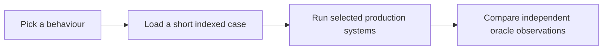

# The engine's architecture

How the engine is built, under [MODEL](MODEL.md), which wins where they disagree. Each decision
below cites the [PRINCIPLES](PRINCIPLES.md) it follows; the oracle is [ORACLE](../ORACLE.md).

## 1. Summary

The engine admits complete clean model state through `game::production::Production` and
advances selected responsibilities with typed inputs. `verify::replay` calls this entry; the
`super-metroid` entry returns `UnsupportedPowerOn`. There is no other executable gameplay and
no writable shadow State. Required missing behaviour returns explicit `Unsupported`.

A catalogue rule is not a case. Many cases can witness one rule, and one case can witness
several rules. The case declares inputs, selected systems, observations and limits.

## 2. What the engine is

Clean Rust models decide gameplay. Adapters hold the model's complete State, answer typed
content/environment queries and publish actual outputs. Imported content, codecs, encoding
and runtime rendering remain separate services. No expected record enters production.
A scoped entry does not imply boot, general actor dispatch, room loading or CPU timing.

## 3. Decisions at a glance

| # | Decision | Principles | Section |
| --- | --- | --- | --- |
| D1 | Crates with plain names | P3, P5, P15 | 4 |
| D2 | Two public engine traits (`Family`, `Canonical`) and concrete context types | K3, P16 | 4.3 |
| D3 | State is a public plain-data schema with private behaviour; one authority | P5, P6, P8 | 5 |
| D4 | `RoomScoped` is one struct, so the door's reset list is a type | P8, K2 | 5 |
| D5 | Video memory is a SNES-layout image, justified by readbacks and stale display | P1, P6 | 5 |
| D6 | The Tick is one video frame in hardware order, from cut to cut | P4, P9 | 6 |
| D7 | A named beam-sync point in the main strand places the scan-out | P4, P9 | 6 |
| D8 | NMI timing (`OnTime` or `Overrun`) is a Tick input from a timing source | P4, P17 | 6 |
| D9 | CPU time is a named cost model of the routines whose frame count depends on it | P2, P9 | 6 |
| D10 | Main strand: a bounded stack of typed continuation frames; interrupt strand: a typed command chain | P9, K2 | 6 |
| D11 | The line program places changes at (line, dot); the dots are oracle rules | P4 | 6 |
| D12 | Slot store with per-family policy | P7, P9 | 7 |
| D13 | One `Program<F>` interpreter for every ROM instruction list | P7, P16, K3 | 7 |
| D14 | AI concrete per species until two share a shape; bosses as data-driven phase tables | P16, P15 | 7 |
| D15 | Content decoded at load; dense IDs inside, stable keys outside; overlays | P1, P7, K1 | 8 |
| D16 | Intents are the model's primary output; one encoder makes the exact output | P18, K4 | 9 |
| D17 | A CPU line compositor writing PPU-domain pixels; `wgpu` presents | P12, P14 | 9 |
| D18 | Sound: protocol and driver model in the Session; synthesis in `runtime` | P18, P4 | 9 |
| D19 | Profiles: Reference, Gameplay (resolved `Rules`), Timing source, Presentation, Input | P17, P4 | 10 |
| D20 | The oracle contract: one record per video frame, cut at each NMI return | P5, P12 | 11 |
| D21 | One decoder, one projection per stream, compared at quiescent cuts | P6, P7 | 11 |
| D22 | Green = every compared stream matches, plus facts; locks keyed by (row, oracle) | P10, P11, P13 | 11 |
| D23 | Speed targets | P14 | 12 |
| D24 | Size, trait and behaviour-catalogue budgets, reported on every landing | P16, P20 | 13 |
| D25 | Each stream's lock comes from the most accurate oracle producing it | P10, P12 | 11 |
| D26 | Short trick movies from seeds; full TAS movies checked by hand, in no workflow | P10, P11 | 11 |

## 4. Packages and ownership

`game` owns production admission, carried clean State and advancement; `verify` owns input
admission, observations and comparison; `tools` owns CLI selection. Independent capture stays
in `oracle`/`oracle_record`. [The crate table](../../crates/README.md) lists dependencies.
Concrete production recipes use existing clean entries. Domain traits answer environment
queries; they cannot supply a second gameplay dispatcher. `Canonical` supplies codecs.

### 4.1 Crates

Production, observation and CLI have separate crate owners. No engine crate depends on
verification. `game` and `runtime` do not depend on each other or reach ROM import. Clean State
uses serde for its representation. The engine's `Canonical` envelope embeds shape-pinned
`Model
` values and owns the schema check, byte encoding and field diff. `canonical_derive`
uses only `proc_macro` and the standard library.

### 4.2 Dependency rules (checked in CI)

Quality checks the dependencies with `cargo deny check bans`: `deny.toml` denies each workspace
crate to all but the crates [the table](../../crates/README.md) lets depend on it, which holds
D1 through any path. Only the registry releases listed there can run build scripts. The workspace
lints forbid `#![feature]`, `allow`, undeclared cfgs such as `cfg(verify)`, unsafe code and, with
`crates/clean/.clippy.toml`, the clean crates' file, network, process and environment access.
`tools/check_crate_rules.sh` greps what no tool sees: probe or observer names in the engine,
SNES address literals (K1), `expect` in the engine (K8) and routine-label names (K9).

### 4.3 The trait budget

Concrete recipes and read-only domain traits avoid a second dispatcher; a new trait is a design
change.

## 5. State

`game::state::owned::OwnedState` holds complete clean model values. Available serializable
States use `canonical::model::Model
` with checked shape pins. Each quantity has one writable
owner. Admission checks state, content and rules before advancing.

Clean models own their typed populations. Independently admitted collision geometry is a
borrowed dependency, not proof of actor lifecycle; missing actor or PLM lifecycle is
unsupported. Display records retain video memory for downstream composition, separate from
movement State; motion-only State does not imply video ownership or pixel equality.

A resident audio session holds the transport, the three real CPU senders and the measured
relationship between their loaded CPU and audio frontiers. Its immutable context selects the
ROM-imported bank and the authenticated room origin. Both identities are checked at restore.

## 6. The Tick

Production carries admitted State over the whole case. Frame cases compare declared cuts;
native audio cases compare transport milestones. Concrete recipes order actual clean calls
and pass outputs to selected consumers. A selected producer cannot be overridden by a tape.
Every changing dependency comes from production or an independently admitted source with a
limited claim. Expected next-state changes cannot manufacture requests, contacts or timing.

Captured frame parity, animation context, cut schedules or clock intervals do not prove the
missing producer. Clean models retain their own pending work between calls. Missing boot,
passage, history, preparation, RNG or timing behaviour prevents the corresponding integrated
claim. Every declared cut remains accounted for.

Advance uses candidate state and commits only on success: a failure changes neither owned
State nor publications. Independent typed stimuli enter production. Runtime rendering is
downstream and cannot affect gameplay.

The played-alone owner, `game::production::played`, steps one whole frame per NMI cut: her
clip's look ahead, her moves, her animation, the camera and the doors, once each. Its only new
input at each cut is the movie's pad from the preceding vblank. While a passage runs the doors
step alone, and `game::production::room_loading` loads what each of their calls names of the
next room from our own room and tileset formats. The scoped connected owner,
`game::production::connected`, steps her movement, animation and camera once each in the same
order, adding her stride and pose selection to the appearance update and, when selected, the
early mini-map. No clean model pauses inside its frame: what a neighbour reads between two of a
model's rules is one of its outputs, such as movement's `position_after_moves` for the mini-map.

Rungs compare owners' State and output bytes at NMI cuts (MODEL decision 35). The software
request, hardware wait, NMI entry and handler return, and their clocks, are T1's; no production
path schedules them. A lag cut inside a rung is an explicit borrowed input.
[T1](domains.md#platform-and-tracks-not-clean-room-hardware-formats-or-the-originals-timing)
owns named CPU costs, beam scheduling and hardware arbitration outside the clean room.

Audio transport keeps no clock. Each frame's audio cadence (the effect turns before and after
the sender service, whether the service runs, and the music turns) is a borrowed input of the
audio owner's frame, like a lag cut, until T1 models the CPU's frame timing and the audio
clock. Required missing timing remains unsupported.

The compositor takes a separate `DisplayFrame` with line-1 registers, writes ordered by their
first visible line, overscan and field parity, plus `VideoMemory`. No production path assembles
that compositor input yet.

## 7. Actors, slots and the interpreter

Clean owners retain their own typed populations, including shots and trails. Typed imported
behaviour tables stay data, interpreted by the clean model specified for that mechanism. Ceres
door/contact selection does not imply general enemy AI, protection ordering, RNG, actor timing
or Ridley's fight.

## 8. Content and IDs

The player supplies the ROM. `import` converts assets into typed `data` formats at the edge;
production validates selected content and holds it with State and rules. ROM-derived bytes
remain outside commits and logs. Catalogue IDs name rules; replay IDs name witnesses. Neither
ID decides gameplay. See [assets](assets.md).

## 9. Output and the presentation boundary

Production publishes complete selected model outputs. Replay compares the fields and outputs
its plan declares: actual model receipts and selected exact encodings. Motion, semantic pose,
contacts, travel and intents can be compared without pixels. The scoped HUD entry returns
semantic events; delivery of item switches and click requests has no production path yet.

`runtime` composes immutable display records into pictures, and presentation feeds no gameplay
State back. Compositing independently admitted records proves the compositor, not production
generation. D17 describes the window presentation target.

**Sound.** `Scope::Audio` holds the complete `audio_transport::State`: the three senders and
their queues, the request lines, each group's audio side and the song. `ProductionContent::Audio`
is a checked `audio::Content`: `Content::resident` admits a ROM-imported bank (its whole cue
roster, aliases, resources and two-track song), and `Content::silent` has no clips or song, for
frames that only queue offers. Admission and restoration check the State against the content:
the song's tracks and mix, every group's history, requests and playback, and that each sender
queues and awaits only its own group's cues. `AdvanceInput::Audio` plays one frame with its
offers and its `FrameCadence`; it publishes nothing beyond the held State, and the replies and
request lines are read back from it. This does not prove the CPU request producers or
whole-engine timing. The opening room's replay adapter
([opening-room loader](../../crates/verify/src/replay/audio/room_load.rs)) admits the imported
bank, the capture's loaded audio side and the load's three ready senders. Movement's touchdown
offers its Contact cue to the same transport, carried with Movement in
`Scope::MovementTouchdown`. No sound-driver code is emulated; synthesis in `runtime` remains
separate, and audio waveforms are not compared.

**Saves.** `Production::save` captures the state after a successful advance. `SavedProduction`
holds canonical bytes containing the State schema and selected State, plus the immutable
context in memory. `Production::restore` checks content and rules by value equality, decodes
the selected schema and revalidates the joined State. Standalone Audio's portable envelope
depends on its own payload schema. The resident envelope also checks its stored origin and bank
identities. Scopes lacking a codec return `SaveFault::Unsupported`. Checkpoints are in-memory
values.

## 10. Options and profiles

Reference rules are selected at admission and held with content. Adjusted behaviours belong
to named rules and vectors, never case IDs or expected outcomes. Scope selects responsibilities
and claim limits, not alternate implementations.

## 11. The engine ↔ oracle comparison contract

Independent unmodified emulator capture supplies pinned records and inputs under
[ORACLE](../ORACLE.md). Initial observation-to-clean conversion happens once. Subsequent
records supply expected observations only. The one `verify::replay` runner advances production
and compares actual owned State and outputs. Decoding is not gameplay, and no expected field
is copied into carried State.

The strict index declares cases, source pins and comparison plans. The baseline binds the exact
index to measured results, counts and observation digests. An expected unsupported boundary
can meet a baseline obligation but remains unsupported, never a successful gameplay case.
Missing data, zero comparisons and absent output fields do not establish equality.

There is no other acceptance executor; the retired ones and their reviewed losses are in
[the replay transition](../../scenarios/replay/transition.toml). Meaningful production/provider
mutants test whether indexed witnesses detect faults.

### 11.6 What isn't compared, by name

Raw WRAM remains capture evidence, not production State.
Unobserved hardware leftovers, sound-driver upload bytes and audio waveforms are not equality
claims. Missing PPU fields and oracle representation limits remain named in
[LEGACY](../LEGACY.md#comparison-representation-limits). Scoped exclusions are declared per case.

## 12. Speed

Replay benchmarks use the same selected cases and production runner as acceptance. Each
result names its scope and comparison plan; unavailable whole-engine execution supplies no
whole-engine throughput claim.

## 13. Size, trait and behaviour budgets

**D24.** Every landing reports its size with `tools size` (MODEL §4), per crate and per MODEL
layer so the routine-port share is visible and falls; the trait budget (§4.3); and the
behaviour catalogue (MODEL §3): behaviours catalogued, proven exact and switchable (P20). A
rebuilt domain's budget comes from its spec (MODEL §1 decision 7); after independent review the
root uses it to decide whether a cut is worthwhile (decision 19).

## 14. Checkpoints and starts

A cache-cut start admits State once and compares following cuts. Native starts use pinned
independent seeds. Restore uses saved production State rather than expected records. A
whole-movie claim requires actual power-on ownership and movie inputs only; missing owners
remain explicit unsupported boundaries.

## 15. Build order

The lowest unmet rung determines work ([the plan](domains.md#4-order)). Wiring existing clean
capabilities uses production and indexed witnesses. Missing rules go through observer and
implementer clean-room rounds ([MODEL §5](MODEL.md#5-how-the-work-is-planned)); engineering
cannot recreate them to preserve an old prefix.

Platform timing schedules and charges work owned by those models and services. Missing actor
selection, audio queue rules or NMI gameplay mutations need clean rules or explicitly scoped
external producers; timing machinery cannot supply their gameplay decisions.
