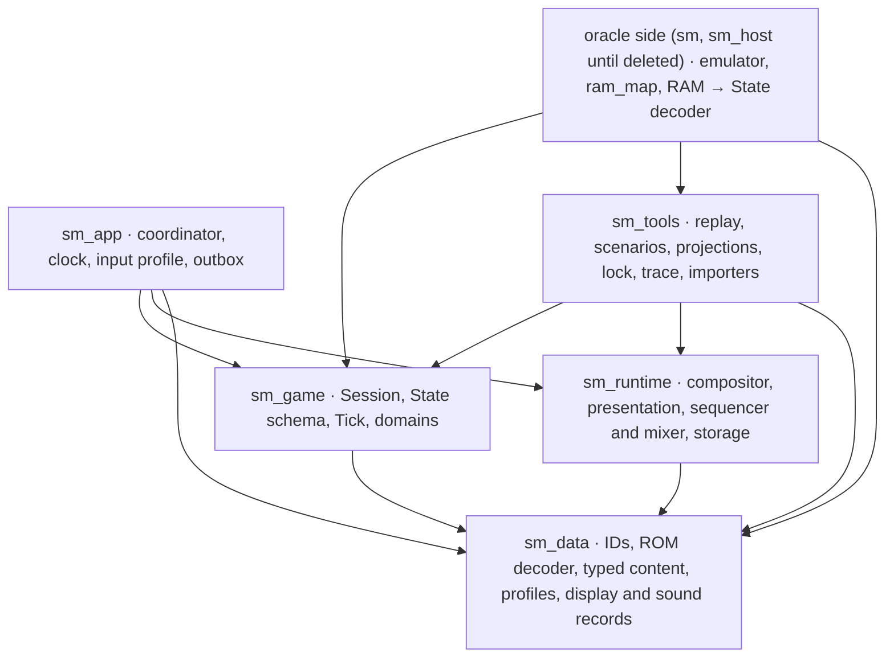

# The foundation

Design lane `research/foundation-design`, based on `origin/main` at `52c2117`, 2026-11-05.
This is the foundation step of Jim's rebuild decision
([REVIEW](../REVIEW.md#rebuild-on-a-new-foundation-jim-2026-11-05)): the design the new
engine is built on, written down for Jim's review before any of it is built. It answers
the three requirement reports in this directory:

- [frame-requirements.md](frame-requirements.md): R1-R31, what the original's frame
  behaviour demands of the Tick, the Scene and the effects;
- [domain-model.md](domain-model.md): the slot tables, the shared interpreter, the domain
  table and its size estimate;
- [map-rando-requirements.md](map-rando-requirements.md): the F items, what Map Rando
  needs from content, IDs and options.

It changes no code. A compile-checked sketch of the core types (about 1,300 lines,
`cargo clippy --all-targets` clean, two behaviour tests) was written to test that the
design holds together; [the appendix](#appendix-key-signatures) carries its key
signatures. The sketch is not part of this branch.

Section 13 maps every requirement to the element that meets it. Section 12 lists the
decisions that are Jim's, each with a recommendation.

## 1. Summary

1. **A Tick is what the oracle calls a frame:** the main strand runs until the game
   waits for NMI, then the NMI runs (committing the display batch if requested, or
   counting lag), then the lines are drawn with the interrupt strand running at its
   lines. This is how the oracle steps (section 2), so the engine's Tick boundaries,
   lag Ticks and RNG call counts match the oracle by construction.
2. **No CPU-overrun lag.** The oracle does not model it: it never advances the beam
   while the CPU runs. Structural lag (message boxes, loading, door waits) is typed
   wait steps. Overrun lag is a difference from hardware, listed in LEGACY, with room
   left for a recorded-lag profile later.
3. **Game logic is resumable.** The main strand is a bounded stack of typed
   continuation frames from a closed set (main loop, gameplay pass phase, PLM pass,
   message box, door transition, pause, death, cinematics, boot). Every cursor is
   plain data in the Checkpoint. No async, no generators.
4. **Video memory is SNES-layout Session state.** The Session owns a VRAM, CGRAM and
   OAM image and a typed register file, written only at the two commit points: the
   requested NMI's batch and forced blank (loading, door IRQ). The renderer consumes a
   **display frame**: the frame's uploads with their commit points, the registers at
   line 0, and typed register changes at lines. HDMA and IRQ effects are resolved into
   that line program by the Session.
5. **Sound runs a port protocol in Tick time.** The Session holds the CPU side (music
   queue, three sound libraries' handshakes, downtime) and a model of the driver's
   acknowledgements. Each Tick emits a port frame (the compared bytes) and typed
   commands. The sequencer and mixer are in `sm_runtime`.
6. **One program interpreter, one slot store.** `Program<F: Family>` with core and
   family ops, labels instead of addresses. `SlotStore` takes the original's capacity,
   spawn order, run order and deletion rule as policy, with live passes.
7. **Content is decoded once from the ROM at load time** in `sm_data`, into typed
   records with stable IDs. The decoder also emits the address map that verification
   uses. Rooms, placements and topology are separate records. Doorways own their
   arrival data. Options are typed profiles.
8. **The Session's state is a public plain-data schema** (the Checkpoint) with private
   behaviour. The oracle decoder builds the same schema from oracle RAM. One projection
   per stream reads the schema, whether the state came from the engine or from the
   oracle.
9. **A row is green when every stream except `wram` matches the lock.** The `ppu` and
   `apu` streams and the typed domains need one deliberate redefinition and re-lock.
10. **The first slice is two seeded rows in the Morph Ball Room**, `area-brinstar`
    then `item-morph-ball`: the HUD split, Samus, a PLM, enemies, a mid-pass message
    box and the item fanfare. Then rooms grow green in clusters that share a seed room.

## 2. Evidence this design rests on

I checked these against the oracle code, because several requirements depended on them.

**The oracle has no beam during CPU execution.** `run_one_frame_of_game_emulated`
(`sm/src/cpu_infra.rs`, around line 1118) runs the CPU until the PC reaches `$80:8343`
(the main loop's wait-for-NMI spin) or `$85:813C` (the message box's lag wait), sets
`nmiWanted`, and runs until `$80:834A` or `$85:8142`. `step_cpu` counts no cycles
against the beam. Afterwards `draw_frame_to_ppu` calls
`sm_game::scene::settle::settle`, which steps the beam line by line from line 0 at four
events per line (raster at 512, HDMA at 1024, wrap at 1362) and runs the IRQ handler
after a line's wrap when `vPos - 1 == vTimer`, until vblank sets the NMI flag again.

Consequences:

- An oracle frame is one wait-for-NMI boundary, not 262 lines of CPU time. Overrun lag,
  mid-frame HDMA tearing and an IRQ interrupting a main-thread multiplication (R10,
  R11) cannot occur in the oracle.
- Interrupt work runs after the main strand has stopped and after the NMI, at line
  granularity: a write at line L takes effect from line L+1 (R13).
- The faithful oracle keeps the ROM patches that make this possible
  (`tools/snesrev_patches.py`, rows marked `kept`): beam spin-wait removals, and the door
  busy-waits at `$82:E06B`, `$E50D`, `$E526` turned into "wait for NMI, then test"
  loops through `$80:D000`/`$80:D004`. It also defers message boxes: `$85:8080` only
  records the request, and hooks run the box after the PLM instruction that asked for
  it (`$84:EFDC`), so the box still runs at the same point in the pass. Most of these are
  verdict `a` (RAM-only). A few `kept` rows are verdict `b` or `c` (timing): the
  host-owned soft reset, one frame later than hardware (`$80:8475`, `$81:F000` and the
  game-over and file-select jumps to it), and the gunship's save confirmation, one
  frame later (`$85:9670`, `$A2:AB22`).
- Hardware movies are already converted to oracle frames: `tools/movie_inputs.py`
  aligns each input to a wait entry and rejects gaps "instead of guessing lag removal".

**The oracle's APU side is a port queue into a native driver.** With the default
`g_use_my_apu_code`, CPU writes to `$2140-$2143` go into `ApuQueue.pending`
(`crates/sm_host/src/apu_queue.rs`, written through `rtl.rs` `apu_write`). The frame
pushes it at its end (`rtl_push_apu_state`), and the next audio render pops it into the
native N-SPC driver (`rtl_pop_apu_state_locked`, 534 samples per frame). CPU reads of the
ports return the driver's output ports. So the acknowledge timing is a deterministic
per-frame protocol: a Tick-time model can match it exactly (R22).

**The lock's machine streams** (`crates/sm_host/src/verification/observation/machine.rs`):
`vram`, `cgram` and `oam` digest the console-layout images. `sram` digests the SRAM.
`video` digests LakeSnes's 256×240 BGRA buffer. `apu` digests `apu_queue.pending`.
`ppu` digests the PPU's **internal** state: the architectural registers, but also the
VRAM, CGRAM and OAM port pointers, the write latches, the H/V counter latches, the open
bus and part of the renderer's scratch line buffer (`objPixelBufferXX[..19]`).

**Most rows start from a seed**, an original-emulator snapshot, not from boot
(`scenarios/corpus.toml`: 157 of 161 rows). So the new engine has to open from a
decoded oracle snapshot from day one. The oracle RAM to Session decoder is part of the
foundation, not a later verification nicety.

## 3. Packages and ownership



| Package | Owns | Does not own |
| --- | --- | --- |
| `sm_data` | Stable IDs; the ROM decoder (load time) and its opcode, header and room tables; typed content (`Programs<F>`, species, poses, rooms, doorways, tilesets, songs); the world records (room, placement, topology); profiles; the portable records `sm_game` emits and `sm_runtime` consumes (display frame, video memory image, sound frame); the address map as a side output | Mutable state, rules, devices |
| `sm_game` | `Session`, the `State` schema and its canonical codec (the Checkpoint), the Tick, the strands, the slot store and interpreter, every gameplay domain, the CPU side of sound and the driver acknowledge model, the SRAM image, typed observations | Pixels, samples, files, the address map |
| `sm_runtime` | The line compositor (display frame + video memory → 256×240 image), `wgpu` presentation and scaling, the N-SPC sequencer, voices, DSP and echo, `cpal` output, save storage | Game rules; it never feeds back into the Session |
| `sm_app` | `RunCoordinator`: Tick admission at the Reference cadence, the input profile (physical → logical buttons, Session commands), effect outbox, cutovers | Gameplay |
| `sm_tools` | Headless replay, scenarios, free run against the lock, the one projection per stream (State → observation bytes), traces, the Map Rando and sm-json-data importers | The oracle; it never depends on `sm` |
| Oracle side | The emulator, `ram_map.rs`, the RAM → `State` decoder, lockstep. It lives in `sm` today (REVIEW D6) and moves into a small `sm_oracle` crate when the old game is deleted | Engine behaviour |

The arrows match ARCHITECTURE except one: `sm_tools → sm_runtime`, so the headless
verifier can draw the `video` stream without a device. `sm_runtime`'s compositor has no
device dependency. Its presentation and audio output sit behind a `native` feature.

**Where the new crates come from (J7).** Today's `sm_game` (160k lines), `sm_data` and
part of `sm_runtime` belong to the frozen old engine and are wired into `sm_host`'s
leases. The recommendation is to rename them in one mechanical commit
(`crates/legacy/sm_game_v1` and so on, used only by `sm_host`), and start the accepted
names fresh. The compiler then guarantees that the new engine cannot call the old code.
A module from the old crates (`digest.rs`, the renderer's line compositor, the lock and
trace tools) moves across only once it meets the new contracts. The alternatives were
new modules inside the old crates (one compile unit, easy accidental reuse, no
compiler-enforced separation) and new crate names (they contradict the accepted package
names).

## 4. The Session

### 4.1 State model

The `State` is the whole Session as plain data: public structs and enums, no behaviour.
It is the Checkpoint's schema, what the oracle decoder builds, and what the projections
read. Behaviour and mutation stay private to `sm_game`. Opening a Session from a `State`
validates its invariants. (This is a revision of ARCHITECTURE's "domain state ...
deliberately private": the decoder and Session-space comparison need the schema
public. J8.)

| Domain | Key types | Scope across a door |
| --- | --- | --- |
| clock | `Tick`, `Counters { completed8, completed16, nmi, lag, max_lag }`, in-game time | carried |
| rng | `Rng(u16)`, with a call counter for the `rng` domain | carried |
| controller | `Controller { auto_read, held, pressed, repeat, previous, repeat timers }` | carried |
| mode | `GameMode`: the 45 game states as an enum, each variant with its data | carried |
| strands | `MainStrand { frames, waiting }`, `IrqStrand { command, line }` | carried |
| video | `Video { memory: VideoMemory, committed: Registers, batch: NmiBatch, hdma: HdmaChannels, nmi_requested }` | carried (content changes by uploads) |
| sound | `SoundCpu { music_queue, libraries: [LibraryHandshake; 3], downtime }`, `DriverIntake`, written `PortFrame` | carried |
| samus | locomotion, posture, equipment, weapon and charge, speed and blue state, damage and i-frames, grapple, reserve mode, drawing state (ARCHITECTURE "orthogonal facts") | carried |
| room | `RoomScoped`: room and state, level blocks and BTS, scrolls, camera, FX, actors (enemies, enemy projectiles, PLMs, sprite objects, Samus projectiles), visual effects (HDMA objects, palette FX, animated tiles, layer blending), entered-by `DoorwayId` | reset by the transition's typed reset list |
| progress | `ItemSet`, `EventSet`, `BossSet` (by home area), explored map (by map area and cell), opened locks (by `LockId`), restart location | carried; save and reload follow section 6.6 |
| menus | pause, file select, game over, message box, HUD state | per mode |
| sram | `Sram`: the 8 KiB save image, typed slot codec at its edge | persistent |

Room-scoped state is one struct, `RoomScoped`, so the transition's reset list is the
type: replacing it resets everything in it, and everything outside it carries (Map
Rando §13). What the transition keeps from the old room on purpose (projectiles that
survive, X-ray, a G-mode setup's leftovers) is a named field the transition copies, and
the copy is in the transition module's reset table.

Values are typed (enums, newtypes, flag sets). Each domain converts to the original's
numbers only at the edges: the decoder, the projections and the SRAM codec.

### 4.2 The slot store and actors

`SlotStore<F, C, B, const N>` holds `N` slots of family `F`. Each slot has common
fields `C` (position, radius, health, properties, palette, layer, cursor) and a typed
body `B` in `Occupancy::{Free, Live(B), Deleting(B)}`. The family's `SlotPolicy` gives:

- **spawn order**: ascending, descending, or a pinned slot (HDMA channels 6 and 7). A
  full table returns `SpawnResult::Full`, a defined gameplay result;
- **run order**: `LiveAscending`, `LiveDescending` or `ListedAtPassStart` (enemies,
  `$A0:8EB6`). A live pass re-reads occupancy at each step, so a slot filled ahead of
  the cursor runs in the same pass. The sketch's test checks this for an 18-slot
  descending table;
- **deletion**: `Immediate` or `NextPass` (an enemy is `Deleting` until the next
  determine pass frees it).

`SlotIndex<F>` is a newtype the content can see: it is the order key and the tie-break.
References the original keeps as raw slot numbers (a projectile's parent, a PLM's
enemy, a boss's parts) are `SlotRef<F>` and see whatever occupies the slot now, as the
original does. A generation-checked `Handle<F>` is used where behaviour must not follow
reuse (J10). Multipart bosses are groups of consecutive slots with typed part roles;
cross-part access uses disjoint borrows (`split`, `pair_mut`) inside the group.

**Leftover state (J11).** The store never clears the common fields: only the spawn code
writes the fields the original's init writes. So a field an init forgets keeps the
previous occupant's value, as on the console, without a raw residue. Species state is
built whole by its init. If the oracle shows a species reading a species variable its
init didn't set, that species gets a named `Residue` field, listed in LEGACY.

### 4.3 The program interpreter

One generic loop serves the eight slot families and the four single-cursor consumers
(Samus animation delays, demo input, Samus projectiles, cinematic scripts; J14):

- `Program<F> { steps: [Step<F>] }`, where a step is `Show { frames, payload }`,
  `Core(CoreOp)` or `Family(F::Op)`. `CoreOp` is the shared set: delete, sleep, goto,
  link and return, set or clear the pre-op, set the timer, decrement and branch, queue
  a sound.
- `Cursor<F> { at: Label<F>, delay, link, pre_op: F::PreOp, timer }`. The pre-op is a
  typed enum, not a function pointer.
- `run(programs, cursor, host, budget)` follows the original: pre-op, timer countdown,
  then steps until a `Show`, a sleep or a delete. A family op returns `Continue`,
  `Yield` or `Delete`. Running past the content's validated step bound is a fault, not
  a hang.
- `Label<F> = (ProgramId<F>, StepIndex)`. Every address the original jumps into or
  compares against is a label. The engine names the labels it tests ("is my list the
  roar list") through a per-family `LabelName` enum, which `sm_data` resolves to
  labels at load time.

Family ops and pre-ops are enums with one handler each. Species-specific instructions
are variants of the species family's op enum, next to the species' AI.

### 4.4 Machines

The species families, bosses, menus and the door transition share one shape:
`Machine<S, A, M, X>`: states `S`, each with entry actions `A`, a motion rule `M` and
exits `X` (timer, contact, Samus range, wall, health, part dead). These are per-domain
enums with Rust handlers. Motion that is maths (swoops, neck chains, figure-eights)
stays a Rust function per motion variant. Bosses are phase machines plus shared
combinators, with their motion in Rust (J13).

### 4.5 Strands and continuations

The original suspends game logic in two kinds of places. The main loop's wait-for-NMI
ends every ordinary frame. Nested waits sit inside routines: message boxes inside the
PLM handler, door loading, pause, death, cinematics and boot (frame report section 6).
The design represents both directly.

**The main strand** is `MainStrand { frames: Vec<Frame> (at most 8), waiting:
Option<Wait> }`. `Frame` is a closed enum of resumable routines:

```rust
pub enum Frame {
    MainLoop(MainLoopAt),          // $82:893D: HDMA objects, RNG, OAM, state, sound, wait
    GameState(GameStateAt),        // the $0998 dispatch for states with their own cursors
    Gameplay(PassAt),              // $82:8B44, one variant per phase in the original's order
    Plms(PlmPassAt),               // the PLM pass, resumable at a slot
    MessageBox(MessageBoxAt),      // $85:8080
    Door(DoorAt),                  // game states 9-Bh
    Pause(PauseAt), Death(DeathAt), Cinematic(ProgramCursor), Boot(BootAt),
}
```

Each frame's step function returns `Next::{Continue, Call(Frame), Return, Yield(Wait)}`.
`resume` runs the innermost frame until something yields. A `Call` pushes, a `Return`
pops and resumes the caller after its call site. So an item message box opened by the
PLM handler is `[MainLoop, Gameplay(Plms), Plms { slot }, MessageBox(Shown { .. })]`.
When the box closes, the rest of the gameplay pass runs about 370 Ticks later, exactly
where the original resumes (R2). The faithful oracle runs the box from a hook right
after the PLM instruction that requested it (section 2), which is the same point. A routine that cannot span a Tick is an ordinary
function and never appears in `Frame`.

**Waits** are typed (R9, R19):

| `Wait` | Original | Tick effect |
| --- | --- | --- |
| `Nmi` | `$80:8338` (sets `$05B4`) | requested NMI: the batch commits, the pad is latched |
| `LagFrame` | `$85:8136` (waits on `$05B8`) | lag NMI: counters only |
| `Until(Condition)` | the oracle's wait-then-test loops (`$80:D004`, music queue waits) | wait for NMI, then test at the next resume |

`Condition` is a closed enum: `DoorScrollDone`, `DoorVramUpdated`, `MusicQueueEmpty`,
`ApuReady`. "N frames" is a counter in the frame's own cursor. "Run a sub-step every
frame while waiting" (the message box's music queue and sound handler) is the frame's
step doing that work before it yields.

**Why this and not the alternatives.** Rust `async` and generators can't be serialized
into a Checkpoint, and generators aren't stable. Re-running a pass and skipping finished
work re-executes side effects and breaks on RNG. A general script VM is excluded by
ARCHITECTURE. Explicit cursors are what `dialogue.rs` already does for message boxes.
The cost is that each resumable routine is written as a state machine, but the set is
small and closed.

**The interrupt strand** is the `$AB` command chain as a typed enum, `IrqCommand`: off;
the gameplay HUD and its restore; the door-start HUD; Draygon's HUD; the vertical and
horizontal door commands at their three lines. Each command's handler is a Rust
function over the Session's door and display state that returns the next command and
its line. It is gameplay: during doors it moves Samus, layer 1 and the scrolls, runs the
forced-blank VRAM update and grants the NMI request (R15).

### 4.6 Checkpoint

`Checkpoint { schema: SchemaVersion, fingerprint: Fingerprint, state: State }`. It is
encoded canonically: fields in declared order, fixed-width little-endian integers, enums
by declared index, no maps with unordered iteration. One trait, `Canonical`, provides
`encode`, `decode` and `diff`. `diff` walks two values and reports the first differing
field path, which is what Session-space lockstep reports. The trait is derived, not
hand-written per type (J9: our own derive macro, with `syn` and `quote` as build-time
dependencies). This replaces today's six checkpoint codecs with one.

### 4.7 Starts

```rust
pub enum Start {
    Boot,                                      // power-on
    Checkpoint(Box<Checkpoint>),               // ours, or a decoded oracle seed
    PlayerSave { save: PlayerSave, slot: u8 }, // the original's load flow
    Arrival { world: WorldId, doorway: DoorwayId, carried: Box<Carried> },
}
```

A seeded corpus row opens with `Start::Checkpoint(decode(seed))`. A constructed arrival
(Map Rando §13: "arrives shinecharged with N frames") is a doorway plus the typed
carried part of the State, so strat joins between rooms that are never neighbours can be
tested without playing through a vanilla neighbour.

## 5. The Tick

### 5.1 Order

`Session::step(input)` advances one Tick, which is one video frame as the oracle steps
it:

1. **Main strand.** Resume from `waiting`. If it is `Until(c)` and `c` is still false,
   it stays waiting and the Tick's NMI is requested, as in the oracle's "wait for NMI,
   then test" loops. Otherwise run frames until one yields. One main-loop iteration is, in order:
   the HDMA object handler (music queue first, then the pending power bomb spawn, the
   six HDMA objects and layer blending), one RNG call, clearing high OAM and the
   transfer flags, the game state dispatch, the sound handler, finalising OAM, the
   previous-input copy, and then `Yield(Wait::Nmi)`.
2. **NMI.** If requested, commit the NMI batch in the original's order: OAM and CGRAM,
   Samus tiles, animated tiles, the register mirrors, HDMA bindings, the Mode 7
   transfers, the VRAM write table, then the VRAM read table into its Session targets.
   Then HDMA enable, the controller latch, and the counters (`lag = 0`, `completed8`,
   `completed16`). If not requested, increment `lag` and update `max_lag`. Always
   increment `nmi`. Then store the pad as `auto_read`.
3. **Lines.** For each visible line: the line takes the registers in effect, then the
   HDMA channels write the next line's values, then the IRQ command due at this line
   runs. Its writes take effect from the next line (the oracle's rule, R13). The result
   is the display frame's line program.
4. **Sound delivery.** The Tick's port frame goes to the driver acknowledge model. Its
   echoes are what the CPU side reads from the next Tick (section 6.3).
5. **Output.** `TickOutput { tick, nmi: NmiKind, display: DisplayFrame, sound:
   SoundFrame, save: Option<SramWrite>, failure: Option<OriginalFailure> }`.

The 19 phases of the gameplay pass (`PassAt`) follow `$82:8B44`'s order (R25): enemy
selection, palette FX, Samus current state, Samus and projectile interaction, enemies,
Samus new state, enemy projectiles, PLMs, animated tiles, collisions, power bomb,
scrolling, drawing, HUD, BG scroll, room main code, health and time, room shaking and
hurt timers. Inside the enemy phase the `$A0` order holds: determine active, Samus and
projectile contacts, each enemy's contact, AI, instructions and draw queue, then
solid-enemy contact, enemy projectile contacts, power bomb contact, draw and shake.
These replace CONTRACTS' stage 2-6 table. The domain report's "(confirm)" rows (the PLM
direction `$84:85DA`, the sprite object, palette FX and animated tile counts and orders,
the runtime enemy spawn search) are checked against the bank logs before their families
are built. They are policy values, so a correction changes data, not structure.

### 5.2 Input and its latch

`TickInput { pad: Buttons, commands: SessionCommands, host: HostResults }`. `pad` is the
controller **as sampled at this Tick's vblank** (R5). That matches the oracle:
`run_one_frame_of_game_emulated` gives the NMI the next input line's word and restores
the frame's own word for main-thread reads. It also matches REVIEW's "input index i
commits Tick(i+1)".

- A requested NMI latches `pad` into `held`, `pressed = pad & !previous` against the
  last *latched* word, and the repeat words. The next Tick's main strand sees them.
- Every NMI, requested or lag, sets `controller.auto_read = pad`. Direct reads in the
  next Tick's main strand (the message box poll, the save confirmation, R7) read
  `auto_read`. A press and release that fall within lag Ticks never reach the game.
- Demos replace the latched words from a demo program (`Program<Demo>`). Controller 2
  and the debug branch are dead in vanilla (R6), so `TickInput` carries one pad. Soft
  reset and the game-over and file-select quits are a typed `GameMode::Reset`
  transition into the boot strand.
- `SessionCommands` (quick reload and the like for Map Rando, initially empty) are
  recorded inputs too, so replays reproduce them.
- The replay format's `-` lag lines become an *expected* observation (the `input`
  domain's lag flag), not a command: the engine decides lag, and a mismatch is a
  divergence.

### 5.3 Lag

**Structural lag** is behaviour. It falls out of the strands: a `LagFrame` wait, a
`Wait::Until` that is still false, or a fixed count in a frame's cursor
(`$85:8574`'s 2 frames, `$85:8493`'s 360 or 10). No frame count is folded into a
constant elsewhere.

**Overrun lag (J1).** The oracle does not model it (section 2): an iteration that would
overrun on the console is one Tick in the oracle, whatever its CPU cost. The decision:

| Option | Matches the oracle lock | Live-play behaviour | Cost |
| --- | --- | --- | --- |
| (c) **No overrun lag** (recommended) | yes, by construction | busy rooms don't slow down; the gameplay is still exact, because RNG and IGT advance per iteration (R10) | none; one LEGACY entry |
| (b) Recorded overrun marker | only if the lock is re-recorded from hardware traces | needs a marker source in live play; without one, it is (c) | one `TickInput` field: on a marked Tick the main strand doesn't resume and the NMI takes the lag path; the display shows new HDMA over old registers (R8) |
| (a) Cycle cost model | no: the engine would lag where the oracle doesn't | approximates hardware slowdown | per-routine cycle budgets calibrated against Mesen and bsnes; large and unverifiable against our gate |

(c) is the faithful oracle's behaviour, so it is the Reference profile
(`LagModel::Structural`). The design keeps (b) open: a marked Tick is a Tick whose main
strand isn't resumed, which the Tick structure already supports. R11's multiplier
clobber and mid-frame HDMA tearing go into LEGACY with it. Neither can occur in the
oracle.

### 5.4 Interrupts and HDMA in the line program

The Session evaluates HDMA, not the renderer. HDMA objects (`Program<Hdma>`) keep typed
per-line tables (`ScrollCurve`, `WindowSpans`, `ModeSplit`, colour math runs) in
`video.hdma`. The NMI commits which channels are enabled and bound (`$85` and the
`$18B4` pointers). The line pass reads the enabled channels each Tick. This gives R8's
two commit points without a special case:

- registers, OAM, CGRAM and video memory change only through the NMI batch or forced
  blank;
- HDMA tables are rewritten by the HDMA object handler at the start of each iteration,
  and the line pass reads whatever they hold. On a lag Tick the display shows the
  latest tables over the previous registers and OAM (R8, R28).

Forced blank is a register change at a line (`Change::ForcedBlank`), so a line range
(the door update at line A0h or D8h) and a whole frame (loading) are both expressible
(R14).

### 5.5 The door transition's two strands

The door transition is a `Frame::Door(DoorAt)` cursor on the main strand. Its interrupt
side is `IrqCommand::{VerticalDoor, HorizontalDoor}(DoorIrqAt)` on the interrupt strand.
They share `RoomScoped`'s transition record: scroll progress, the pending VRAM update and
the done flags (R20).

- The main strand fades out, loads the door, aligns the screen, loads the room (level,
  scroll and CRE data decoded from content), sets up scrolling, places Samus, starts the
  IRQ chain, loads sprites, PLMs and enemies. Then it waits `Until(DoorVramUpdated)` and
  `Until(DoorScrollDone)`, runs one PLM pass and waits for NMI, then animated tiles,
  `Until(MusicQueueEmpty)`, the Samus nudge and the fade-in.
- On its lines, the interrupt strand draws the HUD, scrolls Samus, layer 1 and the BG,
  runs the deferred VRAM update under forced blank, and sets the NMI request. The door
  IRQ zeroes `completed8` the way the original's 16-bit `STZ`/`INC` does (R15).

Neither strand fixes the frame count: it is however many Ticks the slower strand takes,
per room (R20; the frame report's open question 2 becomes a measurement in build step 3).
The carried state is everything outside `RoomScoped`. The transition's reset and keep
table names each room-scoped field it copies, and the order of "room loaded", "first
gameplay frame" and "reserve check" follows the original's steps (R21). The arrival
position and camera are a function of the exit doorway, the arrival doorway and the
carried state only (Map Rando §2, §13).

### 5.6 RNG and failures

`Rng(u16)` advances `r * 5 + 0x111` with the original's high-byte carry, using its own
arithmetic, not a multiplier register. It is called once per main-loop iteration and by
each consumer in pass order. A lag Tick doesn't call it (R25). The counter of calls is
part of the `rng` observation (R26).

Original crashes and softlocks are typed: `OriginalFailure::{SpringBallMenu,
YappingMawSpark, AutoReservePause, XModeCollision, SpriteOverflow, ...}`. Under the
Reproduce policy the Session runs up to the observable point the oracle reaches and then
returns the failure in its `TickOutput`, and the Session ends. A Map Rando preset maps a
failure to death, warn or continue (J17). Engine faults (an invariant broken, a step
budget exceeded) are `SessionFault`, which poisons the Session as CONTRACTS requires.
Original limits (a full table, a dropped sound) are neither: they are gameplay.

## 6. Output

### 6.1 Video

`VideoMemory { vram: [u16; 0x8000], cgram: [u16; 0x100], oam: [u16; 0x100], oam_high:
[u8; 0x20] }` is SNES-layout Session state (J3). The alternatives, and why this one:

- **A typed Scene of authored visual IDs, projected into SNES layout for verification**
  (ARCHITECTURE's Scene, R17's second option). The game reads video memory back (R16),
  so the Session must own the bytes anyway. A projection would have to reconstruct where
  every tile and tilemap entry went, which means reimplementing every upload a second
  time. The content being uploaded is itself bytes: decompressed tiles, tilemaps,
  palettes and Samus's per-pose tile blocks.
- **The image in the renderer only:** rejected by R16 and R18.
- **The image in the Session** makes `vram`, `cgram` and `oam` direct digests,
  readbacks trivial, and seed decoding a copy. What modularity needs (custom Samus
  sheets, palettes, tile themes) is substituted where the content is decoded: the upload
  sources are media references keyed by `PoseId`, frame and `AssetId`, so a replacement
  sheet changes the bytes uploaded, not the engine (Map Rando §5, §11).

Writes are only possible through two guards, which the type system enforces. A
`VideoWriter` is created only by the NMI commit (`CommitPoint::Nmi`) or by a
forced-blank scope (`CommitPoint::Loading` for the main strand under forced blank,
`CommitPoint::BlankLine(l)` for the door IRQ). Every write is logged as an `Upload {
at, target, words }` in the Tick's display frame (R18).

The main strand writes only the **NMI batch** (`NmiBatch`: the OAM and palette buffers,
register mirrors, the VRAM write and read tables, Samus and animated tile transfers),
which the requested NMI applies in order. Readbacks (`Readback { from, words, into:
PauseBg2Backup | XrayBackground | ... }`) copy from the image into their Session
targets at the NMI, after the write table, as `$80:8EA2` does.

The **display frame** is the renderer's input:

```rust
pub struct DisplayFrame {
    pub uploads: Vec<Upload>,       // in order, each with its commit point
    pub start: Registers,           // the registers in effect at line 0
    pub changes: Vec<LineChange>,   // typed changes from a line on: scroll, mode, window,
                                    // screens, colour math, forced blank, layer bases
}
```

`Registers` is the architectural PPU state as typed records (`BgMode`, `Layer`,
`Screens`, `WindowEdges`, `ColorMath`, `Brightness`, Mode 7), not register addresses.
OAM is 128 entries in draw order, with the original's parking at Y = F0h and its
overflow (R27). The compositor applies the per-line 32-sprite and 34-tile limits in that
order. A lag Tick's display frame has no NMI uploads, so the previous OAM, palette and
registers stay on screen (R3, R28).

### 6.2 The renderer

`sm_runtime::video` keeps its own mirror of the video memory. It applies every Tick's
uploads, even on Ticks it doesn't present, and composes 256×240 lines from the mirror
and the line program. Its pixel rules are the oracle's (LakeSnes's colour conversion,
brightness and priority), so the `video` digest can match. It is a CPU line compositor
writing a native image. `wgpu` scales and presents it (J4). That revises ARCHITECTURE's
"focused GPU renderer": per-line SNES composition at 256×224 is cheap on the CPU, and
exactness to the oracle's pixels is easier to reach and to prove there. The GPU's role
is presentation. If the fixed pass plan later earns GPU composition, the display frame
is the same input.

Shake and flashing intent travel in the display frame as typed fields, so a
presentation profile can reduce them (Map Rando §11). In the vanilla profile they are
applied exactly.

### 6.3 Sound

The Session holds the CPU side of the original's sound protocol, typed:

- the **music queue**: 8 entries with per-entry delays (`$80:8F0C`, `$8FC1`, `$8FF7`);
- three **library handshakes**, each `LibraryState::{Idle, Writing(SoundId), Clearing {
  frames }, AwaitingZero, Reset}` (`$82:89EF`), with 16-deep queues and the original's
  caps, demo and power bomb drops and lower-ID-wins collisions (R24);
- the **downtime** counter.

Each Tick's writes form a `PortFrame([Option<u8>; 4])`: the latest value written to each
port, `None` for an unwritten port. That is exactly what the oracle's `ApuQueue.pending`
holds. At Tick end it goes to **`DriverIntake`**, a deterministic model of the driver's
port handling in Tick time: what it echoes on each read port and when, and when it is
busy taking a music data upload. The CPU side reads those echoes from the next Tick
(R22). The oracle hands the ports to its native driver once per frame, so the first
rule to try is "a command written in Tick N is echoed from Tick N+1", with measured
exceptions. The frame report's open question 5 becomes a measurement, made before the
first sound row: log the oracle's port reads per Tick over `music-fir-selector10` and an
item row. If the echo turns out to depend on sequencer state (voices busy), the
sequencer's control part (not mixing) moves into the Session as a Tick-stepped model
(J16).

`SoundFrame { ports: PortFrame, commands: Vec<SoundCommand> }` carries both the
compared bytes and the typed commands they encode: `Music(..)`, `Effect { library, id
}`, `UploadSongSet(SongSetId)`. `sm_runtime`'s sequencer plays the commands from banks
decoded from the ROM's N-SPC data. It keeps its own clock (CONTRACTS "Sound engine and
transport" stays as is). Music uploads cost the Ticks the oracle spends on them, and no
CPU time beyond that (R23, J18). The first measurement (`music-fir-selector10`, an area
row's first room) confirms the count.

### 6.4 Saves, effects and the outbox

SRAM is Session state (`Sram`, the 8 KiB image). The save routine writes slot bytes and
checksums there synchronously in its Tick, and the Tick's output carries an owned
`SramWrite` snapshot to the storage worker (R29). The host receipt is recorded input but
doesn't change behaviour in the vanilla profile. The original's load clears a slot whose
checksum fails, and the vanilla profile reproduces that, because it is game behaviour
(R30, J15). CONTRACTS' "do not silently reset a corrupt slot" applies to our container
file: a damaged or incompatible save file refuses to open and leaves the run intact. Our
`PlayerSave` is a versioned container holding the SRAM-format slot, the world and
profile identity, and Map Rando's "survives reload" record (explored map) when that
profile is active (Map Rando §12).

The outbox, its capacities and the epoch rules stay as CONTRACTS describes. The game's
own drops (queue caps, demo drops) are behaviour. "Never silently drop a cue" applies to
the engine's transport.

## 7. Content and IDs

### 7.1 Decoded once, at load time

`sm_data::import` decodes the ROM when content is loaded (REVIEW #253, J12) into
validated, typed records: species and their hooks, vulnerability and drop tables,
`Programs<F>` per family, PLM and projectile headers, poses and transitions, animation
lists, rooms and states, doorways, scroll data, enemy sets, tilesets and their media
references, HDMA, palette FX and animated tile programs, N-SPC banks, demo lists and
cinematic scripts.

- Each opcode has one table row: its address, its argument layout and its typed variant.
  The engine never reads list bytes.
- A raw value crosses into an enum once, with `TryFrom`. A value the original tolerates
  becomes a named `Unknown(u16)` variant and a LEGACY line. A value it treats as an
  error is `Fatal::unreachable` at decode.
- A jump into an address that isn't a step start fails decoding, unless the table
  records it as a quirk.
- Map Rando and custom content produce the same records.

The decoder also returns an **`AddressMap`**: ROM address to `(family, ProgramId,
StepIndex)`, AI state address to state enum, pre-op address to pre-op variant, room
header to `RoomId`, door header to `DoorwayId`. Only verification uses it. The Session
never holds it. It may be many-to-one (#251).

### 7.2 Labels instead of addresses

Engine code names program places with `LabelName` enums per family, and room code names
rooms, doorways and items by their IDs. Vanilla addresses appear only in `sm_data`'s
import tables and `CompatibilityKeys`. So `sm_game_ram_sites`' spirit, no address in
engine logic, holds by construction.

### 7.3 World, doorways and placement

Following the Map Rando report's decisions 1-4 and 8:

- `Room` (content: states, level and collision, objects, enemies, presentation
  references, doorways) is independent of where it sits. `RoomId` is its identity.
  `HomeArea` is part of it.
- `Placement { room(s), map_area: MapArea, map_x, map_y, sub_area, sub_sub_area }` puts a
  placement unit (one room, or the two twins, J23) somewhere in a world. A room can be
  left out of a world.
- `Doorway { id: DoorwayId, room, kind: Normal(axis) | Sand | Elevator, arrival: Arrival,
  exit side, lock }` owns its arrival data (facing, spawn distance, cap position, typed
  `DoorAction`s instead of door ASM) and its per-arrival hooks (map reveal, the sand X
  clamp range, boss-exit cleanup), interpreted by the transition module.
- `Topology { connections: [Connection { a, b: Connected(DoorwayId) | Wall, lock:
  Option<LockId> }], one_way_arrivals }`. "Leave through A" means "arrive at
  partner(A)". The area-change and CRE-reload flags are computed from the pair's
  placements and tilesets, not stored per exit.
- Everything keyed by "the door you came in by" (FX entry selection, the door-matched
  background transfer, the save station's scroll setup, entry-side boss logic) reads
  `RoomScoped.entered_by: DoorwayId`.
- Items: `ItemLocationId` with its presentation style; the placed item is world data;
  `ItemKind` and equipment capabilities are enums with a vanilla subset; pickup amounts
  are profile data; which items exist in which state is world data.
- Events and objectives: `Event` and `Boss` enums with stable names that map to
  sm-json-data flags; the Tourian gate reads an objective set from the world.
- Locks: `LockId` shared by both doorways of a connection. Opened state is keyed by
  `LockId`. `DoorCap` kinds form an extensible enum with typed gray-door conditions.
- Starts: `StartDefinition { room, position, camera, arrival: DoorwayId, inventory,
  flags }`. The new-game flow is a strand the profile can skip.
- The vanilla world is one `World` value built from vanilla data, and it must rebuild
  the vanilla room headers, map pages and area-indexed state exactly: a check, not an
  assumption.

### 7.4 Media and presentation

Room-state presentation (tileset tiles, tile table and palette, level graphics, music
cue `(SongSetId, track)`, FX appearance, map tiles relative to the room) is a set of
media references, replaceable without touching collision, BTS, objects or enemies. Map
tiles are composed into area pages at runtime from placements. Samus's appearance is
keyed by `PoseId`, frame and palette state. The content that loading costs in Ticks
(decompression and upload structure) comes from what is loaded, never from a cached
vanilla neighbour (Map Rando §5).

### 7.5 Profiles

| Profile | Owner | In the fingerprint | Contents |
| --- | --- | --- | --- |
| `ReferenceProfile` | `sm_data` | yes | cadence (NTSC: master clock 236,250,000/11 Hz over 357,366 cycles a frame on average, ≈ 60.0988 Ticks/s; the oracle itself is iteration-paced), `LagModel::Structural`, the oracle line rule, the faithful-oracle rule (J2) |
| `GameplayProfile` | `sm_data`, each field read by the module whose rule it changes | yes | suits, transition timing, movement capabilities and persistence, shinespark cost, pickup sizes, station refills, drops, respawn, boss variants, escape, glitch policy, failure policy. Presets `VANILLA` (every field's default) and `MAP_RANDO_BASE` |
| `PresentationProfile` | `sm_runtime` | no (media revision) | palettes, themes, door colours, Samus sheet, map style, shake and flash levels, HUD style |
| `InputProfile` | `sm_app` | no | physical to logical buttons, spin lock, quick reload and save state bindings (which emit recorded `SessionCommands`) |

An importer maps every mechanic setting to a profile field or rejects the seed with a
diagnostic (Map Rando §10).

## 8. Verification

### 8.1 How each stream is produced

| Stream | Engine side | Oracle side | Change to the lock |
| --- | --- | --- | --- |
| `vram`, `cgram`, `oam` | digest of `State.video.memory` (layout-exact) | as today | none |
| `sram` | digest of `State.sram` | as today | none |
| `video` | `sm_runtime` compositor run headless by `sm_tools` on the Tick's display frame | LakeSnes render buffer, as today | none |
| `ppu` | digest of `State.video.committed` plus the line program's end-of-frame registers | today: LakeSnes internal state | **redefine** as the architectural registers only, with the port pointers, latches, H/V counters, open bus and renderer scratch as named exclusions (J5) |
| `apu` | digest of the Tick's `PortFrame` and uploads | today: `ApuQueue.pending` at frame end | **define precisely** as the Tick's port frame as delivered (J5) |
| `input`, `samus`, `camera`, `room`, `progress`, `actors`, `effects`, and a new `rng` | `sm_tools` projection of the engine's `State` | **the same projection** of the decoded oracle `State` | **re-lock** once when the decoder lands (J5) |
| `wram` | not produced | as today | stays for the old path's nightly; not part of the new engine's gate |

**One projection, two sources.** Each typed domain is a function `State → bytes` in
`sm_tools`. The oracle side decodes its RAM into a `State` and runs the same function.
The two sides can then disagree only through behaviour or the decoder, never because two
projections were written differently. This replaces today's two hand-kept projections.

### 8.2 The decoder

The oracle-side decoder builds a `Checkpoint` from the oracle's machine after a frame:
WRAM through `ram_map.rs`, VRAM, CGRAM, OAM, SRAM, the SPC driver's variables, and the
CPU's PC and stack. It uses the `AddressMap` for every ROM pointer (instruction
pointers, AI states, pre-ops, room and door headers).

- **Continuations.** The oracle stops at known wait sites (`$80:8343`, `$85:813C`, the
  `$80:D004` loop and the others). The decoder maps the PC and the return addresses on
  the stack to a `MainStrand`. A stack it can't map is `DecodeError::UnknownYieldSite`,
  and the row can't start until the yield site is named. That is a precise to-do, not a
  silent guess.
- **Seeds.** The same decoder opens seeded rows (`Start::Checkpoint`). VRAM, CGRAM and
  OAM are copies, because the image is layout-exact.
- **Audio.** For the Session, only the driver intake state is decoded. For offline audio
  checks, `sm_runtime`'s sequencer start state is decoded from SPC RAM separately.
- **Coverage.** Every `State` field has a decode rule or a named reason why the oracle
  has no equivalent (for example the RNG call counter, which starts at zero). The
  decoder's tests check that the field list is complete.

**Session-space lockstep** steps both sides, decodes the oracle each Tick and reports
`Checkpoint::diff`'s first differing field path. It is the fault localiser behind the
lock's 1,000-Tick marks.

### 8.3 What "green" means

A row is **green on the new engine** when the engine's free run from the row's start
over the row's inputs produces the lock's Tick count and the same running digests for
every stream except `wram`. That is the gate REVIEW names: a change may not lower the
number of green rows, and Quality passes. I also recommend reporting (and ratcheting)
the green **(row, stream) pairs**, so partial progress inside a row is protected before
the whole row turns green (J6). Rows marked `unlocked` in the corpus can't be green until
they are locked against the faithful oracle.

Determinism checks (Checkpoint, advance, restore, advance; equal inputs give equal
digests) and mutation sensitivity (a one-field mutant is reported at the right Tick and
stream) run on every green row in CI's Quality job.

## 9. Size budget

The domain report estimates 57-84k lines of rebuilt `sm_game` and a 4-8k decoder. This
design adds the line strand, the NMI, the sound protocol model and the checkpoint
derive, and puts the decoder in `sm_data`. The budget, in physical lines of authored
Rust, excluding tests:

| Package | Part | Budget |
| --- | --- | ---: |
| `sm_data` | IDs, typed content and world records, profiles, display and sound records | 6-8k |
| | ROM decoder: opcode, header and room tables, address map | 5-9k |
| `sm_game` | spine: Session, State schema, Tick, strands, NMI and line pass, slot store, interpreter, checkpoint | 8-12k |
| | Samus | 9-12k |
| | enemy species | 8-12k |
| | actor infrastructure (contacts, probes, population) | 3-4k |
| | bosses | 10-15k |
| | enemy projectiles | 3-4.5k |
| | PLMs | 2.5-3.5k |
| | sprite objects | 0.3-0.6k |
| | visual effects (HDMA, FX, palette FX, animated tiles, layer blending) | 4-6k |
| | rooms and the door transition | 3.5-5k |
| | progression and the SRAM codec | 1.5-2.5k |
| | sound: CPU protocol and driver intake | 1-1.5k |
| | menus, messages, cinematics, credits | 7-10k |
| `sm_runtime` | compositor 3-4k, presentation 1.5-2.5k, N-SPC sequencer, voices, DSP and echo 4-6k, devices and storage 1-1.5k | 9.5-14k |
| `sm_app` | coordinator, clock, input profile, outbox | 2-3k |
| **Engine total** | | **83-123k** |
| Verification, outside the engine count | `sm_tools` projections, free run, lock, trace, scenarios 6-9k; importers 2-3k; oracle-side decoder 4-6k; derive crate 0.5-1k | 12.5-19k |

The engine total sits under REVIEW's ~125k target for this phase, with the domain
report's ranges for the large domains. Each domain's budget becomes an advisory measure
when its first rows turn green. A domain running past its upper bound is a design
review, not a ratchet failure.

## 10. Changes to the accepted destination

The requirements prove these parts of `docs/target-architecture` wrong or incomplete. I
propose these revisions and would apply them in the PR that Jim's decisions approve, not
before:

1. **ARCHITECTURE, Focused GPU renderer and the Scene.** The Scene becomes the display
   frame over a layout-exact video memory image owned by the Session (typed registers,
   not addresses). The renderer is a CPU line compositor with GPU presentation. The
   media boundary moves to the upload sources. (R12, R16-R18; J3, J4)
2. **ARCHITECTURE, Gameplay structure.** "Actor handles detect stale references" becomes
   "generation-checked unless the Reference profile observes slot reuse; those
   references are typed `SlotRef` and listed". The domain state *schema* is public plain
   data, and behaviour stays private. (Domain Q1; J8, J10)
3. **CONTRACTS, A Tick with explicit commit points.** The stage table becomes section
   5's order (main strand, NMI, lines, sound delivery), with the gameplay pass phases in
   the original's order and live slot passes instead of "commit early actions".
4. **CONTRACTS, Public gameplay interface.** `TickInput` carries the pad sampled at the
   Tick's vblank and recorded Session commands. `TickOutput` carries the display frame,
   the sound frame, the SRAM write and the original failure.
5. **ARCHITECTURE and CONTRACTS, Sound.** The Session emits port frames and typed
   commands and owns the driver acknowledge model. The game's own drops are behaviour.
   (R22, R24)
6. **CONTRACTS, Save and load.** The corrupt-slot clear is vanilla behaviour inside the
   SRAM image. "Do not silently reset" applies to our container. The persistence table's
   Player save is the SRAM-format slot in a versioned container. (R29, R30)
7. **ARCHITECTURE, Scope; VALIDATION, Gate 0.** The slowdown policy is decided:
   structural lag only, recorded overrun lag reserved. (R10)
8. **ARCHITECTURE, Content and development workflow.** Vanilla content is decoded from
   the ROM at load time (already REVIEW #253). Tiled and RON authoring waits until a
   real authoring need appears.
9. **VALIDATION, Gate 1.** The slice is section 11's slice 0, compared on every stream
   except `wram`.
10. **GLOSSARY.** New terms: main strand, interrupt strand, continuation frame, yield
    site, wait, display frame, commit point, video memory image, NMI batch, family, slot
    store, slot policy, program, label, address map, doorway, placement, topology, home
    area, map area, port frame, driver intake.

## 11. Build order

### Before slice 0

1. The package plan (J7): rename the old crates, create the fresh ones, keep the
   workspace and CI green.
2. The `Canonical` derive and the `State` schema skeleton: clock, controller, video,
   strands, RNG.
3. Two measurements on the oracle that set rules before code depends on them: the port
   echo latency (section 6.3) and the door frame counts per room (section 5.5). Both are
   per-Tick logs from the existing verifier.
4. The decoder skeleton on the oracle side, decoding the fields the schema has so far,
   and the projections for `input` and the machine streams.

### Slice 0: the Morph Ball Room

Rows: **`area-brinstar`** (seed `683b992`, room `9E9F`, 250 Ticks), then
**`item-morph-ball`** (same seed, 1,200 Ticks). Together they prove the foundation:

| Foundation element | How the slice proves it |
| --- | --- |
| Tick order, NMI, counters, input latch | every Tick; the `input` stream |
| HUD split (IRQ commands at lines 0 and 1Fh) | every Tick; `video`, `ppu` |
| Video memory image and NMI batch | HUD and Samus uploads; `vram`, `cgram`, `oam` |
| Line compositor | `video` |
| Seeded start through the decoder | both rows start from a seed |
| Slot store and interpreter | the room's PLMs (door caps, the item) and its enemies |
| Samus | standing, running and jumping as the inputs require |
| Mid-pass suspension and structural lag | the item's message box, opened from the PLM pass, about 370 lag Ticks, then the rest of the pass |
| Sound protocol and driver intake | the pickup sound and the item fanfare through the music queue; `apu` |
| Content decoder and labels | everything the room loads |
| Checkpoint | restore at the box's midpoint and continue: equal digests |

Exit: both rows green on every stream except `wram`; determinism and one mutant per
stream reported correctly; the size of every new package reported against section 9.

**Why not boot → one room.** From power-on to the first controllable room is the logo,
title, file select, intro and Ceres: the `samus-scripted-intro` row is 8,780 Ticks of
cinematics before gameplay. That exercises content far from the foundation's seams.
157 of the 161 rows start from seeds, so the decoder is foundation-critical anyway
(J24). Boot is step 8 below.

### Then, by clusters of rows that share a room

Each step makes a cluster of locked rows green. Each adds the domains its rows reach
and nothing speculative. The old engine's modules for a domain are deleted when the
domain's rows are green (REVIEW's deletion measure).

| Step | Rows | What it adds |
| --- | --- | --- |
| 1 | Landing Site `91F8`: `area-crateria`, `gunship-bobbing-cycle`, `samus-walljump-*`, `samus-shinespark-*`, `samus-space-jump-chain`, `samus-mockball`, `special-beam-*`, `xray-scan-91f8`, `samus-crystal-flash`, `samus-gunship-save` | Samus's movement depth, beams, x-ray and crystal flash HDMA, rain FX, the save station flow and SRAM |
| 2 | `door-transition`, `door-loading-lag-nmi`, `tas-ceres-four-doors`, `tas-ceres-cross-frame-read`, `elevator-*`, `power-bomb-*-entry` | the two-strand transition, carry-over, elevators, power bomb; the room chains start here |
| 3 | `area-*`, `enemy-*`, `terrain-*`, `wall-crawler-slope-step`, `beam-reflect`, the other `xray-scan-*` | enemy families on the machine pattern, enemy projectiles, liquids and terrain |
| 4 | `item-*`, `pickup-*`, `samus-grapple-*`, `samus-square-slope-reserve`, `xray-activate-release` | all equipment, grapple, reserves, the message box family |
| 5 | Ceres: `area-ceres`, `samus-input-poses`, `samus-forced-ceres`, `samus-ceres-push`, `boss-ceres-ridley*` | Mode 7, the escape timer, the Ceres cinematics |
| 6 | `pause-menu-tour`, `boss-kraid-pause-*`, `death`, `save-death-reload`, `save-memory`, `file-copy-clear` | pause and readback, death, load and the corrupt-slot rule |
| 7 | bosses, smallest first: Spore Spawn, Bomb Torizo, Golden Torizo, Botwoon, Phantoon, Crocomire, Kraid, Draygon, Ridley, Mother Brain (with their parameter rows) | phase machines, combinators, multipart groups |
| 8 | boot rows: `options-menu-return-parameter`, `demo-attract-setup`, `options-menu-tour`, `samus-scripted-intro` | boot, logo, title, menus, demos, the intro |
| 9 | `credits*`, `music-fir-selector10` | ending, credits, the remaining music |
| 10 | the room chains, then the any%, 100% and low% movies | completeness |

Map Rando work starts after step 3. It covers the vanilla world as one `World` value
(the rebuild check of section 7.3), constructed arrivals, then the topology import
(J20), first under vanilla rules.

### How a row turns green

1. Decode the row's seed. Any field the decoder can't map yet is a named to-do.
2. Run the engine free against the lock. The report shows which streams diverge and the
   last matching 1,000-Tick mark.
3. Run Session-space lockstep over that span. It names the first Tick and field path.
4. Fix the behaviour. If the difference is the oracle's and not the console's, add it
   to LEGACY with its patch ID (J2).
5. When every stream matches, the row counts. The gate keeps it green from then on.

## 12. Decisions for Jim

The open questions of the three reports, deduplicated, with my own. Each has a
recommendation.

| # | Decision | Recommendation | Sources |
| --- | --- | --- | --- |
| J1 | Overrun lag | No overrun lag: the oracle's structural rule is the Reference profile, LEGACY lists the difference, and a recorded-lag marker stays possible later (5.3). The multiplier clobber and mid-frame tearing go into LEGACY with it | frame Q1, Q4; R10, R11 |
| J2 | Faithful oracle or hardware where they differ | The engine reproduces the faithful oracle, including its `kept` `b` and `c` patches (the soft reset and the gunship save confirmation, each a frame late) and its line rule. Each difference from hardware is a LEGACY line with its patch ID. Mesen and hardware spot checks (#250) decide disputes, and when the oracle drops a patch the lock changes and the engine follows | frame Q6; R13 |
| J3 | Video memory: layout image or projection | A layout-exact image in the Session; the Scene is the display frame over it (6.1) | frame Q3; R16, R17 |
| J4 | Renderer | A CPU line compositor (owned, oracle pixel rules) with `wgpu` presentation | R12; ARCHITECTURE renderer gate |
| J5 | Lock streams | Redefine `ppu` as architectural registers and `apu` as the Tick's port frame; redefine the typed domains as one projection over the decoded State; re-lock those domains once on the faithful oracle | 8.1 |
| J6 | The gate's measure | Green rows (every stream except `wram`) as the gate, plus a ratchet on green (row, stream) pairs | REVIEW gate |
| J7 | Where the new code goes | Rename today's crates to `legacy/…`; start fresh crates under the accepted names | 3 |
| J8 | State visibility | The State schema is public plain data; behaviour is private | 4.1 |
| J9 | Checkpoint codec | Our own derive (`Canonical`: encode, decode, diff) with `syn` and `quote` as build-time dependencies. The alternative is hand-written codecs, about 3-5k more lines | 4.6 |
| J10 | Stale references | `SlotRef` with the original's reuse semantics wherever the original keeps slot numbers; generation-checked handles elsewhere | domain Q1 |
| J11 | Leftover slot state | Common fields persist across occupants; a per-species `Residue` only on oracle evidence, listed in LEGACY | domain Q2 |
| J12 | Decoder location | `sm_data`, at load time | domain Q3 |
| J13 | How far bosses go into data | Phase machines plus combinators; motion stays Rust | domain Q5 |
| J14 | Interpreter scope | Samus animation, demo input, Samus projectiles and cinematic scripts all on `Program<F>` | domain Q6 |
| J15 | Corrupt SRAM slot | Reproduce the clear in vanilla; the no-silent-reset rule covers our container | frame Q7; R30 |
| J16 | Sound acknowledge model | The CPU protocol and driver intake in `sm_game`, the sequencer and mixer in `sm_runtime`; measure the echo latency first; move the sequencer's control part into the Session only if the echo depends on it | frame Q5; R22 |
| J17 | Original crashes | Reproduce up to the observable point, then a typed `OriginalFailure` ends the Session; Map Rando presets map each failure to death, warn or continue | Map Rando Q3 |
| J18 | Load-time fidelity | Reproduce the oracle's load Ticks (structural waits, RNG per iteration); no CPU-time cost model | Map Rando Q4; R23 |
| J19 | Oracle for Map Rando options | Later: a Map Rando-patched ROM on the emulator as the authority for "Map Rando base", seeds generated in CI with Map Rando's MIT crate and a user-supplied ROM | Map Rando Q1 |
| J20 | Map Rando scope at its first gate | Vanilla rules on an imported topology first; the "Map Rando base" preset at the following gate, covering only that preset's patched routines as typed vocabulary | Map Rando Q2; domain Q4 |
| J21 | ID mapping storage | Regenerate at import from pinned upstream commits; commit the pins and our own ID definitions, not the mapping | Map Rando Q5 |
| J22 | Map Rando versions | One pinned version at a time | Map Rando Q6 |
| J23 | Twins and the Toilet | Twins stay two rooms in one placement unit; the Toilet overlap later | Map Rando Q7 |
| J24 | First slice's start | Seeded rows (`area-brinstar`, `item-morph-ball`), not boot | 11 |

The frame report's question 2 (door loading lag per room) and the domain report's
"(confirm)" rows are measurements in the build order, not decisions.

## 13. Traceability

### Frame requirements

| Req | Met by |
| --- | --- |
| R1 Tick is a video frame | 5.1: one Tick per NMI as the oracle steps; lag Ticks are Ticks with a full output |
| R2 Suspend and resume, in Checkpoints | 4.5 main strand frames; 4.6 Checkpoint; slice 0's message box |
| R3 NMI batch at the boundary, completed frames only | 5.1 step 2; 6.1 `NmiBatch`, `CommitPoint::Nmi` |
| R4 Three counters | 4.1 `Counters`; 5.1; the door IRQ's `completed8` reset (5.5) |
| R5 Input latch | 5.2 |
| R6 Controller 2 and debug dead; reset is a transition | 5.2 `GameMode::Reset` |
| R7 Other input sources | 5.2 `auto_read`; demo programs |
| R8 NMI state versus per-line programs | 5.4 two commit points; 6.1 |
| R9 Structural lag as typed steps | 4.5 `Wait`, frame cursors; 5.3 |
| R10 Overrun lag policy | 5.3; J1 (oracle evidence in section 2) |
| R11 IRQ multiplier clobber | not possible in the oracle (section 2); LEGACY; J1 |
| R12 Per-scanline display program | 5.4; 6.1 `DisplayFrame` |
| R13 Line granularity, oracle rule | 5.1 step 3; `ReferenceProfile`; J2 |
| R14 Forced blank, line range and whole frame | 5.4 `Change::ForcedBlank`; `CommitPoint::{BlankLine, Loading}` |
| R15 Interrupt work is gameplay | 4.5 interrupt strand; 5.5 |
| R16 Session owns video memory content | 6.1 `VideoMemory` in State; readbacks |
| R17 Layout image or projection | 6.1 layout image; 8.1; J3 |
| R18 Uploads have commit points | 6.1 `Upload { at }`; 6.2 renderer applies every Tick's uploads |
| R19 Sequence vocabulary, cursors in Checkpoints | 4.5 |
| R20 Two door strands | 5.5 |
| R21 Carry-over is behaviour; original limits | 4.1 `RoomScoped` reset list; 5.5; 4.2 `SpawnResult::Full` |
| R22 Driver acknowledge in Tick time | 6.3 `DriverIntake`; J16 |
| R23 Music upload frame cost | 6.3; J18 (measured from the oracle) |
| R24 Cue order and the game's own drops | 6.3 library handshakes and queues; 6.4 |
| R25 RNG in the original's call order | 5.1 pass order; 5.6 |
| R26 RNG word in Checkpoints, call count | 4.1; 5.6; 8.1 `rng` stream |
| R27 Ordered sprite list, 128, overflow | 6.1 OAM in draw order; compositor limits |
| R28 OAM only through the NMI | 6.1 guards; 5.4 |
| R29 SRAM compared per Tick | 4.1 `Sram`; 6.4; 8.1 |
| R30 Corrupt-slot clear | 6.4; J15 |
| R31 NTSC cadence pinned | 7.5 `ReferenceProfile` |

### Domain model decisions

| Item | Met by |
| --- | --- |
| One interpreter, generic over a family | 4.3 |
| Jumps decoded to steps; addresses become labels | 4.3; 7.1; 7.2 |
| Pre-op as typed family state; link and return as one cursor word | 4.3 `Cursor<F>` |
| Slot store: capacity, spawn order, run order, live passes, deferred deletion | 4.2 |
| Slot index observable, separate from handles | 4.2 `SlotIndex`, `SlotRef`, `Handle` |
| Common fields plus typed variant | 4.2 `Slot<C, B>` |
| Groups for multipart actors | 4.2; 4.4 |
| Typed content, decoded once; `Unknown(u16)`; `Fatal::unreachable` | 7.1 |
| Reverse address map for verification | 7.1 `AddressMap`; 8.2 |
| State machines as data, Rust where the rule is maths | 4.4 |
| Ordering guarantees named as Tick phases | 5.1 `PassAt` and the `$A0` order |
| Domain table and estimates | 9 |
| Questions 1-6 | J10, J11, J12, J20, J13, J14 |
| Next checks ("(confirm)" rows, header counts, the representative encounter) | 5.1 confirmations before each family; 11 steps 3 and 7 |

### Map Rando requirements

| Item | Met by |
| --- | --- |
| §1 `RoomId` separate from placement | 7.3 `Room`, `Placement` |
| §1 Placement units, omitted rooms, exits resolve or are walls | 7.3; J23 |
| §1 Toilet overlap | deferred (later item); J23 |
| §2 `DoorwayId` owns arrival and exit data; `Connection` topology | 7.3 |
| §2 Connection-derived flags from the pair | 7.3 |
| §2 Keyed by arrival doorway | 7.3 `entered_by` |
| §2 Typed entry side | 7.3; 4.1 |
| §2 Per-arrival hooks as data | 7.3 doorway hooks |
| §2 Door kinds typed and validated | 7.3 `DoorwayKind` |
| §2 Race fixes as profile options | 7.5 `GameplayProfile`; later |
| §3 Home area and map area | 7.3 `HomeArea`, `MapArea` |
| §3 Sub-areas as presentation data | 7.3 `Placement` |
| §4 Per-room map tiles composed from placements | 7.4 |
| §4 Explored state keyed by map area and cell, Session-owned | 4.1 progress |
| §5 Replaceable presentation references, collision apart | 7.4 |
| §5 Typed music cue; songset coupling as data | 7.4; 6.3 |
| §5 Load effects from content, not from neighbours | 7.4; J18 |
| §6 Locks with shared identity | 7.3 `LockId` |
| §6 Extensible door-cap kinds; gray-door conditions | 7.3 |
| §6 Event objects placed through topology | 7.3 topology queries |
| §7 `ItemLocationId`, item kinds and capabilities, pickup amounts, items per state | 7.3; 7.5 |
| §8 Flags and objectives; start record; boss and escape parameters | 7.3; 7.5 |
| §9 Typed gameplay profile with vanilla defaults | 7.5 |
| §9 Original failures and crash policy | 5.6; J17 |
| §9 "Map Rando base" preset | 7.5 `MAP_RANDO_BASE`; J20 |
| §10 Importer maps every setting or rejects | 7.5 |
| §11 Samus appearance contract | 7.4 |
| §11 Presentation profile outside the fingerprint; shake and flash intent | 7.5; 6.2 |
| §11 Input mapping in the app; Session commands recorded | 5.2; 7.5 |
| §12 Persistent record with a reload and survive split | 6.4 `PlayerSave` |
| §13 Whole-State carry; typed reset list; position as a pure function | 4.1 `RoomScoped`; 5.5 |
| §13 Constructed arrivals in `open` | 4.7 `Start::Arrival` |
| §14 Resolve `(room, node)` to our IDs | 7.1 compatibility keys; importer in `sm_tools`; J21 |
| §14 Typed observations for strat facts | 8.1 projections |
| Decisions 1-9 | 7.1-7.5, 5.5, 6.4; seed import in `sm_tools` (later) |
| Questions 1-7 | J19, J20, J17, J18, J21, J22, J23 |
| Later items (QoL rules, beam doors, objectives, map extras, sheets, MSU-1, rolling saves, Toilet, timer computation, spoiler map, importer) | deferred: each is a rule module, media pack or tool on these records (Map Rando report, "Can be added later") |

## Appendix: key signatures

From the compile-checked sketch (Rust 1.99, edition 2024, `clippy` clean). Generic
marker types need hand-written `Clone`, `Copy` and `PartialEq` impls on
`ProgramId<F>`, `Label<F>` and `SlotIndex<F>`, because derives would bound `F`. The real
crates should provide them once in the ID module.

```rust
// sm_data::program
pub trait Family: Copy + Debug + 'static {
    type Payload: Copy + Debug;     // spritemap, block draw, HDMA table, ...
    type Op: Copy + Debug;          // the family's own instructions
    type PreOp: Copy + Debug + Default;
}
pub struct ProgramId<F>(pub u16, PhantomData<F>);
pub struct StepIndex(pub u16);
pub struct Label<F> { pub program: ProgramId<F>, pub at: StepIndex }
pub enum CoreOp<F: Family> {
    Delete, Sleep, Goto(Label<F>), Link(Label<F>), Return,
    SetPreOp(F::PreOp), ClearPreOp, SetTimer(u16),
    DecrementTimerAndBranch(Label<F>), QueueSound(SoundRequest),
}
pub enum Step<F: Family> { Show { frames: Frames, payload: F::Payload }, Core(CoreOp<F>), Family(F::Op) }
pub struct Programs<F: Family> { pub programs: Box<[Program<F>]> }

// sm_game: interpreter
pub struct Cursor<F: Family> { pub at: Label<F>, pub delay: Frames, pub link: Option<Label<F>>, pub pre_op: F::PreOp, pub timer: u16 }
pub enum Flow { Continue, Yield, Delete }
pub trait Interpret<F: Family> {
    fn pre_op(&mut self, pre_op: F::PreOp, cursor: &mut Cursor<F>) -> Flow;
    fn show(&mut self, payload: F::Payload);
    fn op(&mut self, op: F::Op, cursor: &mut Cursor<F>) -> Flow;
    fn sound(&mut self, request: SoundRequest);
}
pub fn run<F: Family, I: Interpret<F>>(programs: &Programs<F>, cursor: &mut Cursor<F>, host: &mut I, budget: u16)
    -> Result<Lifetime, InterpretFault>;

// sm_game: slot store
pub struct SlotPolicy { pub spawn: SpawnOrder, pub run: RunOrder, pub delete: DeleteRule }
pub enum RunOrder { LiveAscending, LiveDescending, ListedAtPassStart }
pub enum Occupancy<B> { Free, Live(B), Deleting(B) }
pub struct Slot<C, B> { pub common: C, pub body: Occupancy<B>, pub generation: u32 }
pub struct SlotStore<F, C, B, const N: usize> { pub slots: [Slot<C, B>; N], pub policy: SlotPolicyOf<F> }
impl<F, C, B, const N: usize> SlotStore<F, C, B, N> {
    pub fn spawn(&mut self, body: B, init: impl FnOnce(&mut C)) -> SpawnResult<F>; // Spawned(i) | Full
    pub fn split(&mut self, index: usize) -> (&mut Slot<C, B>, Others<'_, C, B>);
    pub fn pass(&self) -> Pass;  // Pass::next re-reads occupancy for live orders
}
pub type SlotRef<F> = SlotIndex<F>;                       // the original's raw slot reference
pub struct Handle<F> { pub slot: SlotIndex<F>, pub generation: u32 }

// sm_game: strands
pub enum Wait { Nmi, LagFrame, Until(Condition) }
pub enum Frame { MainLoop(MainLoopAt), Gameplay(PassAt), Plms(PlmPassAt), MessageBox(MessageBoxAt), Door(DoorAt), /* ... */ }
pub enum Next { Continue, Call(Frame), Return, Yield(Wait) }
pub struct MainStrand { pub frames: Vec<Frame>, pub waiting: Option<Wait> }
impl MainStrand {
    pub fn resume(&mut self, step: impl FnMut(&mut Frame) -> Next, condition: impl FnMut(Condition) -> bool)
        -> Result<Wait, StrandFault>;
}
pub enum IrqCommand { Off, GameplayHud, GameplayAfterHud, DoorStartHud, DoorStartAfterHud,
                      VerticalDoor(DoorIrqAt), HorizontalDoor(DoorIrqAt) }

// sm_data::display
pub enum CommitPoint { Nmi, BlankLine(Line), Loading }
pub enum Target { Vram { word: u16 }, Cgram { color: u8 }, Oam { entry: u8 }, OamHigh { byte: u8 } }
pub struct Upload { pub at: CommitPoint, pub target: Target, pub words: Box<[u16]> }
pub struct Registers { pub forced_blank: bool, pub brightness: Brightness, pub mode: BgMode, pub layers: [Layer; 4],
                       pub screens: Screens, pub windows: [WindowEdges; 2], pub color_math: ColorMath, pub mode7_matrix: [i16; 4] }
pub enum Change { Scroll { layer: u8, scroll: Scroll }, Mode(BgMode), Window { window: u8, edges: WindowEdges },
                  Screens(Screens), ColorMath(ColorMath), ForcedBlank(bool), Layer { layer: u8, layer_state: Layer } }
pub struct LineChange { pub line: Line, pub change: Change }
pub struct DisplayFrame { pub uploads: Vec<Upload>, pub start: Registers, pub changes: Vec<LineChange> }
pub struct VideoMemory { pub vram: Box<[u16]>, pub cgram: Box<[u16]>, pub oam: Box<[u16]>, pub oam_high: Box<[u8]> }

// sm_data::sound
pub enum Port { Music, Library1, Library2, Library3 }
pub struct PortFrame(pub [Option<u8>; 4]);           // the latest write per port this Tick
pub struct SoundFrame { pub ports: PortFrame, pub uploads: Vec<SongSetId> }

// sm_game: Session
pub struct TickInput { pub pad: Buttons /* sampled at this Tick's vblank */ }
pub struct TickOutput { pub tick: Tick, pub nmi: NmiKind, pub display: DisplayFrame, pub sound: SoundFrame }
pub enum Start { Boot, Checkpoint(Box<Checkpoint>), Arrival { doorway: DoorwayId, carried: Box<State> } }
pub struct Checkpoint { pub fingerprint: Fingerprint, pub state: State }
impl Session {
    pub fn open(content: Arc<Content>, start: Start) -> Result<Self, SessionFault>;
    pub fn step(&mut self, input: TickInput) -> Result<TickOutput, SessionFault>;
    pub fn checkpoint(&self) -> Checkpoint;
    pub fn state(&self) -> &State;
}

// verification
pub trait Project { const STREAM: Stream; fn project(state: &State, out: &mut Vec<u8>); }
pub trait Decode { fn decode(&self, frame: &OracleFrame<'_>) -> Result<Checkpoint, DecodeError>; }
pub enum DecodeError { UnknownYieldSite(u32), UnmappedAddress { field: &'static str, address: u32 } }
```

The sketch omits `Start::PlayerSave` and the world on `Start::Arrival` (section 4.7).
Its tests check two claims. First, a projectile spawned below the cursor during a live
descending pass runs in the same pass, and a spawn into the full 18-slot table returns
`Full`. Second, a requested NMI latches the Tick's pad and counts the NMI.
