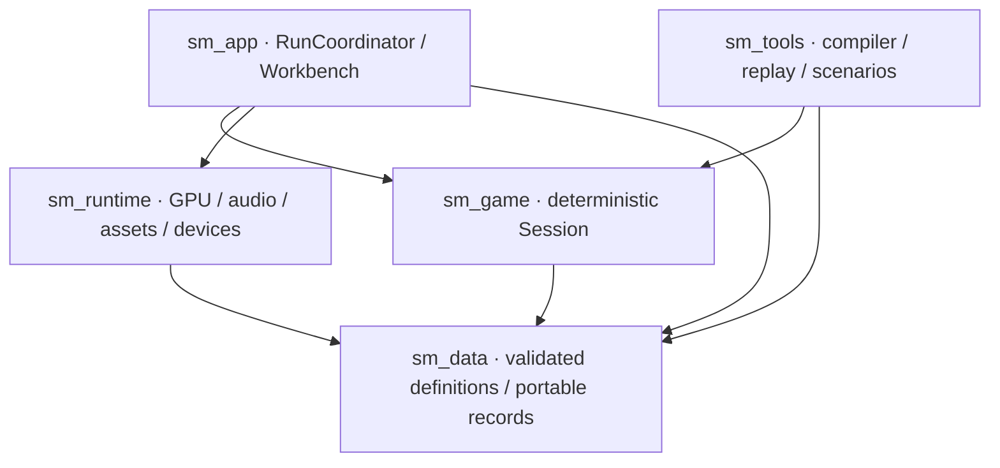

# Super Metroid in Rust · architecture revision 3

Design a modern implementation specifically for Super Metroid. Preserve its gameplay, world, progression, enemies, bosses, interface, visual effects, and sound. Include the custom engine and its tools in the scope. The user has accepted this architecture; no engine implementation or fidelity result is claimed.

Modernization means explicit ownership, deterministic rules, useful authoring, controlled resource lifetimes, and recoverable device and storage failures. It does not require a general engine, an ECS, parallel gameplay, or a particular line count.

This document specifies the destination. The [accepted migration policy](README.md#responsibility-migration) lets Windows workers continue using the current Rust game, emulated hardware, and comparison oracle while replacing complete responsibilities. Existing work and its validation remain useful. The independence requirements below apply when claiming a completed new-engine slice or final runtime, not before continuing current tasks.

## Scope and acceptance target

The user has confirmed that this engine serves this rebuild exclusively, and that gameplay/content should be preserved while implementation is modernized. The starting presentation target is desktop, the NTSC game's native 256 × 224 image, and a fixed logical Tick cadence. Pin the exact release and timing in a Reference profile before producing fidelity fixtures; “60.1 Hz” is only a rounded explanation.

Movement techniques, weapon interactions, room persistence, and unusual but established gameplay behavior belong in the acceptance scenarios. Do not add coyote time, generic analog movement, interpolation, or altered collision behavior as incidental implementation improvements. Decide how original overload slowdown and out-of-bounds glitches fit the Reference profile at the evidence gate; the architecture must not silently decide that policy.

The completed target runtime excludes SNES CPU, bus, PPU, and APU emulation, recovered-C gameplay, and external engine/ECS implementations. It also needs no plugin ecosystem, networking, general script VM, custom level-editor framework, or arbitrary live-state migration. Original observable behavior is implemented directly in our game and engine.

## Map Rando integration

Easy integration with the Super Metroid Map Rando project is part of the core destination, reaffirmed on 2026-10-23. Modularity serves concrete game modifications: custom sprites and palettes, reordered rooms and connections, and opt-in mechanics such as re-spin and other quality-of-life changes. Vanilla is an explicit fidelity profile, not an assumption baked into every content consumer.

| Variation | Owning boundary | Required behavior |
| --- | --- | --- |
| Custom sprites and palettes | Prepared media and stable asset IDs | Replace appearance through data without rewriting gameplay or fixed ROM offsets. Preserve animation/pose/palette contracts; changes to hitboxes or gameplay timing are gameplay changes. |
| Room order, layout and door connections | Validated world definitions and stable room/door IDs | Traverse the supplied graph, including destination/spawn/map metadata, without treating array position or vanilla order as identity. Persistence and progression use stable identities. |
| Re-spin and other optional mechanics | Explicit gameplay profile and the responsible rule modules | Vanilla defaults preserve current behavior. Supported options have named semantics, enabled/disabled checks and relevant interaction tests; they are not accidental refactor changes. |
| Map Rando seed, settings and asset input | A versioned import/integration adapter feeding these same definitions | Preserve upstream meaning and diagnose unsupported settings. Actual upstream formats and supported versions must be established from Map Rando sources and integration tests, not invented here. |

Map Rando input must not require manually rebuilding a seed in Tiled. The adapter and optional authoring tools feed the same validated runtime representation. Select the world, media and gameplay profile when opening a Session; keep the choice reproducible in saves, checkpoints and replays under the existing compatibility rules. Gameplay-affecting options and topology participate in the gameplay fingerprint. Appearance-only replacements use the media revision when their behavioral contracts are unchanged.

This remains a purpose-built Super Metroid core. Implement supported optional rules as ordinary code in the relevant player/combat/room modules; no generic plugin system or script engine is required. Original ROM layout, patch addresses and the current comparison backend stay in migration/import adapters. Completing safe interval ownership alone does not prove these integration boundaries are implemented.

## Implementation ownership

We write the gameplay and engine in straightforward Rust: ordinary structs and enums for state, direct functions for rules, private modules for organization, and explicit update order. We own collision, Actor storage, room transitions, rendering passes and shaders, sound sequencing/mixing, content loading, saves, and development tools. Small GPU shaders are our source too, even though the shader language is not Rust.

The user explicitly permits small platform libraries such as `winit`, `wgpu`, and `cpal` for window/events, GPU access, and audio-device output. A controller adapter may provide physical-device access. Those libraries do not decide game rules, rendering effects, or sound behavior. Keep platform types in runtime adapters and use the Rust standard library for ordinary support code where practical.

The five packages below are our own workspace code, linked into the application. They are not separately supplied game modules or plugins. Prefer concrete composition and private helper functions; introduce a trait only where a real interchangeable implementation earns it.

Current `sm-decomp` is maintained Rust with emulated hardware; its earlier C-backed restart is archived. During migration, keep that working runtime and its built-in oracle available for development comparisons. Temporary bridges must identify the state, callbacks, or emulated services they still require and the evidence needed to replace them.

For the completed target, reference capture may run the comparison implementation in a separate process, and offline import can produce the new content pack. Normal build and play from prepared content must work with the comparison backend, archived repositories, and recovered-C libraries absent. Retain useful algorithms and counterexamples in our own domain model. The target Session uses typed domain state; the current oracle-compatible path keeps its required WRAM layout until its consumers have been replaced.

This choice adds responsibility for every observable rendering and sound effect. Existing playthroughs and fixtures guide implementation; they do not establish fidelity for newly written code. See [the ownership decision](docs/adr/0004-owned-rust-implementation.md).

## Session and coordination

`Session` owns gameplay and exposes `open`, `step`, and `checkpoint`, returning
owned Scenes and Runtime effects without device or filesystem access.

```rust
let OpenedSession { mut session, initial } = Session::open(data, start)?;
show(initial.scene);
let output = session.step(input)?;
deliver(output.effects);
show(output.scene);
let checkpoint = session.checkpoint()?;
```

`RunCoordinator` delivers outputs and manages devices and content cutovers.
Its optional Workbench prepares revisions and launches Scenarios through the same
Session interface. Actor storage, serial ordering, restoration and inspection
remain private Session responsibilities, refined through a representative encounter.
The accepted [Session](docs/adr/0001-owned-session.md) and
[revision-cutover](docs/adr/0002-revision-cutovers.md) decisions retain the rationale.

## Packages and dependency direction

Five Cargo packages enforce useful seams. Private Rust modules do most of the organization; there is no crate or trait for every noun.



Every arrow means “depends on.” `sm_game` and `sm_runtime` do not depend on each other. `sm_tools` launches the native application as a process for GPU/audio capture and preview, so headless tools do not acquire a device dependency. If in-process native capture later earns its cost, give it an explicit native feature/package.

| Package | Public responsibility | Deliberately private |
| --- | --- | --- |
| `sm_data` | Validated gameplay/media definitions, authored IDs, portable Scene and audio records | Binary validation machinery and record constructors |
| `sm_game` | Session, starting states, Tick inputs/outputs, Player saves, Checkpoints | Domain state, Actor storage, collision rules, ordering |
| `sm_runtime` | Device adapters, prepared media, rendering, sound, storage jobs | GPU handles, mixer internals, pack loading, OS details |
| `sm_app` | Composition, Tick admission, effect delivery, cutovers, optional Workbench | Application lifecycle and queue coordination |
| `sm_tools` | Content compilation and headless replay/scenario commands | Editor import, source maps, validation passes |

`sm_data` has a specific scope: immutable content and cross-package value records. It must not become a general “core” package for managers, clocks, services, or mutable gameplay. Session-specific types such as Checkpoint and Actor handle remain in `sm_game`. Runtime storage accepts owned bytes and a target slot; it does not understand Player save internals.

```text
crates/
  sm_data/src/       identity, gameplay, media, scene, audio_records
  sm_game/src/       session, player, collision, actors, rooms,
                     progress, sequences, extraction, persistence
  sm_runtime/src/    video, audio, assets, devices, storage
  sm_app/src/        coordinator, clock, effects, revisions, workbench
  sm_tools/src/      compile, editor_import, replay, scenarios, diagnostics
content/            rooms, actors, sequences, media, scenarios
fixtures/           reference_profile, inputs, traces, images, audio
```

Windowing (`winit`), GPU access (`wgpu`), controllers (a `gilrs` adapter where appropriate), and audio devices (`cpal`) are permitted platform dependencies. The engine implements composition, audio sequencing/mixing, assets, timing, input policy, and storage integration. Pin compatible versions when the first executable slice is built. Permission to use these platform libraries is settled; exact versions and target support remain implementation choices.

## Gameplay structure

`Session` exclusively owns all mutable gameplay. Read-only, validated gameplay definitions are shared by `Arc`. The Session has no filesystem, wall clock, GPU, audio-device, or operating-system input capability.

| Private module | State and behavior concentrated there |
| --- | --- |
| `session` | Tick number, game mode, input history, RNG, phase order, poison state |
| `player` | Locomotion, posture, equipment, weapon/charge state, damage and invulnerability |
| `collision` | Exact tile/slope rules, axis resolution, probes, contact ordering, liquid effects |
| `actors` | Typed stores, generation checks, shared families, projectiles, explicit bosses |
| `rooms` | Room instances, door transitions, room objects, camera, reset/carryover policy |
| `progress` | Inventory, pickups, persistent flags, map discoveries, restart location |
| `sequences` | Small typed action vocabulary and sequence cursors for authored events |
| `extraction` | Read-only mapping to complete Scene, HUD/map/menu records, inspection |
| `persistence` | Explicit Player save and Checkpoint schemas and validation |

Model orthogonal player facts separately where the game allows them: locomotion, posture, equipment, and weapon charge do not need a Cartesian-product enum. Use explicit transition functions and validated combinations. Gameplay animation and hitboxes advance inside the Session; extracting or drawing a Scene cannot change them.

Actor handles detect stale references. Simulation order keys define evaluation order. Authored IDs identify source definitions and persistent content. A storage index cannot substitute for all three. Cross-Actor references resolve through the owning store; a multipart boss owns a cohesive phase machine and ordered part references rather than a graph of shared mutable objects.

Rust borrowing follows the same ownership model. Split Session fields into scoped borrows for each phase. Inside the Actor store, split out the current slot so its behavior receives mutable access to its own state and a read-only view of other Actors; its own state is passed directly rather than looked up again through its handle. Changes to other Actors become typed actions applied by the scheduler at the required commit point. Earlier committed Actor updates remain visible to later queries when the reference rules require that; do not introduce a whole-phase snapshot that silently changes sequential interactions. Keep this store helper private. Shared mutable pointers or a mutex around the world would obscure these rules rather than solve them.

Use typed handles for distinct stores where they prevent meaningful mistakes, such as confusing a projectile with a boss part. A common read-only query can return a tagged Actor view when interactions span stores. Generation/order-counter overflow is a checked failure rather than permission to resurrect a stale identity. The representative encounter validates this storage/borrow strategy before it becomes a large implementation commitment.

When an interaction requires an immediate update to two Actors, the scheduler resolves the validated pair using disjoint mutable borrows and returns the outcome before continuing. It is not deferred merely to satisfy the borrow checker.

General rigid-body physics would impose different collision and resolution rules. Implement the game's motion queries and integer/subpixel arithmetic directly. Specify widths, signedness, rounding, wrapping where observed, and overflow failures; do not rely on debug/release overflow differences. Hashing, allocation order, floating-point math, and renderer order cannot determine gameplay outcomes.

The initial schedule is serial on the event-loop thread. Contact resolution and spawn/removal timing are named phases, with reference evidence required for their exact order. Multiple commit points are expected: a shot may need to be present for a later phase of its firing Tick. Preserve observable ordering without mechanically copying every original bank or routine.

## Focused GPU renderer

Start with a small `wgpu` renderer, subject to an early visual/performance gate. A GPU implementation supports native composition, display scaling, inspection textures, and modern desktop presentation. It also adds shader, driver, pipeline, and device-recovery work. At 256 × 224, the previous CPU-compositor proposal remains technically plausible; “GPU” is not evidence of correctness or better performance.

The Scene contains authored visual IDs, positions, layer/priority information, palette selection, masks, and effect parameters. These are game-facing drawing records, not SNES registers or `wgpu` objects. `sm_game::extraction` maps game knowledge into the Scene; the renderer understands the required 2D effects.

Use a fixed pass plan initially:

1. Resolve a pinned media revision into indexed tile/sprite atlases and palette tables.
2. Draw ordered background/sprite contributions at native resolution. Preserve overlap order; batch only adjacent compatible commands, never globally sort translucent work by texture.
3. Apply required masks, priority decisions, color math, affine backgrounds, and scanline parameters with explicit intermediate targets where needed.
4. Convert the defined native color result to the output surface, with nearest-neighbor scaling and letterboxing. Handle integer scaling, small windows, and color-space conversion deliberately.
5. Add optional development overlays after the faithful game image. Game HUD and menus are part of that image and use authored assets.

Use integer texel addressing and specified quantization where fidelity requires it. Hardware sRGB blending is not a substitute for the original color math. Screenshot fixtures must cover overlap/priority, palette changes, masking, fades, water/heat effects, and affine effects before this pass plan is considered adequate.

The runtime owns all GPU resources. Scene submissions pin their revision until GPU completion. Keep submission depth bounded, skip acquisition for zero-size/occluded surfaces, and treat surface/device recovery as a runtime lifecycle. No generic render-graph framework or second complete backend is needed before this renderer is measured.

## Sound engine and transport

Compile samples, instruments, and music sequences into sound banks. The custom engine owns sequencing, voice rules, pitch, envelopes, mixing, and the required echo behavior. The Session emits semantic, Tick-stamped cues. The audio callback owns sample generation, using a rational Tick-to-sample mapping and a small scheduled lead independent of the monitor.

No callback allocation, blocking locks, file access, content decoding, or expensive final-reference destruction is permitted. The asset manager keeps sound banks alive until voice retirement is acknowledged. Commands and acknowledgments use bounded transport; normal authored sounds must not be silently dropped or coalesced to fit a queue.

Device clocks drift relative to the host clock. Measure the negotiated rate and consumed-sample position; use bounded output resampling/clock correction for presentation, not changes to Session Tick duration. Audio reference exports use a fixed rate and the exact cue trace without live clock correction. Pause, restoration, and device recovery explicitly reanchor the transport.

Sound fidelity needs independent evidence for cue timing, voice stealing, pitch, envelopes, music sequencing, and echo. A library that plays samples does not automatically reproduce these behaviors. A gameplay Checkpoint does not promise sample-exact mixer, echo-tail, or audiovisual seeking.

## Content and development workflow

Use Tiled for room geometry and typed objects/properties, plus typed RON for Actor parameters, animation timing, progression, and named Scenarios. Existing editor features are enough to start. Original assets/reference data can enter through a separate deterministic import step; runtime never runs the source importer.

Tiled is an optional external authoring application. Our Rust compiler owns the conversion into validated content; neither the editor nor its implementation is part of the running game.

Keep unique behavior in Rust. Repeated cutscene/room patterns can use a finite vocabulary such as wait, spawn, move target, set flag, start cue, and await condition. Give sequences explicit cursors, instruction limits, ordering, and validation. This is a small authored language with real complexity; its executable statements count as code regardless of file extension.

The compiler produces a versioned pack with canonical ordering, gameplay fingerprint, media revision, stable authored IDs, checksums, and limits. It rejects missing references, duplicate IDs, invalid doors, malformed collision records, unsupported behavior kinds, invalid sequence targets, and resource-limit violations. Diagnostics point back to source file, object, and property.

Loaders validate external pack bytes before constructing `ValidatedGameplay` or prepared media. “The compiler checked it” does not justify trusting damaged or incompatible files. Preload gameplay definitions and media for this bounded game, then measure decoded size and peak memory during reload. Mutable room state is one active instance plus a staged destination when a transition needs it.

The Workbench offers Scenario launch/reset, Tick stepping, input recording, collision/Actor/order inspection, cue and queue diagnostics, and validated typed edits between Ticks. It reads owned observations and Checkpoints. It never receives unrestricted mutable gameplay access.

Initially, edits target authored content or a Scenario's starting description. The coordinator applies them as a media revision or a Scenario restart through the existing open/step/checkpoint interface. Editing a live Actor field is not a hidden fourth interface; a development teleport or phase jump can instead construct a new named Scenario start and epoch. If live developer commands later become necessary, give them an explicit recorded Tick-input contract.

Media-only revision changes preserve the live Session if gameplay fingerprint and record contracts match. Collision, hitboxes, animation timing, authored sequence logic, and RNG-affecting parameters are gameplay changes even if edited in an “art” file. Gameplay changes restart a Scenario. Rust changes rebuild and restart the process. These policies make reload predictable without maintaining an arbitrary state-migration framework.

## Evidence before expansion

The next implementation deliverable is a vertical slice: one real room, input recording/replay, one timed sound, the hardest required rendering effects, and one saved state crossing the actual seams. Then prove the controller, a connected room set, a shared enemy family, and a multipart boss before expanding content.

See [Contracts](CONTRACTS.md) for exact handoffs and failure policies and [Validation](VALIDATION.md) for exit evidence. Consult the dated [validation snapshot](../PROGRESS_REPORT.md#architecture-snapshot) for gate evidence. Historical source counts are context, not a Rust multiplier, lower bound, or evidence of bloat. The earlier 30–60k runtime estimate is not an architectural constraint; the current project's reduction objective remains in its work plan.
